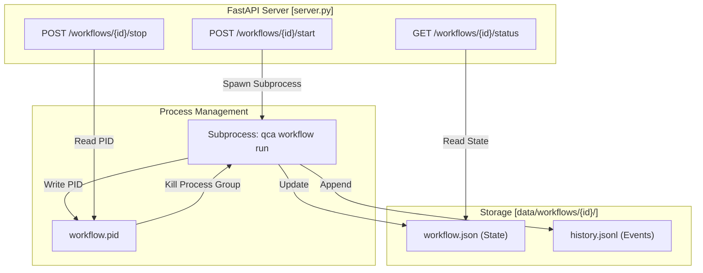
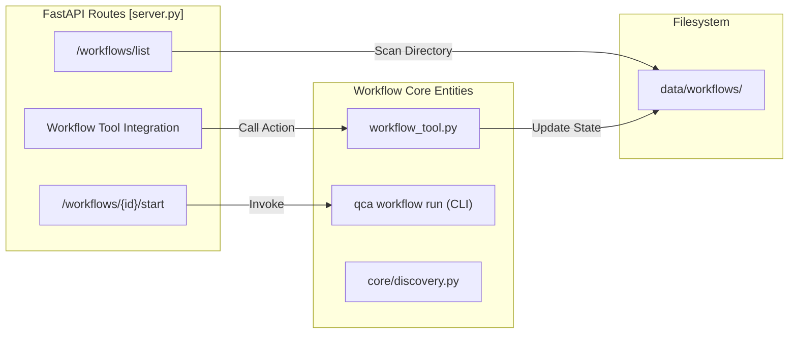

<!-- source: DeepWiki mcp.deepwiki.com · repo NVIDIA/Quantum-Calibration-Agent-Blueprint · page 3.3 Workflow Server Endpoints · fetched 2026-10-26 -->

# Workflow Server Endpoints

Relevant source files

The following files were used as context for generating this wiki page:

- [docs/latest/user-guide/workflows/index.mdx](docs/latest/user-guide/workflows/index.mdx)
- [server.py](server.py)

The Workflow Server endpoints in the Quantum Calibration Agent (QCA) provide a robust API for managing multi-step experiment sequences. These endpoints handle the lifecycle of Directed Acyclic Graphs (DAGs), including creation, status tracking, asynchronous execution via subprocess spawning, and process termination.

The server implements a **pid-file-based tracking model**, ensuring that even if the FastAPI server restarts, it can reconnect to or accurately report the status of ongoing workflow processes by checking the filesystem for process identifiers and lock files.

## Workflow Management Overview

Workflows are stored on disk within the `data/workflows/{workflow_id}/` directory structure [docs/latest/user-guide/workflows/index.mdx:22-26](). The server interacts with these files to provide a real-time view of the calibration pipeline.

### Process Tracking Model
The server manages workflow execution by spawning the `qca workflow run` command as a background subprocess. 
1. **PID Files**: When a workflow starts, the system tracks the subprocess ID.
2. **Process Groups**: Workflows are started in their own process groups to ensure that stopping a workflow cleans up all child processes (e.g., experiment scripts or analysis tools).
3. **State Persistence**: The definitive state of a workflow is maintained in its `workflow.json` file, while execution events are appended to `history.jsonl` [docs/latest/user-guide/workflows/index.mdx:22-26]().

## Endpoint Reference

### List and Metadata Endpoints

| Endpoint | Method | Description |
| :--- | :--- | :--- |
| `/workflows/list` | `GET` | Returns a list of all workflow IDs and basic metadata found in the `data/workflows` directory. |
| `/workflows/{id}` | `GET` | Returns the full `workflow.json` definition for a specific workflow, including node definitions and current context. |
| `/workflows/{id}/status` | `GET` | Returns the execution status (e.g., `running`, `completed`, `failed`, `paused`) and the status of individual nodes. |
| `/workflows/{id}/history` | `GET` | Streams or returns the `history.jsonl` event log for the specified workflow. |

**Sources:** [server.py:16-23](), [docs/latest/user-guide/workflows/index.mdx:27-40]()

### Execution Control Endpoints

#### `POST /workflows/{id}/start`
Spawns a new subprocess to execute the workflow. The server uses the `LocalShellBackend` logic to initiate the `qca workflow run` command [server.py:128-132]().
- **Logic**: It checks if a PID file already exists to prevent double-execution.
- **Subprocess**: Invokes the CLI runner which iterates through nodes based on dependency resolution [docs/latest/user-guide/workflows/index.mdx:100-109]().

#### `POST /workflows/{id}/stop`
Terminates a running workflow.
- **Logic**: Reads the PID from the tracking file and sends a termination signal (SIGTERM/SIGKILL) to the entire process group.
- **Cleanup**: Updates the `workflow.json` state to `failed` or `paused` depending on the interrupt type.

**Sources:** [server.py:149-156](), [docs/latest/user-guide/workflows/index.mdx:31-40]()

## Implementation Architecture

The following diagram illustrates how the FastAPI server routes requests to the underlying workflow filesystem and process management logic.

### Workflow Execution Data Flow
Title: "Workflow Execution and Process Tracking"

**Sources:** [server.py:56-65](), [docs/latest/user-guide/workflows/index.mdx:22-26](), [docs/latest/user-guide/workflows/index.mdx:41-54]()

## Node State Transitions

The server reports node states based on the workflow engine's internal transitions. Each node represents a discrete experiment step [docs/latest/user-guide/workflows/index.mdx:14-20]().

| State | Description |
| :--- | :--- |
| `pending` | Dependencies not yet met or execution not reached [docs/latest/user-guide/workflows/index.mdx:49](). |
| `running` | Subagent is currently executing the experiment script [docs/latest/user-guide/workflows/index.mdx:50](). |
| `success` | Experiment completed and results were successfully extracted [docs/latest/user-guide/workflows/index.mdx:51](). |
| `failed` | Experiment failed or results did not meet success criteria after retries [docs/latest/user-guide/workflows/index.mdx:52](). |
| `skipped` | Node bypassed due to conditional logic or manual intervention [docs/latest/user-guide/workflows/index.mdx:53](). |

### Code Entity Mapping: Server to Workflow Core
Title: "Mapping API Endpoints to Workflow Logic"

**Sources:** [server.py:107-113](), [server.py:56-65](), [docs/latest/user-guide/workflows/index.mdx:74-84]()

## Error Handling and Concurrency

1. **Locking**: The server prevents multiple concurrent "start" requests for the same workflow ID by checking for active PIDs in the `data/workflows/{id}/` directory.
2. **Zombie Processes**: On server startup, the `lifespan` handler [server.py:171-179]() ensures the `LocalShellBackend` is initialized, which provides the environment for managing these subprocesses safely.
3. **Subagent Isolation**: Each node in the workflow is executed by a "subagent" [docs/latest/user-guide/workflows/index.mdx:100-109](). If a subagent crashes, the workflow runner catches the exception, logs it to `history.jsonl`, and marks the node as `failed` without crashing the main FastAPI server process.

**Sources:** [server.py:128-132](), [docs/latest/user-guide/workflows/index.mdx:100-109]()

---

