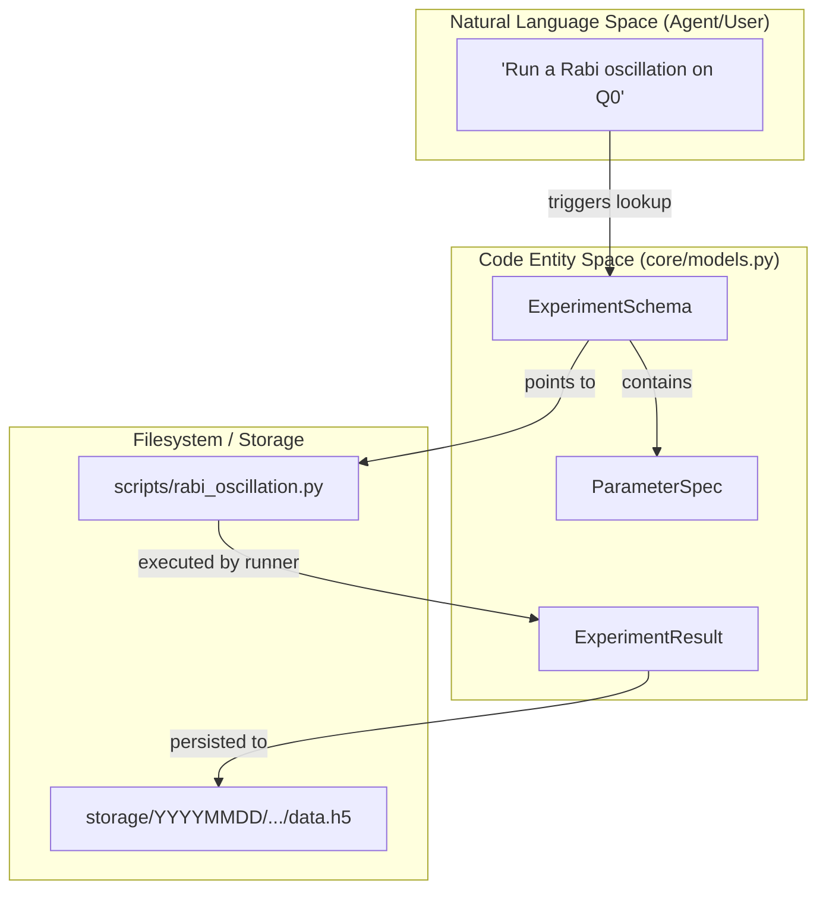
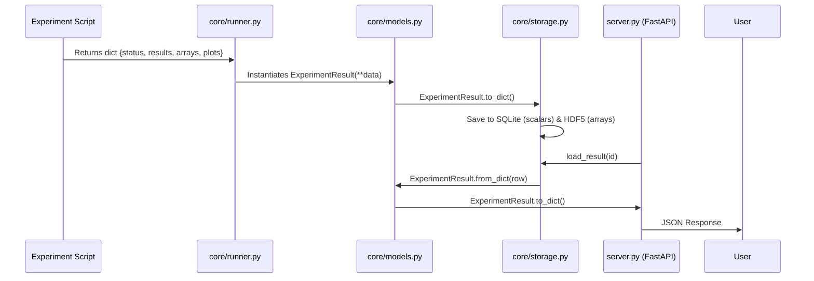

<!-- source: DeepWiki mcp.deepwiki.com · repo NVIDIA/Quantum-Calibration-Agent-Blueprint · page 4.1 Data Models · fetched 2026-10-26 -->

# Data Models

Relevant source files

The following files were used as context for generating this wiki page:

- [core/models.py](core/models.py)

The Quantum Calibration Agent (QCA) utilizes a set of core data models to define the contract between experiment scripts, the discovery engine, the execution runner, and the storage layer. These models ensure type safety and consistent serialization across the system's distributed components, including the FastAPI backend and the Next.js Web UI.

## Core Data Model Classes

The primary data models are implemented as Python dataclasses in `core/models.py`. They handle the lifecycle of an experiment from its structural definition to its final execution output.

### ParameterSpec
The `ParameterSpec` class defines the requirements and constraints for a single input parameter of an experiment script [core/models.py:22-32]().

| Field | Type | Description |
| :--- | :--- | :--- |
| `name` | `str` | The identifier for the parameter (e.g., "qubit", "duration"). |
| `type` | `str` | The expected Python type (int, float, str, bool, list). |
| `default` | `Optional[Any]` | The default value if not provided; `None` implies the parameter might be required. |
| `range` | `Optional[tuple]` | A tuple of `(min, max)` used for numeric validation. |
| `required` | `bool` | Flag indicating if the parameter must be supplied by the user/agent. |

Sources: [core/models.py:34-38]()

### ExperimentSchema
The `ExperimentSchema` represents the metadata and interface of an experiment script discovered by the system [core/models.py:51-59](). It acts as the blueprint that the Agent uses to understand how to call specific calibration routines.

| Field | Type | Description |
| :--- | :--- | :--- |
| `name` | `str` | The name of the experiment (usually the function name). |
| `description` | `str` | Extracted from the script's docstring. |
| `parameters` | `list[ParameterSpec]` | A collection of specs defining the input interface. |
| `module_path` | `str` | The filesystem path to the script source. |

Sources: [core/models.py:61-64]()

### ExperimentResult
The `ExperimentResult` captures the full context and output of a completed experiment execution [core/models.py:87-102](). It is designed to hold both scalar metadata (for SQLite) and complex data structures (for HDF5).

| Field | Type | Description |
| :--- | :--- | :--- |
| `id` | `str` | Unique identifier formatted as `YYYYMMDD_HHMMSS_type`. |
| `status` | `str` | Either "success" or "failed". |
| `target` | `str` | The specific hardware component targeted (e.g., "qubit_0"). |
| `params` | `dict` | The actual input parameters used for the run. |
| `results` | `dict` | Scalar result values (e.g., fit parameters). |
| `arrays` | `dict` | Large numerical arrays (e.g., raw voltage traces). |
| `plots` | `list` | Serialized Plotly JSON objects for visualization. |

Sources: [core/models.py:104-114]()

## Data Flow and Entity Mapping

The following diagrams illustrate how these models bridge the gap between high-level agent intents and low-level code execution.

### Entity Relationship: From Discovery to Result
This diagram shows how `ExperimentSchema` defines the "capabilities" known to the system, which are then instantiated into `ExperimentResult` objects upon execution.

Title: QCA Entity Space Mapping

Sources: [core/models.py:22-124](), [core/discovery.py:1-20]()

### Serialization and System Flow
Data models move through the system using `to_dict()` and `from_dict()` methods to facilitate JSON communication between the Python backend and the TypeScript frontend.

Title: Model Serialization Flow

Sources: [core/models.py:40-47](), [core/models.py:66-83](), [core/models.py:116-123]()

## Implementation Details

### Serialization Methods
Every model implements a standard interface for dictionary conversion, which is critical for the `qca` CLI and the FastAPI web server.

*   **`to_dict()`**: Uses `dataclasses.asdict` for deep conversion of nested fields [core/models.py:42](). In `ExperimentSchema`, it manually iterates through `ParameterSpec` objects to ensure they are also converted to dictionaries [core/models.py:71]().
*   **`from_dict(data)`**: A class method that unpacks a dictionary into the constructor [core/models.py:47](). For `ExperimentSchema`, it explicitly handles the reconstruction of the `ParameterSpec` list [core/models.py:81]().

### Result Identification
The `id` field in `ExperimentResult` is not just a random UUID. It follows a specific naming convention: `YYYYMMDD_HHMMSS_type` [core/models.py:91](). This format allows the `Storage` layer to organize files on disk in a date-based hierarchy while maintaining human-readability during CLI operations.

Sources: [core/models.py:1-124]()

---

