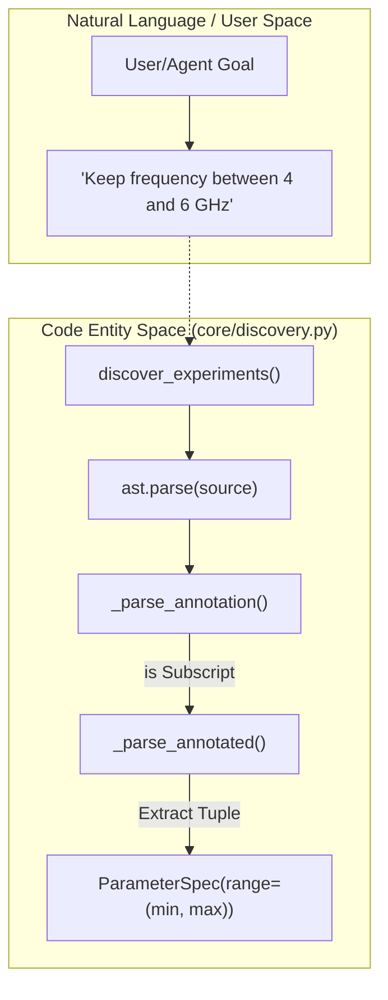
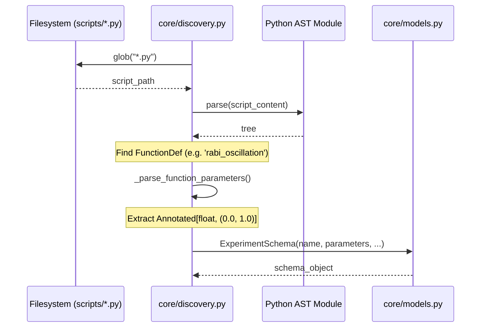

<!-- source: DeepWiki mcp.deepwiki.com · repo NVIDIA/Quantum-Calibration-Agent-Blueprint · page 4.2 Experiment Discovery · fetched 2026-10-26 -->

# Experiment Discovery

Relevant source files

The following files were used as context for generating this wiki page:

- [core/discovery.py](core/discovery.py)
- [docs/latest/user-guide/experiments/writing-scripts.mdx](docs/latest/user-guide/experiments/writing-scripts.mdx)

The Experiment Discovery system is a core component of the Quantum Calibration Agent (QCA) that allows the platform to dynamically identify and interface with quantum calibration routines. By using Abstract Syntax Tree (AST) parsing, the system can extract metadata, parameter requirements, and validation constraints from Python scripts without executing them, ensuring a secure and efficient bridge between the high-level agent and low-level hardware scripts.

## Overview of the Discovery Process

The discovery logic resides in `core/discovery.py`. It is designed to scan a specific directory (typically `scripts/`) and identify valid experiment functions based on a strict set of structural requirements.

### Script Discovery Workflow
The process begins when `discover_experiments` is called, usually triggered by the CLI or the FastAPI backend.

| Stage | Action | Description |
| :--- | :--- | :--- |
| **Scan** | `scripts/` globbing | Scans for `.py` files, excluding those starting with `_` [core/discovery.py:42-45](). |
| **Parse** | `ast.parse()` | Converts the script content into an Abstract Syntax Tree to inspect structure without execution [core/discovery.py:81-82](). |
| **Filter** | Function Validation | Identifies the first public function (no `_` prefix) with a `-> dict` return annotation [core/discovery.py:87-104](). |
| **Extract** | Schema Generation | Parses docstrings and parameter annotations (including `Annotated` ranges) [core/discovery.py:107-123](). |

**Sources:** [core/discovery.py:25-51](), [core/discovery.py:71-124]().

## AST-Based Schema Extraction

The core of the discovery engine is `_extract_schema_from_file`, which utilizes the Python `ast` module to perform static analysis.

### Function Signature Requirements
For a script to be discovered as an experiment, it must meet these criteria:
1.  **Public Function**: It must contain at least one function not prefixed with an underscore [core/discovery.py:90-91]().
2.  **Return Annotation**: The function must explicitly define `-> dict` as its return type [core/discovery.py:98-101]().
3.  **Type Hints**: Parameters must have type annotations (e.g., `int`, `float`, `str`, `bool`, `list`) to be included in the schema [core/discovery.py:149-150]().

### Parameter Parsing and Annotated Ranges
The system specifically looks for `typing.Annotated` to extract numerical bounds for parameters. This allows the agent to reason about safe operating ranges for hardware.

**Sources:** [core/discovery.py:126-190](), [core/discovery.py:205-209](), [docs/latest/user-guide/experiments/writing-scripts.mdx:126-155]().

## Data Flow: From Script to Schema

The following diagram illustrates how a physical Python file on disk is transformed into a structured `ExperimentSchema` object used by the `qca` CLI and the Agent.

**Sources:** [core/discovery.py:25-51](), [core/discovery.py:118-123](), [core/models.py:22-22]().

## Key Functions and Classes

### `discover_experiments(scripts_dir: Path)`
The entry point for the discovery system. It iterates through the directory and returns a list of `ExperimentSchema` objects [core/discovery.py:25-51]().

### `_parse_function_parameters(func_def: ast.FunctionDef)`
Iterates through `posonlyargs`, `args`, and `kwonlyargs` of a function definition. It determines:
*   **Required vs. Optional**: Parameters with default values are marked `required=False` [core/discovery.py:156-160]().
*   **Default Values**: Uses `_eval_literal` to safely extract default values from the AST [core/discovery.py:160]().

### `_parse_annotation(annotation: ast.expr)`
Maps Python types to a internal string representation:
*   `float`, `int`, `str`, `bool`, `list` are supported [core/discovery.py:215-222]().
*   If `Annotated` is detected, it delegates to `_parse_annotated` [core/discovery.py:208-209]().

### `validate_script(script_path: Path)`
Used by the CLI (`qca experiments validate`) to check if a specific file meets the experiment contract. It attempts to extract a schema and returns `True` if successful and the file is properly structured [docs/latest/user-guide/experiments/writing-scripts.mdx:118-124]().

**Sources:** [core/discovery.py:126-190](), [core/discovery.py:193-224]().

## Summary Table of Discovery Rules

| Feature | Requirement / Behavior |
| :--- | :--- |
| **File Name** | Must end in `.py` and not start with `_` [core/discovery.py:42-44](). |
| **Function Name** | First top-level function not starting with `_` [core/discovery.py:88-92](). |
| **Return Type** | Must be explicitly annotated as `-> dict` [core/discovery.py:98-101](). |
| **Parameters** | Must have type hints to be visible to the system [core/discovery.py:149-150](). |
| **Docstrings** | The first line of the docstring is used as the experiment description [core/discovery.py:108-109](). |

**Sources:** [core/discovery.py:71-124](), [docs/latest/user-guide/experiments/writing-scripts.mdx:16-24]().

---

