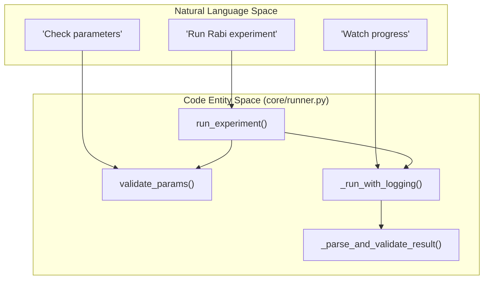
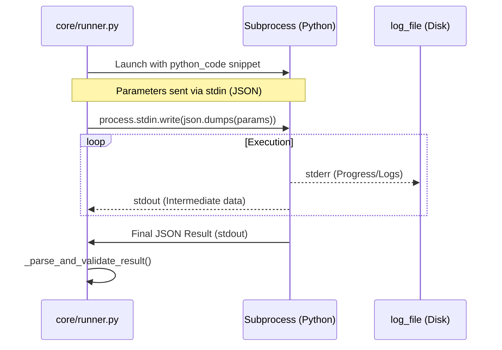

<!-- source: DeepWiki mcp.deepwiki.com · repo NVIDIA/Quantum-Calibration-Agent-Blueprint · page 4.3 Experiment Runner · fetched 2026-10-26 -->

# Experiment Runner

Relevant source files

The following files were used as context for generating this wiki page:

- [core/runner.py](core/runner.py)

The Experiment Runner is a core component of the Quantum Calibration Agent (QCA) responsible for the safe and isolated execution of experiment scripts. It provides a robust subprocess wrapper that handles parameter validation, real-time logging, and standardized result parsing.

## Overview

The primary entry point for execution is the `run_experiment` function [core/runner.py:76-83](). This function bridges the gap between the agent's high-level requests and the low-level execution of Python scripts in the `scripts/` directory. It ensures that every experiment run adheres to a strict contract: parameters must match the discovered schema, and results must conform to the system's data models.

### Execution Workflow

The runner follows a multi-stage pipeline to execute an experiment:

1.  **Schema Retrieval**: Fetches the `ExperimentSchema` using `get_experiment_schema` [core/runner.py:103-105]().
2.  **Validation**: Checks provided parameters against the schema using `validate_params` [core/runner.py:108-110]().
3.  **Command Construction**: Dynamically generates a Python snippet that imports the target function and injects parameters via `stdin` [core/runner.py:121-128]().
4.  **Subprocess Execution**: Launches the script in an isolated process with optional real-time logging [core/runner.py:134-147]().
5.  **Result Parsing**: Captures `stdout`, parses the JSON result, and validates the output structure [core/runner.py:153]().

### Natural Language to Code Mapping: Execution

The following diagram illustrates how natural language concepts used by the agent map to specific code entities within the runner.

**Figure 1: Experiment Execution Entity Mapping**

Sources: [core/runner.py:27-27](), [core/runner.py:76-76](), [core/runner.py:135-137](), [core/runner.py:153-153]()

---

## Parameter Validation

Before any code is executed, the `validate_params` function performs strict type and range checking [core/runner.py:27-37]().

### Validation Logic
*   **Required Fields**: Ensures all parameters marked as `required` in the `ParameterSpec` are present [core/runner.py:43-45]().
*   **Type Safety**: Performs strict type checking (no implicit coercion) against the expected type string [core/runner.py:57-62]().
*   **Range Constraints**: For `int` and `float` types, it verifies that the value falls within the inclusive `[min, max]` range defined in the schema [core/runner.py:65-71]().

Sources: [core/runner.py:27-73]()

---

## Execution Modes

The runner supports two distinct modes of execution based on whether a `log_file` path is provided to `run_experiment` [core/runner.py:134-139]().

### 1. Buffered Mode (Standard)
Used for simple executions where real-time feedback is not required. It utilizes `subprocess.run` and captures the entire output at the end of the process [core/runner.py:141-147]().

### 2. Streaming Mode (with Logging)
Invoked via `_run_with_logging` when a `log_file` is specified [core/runner.py:161-167](). This mode is critical for long-running experiments:
*   **Real-time Stderr**: Uses `subprocess.Popen` to stream `stderr` directly to a log file on disk [core/runner.py:186-193]().
*   **Unbuffered Output**: Sets `PYTHONUNBUFFERED="1"` in the environment to ensure logs are flushed immediately [core/runner.py:181-182]().
*   **Polling Loop**: Uses a `while True` loop with `select.select` to monitor `stdout` and `stderr` pipes simultaneously while checking for timeouts [core/runner.py:203-210]().

### Data Flow: Runner to Subprocess

The diagram below shows the data flow between the `core/runner.py` and the spawned experiment process.

**Figure 2: Subprocess Data Flow**

Sources: [core/runner.py:121-128](), [core/runner.py:186-197](), [core/runner.py:199-201]()

---

## Result Contract

The Experiment Runner enforces a JSON result contract. Every experiment script must return a dictionary that includes specific keys, which are then validated by `_parse_and_validate_result` [core/runner.py:153]().

| Key | Type | Description |
| :--- | :--- | :--- |
| `status` | `str` | Usually "success" or "error". |
| `results` | `dict` | Scalar values and summary statistics. |
| `arrays` | `dict` | Large numerical datasets (e.g., sweep points, signal voltages). |
| `plots` | `list` | Plotly-compatible JSON objects for visualization. |
| `metadata` | `dict` | Execution context (timestamps, hardware IDs). |

If the subprocess fails to return valid JSON or returns a non-zero exit code, the runner raises a `RuntimeError` with the captured `stderr` [core/runner.py:149-151]().

Sources: [core/runner.py:83-83](), [core/runner.py:149-153]()

---

