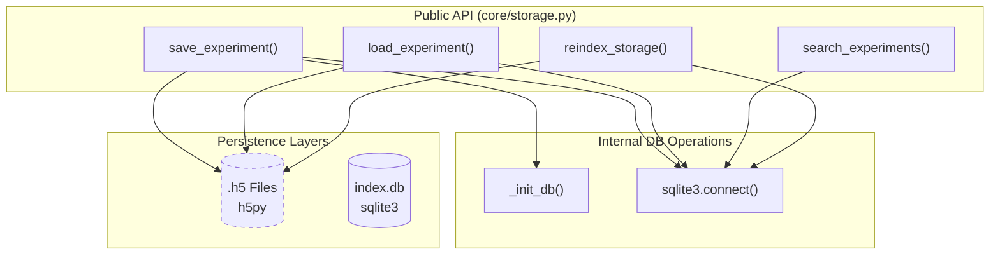
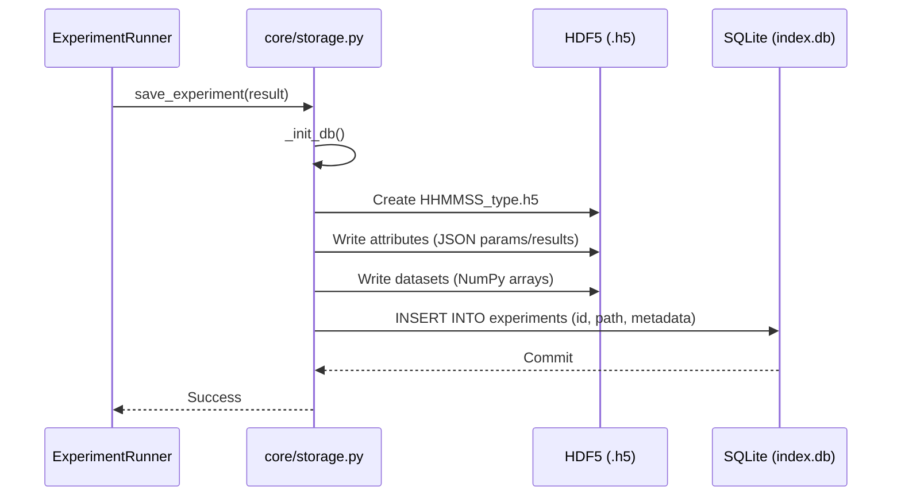

<!-- source: DeepWiki mcp.deepwiki.com · repo NVIDIA/Quantum-Calibration-Agent-Blueprint · page 4.4 Storage Layer · fetched 2026-10-26 -->

# Storage Layer

<details>
<summary>Relevant source files</summary>

The following files were used as context for generating this wiki page:

- [core/storage.py](core/storage.py)
- [docs/latest/user-guide/experiments/experiment-storage.mdx](docs/latest/user-guide/experiments/experiment-storage.mdx)

</details>


The Storage Layer in the Quantum Calibration Agent (QCA) provides a dual-tier architecture designed for high-performance scientific data management. It combines the structured query capabilities of **SQLite** with the efficient, large-scale binary storage of **HDF5**.

## Architecture Overview

The system is optimized for quantum calibration workflows where experiment metadata (parameters, results, status) must be searchable, while raw measurement data (large arrays) must be stored efficiently and support partial reads.

### Dual-Tier Strategy
1.  **SQLite Index (`index.db`)**: Acts as a global catalog. It stores metadata and file pointers to enable sub-second searches across thousands of experiments without opening heavy data files [core/storage.py:30-61]().
2.  **HDF5 Data Store**: Each experiment is saved as a standalone `.h5` file. These files are self-describing, containing the full experiment context, raw NumPy arrays, and Plotly visualizations [core/storage.py:84-128]().

### Directory Hierarchy
Data is organized using a date-based hierarchy to prevent directory saturation and simplify manual navigation [core/storage.py:71-81]().

```text
data/
├── index.db                    # SQLite global index
└── experiments/                # HDF5 root
    └── YYYY/                   # Year
        └── MM/                 # Month
            └── DD/             # Day
                └── HHMMSS_type.h5  # Individual experiment file
```

### System Entity Mapping
The following diagram bridges the high-level storage concepts to the specific implementation entities in `core/storage.py`.

**Storage Logic to Code Mapping**

Sources: [core/storage.py:30-30](), [core/storage.py:64-64](), [core/storage.py:158-158](), [core/storage.py:226-226](), [core/storage.py:532-532]()

---

## Data Operations

### Save Operation
When `save_experiment` is called, the system performs a two-stage write:
1.  **HDF5 Write**:
    *   Metadata (ID, type, status, target) is stored as root attributes [core/storage.py:90-98]().
    *   Parameters and results are serialized to JSON strings [core/storage.py:96-97]().
    *   NumPy arrays are written to an `arrays/` group [core/storage.py:101-104]().
    *   Plots are converted to byte buffers and stored in a `plots/` group with format attributes [core/storage.py:106-128]().
2.  **SQLite Index Update**:
    *   The `experiments` table is updated with an `INSERT OR REPLACE` command to ensure the index stays synchronized with the filesystem [core/storage.py:135-152]().

### Search and Load
The storage layer provides granular access to data to avoid loading large arrays into memory unnecessarily:
*   `search_experiments`: Queries the SQLite index using filters for `type`, `target`, and `status` [core/storage.py:226-278]().
*   `load_experiment`: Retrieves the full `ExperimentResult` object, including all arrays and plots [core/storage.py:158-223]().
*   `get_array`: Slices specific datasets directly from the HDF5 file using `start` and `end` indices, enabling efficient data streaming [core/storage.py:378-410]().

**Data Flow: Experiment Persistence**

Sources: [core/storage.py:64-156](), [core/storage.py:30-61]()

---

## Schema and Recovery

### SQLite Schema
The `index.db` maintains a flat table for rapid filtering.

| Column | Type | Description |
| :--- | :--- | :--- |
| `id` | TEXT | Primary Key (e.g., `exp_20240101_...`) |
| `type` | TEXT | Experiment script name (Indexed) |
| `target` | TEXT | Qubit or component identifier |
| `timestamp`| TEXT | ISO 8601 timestamp (Indexed) |
| `status` | TEXT | `success` or `failed` |
| `params` | TEXT | JSON string of input parameters |
| `results` | TEXT | JSON string of calculated results |
| `file_path` | TEXT | Absolute path to the HDF5 source |

Sources: [core/storage.py:41-59]()

### Reindexing Utility
The `reindex_storage` function provides a disaster recovery mechanism. If the `index.db` is deleted or corrupted, this utility recursively scans the `experiments/` directory, opens every `.h5` file, reads the internal metadata attributes, and reconstructs the SQLite index [core/storage.py:532-579]().

---

## Granular Access APIs

The storage layer exposes specialized functions used by the `lab` tool and the Web UI to inspect data without full object deserialization.

| Function | Purpose | Implementation Detail |
| :--- | :--- | :--- |
| `list_arrays` | List dataset names and shapes | Reads HDF5 `arrays/` group keys [core/storage.py:343-375]() |
| `get_array_stats` | Calculate min/max/mean/std | Performs operations on HDF5 dataset slice [core/storage.py:413-448]() |
| `list_plots` | List available visualizations | Reads HDF5 `plots/` group and format attrs [core/storage.py:451-483]() |
| `get_plot` | Retrieve specific plot data | Returns dict with `name`, `format`, and `data` [core/storage.py:486-529]() |
| `delete_experiment`| Remove data and index entry | Deletes HDF5 file and SQLite row [core/storage.py:281-314]() |

Sources: [core/storage.py:343-529]()

---

