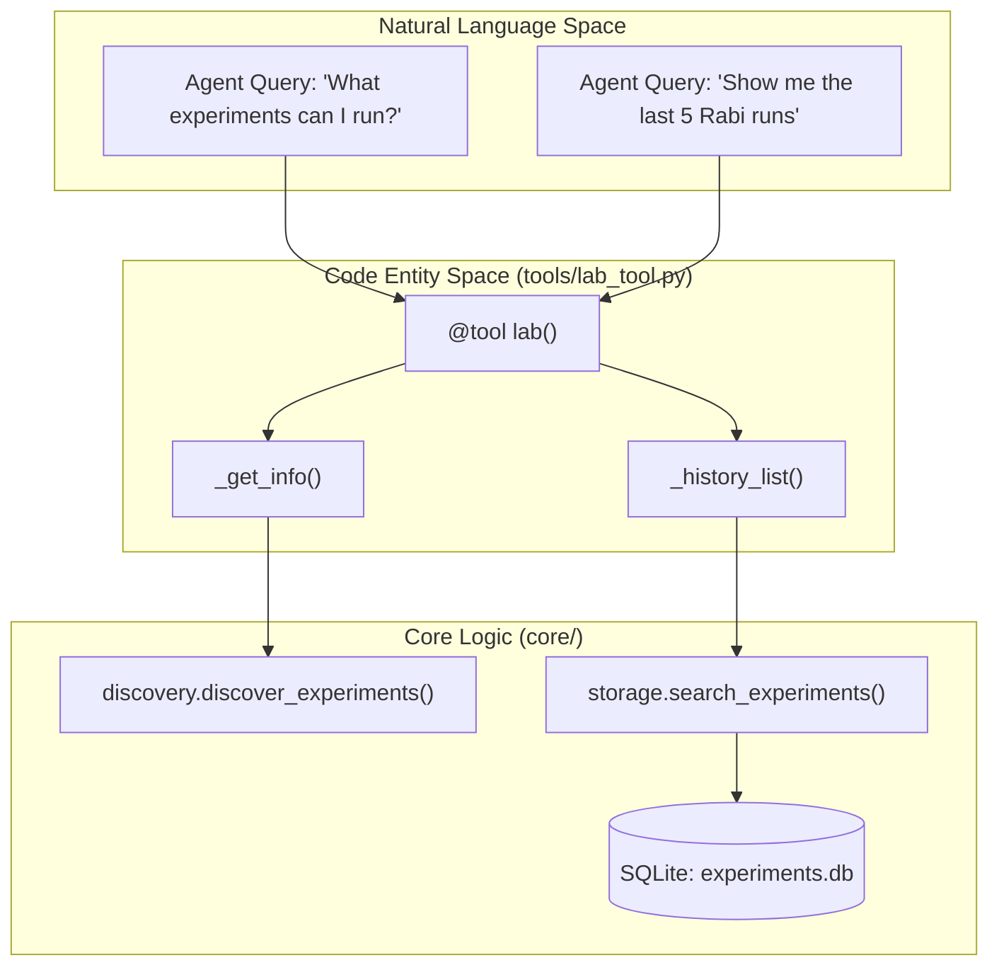
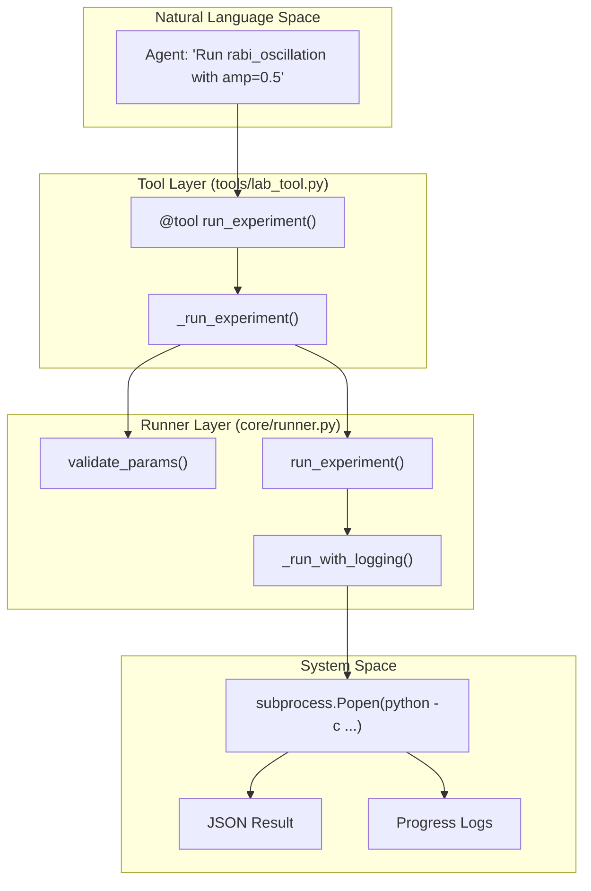

<!-- source: DeepWiki mcp.deepwiki.com · repo NVIDIA/Quantum-Calibration-Agent-Blueprint · page 5.1 Lab and Run Experiment Tools · fetched 2026-10-26 -->

# Lab and Run Experiment Tools

<details>
<summary>Relevant source files</summary>

The following files were used as context for generating this wiki page:

- [core/runner.py](core/runner.py)
- [data/knowledge/skills/vlm-configuration.md](data/knowledge/skills/vlm-configuration.md)
- [tools/lab_tool.py](tools/lab_tool.py)

</details>


The Quantum Calibration Agent (QCA) provides a bifurcated toolset for interacting with quantum experiments. The `lab` tool serves as a read-only query interface for discovering capabilities and inspecting historical data, while the `run_experiment` tool handles the state-changing execution of calibration scripts. This separation ensures that the agent can perform extensive data analysis and planning without accidentally triggering hardware-intensive operations.

## Overview of Tool Responsibilities

The system distinguishes between **Query** (Discovery and Retrieval) and **Execution** (Subprocess Management).

| Tool | Responsibility | Key File |
| :--- | :--- | :--- |
| `lab` | Schema discovery, history listing, array retrieval, and statistics calculation. | [tools/lab_tool.py:34-92]() |
| `run_experiment` | Parameter validation, subprocess spawning, and result persistence. | [tools/lab_tool.py:94-113]() |

Sources: [tools/lab_tool.py:34-113]()

## The Lab Tool

The `lab` tool is a multi-action LangChain tool that interfaces with the `core.discovery` and `core.storage` modules. It is the primary mechanism for the agent to understand what experiments are available and what data has been collected.

### Supported Actions
The tool uses an `action` string to determine the underlying logic branch:

*   **`info`**: Returns a comprehensive list of all discovered experiments, including descriptions and parameter requirements. This is the recommended "entry point" for the agent [tools/lab_tool.py:48-48]().
*   **`schema`**: Provides a detailed `ExperimentSchema` for a specific named experiment, including allowed ranges and default values [tools/lab_tool.py:169-197]().
*   **`history_list`**: Queries the SQLite database for a list of past runs, supporting filtering by type and limiting results via `last_n` [tools/lab_tool.py:236-258]().
*   **`history_show`**: Retrieves full metadata for a specific `experiment_id` [tools/lab_tool.py:261-280]().
*   **`get_array`**: Extracts specific numerical data from HDF5 storage. Supports slicing (e.g., `slice_start`, `slice_end`) to prevent context window overflow when dealing with large datasets [tools/lab_tool.py:307-332]().

### Lab Tool Data Flow
The following diagram illustrates how the `lab` tool bridges Natural Language Space to the underlying storage and discovery entities.

**Lab Tool Entity Mapping**

Sources: [tools/lab_tool.py:34-92](), [tools/lab_tool.py:116-151](), [tools/lab_tool.py:236-258]()

---

## The Run Experiment Tool

The `run_experiment` tool is responsible for the lifecycle of a calibration script execution. It performs strict validation before attempting to spawn a subprocess.

### Execution Workflow
1.  **Validation**: The tool calls `runner.validate_params`, which checks the provided `params` dictionary against the `ExperimentSchema`. It verifies types (int, float, str) and ensures numeric values fall within the `Annotated` ranges defined in the script [core/runner.py:27-73]().
2.  **Subprocess Construction**: It builds a Python command string that inserts the `scripts` directory into `sys.path` and executes the target function via `python -c` [core/runner.py:116-128]().
3.  **Real-time Logging**: If a `log_file` is provided, the runner uses `_run_with_logging` to stream `stderr` (where progress bars and status updates typically reside) to a file while the process is active [core/runner.py:161-172]().
4.  **Result Capture**: The experiment script must return a JSON-serializable dictionary. The runner parses `stdout` to capture this result, which includes `status`, `results`, `arrays`, and `plots` [core/runner.py:125-127]().
5.  **Persistence**: Upon successful completion, the results are passed to `storage.save_experiment`, which writes metadata to SQLite and numerical arrays to HDF5 [tools/lab_tool.py:221-233]().

### Experiment Execution Entity Mapping
This diagram shows the transition from an agent's intent to the OS-level subprocess execution.

**Execution Flow and Entity Mapping**

Sources: [tools/lab_tool.py:94-113](), [core/runner.py:76-137](), [core/runner.py:161-193]()

---

## Parameter Validation Logic

Validation is a critical safety step to prevent hardware damage or script crashes. The `validate_params` function in `core/runner.py` performs the following checks:

*   **Presence**: Ensures all `required` parameters defined in the `ParameterSpec` are present in the agent's input [core/runner.py:43-45]().
*   **Type Safety**: Validates that the input type matches the expected Python type (e.g., ensuring a string isn't passed where a float is expected) [core/runner.py:57-62]().
*   **Range Constraints**: For numeric types, it checks that `min <= value <= max` based on the `range` attribute extracted during discovery [core/runner.py:65-71]().

### Example Validation Error
If an agent attempts to run a `qubit_spectroscopy` with a frequency outside the allowed range, the tool returns:
```json
{
  "error": "Parameter validation failed: Parameter freq out of range. Expected [4.0, 6.0], got 8.5"
}
```
Sources: [core/runner.py:27-73](), [core/models.py:24-38]()

## Data Persistence and Storage Integration

Once an experiment completes, the `_run_experiment` function in `tools/lab_tool.py` handles the hand-off to the storage layer:

1.  **Metadata Preparation**: It adds `start_time`, `end_time`, and `experiment_name` to the result dictionary [tools/lab_tool.py:214-220]().
2.  **Storage Call**: It invokes `storage.save_experiment(result)`, which generates a unique UUID for the run [tools/lab_tool.py:221-221]().
3.  **ID Return**: The tool returns the generated `experiment_id` to the agent, allowing the agent to immediately query the results using `lab(action='history_show', experiment_id=...)` [tools/lab_tool.py:233-233]().

Sources: [tools/lab_tool.py:200-234](), [core/storage.py:55-105]()

---

