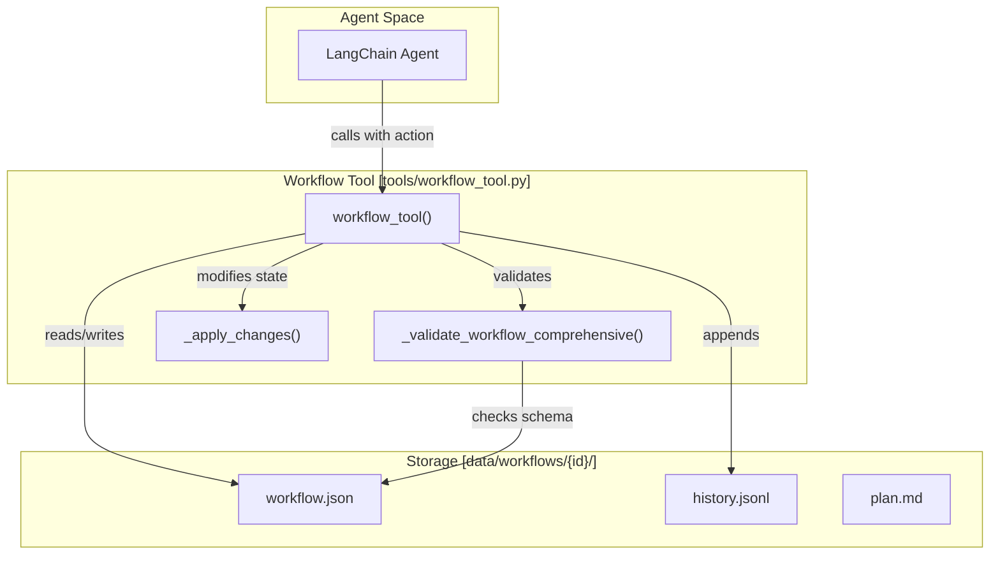
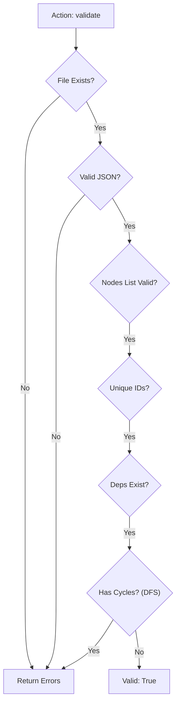

<!-- source: DeepWiki mcp.deepwiki.com · repo NVIDIA/Quantum-Calibration-Agent-Blueprint · page 5.2 Workflow Tool · fetched 2026-10-26 -->

# Workflow Tool

<details>
<summary>Relevant source files</summary>

The following files were used as context for generating this wiki page:

- [docs/latest/user-guide/workflows/index.mdx](docs/latest/user-guide/workflows/index.mdx)
- [tools/workflow_tool.py](tools/workflow_tool.py)

</details>


The Workflow Tool is a core agent utility designed to manage the lifecycle of complex, multi-step experiment sequences. It provides the agent with capabilities to create, monitor, validate, and update Directed Acyclic Graphs (DAGs) of experiments. Unlike simple experiment execution, the workflow tool handles state persistence, dependency resolution, and context sharing between nodes.

## Workflow Actions and Implementation

The tool is implemented as a single LangChain tool with multiple sub-actions, allowing the agent to interact with the workflow system through a unified interface.

### Key Tool Actions

| Action | Description | Implementation Detail |
| :--- | :--- | :--- |
| `list` | Lists all existing workflows. | Scans `data/workflows/` for subdirectories. |
| `show` | Retrieves the full `workflow.json` for a specific ID. | Reads and parses the JSON state file. |
| `status` | Provides a summary of the workflow and its nodes. | Aggregates node states (pending, running, etc.). |
| `validate` | Performs comprehensive DAG and schema checks. | Invokes `_validate_workflow_comprehensive`. |
| `history` | Returns the event log from `history.jsonl`. | Reads the append-only JSONL log. |
| `update` | Modifies the workflow state or context. | Uses dot-notation for deep updates. |
| `log` | Appends a custom event to the history log. | Writes a timestamped entry to `history.jsonl`. |

### System Topology: Tool to File System
This diagram illustrates how the `workflow_tool` interacts with the underlying storage and the agent.

**Workflow Data Flow**

Sources: `[tools/workflow_tool.py:16-28]()`, `[tools/workflow_tool.py:85-112]()`

## State Update Mechanism (Dot-Notation)

To allow the agent to update specific parts of a complex workflow (like a single parameter in a specific node) without rewriting the entire JSON file, the tool implements a dot-notation update mechanism in `_apply_changes`.

### Implementation Logic
The function `_apply_changes` supports:
1.  **Simple Keys**: `{"status": "running"}` updates the top-level status. `[tools/workflow_tool.py:47-49]()`
2.  **Nested Paths**: `{"context.qubit_freq": 5.2}` navigates into the context dictionary. `[tools/workflow_tool.py:52-71]()`
3.  **Node Targeting**: `{"nodes.node_id.state": "success"}`. The logic detects the `nodes` key, treats it as a list, and searches for the element where `id == "node_id"`. `[tools/workflow_tool.py:57-67]()`

Sources: `[tools/workflow_tool.py:34-82]()`

## DAG Validation Logic

The `validate` action performs rigorous checks to ensure a workflow is executable and structurally sound.

### Validation Steps
1.  **File Integrity**: Verifies `workflow.json` exists and is valid JSON. `[tools/workflow_tool.py:121-151]()`
2.  **Schema Compliance**: Ensures required fields (`id`, `name`, `nodes`) are present. `[tools/workflow_tool.py:154-172]()`
3.  **Node Uniqueness**: Checks that all node IDs are unique within the workflow. `[tools/workflow_tool.py:207-227]()`
4.  **Dependency Resolution**: Validates that every dependency listed in a node actually exists as another node ID. `[tools/workflow_tool.py:229-250]()`
5.  **Cycle Detection**: Implements a Depth-First Search (DFS) to ensure no circular dependencies exist (A -> B -> A). `[tools/workflow_tool.py:252-286]()`

**Validation Logic Flow**

Sources: `[tools/workflow_tool.py:85-300]()`

## History Log Format

The workflow system maintains an append-only event log in `history.jsonl`. Each line is a standalone JSON object representing a discrete event in the workflow's life.

### Schema and Example
Each entry contains a `timestamp`, an `event` type, and associated `data`.

```json
{"timestamp": "2024-01-01T12:00:00Z", "event": "workflow_started", "data": {"id": "calib_001"}}
{"timestamp": "2024-01-01T12:00:05Z", "event": "node_started", "data": {"node_id": "spec_01"}}
{"timestamp": "2024-01-01T12:05:00Z", "event": "node_completed", "data": {"node_id": "spec_01", "result": "success"}}
```

The tool's `log` action allows the agent to insert custom commentary or observations into this stream, which are then viewable via the `history` action or the Web UI.

Sources: `[tools/workflow_tool.py:440-474]()`, `[docs/latest/user-guide/workflows/index.mdx:22-25]()`

## Integration with Workflow System

The Workflow Tool serves as the interface for the agent to manipulate the data structures defined in the broader Workflow System.

| Entity | Role |
| :--- | :--- |
| `workflow.json` | The "Source of Truth" for the DAG structure and current state. |
| `plan.md` | A natural language description of the workflow goals. |
| `context` | A shared dictionary within `workflow.json` used to pass results between nodes. |

**Context Sharing Example**
If `node_1` (Resonator Spectroscopy) finds a frequency, the agent updates the workflow:
`update(workflow_id="...", changes={"context.res_freq": 6.543, "nodes.node_1.state": "success"})`
Subsequent nodes can then reference `context.res_freq` in their parameters.

Sources: `[docs/latest/user-guide/workflows/index.mdx:85-98]()`, `[tools/workflow_tool.py:34-45]()`

---

