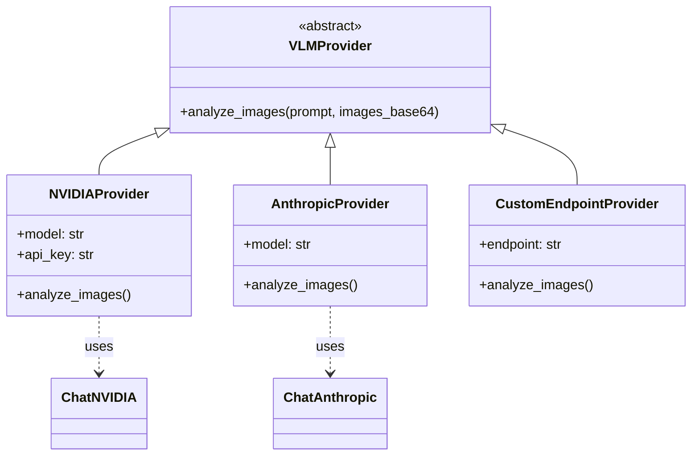

<!-- source: DeepWiki mcp.deepwiki.com · repo NVIDIA/Quantum-Calibration-Agent-Blueprint · page 5.3 VLM Inspect Tool · fetched 2026-10-26 -->

# VLM Inspect Tool

<details>
<summary>Relevant source files</summary>

The following files were used as context for generating this wiki page:

- [data/knowledge/skills/vlm-configuration.md](data/knowledge/skills/vlm-configuration.md)
- [tools/vlm_tool.py](tools/vlm_tool.py)
- [vlm/providers.py](vlm/providers.py)
- [vlm/renderer.py](vlm/renderer.py)

</details>


The `vlm_inspect` tool provides the Quantum Calibration Agent (QCA) with "eyes" to analyze experiment results. It automates the process of retrieving experiment plots from the storage layer, converting them into a visual format compatible with Vision Language Models (VLMs), and querying a configured VLM provider for qualitative analysis.

## Overview and Execution Model

The tool is defined as a LangChain-compatible tool using the `@tool` decorator [tools/vlm_tool.py:49-53](). Because the underlying VLM providers and rendering logic are asynchronous, but LangChain tools are often called in synchronous contexts (like FastAPI or CLI loops), `vlm_inspect` implements a robust execution model to handle event loops.

If an event loop is already running, the tool dispatches the request to a `ThreadPoolExecutor` to avoid "event loop already running" errors [tools/vlm_tool.py:70-75](). If no loop exists, it uses `asyncio.run` directly [tools/vlm_tool.py:76-78]().

### Tool Data Flow

Title: VLM Inspect Execution Flow
```mermaid
graph TD
    subgraph "Agent Space"
        "Agent" -- "calls" --> "vlm_inspect[tools/vlm_tool.py]"
    end

    subgraph "Logic Space"
        "vlm_inspect[tools/vlm_tool.py]" -- "manages" --> "ThreadPoolExecutor"
        "ThreadPoolExecutor" -- "runs" --> "v_async[_vlm_inspect_async]"
        "v_async[_vlm_inspect_async]" -- "loads" --> "config[config.yaml]"
        "v_async[_vlm_inspect_async]" -- "fetches" --> "storage[core/storage.py]"
        "v_async[_vlm_inspect_async]" -- "renders" --> "renderer[vlm/renderer.py]"
        "v_async[_vlm_inspect_async]" -- "invokes" --> "provider[vlm/providers.py]"
    end

    subgraph "Storage & External"
        "storage[core/storage.py]" -- "reads" --> "HDF5/SQLite"
        "provider[vlm/providers.py]" -- "HTTPS" --> "NVIDIA/Anthropic API"
    end
```
Sources: [tools/vlm_tool.py:49-186](), [vlm/renderer.py:23-84](), [vlm/providers.py:26-47]()

## Plot Rendering Pipeline

The tool retrieves plots stored in the HDF5/SQLite backend via `storage.get_plot` [tools/vlm_tool.py:117](). Since experiments typically store plots as Plotly JSON structures to remain interactive in the Web UI, they must be rasterized for VLM consumption.

### The Rendering Process
1.  **Format Detection**: The tool checks the `format` field of the retrieved plot metadata [tools/vlm_tool.py:124]().
2.  **Plotly to PNG**: If the format is `plotly`, the `render_plot_to_base64` function is called [vlm/renderer.py:23]().
    *   It parses the JSON into a Plotly figure object using `pio.from_json` [vlm/renderer.py:65]().
    *   It uses the **Kaleido** engine to export the figure to PNG bytes [vlm/renderer.py:71-76]().
3.  **Base64 Encoding**: The PNG bytes are encoded into a base64 string [vlm/renderer.py:84](), which is the standard format for VLM multi-modal payloads.

Sources: [vlm/renderer.py:16-84](), [tools/vlm_tool.py:115-141]()

## Multi-Image Context and Prompt Augmentation

The tool is designed to handle experiments that produce multiple plots (e.g., a Resonator Spectroscopy experiment showing both Magnitude and Phase). 

When multiple plots are detected, the tool performs **Prompt Augmentation**:
*   It counts the total number of images [tools/vlm_tool.py:156]().
*   It extracts the names of all plots [tools/vlm_tool.py:157]().
*   It prepends a context header to the user's prompt: `"You are analyzing {count} plots from experiment '{id}'. Plot names: {names}."` [tools/vlm_tool.py:157]().

This ensures the VLM understands the relationship between the images it is receiving in the message array.

Sources: [tools/vlm_tool.py:150-159]()

## VLM Provider Integration

The `vlm_inspect` tool is provider-agnostic. It uses `get_vlm_client` to instantiate a provider based on the `vlm` section in `config.yaml` [tools/vlm_tool.py:40-46]().

### Provider Class Structure

Title: VLM Provider Class Hierarchy

Sources: [vlm/providers.py:26-203](), [data/knowledge/skills/vlm-configuration.md:12-19]()

### Configuration
The VLM configuration is reloaded on every tool call, allowing for hot-swapping models without restarting the agent [tools/vlm_tool.py:40-46](). Key parameters include:
*   `provider`: `nvidia`, `anthropic`, or `custom`.
*   `model`: The specific model string (e.g., `nvidia/ising-calibration-1-35b-a3b`) [data/knowledge/skills/vlm-configuration.md:12-19]().
*   `enable_thinking`: Specific to models supporting internal reasoning chains [vlm/providers.py:111-112]().

## Error Handling and Requirements

The tool includes specific checks for common failure modes in visual analysis:
*   **Missing Dependencies**: If `kaleido` or `plotly` are missing, the tool returns a descriptive error with a "hint" for the user to install them [tools/vlm_tool.py:147](), [vlm/renderer.py:79-81]().
*   **Storage Misses**: If an `experiment_id` is invalid or contains no plots, the tool returns a `status: error` dictionary rather than raising an unhandled exception [tools/vlm_tool.py:97-108]().
*   **Partial Success**: If some plots render successfully but others fail, the tool proceeds with the successful ones and includes a `warnings` list in the final result [tools/vlm_tool.py:176-177]().

Sources: [tools/vlm_tool.py:86-185](), [vlm/renderer.py:44-84]()

---

