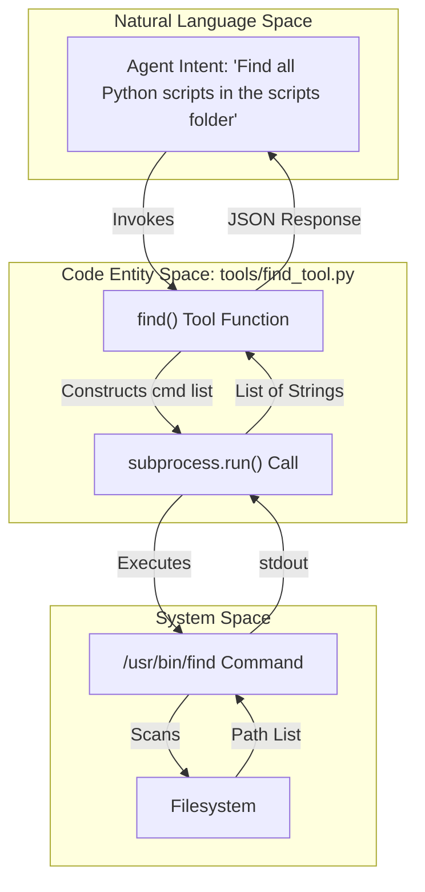
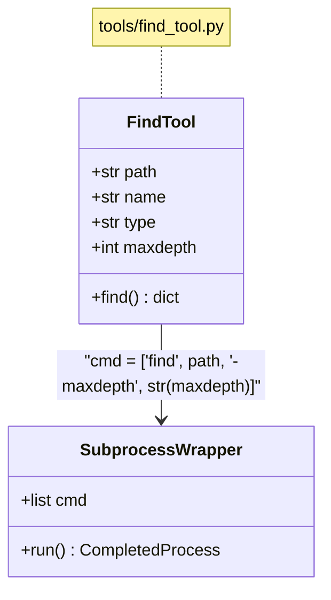

<!-- source: DeepWiki mcp.deepwiki.com · repo NVIDIA/Quantum-Calibration-Agent-Blueprint · page 5.4 Find Tool · fetched 2026-10-26 -->

# Find Tool

Relevant source files

The following files were used as context for generating this wiki page:

- [tools/find_tool.py](tools/find_tool.py)

The **Find Tool** is a filesystem utility provided to the Quantum Calibration Agent (QCA) to enable autonomous discovery of files and directories within the workspace. It acts as a wrapper around the system's `find` command, allowing the agent to locate experiment scripts, data files, or documentation without requiring hardcoded paths.

### Overview

In a complex calibration environment, the agent frequently needs to explore the directory structure to identify available assets. The `find` tool provides a controlled interface for this exploration, implementing safety constraints like search depth and timeouts to prevent the agent from triggering resource-intensive recursive searches on large volumes or network mounts.

The tool is defined as a LangChain-compatible tool using the `@tool` decorator, making it directly available for the agent's LLM to invoke during reasoning steps.

**Sources:**
- [tools/find_tool.py:16-23]()

---

### Implementation Details

The tool is implemented in [tools/find_tool.py]() as a single function named `find`. It translates natural language search requests from the agent into a structured subprocess call.

#### Function Signature
The `find` function accepts four parameters that mirror standard Unix `find` flags:
- `path`: The starting directory for the search (defaults to `.`).
- `name`: A pattern to match, supporting wildcards (e.g., `*.py`).
- `type`: Filter for file types (`f` for files, `d` for directories).
- `maxdepth`: An integer constraint on recursion depth (defaults to `10`).

**Sources:**
- [tools/find_tool.py:24-40]()

#### Subprocess Execution
The tool constructs a command list and executes it via `subprocess.run`. It includes several safety and reliability features:
- **Timeout**: The command is capped at 30 seconds to prevent the agent from hanging on slow filesystems [tools/find_tool.py:54-64]().
- **Output Capture**: Both `stdout` and `stderr` are captured to provide the agent with either the results or actionable error messages [tools/find_tool.py:50-58]().
- **Result Parsing**: The raw string output from the system command is split into a clean list of paths [tools/find_tool.py:60-61]().

**Sources:**
- [tools/find_tool.py:41-66]()

---

### Data Flow: Natural Language to System Command

The following diagram illustrates how an agent's intent (expressed in natural language) is transformed into a filesystem operation and back into a structured response.

**Intent Translation and Execution Flow**

**Sources:**
- [tools/find_tool.py:24-61]()

---

### Key Components and Logic

The tool returns a dictionary containing either a list of matches or an error description. This structure ensures the agent can programmatically handle failures (like a missing directory or a timeout).

| Component | Logic / Implementation | Reference |
| :--- | :--- | :--- |
| **Command Construction** | Dynamically appends `-name` and `-type` flags only if provided by the agent. | [tools/find_tool.py:41-47]() |
| **Depth Control** | Enforces `-maxdepth` to prevent "runaway" searches in deep hierarchies. | [tools/find_tool.py:41-41]() |
| **Error Handling** | Catches `subprocess.TimeoutExpired` and generic `Exception` to return clean error strings. | [tools/find_tool.py:63-66]() |
| **Output Processing** | Strips whitespace and filters out empty lines from the `find` output. | [tools/find_tool.py:60-61]() |

### Code Structure and Tool Mapping

This diagram maps the Python function parameters and internal logic to the resulting system command execution.

**Mapping Logic to Subprocess**

**Sources:**
- [tools/find_tool.py:24-55]()

---

