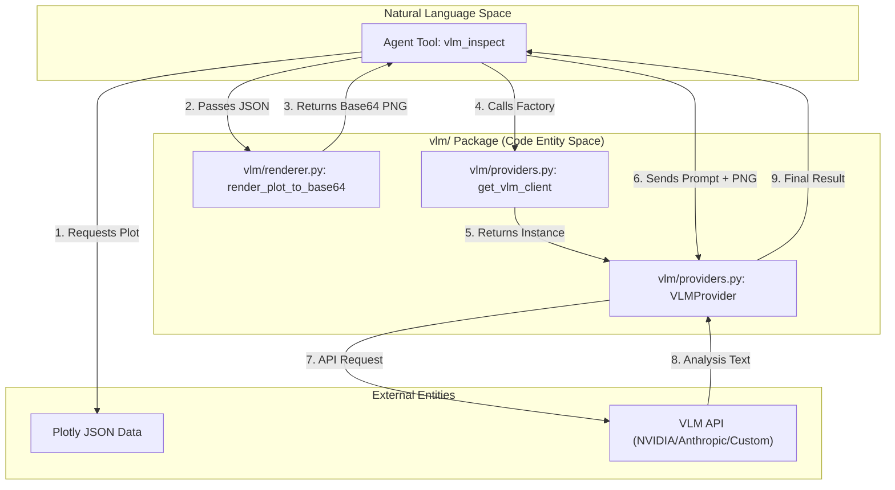
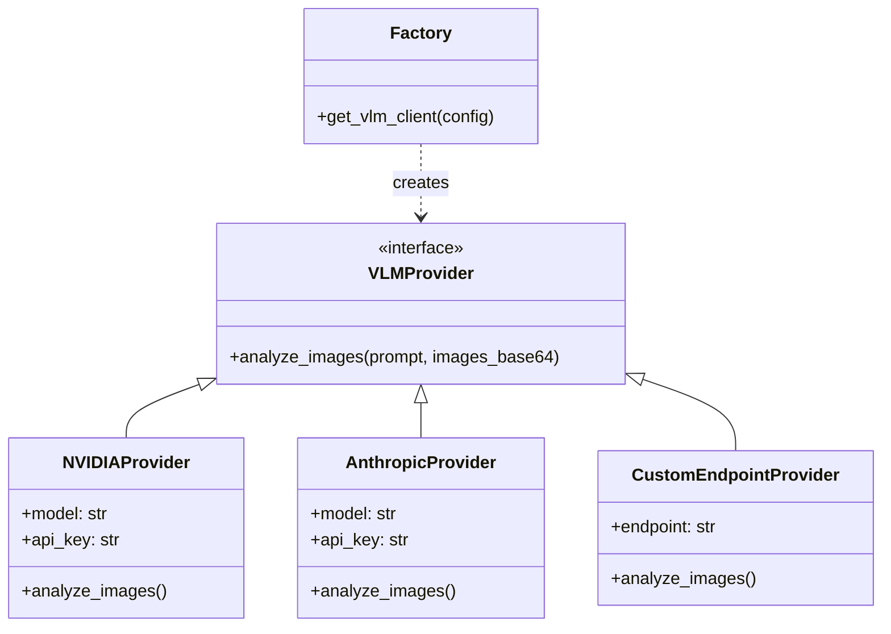

<!-- source: DeepWiki mcp.deepwiki.com · repo NVIDIA/Quantum-Calibration-Agent-Blueprint · page 6 VLM Subsystem · fetched 2026-10-26 -->

# VLM Subsystem

Relevant source files

The following files were used as context for generating this wiki page:

- [vlm/__init__.py](vlm/__init__.py)
- [vlm/providers.py](vlm/providers.py)
- [vlm/renderer.py](vlm/renderer.py)

The `vlm/` package provides the Vision Language Model (VLM) capabilities for the Quantum Calibration Agent. It acts as a bridge between the numerical/graphical data produced by quantum experiments and the reasoning capabilities of the agent. The subsystem is responsible for two primary tasks: abstracting interactions with various VLM providers and rendering Plotly-based experiment results into a visual format (PNG) that these models can process.

### System Architecture

The VLM subsystem is structured to decouple the rendering logic from the model invocation logic. This allows the agent to inspect plots regardless of whether it is using a local NVIDIA-hosted model, an Anthropic model, or a custom OpenAI-compatible endpoint.

#### VLM Logic Flow
The following diagram illustrates how the `vlm/` package components interact to transform raw experiment data into natural language insights.

**Plot Analysis Pipeline**

Sources: [vlm/__init__.py:18-21](), [vlm/renderer.py:23-43](), [vlm/providers.py:26-46]()

---

### VLM Provider Abstraction

The `vlm/providers.py` module defines a unified interface for interacting with different vision-capable models. This abstraction ensures that the rest of the system (specifically the `vlm_inspect` tool) does not need to handle provider-specific API schemas or authentication nuances.

The system supports several concrete implementations:
*   **NVIDIAProvider**: Uses `langchain-nvidia-ai-endpoints` to connect to NVIDIA's optimized model hosting.
*   **AnthropicProvider**: Connects to Claude models via `langchain-anthropic`.
*   **CustomEndpointProvider**: A generic wrapper for any OpenAI-compatible VLM endpoint.

The selection of the provider is handled by the `get_vlm_client` factory function, which reads the configuration (typically from `config.yaml`) to instantiate the appropriate class.

For details on configuration and provider-specific logic, see **[VLM Providers](#6.1)**.

**Provider Class Hierarchy**

Sources: [vlm/providers.py:26-49](), [vlm/providers.py:122-152](), [vlm/providers.py:192-215]()

---

### Plot Rendering Pipeline

Because VLMs require image inputs (typically Base64-encoded PNGs) rather than raw data structures, the `vlm/renderer.py` module provides a specialized pipeline for converting Plotly figures. 

The primary function, `render_plot_to_base64`, performs the following steps:
1.  **Parsing**: Accepts either a Python dictionary or a JSON string representing a Plotly figure.
2.  **Reconstruction**: Uses `plotly.io.from_json` to recreate the figure object.
3.  **Export**: Utilizes the `kaleido` engine to render the vector-based Plotly object into a static PNG byte stream.
4.  **Encoding**: Converts the resulting bytes into a Base64 string suitable for transmission to VLM APIs.

This pipeline is essential for the `vlm_inspect` tool, which allows the agent to "see" the results of calibration experiments like Rabi oscillations or Ramsey measurements.

For details on the rendering implementation and dependencies, see **[Plot Rendering Pipeline](#6.2)**.

Sources: [vlm/renderer.py:23-84]()

---

