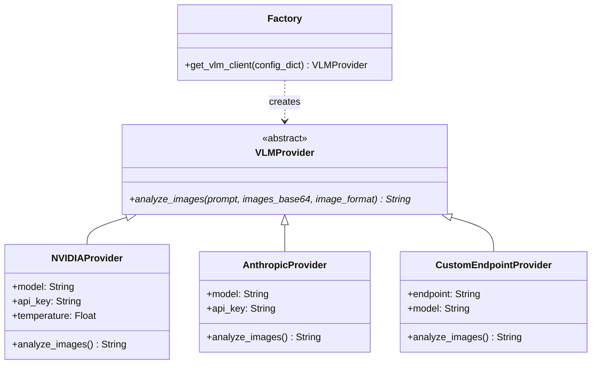
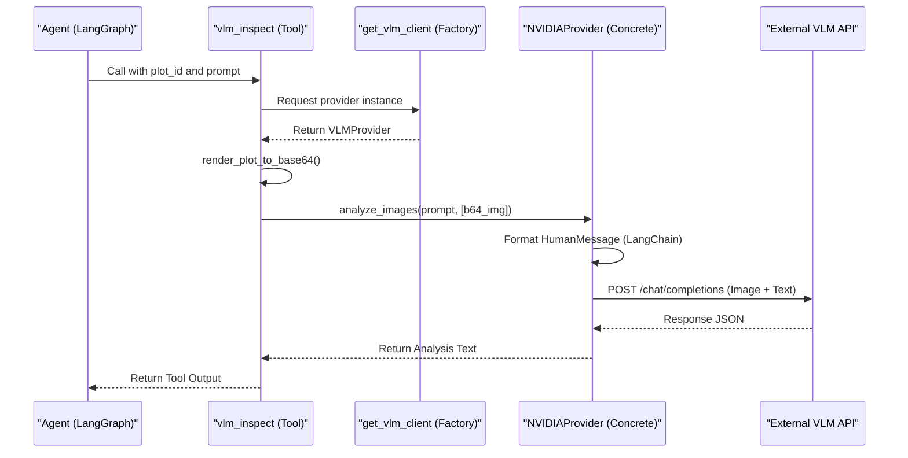

<!-- source: DeepWiki mcp.deepwiki.com · repo NVIDIA/Quantum-Calibration-Agent-Blueprint · page 6.1 VLM Providers · fetched 2026-10-26 -->

# VLM Providers

Relevant source files

The following files were used as context for generating this wiki page:

- [config.yaml](config.yaml)
- [vlm/providers.py](vlm/providers.py)

The Vision Language Model (VLM) subsystem provides a standardized interface for the Quantum Calibration Agent (QCA) to analyze experiment plots and visual data. This abstraction layer allows the agent to switch between different model providers (NVIDIA, Anthropic, or OpenAI-compatible endpoints) without modifying the core tool logic.

## Architecture Overview

The VLM subsystem is built around an abstract base class, `VLMProvider`, which defines the contract for image analysis. The `get_vlm_client` factory function instantiates the appropriate concrete implementation based on the system configuration.

### VLM Provider Class Hierarchy

The following diagram illustrates the relationship between the base provider class and its concrete implementations.

**VLM Provider Class Diagram**

**Sources:** [vlm/providers.py:26-47](), [vlm/providers.py:49-120](), [vlm/providers.py:122-190](), [vlm/providers.py:192-261](), [vlm/providers.py:264-308]()

---

## Configuration and Initialization

VLM settings are defined in the `vlm` section of `config.yaml`. The configuration specifies the provider type, the specific model identifier, and execution parameters like temperature and token limits.

### Configuration Schema
| Key | Description | Example |
| :--- | :--- | :--- |
| `provider` | The provider type: `nvidia`, `anthropic`, or `custom` | `nvidia` |
| `model` | The specific model string used by the provider | `nvidia/ising-calibration-1-35b-a3b` |
| `api_key_env` | Environment variable name containing the API key | `NVIDIA_API_KEY` |
| `temperature` | Sampling temperature for the model | `0.2` |
| `max_tokens` | Maximum response length | `32768` |
| `enable_thinking` | (NVIDIA only) Enables reasoning/thinking modes | `false` |

**Sources:** [config.yaml:32-38](), [vlm/providers.py:264-308]()

### Factory Logic
The `get_vlm_client` function acts as the entry point for the subsystem. It parses the `vlm` dictionary from the configuration and returns a singleton-like instance of the requested provider.

1.  **NVIDIA**: Uses `langchain-nvidia-ai-endpoints` to connect to NVIDIA API Catalog models [vlm/providers.py:49-120]().
2.  **Anthropic**: Uses `langchain-anthropic` for Claude-based vision analysis [vlm/providers.py:122-190]().
3.  **Custom**: Uses `langchain-openai` to target any OpenAI-compatible API (e.g., local vLLM or NIM self-hosted endpoints) [vlm/providers.py:192-261]().

---

## Provider Implementations

### NVIDIAProvider
This provider is the default for the QCA Blueprint. It leverages `ChatNVIDIA` and supports specialized features like "thinking" modes for calibration-specific models.

*   **Data Flow**: It constructs a list of `HumanMessage` objects where images are passed as `image_url` objects with base64 data URIs [vlm/providers.py:93-102]().
*   **Implementation**: Invokes `chat.ainvoke` using the LangChain NVIDIA integration [vlm/providers.py:113-116]().

### AnthropicProvider
Designed for Claude 3.x models. Unlike the NVIDIA provider which uses data URIs in URLs, the Anthropic implementation uses a specific `source` block with `base64` type and `media_type` [vlm/providers.py:164-173]().

### CustomEndpointProvider
This provider allows the system to point to local or private infrastructure. It requires a `base_url` (mapped from `endpoint` in config) and follows the standard OpenAI vision request format [vlm/providers.py:246-255]().

---

## Data Flow: From Tool to Provider

The VLM subsystem is primarily consumed by the `vlm_inspect` tool. The following diagram shows how a natural language request to "look at a plot" traverses the system into the code entities.

**VLM Analysis Data Flow**

**Sources:** [vlm/providers.py:264-308](), [vlm/providers.py:77-116](), [vlm/renderer.py:20-25]() (implied by tool integration)

## Key Functions

### `analyze_images`
Defined in the `VLMProvider` base class, this asynchronous method is the primary execution path.
*   **Input**: A string `prompt` and a list of `images_base64` strings [vlm/providers.py:30-35]().
*   **Output**: A string containing the model's textual description or analysis of the visual data [vlm/providers.py:44]().

### `get_vlm_client`
A utility function that maps the `config.yaml` provider string to the correct class constructor.
*   **Logic**: It performs a case-insensitive check on the `provider` key (`nvidia`, `anthropic`, `custom`) and extracts the relevant parameters (`model`, `temperature`, `max_tokens`, etc.) to initialize the specific subclass [vlm/providers.py:264-308]().

**Sources:** [vlm/providers.py:26-47](), [vlm/providers.py:264-308]()

---

