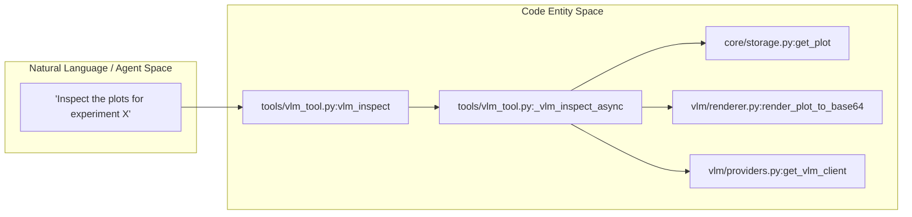

<!-- source: DeepWiki mcp.deepwiki.com · repo NVIDIA/Quantum-Calibration-Agent-Blueprint · page 6.2 Plot Rendering Pipeline · fetched 2026-10-26 -->

# Plot Rendering Pipeline

<details>
<summary>Relevant source files</summary>

The following files were used as context for generating this wiki page:

- [tools/vlm_tool.py](tools/vlm_tool.py)
- [vlm/renderer.py](vlm/renderer.py)

</details>


The Plot Rendering Pipeline is responsible for transforming abstract Plotly JSON data structures into visual representations that Vision Language Models (VLMs) can process. This pipeline bridges the gap between structured experiment results and the visual reasoning capabilities of the agent, enabling automated peak detection, trend analysis, and anomaly identification.

## Overview

The core of the pipeline resides in `vlm/renderer.py`, which provides a specialized utility to convert Plotly figures into base64-encoded PNG strings. This utility is primarily consumed by the `vlm_inspect` tool, which orchestrates the retrieval of plots from storage and their delivery to a configured VLM provider.

### Pipeline Data Flow

The following diagram illustrates the transformation of data from the experiment storage layer through the rendering engine to the VLM.

**Plot Transformation and Inspection Flow**

```mermaid
graph TD
    subgraph "Storage Layer"
        [storage.get_plot] --> |"Plotly JSON/Dict"| PlotData["plot['data']"]
    end

    subgraph "vlm/renderer.py"
        PlotData --> [render_plot_to_base64]
        [render_plot_to_base64] --> |"json.loads"| ParsedJSON["Parsed JSON"]
        ParsedJSON --> |"plotly.io.from_json"| PlotlyFig["plotly.graph_objects.Figure"]
        PlotlyFig --> |"fig.to_image(format='png')"| RawBytes["PNG Bytes (via Kaleido)"]
        RawBytes --> |"base64.b64encode"| B64String["Base64 PNG String"]
    end

    subgraph "tools/vlm_tool.py"
        B64String --> [_vlm_inspect_async]
        [_vlm_inspect_async] --> |"vlm.analyze_images"| VLMProvider["VLM Provider"]
    end
```

**Sources:** [vlm/renderer.py:23-84](), [tools/vlm_tool.py:115-137]()

---

## Core Implementation: `render_plot_to_base64`

The function `render_plot_to_base64` in `vlm/renderer.py` is the primary entry point for the rendering logic. It handles input validation, Plotly figure reconstruction, and image export.

### Implementation Details
- **Input Handling**: Accepts either a raw JSON string or a Python dictionary representing a Plotly figure [vlm/renderer.py:24-32]().
- **Figure Reconstruction**: Uses `plotly.io.from_json` to reconstruct the figure object from the provided schema [vlm/renderer.py:65]().
- **Kaleido Integration**: Leverages the `kaleido` engine via the `fig.to_image` method to perform headless rendering of the plot into PNG bytes [vlm/renderer.py:71-76]().
- **Encoding**: The resulting bytes are base64-encoded and decoded to a UTF-8 string, making them suitable for transmission in JSON payloads to VLM APIs [vlm/renderer.py:84]().

### Parameters
| Parameter | Type | Default | Description |
| :--- | :--- | :--- | :--- |
| `plotly_json` | `Union[str, dict]` | N/A | The Plotly figure data to render. |
| `width` | `int` | `640` | Width of the output PNG in pixels. |
| `height` | `int` | `480` | Height of the output PNG in pixels. |
| `scale` | `float` | `1.0` | Resolution multiplier for higher DPI images. |

**Sources:** [vlm/renderer.py:23-43](), [vlm/renderer.py:65-84]()

---

## Integration with `vlm_inspect` Tool

The `vlm_inspect` tool (defined in `tools/vlm_tool.py`) acts as the high-level orchestrator for the rendering pipeline. It allows the agent to request visual analysis for a specific `experiment_id`.

### Tool Execution Logic
1. **Metadata Retrieval**: The tool calls `storage.list_plots` to identify all available plots for the given experiment [tools/vlm_tool.py:96]().
2. **Batch Rendering**: It iterates through the plots, retrieving data via `storage.get_plot` and passing Plotly-formatted data to `render_plot_to_base64` [tools/vlm_tool.py:115-126]().
3. **Format Support**: While Plotly is the primary format, the tool also supports plots already stored as base64 PNGs or JPEGs, bypassing the renderer for those specific items [tools/vlm_tool.py:127-130]().
4. **Context Augmentation**: If multiple plots are present, the tool automatically enhances the user's prompt with a list of plot names to provide the VLM with better spatial and contextual awareness [tools/vlm_tool.py:155-157]().

### Threading and Async Management
Because the agent's tool execution environment may vary (e.g., running within a FastAPI event loop), `vlm_inspect` includes a safety wrapper. It checks for a running event loop and, if found, uses a `ThreadPoolExecutor` to execute the async `_vlm_inspect_async` logic, preventing "event loop already running" errors [tools/vlm_tool.py:70-78]().

**Agent Tool to Code Entity Mapping**



**Sources:** [tools/vlm_tool.py:50-79](), [tools/vlm_tool.py:115-159]()

---

## Dependencies and Requirements

The rendering pipeline relies on two external libraries that must be present in the environment:

1. **Plotly**: Used for parsing the JSON schema and managing the figure object [vlm/renderer.py:45-49]().
2. **Kaleido**: A dependency of Plotly used for static image export. The pipeline explicitly checks for Kaleido and raises a `RuntimeError` with installation instructions if it is missing during the image conversion step [vlm/renderer.py:78-82]().

**Sources:** [vlm/renderer.py:44-50](), [vlm/renderer.py:77-82]()

---

