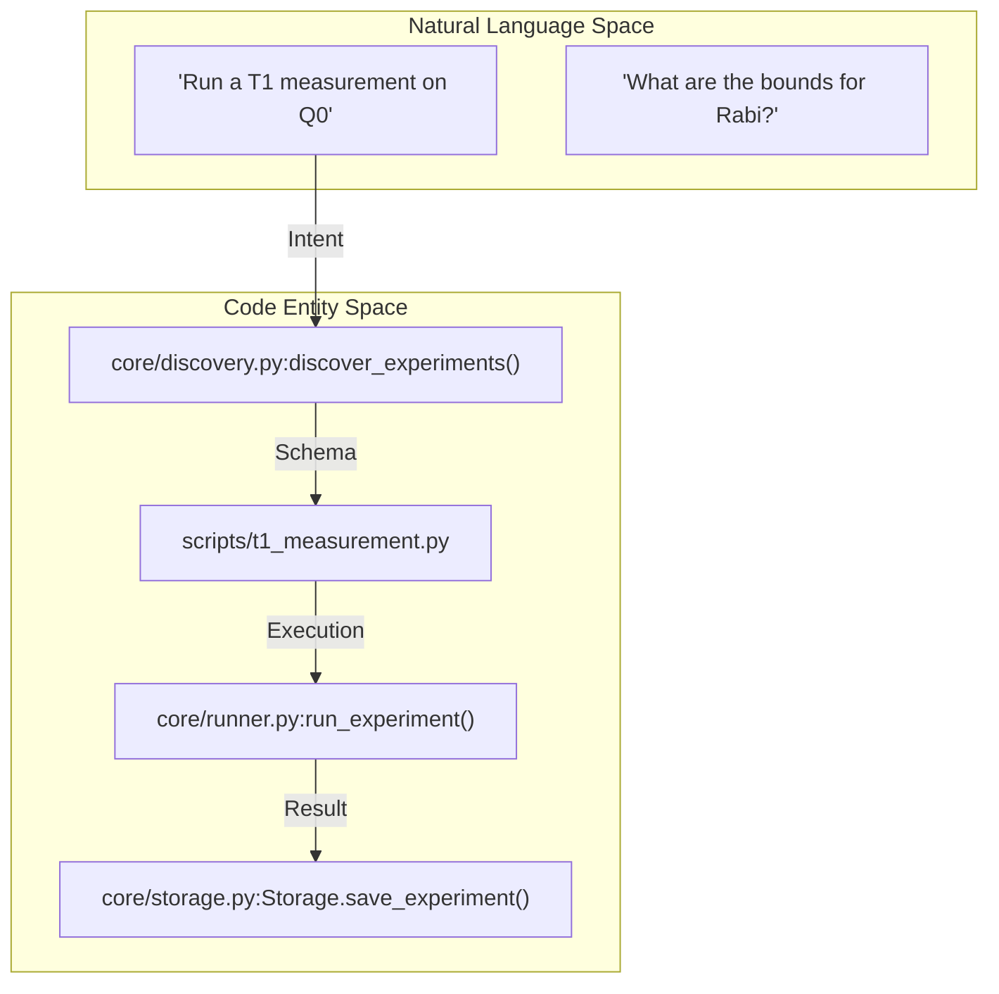
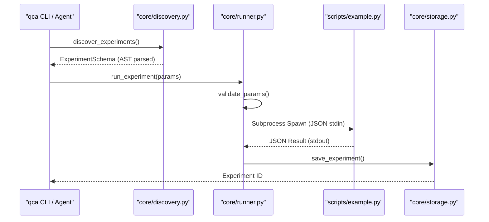

<!-- source: DeepWiki mcp.deepwiki.com · repo NVIDIA/Quantum-Calibration-Agent-Blueprint · page 7 Experiment Scripts · fetched 2026-10-26 -->

# Experiment Scripts

Relevant source files

The following files were used as context for generating this wiki page:

- [docs/latest/user-guide/experiments/index.mdx](docs/latest/user-guide/experiments/index.mdx)
- [docs/latest/user-guide/experiments/writing-scripts.mdx](docs/latest/user-guide/experiments/writing-scripts.mdx)
- [scripts/__init__.py](scripts/__init__.py)
- [scripts/t1_measurement.py](scripts/t1_measurement.py)

Experiment scripts are the fundamental execution units of the Quantum Calibration Agent (QCA) blueprint. Located in the `scripts/` directory, these Python files define the specific quantum measurements, simulations, and calibrations that the agent can perform. The system uses an AST-based discovery mechanism to expose these scripts as tools for the LLM without requiring manual registration.

### High-Level Architecture

The experiment system bridges high-level natural language requests to low-level Python execution. When an agent or user requests an experiment, the `core/discovery.py` module parses the script's metadata, and `core/runner.py` executes it in an isolated subprocess.

**Natural Language to Code Entity Mapping**

**Sources:** [docs/latest/user-guide/experiments/index.mdx:27-33](), [docs/latest/user-guide/experiments/index.mdx:134-140]()

---

### The Script Contract

To be recognized by the QCA blueprint, a script must adhere to a strict structural contract. This allows the system to automatically generate schemas for the agent and validate parameters before execution.

| Requirement | Description | Code Reference |
| :--- | :--- | :--- |
| **File Location** | Must reside in the `scripts/` directory. | [docs/latest/user-guide/experiments/writing-scripts.mdx:7-14]() |
| **Public Function** | Must contain a function (no `_` prefix) that serves as the entry point. | [docs/latest/user-guide/experiments/writing-scripts.mdx:18-21]() |
| **Type Hints** | All parameters must be annotated (e.g., `int`, `float`, `str`). | [docs/latest/user-guide/experiments/writing-scripts.mdx:80-90]() |
| **Annotated Ranges** | Use `Annotated[type, (min, max)]` for numeric validation. | [docs/latest/user-guide/experiments/writing-scripts.mdx:126-146]() |
| **Return Type** | Must be annotated as `-> dict`. | [docs/latest/user-guide/experiments/writing-scripts.mdx:62-64]() |
| **Return Schema** | Must return a dictionary with `status`, `data`, and `plots`. | [docs/latest/user-guide/experiments/writing-scripts.mdx:158-170]() |

**Sources:** [docs/latest/user-guide/experiments/writing-scripts.mdx:18-24](), [scripts/t1_measurement.py:33-38]()

---

### Experiment Lifecycle

The blueprint manages experiments through a five-stage lifecycle that ensures safety and data integrity.

**Sources:** [docs/latest/user-guide/experiments/index.mdx:27-61](), [docs/latest/user-guide/experiments/writing-scripts.mdx:150-155]()

---

### Built-in Calibration Experiments

The repository includes six reference experiments that demonstrate common quantum characterization tasks. These scripts utilize a shared helper, `qubit_params.py`, to simulate realistic qubit behaviors.

*   **Spectroscopy**: Frequency sweeps for resonators and qubits.
*   **Rabi Oscillation**: Amplitude/time sweeps to calibrate pi-pulses.
*   **T1/Ramsey**: Coherence time measurements (relaxation and dephasing).
*   **Qubit Params**: A central configuration script used by mock experiments.

For details on parameter sets and return values for these specific scripts, see [Built-in Calibration Experiments](#7.1).

**Sources:** [scripts/__init__.py:18-30](), [scripts/t1_measurement.py:25-25]()

---

### Writing and Validating Custom Scripts

Users can extend the system by adding new `.py` files to the `scripts/` directory. The QCA provides CLI tools to ensure these new scripts meet the required interface standards.

1.  **Creation**: Define a function using `typing.Annotated` for parameter bounds.
2.  **Validation**: Run `qca experiments validate <script_name>` to check for AST parsing errors or missing annotations.
3.  **Testing**: Execute via `qca experiments run <script_name> --param key=value` to verify the JSON output structure.

For a step-by-step guide on creating new experiments and common patterns like amplitude sweeps, see [Writing Custom Experiment Scripts](#7.2).

**Sources:** [docs/latest/user-guide/experiments/writing-scripts.mdx:26-52](), [docs/latest/user-guide/experiments/index.mdx:97-103]()

---

