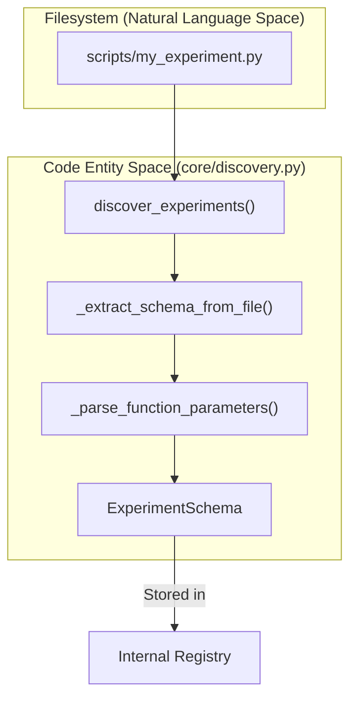
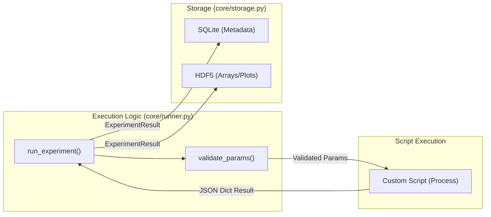

<!-- source: DeepWiki mcp.deepwiki.com · repo NVIDIA/Quantum-Calibration-Agent-Blueprint · page 7.2 Writing Custom Experiment Scripts · fetched 2026-10-26 -->

# Writing Custom Experiment Scripts

<details>
<summary>Relevant source files</summary>

The following files were used as context for generating this wiki page:

- [core/discovery.py](core/discovery.py)
- [data/knowledge/skills/vlm-configuration.md](data/knowledge/skills/vlm-configuration.md)
- [docs/latest/user-guide/experiments/writing-scripts.mdx](docs/latest/user-guide/experiments/writing-scripts.mdx)

</details>


This page provides a technical guide for developing custom experiment scripts for the Quantum Calibration Agent (QCA). It covers the required function signatures, parameter validation via `Annotated` types, the standardized return format, and how the system discovers and validates these scripts.

## Overview and Script Discovery

QCA uses an Abstract Syntax Tree (AST) based discovery mechanism to identify valid experiment scripts within the `scripts/` directory. This allows the system to extract metadata, parameter types, and range constraints without executing the Python code itself [core/discovery.py:25-36]().

### Script Requirements
For a script to be recognized by the QCA discovery engine, it must meet the following criteria:
1. **File Location**: Must reside in the `scripts/` folder at the project root [docs/latest/user-guide/experiments/writing-scripts.mdx:9-14]().
2. **File Naming**: Must be a `.py` file that does not start with an underscore (`_`) [core/discovery.py:42-45]().
3. **Public Function**: Must contain at least one top-level function that does not start with an underscore [core/discovery.py:86-91]().
4. **Return Annotation**: The function must explicitly include a `-> dict` return type hint [core/discovery.py:97-104]().
5. **Type Hints**: Parameters must have type annotations (e.g., `int`, `float`, `str`, `bool`, `list`) [docs/latest/user-guide/experiments/writing-scripts.mdx:80-90]().

### Natural Language to Code Entity Mapping: Discovery
The following diagram illustrates how the system maps physical script files to the internal `ExperimentSchema` model.

**Diagram: Discovery Flow**

Sources: [core/discovery.py:25-51](), [core/discovery.py:71-123](), [core/discovery.py:126-190]()

## Function Signature and Parameters

### Parameter Validation with `Annotated`
QCA leverages `typing.Annotated` to enforce range constraints on numeric parameters. This information is parsed by the AST engine and used by the agent to reason about valid experimental bounds [docs/latest/user-guide/experiments/writing-scripts.mdx:126-154]().

**Syntax:** `Annotated[type, (min, max)]`

```python
from typing import Annotated

def my_calibration(
    frequency: Annotated[float, (4.0, 6.0)] = 5.0,
    power: Annotated[int, (-30, 0)] = -10
) -> dict:
    ...
```

### Parameter Logic
- **Required Parameters**: Parameters without default values are treated as mandatory by the `qca experiments run` command [docs/latest/user-guide/experiments/writing-scripts.mdx:104-113]().
- **Optional Parameters**: Parameters with default values can be overridden via the CLI using `--param name=value` [docs/latest/user-guide/experiments/writing-scripts.mdx:115-124]().

Sources: [docs/latest/user-guide/experiments/writing-scripts.mdx:104-154](), [core/discovery.py:155-170]()

## Return Format Specification

The experiment function must return a dictionary. This dictionary is the primary data contract between the experiment script, the storage layer, and the VLM (Vision Language Model) for analysis.

### Standardized Dictionary Keys
| Key | Type | Required | Description |
| :--- | :--- | :--- | :--- |
| `status` | `str` | Yes | Must be `"success"` or `"failed"` [docs/latest/user-guide/experiments/writing-scripts.mdx:198-208](). |
| `error` | `str` | Conditional | Required if `status` is `"failed"` [docs/latest/user-guide/experiments/writing-scripts.mdx:173](). |
| `data` | `dict` | No | Container for `scalar` and `array` results [docs/latest/user-guide/experiments/writing-scripts.mdx:210-216](). |
| `plots` | `list` | No | List of Plotly JSON objects or base64 PNGs [docs/latest/user-guide/experiments/writing-scripts.mdx:254-259](). |

### Data and Plots Structure
Each entry in the `data` dictionary must define a `type`, `value`, `unit`, and `name` [docs/latest/user-guide/experiments/writing-scripts.mdx:210-216]().

**Example Data Entry:**
```python
"data": {
    "qubit_freq": {
        "type": "scalar",
        "value": 4.852,
        "unit": "GHz",
        "name": "Fitted Frequency"
    }
}
```

**Example Plot Entry:**
Plotly format is highly recommended as it allows the Web UI to render interactive charts and the VLM to perform visual inspections [docs/latest/user-guide/experiments/writing-scripts.mdx:261-278]().

```python
"plots": [
    {
        "name": "Spectroscopy Plot",
        "format": "plotly",
        "data": { ... plotly_json_dict ... }
    }
]
```

Sources: [docs/latest/user-guide/experiments/writing-scripts.mdx:168-196](), [docs/latest/user-guide/experiments/writing-scripts.mdx:218-251]()

## Implementation Patterns

### Common Patterns
1. **Sweep/Scan**: Iterating over a range of parameters and returning the resulting arrays in the `data` block.
2. **Time-Domain**: Measurements like T1 or T2 where the x-axis is a time delay.
3. **Amplitude Calibration**: Sweeping pulse amplitudes to find optimal Rabi π-pulses.

### Execution Data Flow
When an experiment is executed, the `ExperimentRunner` handles the subprocess invocation and ensures the result matches the expected schema.

**Diagram: Experiment Execution and Data Flow**

Sources: [docs/latest/user-guide/experiments/writing-scripts.mdx:28-52](), [core/discovery.py:126-190]()

## Validation and Testing

Before using a script with the agent, developers should validate the script's schema and execution using the QCA CLI.

### CLI Validation Commands
- **Validate Schema**: Check if the script meets the AST discovery requirements.
  ```bash
  qca experiments validate scripts/my_experiment.py
  ```
- **List Experiments**: Verify the script appears in the discovered list.
  ```bash
  qca experiments list
  ```
- **Run Test**: Execute the script with sample parameters.
  ```bash
  qca experiments run my_experiment --param frequency=5.0
  ```

Sources: [docs/latest/user-guide/experiments/writing-scripts.mdx:115-124](), [core/discovery.py:25-51]()

---

