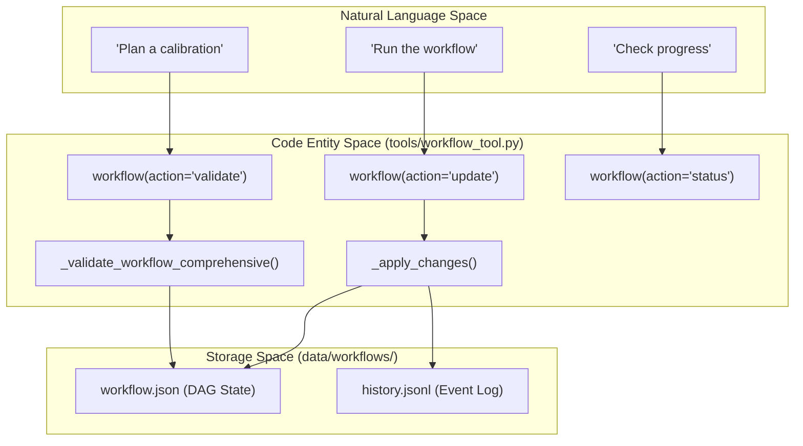
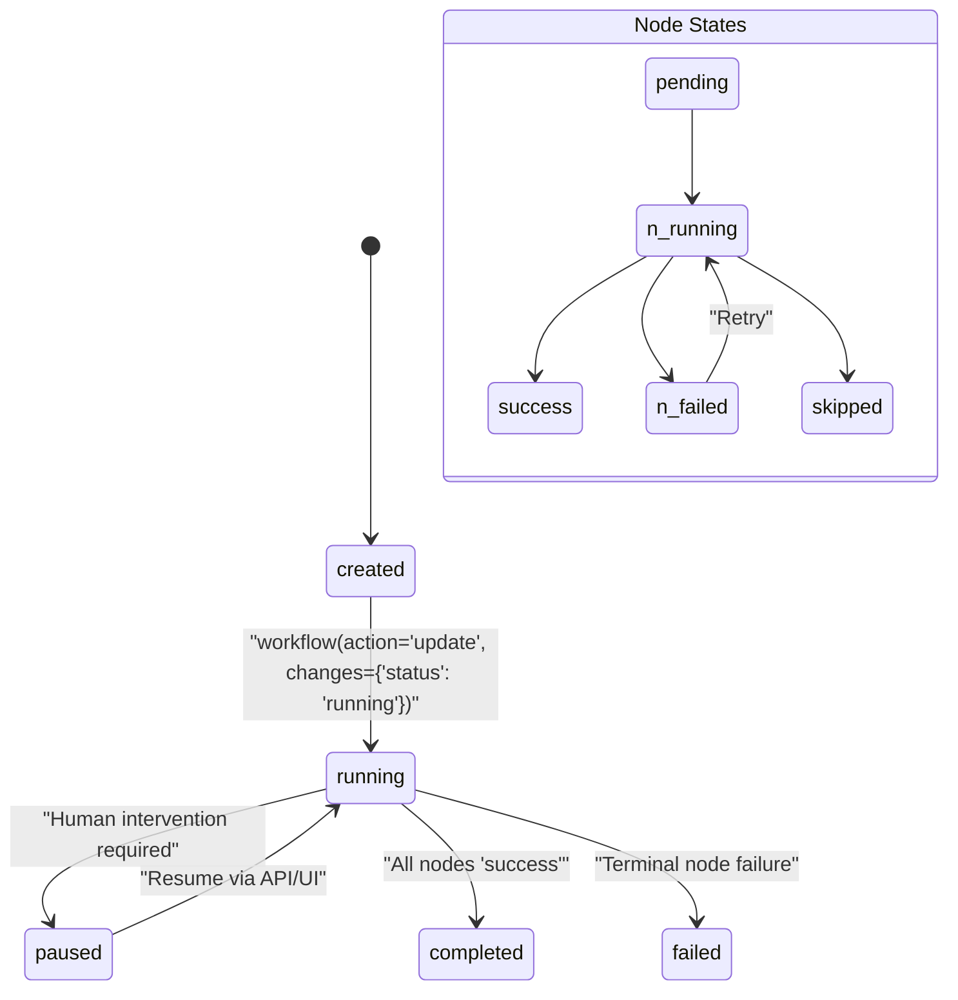

<!-- source: DeepWiki mcp.deepwiki.com · repo NVIDIA/Quantum-Calibration-Agent-Blueprint · page 8 Workflow System · fetched 2026-10-26 -->

# Workflow System

Relevant source files

The following files were used as context for generating this wiki page:

- [docs/latest/user-guide/workflows/index.mdx](docs/latest/user-guide/workflows/index.mdx)
- [server.py](server.py)
- [tools/workflow_tool.py](tools/workflow_tool.py)

The Workflow System in the Quantum Calibration Agent (QCA) blueprint is designed to orchestrate complex, multi-step experiment sequences. It transitions the agent from executing single scripts to managing a Directed Acyclic Graph (DAG) of interdependent tasks. This system ensures that calibration routines—such as moving from resonator spectroscopy to qubit spectroscopy and finally to Rabi oscillations—are handled with robust state management, automated retries, and human-in-the-loop (HITL) checkpoints.

## System Overview

Workflows are defined as JSON structures that specify a sequence of nodes. Each node represents a discrete experiment or analysis step. The system provides a mechanism for the agent to plan these sequences, execute them node-by-node, and maintain a persistent state that survives system restarts or agent interruptions.

### Workflow Entity Mapping

The following diagram bridges the high-level workflow concepts to the specific code entities and file structures used in the implementation.

**Workflow Concept to Code Mapping**

Sources: [tools/workflow_tool.py:16-32](), [docs/latest/user-guide/workflows/index.mdx:22-26]()

## Core Components

The workflow system relies on three primary files located in each workflow's unique directory within `data/workflows/{workflow_id}/`:

| File | Role | Format |
| :--- | :--- | :--- |
| `workflow.json` | The "Source of Truth" for the DAG. Contains node definitions, dependencies, and current execution states. | JSON |
| `plan.md` | A human-readable strategy document describing the goals and success criteria for each step. | Markdown |
| `history.jsonl` | An append-only audit trail of every state change and tool output during execution. | JSON Lines |

Sources: [docs/latest/user-guide/workflows/index.mdx:22-26](), [tools/workflow_tool.py:27-28]()

## Execution Lifecycle

Workflows and their constituent nodes follow a strict state machine to ensure predictable execution and recovery.

### Workflow and Node States

A workflow typically moves from `created` to `running`, and finally to `completed` or `failed`. If the agent requires human intervention, the workflow enters a `paused` state.

**State Transition Logic**

Sources: [docs/latest/user-guide/workflows/index.mdx:29-54](), [tools/workflow_tool.py:30-31]()

## Key Features

### Dot-Notation State Updates
The `workflow_tool.py` implements a flexible `_apply_changes` function that allows the agent to update nested JSON values using dot-notation. This is used to update specific node states or inject results into the global `context`.
*   Example: `{"nodes.node_1.state": "success", "context.qubit_freq": 5.12}`
*   Sources: [tools/workflow_tool.py:34-82]()

### Context Sharing
Results from completed nodes are extracted and stored in the `context` object within `workflow.json`. Downstream nodes reference these values to parameterize subsequent experiments, enabling automated calibration loops.
*   Sources: [docs/latest/user-guide/workflows/index.mdx:85-98]()

### Subagent Execution
While the `workflow_tool` manages the DAG, the actual execution of a node is often performed by a subagent. This subagent uses the `run_experiment` tool to execute scripts, analyzes the data, and reports back to the workflow manager to trigger the next state transition.
*   Sources: [docs/latest/user-guide/workflows/index.mdx:100-109](), [server.py:101-103]()

## Detailed Subsystems

For more in-depth technical information on specific parts of the workflow system, see the following child pages:

### [Workflow Planning and Creation](#8.1)
Covers how the agent interacts with the user to define goals, generates the `plan.md`, and constructs the initial `workflow.json` DAG. It also details the schema validation rules used by `_validate_workflow_comprehensive`.

### [Workflow Execution and State Management](#8.2)
Documents the runtime loop: how the system identifies "ready" nodes (those with all dependencies met), handles subprocess execution, manages the `history.jsonl` log, and implements the logic for pausing and resuming workflows via the FastAPI `server.py` endpoints.

---

