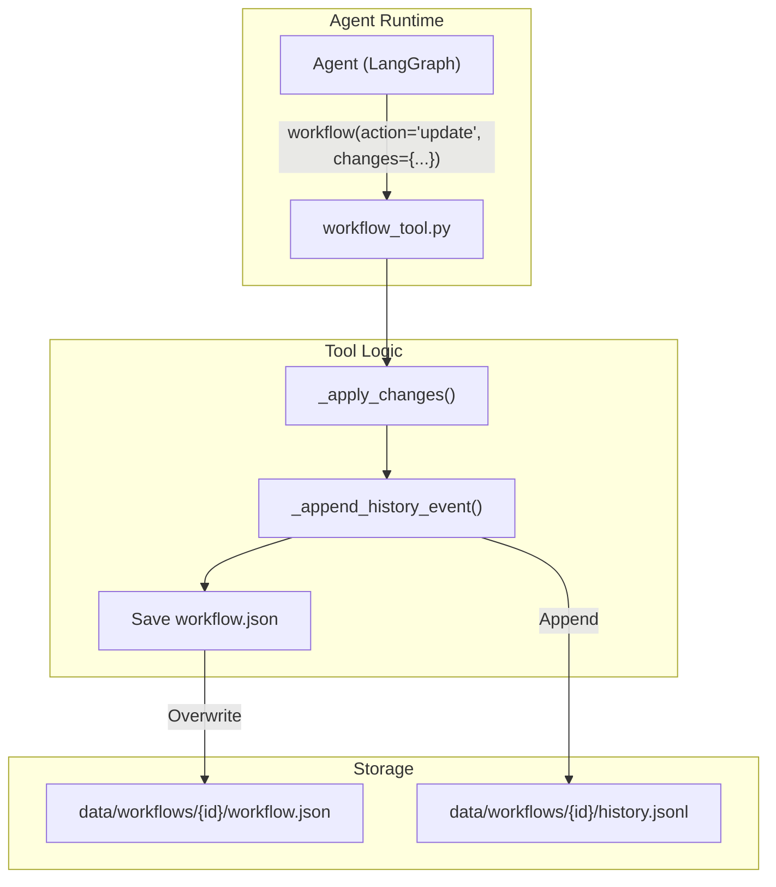
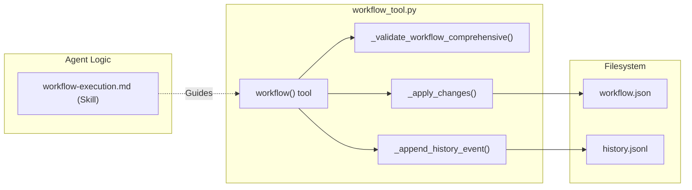

<!-- source: DeepWiki mcp.deepwiki.com · repo NVIDIA/Quantum-Calibration-Agent-Blueprint · page 8.2 Workflow Execution and State Management · fetched 2026-10-26 -->

# Workflow Execution and State Management

<details>
<summary>Relevant source files</summary>

The following files were used as context for generating this wiki page:

- [data/knowledge/documents/.gitkeep](data/knowledge/documents/.gitkeep)
- [data/knowledge/memory/workflow-preferences.md](data/knowledge/memory/workflow-preferences.md)
- [server.py](server.py)
- [tools/workflow_tool.py](tools/workflow_tool.py)

</details>


This page documents the node-by-node execution loop of the Quantum Calibration Agent (QCA) workflow system. It covers how the system identifies ready nodes, manages state transitions using dot-notation updates, maintains an immutable event log in `history.jsonl`, and handles complex execution scenarios like backtracking, pausing for human intervention, and resuming interrupted sessions.

## Execution Lifecycle and Node Selection

Workflow execution is a state-driven process managed by the `workflow` tool in [tools/workflow_tool.py](). The system does not use a centralized "orchestrator" process; instead, the Agent acts as the controller, using the `workflow` tool to query status and commit state changes as it executes the DAG defined in `workflow.json`.

### Node Selection Logic
The agent identifies the "next ready node" by inspecting the `nodes` array within the workflow state. A node is considered ready for execution if:
1. Its current `state` is `pending`.
2. All nodes listed in its `dependencies` array have a state of `success` (or `skipped` if the logic allows).

### State Transitions
Nodes transition through a defined set of states: `pending`, `running`, `success`, `failed`, and `skipped` [[tools/workflow_tool.py:31-31]](). The overall workflow status also transitions through `created`, `running`, `paused`, `completed`, and `failed` [[tools/workflow_tool.py:30-30]]().

| Node State | Description |
| :--- | :--- |
| `pending` | Initial state; waiting for dependencies to clear. |
| `running` | Node is currently being executed by the agent (e.g., running an experiment). |
| `success` | Node completed successfully and met its success criteria. |
| `failed` | Node execution failed or success criteria were not met. |
| `skipped` | Node was manually or automatically bypassed. |

Sources: [tools/workflow_tool.py:30-32](), [tools/workflow_tool.py:228-253]()

## State Management and Dot-Notation

The QCA system uses a flexible "dot-notation" mechanism to update nested workflow state without overwriting the entire JSON structure. This is implemented in the `_apply_changes` helper function.

### Implementation: `_apply_changes`
The function `_apply_changes(data, changes)` [[tools/workflow_tool.py:34-82]]() takes the current workflow dictionary and a map of updates. It supports three primary update patterns:

1.  **Top-level Keys**: `{"status": "running"}` updates the root status.
2.  **Nested Context**: `{"context.resonator_freq": 5.823}` updates the shared workflow context [[tools/workflow_tool.py:39-39]]().
3.  **Node-Specific State**: `{"nodes.node_id.state": "success"}`. The system automatically traverses the `nodes` list, finds the dictionary with the matching `id`, and updates its fields [[tools/workflow_tool.py:57-67]]().

### Data Flow: State Update Loop
The following diagram illustrates how the Agent interacts with the workflow state via the `workflow` tool.

**Workflow State Update Flow**

Sources: [tools/workflow_tool.py:34-82](), [tools/workflow_tool.py:444-469]()

## The Event Log (history.jsonl)

Every state change is recorded as an immutable event in a `history.jsonl` file located in the workflow's directory [[tools/workflow_tool.py:444-469]](). This provides a complete audit trail of the calibration process.

### Event Schema
Each line in `history.jsonl` is a JSON object containing:
- `timestamp`: ISO 8601 UTC timestamp.
- `action`: The tool action performed (e.g., "update").
- `changes`: The specific delta applied to the state.
- `comment`: An optional rationale provided by the agent.

### Example Log Entry
```json
{"timestamp": "2024-05-20T10:00:00Z", "action": "update", "changes": {"nodes.spec_1.state": "running"}, "comment": "Starting resonator spectroscopy."}
```
Sources: [tools/workflow_tool.py:444-469](), [tools/workflow_tool.py:482-506]()

## Human-in-the-Loop (HITL) and Resumption

The system supports pausing workflows for human intervention, typically when an experiment result is ambiguous or requires manual hardware adjustment.

### Pausing and Resuming
- **Pausing**: The agent sets the workflow status to `paused` using the `update` action.
- **Human Decision**: In the Web UI, the user can review the current state and plots.
- **Resuming**: The agent resumes by reading the latest state from `workflow.json`. Because the state is persisted to disk, the `server.py` can restart, or the agent's thread can be cleared, and the workflow can still be resumed by loading the `workflow_id` [[server.py:167-167]]().

### Backtracking and Skipping
The agent can "backtrack" by marking a previously `success` node as `pending`. Because the `workflow` tool simply applies the requested changes to the JSON, the agent has full autonomy to:
- Reset a branch of the DAG to re-run calibrations.
- Skip nodes that are no longer relevant based on new data.

## Implementation Details: Workflow Tool Actions

The `workflow` tool [[tools/workflow_tool.py:522-632]]() exposes several actions to the agent:

| Action | Code Reference | Description |
| :--- | :--- | :--- |
| `list` | [tools/workflow_tool.py:548-560]() | Lists all available workflow directories. |
| `status` | [tools/workflow_tool.py:568-577]() | Returns the full JSON content of `workflow.json`. |
| `update` | [tools/workflow_tool.py:587-606]() | Applies dot-notation changes and logs to history. |
| `validate` | [tools/workflow_tool.py:562-566]() | Runs comprehensive DAG and schema checks. |
| `history` | [tools/workflow_tool.py:579-585]() | Returns the list of events from `history.jsonl`. |

### DAG Validation
Before execution, the `_validate_workflow_comprehensive` function ensures the integrity of the workflow [[tools/workflow_tool.py:85-220]](). It checks for:
- **Circular Dependencies**: Ensures the graph is a valid DAG.
- **Node ID Uniqueness**: Prevents ambiguous state updates [[tools/workflow_tool.py:207-220]]().
- **Required Fields**: Validates that every node has an `id`, `name`, and `state` [[tools/workflow_tool.py:153-172]]().

**Code Entity Mapping: Workflow Execution**

Sources: [tools/workflow_tool.py:85-220](), [tools/workflow_tool.py:34-82](), [tools/workflow_tool.py:444-469](), [data/knowledge/skills/workflow-execution.md]() (referenced via context).

Sources: [tools/workflow_tool.py:1-632](), [server.py:108-113](), [server.py:167-167]()

---

