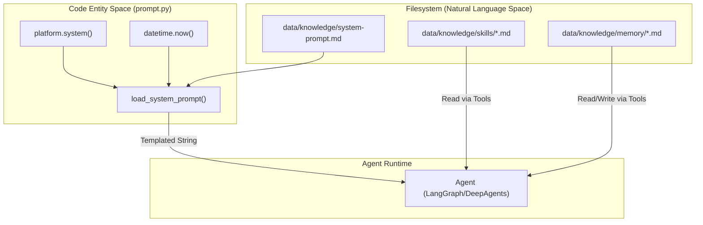
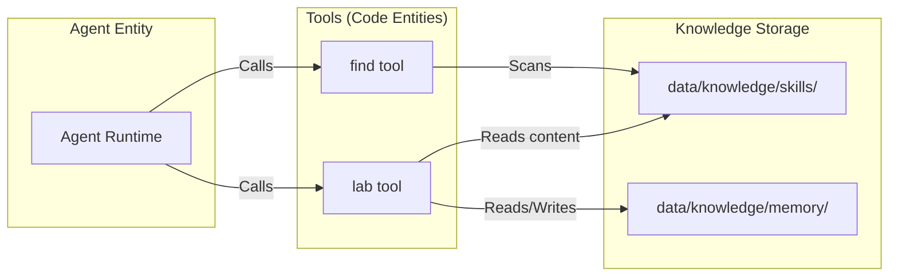

<!-- source: DeepWiki mcp.deepwiki.com · repo NVIDIA/Quantum-Calibration-Agent-Blueprint · page 9.1 Skills and System Prompt · fetched 2026-10-26 -->

# Skills and System Prompt

Relevant source files

The following files were used as context for generating this wiki page:

- [data/knowledge/skills/vlm-configuration.md](data/knowledge/skills/vlm-configuration.md)
- [docs/latest/user-guide/knowledge-base.mdx](docs/latest/user-guide/knowledge-base.mdx)
- [prompt.py](prompt.py)

The Quantum Calibration Agent (QCA) utilizes a dynamic knowledge-based approach to define agent behavior. Rather than hard-coding instructions, the system relies on a collection of markdown-based "Skills" and a templated "System Prompt" that is populated with runtime context. This architecture allows the agent to adapt to different operating systems, file structures, and specialized calibration tasks without modifying the core logic.

## System Prompt Loading and Templating

The agent's primary persona and operational constraints are defined in `data/knowledge/system-prompt.md`. This file is not used directly; instead, it is processed by a loader that injects environmental variables and directory paths to ensure the agent has an accurate view of its "world."

### Implementation: prompt.py

The `prompt.py` module serves as the entry point for generating the agent's instructions. It identifies the host platform and resolves relative paths for the agent's filesystem tools.

Key functions and logic in `prompt.py`:
*   **`load_system_prompt()`**: Reads `data/knowledge/system-prompt.md` and performs string replacement for specific placeholders [[prompt.py:43-77]]().
*   **Platform Detection**: It uses `platform.system()` to inform the agent whether it is operating in a Windows, macOS, or Linux environment, which affects how the agent suggests shell commands [[prompt.py:51-61]]().
*   **Path Resolution**: It calculates relative paths for `SCRIPTS_DIR`, `SKILLS_DIR`, and `MEMORY_DIR` relative to the project root. This ensures that when the agent uses the `find` or `lab` tools, it uses paths consistent with the project structure [[prompt.py:68-71]]().

### Runtime Placeholders
The following placeholders are defined in the `system-prompt.md` and replaced at runtime:

| Placeholder | Description | Example Value |
| :--- | :--- | :--- |
| `{{DATETIME}}` | Current system time | `2026-02-14 10:00:00` |
| `{{PLATFORM}}` | Operating System | `Linux (6.8.0)` |
| `{{SHELL}}` | Expected terminal | `bash` |
| `{{SCRIPTS_DIR}}` | Location of experiment scripts | `scripts` |
| `{{SKILLS_DIR}}` | Location of skill documents | `data/knowledge/skills` |
| `{{MEMORY_DIR}}` | Location of agent memory | `data/knowledge/memory` |

**Sources:** [[prompt.py:16-78]]()

## Skills: The Knowledge Base

The `data/knowledge/skills/` directory contains specialized markdown files that provide the agent with deep domain expertise. These files are treated as "long-term memory" or "standard operating procedures" that the agent can reference to perform complex tasks.

### Core Skill Documents

| File | Purpose |
| :--- | :--- |
| `experiment-execution.md` | Guidance on how to run experiments, handle errors, and interpret result codes. |
| `writing-experiment-scripts.md` | Technical specifications for the experiment contract, including `Annotated` types and return schemas [[docs/latest/user-guide/knowledge-base.mdx:71-71]](). |
| `workflow-planning.md` | Strategies for breaking down high-level calibration goals into a Directed Acyclic Graph (DAG) of nodes. |
| `workflow-execution.md` | Instructions on managing node states, handling pauses for human intervention, and resuming from failures. |
| `vlm-configuration.md` | Details on the Vision Language Model (VLM) provider settings and available models [[data/knowledge/skills/vlm-configuration.md:1-40]](). |
| `analysis-scripts.md` | Templates and logic for post-processing experiment data using Python [[docs/latest/user-guide/knowledge-base.mdx:70-70]](). |

### VLM Configuration Skill
The `vlm-configuration.md` file is particularly important as it documents how the agent can modify its own vision capabilities. It points the agent to `config.yaml` and specifies that changes to the `vlm` section take effect immediately without a system restart [[data/knowledge/skills/vlm-configuration.md:35-39]]().

**Sources:** [[data/knowledge/skills/vlm-configuration.md:1-40]](), [[docs/latest/user-guide/knowledge-base.mdx:6-19]](), [[docs/latest/user-guide/knowledge-base.mdx:50-55]]()

## Data Flow: From File to Agent

The following diagram illustrates how the static knowledge files and runtime environment are merged into the final system prompt used by the LLM.

### System Prompt Assembly

**Sources:** [[prompt.py:43-77]](), [[docs/latest/user-guide/knowledge-base.mdx:63-74]]()

## Agent Interaction with Skills

The agent does not ingest all skill files into its context window at once to save tokens. Instead, it uses tools to interact with the knowledge base dynamically.

### Knowledge Access Patterns

1.  **Discovery**: The agent uses the `find` tool to locate relevant markdown files in `{{SKILLS_DIR}}`.
2.  **Retrieval**: The agent uses the `lab` tool (specifically the `knowledge` actions) to read the content of a specific skill file into its context window.
3.  **Application**: The agent follows the instructions in the skill file to execute experiments or plan workflows.

**Sources:** [[docs/latest/user-guide/knowledge-base.mdx:22-39]](), [[prompt.py:27-34]]()

---

