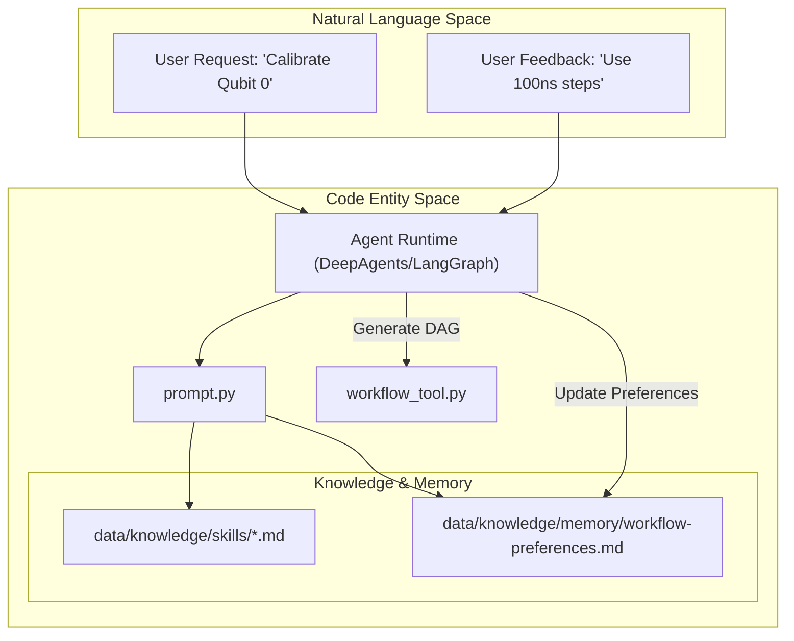
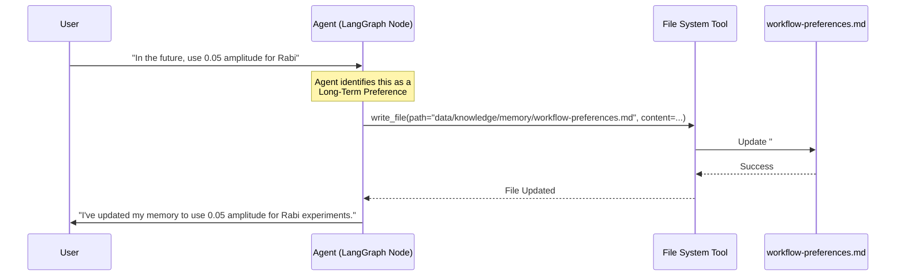

<!-- source: DeepWiki mcp.deepwiki.com · repo NVIDIA/Quantum-Calibration-Agent-Blueprint · page 9.2 Agent Memory · fetched 2026-10-26 -->

# Agent Memory

<details>
<summary>Relevant source files</summary>

The following files were used as context for generating this wiki page:

- [data/knowledge/documents/.gitkeep](data/knowledge/documents/.gitkeep)
- [data/knowledge/memory/workflow-preferences.md](data/knowledge/memory/workflow-preferences.md)

</details>


The Agent Memory system provides a mechanism for the Quantum Calibration Agent (QCA) to persist learned preferences, user-specific constraints, and operational conventions across different sessions. Unlike the static knowledge base (skills and documents), the memory layer is dynamic; the agent is instructed to read from it during the planning phase and update it when the user provides explicit corrections or feedback regarding workflow construction.

## Memory Architecture

The memory system is structured to distinguish between immutable system instructions and mutable agent-managed knowledge. It resides within the `data/knowledge/memory/` directory.

### Static vs. Dynamic Knowledge
The QCA utilizes three distinct tiers of information to inform its reasoning:

| Tier | Directory | Purpose | Mutability |
| :--- | :--- | :--- | :--- |
| **Skills** | `data/knowledge/skills/` | Markdown files describing tool usage and domain logic. | Static (System-defined) |
| **Documents** | `data/knowledge/documents/` | Reference materials for quantum hardware or protocols. | Static (User-provided) |
| **Memory** | `data/knowledge/memory/` | Long-term storage for user preferences and workflow patterns. | Dynamic (Agent-updated) |

### Memory File Structure
The primary interface for long-term memory is `workflow-preferences.md` [data/knowledge/memory/workflow-preferences.md:1-20](). This file is organized into four key sections that the agent monitors:

1.  **Success Criteria**: Specific thresholds or metrics the user considers a "pass" for calibration steps.
2.  **Parameter Conventions**: Preferred ranges or step sizes for specific experiments (e.g., "always use 50 points for Rabi sweeps").
3.  **Device-Specific Settings**: Qubit-specific or resonator-specific constants that should be applied globally.
4.  **Workflow Patterns**: Reusable sequences of nodes that have proven successful in the past.

## Data Flow: Read/Write Lifecycle

The agent interacts with its memory during the workflow planning and execution cycle. This ensures that the agent "learns" from human-in-the-loop (HITL) interactions.

### The Planning Read Loop
When a user requests a new calibration plan, the agent performs the following steps:
1.  **Context Loading**: The agent loads the system prompt via `prompt.py`.
2.  **Memory Retrieval**: The agent reads the current state of `workflow-preferences.md` [data/knowledge/memory/workflow-preferences.md:1-3]().
3.  **Constraint Integration**: The agent incorporates recorded preferences (e.g., "Success Criteria") into the proposed `workflow.json` DAG.

### The Correction Write Loop
If a user rejects a plan or provides feedback (e.g., "Don't use such a large step size for Ramsey"), the agent is programmed to:
1.  **Acknowledge Correction**: Update the immediate conversation state.
2.  **Persist Knowledge**: Use its internal file-writing capabilities to append or modify the relevant section in `workflow-preferences.md` [data/knowledge/memory/workflow-preferences.md:3-3]().

### Diagram: Memory Integration in Workflow Planning
The following diagram illustrates how the `AgentRuntime` interacts with the filesystem to synthesize a plan based on both static skills and dynamic memory.


**Sources:** [data/knowledge/memory/workflow-preferences.md:1-20](), [data/knowledge/skills/workflow-planning.md:1-50]() (referenced by purpose).

## Implementation Details

### Workflow Preferences File
The `workflow-preferences.md` file acts as a semi-structured log. Initially, it contains placeholders for the agent to fill [data/knowledge/memory/workflow-preferences.md:5-20]().

```markdown
## Success Criteria
*No preferences recorded yet.*

## Parameter Conventions
*No preferences recorded yet.*
```

### Agent-Driven Updates
The agent uses its file manipulation tools to modify this document. This is typically triggered when:
*   A user explicitly says: "Remember to always..."
*   The user corrects a generated `workflow.json` parameter.
*   A specific experiment consistently fails with default parameters but succeeds with user-suggested ones.

### Diagram: Data Flow for Memory Persistence
This diagram maps the transition from a user's natural language instruction to the physical update of the memory file.


**Sources:** [data/knowledge/memory/workflow-preferences.md:1-11]().

## Key Memory Sections

| Section | Description | Code/Logic Impact |
| :--- | :--- | :--- |
| **Success Criteria** | Thresholds for `status: success` in workflow nodes. | Informs the `success_criteria` field in `workflow.json`. |
| **Parameter Conventions** | Default values for `ExperimentSchema`. | Overrides default values during `run_experiment` tool calls. |
| **Device-Specific Settings** | Constants for specific hardware IDs. | Used to populate the `params` dictionary in node definitions. |
| **Workflow Patterns** | Sequences of dependent experiments. | Influences the structure of the DAG generated by the agent. |

**Sources:** [data/knowledge/memory/workflow-preferences.md:5-17]().

---

