# Page: Overview

# Overview

<details>
<summary>Relevant source files</summary>

The following files were used as context for generating this wiki page:

- [.env.example](.env.example)
- [README.md](README.md)
- [config.yaml](config.yaml)
- [fern/docs.yml](fern/docs.yml)
- [pyproject.toml](pyproject.toml)

</details>


The **Quantum Calibration Agent (QCA)** is a reference blueprint designed for AI-powered quantum device calibration. It leverages Large Language Models (LLMs) and Vision Language Models (VLMs) to automate the discovery, execution, and analysis of quantum experiments [README.md:1-7]().

By providing an intelligent agent layer over standard calibration scripts, QCA enables researchers to interact with quantum hardware using natural language, execute complex multi-step workflows, and perform visual data inspection through an integrated VLM pipeline [README.md:14-24]().

## Key Capabilities

*   **Intelligent Experiment Discovery**: Automatically scans and parses Python experiment scripts using AST to understand parameter requirements and constraints [README.md:18-18]().
*   **AI-Driven Execution**: Supports natural language commands to run experiments, with the agent handling parameter validation and subprocess management [README.md:19-19]().
*   **Visual Analysis**: Integrates VLMs to "see" and interpret Plotly-generated charts, enabling automated qualitative assessment of calibration results [README.md:20-20]().
*   **Workflow Automation**: Orchestrates Directed Acyclic Graphs (DAGs) of experiments with state tracking and human-in-the-loop (HITL) pause/resume capabilities [README.md:21-21]().
*   **Hybrid Storage**: Maintains a complete history of executions using SQLite for metadata indexing and HDF5 for high-performance numerical array storage [README.md:22-22]().

**Sources:** [README.md:14-24](), [pyproject.toml:7-22]()

## System Topology

The QCA system is composed of three primary layers: the **User Interface**, the **Agent Runtime**, and the **Core Engine**.

### High-Level System Relationship
The following diagram illustrates how natural language intent flows from the interfaces through the agent logic into the core execution modules.

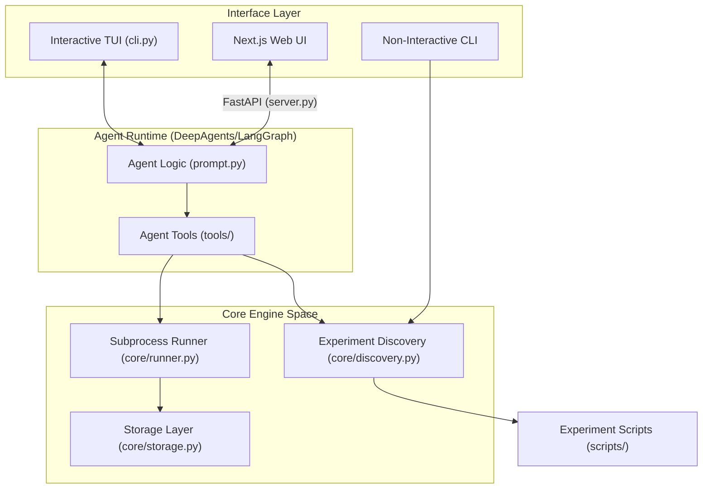
**Sources:** [README.md:60-87](), [pyproject.toml:37-46](), [config.yaml:16-30]()

## Major Subsystems

### 1. Interaction Interfaces
Users can interact with QCA through three primary modes:
*   **Web UI**: A Next.js application providing a rich chat interface and experiment visualization [README.md:62-72]().
*   **Interactive TUI**: A terminal-based conversational interface powered by `deepagents-cli` [README.md:90-90](), [pyproject.toml:9-9]().
*   **Command Line**: Direct subcommands for listing experiments, running scripts, and managing history [README.md:98-132]().

For details, see [Getting Started](#1.1).

### 2. The Agent Layer
The brain of the system is a LangGraph-based agent that uses a specialized system prompt to understand quantum calibration domains [prompt.py:1-50](). It utilizes a suite of tools to interact with the rest of the system, including `run_experiment`, `vlm_inspect`, and `workflow` tools.

For details, see [Architecture Overview](#1.2).

### 3. Core Execution and Storage
The backend logic is decoupled from the agent. The **Discovery** module uses static analysis to find experiments in the `scripts/` directory [pyproject.toml:46-46](). The **Runner** executes these as isolated subprocesses to ensure environment stability. All results are persisted in a structured hierarchy of SQLite and HDF5 files.

### Code Entity Mapping
This diagram bridges the conceptual subsystems to the specific code entities that implement them.

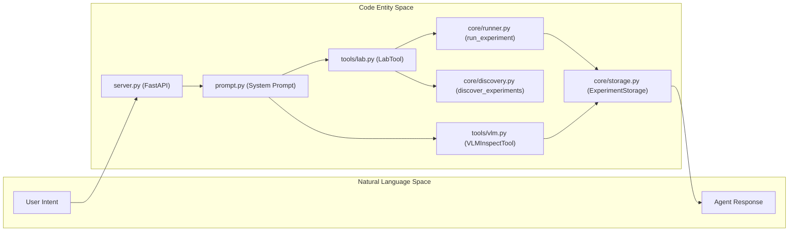
**Sources:** [pyproject.toml:37-46](), [config.yaml:32-39](), [README.md:100-132]()

## Project Structure

| Directory/File | Description |
| :--- | :--- |
| `core/` | Logic for experiment discovery, execution, and data storage. |
| `tools/` | LangChain-compatible tools that the agent uses to perform actions. |
| `vlm/` | Vision Language Model provider abstractions and plot rendering. |
| `scripts/` | The library of Python quantum calibration experiments. |
| `ui/` | Next.js frontend and the development proxy gateway. |
| `data/knowledge/` | Markdown files providing domain expertise to the agent. |
| `server.py` | FastAPI entry point for the Web UI. |
| `cli.py` | Typer-based entry point for the TUI and CLI. |

**Sources:** [pyproject.toml:37-46](), [README.md:135-141]()

---

### Next Steps
*   To set up the environment and run your first experiment, see **[Getting Started](#1.1)**.
*   To understand the technical design and data flow, see **[Architecture Overview](#1.2)**.

---

# Page: Getting Started

# Getting Started

<details>
<summary>Relevant source files</summary>

The following files were used as context for generating this wiki page:

- [.env.example](.env.example)
- [README.md](README.md)
- [config.yaml](config.yaml)
- [docs/latest/quick-start/index.mdx](docs/latest/quick-start/index.mdx)
- [docs/latest/quick-start/installation.mdx](docs/latest/quick-start/installation.mdx)
- [fern/docs.yml](fern/docs.yml)
- [pyproject.toml](pyproject.toml)

</details>


This guide provides step-by-step instructions for setting up the Quantum Calibration Agent (QCA). It covers prerequisites, installation, environment configuration, and the various ways to launch the system.

## Prerequisites

Before installing QCA, ensure your environment meets the following requirements:

*   **Python 3.11+**: Required for the backend and agent runtime [pyproject.toml:6-6]().
*   **Node.js 18+ & npm 9+**: Required for building and running the Next.js Web UI [README.md:31-31]().
*   **API Credentials**: An API key from a supported LLM provider.
    *   **NVIDIA API Catalog** (Default): [build.nvidia.com](https://build.nvidia.com/) [README.md:33-33]().
    *   **Anthropic**: [console.anthropic.com](https://console.anthropic.com/) [README.md:34-34]().
    *   **OpenAI**: [platform.openai.com](https://platform.openai.com/) [README.md:35-35]().

Sources: [README.md:28-35](), [pyproject.toml:6-6]()

---

## Installation

Follow these steps to clone the repository and set up the Python and Node.js environments.

### 1. Clone and Python Setup
```bash
# Clone the repository
git clone https://github.com/NVIDIA/Quantum-Calibration-Agent-Blueprint.git
cd Quantum-Calibration-Agent-Blueprint

# Create and activate virtual environment
python -m venv .venv
source .venv/bin/activate  # Windows: .venv\Scripts\activate

# Install the package in editable mode with development dependencies
pip install -e ".[test,docs]"
```
The `pip install -e .` command installs core dependencies including `deepagents`, `langchain-nvidia-ai-endpoints`, `fastapi`, and `plotly` [pyproject.toml:7-22]().

### 2. Web UI Setup
```bash
# Install frontend dependencies
cd ui
npm install
cd ..
```

Sources: [README.md:39-50](), [pyproject.toml:1-38](), [docs/latest/quick-start/index.mdx:18-36]()

---

## Configuration

QCA uses a combination of a `.env` file for secrets and a `config.yaml` for system-level settings.

### Environment Variables (.env)
Create a `.env` file by copying the provided example:
```bash
cp .env.example .env
```
Edit the `.env` file to include your API keys and preferred model:

| Variable | Description | Example |
| :--- | :--- | :--- |
| `NVIDIA_API_KEY` | Key for NVIDIA API Catalog | `nvapi-your-key` |
| `QCA_MODEL` | Provider and model string | `nvidia:nvidia/nemotron-3-nano-30b-a3b` |
| `QCAL_SCRIPTS_DIR` | Path to experiment scripts | `./scripts` |

### System Configuration (config.yaml)
The `config.yaml` file defines the backend server parameters and VLM (Vision Language Model) defaults:

*   **Backend**: Configures the FastAPI server host, port, and endpoint paths [config.yaml:16-29]().
*   **VLM**: Sets the default provider (e.g., `"nvidia"`), model, and sampling parameters for visual analysis [config.yaml:32-38]().

### Configuration Data Flow
The following diagram illustrates how configuration files are consumed by the system entities.

**Configuration Ingestion Flow**
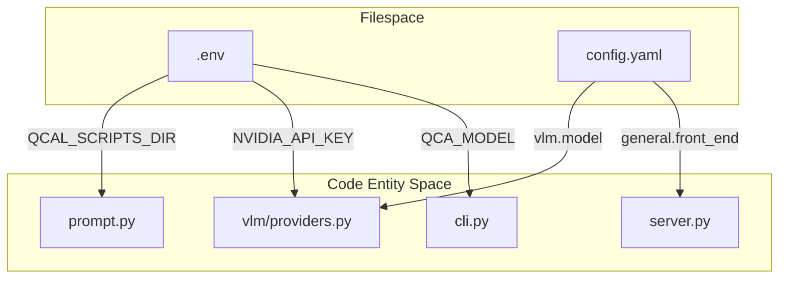
Sources: [.env.example:1-21](), [config.yaml:16-54](), [docs/latest/quick-start/installation.mdx:69-105]()

---

## Launching the System

You can interact with QCA through three primary interfaces.

### 1. Full System (Web UI + Backend)
This is the recommended mode for visual experiment analysis and workflow monitoring.

*   **Start Backend**: `qca serve` launches the FastAPI server defined in `server.py` [README.md:66-66]().
*   **Start Web UI**: `cd ui && npm run dev` starts the Next.js development server [README.md:69-69]().
*   **Access**: Open `http://localhost:3000`.

### 2. Interactive TUI
For a rich terminal experience, simply run:
```bash
qca
```
This invokes the `main` function in `cli.py` [pyproject.toml:38-38](), launching an interactive Terminal User Interface (TUI) powered by `deepagents-cli` [README.md:77-78]().

### 3. Non-Interactive CLI
You can execute specific tasks directly from the shell without entering an interactive session:
```bash
# List all discovered experiments
qca experiments list

# Run a specific calibration script
qca experiments run t1_measurement

# Check the status of an automated workflow
qca workflow status <workflow_id>
```

### System Launch Sequence
This diagram shows the relationship between the user commands and the underlying code execution.

**Execution Entry Points**
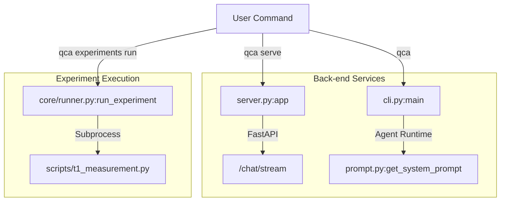

Sources: [README.md:62-86](), [pyproject.toml:37-38](), [docs/latest/quick-start/index.mdx:53-105]()

---

## Verifying the Setup

To ensure everything is configured correctly, run the following verification commands:

1.  **Check CLI Version**: `qca --version` should return `qca 0.1.0` [docs/latest/quick-start/installation.mdx:59-67]().
2.  **Test Discovery**: `qca experiments list` should display the built-in scripts like `t1_measurement` and `qubit_spectroscopy` [docs/latest/quick-start/index.mdx:95-97]().
3.  **Test Backend API**: With `qca serve` running, verify the endpoint:
    ```bash
    curl http://localhost:8000/api/experiments/list
    ```

Sources: [docs/latest/quick-start/index.mdx:106-121](), [docs/latest/quick-start/installation.mdx:106-130]()

---

# Page: Architecture Overview

# Architecture Overview

<details>
<summary>Relevant source files</summary>

The following files were used as context for generating this wiki page:

- [.env.example](.env.example)
- [README.md](README.md)
- [docs/latest/developer-guide/architecture.mdx](docs/latest/developer-guide/architecture.mdx)
- [fern/docs.yml](fern/docs.yml)
- [pyproject.toml](pyproject.toml)
- [server.py](server.py)

</details>


The Quantum Calibration Agent (QCA) is a multi-layered system designed to bridge high-level natural language intent with low-level quantum experiment execution. It leverages the `DeepAgents` framework to provide an autonomous agent capable of discovering experiments, managing complex workflows, and performing visual analysis of calibration data.

## System Topology

The QCA architecture consists of three primary interaction layers: the **Web UI**, the **CLI/TUI**, and the **FastAPI Backend**. These layers communicate with a central **Agent Layer** built on `LangGraph`, which orchestrates tools to interact with the **Core Engine** (Discovery, Execution, and Storage).

### High-Level Component Diagram

This diagram illustrates the relationship between the user interfaces, the agentic reasoning core, and the underlying experiment infrastructure.

```mermaid
graph TB
    subgraph "Interface Layer"
        [Web_UI] -- "HTTP/SSE" --> [FastAPI_Server]
        [CLI_TUI] -- "Direct Call" --> [Agent_Runtime]
    end

    subgraph "Agent Layer (LangGraph)"
        [FastAPI_Server] -- "Invoke" --> [Agent_Runtime]
        [Agent_Runtime] --> [System_Prompt]
        [Agent_Runtime] <--> [Tools_Registry]
    end

    subgraph "Core Engine"
        [Tools_Registry] --> [Experiment_Discovery]
        [Tools_Registry] --> [Experiment_Runner]
        [Tools_Registry] --> [Workflow_Manager]
        [Tools_Registry] --> [Storage_Layer]
    end

    subgraph "Data & Scripts"
        [Experiment_Discovery] --> [Python_Scripts]
        [Experiment_Runner] --> [Subprocess_Execution]
        [Storage_Layer] --> [SQLite_HDF5]
    end

    [Web_UI]:::interface
    [FastAPI_Server]:::interface
    [CLI_TUI]:::interface
```
**Sources:** [README.md:14-24](), [docs/latest/developer-guide/architecture.mdx:19-70](), [server.py:16-23]()

---

## Major Subsystems

### 1. Python Backend (FastAPI & CLI)
The backend serves as the orchestration hub. It is responsible for:
*   **Agent Initialization**: Loading the `ChatNVIDIA` or other LLM providers and binding them to the `LocalShellBackend` [server.py:73-91](), [server.py:126-159]().
*   **API Endpoints**: Providing REST and Streaming (SSE) endpoints for the Web UI to interact with the agent [server.py:185-194]().
*   **CLI Entrypoint**: The `qca` command (defined in `cli.py`) allows for both interactive TUI sessions and non-interactive command execution [pyproject.toml:37-38](), [README.md:98-107]().

### 2. Agent Layer (DeepAgents / LangGraph)
The agent is constructed using `create_deep_agent` from the `DeepAgents` library [server.py:149-156](). It uses a `MemorySaver` checkpointer to maintain conversation state across turns [server.py:136]().
*   **Tools**: The agent is equipped with specialized tools: `lab` (querying), `run_experiment` (execution), `workflow` (multi-step logic), and `vlm_inspect` (visual analysis) [server.py:94-123]().
*   **System Prompt**: A dynamic prompt is loaded from `data/knowledge/system-prompt.md` and templated with runtime context [server.py:134](), [server.py:47]().

### 3. Core Engine
The Core Engine is the "Code Entity Space" where the actual work happens:
*   **Discovery**: Uses AST parsing in `core/discovery.py` to scan the `scripts/` directory and extract `ExperimentSchema` from Python type hints [server.py:46]().
*   **Runner**: Manages the execution of experiment scripts as isolated subprocesses, capturing logs and JSON results [README.md:93-94]().
*   **Storage**: A dual-tier system using **SQLite** for metadata indexing and **HDF5** for high-performance numerical array storage [README.md:22](), [server.py:46]().

### 4. Next.js Web UI
A modern frontend located in the `ui/` directory. It communicates with the FastAPI server through a proxy gateway that handles Server-Sent Events (SSE) for real-time agent responses [README.md:68-72]().

---

## Data Flow: Natural Language to Code Execution

The following diagram traces a user request (e.g., "Run a T1 measurement on qubit 0") from the Natural Language Space into the specific code entities that handle the request.

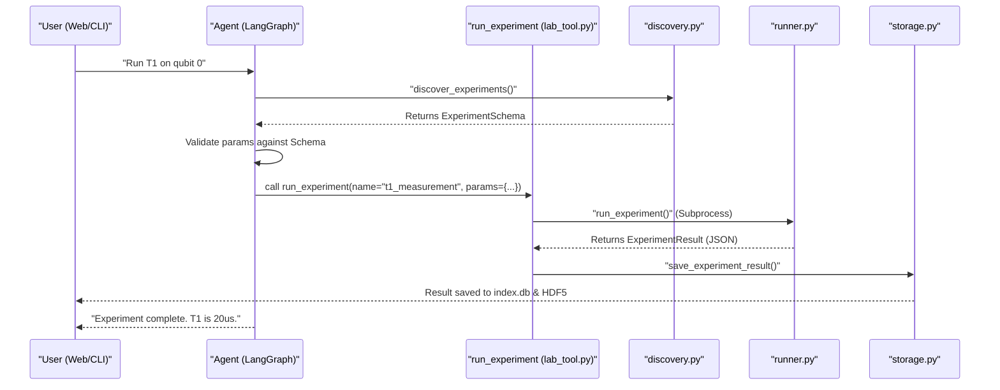
**Sources:** [server.py:94-123](), [server.py:218-230](), [README.md:18-22](), [docs/latest/developer-guide/architecture.mdx:19-70]()

---

## Implementation Details

### Component Mapping

| Subsystem | Primary Code Entities | Responsibility |
| :--- | :--- | :--- |
| **Server** | `server.py`, `app = FastAPI()` | Hosting API, SSE streaming, and agent lifecycle. |
| **Agent** | `create_deep_agent`, `LocalShellBackend` | Reasoning, tool selection, and state management. |
| **Tools** | `lab_tool.py`, `workflow_tool.py`, `vlm_tool.py` | Bridging LLM actions to Python functions. |
| **Discovery** | `core/discovery.py`, `discover_experiments` | Extracting schemas from `scripts/*.py` via AST. |
| **Execution** | `core/runner.py`, `run_experiment` | Subprocess management and parameter validation. |
| **Storage** | `core/storage.py`, `SQLite`, `HDF5` | Persistent storage of metadata and large arrays. |
| **Vision** | `vlm/renderer.py`, `vlm/providers.py` | Converting Plotly JSON to PNG for VLM analysis. |

### Directory Structure
The codebase is organized to separate the agent logic from the experiment logic:
*   `core/`: Internal logic for data, discovery, and execution.
*   `tools/`: LangChain-compatible tool definitions.
*   `scripts/`: User-provided Python experiment scripts (the "Apparatus").
*   `vlm/`: Vision Language Model provider abstractions.
*   `ui/`: Next.js frontend source code.
*   `data/`: Persistent storage (SQLite DB, HDF5 files, and Knowledge Base).

**Sources:** [pyproject.toml:44-46](), [server.py:56-64](), [README.md:133-142]()

---

# Page: CLI and Agent Interface

# CLI and Agent Interface

<details>
<summary>Relevant source files</summary>

The following files were used as context for generating this wiki page:

- [.env.example](.env.example)
- [README.md](README.md)
- [cli.py](cli.py)
- [core/__init__.py](core/__init__.py)
- [docs/latest/user-guide/cli-overview.mdx](docs/latest/user-guide/cli-overview.mdx)
- [fern/docs.yml](fern/docs.yml)

</details>


The Quantum Calibration Agent (QCA) provides a multi-modal interface for interacting with quantum hardware. Users can engage with the system via a high-level conversational agent (Natural Language Space) or through direct, deterministic commands (Code Entity Space). The underlying agent runtime leverages LangGraph and the DeepAgents framework to bridge these spaces, allowing natural language prompts to trigger structured Python experiments and workflows.

## Interaction Modes

QCA supports three primary interaction modes, all accessible via the `qca` entry point defined in [cli.py:18-40]().

| Mode | Command | Description |
| :--- | :--- | :--- |
| **Interactive TUI** | `qca` | A terminal user interface featuring a chat window, tool execution logs, and real-time status updates [cli.py:21](). |
| **Non-Interactive** | `qca -n "prompt"` | Executes a single natural language task and exits, useful for scripting [cli.py:23](). |
| **Direct CLI** | `qca <subcommand>` | Bypasses the LLM to execute specific functions like `experiments run` or `workflow status` [cli.py:25-39](). |

For a detailed breakdown of every command and flag, see [CLI Commands Reference](#2.1).

## Agent Runtime

The QCA agent is an autonomous loop that processes user input, selects appropriate tools, and executes them to fulfill requests. It is built on the `deepagents` framework and utilizes a system prompt that defines its persona as a quantum calibration expert.

### Model Selection and Configuration
The agent's "brain" is configured via the `QCA_MODEL` environment variable. QCA supports multiple providers through a unified interface in `cli.py`:
*   **NVIDIA**: Default provider using `ChatNVIDIA` for optimized inference [cli.py:74-80]().
*   **Anthropic/OpenAI**: Supported via `init_chat_model` [cli.py:82-86]().

### Tool Integration
The agent does not perform calibration directly; instead, it invokes specialized tools. These tools act as the bridge between the agent's reasoning and the `core` engine. Key tools include:
*   `lab`: Queries experiment schemas and history [tools/lab.py]().
*   `run_experiment`: Executes Python scripts in the `scripts/` directory [tools/run_experiment.py]().
*   `workflow`: Manages multi-step DAG execution [tools/workflow.py]().
*   `vlm_inspect`: Sends plots to a Vision Language Model for analysis [tools/vlm_inspect.py]().

For details on how the agent is constructed and the logic within its system prompt, see [Agent Runtime and System Prompt](#2.2).

## System Topology: Language to Execution

The following diagrams illustrate how user intent in "Natural Language Space" is mapped to specific code entities and execution flows within the "Code Entity Space."

### Intent Mapping Diagram
This diagram shows how different `qca` CLI modes route requests to the underlying system components.

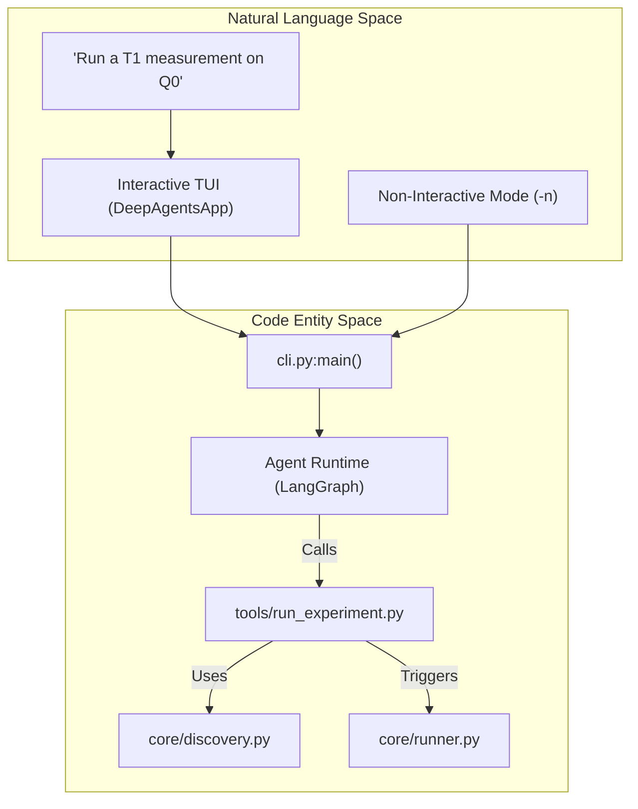
**Sources:** [cli.py:18-40](), [docs/latest/user-guide/cli-overview.mdx:8-48]()

### Component Interaction Diagram
This diagram maps the internal Python classes and functions responsible for fulfilling an agent's tool call.

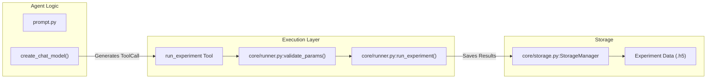
**Sources:** [cli.py:68-86](), [README.md:18-22](), [docs/latest/user-guide/cli-overview.mdx:140-163]()

## Child Pages

*   **[CLI Commands Reference](#2.1)**: Detailed reference for all `qca` CLI subcommands including `experiments`, `history`, `data`, and `workflow`.
*   **[Agent Runtime and System Prompt](#2.2)**: Technical details on the LangGraph construction, the `prompt.py` templating system, and model provider configuration.

**Sources:**
*   [README.md:98-132]() (Command summaries)
*   [cli.py:18-104]() (CLI structure and branding)
*   [.env.example:1-16]() (Model configuration)
*   [docs/latest/user-guide/cli-overview.mdx:1-171]() (Command usage and examples)

---

# Page: CLI Commands Reference

# CLI Commands Reference

<details>
<summary>Relevant source files</summary>

The following files were used as context for generating this wiki page:

- [cli.py](cli.py)
- [core/__init__.py](core/__init__.py)
- [docs/latest/user-guide/cli-overview.mdx](docs/latest/user-guide/cli-overview.mdx)
- [docs/latest/user-guide/experiments/running-experiments.mdx](docs/latest/user-guide/experiments/running-experiments.mdx)

</details>


The `qca` command-line interface is the primary entry point for interacting with the Quantum Calibration Agent. It provides a multi-modal interface that supports an interactive Text User Interface (TUI), a non-interactive agent mode for automated tasks, a FastAPI backend server for the Web UI, and a suite of low-level subcommands for direct system management.

## System Entry Point and Global Options

The CLI is implemented using the `typer` library in `cli.py`. It serves as a dispatcher that routes requests to either the `deepagents-cli` runtime (for agentic interaction) or specific core modules (for experiment and workflow management).

### Execution Modes

| Mode | Command | Implementation |
| :--- | :--- | :--- |
| **Interactive TUI** | `qca` | Launches `DeepAgentsApp` with custom NVIDIA branding [cli.py:159-163](). |
| **Non-Interactive** | `qca -n "task"` | Executes a single prompt through the agent and exits [cli.py:530-534](). |
| **Backend Server** | `qca serve` | Starts the FastAPI server defined in `server.py` [cli.py:561-570](). |
| **Subcommands** | `qca <group> <cmd>` | Direct execution of logic without LLM intervention [cli.py:580-1120](). |

### Global Flags
*   `--non-interactive` (`-n`): Run a single agent task and exit [cli.py:530]().
*   `--model`: Override the default model (Default: `QCA_MODEL` env var) [cli.py:65]().
*   `--resume` (`-r`): Resume a specific conversation thread ID [cli.py:541]().
*   `--auto-approve` (`-y`): Skip manual confirmation for tool calls [cli.py:535]().

**Sources:** [cli.py:18-40](), [cli.py:520-555](), [docs/latest/user-guide/cli-overview.mdx:38-48]()

---

## Experiments Subcommands

The `experiments` group manages the discovery, validation, and execution of quantum calibration scripts located in the `scripts/` directory.

### `experiments list`
Scans the `scripts/` directory using `discover_experiments()` to identify valid experiment functions.
*   **Data Flow**: `cli.py` → `core/discovery.py:discover_experiments()` → `core/discovery.py:_extract_schema_from_file()`.
*   **Output**: Returns a list of experiment names and brief descriptions [cli.py:586-608]().

### `experiments schema <name>`
Retrieves the detailed parameter specification for a specific experiment.
*   **Implementation**: Uses `get_experiment_schema(name)` which parses Python type hints and `Annotated` metadata [core/discovery.py:133-146]().
*   **Details**: Includes parameter types, default values, and valid ranges [docs/latest/user-guide/experiments/running-experiments.mdx:42-70]().

### `experiments validate <path>`
Performs a static analysis of a Python script to ensure it conforms to the QCA experiment contract.
*   **Checks**: Verifies the existence of a public function, a `-> dict` return annotation, and typed parameters [cli.py:633-657]().

### `experiments run <name>`
Executes an experiment in a managed subprocess.
*   **Implementation**: Calls `run_experiment()` in `core/runner.py`.
*   **Logic**:
    1.  Validates input `--params` against the discovered schema [core/runner.py:126-128]().
    2.  Spawns a subprocess using a wrapper that captures `stdout`/`stderr` [core/runner.py:184-210]().
    3.  Saves the resulting `ExperimentResult` to the HDF5/SQLite storage via `save_experiment()` [core/storage.py:165-210]().

**CLI to Core Mapping: Experiment Execution**

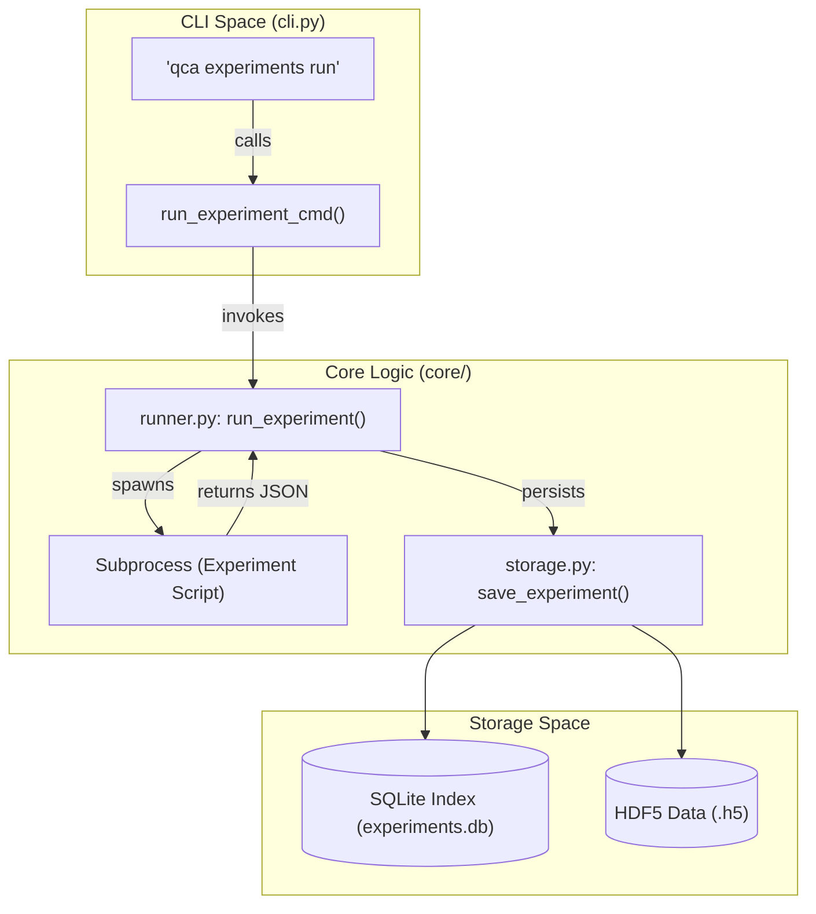
**Sources:** [cli.py:580-705](), [core/discovery.py:30-60](), [core/runner.py:110-150](), [docs/latest/user-guide/experiments/running-experiments.mdx:81-108]()

---

## History and Data Subcommands

These commands provide administrative access to the `data/` directory, allowing users to query past results and extract raw arrays.

### `history list`
Queries the SQLite index for past runs.
*   **Options**: `--type` (filter by script), `--last` (limit results) [cli.py:724-730]().
*   **Implementation**: Calls `list_experiments()` in `core/storage.py` [core/storage.py:270-305]().

### `history show <id>`
Displays all metadata, scalar results, and available data keys for a specific run ID [cli.py:769-805]().

### `data arrays <id>`
Lists the names of all multi-dimensional arrays stored within a specific experiment's HDF5 file [cli.py:863-884]().

### `data get <id> <array_name>`
Retrieves raw numerical data for a specific array.
*   **Implementation**: `get_array_data(experiment_id, array_name)` [core/storage.py:388-410]().
*   **Data Flow**: Opens the HDF5 file at `data/experiments/YYYY/MM/DD/<id>.h5` and reads the specified dataset [core/storage.py:395-400]().

**Sources:** [cli.py:710-915](), [core/storage.py:20-50](), [docs/latest/user-guide/cli-overview.mdx:171-230]()

---

## Workflow Subcommands

The `workflow` group manages long-running, multi-step calibration DAGs (Directed Acyclic Graphs).

### `workflow list`
Lists all workflow definitions (`workflow.json`) found in the `data/workflows/` directory [cli.py:925-945]().

### `workflow status <id>`
Displays the current execution state of a workflow, including which nodes are `pending`, `running`, `success`, or `failed` [cli.py:976-1002]().

### `workflow watch <id>`
Provides a live-updating view of the workflow's progress using a `rich.live.Live` display [cli.py:1100-1120](). It polls the workflow state every 2 seconds.

### `workflow validate <id>`
Checks a workflow JSON file for structural integrity, ensuring all dependencies exist and there are no circular references [cli.py:1029-1052]().

**CLI to Code Entity Association: Workflow Management**

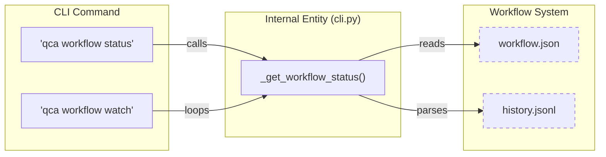
**Sources:** [cli.py:920-1120](), [docs/latest/user-guide/cli-overview.mdx:260-310]()

---

## The `serve` Command

The `qca serve` command initializes the system's web backend.

*   **Command**: `qca serve [--host HOST] [--port PORT]` [cli.py:561]().
*   **Implementation**:
    1.  Imports `uvicorn`.
    2.  Launches the FastAPI app defined in `server.py` [cli.py:568-570]().
*   **Responsibilities**:
    *   Exposes REST endpoints for the Web UI [server.py:50-100]().
    *   Manages the streaming agent interface via `/chat/stream` [server.py:144-160]().
    *   Spawns background processes for workflow execution [server.py:440-460]().

**Sources:** [cli.py:561-570](), [server.py:1-40]()

---

# Page: Agent Runtime and System Prompt

# Agent Runtime and System Prompt

<details>
<summary>Relevant source files</summary>

The following files were used as context for generating this wiki page:

- [cli.py](cli.py)
- [config.yaml](config.yaml)
- [core/__init__.py](core/__init__.py)
- [prompt.py](prompt.py)
- [tools/__init__.py](tools/__init__.py)

</details>


This page describes the initialization and execution lifecycle of the Quantum Calibration Agent (QCA). It details how the LangGraph-based agent is constructed, how the system prompt is dynamically templated, and how the model provider and toolset are assembled at runtime.

## Agent Architecture and Construction

The QCA agent is built upon the `DeepAgents` framework, which utilizes `LangGraph` for orchestration. The agent's lifecycle begins when the CLI or Server initializes a chat model and binds it to a specific set of tools.

### Model Selection and Initialization
The agent's Large Language Model (LLM) is determined by the `QCA_MODEL` environment variable, defaulting to `nvidia:nvidia/nemotron-3-nano-30b-a3b` [cli.py:65-65](). 

The `create_chat_model` function in `cli.py` handles the instantiation of the model provider:
- **NVIDIA Models**: If the model string starts with `nvidia:`, it uses `langchain_nvidia_ai_endpoints.ChatNVIDIA`. Note that streaming is disabled for these models to avoid truncation issues [cli.py:74-80]().
- **Other Providers**: For other prefixes (e.g., `openai:`), it utilizes `langchain.chat_models.init_chat_model` [cli.py:82-86]().

### Tool Assembly
The agent is equipped with a specialized toolset defined in the `tools/` package [tools/__init__.py:18-23](). These tools allow the agent to interact with the quantum hardware simulator, manage workflows, and perform visual inspections:
- `lab`: Query experiment schemas and history.
- `run_experiment`: Execute calibration scripts.
- `workflow`: Manage multi-step DAG execution.
- `vlm_inspect`: Analyze plots using Vision Language Models.
- `find`: Search the filesystem for scripts and data.

### Runtime Data Flow: Natural Language to Code Entities

The following diagram illustrates how a user request flows through the agent runtime, bridging the gap between natural language intent and the underlying Python implementation.

**Diagram: Agent Execution Flow**
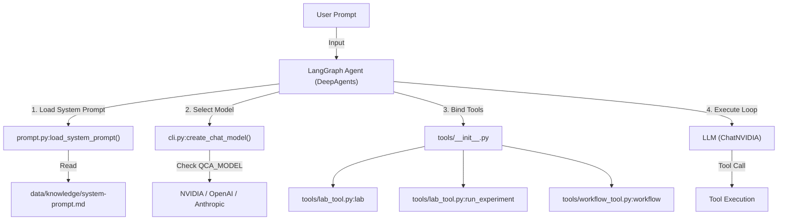
**Sources:** [cli.py:65-87](), [tools/__init__.py:18-23](), [prompt.py:43-77]()

---

## Dynamic System Prompting

The system prompt is not static; it is loaded and templated at runtime to provide the agent with environmental context, such as the current operating system, directory structures, and real-time timestamps.

### Template Injection
The `load_system_prompt` function in `prompt.py` reads the base template from `data/knowledge/system-prompt.md` and performs string replacement for several keys [prompt.py:43-49]().

| Placeholder | Value Source | Description |
| :--- | :--- | :--- |
| `{{DATETIME}}` | `datetime.now()` | Current system time for time-sensitive analysis [prompt.py:65-65](). |
| `{{PLATFORM}}` | `platform.system()` | Identifies Windows, macOS, or Linux [prompt.py:52-60](). |
| `{{SHELL}}` | Platform detection | Specifies bash, zsh, or PowerShell/cmd [prompt.py:55-61](). |
| `{{SCRIPTS_DIR}}` | `SCRIPTS_DIR` | Relative path to experiment scripts [prompt.py:68-68](). |
| `{{SKILLS_DIR}}` | `SKILLS_DIR` | Relative path to the skills knowledge base [prompt.py:69-69](). |
| `{{MEMORY_DIR}}` | `MEMORY_DIR` | Path to agent long-term memory files [prompt.py:71-71](). |

### Directory Context
The prompt loader defines the root hierarchy of the QCA system, ensuring the agent understands where to find its internal documentation and data [prompt.py:23-40]().

**Diagram: Knowledge and Data Hierarchy**
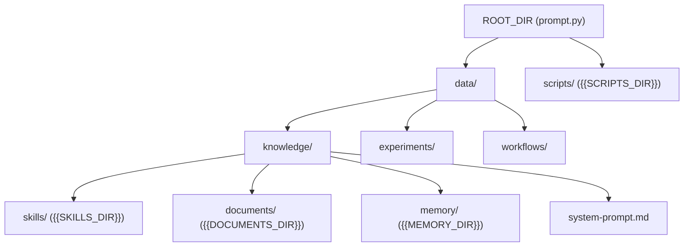
**Sources:** [prompt.py:23-40](), [prompt.py:64-72]()

---

## Configuration and Model Providers

The agent runtime behavior is further tuned via `config.yaml` and environment variables.

### Model Configuration
While the chat model is primarily controlled via `QCA_MODEL` [cli.py:65-65](), the Vision Language Model (VLM) used by the `vlm_inspect` tool is configured in the `vlm` section of `config.yaml` [config.yaml:32-38]().

- **Provider**: Typically "nvidia" [config.yaml:33-33]().
- **Model**: Specific VLM endpoint (e.g., `nvidia/ising-calibration-1-35b-a3b`) [config.yaml:34-34]().
- **Parameters**: `temperature`, `max_tokens`, and `enable_thinking` toggles [config.yaml:36-38]().

### CLI Customization
The QCA runtime includes custom branding and UI overrides for the DeepAgents TUI. The `_patch_banner` and `_patch_colors` functions in `cli.py` modify the CLI appearance to use NVIDIA's branding (Emerald Green) and distinct colors for tool outputs (Light Purple) [cli.py:117-170]().

**Sources:** [config.yaml:32-38](), [cli.py:65-87](), [cli.py:117-170]()

---

# Page: Backend Server

# Backend Server

<details>
<summary>Relevant source files</summary>

The following files were used as context for generating this wiki page:

- [server.py](server.py)

</details>


The Backend Server is a FastAPI-based application that acts as the central orchestration layer for the Quantum Calibration Agent (QCA) blueprint. It bridges the [Web UI](#10) with the [Agent Runtime and System Prompt](#2.2), experiment [Experiment Discovery](#4.2) engine, and [Storage Layer](#4.4) layer. 

The server is defined in `server.py` and provides a unified API for chat streaming, experiment management, workflow control, and historical data retrieval.

### Role and Responsibility

The server performs several critical roles within the system topology:
1.  **Agent Integration**: It initializes and maintains the `DeepAgent` instance using `create_deep_agent` [server.py:149-156]().
2.  **State Management**: It manages chat session persistence using a LangGraph `MemorySaver` [server.py:136]() and tracks pending Human-in-the-Loop (HITL) interrupts [server.py:167]().
3.  **Resource Bridging**: It exposes the internal Python APIs for experiment discovery and HDF5/SQLite storage as RESTful endpoints for the frontend.
4.  **Workflow Hosting**: It manages the lifecycle of long-running calibration workflows, including process spawning and status tracking.

### System Topology and Data Flow

The following diagram illustrates how the `server.py` connects "Natural Language Space" (the Agent) to "Code Entity Space" (the underlying tools and storage).

**Backend Entity Mapping**
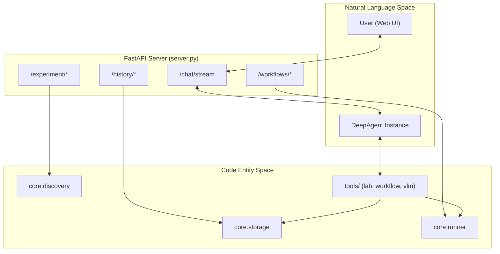
Sources: [server.py:16-23](), [server.py:43-47](), [server.py:185]()

---

### API Surface Areas

The backend is organized into four primary functional domains. Each domain is covered in detail in its respective child page.

#### 1. Chat and Streaming API
The server implements an asynchronous streaming protocol using Server-Sent Events (SSE). It handles the conversion of frontend message formats to LangChain primitives (`HumanMessage`, `AIMessage`) [server.py:218-230]() and manages the `thread_id` session context. It also supports a "resume" mechanism for handling agent interrupts.

*   **Key Endpoints**: `/chat/stream`, `/chat/resume`.
*   **For details, see [Chat and Streaming API](#3.1)**.

#### 2. Experiment and History Endpoints
This area provides the Web UI with visibility into available hardware capabilities and past results. It uses the `core.discovery` module to scan for scripts [server.py:413-417]() and the `core.storage` module to retrieve HDF5 arrays and Plotly visualizations [server.py:348-356]().

*   **Key Endpoints**: `/experiment/capabilities`, `/history/list`, `/history/{id}/plot`.
*   **For details, see [Experiment and History Endpoints](#3.2)**.

#### 3. Workflow Server Endpoints
Workflows are managed as managed subprocesses. The server provides endpoints to start, stop, and monitor the execution of multi-step calibration DAGs. It tracks process IDs (PIDs) and handles the transition between workflow nodes.

*   **Key Endpoints**: `/workflows/start`, `/workflows/stop`, `/workflows/status`.
*   **For details, see [Workflow Server Endpoints](#3.3)**.

#### 4. Knowledge and Static Assets
The server serves the markdown-based knowledge base used by the agent for RAG (Retrieval-Augmented Generation) and provides access to raw logs generated during experiment execution.

---

### Internal Service Architecture

The server maintains several global instances and directory configurations to ensure consistency across different API calls.

| Entity | Code Reference | Description |
| :--- | :--- | :--- |
| `ROOT_DIR` | [server.py:56]() | The base directory of the QCA project. |
| `_agent` | [server.py:162]() | Global `DeepAgent` instance initialized during `lifespan`. |
| `_checkpointer` | [server.py:164]() | `MemorySaver` instance for persisting agent state. |
| `lifespan` | [server.py:171-179]() | Startup/shutdown logic for initializing the agent and model. |
| `CORS` | [server.py:187-193]() | Middleware configured to allow communication with the Next.js UI. |

**Component Interaction Diagram**
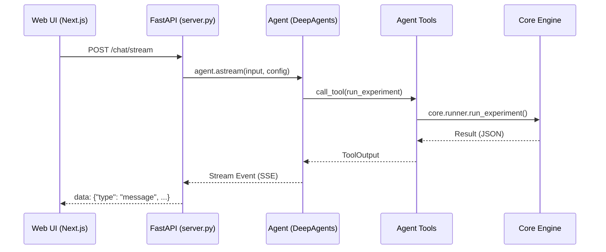
Sources: [server.py:149-156](), [server.py:235-260](), [tools/lab_tool.py]() *(implied by imports)*

### Configuration
The server behavior is influenced by environment variables, primarily `QCA_MODEL` [server.py:70](), which determines the LLM backend used (e.g., NVIDIA NIM, OpenAI, or Anthropic). It also automatically ensures that required directories like `data/` and `scripts/` exist upon startup [server.py:61-64]().

Sources: [server.py:49-123](), [server.py:171-179]()

---

# Page: Chat and Streaming API

# Chat and Streaming API

<details>
<summary>Relevant source files</summary>

The following files were used as context for generating this wiki page:

- [server.py](server.py)

</details>


The Chat and Streaming API serves as the primary communication gateway between the Web UI and the Quantum Calibration Agent (QCA). It implements a Server-Sent Events (SSE) protocol to provide real-time updates on agent reasoning, tool execution, and experiment progress.

## Overview of Chat Endpoints

The backend, defined in `server.py`, exposes two primary endpoints for agent interaction:

1.  **`/chat/stream`**: Initiates a new interaction or continues an existing thread by sending a user message.
2.  **`/chat/resume`**: Handles Human-in-the-Loop (HITL) scenarios where the agent has paused for user approval or feedback.

### Data Flow and Serialization

The server uses `DeepAgents` (a wrapper around LangGraph) to manage the agent state machine [server.py:43-44](). Messages are converted from the frontend's JSON format into LangChain message objects (`HumanMessage`, `AIMessage`, etc.) before being processed by the graph [server.py:218-230]().

**Sources:** [server.py:43-44](), [server.py:218-230]()

---

## SSE Streaming Protocol

The `/chat/stream` endpoint returns a `StreamingResponse` using the `text/event-stream` media type. This allows the UI to render the agent's response incrementally.

### Stream Event Types

The agent emits several types of events during its execution cycle:

| Event Type | Description | Data Content |
| :--- | :--- | :--- |
| `text` | Incremental tokens of the agent's natural language response. | String chunk |
| `tool_start` | Indicates the agent is calling a specific tool (e.g., `run_experiment`). | Tool name and input arguments |
| `tool_end` | Provides the result of a tool execution. | Tool output/result |
| `interrupt` | Signal that the agent has paused for HITL approval. | Details of the pending action |
| `error` | Reports a runtime exception during the graph execution. | Error message |

### Implementation Detail: `stream_generator`

The `stream_generator` function in `server.py` iterates over the LangGraph event stream. It filters and serializes specific nodes (like `call_model` or `call_tools`) into the SSE format expected by the `ui/proxy/server.js` and the React frontend.

**Sources:** [server.py:253-316]()

---

## Human-in-the-Loop (HITL) and Interrupts

The QCA architecture supports a sophisticated "pending interrupts" state machine to ensure safe execution of hardware-altering commands.

### The `pending_interrupts` State Machine

When the agent reaches a node configured for interruption (e.g., `run_experiment`), the graph enters a `suspended` state. The server tracks these interruptions in an in-memory dictionary.

*   **Storage**: `pending_interrupts: dict[str, dict]` maps a `thread_id` to its current interrupt data [server.py:167]().
*   **Mechanism**: The `interrupt_on` configuration in `create_agent` defines which tools require manual approval [server.py:140-145]().

### Resume Logic

When a user approves or rejects an action in the UI, the `/chat/resume` endpoint is called. The server uses the LangGraph `Command` object to resume the graph with the user's decision.

```python
# Example of resuming with a decision
if decision.get("type") == "approve":
    # Resume the graph with no changes to the current state
    cmd = Command(resume=None)
else:
    # Resume with a rejection message back to the agent
    cmd = Command(resume=decision.get("message", "Action rejected by user"))

# Feed the command back into the agent stream
_agent.stream(cmd, config=config, stream_mode="messages")
```
*(Simplified logic based on [server.py:348-360]())*

**Sources:** [server.py:140-145](), [server.py:167](), [server.py:348-360]()

---

## System Topology: API to Code Entities

The following diagram bridges the natural language requests from the user to the specific code entities in the backend.

### Request Routing and Execution

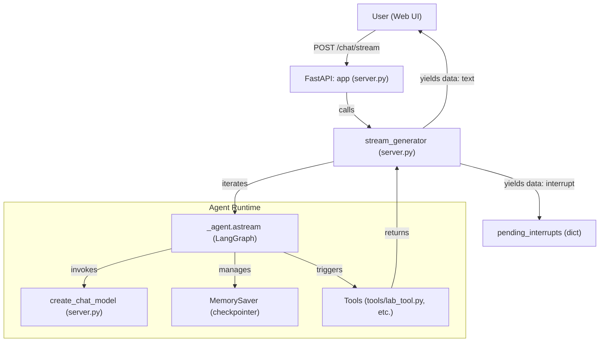

**Sources:** [server.py:126-159](), [server.py:253-270](), [server.py:321-340]()

---

## Interaction Sequence: Tool Execution with Interrupt

This diagram illustrates the flow when the agent attempts to run an experiment that requires user confirmation.

### HITL Sequence Diagram

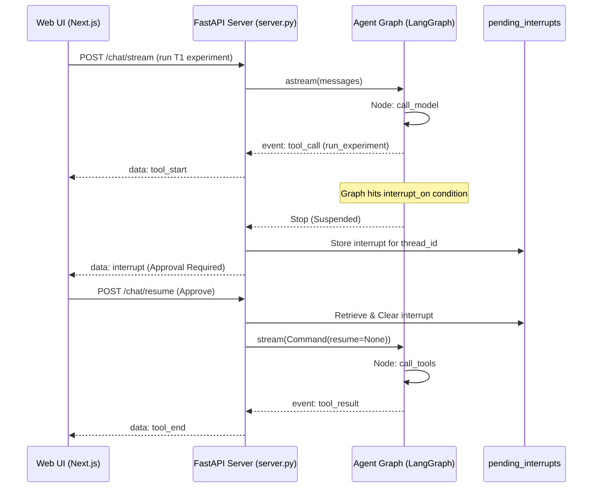

**Sources:** [server.py:140-145](), [server.py:321-340](), [server.py:348-360]()

---

## Key Functions and Classes

### `ChatRequest` and `ResumeRequest`
Pydantic models that define the structure of incoming API calls. `ChatRequest` includes the message history and an optional `thread_id` for session persistence [server.py:206-216]().

### `create_agent()`
The factory function that assembles the `LocalShellBackend`, `MemorySaver` checkpointer, and the `DeepAgent` graph. It configures the `system_prompt` and the available toolset [server.py:126-159]().

### `convert_to_langchain_messages()`
A utility function that maps the generic `ChatMessage` objects (role/content) to specific LangChain classes like `HumanMessage` or `AIMessage`, ensuring compatibility with the underlying LLM providers [server.py:218-230]().

**Sources:** [server.py:126-159](), [server.py:206-216](), [server.py:218-230]()

---

# Page: Experiment and History Endpoints

# Experiment and History Endpoints

<details>
<summary>Relevant source files</summary>

The following files were used as context for generating this wiki page:

- [core/discovery.py](core/discovery.py)
- [core/storage.py](core/storage.py)
- [docs/latest/user-guide/experiments/experiment-storage.mdx](docs/latest/user-guide/experiments/experiment-storage.mdx)
- [server.py](server.py)

</details>


The **Experiment** and **History** endpoints in `server.py` serve as the primary bridge between the core discovery/storage modules and the Web UI. They allow the frontend to browse available experiment scripts, inspect their parameter schemas, and retrieve historical data stored in the dual-tier SQLite/HDF5 storage system.

## Experiment Discovery Endpoints

These endpoints utilize the `core/discovery.py` module to perform static analysis on the `scripts/` directory, exposing experiment metadata to the UI without executing the scripts.

### `/experiment/capabilities`
- **Method**: `GET`
- **Implementation**: Calls `discovery.discover_experiments(SCRIPTS_DIR)` [server.py:348-351]().
- **Functionality**: Scans the `scripts/` directory for Python files, parses them using AST, and returns a list of `ExperimentSchema` objects. This allows the UI to populate the "Available Experiments" list.

### `/experiment/script/{name}`
- **Method**: `GET`
- **Implementation**: Calls `discovery.get_experiment_schema(name, SCRIPTS_DIR)` [server.py:354-361]().
- **Functionality**: Retrieves the detailed schema for a specific experiment, including its `ParameterSpec` (type, range, default values). This is used by the UI to generate dynamic input forms for experiment execution.

### Discovery Data Flow
The following diagram illustrates how a request for experiment capabilities moves from the Web UI through the FastAPI server to the AST-based discovery engine.

**Experiment Discovery Architecture**
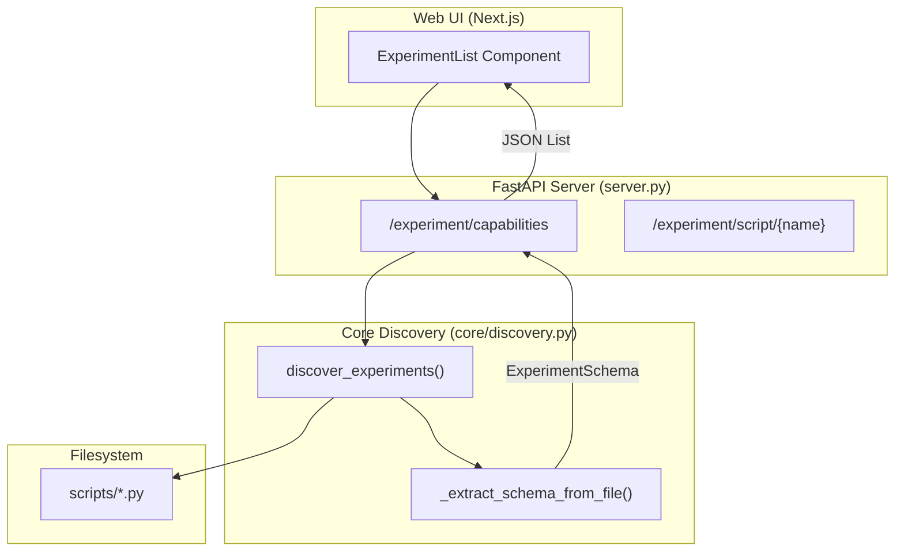
Sources: [server.py:348-361](), [core/discovery.py:25-51](), [core/discovery.py:71-124]()

---

## History and Data Endpoints

The history endpoints provide access to the `data/` directory, which contains the `index.db` (SQLite) and the date-partitioned HDF5 files [docs/latest/user-guide/experiments/experiment-storage.mdx:9-19]().

### `/history/list`
- **Method**: `GET`
- **Implementation**: Calls `storage.search_experiments(DATA_DIR, ...)` [server.py:382-393]().
- **Parameters**: Supports `limit`, `offset`, `type`, and `target` filters.
- **Functionality**: Queries the SQLite `experiments` table to return a list of past runs.

### `/history/{id}/array/{name}`
- **Method**: `GET`
- **Implementation**: Calls `storage.get_array(id, name, DATA_DIR)` [server.py:411-421]().
- **Functionality**: Extracts a specific numerical dataset (e.g., "frequencies") from the HDF5 file associated with the experiment ID. It supports `start` and `end` indices for partial data slicing [core/storage.py:197-202]().

### `/history/{id}/plot`
- **Method**: `GET`
- **Implementation**: Calls `storage.load_experiment(id, DATA_DIR)` and filters the `plots` attribute [server.py:438-450]().
- **Functionality**: Returns the Plotly JSON or binary plot data stored in the HDF5 file [core/storage.py:203-218]().

### `/history/{id}/logs`
- **Method**: `GET`
- **Implementation**: Locates the `.log` file associated with the experiment's HDF5 path [server.py:424-435]().
- **Functionality**: Streams the execution logs back to the UI for debugging.

### Storage and Retrieval Mapping
This diagram bridges the logical "History" concept to the specific database and file entities used in the code.

**History Data Access Flow**
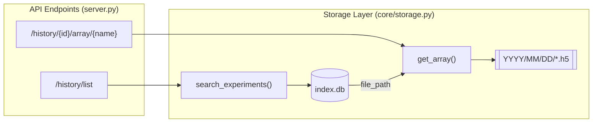
Sources: [server.py:382-450](), [core/storage.py:64-128](), [core/storage.py:158-223]()

---

## Implementation Details

### Dual-Tier Storage Logic
When an experiment is saved via `storage.save_experiment`, the system performs two operations:
1.  **HDF5 Write**: Large arrays and plot data are written to a file at `data/experiments/YYYY/MM/DD/HHMMSS_{type}.h5` [core/storage.py:75-86]().
2.  **SQLite Index**: Metadata (ID, type, status, parameters, and the HDF5 `file_path`) is inserted into the `experiments` table in `index.db` [core/storage.py:130-155]().

### Endpoint Summary Table

| Endpoint | Core Function | Primary Data Source |
| :--- | :--- | :--- |
| `/experiment/capabilities` | `discovery.discover_experiments` | `scripts/` (AST) |
| `/history/list` | `storage.search_experiments` | `data/index.db` (SQLite) |
| `/history/{id}/array/{name}` | `storage.get_array` | `data/experiments/.../*.h5` |
| `/history/{id}/plot` | `storage.load_experiment` | `data/experiments/.../*.h5` |

Sources: [server.py:348-450](), [core/storage.py:30-61](), [docs/latest/user-guide/experiments/experiment-storage.mdx:82-101]()

---

# Page: Workflow Server Endpoints

# Workflow Server Endpoints

<details>
<summary>Relevant source files</summary>

The following files were used as context for generating this wiki page:

- [docs/latest/user-guide/workflows/index.mdx](docs/latest/user-guide/workflows/index.mdx)
- [server.py](server.py)

</details>


The Workflow Server endpoints in the Quantum Calibration Agent (QCA) provide a robust API for managing multi-step experiment sequences. These endpoints handle the lifecycle of Directed Acyclic Graphs (DAGs), including creation, status tracking, asynchronous execution via subprocess spawning, and process termination.

The server implements a **pid-file-based tracking model**, ensuring that even if the FastAPI server restarts, it can reconnect to or accurately report the status of ongoing workflow processes by checking the filesystem for process identifiers and lock files.

## Workflow Management Overview

Workflows are stored on disk within the `data/workflows/{workflow_id}/` directory structure [docs/latest/user-guide/workflows/index.mdx:22-26](). The server interacts with these files to provide a real-time view of the calibration pipeline.

### Process Tracking Model
The server manages workflow execution by spawning the `qca workflow run` command as a background subprocess. 
1. **PID Files**: When a workflow starts, the system tracks the subprocess ID.
2. **Process Groups**: Workflows are started in their own process groups to ensure that stopping a workflow cleans up all child processes (e.g., experiment scripts or analysis tools).
3. **State Persistence**: The definitive state of a workflow is maintained in its `workflow.json` file, while execution events are appended to `history.jsonl` [docs/latest/user-guide/workflows/index.mdx:22-26]().

## Endpoint Reference

### List and Metadata Endpoints

| Endpoint | Method | Description |
| :--- | :--- | :--- |
| `/workflows/list` | `GET` | Returns a list of all workflow IDs and basic metadata found in the `data/workflows` directory. |
| `/workflows/{id}` | `GET` | Returns the full `workflow.json` definition for a specific workflow, including node definitions and current context. |
| `/workflows/{id}/status` | `GET` | Returns the execution status (e.g., `running`, `completed`, `failed`, `paused`) and the status of individual nodes. |
| `/workflows/{id}/history` | `GET` | Streams or returns the `history.jsonl` event log for the specified workflow. |

**Sources:** [server.py:16-23](), [docs/latest/user-guide/workflows/index.mdx:27-40]()

### Execution Control Endpoints

#### `POST /workflows/{id}/start`
Spawns a new subprocess to execute the workflow. The server uses the `LocalShellBackend` logic to initiate the `qca workflow run` command [server.py:128-132]().
- **Logic**: It checks if a PID file already exists to prevent double-execution.
- **Subprocess**: Invokes the CLI runner which iterates through nodes based on dependency resolution [docs/latest/user-guide/workflows/index.mdx:100-109]().

#### `POST /workflows/{id}/stop`
Terminates a running workflow.
- **Logic**: Reads the PID from the tracking file and sends a termination signal (SIGTERM/SIGKILL) to the entire process group.
- **Cleanup**: Updates the `workflow.json` state to `failed` or `paused` depending on the interrupt type.

**Sources:** [server.py:149-156](), [docs/latest/user-guide/workflows/index.mdx:31-40]()

## Implementation Architecture

The following diagram illustrates how the FastAPI server routes requests to the underlying workflow filesystem and process management logic.

### Workflow Execution Data Flow
Title: "Workflow Execution and Process Tracking"
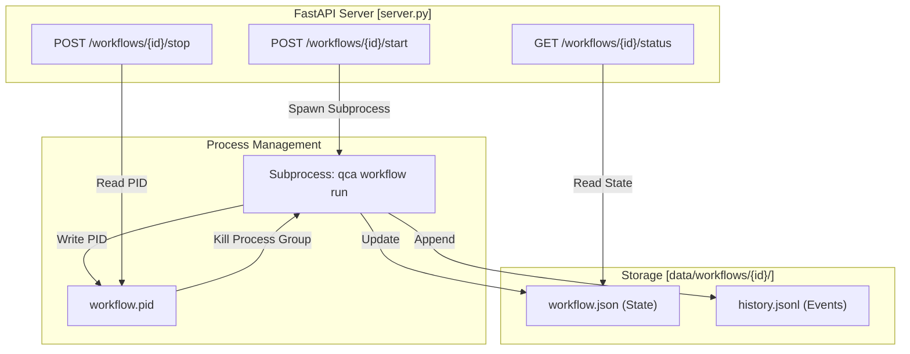
**Sources:** [server.py:56-65](), [docs/latest/user-guide/workflows/index.mdx:22-26](), [docs/latest/user-guide/workflows/index.mdx:41-54]()

## Node State Transitions

The server reports node states based on the workflow engine's internal transitions. Each node represents a discrete experiment step [docs/latest/user-guide/workflows/index.mdx:14-20]().

| State | Description |
| :--- | :--- |
| `pending` | Dependencies not yet met or execution not reached [docs/latest/user-guide/workflows/index.mdx:49](). |
| `running` | Subagent is currently executing the experiment script [docs/latest/user-guide/workflows/index.mdx:50](). |
| `success` | Experiment completed and results were successfully extracted [docs/latest/user-guide/workflows/index.mdx:51](). |
| `failed` | Experiment failed or results did not meet success criteria after retries [docs/latest/user-guide/workflows/index.mdx:52](). |
| `skipped` | Node bypassed due to conditional logic or manual intervention [docs/latest/user-guide/workflows/index.mdx:53](). |

### Code Entity Mapping: Server to Workflow Core
Title: "Mapping API Endpoints to Workflow Logic"
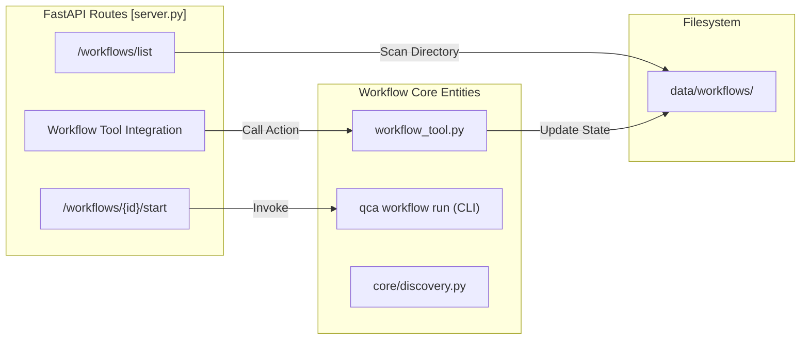
**Sources:** [server.py:107-113](), [server.py:56-65](), [docs/latest/user-guide/workflows/index.mdx:74-84]()

## Error Handling and Concurrency

1. **Locking**: The server prevents multiple concurrent "start" requests for the same workflow ID by checking for active PIDs in the `data/workflows/{id}/` directory.
2. **Zombie Processes**: On server startup, the `lifespan` handler [server.py:171-179]() ensures the `LocalShellBackend` is initialized, which provides the environment for managing these subprocesses safely.
3. **Subagent Isolation**: Each node in the workflow is executed by a "subagent" [docs/latest/user-guide/workflows/index.mdx:100-109](). If a subagent crashes, the workflow runner catches the exception, logs it to `history.jsonl`, and marks the node as `failed` without crashing the main FastAPI server process.

**Sources:** [server.py:128-132](), [docs/latest/user-guide/workflows/index.mdx:100-109]()

---

# Page: Core Engine

# Core Engine

<details>
<summary>Relevant source files</summary>

The following files were used as context for generating this wiki page:

- [core/discovery.py](core/discovery.py)
- [core/models.py](core/models.py)
- [core/runner.py](core/runner.py)
- [core/storage.py](core/storage.py)

</details>


The `core/` package serves as the foundational layer of the Quantum Calibration Agent (QCA) blueprint. It provides the data structures, discovery mechanisms, and execution logic required to manage quantum experiments and their resulting data.

The Core Engine is designed to be independent of the Agent and Web UI layers, allowing it to be used as a standalone library for experiment management and data storage.

### System Overview and Code Entities

The following diagram illustrates how high-level system concepts map to specific code entities within the `core/` package.

**Natural Language to Code Entity Mapping**
```mermaid
graph TD
    subgraph "Natural Language Space"
        A["Experiment Definition"]
        B["Experiment Execution"]
        C["Data Storage"]
        D["Parameter Rules"]
    end

    subgraph "Code Entity Space (core/)"
        A --> E["discover_experiments()"]
        A --> F["ExperimentSchema"]
        B --> G["run_experiment()"]
        B --> H["ExperimentResult"]
        C --> I["save_experiment()"]
        C --> J["index.db (SQLite)"]
        C --> K["*.h5 (HDF5)"]
        D --> L["ParameterSpec"]
        D --> M["validate_params()"]
    end

    E -- "returns" --> F
    G -- "returns" --> H
    I -- "writes to" --> J
    I -- "writes to" --> K
```
Sources: [core/discovery.py:25-36](), [core/models.py:51-59](), [core/runner.py:76-101](), [core/storage.py:64-70]()

---

### Data Models
The system relies on a set of strictly defined dataclasses to ensure consistency across the discovery, execution, and storage phases. These models handle the serialization of experiment metadata, parameter constraints, and complex result sets (including multidimensional arrays and plots).

*   **`ParameterSpec`**: Defines the name, type, and optional range constraints for experiment inputs [core/models.py:23-39]().
*   **`ExperimentSchema`**: Represents the static definition of an experiment script discovered on disk [core/models.py:51-59]().
*   **`ExperimentResult`**: Encapsulates the complete output of a run, including scalars, NumPy-compatible arrays, and Plotly visualizations [core/models.py:87-114]().

For details, see [Data Models](#4.1).

---

### Experiment Discovery
QCA uses an AST (Abstract Syntax Tree) based discovery mechanism to identify available experiments without executing the scripts. This allows the system to safely inspect user-provided Python files in the `scripts/` directory to extract function signatures and documentation.

*   **Static Analysis**: The `discover_experiments` function parses Python files into AST nodes to identify public functions [core/discovery.py:25-51]().
*   **Type Extraction**: It specifically looks for type hints (e.g., `Annotated[float, (0, 1)]`) to automatically build validation rules [core/discovery.py:193-224]().

For details, see [Experiment Discovery](#4.2).

---

### Experiment Runner
Experiments are executed in isolated subprocesses to prevent crashes in the main agent or server process from affecting the entire system. The runner manages the lifecycle of these subprocesses, handles parameter validation, and captures real-time logs.

*   **Subprocess Isolation**: `run_experiment` constructs a Python command that imports the target script and passes parameters via `stdin` [core/runner.py:116-128]().
*   **Execution Modes**: Supports both simple buffered execution and real-time streaming of `stderr` to log files via `_run_with_logging` [core/runner.py:161-172]().

For details, see [Experiment Runner](#4.3).

---

### Storage Layer
The storage system employs a dual-tier architecture designed for both fast metadata searching and efficient high-volume data persistence.

*   **SQLite Index**: Stores experiment metadata (ID, type, status, timestamp) for rapid filtering and search operations [core/storage.py:30-61]().
*   **HDF5 Data Store**: Stores large numerical arrays and serialized plot data in a hierarchical format, organized on disk by date [core/storage.py:71-128]().

**Storage Interaction Flow**
```mermaid
sequenceDiagram
    participant R as Experiment Runner
    participant S as storage.py
    participant DB as index.db (SQLite)
    participant FS as HDF5 Filesystem

    R->>S: save_experiment(ExperimentResult)
    S->>FS: Create YYYY/MM/DD/HHMMSS_type.h5
    S->>FS: Write arrays and plots
    S->>DB: INSERT OR REPLACE INTO experiments
    Note over DB: Index metadata for search
```
Sources: [core/storage.py:64-155]()

For details, see [Storage Layer](#4.4).

---
**Sources:**
- [core/models.py:1-124]()
- [core/discovery.py:1-236]()
- [core/runner.py:1-210]()
- [core/storage.py:1-155]()

---

# Page: Data Models

# Data Models

<details>
<summary>Relevant source files</summary>

The following files were used as context for generating this wiki page:

- [core/models.py](core/models.py)

</details>


The Quantum Calibration Agent (QCA) utilizes a set of core data models to define the contract between experiment scripts, the discovery engine, the execution runner, and the storage layer. These models ensure type safety and consistent serialization across the system's distributed components, including the FastAPI backend and the Next.js Web UI.

## Core Data Model Classes

The primary data models are implemented as Python dataclasses in `core/models.py`. They handle the lifecycle of an experiment from its structural definition to its final execution output.

### ParameterSpec
The `ParameterSpec` class defines the requirements and constraints for a single input parameter of an experiment script [core/models.py:22-32]().

| Field | Type | Description |
| :--- | :--- | :--- |
| `name` | `str` | The identifier for the parameter (e.g., "qubit", "duration"). |
| `type` | `str` | The expected Python type (int, float, str, bool, list). |
| `default` | `Optional[Any]` | The default value if not provided; `None` implies the parameter might be required. |
| `range` | `Optional[tuple]` | A tuple of `(min, max)` used for numeric validation. |
| `required` | `bool` | Flag indicating if the parameter must be supplied by the user/agent. |

Sources: [core/models.py:34-38]()

### ExperimentSchema
The `ExperimentSchema` represents the metadata and interface of an experiment script discovered by the system [core/models.py:51-59](). It acts as the blueprint that the Agent uses to understand how to call specific calibration routines.

| Field | Type | Description |
| :--- | :--- | :--- |
| `name` | `str` | The name of the experiment (usually the function name). |
| `description` | `str` | Extracted from the script's docstring. |
| `parameters` | `list[ParameterSpec]` | A collection of specs defining the input interface. |
| `module_path` | `str` | The filesystem path to the script source. |

Sources: [core/models.py:61-64]()

### ExperimentResult
The `ExperimentResult` captures the full context and output of a completed experiment execution [core/models.py:87-102](). It is designed to hold both scalar metadata (for SQLite) and complex data structures (for HDF5).

| Field | Type | Description |
| :--- | :--- | :--- |
| `id` | `str` | Unique identifier formatted as `YYYYMMDD_HHMMSS_type`. |
| `status` | `str` | Either "success" or "failed". |
| `target` | `str` | The specific hardware component targeted (e.g., "qubit_0"). |
| `params` | `dict` | The actual input parameters used for the run. |
| `results` | `dict` | Scalar result values (e.g., fit parameters). |
| `arrays` | `dict` | Large numerical arrays (e.g., raw voltage traces). |
| `plots` | `list` | Serialized Plotly JSON objects for visualization. |

Sources: [core/models.py:104-114]()

## Data Flow and Entity Mapping

The following diagrams illustrate how these models bridge the gap between high-level agent intents and low-level code execution.

### Entity Relationship: From Discovery to Result
This diagram shows how `ExperimentSchema` defines the "capabilities" known to the system, which are then instantiated into `ExperimentResult` objects upon execution.

Title: QCA Entity Space Mapping
```mermaid
graph TD
    subgraph "Natural Language Space (Agent/User)"
        NL_Intent["'Run a Rabi oscillation on Q0'"]
    end

    subgraph "Code Entity Space (core/models.py)"
        Schema["ExperimentSchema"]
        PSpec["ParameterSpec"]
        Result["ExperimentResult"]
    end

    subgraph "Filesystem / Storage"
        Script["scripts/rabi_oscillation.py"]
        H5["storage/YYYYMMDD/.../data.h5"]
    end

    NL_Intent -- "triggers lookup" --> Schema
    Schema -- "contains" --> PSpec
    Schema -- "points to" --> Script
    
    Script -- "executed by runner" --> Result
    Result -- "persisted to" --> H5
```
Sources: [core/models.py:22-124](), [core/discovery.py:1-20]()

### Serialization and System Flow
Data models move through the system using `to_dict()` and `from_dict()` methods to facilitate JSON communication between the Python backend and the TypeScript frontend.

Title: Model Serialization Flow
```mermaid
sequenceDiagram
    participant S as Experiment Script
    participant R as core/runner.py
    participant M as core/models.py
    participant ST as core/storage.py
    participant API as server.py (FastAPI)

    S->>R: Returns dict {status, results, arrays, plots}
    R->>M: Instantiates ExperimentResult(**data)
    M->>ST: ExperimentResult.to_dict()
    ST->>ST: Save to SQLite (scalars) & HDF5 (arrays)
    API->>ST: load_result(id)
    ST->>M: ExperimentResult.from_dict(row)
    M->>API: ExperimentResult.to_dict()
    API->>User: JSON Response
```
Sources: [core/models.py:40-47](), [core/models.py:66-83](), [core/models.py:116-123]()

## Implementation Details

### Serialization Methods
Every model implements a standard interface for dictionary conversion, which is critical for the `qca` CLI and the FastAPI web server.

*   **`to_dict()`**: Uses `dataclasses.asdict` for deep conversion of nested fields [core/models.py:42](). In `ExperimentSchema`, it manually iterates through `ParameterSpec` objects to ensure they are also converted to dictionaries [core/models.py:71]().
*   **`from_dict(data)`**: A class method that unpacks a dictionary into the constructor [core/models.py:47](). For `ExperimentSchema`, it explicitly handles the reconstruction of the `ParameterSpec` list [core/models.py:81]().

### Result Identification
The `id` field in `ExperimentResult` is not just a random UUID. It follows a specific naming convention: `YYYYMMDD_HHMMSS_type` [core/models.py:91](). This format allows the `Storage` layer to organize files on disk in a date-based hierarchy while maintaining human-readability during CLI operations.

Sources: [core/models.py:1-124]()

---

# Page: Experiment Discovery

# Experiment Discovery

<details>
<summary>Relevant source files</summary>

The following files were used as context for generating this wiki page:

- [core/discovery.py](core/discovery.py)
- [docs/latest/user-guide/experiments/writing-scripts.mdx](docs/latest/user-guide/experiments/writing-scripts.mdx)

</details>


The Experiment Discovery system is a core component of the Quantum Calibration Agent (QCA) that allows the platform to dynamically identify and interface with quantum calibration routines. By using Abstract Syntax Tree (AST) parsing, the system can extract metadata, parameter requirements, and validation constraints from Python scripts without executing them, ensuring a secure and efficient bridge between the high-level agent and low-level hardware scripts.

## Overview of the Discovery Process

The discovery logic resides in `core/discovery.py`. It is designed to scan a specific directory (typically `scripts/`) and identify valid experiment functions based on a strict set of structural requirements.

### Script Discovery Workflow
The process begins when `discover_experiments` is called, usually triggered by the CLI or the FastAPI backend.

| Stage | Action | Description |
| :--- | :--- | :--- |
| **Scan** | `scripts/` globbing | Scans for `.py` files, excluding those starting with `_` [core/discovery.py:42-45](). |
| **Parse** | `ast.parse()` | Converts the script content into an Abstract Syntax Tree to inspect structure without execution [core/discovery.py:81-82](). |
| **Filter** | Function Validation | Identifies the first public function (no `_` prefix) with a `-> dict` return annotation [core/discovery.py:87-104](). |
| **Extract** | Schema Generation | Parses docstrings and parameter annotations (including `Annotated` ranges) [core/discovery.py:107-123](). |

**Sources:** [core/discovery.py:25-51](), [core/discovery.py:71-124]().

## AST-Based Schema Extraction

The core of the discovery engine is `_extract_schema_from_file`, which utilizes the Python `ast` module to perform static analysis.

### Function Signature Requirements
For a script to be discovered as an experiment, it must meet these criteria:
1.  **Public Function**: It must contain at least one function not prefixed with an underscore [core/discovery.py:90-91]().
2.  **Return Annotation**: The function must explicitly define `-> dict` as its return type [core/discovery.py:98-101]().
3.  **Type Hints**: Parameters must have type annotations (e.g., `int`, `float`, `str`, `bool`, `list`) to be included in the schema [core/discovery.py:149-150]().

### Parameter Parsing and Annotated Ranges
The system specifically looks for `typing.Annotated` to extract numerical bounds for parameters. This allows the agent to reason about safe operating ranges for hardware.

```mermaid
graph TD
    subgraph "Natural Language / User Space"
        User["User/Agent Goal"]
        Range["'Keep frequency between 4 and 6 GHz'"]
    end

    subgraph "Code Entity Space (core/discovery.py)"
        Discovery["discover_experiments()"]
        AST["ast.parse(source)"]
        ParseAnn["_parse_annotation()"]
        ParseAnnotated["_parse_annotated()"]
        ParamSpec["ParameterSpec(range=(min, max))"]
    end

    User --> Range
    Range -.-> Discovery
    Discovery --> AST
    AST --> ParseAnn
    ParseAnn -->|is Subscript| ParseAnnotated
    ParseAnnotated -->|Extract Tuple| ParamSpec
```

**Sources:** [core/discovery.py:126-190](), [core/discovery.py:205-209](), [docs/latest/user-guide/experiments/writing-scripts.mdx:126-155]().

## Data Flow: From Script to Schema

The following diagram illustrates how a physical Python file on disk is transformed into a structured `ExperimentSchema` object used by the `qca` CLI and the Agent.

```mermaid
sequenceDiagram
    participant FS as Filesystem (scripts/*.py)
    participant Disc as core/discovery.py
    participant AST as Python AST Module
    participant Model as core/models.py

    Disc->>FS: glob("*.py")
    FS-->>Disc: script_path
    Disc->>AST: parse(script_content)
    AST-->>Disc: tree
    Note over Disc: Find FunctionDef (e.g. 'rabi_oscillation')
    Disc->>Disc: _parse_function_parameters()
    Note over Disc: Extract Annotated[float, (0.0, 1.0)]
    Disc->>Model: ExperimentSchema(name, parameters, ...)
    Model-->>Disc: schema_object
```

**Sources:** [core/discovery.py:25-51](), [core/discovery.py:118-123](), [core/models.py:22-22]().

## Key Functions and Classes

### `discover_experiments(scripts_dir: Path)`
The entry point for the discovery system. It iterates through the directory and returns a list of `ExperimentSchema` objects [core/discovery.py:25-51]().

### `_parse_function_parameters(func_def: ast.FunctionDef)`
Iterates through `posonlyargs`, `args`, and `kwonlyargs` of a function definition. It determines:
*   **Required vs. Optional**: Parameters with default values are marked `required=False` [core/discovery.py:156-160]().
*   **Default Values**: Uses `_eval_literal` to safely extract default values from the AST [core/discovery.py:160]().

### `_parse_annotation(annotation: ast.expr)`
Maps Python types to a internal string representation:
*   `float`, `int`, `str`, `bool`, `list` are supported [core/discovery.py:215-222]().
*   If `Annotated` is detected, it delegates to `_parse_annotated` [core/discovery.py:208-209]().

### `validate_script(script_path: Path)`
Used by the CLI (`qca experiments validate`) to check if a specific file meets the experiment contract. It attempts to extract a schema and returns `True` if successful and the file is properly structured [docs/latest/user-guide/experiments/writing-scripts.mdx:118-124]().

**Sources:** [core/discovery.py:126-190](), [core/discovery.py:193-224]().

## Summary Table of Discovery Rules

| Feature | Requirement / Behavior |
| :--- | :--- |
| **File Name** | Must end in `.py` and not start with `_` [core/discovery.py:42-44](). |
| **Function Name** | First top-level function not starting with `_` [core/discovery.py:88-92](). |
| **Return Type** | Must be explicitly annotated as `-> dict` [core/discovery.py:98-101](). |
| **Parameters** | Must have type hints to be visible to the system [core/discovery.py:149-150](). |
| **Docstrings** | The first line of the docstring is used as the experiment description [core/discovery.py:108-109](). |

**Sources:** [core/discovery.py:71-124](), [docs/latest/user-guide/experiments/writing-scripts.mdx:16-24]().

---

# Page: Experiment Runner

# Experiment Runner

<details>
<summary>Relevant source files</summary>

The following files were used as context for generating this wiki page:

- [core/runner.py](core/runner.py)

</details>


The Experiment Runner is a core component of the Quantum Calibration Agent (QCA) responsible for the safe and isolated execution of experiment scripts. It provides a robust subprocess wrapper that handles parameter validation, real-time logging, and standardized result parsing.

## Overview

The primary entry point for execution is the `run_experiment` function [core/runner.py:76-83](). This function bridges the gap between the agent's high-level requests and the low-level execution of Python scripts in the `scripts/` directory. It ensures that every experiment run adheres to a strict contract: parameters must match the discovered schema, and results must conform to the system's data models.

### Execution Workflow

The runner follows a multi-stage pipeline to execute an experiment:

1.  **Schema Retrieval**: Fetches the `ExperimentSchema` using `get_experiment_schema` [core/runner.py:103-105]().
2.  **Validation**: Checks provided parameters against the schema using `validate_params` [core/runner.py:108-110]().
3.  **Command Construction**: Dynamically generates a Python snippet that imports the target function and injects parameters via `stdin` [core/runner.py:121-128]().
4.  **Subprocess Execution**: Launches the script in an isolated process with optional real-time logging [core/runner.py:134-147]().
5.  **Result Parsing**: Captures `stdout`, parses the JSON result, and validates the output structure [core/runner.py:153]().

### Natural Language to Code Mapping: Execution

The following diagram illustrates how natural language concepts used by the agent map to specific code entities within the runner.

**Figure 1: Experiment Execution Entity Mapping**
```mermaid
graph TD
    subgraph "Natural Language Space"
        A["'Run Rabi experiment'"]
        B["'Check parameters'"]
        C["'Watch progress'"]
    end

    subgraph "Code Entity Space (core/runner.py)"
        A1["run_experiment()"]
        B1["validate_params()"]
        C1["_run_with_logging()"]
        D1["_parse_and_validate_result()"]
    end

    A --> A1
    B --> B1
    C --> C1
    A1 --> B1
    A1 --> C1
    C1 --> D1
```
Sources: [core/runner.py:27-27](), [core/runner.py:76-76](), [core/runner.py:135-137](), [core/runner.py:153-153]()

---

## Parameter Validation

Before any code is executed, the `validate_params` function performs strict type and range checking [core/runner.py:27-37]().

### Validation Logic
*   **Required Fields**: Ensures all parameters marked as `required` in the `ParameterSpec` are present [core/runner.py:43-45]().
*   **Type Safety**: Performs strict type checking (no implicit coercion) against the expected type string [core/runner.py:57-62]().
*   **Range Constraints**: For `int` and `float` types, it verifies that the value falls within the inclusive `[min, max]` range defined in the schema [core/runner.py:65-71]().

Sources: [core/runner.py:27-73]()

---

## Execution Modes

The runner supports two distinct modes of execution based on whether a `log_file` path is provided to `run_experiment` [core/runner.py:134-139]().

### 1. Buffered Mode (Standard)
Used for simple executions where real-time feedback is not required. It utilizes `subprocess.run` and captures the entire output at the end of the process [core/runner.py:141-147]().

### 2. Streaming Mode (with Logging)
Invoked via `_run_with_logging` when a `log_file` is specified [core/runner.py:161-167](). This mode is critical for long-running experiments:
*   **Real-time Stderr**: Uses `subprocess.Popen` to stream `stderr` directly to a log file on disk [core/runner.py:186-193]().
*   **Unbuffered Output**: Sets `PYTHONUNBUFFERED="1"` in the environment to ensure logs are flushed immediately [core/runner.py:181-182]().
*   **Polling Loop**: Uses a `while True` loop with `select.select` to monitor `stdout` and `stderr` pipes simultaneously while checking for timeouts [core/runner.py:203-210]().

### Data Flow: Runner to Subprocess

The diagram below shows the data flow between the `core/runner.py` and the spawned experiment process.

**Figure 2: Subprocess Data Flow**
```mermaid
sequenceDiagram
    participant R as core/runner.py
    participant S as Subprocess (Python)
    participant L as log_file (Disk)

    R->>S: Launch with python_code snippet
    Note over R,S: Parameters sent via stdin (JSON)
    R->>S: process.stdin.write(json.dumps(params))
    
    loop Execution
        S-->>L: stderr (Progress/Logs)
        S-->>R: stdout (Intermediate data)
    end
    
    S->>R: Final JSON Result (stdout)
    R->>R: _parse_and_validate_result()
```
Sources: [core/runner.py:121-128](), [core/runner.py:186-197](), [core/runner.py:199-201]()

---

## Result Contract

The Experiment Runner enforces a JSON result contract. Every experiment script must return a dictionary that includes specific keys, which are then validated by `_parse_and_validate_result` [core/runner.py:153]().

| Key | Type | Description |
| :--- | :--- | :--- |
| `status` | `str` | Usually "success" or "error". |
| `results` | `dict` | Scalar values and summary statistics. |
| `arrays` | `dict` | Large numerical datasets (e.g., sweep points, signal voltages). |
| `plots` | `list` | Plotly-compatible JSON objects for visualization. |
| `metadata` | `dict` | Execution context (timestamps, hardware IDs). |

If the subprocess fails to return valid JSON or returns a non-zero exit code, the runner raises a `RuntimeError` with the captured `stderr` [core/runner.py:149-151]().

Sources: [core/runner.py:83-83](), [core/runner.py:149-153]()

---

# Page: Storage Layer

# Storage Layer

<details>
<summary>Relevant source files</summary>

The following files were used as context for generating this wiki page:

- [core/storage.py](core/storage.py)
- [docs/latest/user-guide/experiments/experiment-storage.mdx](docs/latest/user-guide/experiments/experiment-storage.mdx)

</details>


The Storage Layer in the Quantum Calibration Agent (QCA) provides a dual-tier architecture designed for high-performance scientific data management. It combines the structured query capabilities of **SQLite** with the efficient, large-scale binary storage of **HDF5**.

## Architecture Overview

The system is optimized for quantum calibration workflows where experiment metadata (parameters, results, status) must be searchable, while raw measurement data (large arrays) must be stored efficiently and support partial reads.

### Dual-Tier Strategy
1.  **SQLite Index (`index.db`)**: Acts as a global catalog. It stores metadata and file pointers to enable sub-second searches across thousands of experiments without opening heavy data files [core/storage.py:30-61]().
2.  **HDF5 Data Store**: Each experiment is saved as a standalone `.h5` file. These files are self-describing, containing the full experiment context, raw NumPy arrays, and Plotly visualizations [core/storage.py:84-128]().

### Directory Hierarchy
Data is organized using a date-based hierarchy to prevent directory saturation and simplify manual navigation [core/storage.py:71-81]().

```text
data/
├── index.db                    # SQLite global index
└── experiments/                # HDF5 root
    └── YYYY/                   # Year
        └── MM/                 # Month
            └── DD/             # Day
                └── HHMMSS_type.h5  # Individual experiment file
```

### System Entity Mapping
The following diagram bridges the high-level storage concepts to the specific implementation entities in `core/storage.py`.

**Storage Logic to Code Mapping**
```mermaid
graph TD
    subgraph "Public API (core/storage.py)"
        SAVE["save_experiment()"]
        LOAD["load_experiment()"]
        SEARCH["search_experiments()"]
        REINDEX["reindex_storage()"]
    end

    subgraph "Internal DB Operations"
        INIT_DB["_init_db()"]
        SQL_EXEC["sqlite3.connect()"]
    end

    subgraph "Persistence Layers"
        HDF5[(".h5 Files<br/>h5py")]
        SQLITE[("index.db<br/>sqlite3")]
    end

    SAVE --> INIT_DB
    SAVE --> HDF5
    SAVE --> SQL_EXEC
    LOAD --> SQL_EXEC
    LOAD --> HDF5
    SEARCH --> SQL_EXEC
    REINDEX --> HDF5
    REINDEX --> SQL_EXEC

    style HDF5 stroke-dasharray: 5 5
```
Sources: [core/storage.py:30-30](), [core/storage.py:64-64](), [core/storage.py:158-158](), [core/storage.py:226-226](), [core/storage.py:532-532]()

---

## Data Operations

### Save Operation
When `save_experiment` is called, the system performs a two-stage write:
1.  **HDF5 Write**:
    *   Metadata (ID, type, status, target) is stored as root attributes [core/storage.py:90-98]().
    *   Parameters and results are serialized to JSON strings [core/storage.py:96-97]().
    *   NumPy arrays are written to an `arrays/` group [core/storage.py:101-104]().
    *   Plots are converted to byte buffers and stored in a `plots/` group with format attributes [core/storage.py:106-128]().
2.  **SQLite Index Update**:
    *   The `experiments` table is updated with an `INSERT OR REPLACE` command to ensure the index stays synchronized with the filesystem [core/storage.py:135-152]().

### Search and Load
The storage layer provides granular access to data to avoid loading large arrays into memory unnecessarily:
*   `search_experiments`: Queries the SQLite index using filters for `type`, `target`, and `status` [core/storage.py:226-278]().
*   `load_experiment`: Retrieves the full `ExperimentResult` object, including all arrays and plots [core/storage.py:158-223]().
*   `get_array`: Slices specific datasets directly from the HDF5 file using `start` and `end` indices, enabling efficient data streaming [core/storage.py:378-410]().

**Data Flow: Experiment Persistence**
```mermaid
sequenceDiagram
    participant R as ExperimentRunner
    participant S as core/storage.py
    participant H as HDF5 (.h5)
    participant DB as SQLite (index.db)

    R->>S: save_experiment(result)
    S->>S: _init_db()
    S->>H: Create HHMMSS_type.h5
    S->>H: Write attributes (JSON params/results)
    S->>H: Write datasets (NumPy arrays)
    S->>DB: INSERT INTO experiments (id, path, metadata)
    DB-->>S: Commit
    S-->>R: Success
```
Sources: [core/storage.py:64-156](), [core/storage.py:30-61]()

---

## Schema and Recovery

### SQLite Schema
The `index.db` maintains a flat table for rapid filtering.

| Column | Type | Description |
| :--- | :--- | :--- |
| `id` | TEXT | Primary Key (e.g., `exp_20240101_...`) |
| `type` | TEXT | Experiment script name (Indexed) |
| `target` | TEXT | Qubit or component identifier |
| `timestamp`| TEXT | ISO 8601 timestamp (Indexed) |
| `status` | TEXT | `success` or `failed` |
| `params` | TEXT | JSON string of input parameters |
| `results` | TEXT | JSON string of calculated results |
| `file_path` | TEXT | Absolute path to the HDF5 source |

Sources: [core/storage.py:41-59]()

### Reindexing Utility
The `reindex_storage` function provides a disaster recovery mechanism. If the `index.db` is deleted or corrupted, this utility recursively scans the `experiments/` directory, opens every `.h5` file, reads the internal metadata attributes, and reconstructs the SQLite index [core/storage.py:532-579]().

---

## Granular Access APIs

The storage layer exposes specialized functions used by the `lab` tool and the Web UI to inspect data without full object deserialization.

| Function | Purpose | Implementation Detail |
| :--- | :--- | :--- |
| `list_arrays` | List dataset names and shapes | Reads HDF5 `arrays/` group keys [core/storage.py:343-375]() |
| `get_array_stats` | Calculate min/max/mean/std | Performs operations on HDF5 dataset slice [core/storage.py:413-448]() |
| `list_plots` | List available visualizations | Reads HDF5 `plots/` group and format attrs [core/storage.py:451-483]() |
| `get_plot` | Retrieve specific plot data | Returns dict with `name`, `format`, and `data` [core/storage.py:486-529]() |
| `delete_experiment`| Remove data and index entry | Deletes HDF5 file and SQLite row [core/storage.py:281-314]() |

Sources: [core/storage.py:343-529]()

---

# Page: Agent Tools

# Agent Tools

<details>
<summary>Relevant source files</summary>

The following files were used as context for generating this wiki page:

- [tools/__init__.py](tools/__init__.py)
- [tools/find_tool.py](tools/find_tool.py)
- [tools/lab_tool.py](tools/lab_tool.py)

</details>


The Quantum Calibration Agent (QCA) utilizes a set of specialized LangChain tools to interact with the quantum hardware environment, manage data, and execute complex workflows. These tools are registered and exposed to the LLM to bridge the gap between natural language intent and the underlying Python core logic.

### Tool Registration
All tools are exported from the `tools` package and are decorated with the `@tool` decorator from `langchain_core.tools` [tools/__init__.py:18-23](). This registration allows the agent to discover capabilities such as experiment execution, data retrieval, and visual inspection.

### Natural Language to Code Mapping: Tooling Layer
The following diagram illustrates how the Agent's high-level tool definitions map to the specific Python functions and modules in the codebase.

**Diagram: Agent Tool Mapping**
```mermaid
graph TD
    subgraph "Natural Language Space (Agent)"
        A["'Run an experiment'"]
        B["'Check the history'"]
        C["'Look at this plot'"]
        D["'Manage the workflow'"]
        E["'Find a file'"]
    end

    subgraph "Code Entity Space (tools/)"
        A --> T1["run_experiment()"]
        B --> T2["lab(action='history_list')"]
        C --> T3["vlm_inspect()"]
        D --> T4["workflow()"]
        E --> T5["find()"]
    end

    subgraph "Core Implementation"
        T1 --> C1["core.runner.run_experiment"]
        T2 --> C2["core.storage.list_experiments"]
        T3 --> C3["vlm.renderer.render_plot_to_base64"]
        T4 --> C4["core.workflow_manager"]
        T5 --> C5["subprocess.run(['find', ...])"]
    end
```
Sources: [tools/__init__.py:18-23](), [tools/lab_tool.py:34-57](), [tools/find_tool.py:24-40]()

---

### Lab and Run Experiment Tools
The `lab` tool serves as the primary query interface for the agent. It is a multi-action tool used to discover experiment capabilities, inspect schemas, and retrieve historical data or statistics [tools/lab_tool.py:35-57](). 

The `run_experiment` tool is strictly separated from the `lab` tool to ensure that "Read" operations (queries) and "Write" operations (executions) are handled with appropriate safety boundaries [tools/lab_tool.py:95-113]().

*   **Lab Actions**: `info`, `schema`, `history_list`, `history_show`, `list_arrays`, `get_array`, `get_stats`.
*   **Execution**: `run_experiment` handles parameter validation and subprocess spawning.

For details, see [Lab and Run Experiment Tools](#5.1).

### Workflow Tool
The `workflow` tool enables the agent to manage long-running, multi-step calibration DAGs (Directed Acyclic Graphs). It provides actions to list active workflows, validate DAG structures, and update the state of specific nodes [tools/workflow_tool.py:23-50](). It utilizes a dot-notation mechanism (e.g., `node_id.status`) to allow the agent to perform granular updates to the workflow JSON state.

For details, see [Workflow Tool](#5.2).

### VLM Inspect Tool
The `vlm_inspect` tool bridges the gap between raw data and visual reasoning. It allows the agent to request a visual analysis of experiment results. The tool retrieves Plotly JSON data from storage, renders it into a PNG via the `vlm/renderer.py` pipeline, and sends the image along with a specialized prompt to a Vision Language Model (VLM) [tools/vlm_tool.py:26-45]().

For details, see [VLM Inspect Tool](#5.3).

### Find Tool
The `find` tool is a filesystem utility that allows the agent to locate scripts, data files, or logs within the repository. It acts as a wrapper around the system `find` command, providing the agent with a way to explore the directory structure without requiring direct shell access [tools/find_tool.py:24-40]().

For details, see [Find Tool](#5.4).

---

### System Integration Overview
The tools act as the interface between the LangGraph agent and the various subsystems of the QCA blueprint.

**Diagram: Tool-Subsystem Interaction**
```mermaid
graph LR
    subgraph "Agent Runtime"
        AGENT["LangGraph Agent"]
    end

    subgraph "Tools Layer"
        LAB["lab / run_experiment"]
        WF["workflow"]
        VLM["vlm_inspect"]
        F["find"]
    end

    subgraph "Subsystems"
        DISC["core/discovery.py"]
        RUN["core/runner.py"]
        STORE["core/storage.py"]
        REND["vlm/renderer.py"]
    end

    AGENT --> LAB
    AGENT --> WF
    AGENT --> VLM
    AGENT --> F

    LAB --> DISC
    LAB --> RUN
    LAB --> STORE
    VLM --> REND
    VLM --> STORE
```
Sources: [tools/lab_tool.py:25-27](), [tools/vlm_tool.py:18-22](), [tools/find_tool.py:18-20]()

---

# Page: Lab and Run Experiment Tools

# Lab and Run Experiment Tools

<details>
<summary>Relevant source files</summary>

The following files were used as context for generating this wiki page:

- [core/runner.py](core/runner.py)
- [data/knowledge/skills/vlm-configuration.md](data/knowledge/skills/vlm-configuration.md)
- [tools/lab_tool.py](tools/lab_tool.py)

</details>


The Quantum Calibration Agent (QCA) provides a bifurcated toolset for interacting with quantum experiments. The `lab` tool serves as a read-only query interface for discovering capabilities and inspecting historical data, while the `run_experiment` tool handles the state-changing execution of calibration scripts. This separation ensures that the agent can perform extensive data analysis and planning without accidentally triggering hardware-intensive operations.

## Overview of Tool Responsibilities

The system distinguishes between **Query** (Discovery and Retrieval) and **Execution** (Subprocess Management).

| Tool | Responsibility | Key File |
| :--- | :--- | :--- |
| `lab` | Schema discovery, history listing, array retrieval, and statistics calculation. | [tools/lab_tool.py:34-92]() |
| `run_experiment` | Parameter validation, subprocess spawning, and result persistence. | [tools/lab_tool.py:94-113]() |

Sources: [tools/lab_tool.py:34-113]()

## The Lab Tool

The `lab` tool is a multi-action LangChain tool that interfaces with the `core.discovery` and `core.storage` modules. It is the primary mechanism for the agent to understand what experiments are available and what data has been collected.

### Supported Actions
The tool uses an `action` string to determine the underlying logic branch:

*   **`info`**: Returns a comprehensive list of all discovered experiments, including descriptions and parameter requirements. This is the recommended "entry point" for the agent [tools/lab_tool.py:48-48]().
*   **`schema`**: Provides a detailed `ExperimentSchema` for a specific named experiment, including allowed ranges and default values [tools/lab_tool.py:169-197]().
*   **`history_list`**: Queries the SQLite database for a list of past runs, supporting filtering by type and limiting results via `last_n` [tools/lab_tool.py:236-258]().
*   **`history_show`**: Retrieves full metadata for a specific `experiment_id` [tools/lab_tool.py:261-280]().
*   **`get_array`**: Extracts specific numerical data from HDF5 storage. Supports slicing (e.g., `slice_start`, `slice_end`) to prevent context window overflow when dealing with large datasets [tools/lab_tool.py:307-332]().

### Lab Tool Data Flow
The following diagram illustrates how the `lab` tool bridges Natural Language Space to the underlying storage and discovery entities.

**Lab Tool Entity Mapping**
```mermaid
graph TD
    subgraph "Natural Language Space"
        A["Agent Query: 'What experiments can I run?'"]
        B["Agent Query: 'Show me the last 5 Rabi runs'"]
    end

    subgraph "Code Entity Space (tools/lab_tool.py)"
        LAB_TOOL["@tool lab()"]
        ACTION_INFO["_get_info()"]
        ACTION_HIST["_history_list()"]
    end

    subgraph "Core Logic (core/)"
        DISC["discovery.discover_experiments()"]
        STORE["storage.search_experiments()"]
        DB[("SQLite: experiments.db")]
    end

    A --> LAB_TOOL
    B --> LAB_TOOL
    LAB_TOOL --> ACTION_INFO
    LAB_TOOL --> ACTION_HIST
    ACTION_INFO --> DISC
    ACTION_HIST --> STORE
    STORE --> DB
```
Sources: [tools/lab_tool.py:34-92](), [tools/lab_tool.py:116-151](), [tools/lab_tool.py:236-258]()

---

## The Run Experiment Tool

The `run_experiment` tool is responsible for the lifecycle of a calibration script execution. It performs strict validation before attempting to spawn a subprocess.

### Execution Workflow
1.  **Validation**: The tool calls `runner.validate_params`, which checks the provided `params` dictionary against the `ExperimentSchema`. It verifies types (int, float, str) and ensures numeric values fall within the `Annotated` ranges defined in the script [core/runner.py:27-73]().
2.  **Subprocess Construction**: It builds a Python command string that inserts the `scripts` directory into `sys.path` and executes the target function via `python -c` [core/runner.py:116-128]().
3.  **Real-time Logging**: If a `log_file` is provided, the runner uses `_run_with_logging` to stream `stderr` (where progress bars and status updates typically reside) to a file while the process is active [core/runner.py:161-172]().
4.  **Result Capture**: The experiment script must return a JSON-serializable dictionary. The runner parses `stdout` to capture this result, which includes `status`, `results`, `arrays`, and `plots` [core/runner.py:125-127]().
5.  **Persistence**: Upon successful completion, the results are passed to `storage.save_experiment`, which writes metadata to SQLite and numerical arrays to HDF5 [tools/lab_tool.py:221-233]().

### Experiment Execution Entity Mapping
This diagram shows the transition from an agent's intent to the OS-level subprocess execution.

**Execution Flow and Entity Mapping**
```mermaid
graph TD
    subgraph "Natural Language Space"
        INTENT["Agent: 'Run rabi_oscillation with amp=0.5'"]
    end

    subgraph "Tool Layer (tools/lab_tool.py)"
        RUN_TOOL["@tool run_experiment()"]
        INTERNAL_RUN["_run_experiment()"]
    end

    subgraph "Runner Layer (core/runner.py)"
        VALIDATE["validate_params()"]
        RUN_FUNC["run_experiment()"]
        LOGGING["_run_with_logging()"]
    end

    subgraph "System Space"
        PROC["subprocess.Popen(python -c ...)"]
        STDOUT["JSON Result"]
        STDERR["Progress Logs"]
    end

    INTENT --> RUN_TOOL
    RUN_TOOL --> INTERNAL_RUN
    INTERNAL_RUN --> VALIDATE
    INTERNAL_RUN --> RUN_FUNC
    RUN_FUNC --> LOGGING
    LOGGING --> PROC
    PROC --> STDOUT
    PROC --> STDERR
```
Sources: [tools/lab_tool.py:94-113](), [core/runner.py:76-137](), [core/runner.py:161-193]()

---

## Parameter Validation Logic

Validation is a critical safety step to prevent hardware damage or script crashes. The `validate_params` function in `core/runner.py` performs the following checks:

*   **Presence**: Ensures all `required` parameters defined in the `ParameterSpec` are present in the agent's input [core/runner.py:43-45]().
*   **Type Safety**: Validates that the input type matches the expected Python type (e.g., ensuring a string isn't passed where a float is expected) [core/runner.py:57-62]().
*   **Range Constraints**: For numeric types, it checks that `min <= value <= max` based on the `range` attribute extracted during discovery [core/runner.py:65-71]().

### Example Validation Error
If an agent attempts to run a `qubit_spectroscopy` with a frequency outside the allowed range, the tool returns:
```json
{
  "error": "Parameter validation failed: Parameter freq out of range. Expected [4.0, 6.0], got 8.5"
}
```
Sources: [core/runner.py:27-73](), [core/models.py:24-38]()

## Data Persistence and Storage Integration

Once an experiment completes, the `_run_experiment` function in `tools/lab_tool.py` handles the hand-off to the storage layer:

1.  **Metadata Preparation**: It adds `start_time`, `end_time`, and `experiment_name` to the result dictionary [tools/lab_tool.py:214-220]().
2.  **Storage Call**: It invokes `storage.save_experiment(result)`, which generates a unique UUID for the run [tools/lab_tool.py:221-221]().
3.  **ID Return**: The tool returns the generated `experiment_id` to the agent, allowing the agent to immediately query the results using `lab(action='history_show', experiment_id=...)` [tools/lab_tool.py:233-233]().

Sources: [tools/lab_tool.py:200-234](), [core/storage.py:55-105]()

---

# Page: Workflow Tool

# Workflow Tool

<details>
<summary>Relevant source files</summary>

The following files were used as context for generating this wiki page:

- [docs/latest/user-guide/workflows/index.mdx](docs/latest/user-guide/workflows/index.mdx)
- [tools/workflow_tool.py](tools/workflow_tool.py)

</details>


The Workflow Tool is a core agent utility designed to manage the lifecycle of complex, multi-step experiment sequences. It provides the agent with capabilities to create, monitor, validate, and update Directed Acyclic Graphs (DAGs) of experiments. Unlike simple experiment execution, the workflow tool handles state persistence, dependency resolution, and context sharing between nodes.

## Workflow Actions and Implementation

The tool is implemented as a single LangChain tool with multiple sub-actions, allowing the agent to interact with the workflow system through a unified interface.

### Key Tool Actions

| Action | Description | Implementation Detail |
| :--- | :--- | :--- |
| `list` | Lists all existing workflows. | Scans `data/workflows/` for subdirectories. |
| `show` | Retrieves the full `workflow.json` for a specific ID. | Reads and parses the JSON state file. |
| `status` | Provides a summary of the workflow and its nodes. | Aggregates node states (pending, running, etc.). |
| `validate` | Performs comprehensive DAG and schema checks. | Invokes `_validate_workflow_comprehensive`. |
| `history` | Returns the event log from `history.jsonl`. | Reads the append-only JSONL log. |
| `update` | Modifies the workflow state or context. | Uses dot-notation for deep updates. |
| `log` | Appends a custom event to the history log. | Writes a timestamped entry to `history.jsonl`. |

### System Topology: Tool to File System
This diagram illustrates how the `workflow_tool` interacts with the underlying storage and the agent.

**Workflow Data Flow**
```mermaid
graph TD
    subgraph "Agent Space"
        Agent["LangChain Agent"]
    end

    subgraph "Workflow Tool [tools/workflow_tool.py]"
        Tool["workflow_tool()"]
        Validator["_validate_workflow_comprehensive()"]
        Applier["_apply_changes()"]
    end

    subgraph "Storage [data/workflows/{id}/]"
        WF_JSON["workflow.json"]
        WF_LOG["history.jsonl"]
        WF_PLAN["plan.md"]
    end

    Agent -- "calls with action" --> Tool
    Tool -- "reads/writes" --> WF_JSON
    Tool -- "appends" --> WF_LOG
    Tool -- "validates" --> Validator
    Tool -- "modifies state" --> Applier
    Validator -- "checks schema" --> WF_JSON
```
Sources: `[tools/workflow_tool.py:16-28]()`, `[tools/workflow_tool.py:85-112]()`

## State Update Mechanism (Dot-Notation)

To allow the agent to update specific parts of a complex workflow (like a single parameter in a specific node) without rewriting the entire JSON file, the tool implements a dot-notation update mechanism in `_apply_changes`.

### Implementation Logic
The function `_apply_changes` supports:
1.  **Simple Keys**: `{"status": "running"}` updates the top-level status. `[tools/workflow_tool.py:47-49]()`
2.  **Nested Paths**: `{"context.qubit_freq": 5.2}` navigates into the context dictionary. `[tools/workflow_tool.py:52-71]()`
3.  **Node Targeting**: `{"nodes.node_id.state": "success"}`. The logic detects the `nodes` key, treats it as a list, and searches for the element where `id == "node_id"`. `[tools/workflow_tool.py:57-67]()`

Sources: `[tools/workflow_tool.py:34-82]()`

## DAG Validation Logic

The `validate` action performs rigorous checks to ensure a workflow is executable and structurally sound.

### Validation Steps
1.  **File Integrity**: Verifies `workflow.json` exists and is valid JSON. `[tools/workflow_tool.py:121-151]()`
2.  **Schema Compliance**: Ensures required fields (`id`, `name`, `nodes`) are present. `[tools/workflow_tool.py:154-172]()`
3.  **Node Uniqueness**: Checks that all node IDs are unique within the workflow. `[tools/workflow_tool.py:207-227]()`
4.  **Dependency Resolution**: Validates that every dependency listed in a node actually exists as another node ID. `[tools/workflow_tool.py:229-250]()`
5.  **Cycle Detection**: Implements a Depth-First Search (DFS) to ensure no circular dependencies exist (A -> B -> A). `[tools/workflow_tool.py:252-286]()`

**Validation Logic Flow**
```mermaid
flowchart TD
    Start["Action: validate"] --> Exists{"File Exists?"}
    Exists -- No --> Fail["Return Errors"]
    Exists -- Yes --> JSON{"Valid JSON?"}
    JSON -- No --> Fail
    JSON -- Yes --> Nodes{"Nodes List Valid?"}
    Nodes -- Yes --> Uniqueness{"Unique IDs?"}
    Uniqueness -- Yes --> Deps{"Deps Exist?"}
    Deps -- Yes --> Cycles{"Has Cycles? (DFS)"}
    Cycles -- No --> Success["Valid: True"]
    Cycles -- Yes --> Fail
```
Sources: `[tools/workflow_tool.py:85-300]()`

## History Log Format

The workflow system maintains an append-only event log in `history.jsonl`. Each line is a standalone JSON object representing a discrete event in the workflow's life.

### Schema and Example
Each entry contains a `timestamp`, an `event` type, and associated `data`.

```json
{"timestamp": "2024-01-01T12:00:00Z", "event": "workflow_started", "data": {"id": "calib_001"}}
{"timestamp": "2024-01-01T12:00:05Z", "event": "node_started", "data": {"node_id": "spec_01"}}
{"timestamp": "2024-01-01T12:05:00Z", "event": "node_completed", "data": {"node_id": "spec_01", "result": "success"}}
```

The tool's `log` action allows the agent to insert custom commentary or observations into this stream, which are then viewable via the `history` action or the Web UI.

Sources: `[tools/workflow_tool.py:440-474]()`, `[docs/latest/user-guide/workflows/index.mdx:22-25]()`

## Integration with Workflow System

The Workflow Tool serves as the interface for the agent to manipulate the data structures defined in the broader Workflow System.

| Entity | Role |
| :--- | :--- |
| `workflow.json` | The "Source of Truth" for the DAG structure and current state. |
| `plan.md` | A natural language description of the workflow goals. |
| `context` | A shared dictionary within `workflow.json` used to pass results between nodes. |

**Context Sharing Example**
If `node_1` (Resonator Spectroscopy) finds a frequency, the agent updates the workflow:
`update(workflow_id="...", changes={"context.res_freq": 6.543, "nodes.node_1.state": "success"})`
Subsequent nodes can then reference `context.res_freq` in their parameters.

Sources: `[docs/latest/user-guide/workflows/index.mdx:85-98]()`, `[tools/workflow_tool.py:34-45]()`

---

# Page: VLM Inspect Tool

# VLM Inspect Tool

<details>
<summary>Relevant source files</summary>

The following files were used as context for generating this wiki page:

- [data/knowledge/skills/vlm-configuration.md](data/knowledge/skills/vlm-configuration.md)
- [tools/vlm_tool.py](tools/vlm_tool.py)
- [vlm/providers.py](vlm/providers.py)
- [vlm/renderer.py](vlm/renderer.py)

</details>


The `vlm_inspect` tool provides the Quantum Calibration Agent (QCA) with "eyes" to analyze experiment results. It automates the process of retrieving experiment plots from the storage layer, converting them into a visual format compatible with Vision Language Models (VLMs), and querying a configured VLM provider for qualitative analysis.

## Overview and Execution Model

The tool is defined as a LangChain-compatible tool using the `@tool` decorator [tools/vlm_tool.py:49-53](). Because the underlying VLM providers and rendering logic are asynchronous, but LangChain tools are often called in synchronous contexts (like FastAPI or CLI loops), `vlm_inspect` implements a robust execution model to handle event loops.

If an event loop is already running, the tool dispatches the request to a `ThreadPoolExecutor` to avoid "event loop already running" errors [tools/vlm_tool.py:70-75](). If no loop exists, it uses `asyncio.run` directly [tools/vlm_tool.py:76-78]().

### Tool Data Flow

Title: VLM Inspect Execution Flow
```mermaid
graph TD
    subgraph "Agent Space"
        "Agent" -- "calls" --> "vlm_inspect[tools/vlm_tool.py]"
    end

    subgraph "Logic Space"
        "vlm_inspect[tools/vlm_tool.py]" -- "manages" --> "ThreadPoolExecutor"
        "ThreadPoolExecutor" -- "runs" --> "v_async[_vlm_inspect_async]"
        "v_async[_vlm_inspect_async]" -- "loads" --> "config[config.yaml]"
        "v_async[_vlm_inspect_async]" -- "fetches" --> "storage[core/storage.py]"
        "v_async[_vlm_inspect_async]" -- "renders" --> "renderer[vlm/renderer.py]"
        "v_async[_vlm_inspect_async]" -- "invokes" --> "provider[vlm/providers.py]"
    end

    subgraph "Storage & External"
        "storage[core/storage.py]" -- "reads" --> "HDF5/SQLite"
        "provider[vlm/providers.py]" -- "HTTPS" --> "NVIDIA/Anthropic API"
    end
```
Sources: [tools/vlm_tool.py:49-186](), [vlm/renderer.py:23-84](), [vlm/providers.py:26-47]()

## Plot Rendering Pipeline

The tool retrieves plots stored in the HDF5/SQLite backend via `storage.get_plot` [tools/vlm_tool.py:117](). Since experiments typically store plots as Plotly JSON structures to remain interactive in the Web UI, they must be rasterized for VLM consumption.

### The Rendering Process
1.  **Format Detection**: The tool checks the `format` field of the retrieved plot metadata [tools/vlm_tool.py:124]().
2.  **Plotly to PNG**: If the format is `plotly`, the `render_plot_to_base64` function is called [vlm/renderer.py:23]().
    *   It parses the JSON into a Plotly figure object using `pio.from_json` [vlm/renderer.py:65]().
    *   It uses the **Kaleido** engine to export the figure to PNG bytes [vlm/renderer.py:71-76]().
3.  **Base64 Encoding**: The PNG bytes are encoded into a base64 string [vlm/renderer.py:84](), which is the standard format for VLM multi-modal payloads.

Sources: [vlm/renderer.py:16-84](), [tools/vlm_tool.py:115-141]()

## Multi-Image Context and Prompt Augmentation

The tool is designed to handle experiments that produce multiple plots (e.g., a Resonator Spectroscopy experiment showing both Magnitude and Phase). 

When multiple plots are detected, the tool performs **Prompt Augmentation**:
*   It counts the total number of images [tools/vlm_tool.py:156]().
*   It extracts the names of all plots [tools/vlm_tool.py:157]().
*   It prepends a context header to the user's prompt: `"You are analyzing {count} plots from experiment '{id}'. Plot names: {names}."` [tools/vlm_tool.py:157]().

This ensures the VLM understands the relationship between the images it is receiving in the message array.

Sources: [tools/vlm_tool.py:150-159]()

## VLM Provider Integration

The `vlm_inspect` tool is provider-agnostic. It uses `get_vlm_client` to instantiate a provider based on the `vlm` section in `config.yaml` [tools/vlm_tool.py:40-46]().

### Provider Class Structure

Title: VLM Provider Class Hierarchy
```mermaid
classDiagram
    class VLMProvider {
        <<abstract>>
        +analyze_images(prompt, images_base64)
    }
    class NVIDIAProvider {
        +model: str
        +api_key: str
        +analyze_images()
    }
    class AnthropicProvider {
        +model: str
        +analyze_images()
    }
    class CustomEndpointProvider {
        +endpoint: str
        +analyze_images()
    }

    VLMProvider <|-- NVIDIAProvider
    VLMProvider <|-- AnthropicProvider
    VLMProvider <|-- CustomEndpointProvider

    NVIDIAProvider ..> ChatNVIDIA : uses
    AnthropicProvider ..> ChatAnthropic : uses
```
Sources: [vlm/providers.py:26-203](), [data/knowledge/skills/vlm-configuration.md:12-19]()

### Configuration
The VLM configuration is reloaded on every tool call, allowing for hot-swapping models without restarting the agent [tools/vlm_tool.py:40-46](). Key parameters include:
*   `provider`: `nvidia`, `anthropic`, or `custom`.
*   `model`: The specific model string (e.g., `nvidia/ising-calibration-1-35b-a3b`) [data/knowledge/skills/vlm-configuration.md:12-19]().
*   `enable_thinking`: Specific to models supporting internal reasoning chains [vlm/providers.py:111-112]().

## Error Handling and Requirements

The tool includes specific checks for common failure modes in visual analysis:
*   **Missing Dependencies**: If `kaleido` or `plotly` are missing, the tool returns a descriptive error with a "hint" for the user to install them [tools/vlm_tool.py:147](), [vlm/renderer.py:79-81]().
*   **Storage Misses**: If an `experiment_id` is invalid or contains no plots, the tool returns a `status: error` dictionary rather than raising an unhandled exception [tools/vlm_tool.py:97-108]().
*   **Partial Success**: If some plots render successfully but others fail, the tool proceeds with the successful ones and includes a `warnings` list in the final result [tools/vlm_tool.py:176-177]().

Sources: [tools/vlm_tool.py:86-185](), [vlm/renderer.py:44-84]()

---

# Page: Find Tool

# Find Tool

<details>
<summary>Relevant source files</summary>

The following files were used as context for generating this wiki page:

- [tools/find_tool.py](tools/find_tool.py)

</details>


The **Find Tool** is a filesystem utility provided to the Quantum Calibration Agent (QCA) to enable autonomous discovery of files and directories within the workspace. It acts as a wrapper around the system's `find` command, allowing the agent to locate experiment scripts, data files, or documentation without requiring hardcoded paths.

### Overview

In a complex calibration environment, the agent frequently needs to explore the directory structure to identify available assets. The `find` tool provides a controlled interface for this exploration, implementing safety constraints like search depth and timeouts to prevent the agent from triggering resource-intensive recursive searches on large volumes or network mounts.

The tool is defined as a LangChain-compatible tool using the `@tool` decorator, making it directly available for the agent's LLM to invoke during reasoning steps.

**Sources:**
- [tools/find_tool.py:16-23]()

---

### Implementation Details

The tool is implemented in [tools/find_tool.py]() as a single function named `find`. It translates natural language search requests from the agent into a structured subprocess call.

#### Function Signature
The `find` function accepts four parameters that mirror standard Unix `find` flags:
- `path`: The starting directory for the search (defaults to `.`).
- `name`: A pattern to match, supporting wildcards (e.g., `*.py`).
- `type`: Filter for file types (`f` for files, `d` for directories).
- `maxdepth`: An integer constraint on recursion depth (defaults to `10`).

**Sources:**
- [tools/find_tool.py:24-40]()

#### Subprocess Execution
The tool constructs a command list and executes it via `subprocess.run`. It includes several safety and reliability features:
- **Timeout**: The command is capped at 30 seconds to prevent the agent from hanging on slow filesystems [tools/find_tool.py:54-64]().
- **Output Capture**: Both `stdout` and `stderr` are captured to provide the agent with either the results or actionable error messages [tools/find_tool.py:50-58]().
- **Result Parsing**: The raw string output from the system command is split into a clean list of paths [tools/find_tool.py:60-61]().

**Sources:**
- [tools/find_tool.py:41-66]()

---

### Data Flow: Natural Language to System Command

The following diagram illustrates how an agent's intent (expressed in natural language) is transformed into a filesystem operation and back into a structured response.

**Intent Translation and Execution Flow**
```mermaid
graph TD
    subgraph "Natural Language Space"
        A["Agent Intent: 'Find all Python scripts in the scripts folder'"]
    end

    subgraph "Code Entity Space: tools/find_tool.py"
        B["find() Tool Function"]
        C["subprocess.run() Call"]
    end

    subgraph "System Space"
        D["/usr/bin/find Command"]
        E["Filesystem"]
    end

    A -->|Invokes| B
    B -->|Constructs cmd list| C
    C -->|Executes| D
    D -->|Scans| E
    E -->|Path List| D
    D -->|stdout| C
    C -->|List of Strings| B
    B -->|JSON Response| A
```
**Sources:**
- [tools/find_tool.py:24-61]()

---

### Key Components and Logic

The tool returns a dictionary containing either a list of matches or an error description. This structure ensures the agent can programmatically handle failures (like a missing directory or a timeout).

| Component | Logic / Implementation | Reference |
| :--- | :--- | :--- |
| **Command Construction** | Dynamically appends `-name` and `-type` flags only if provided by the agent. | [tools/find_tool.py:41-47]() |
| **Depth Control** | Enforces `-maxdepth` to prevent "runaway" searches in deep hierarchies. | [tools/find_tool.py:41-41]() |
| **Error Handling** | Catches `subprocess.TimeoutExpired` and generic `Exception` to return clean error strings. | [tools/find_tool.py:63-66]() |
| **Output Processing** | Strips whitespace and filters out empty lines from the `find` output. | [tools/find_tool.py:60-61]() |

### Code Structure and Tool Mapping

This diagram maps the Python function parameters and internal logic to the resulting system command execution.

**Mapping Logic to Subprocess**
```mermaid
classDiagram
    class FindTool {
        +str path
        +str name
        +str type
        +int maxdepth
        +find() dict
    }
    class SubprocessWrapper {
        +list cmd
        +run() CompletedProcess
    }
    FindTool --> SubprocessWrapper : "cmd = ['find', path, '-maxdepth', str(maxdepth)]"
    note for FindTool "tools/find_tool.py"
```
**Sources:**
- [tools/find_tool.py:24-55]()

---

# Page: VLM Subsystem

# VLM Subsystem

<details>
<summary>Relevant source files</summary>

The following files were used as context for generating this wiki page:

- [vlm/__init__.py](vlm/__init__.py)
- [vlm/providers.py](vlm/providers.py)
- [vlm/renderer.py](vlm/renderer.py)

</details>


The `vlm/` package provides the Vision Language Model (VLM) capabilities for the Quantum Calibration Agent. It acts as a bridge between the numerical/graphical data produced by quantum experiments and the reasoning capabilities of the agent. The subsystem is responsible for two primary tasks: abstracting interactions with various VLM providers and rendering Plotly-based experiment results into a visual format (PNG) that these models can process.

### System Architecture

The VLM subsystem is structured to decouple the rendering logic from the model invocation logic. This allows the agent to inspect plots regardless of whether it is using a local NVIDIA-hosted model, an Anthropic model, or a custom OpenAI-compatible endpoint.

#### VLM Logic Flow
The following diagram illustrates how the `vlm/` package components interact to transform raw experiment data into natural language insights.

**Plot Analysis Pipeline**
```mermaid
graph TD
    subgraph "Natural Language Space"
        A["Agent Tool: vlm_inspect"]
    end

    subgraph "vlm/ Package (Code Entity Space)"
        B["vlm/renderer.py: render_plot_to_base64"]
        C["vlm/providers.py: VLMProvider"]
        D["vlm/providers.py: get_vlm_client"]
    end

    subgraph "External Entities"
        E["Plotly JSON Data"]
        F["VLM API (NVIDIA/Anthropic/Custom)"]
    end

    A -->|1. Requests Plot| E
    A -->|2. Passes JSON| B
    B -->|3. Returns Base64 PNG| A
    A -->|4. Calls Factory| D
    D -->|5. Returns Instance| C
    A -->|6. Sends Prompt + PNG| C
    C -->|7. API Request| F
    F -->|8. Analysis Text| C
    C -->|9. Final Result| A
```
Sources: [vlm/__init__.py:18-21](), [vlm/renderer.py:23-43](), [vlm/providers.py:26-46]()

---

### VLM Provider Abstraction

The `vlm/providers.py` module defines a unified interface for interacting with different vision-capable models. This abstraction ensures that the rest of the system (specifically the `vlm_inspect` tool) does not need to handle provider-specific API schemas or authentication nuances.

The system supports several concrete implementations:
*   **NVIDIAProvider**: Uses `langchain-nvidia-ai-endpoints` to connect to NVIDIA's optimized model hosting.
*   **AnthropicProvider**: Connects to Claude models via `langchain-anthropic`.
*   **CustomEndpointProvider**: A generic wrapper for any OpenAI-compatible VLM endpoint.

The selection of the provider is handled by the `get_vlm_client` factory function, which reads the configuration (typically from `config.yaml`) to instantiate the appropriate class.

For details on configuration and provider-specific logic, see **[VLM Providers](#6.1)**.

**Provider Class Hierarchy**
```mermaid
classDiagram
    class VLMProvider {
        <<interface>>
        +analyze_images(prompt, images_base64)
    }
    class NVIDIAProvider {
        +model: str
        +api_key: str
        +analyze_images()
    }
    class AnthropicProvider {
        +model: str
        +api_key: str
        +analyze_images()
    }
    class CustomEndpointProvider {
        +endpoint: str
        +analyze_images()
    }

    VLMProvider <|-- NVIDIAProvider
    VLMProvider <|-- AnthropicProvider
    VLMProvider <|-- CustomEndpointProvider

    class Factory {
        +get_vlm_client(config)
    }
    Factory ..> VLMProvider : creates
```
Sources: [vlm/providers.py:26-49](), [vlm/providers.py:122-152](), [vlm/providers.py:192-215]()

---

### Plot Rendering Pipeline

Because VLMs require image inputs (typically Base64-encoded PNGs) rather than raw data structures, the `vlm/renderer.py` module provides a specialized pipeline for converting Plotly figures. 

The primary function, `render_plot_to_base64`, performs the following steps:
1.  **Parsing**: Accepts either a Python dictionary or a JSON string representing a Plotly figure.
2.  **Reconstruction**: Uses `plotly.io.from_json` to recreate the figure object.
3.  **Export**: Utilizes the `kaleido` engine to render the vector-based Plotly object into a static PNG byte stream.
4.  **Encoding**: Converts the resulting bytes into a Base64 string suitable for transmission to VLM APIs.

This pipeline is essential for the `vlm_inspect` tool, which allows the agent to "see" the results of calibration experiments like Rabi oscillations or Ramsey measurements.

For details on the rendering implementation and dependencies, see **[Plot Rendering Pipeline](#6.2)**.

Sources: [vlm/renderer.py:23-84]()

---

# Page: VLM Providers

# VLM Providers

<details>
<summary>Relevant source files</summary>

The following files were used as context for generating this wiki page:

- [config.yaml](config.yaml)
- [vlm/providers.py](vlm/providers.py)

</details>


The Vision Language Model (VLM) subsystem provides a standardized interface for the Quantum Calibration Agent (QCA) to analyze experiment plots and visual data. This abstraction layer allows the agent to switch between different model providers (NVIDIA, Anthropic, or OpenAI-compatible endpoints) without modifying the core tool logic.

## Architecture Overview

The VLM subsystem is built around an abstract base class, `VLMProvider`, which defines the contract for image analysis. The `get_vlm_client` factory function instantiates the appropriate concrete implementation based on the system configuration.

### VLM Provider Class Hierarchy

The following diagram illustrates the relationship between the base provider class and its concrete implementations.

**VLM Provider Class Diagram**
```mermaid
classDiagram
    class VLMProvider {
        <<abstract>>
        +analyze_images(prompt, images_base64, image_format)* String
    }
    class NVIDIAProvider {
        +model: String
        +api_key: String
        +temperature: Float
        +analyze_images() String
    }
    class AnthropicProvider {
        +model: String
        +api_key: String
        +analyze_images() String
    }
    class CustomEndpointProvider {
        +endpoint: String
        +model: String
        +analyze_images() String
    }

    VLMProvider <|-- NVIDIAProvider
    VLMProvider <|-- AnthropicProvider
    VLMProvider <|-- CustomEndpointProvider

    class Factory {
        +get_vlm_client(config_dict) VLMProvider
    }
    Factory ..> VLMProvider : creates
```
**Sources:** [vlm/providers.py:26-47](), [vlm/providers.py:49-120](), [vlm/providers.py:122-190](), [vlm/providers.py:192-261](), [vlm/providers.py:264-308]()

---

## Configuration and Initialization

VLM settings are defined in the `vlm` section of `config.yaml`. The configuration specifies the provider type, the specific model identifier, and execution parameters like temperature and token limits.

### Configuration Schema
| Key | Description | Example |
| :--- | :--- | :--- |
| `provider` | The provider type: `nvidia`, `anthropic`, or `custom` | `nvidia` |
| `model` | The specific model string used by the provider | `nvidia/ising-calibration-1-35b-a3b` |
| `api_key_env` | Environment variable name containing the API key | `NVIDIA_API_KEY` |
| `temperature` | Sampling temperature for the model | `0.2` |
| `max_tokens` | Maximum response length | `32768` |
| `enable_thinking` | (NVIDIA only) Enables reasoning/thinking modes | `false` |

**Sources:** [config.yaml:32-38](), [vlm/providers.py:264-308]()

### Factory Logic
The `get_vlm_client` function acts as the entry point for the subsystem. It parses the `vlm` dictionary from the configuration and returns a singleton-like instance of the requested provider.

1.  **NVIDIA**: Uses `langchain-nvidia-ai-endpoints` to connect to NVIDIA API Catalog models [vlm/providers.py:49-120]().
2.  **Anthropic**: Uses `langchain-anthropic` for Claude-based vision analysis [vlm/providers.py:122-190]().
3.  **Custom**: Uses `langchain-openai` to target any OpenAI-compatible API (e.g., local vLLM or NIM self-hosted endpoints) [vlm/providers.py:192-261]().

---

## Provider Implementations

### NVIDIAProvider
This provider is the default for the QCA Blueprint. It leverages `ChatNVIDIA` and supports specialized features like "thinking" modes for calibration-specific models.

*   **Data Flow**: It constructs a list of `HumanMessage` objects where images are passed as `image_url` objects with base64 data URIs [vlm/providers.py:93-102]().
*   **Implementation**: Invokes `chat.ainvoke` using the LangChain NVIDIA integration [vlm/providers.py:113-116]().

### AnthropicProvider
Designed for Claude 3.x models. Unlike the NVIDIA provider which uses data URIs in URLs, the Anthropic implementation uses a specific `source` block with `base64` type and `media_type` [vlm/providers.py:164-173]().

### CustomEndpointProvider
This provider allows the system to point to local or private infrastructure. It requires a `base_url` (mapped from `endpoint` in config) and follows the standard OpenAI vision request format [vlm/providers.py:246-255]().

---

## Data Flow: From Tool to Provider

The VLM subsystem is primarily consumed by the `vlm_inspect` tool. The following diagram shows how a natural language request to "look at a plot" traverses the system into the code entities.

**VLM Analysis Data Flow**
```mermaid
sequenceDiagram
    participant Agent as "Agent (LangGraph)"
    participant Tool as "vlm_inspect (Tool)"
    participant Factory as "get_vlm_client (Factory)"
    participant Provider as "NVIDIAProvider (Concrete)"
    participant API as "External VLM API"

    Agent->>Tool: Call with plot_id and prompt
    Tool->>Factory: Request provider instance
    Factory-->>Tool: Return VLMProvider
    Tool->>Tool: render_plot_to_base64()
    Tool->>Provider: analyze_images(prompt, [b64_img])
    Provider->>Provider: Format HumanMessage (LangChain)
    Provider->>API: POST /chat/completions (Image + Text)
    API-->>Provider: Response JSON
    Provider-->>Tool: Return Analysis Text
    Tool-->>Agent: Return Tool Output
```

**Sources:** [vlm/providers.py:264-308](), [vlm/providers.py:77-116](), [vlm/renderer.py:20-25]() (implied by tool integration)

## Key Functions

### `analyze_images`
Defined in the `VLMProvider` base class, this asynchronous method is the primary execution path.
*   **Input**: A string `prompt` and a list of `images_base64` strings [vlm/providers.py:30-35]().
*   **Output**: A string containing the model's textual description or analysis of the visual data [vlm/providers.py:44]().

### `get_vlm_client`
A utility function that maps the `config.yaml` provider string to the correct class constructor.
*   **Logic**: It performs a case-insensitive check on the `provider` key (`nvidia`, `anthropic`, `custom`) and extracts the relevant parameters (`model`, `temperature`, `max_tokens`, etc.) to initialize the specific subclass [vlm/providers.py:264-308]().

**Sources:** [vlm/providers.py:26-47](), [vlm/providers.py:264-308]()

---

# Page: Plot Rendering Pipeline

# Plot Rendering Pipeline

<details>
<summary>Relevant source files</summary>

The following files were used as context for generating this wiki page:

- [tools/vlm_tool.py](tools/vlm_tool.py)
- [vlm/renderer.py](vlm/renderer.py)

</details>


The Plot Rendering Pipeline is responsible for transforming abstract Plotly JSON data structures into visual representations that Vision Language Models (VLMs) can process. This pipeline bridges the gap between structured experiment results and the visual reasoning capabilities of the agent, enabling automated peak detection, trend analysis, and anomaly identification.

## Overview

The core of the pipeline resides in `vlm/renderer.py`, which provides a specialized utility to convert Plotly figures into base64-encoded PNG strings. This utility is primarily consumed by the `vlm_inspect` tool, which orchestrates the retrieval of plots from storage and their delivery to a configured VLM provider.

### Pipeline Data Flow

The following diagram illustrates the transformation of data from the experiment storage layer through the rendering engine to the VLM.

**Plot Transformation and Inspection Flow**

```mermaid
graph TD
    subgraph "Storage Layer"
        [storage.get_plot] --> |"Plotly JSON/Dict"| PlotData["plot['data']"]
    end

    subgraph "vlm/renderer.py"
        PlotData --> [render_plot_to_base64]
        [render_plot_to_base64] --> |"json.loads"| ParsedJSON["Parsed JSON"]
        ParsedJSON --> |"plotly.io.from_json"| PlotlyFig["plotly.graph_objects.Figure"]
        PlotlyFig --> |"fig.to_image(format='png')"| RawBytes["PNG Bytes (via Kaleido)"]
        RawBytes --> |"base64.b64encode"| B64String["Base64 PNG String"]
    end

    subgraph "tools/vlm_tool.py"
        B64String --> [_vlm_inspect_async]
        [_vlm_inspect_async] --> |"vlm.analyze_images"| VLMProvider["VLM Provider"]
    end
```

**Sources:** [vlm/renderer.py:23-84](), [tools/vlm_tool.py:115-137]()

---

## Core Implementation: `render_plot_to_base64`

The function `render_plot_to_base64` in `vlm/renderer.py` is the primary entry point for the rendering logic. It handles input validation, Plotly figure reconstruction, and image export.

### Implementation Details
- **Input Handling**: Accepts either a raw JSON string or a Python dictionary representing a Plotly figure [vlm/renderer.py:24-32]().
- **Figure Reconstruction**: Uses `plotly.io.from_json` to reconstruct the figure object from the provided schema [vlm/renderer.py:65]().
- **Kaleido Integration**: Leverages the `kaleido` engine via the `fig.to_image` method to perform headless rendering of the plot into PNG bytes [vlm/renderer.py:71-76]().
- **Encoding**: The resulting bytes are base64-encoded and decoded to a UTF-8 string, making them suitable for transmission in JSON payloads to VLM APIs [vlm/renderer.py:84]().

### Parameters
| Parameter | Type | Default | Description |
| :--- | :--- | :--- | :--- |
| `plotly_json` | `Union[str, dict]` | N/A | The Plotly figure data to render. |
| `width` | `int` | `640` | Width of the output PNG in pixels. |
| `height` | `int` | `480` | Height of the output PNG in pixels. |
| `scale` | `float` | `1.0` | Resolution multiplier for higher DPI images. |

**Sources:** [vlm/renderer.py:23-43](), [vlm/renderer.py:65-84]()

---

## Integration with `vlm_inspect` Tool

The `vlm_inspect` tool (defined in `tools/vlm_tool.py`) acts as the high-level orchestrator for the rendering pipeline. It allows the agent to request visual analysis for a specific `experiment_id`.

### Tool Execution Logic
1. **Metadata Retrieval**: The tool calls `storage.list_plots` to identify all available plots for the given experiment [tools/vlm_tool.py:96]().
2. **Batch Rendering**: It iterates through the plots, retrieving data via `storage.get_plot` and passing Plotly-formatted data to `render_plot_to_base64` [tools/vlm_tool.py:115-126]().
3. **Format Support**: While Plotly is the primary format, the tool also supports plots already stored as base64 PNGs or JPEGs, bypassing the renderer for those specific items [tools/vlm_tool.py:127-130]().
4. **Context Augmentation**: If multiple plots are present, the tool automatically enhances the user's prompt with a list of plot names to provide the VLM with better spatial and contextual awareness [tools/vlm_tool.py:155-157]().

### Threading and Async Management
Because the agent's tool execution environment may vary (e.g., running within a FastAPI event loop), `vlm_inspect` includes a safety wrapper. It checks for a running event loop and, if found, uses a `ThreadPoolExecutor` to execute the async `_vlm_inspect_async` logic, preventing "event loop already running" errors [tools/vlm_tool.py:70-78]().

**Agent Tool to Code Entity Mapping**

```mermaid
graph LR
    subgraph "Natural Language / Agent Space"
        AgentReq["'Inspect the plots for experiment X'"]
    end

    subgraph "Code Entity Space"
        AgentReq --> ToolEntry["tools/vlm_tool.py:vlm_inspect"]
        ToolEntry --> AsyncLogic["tools/vlm_tool.py:_vlm_inspect_async"]
        AsyncLogic --> StorageAPI["core/storage.py:get_plot"]
        AsyncLogic --> RenderFunc["vlm/renderer.py:render_plot_to_base64"]
        AsyncLogic --> VLMClient["vlm/providers.py:get_vlm_client"]
    end
```

**Sources:** [tools/vlm_tool.py:50-79](), [tools/vlm_tool.py:115-159]()

---

## Dependencies and Requirements

The rendering pipeline relies on two external libraries that must be present in the environment:

1. **Plotly**: Used for parsing the JSON schema and managing the figure object [vlm/renderer.py:45-49]().
2. **Kaleido**: A dependency of Plotly used for static image export. The pipeline explicitly checks for Kaleido and raises a `RuntimeError` with installation instructions if it is missing during the image conversion step [vlm/renderer.py:78-82]().

**Sources:** [vlm/renderer.py:44-50](), [vlm/renderer.py:77-82]()

---

# Page: Experiment Scripts

# Experiment Scripts

<details>
<summary>Relevant source files</summary>

The following files were used as context for generating this wiki page:

- [docs/latest/user-guide/experiments/index.mdx](docs/latest/user-guide/experiments/index.mdx)
- [docs/latest/user-guide/experiments/writing-scripts.mdx](docs/latest/user-guide/experiments/writing-scripts.mdx)
- [scripts/__init__.py](scripts/__init__.py)
- [scripts/t1_measurement.py](scripts/t1_measurement.py)

</details>


Experiment scripts are the fundamental execution units of the Quantum Calibration Agent (QCA) blueprint. Located in the `scripts/` directory, these Python files define the specific quantum measurements, simulations, and calibrations that the agent can perform. The system uses an AST-based discovery mechanism to expose these scripts as tools for the LLM without requiring manual registration.

### High-Level Architecture

The experiment system bridges high-level natural language requests to low-level Python execution. When an agent or user requests an experiment, the `core/discovery.py` module parses the script's metadata, and `core/runner.py` executes it in an isolated subprocess.

**Natural Language to Code Entity Mapping**

```mermaid
graph TD
    subgraph "Natural Language Space"
        A["'Run a T1 measurement on Q0'"]
        B["'What are the bounds for Rabi?'"]
    end

    subgraph "Code Entity Space"
        C["scripts/t1_measurement.py"]
        D["core/discovery.py:discover_experiments()"]
        E["core/runner.py:run_experiment()"]
        F["core/storage.py:Storage.save_experiment()"]
    end

    A -->|Intent| D
    D -->|Schema| C
    C -->|Execution| E
    E -->|Result| F
```

**Sources:** [docs/latest/user-guide/experiments/index.mdx:27-33](), [docs/latest/user-guide/experiments/index.mdx:134-140]()

---

### The Script Contract

To be recognized by the QCA blueprint, a script must adhere to a strict structural contract. This allows the system to automatically generate schemas for the agent and validate parameters before execution.

| Requirement | Description | Code Reference |
| :--- | :--- | :--- |
| **File Location** | Must reside in the `scripts/` directory. | [docs/latest/user-guide/experiments/writing-scripts.mdx:7-14]() |
| **Public Function** | Must contain a function (no `_` prefix) that serves as the entry point. | [docs/latest/user-guide/experiments/writing-scripts.mdx:18-21]() |
| **Type Hints** | All parameters must be annotated (e.g., `int`, `float`, `str`). | [docs/latest/user-guide/experiments/writing-scripts.mdx:80-90]() |
| **Annotated Ranges** | Use `Annotated[type, (min, max)]` for numeric validation. | [docs/latest/user-guide/experiments/writing-scripts.mdx:126-146]() |
| **Return Type** | Must be annotated as `-> dict`. | [docs/latest/user-guide/experiments/writing-scripts.mdx:62-64]() |
| **Return Schema** | Must return a dictionary with `status`, `data`, and `plots`. | [docs/latest/user-guide/experiments/writing-scripts.mdx:158-170]() |

**Sources:** [docs/latest/user-guide/experiments/writing-scripts.mdx:18-24](), [scripts/t1_measurement.py:33-38]()

---

### Experiment Lifecycle

The blueprint manages experiments through a five-stage lifecycle that ensures safety and data integrity.

```mermaid
sequenceDiagram
    participant CLI as "qca CLI / Agent"
    participant Discovery as "core/discovery.py"
    participant Runner as "core/runner.py"
    participant Script as "scripts/example.py"
    participant Storage as "core/storage.py"

    CLI->>Discovery: discover_experiments()
    Discovery-->>CLI: ExperimentSchema (AST parsed)
    CLI->>Runner: run_experiment(params)
    Runner->>Runner: validate_params()
    Runner->>Script: Subprocess Spawn (JSON stdin)
    Script-->>Runner: JSON Result (stdout)
    Runner->>Storage: save_experiment()
    Storage-->>CLI: Experiment ID
```

**Sources:** [docs/latest/user-guide/experiments/index.mdx:27-61](), [docs/latest/user-guide/experiments/writing-scripts.mdx:150-155]()

---

### Built-in Calibration Experiments

The repository includes six reference experiments that demonstrate common quantum characterization tasks. These scripts utilize a shared helper, `qubit_params.py`, to simulate realistic qubit behaviors.

*   **Spectroscopy**: Frequency sweeps for resonators and qubits.
*   **Rabi Oscillation**: Amplitude/time sweeps to calibrate pi-pulses.
*   **T1/Ramsey**: Coherence time measurements (relaxation and dephasing).
*   **Qubit Params**: A central configuration script used by mock experiments.

For details on parameter sets and return values for these specific scripts, see [Built-in Calibration Experiments](#7.1).

**Sources:** [scripts/__init__.py:18-30](), [scripts/t1_measurement.py:25-25]()

---

### Writing and Validating Custom Scripts

Users can extend the system by adding new `.py` files to the `scripts/` directory. The QCA provides CLI tools to ensure these new scripts meet the required interface standards.

1.  **Creation**: Define a function using `typing.Annotated` for parameter bounds.
2.  **Validation**: Run `qca experiments validate <script_name>` to check for AST parsing errors or missing annotations.
3.  **Testing**: Execute via `qca experiments run <script_name> --param key=value` to verify the JSON output structure.

For a step-by-step guide on creating new experiments and common patterns like amplitude sweeps, see [Writing Custom Experiment Scripts](#7.2).

**Sources:** [docs/latest/user-guide/experiments/writing-scripts.mdx:26-52](), [docs/latest/user-guide/experiments/index.mdx:97-103]()

---

# Page: Built-in Calibration Experiments

# Built-in Calibration Experiments

<details>
<summary>Relevant source files</summary>

The following files were used as context for generating this wiki page:

- [scripts/qubit_params.py](scripts/qubit_params.py)
- [scripts/qubit_spectroscopy.py](scripts/qubit_spectroscopy.py)
- [scripts/rabi_oscillation.py](scripts/rabi_oscillation.py)
- [scripts/ramsey_measurement.py](scripts/ramsey_measurement.py)
- [scripts/resonator_spectroscopy.py](scripts/resonator_spectroscopy.py)
- [scripts/t1_measurement.py](scripts/t1_measurement.py)

</details>


The Quantum Calibration Agent (QCA) includes a suite of six built-in experiment scripts located in the `scripts/` directory. These scripts simulate realistic quantum characterization measurements, including wall-clock execution delays, parameter validation via `Annotated` types, and rich data returns containing scalars, arrays, and Plotly visualizations.

### The Qubit Parameters Helper

All built-in experiments rely on a shared utility, `qubit_params.py`, to ensure consistency across different measurements for the same qubit.

#### Implementation: `_get_qubit_params`
The function `_get_qubit_params` [scripts/qubit_params.py:22-46]() uses the qubit identifier (e.g., "Q0") to seed a `numpy.random.default_rng`. This ensures that while parameters like `qubit_freq` or `t1` have realistic variations, they remain reproducible for a specific qubit throughout a session.

| Parameter | Base Value | Variation | Range / Units |
| :--- | :--- | :--- | :--- |
| `qubit_freq` | 4.85 GHz | ±0.3 | 4.55 - 5.15 GHz |
| `resonator_freq` | 6.02 GHz | ±0.2 | 5.82 - 6.22 GHz |
| `pi_amp` | 0.32 a.u. | ±15% | 0.27 - 0.37 a.u. |
| `t1` | 45.0 µs | ±30% | 31 - 58 µs |
| `t2_star` | 12.0 µs | ±30% | 8 - 16 µs |
| `q_factor` | 5000 | ±20% | 4000 - 6000 |

**Sources:** [scripts/qubit_params.py:18-50]()

---

### Resonator Spectroscopy

The `resonator_spectroscopy` script [scripts/resonator_spectroscopy.py:33-40]() sweeps microwave frequency to find the resonance dip of the readout resonator.

#### Parameters and Implementation
*   **Sweep Range**: Defined by `center_freq` and `span` [scripts/resonator_spectroscopy.py:35-36]().
*   **Physics Simulation**: Models the S21 magnitude response as a Lorentzian dip [scripts/resonator_spectroscopy.py:105-112]().
*   **Return Values**: Returns the `magnitude` array (dB), probe `frequencies` (GHz), and a fitted `resonator_freq` [scripts/resonator_spectroscopy.py:133-157]().

**Sources:** [scripts/resonator_spectroscopy.py:16-180]()

---

### Qubit Spectroscopy

The `qubit_spectroscopy` script [scripts/qubit_spectroscopy.py:33-40]() sweeps the drive frequency to identify the $|0\rangle \rightarrow |1\rangle$ transition frequency.

#### Parameters and Implementation
*   **Input Constraints**: Uses `Annotated` to restrict `center_freq` to [4.0, 5.5] GHz [scripts/qubit_spectroscopy.py:35]().
*   **Physics Simulation**: Generates a Lorentzian peak in the `excited_population` [scripts/qubit_spectroscopy.py:117-127]().
*   **Signal Detection**: Calculates a Signal-to-Noise Ratio (SNR) based on `num_averages` [scripts/qubit_spectroscopy.py:132-141]().

**Sources:** [scripts/qubit_spectroscopy.py:16-202]()

---

### Rabi Oscillation

The `rabi_oscillation` script [scripts/rabi_oscillation.py:33-39]() sweeps the drive pulse amplitude to calibrate the $\pi$ pulse (the amplitude required to flip the qubit state).

#### Parameters and Implementation
*   **Key Inputs**: `max_amplitude` (0.1 to 1.0 a.u.) and `pulse_width` (µs) [scripts/rabi_oscillation.py:35-37]().
*   **Physics Simulation**: Models population as $P_e = \sin^2(\pi \cdot \frac{amp}{amp_{\pi}})$ with added decoherence decay [scripts/rabi_oscillation.py:105-112]().
*   **Fitting**: Identifies the first peak in the population to determine `pi_amplitude` and `pi_half_amplitude` [scripts/rabi_oscillation.py:119-167]().

**Sources:** [scripts/rabi_oscillation.py:16-202]()

---

### T1 Measurement

The `t1_measurement` script [scripts/t1_measurement.py:33-38]() measures the longitudinal relaxation time ($T_1$) by applying a $\pi$ pulse and varying the delay before measurement.

#### Parameters and Implementation
*   **Input**: `max_delay` up to 500.0 µs [scripts/t1_measurement.py:35]().
*   **Physics Simulation**: Models an exponential decay $P_e = A \cdot e^{-t/T_1} + B$ [scripts/t1_measurement.py:104-108]().
*   **Data Flow**: Returns `delays` and `excited_population` arrays along with the scalar `t1_time` [scripts/t1_measurement.py:134-153]().

**Sources:** [scripts/t1_measurement.py:16-187]()

---

### Ramsey Measurement

The `ramsey_measurement` script [scripts/ramsey_measurement.py:33-39]() measures the dephasing time ($T_2^*$) using a $\pi/2 - \tau - \pi/2$ pulse sequence with an artificial detuning.

#### Parameters and Implementation
*   **Artificial Detuning**: Controlled by the `artificial_detuning` parameter (MHz) to create observable fringes [scripts/ramsey_measurement.py:37]().
*   **Physics Simulation**: Models Ramsey fringes as $P_e = 0.5 \cdot (1 + \cos(2\pi\delta t) \cdot e^{-t/T_2^*})$ [scripts/ramsey_measurement.py:111-117]().
*   **Visualization**: The plot includes both the raw data and the upper/lower decay envelopes [scripts/ramsey_measurement.py:180-194]().

**Sources:** [scripts/ramsey_measurement.py:16-194]()

---

### Experiment Execution and Data Flow

The following diagram illustrates how the experiment scripts interact with the `qubit_params` helper and the standardized return structure required by the `ExperimentRunner`.

**Experiment Entity Relationship**
```mermaid
graph TD
    subgraph "Experiment Scripts (scripts/)"
        A["t1_measurement.py"]
        B["qubit_spectroscopy.py"]
        C["resonator_spectroscopy.py"]
        D["rabi_oscillation.py"]
        E["ramsey_measurement.py"]
    end

    subgraph "Shared Logic"
        QP["qubit_params.py"]
        GQP["get_qubit_params()"]
    end

    subgraph "Data Return Structure"
        R["dict (Experiment Result)"]
        S["status: 'success'"]
        DAT["data: dict[str, ScalarOrArray]"]
        PLT["plots: list[PlotlyDict]"]
    end

    A & B & C & D & E -->|"calls"| GQP
    GQP -->|"returns seeded params"| A & B & C & D & E
    A & B & C & D & E -->|"returns"| R
    R --> S
    R --> DAT
    R --> PLT
```
**Sources:** [scripts/qubit_params.py:22-50](), [scripts/t1_measurement.py:132-187](), [scripts/qubit_spectroscopy.py:151-202]()

---

### System Integration: From Script to UI

This diagram shows how the `ExperimentRunner` in the core engine invokes these scripts and how the resulting data is processed for the Web UI and the Agent.

**Script Execution Pipeline**
```mermaid
sequenceDiagram
    participant AG as Agent (LangGraph)
    participant RT as run_experiment (Tool)
    participant ER as ExperimentRunner (core/runner.py)
    participant SCR as Experiment Script (e.g., t1_measurement.py)
    participant ST as Storage (core/storage.py)

    AG->>RT: Call with params (qubit="Q0", max_delay=150)
    RT->>ER: run_experiment("t1_measurement", params)
    ER->>SCR: Subprocess Execution
    SCR->>SCR: _log() progress to stderr
    SCR->>SCR: return JSON to stdout
    ER-->>SCR: Capture stdout/stderr
    ER->>ST: save_experiment_result()
    ST-->>ER: experiment_id
    ER-->>RT: ExperimentResult Object
    RT-->>AG: Summary & experiment_id
```
**Sources:** [scripts/t1_measurement.py:29-30](), [scripts/t1_measurement.py:132-187]()

### Summary Table of Built-in Experiments

| Script Name | Primary Goal | Key Output | Shared Helper |
| :--- | :--- | :--- | :--- |
| `resonator_spectroscopy` | Find readout dip | `resonator_freq` | `get_qubit_params` |
| `qubit_spectroscopy` | Find qubit transition | `qubit_freq` | `get_qubit_params` |
| `rabi_oscillation` | Calibrate $\pi$ pulse | `pi_amplitude` | `get_qubit_params` |
| `t1_measurement` | Measure relaxation | `t1_time` | `get_qubit_params` |
| `ramsey_measurement` | Measure dephasing | `t2_star` | `get_qubit_params` |

**Sources:** [scripts/qubit_params.py:50](), [scripts/resonator_spectroscopy.py:33](), [scripts/qubit_spectroscopy.py:33](), [scripts/rabi_oscillation.py:33](), [scripts/t1_measurement.py:33](), [scripts/ramsey_measurement.py:33]()

---

# Page: Writing Custom Experiment Scripts

# Writing Custom Experiment Scripts

<details>
<summary>Relevant source files</summary>

The following files were used as context for generating this wiki page:

- [core/discovery.py](core/discovery.py)
- [data/knowledge/skills/vlm-configuration.md](data/knowledge/skills/vlm-configuration.md)
- [docs/latest/user-guide/experiments/writing-scripts.mdx](docs/latest/user-guide/experiments/writing-scripts.mdx)

</details>


This page provides a technical guide for developing custom experiment scripts for the Quantum Calibration Agent (QCA). It covers the required function signatures, parameter validation via `Annotated` types, the standardized return format, and how the system discovers and validates these scripts.

## Overview and Script Discovery

QCA uses an Abstract Syntax Tree (AST) based discovery mechanism to identify valid experiment scripts within the `scripts/` directory. This allows the system to extract metadata, parameter types, and range constraints without executing the Python code itself [core/discovery.py:25-36]().

### Script Requirements
For a script to be recognized by the QCA discovery engine, it must meet the following criteria:
1. **File Location**: Must reside in the `scripts/` folder at the project root [docs/latest/user-guide/experiments/writing-scripts.mdx:9-14]().
2. **File Naming**: Must be a `.py` file that does not start with an underscore (`_`) [core/discovery.py:42-45]().
3. **Public Function**: Must contain at least one top-level function that does not start with an underscore [core/discovery.py:86-91]().
4. **Return Annotation**: The function must explicitly include a `-> dict` return type hint [core/discovery.py:97-104]().
5. **Type Hints**: Parameters must have type annotations (e.g., `int`, `float`, `str`, `bool`, `list`) [docs/latest/user-guide/experiments/writing-scripts.mdx:80-90]().

### Natural Language to Code Entity Mapping: Discovery
The following diagram illustrates how the system maps physical script files to the internal `ExperimentSchema` model.

**Diagram: Discovery Flow**
```mermaid
graph TD
    subgraph "Filesystem (Natural Language Space)"
        A["scripts/my_experiment.py"]
    end

    subgraph "Code Entity Space (core/discovery.py)"
        B["discover_experiments()"]
        C["_extract_schema_from_file()"]
        D["_parse_function_parameters()"]
        E["ExperimentSchema"]
    end

    A --> B
    B --> C
    C --> D
    D --> E
    E -- "Stored in" --> F["Internal Registry"]
```
Sources: [core/discovery.py:25-51](), [core/discovery.py:71-123](), [core/discovery.py:126-190]()

## Function Signature and Parameters

### Parameter Validation with `Annotated`
QCA leverages `typing.Annotated` to enforce range constraints on numeric parameters. This information is parsed by the AST engine and used by the agent to reason about valid experimental bounds [docs/latest/user-guide/experiments/writing-scripts.mdx:126-154]().

**Syntax:** `Annotated[type, (min, max)]`

```python
from typing import Annotated

def my_calibration(
    frequency: Annotated[float, (4.0, 6.0)] = 5.0,
    power: Annotated[int, (-30, 0)] = -10
) -> dict:
    ...
```

### Parameter Logic
- **Required Parameters**: Parameters without default values are treated as mandatory by the `qca experiments run` command [docs/latest/user-guide/experiments/writing-scripts.mdx:104-113]().
- **Optional Parameters**: Parameters with default values can be overridden via the CLI using `--param name=value` [docs/latest/user-guide/experiments/writing-scripts.mdx:115-124]().

Sources: [docs/latest/user-guide/experiments/writing-scripts.mdx:104-154](), [core/discovery.py:155-170]()

## Return Format Specification

The experiment function must return a dictionary. This dictionary is the primary data contract between the experiment script, the storage layer, and the VLM (Vision Language Model) for analysis.

### Standardized Dictionary Keys
| Key | Type | Required | Description |
| :--- | :--- | :--- | :--- |
| `status` | `str` | Yes | Must be `"success"` or `"failed"` [docs/latest/user-guide/experiments/writing-scripts.mdx:198-208](). |
| `error` | `str` | Conditional | Required if `status` is `"failed"` [docs/latest/user-guide/experiments/writing-scripts.mdx:173](). |
| `data` | `dict` | No | Container for `scalar` and `array` results [docs/latest/user-guide/experiments/writing-scripts.mdx:210-216](). |
| `plots` | `list` | No | List of Plotly JSON objects or base64 PNGs [docs/latest/user-guide/experiments/writing-scripts.mdx:254-259](). |

### Data and Plots Structure
Each entry in the `data` dictionary must define a `type`, `value`, `unit`, and `name` [docs/latest/user-guide/experiments/writing-scripts.mdx:210-216]().

**Example Data Entry:**
```python
"data": {
    "qubit_freq": {
        "type": "scalar",
        "value": 4.852,
        "unit": "GHz",
        "name": "Fitted Frequency"
    }
}
```

**Example Plot Entry:**
Plotly format is highly recommended as it allows the Web UI to render interactive charts and the VLM to perform visual inspections [docs/latest/user-guide/experiments/writing-scripts.mdx:261-278]().

```python
"plots": [
    {
        "name": "Spectroscopy Plot",
        "format": "plotly",
        "data": { ... plotly_json_dict ... }
    }
]
```

Sources: [docs/latest/user-guide/experiments/writing-scripts.mdx:168-196](), [docs/latest/user-guide/experiments/writing-scripts.mdx:218-251]()

## Implementation Patterns

### Common Patterns
1. **Sweep/Scan**: Iterating over a range of parameters and returning the resulting arrays in the `data` block.
2. **Time-Domain**: Measurements like T1 or T2 where the x-axis is a time delay.
3. **Amplitude Calibration**: Sweeping pulse amplitudes to find optimal Rabi π-pulses.

### Execution Data Flow
When an experiment is executed, the `ExperimentRunner` handles the subprocess invocation and ensures the result matches the expected schema.

**Diagram: Experiment Execution and Data Flow**
```mermaid
graph LR
    subgraph "Execution Logic (core/runner.py)"
        R["run_experiment()"]
        V["validate_params()"]
    end

    subgraph "Script Execution"
        S["Custom Script (Process)"]
    end

    subgraph "Storage (core/storage.py)"
        DB["SQLite (Metadata)"]
        H5["HDF5 (Arrays/Plots)"]
    end

    R --> V
    V -- "Validated Params" --> S
    S -- "JSON Dict Result" --> R
    R -- "ExperimentResult" --> DB
    R -- "ExperimentResult" --> H5
```
Sources: [docs/latest/user-guide/experiments/writing-scripts.mdx:28-52](), [core/discovery.py:126-190]()

## Validation and Testing

Before using a script with the agent, developers should validate the script's schema and execution using the QCA CLI.

### CLI Validation Commands
- **Validate Schema**: Check if the script meets the AST discovery requirements.
  ```bash
  qca experiments validate scripts/my_experiment.py
  ```
- **List Experiments**: Verify the script appears in the discovered list.
  ```bash
  qca experiments list
  ```
- **Run Test**: Execute the script with sample parameters.
  ```bash
  qca experiments run my_experiment --param frequency=5.0
  ```

Sources: [docs/latest/user-guide/experiments/writing-scripts.mdx:115-124](), [core/discovery.py:25-51]()

---

# Page: Workflow System

# Workflow System

<details>
<summary>Relevant source files</summary>

The following files were used as context for generating this wiki page:

- [docs/latest/user-guide/workflows/index.mdx](docs/latest/user-guide/workflows/index.mdx)
- [server.py](server.py)
- [tools/workflow_tool.py](tools/workflow_tool.py)

</details>


The Workflow System in the Quantum Calibration Agent (QCA) blueprint is designed to orchestrate complex, multi-step experiment sequences. It transitions the agent from executing single scripts to managing a Directed Acyclic Graph (DAG) of interdependent tasks. This system ensures that calibration routines—such as moving from resonator spectroscopy to qubit spectroscopy and finally to Rabi oscillations—are handled with robust state management, automated retries, and human-in-the-loop (HITL) checkpoints.

## System Overview

Workflows are defined as JSON structures that specify a sequence of nodes. Each node represents a discrete experiment or analysis step. The system provides a mechanism for the agent to plan these sequences, execute them node-by-node, and maintain a persistent state that survives system restarts or agent interruptions.

### Workflow Entity Mapping

The following diagram bridges the high-level workflow concepts to the specific code entities and file structures used in the implementation.

**Workflow Concept to Code Mapping**
```mermaid
graph TD
    subgraph "Natural Language Space"
        A["'Plan a calibration'" ]
        B["'Run the workflow'" ]
        C["'Check progress'" ]
    end

    subgraph "Code Entity Space (tools/workflow_tool.py)"
        A --> ToolAction1["workflow(action='validate')"]
        B --> ToolAction2["workflow(action='update')"]
        C --> ToolAction3["workflow(action='status')"]
        
        ToolAction2 --> StateFn["_apply_changes()"]
        ToolAction1 --> ValFn["_validate_workflow_comprehensive()"]
    end

    subgraph "Storage Space (data/workflows/)"
        StateFn --> JSON["workflow.json (DAG State)"]
        StateFn --> LOG["history.jsonl (Event Log)"]
        ValFn --> JSON
    end
```
Sources: [tools/workflow_tool.py:16-32](), [docs/latest/user-guide/workflows/index.mdx:22-26]()

## Core Components

The workflow system relies on three primary files located in each workflow's unique directory within `data/workflows/{workflow_id}/`:

| File | Role | Format |
| :--- | :--- | :--- |
| `workflow.json` | The "Source of Truth" for the DAG. Contains node definitions, dependencies, and current execution states. | JSON |
| `plan.md` | A human-readable strategy document describing the goals and success criteria for each step. | Markdown |
| `history.jsonl` | An append-only audit trail of every state change and tool output during execution. | JSON Lines |

Sources: [docs/latest/user-guide/workflows/index.mdx:22-26](), [tools/workflow_tool.py:27-28]()

## Execution Lifecycle

Workflows and their constituent nodes follow a strict state machine to ensure predictable execution and recovery.

### Workflow and Node States

A workflow typically moves from `created` to `running`, and finally to `completed` or `failed`. If the agent requires human intervention, the workflow enters a `paused` state.

**State Transition Logic**
```mermaid
stateDiagram-v2
    [*] --> created
    created --> running : "workflow(action='update', changes={'status': 'running'})"
    running --> paused : "Human intervention required"
    paused --> running : "Resume via API/UI"
    running --> completed : "All nodes 'success'"
    running --> failed : "Terminal node failure"

    state "Node States" as Nodes {
        pending --> n_running
        n_running --> success
        n_running --> n_failed
        n_failed --> n_running : "Retry"
        n_running --> skipped
    }
```
Sources: [docs/latest/user-guide/workflows/index.mdx:29-54](), [tools/workflow_tool.py:30-31]()

## Key Features

### Dot-Notation State Updates
The `workflow_tool.py` implements a flexible `_apply_changes` function that allows the agent to update nested JSON values using dot-notation. This is used to update specific node states or inject results into the global `context`.
*   Example: `{"nodes.node_1.state": "success", "context.qubit_freq": 5.12}`
*   Sources: [tools/workflow_tool.py:34-82]()

### Context Sharing
Results from completed nodes are extracted and stored in the `context` object within `workflow.json`. Downstream nodes reference these values to parameterize subsequent experiments, enabling automated calibration loops.
*   Sources: [docs/latest/user-guide/workflows/index.mdx:85-98]()

### Subagent Execution
While the `workflow_tool` manages the DAG, the actual execution of a node is often performed by a subagent. This subagent uses the `run_experiment` tool to execute scripts, analyzes the data, and reports back to the workflow manager to trigger the next state transition.
*   Sources: [docs/latest/user-guide/workflows/index.mdx:100-109](), [server.py:101-103]()

## Detailed Subsystems

For more in-depth technical information on specific parts of the workflow system, see the following child pages:

### [Workflow Planning and Creation](#8.1)
Covers how the agent interacts with the user to define goals, generates the `plan.md`, and constructs the initial `workflow.json` DAG. It also details the schema validation rules used by `_validate_workflow_comprehensive`.

### [Workflow Execution and State Management](#8.2)
Documents the runtime loop: how the system identifies "ready" nodes (those with all dependencies met), handles subprocess execution, manages the `history.jsonl` log, and implements the logic for pausing and resuming workflows via the FastAPI `server.py` endpoints.

---

# Page: Workflow Planning and Creation

# Workflow Planning and Creation

<details>
<summary>Relevant source files</summary>

The following files were used as context for generating this wiki page:

- [data/knowledge/documents/.gitkeep](data/knowledge/documents/.gitkeep)
- [data/knowledge/memory/workflow-preferences.md](data/knowledge/memory/workflow-preferences.md)
- [docs/latest/user-guide/workflows/index.mdx](docs/latest/user-guide/workflows/index.mdx)
- [tools/workflow_tool.py](tools/workflow_tool.py)

</details>


The Workflow system in the Quantum Calibration Agent (QCA) allows for the orchestration of complex, multi-step experiment sequences defined as Directed Acyclic Graphs (DAGs). Workflow planning is the process by which the agent translates high-level user goals (e.g., "Calibrate qubit 0") into a structured sequence of experiments with explicit dependencies, success criteria, and parameter logic.

## The Planning Process

Workflow planning is a collaborative process between the agent and the user, supported by the agent's internal memory and specialized tools.

### 1. Goal Discussion and Memory Retrieval
Before generating a DAG, the agent is instructed to discuss the goal with the user. During this phase, the agent accesses `data/knowledge/memory/workflow-preferences.md` [data/knowledge/memory/workflow-preferences.md:1-20]() to retrieve historical preferences, device-specific settings, or successful patterns previously established.

### 2. Plan Documentation (`plan.md`)
The agent typically creates a `plan.md` file within the workflow directory (`data/workflows/{workflow_id}/plan.md`). This document serves as a human-readable companion to the JSON DAG, detailing:
*   The overall objective of the calibration sequence.
*   The logic behind the chosen node sequence.
*   Specific success/failure criteria for each step.
*   Expected parameter transitions between experiments.

### 3. DAG Construction (`workflow.json`)
The core of the workflow is the `workflow.json` file. The agent uses the `workflow` tool with the `update` action to construct this file [tools/workflow_tool.py:34-82]().

#### Workflow Schema
The `workflow.json` follows a specific schema required for execution:
*   **`id`**: A unique string identifier for the workflow.
*   **`name`**: A descriptive name for the UI.
*   **`status`**: The global state (`created`, `running`, `paused`, `completed`, `failed`) [tools/workflow_tool.py:30-30]().
*   **`nodes`**: A list of node objects.
*   **`context`**: A shared dictionary for storing extracted results (e.g., frequencies, amplitudes) that downstream nodes can reference [docs/latest/user-guide/workflows/index.mdx:87-96]().

#### Node Schema
Each node represents a discrete experiment step:
*   **`id`**: Unique identifier within the workflow.
*   **`name`**: Human-readable label.
*   **`experiment`**: The name of the experiment script to run (e.g., `qubit_spectroscopy`).
*   **`parameters`**: A dictionary of arguments for the experiment.
*   **`dependencies`**: A list of node IDs that must complete successfully before this node starts [docs/latest/user-guide/workflows/index.mdx:14-20]().
*   **`state`**: Current node status (`pending`, `running`, `success`, `failed`, `skipped`) [tools/workflow_tool.py:31-31]().

## System Topology: Planning Entities

The following diagram bridges the natural language concepts of "Planning" to the specific code entities and file structures used by the QCA.

**Workflow Planning Entity Map**
```mermaid
graph TD
    subgraph "Natural Language Space"
        Goal["User Goal: 'Calibrate Qubit'"]
        Logic["Success/Failure Logic"]
        Prefs["User Preferences"]
    end

    subgraph "Code Entity Space (data/workflows/)"
        direction TB
        WTool["workflow_tool.py"]
        WJson["workflow.json (DAG Schema)"]
        PlanMD["plan.md (Human Readable)"]
        WPref["workflow-preferences.md"]
    end

    Goal -->|Interpreted by Agent| WTool
    Logic -->|Written to| PlanMD
    Prefs ---|Read from/Stored in| WPref
    WTool -->|Generates| WJson
    WTool -->|Updates| PlanMD

    style WJson stroke-width:2px
    style PlanMD stroke-width:2px
```
Sources: [tools/workflow_tool.py:26-31](), [docs/latest/user-guide/workflows/index.mdx:22-26](), [data/knowledge/memory/workflow-preferences.md:1-20]()

## Implementation Details

### State Updates via Dot Notation
The agent manages the workflow state using a dot-notation update mechanism implemented in `_apply_changes` [tools/workflow_tool.py:34-82](). This allows the agent to modify specific parts of the DAG without overwriting the entire file.

*   **Simple keys**: `{"status": "running"}`
*   **Nested context**: `{"context.qubit_freq": 4.52}`
*   **Specific nodes**: `{"nodes.node_1.state": "success"}`

### Comprehensive Validation
Before a workflow can be transitioned from `created` to `running`, it must pass the `_validate_workflow_comprehensive` check [tools/workflow_tool.py:85-205](). This function ensures:
1.  The directory and `workflow.json` exist [tools/workflow_tool.py:102-131]().
2.  The JSON syntax is valid [tools/workflow_tool.py:137-148]().
3.  Required fields (`id`, `name`, `nodes`) are present [tools/workflow_tool.py:153-172]().
4.  Node IDs are unique and dependencies refer to existing nodes [tools/workflow_tool.py:206-213]().

### Data Flow: From Plan to Disk

The following diagram illustrates how the agent's internal planning logic results in persistent storage files.

**Workflow Creation Data Flow**
```mermaid
sequenceDiagram
    participant A as Agent (LLM)
    participant T as workflow_tool.py
    participant FS as File System (data/workflows/)

    A->>T: update(workflow_id, changes, create_if_missing=True)
    Note over T: _apply_changes() processes<br/>dot-notation paths
    T->>FS: Write workflow.json
    A->>T: update(workflow_id, plan_update="...")
    T->>FS: Write/Append plan.md
    A->>T: validate(workflow_id)
    T->>T: _validate_workflow_comprehensive()
    T-->>A: Validation Result (valid: True/False)
```
Sources: [tools/workflow_tool.py:34-82](), [tools/workflow_tool.py:85-151]()

## Agent Memory and Preferences
The agent uses `data/knowledge/memory/workflow-preferences.md` to persist cross-workflow knowledge. If a user repeatedly asks for a specific "Success Criteria" (e.g., "T1 must be > 50us"), the agent records this in the `## Success Criteria` section [data/knowledge/memory/workflow-preferences.md:5-7](). During future planning phases, the agent incorporates these constraints into the `plan.md` and node parameters automatically.

Sources:
* [tools/workflow_tool.py:16-213]()
* [docs/latest/user-guide/workflows/index.mdx:1-110]()
* [data/knowledge/memory/workflow-preferences.md:1-20]()

---

# Page: Workflow Execution and State Management

# Workflow Execution and State Management

<details>
<summary>Relevant source files</summary>

The following files were used as context for generating this wiki page:

- [data/knowledge/documents/.gitkeep](data/knowledge/documents/.gitkeep)
- [data/knowledge/memory/workflow-preferences.md](data/knowledge/memory/workflow-preferences.md)
- [server.py](server.py)
- [tools/workflow_tool.py](tools/workflow_tool.py)

</details>


This page documents the node-by-node execution loop of the Quantum Calibration Agent (QCA) workflow system. It covers how the system identifies ready nodes, manages state transitions using dot-notation updates, maintains an immutable event log in `history.jsonl`, and handles complex execution scenarios like backtracking, pausing for human intervention, and resuming interrupted sessions.

## Execution Lifecycle and Node Selection

Workflow execution is a state-driven process managed by the `workflow` tool in [tools/workflow_tool.py](). The system does not use a centralized "orchestrator" process; instead, the Agent acts as the controller, using the `workflow` tool to query status and commit state changes as it executes the DAG defined in `workflow.json`.

### Node Selection Logic
The agent identifies the "next ready node" by inspecting the `nodes` array within the workflow state. A node is considered ready for execution if:
1. Its current `state` is `pending`.
2. All nodes listed in its `dependencies` array have a state of `success` (or `skipped` if the logic allows).

### State Transitions
Nodes transition through a defined set of states: `pending`, `running`, `success`, `failed`, and `skipped` [[tools/workflow_tool.py:31-31]](). The overall workflow status also transitions through `created`, `running`, `paused`, `completed`, and `failed` [[tools/workflow_tool.py:30-30]]().

| Node State | Description |
| :--- | :--- |
| `pending` | Initial state; waiting for dependencies to clear. |
| `running` | Node is currently being executed by the agent (e.g., running an experiment). |
| `success` | Node completed successfully and met its success criteria. |
| `failed` | Node execution failed or success criteria were not met. |
| `skipped` | Node was manually or automatically bypassed. |

Sources: [tools/workflow_tool.py:30-32](), [tools/workflow_tool.py:228-253]()

## State Management and Dot-Notation

The QCA system uses a flexible "dot-notation" mechanism to update nested workflow state without overwriting the entire JSON structure. This is implemented in the `_apply_changes` helper function.

### Implementation: `_apply_changes`
The function `_apply_changes(data, changes)` [[tools/workflow_tool.py:34-82]]() takes the current workflow dictionary and a map of updates. It supports three primary update patterns:

1.  **Top-level Keys**: `{"status": "running"}` updates the root status.
2.  **Nested Context**: `{"context.resonator_freq": 5.823}` updates the shared workflow context [[tools/workflow_tool.py:39-39]]().
3.  **Node-Specific State**: `{"nodes.node_id.state": "success"}`. The system automatically traverses the `nodes` list, finds the dictionary with the matching `id`, and updates its fields [[tools/workflow_tool.py:57-67]]().

### Data Flow: State Update Loop
The following diagram illustrates how the Agent interacts with the workflow state via the `workflow` tool.

**Workflow State Update Flow**
```mermaid
graph TD
    subgraph "Agent Runtime"
        A["Agent (LangGraph)"] -- "workflow(action='update', changes={...})" --> B["workflow_tool.py"]
    end

    subgraph "Tool Logic"
        B --> C["_apply_changes()"]
        C --> D["_append_history_event()"]
        D --> E["Save workflow.json"]
    end

    subgraph "Storage"
        E -- "Overwrite" --> F["data/workflows/{id}/workflow.json"]
        D -- "Append" --> G["data/workflows/{id}/history.jsonl"]
    end
```
Sources: [tools/workflow_tool.py:34-82](), [tools/workflow_tool.py:444-469]()

## The Event Log (history.jsonl)

Every state change is recorded as an immutable event in a `history.jsonl` file located in the workflow's directory [[tools/workflow_tool.py:444-469]](). This provides a complete audit trail of the calibration process.

### Event Schema
Each line in `history.jsonl` is a JSON object containing:
- `timestamp`: ISO 8601 UTC timestamp.
- `action`: The tool action performed (e.g., "update").
- `changes`: The specific delta applied to the state.
- `comment`: An optional rationale provided by the agent.

### Example Log Entry
```json
{"timestamp": "2024-05-20T10:00:00Z", "action": "update", "changes": {"nodes.spec_1.state": "running"}, "comment": "Starting resonator spectroscopy."}
```
Sources: [tools/workflow_tool.py:444-469](), [tools/workflow_tool.py:482-506]()

## Human-in-the-Loop (HITL) and Resumption

The system supports pausing workflows for human intervention, typically when an experiment result is ambiguous or requires manual hardware adjustment.

### Pausing and Resuming
- **Pausing**: The agent sets the workflow status to `paused` using the `update` action.
- **Human Decision**: In the Web UI, the user can review the current state and plots.
- **Resuming**: The agent resumes by reading the latest state from `workflow.json`. Because the state is persisted to disk, the `server.py` can restart, or the agent's thread can be cleared, and the workflow can still be resumed by loading the `workflow_id` [[server.py:167-167]]().

### Backtracking and Skipping
The agent can "backtrack" by marking a previously `success` node as `pending`. Because the `workflow` tool simply applies the requested changes to the JSON, the agent has full autonomy to:
- Reset a branch of the DAG to re-run calibrations.
- Skip nodes that are no longer relevant based on new data.

## Implementation Details: Workflow Tool Actions

The `workflow` tool [[tools/workflow_tool.py:522-632]]() exposes several actions to the agent:

| Action | Code Reference | Description |
| :--- | :--- | :--- |
| `list` | [tools/workflow_tool.py:548-560]() | Lists all available workflow directories. |
| `status` | [tools/workflow_tool.py:568-577]() | Returns the full JSON content of `workflow.json`. |
| `update` | [tools/workflow_tool.py:587-606]() | Applies dot-notation changes and logs to history. |
| `validate` | [tools/workflow_tool.py:562-566]() | Runs comprehensive DAG and schema checks. |
| `history` | [tools/workflow_tool.py:579-585]() | Returns the list of events from `history.jsonl`. |

### DAG Validation
Before execution, the `_validate_workflow_comprehensive` function ensures the integrity of the workflow [[tools/workflow_tool.py:85-220]](). It checks for:
- **Circular Dependencies**: Ensures the graph is a valid DAG.
- **Node ID Uniqueness**: Prevents ambiguous state updates [[tools/workflow_tool.py:207-220]]().
- **Required Fields**: Validates that every node has an `id`, `name`, and `state` [[tools/workflow_tool.py:153-172]]().

**Code Entity Mapping: Workflow Execution**
```mermaid
graph LR
    subgraph "Filesystem"
        WFILE["workflow.json"]
        HFILE["history.jsonl"]
    end

    subgraph "workflow_tool.py"
        TOOL["workflow() tool"]
        VAL["_validate_workflow_comprehensive()"]
        APPLY["_apply_changes()"]
        LOG["_append_history_event()"]
    end

    subgraph "Agent Logic"
        STEP["workflow-execution.md (Skill)"]
    end

    TOOL --> VAL
    TOOL --> APPLY
    TOOL --> LOG
    APPLY --> WFILE
    LOG --> HFILE
    STEP -. "Guides" .-> TOOL
```
Sources: [tools/workflow_tool.py:85-220](), [tools/workflow_tool.py:34-82](), [tools/workflow_tool.py:444-469](), [data/knowledge/skills/workflow-execution.md]() (referenced via context).

Sources: [tools/workflow_tool.py:1-632](), [server.py:108-113](), [server.py:167-167]()

---

# Page: Knowledge Base

# Knowledge Base

<details>
<summary>Relevant source files</summary>

The following files were used as context for generating this wiki page:

- [data/knowledge/documents/.gitkeep](data/knowledge/documents/.gitkeep)
- [data/knowledge/memory/workflow-preferences.md](data/knowledge/memory/workflow-preferences.md)
- [docs/latest/user-guide/knowledge-base.mdx](docs/latest/user-guide/knowledge-base.mdx)
- [prompt.py](prompt.py)

</details>


The Knowledge Base serves as the persistent context layer for the Quantum Calibration Agent (QCA). It provides the agent with a structured repository of reference materials, operational guidelines, and evolving memories of user preferences. By decoupling static documentation from dynamic execution logic, the system allows for flexible updates to the agent's behavior without requiring code changes.

## Directory Structure and Tiered Knowledge

The knowledge base is organized into a three-tier hierarchy within the `data/knowledge/` directory. This structure separates immutable reference material from the agent's internal reasoning skills and its long-term memory of user interactions.

| Tier | Directory | Purpose |
| :--- | :--- | :--- |
| **Documents** | `data/knowledge/documents/` | Static reference materials, device specifications, and calibration notes. |
| **Skills** | `data/knowledge/skills/` | Markdown-based instruction sets for specific tasks like experiment execution or VLM analysis. |
| **Memory** | `data/knowledge/memory/` | Dynamic files where the agent records long-term preferences and success criteria. |

### Knowledge Organization Flow

The following diagram illustrates how the `prompt.py` module aggregates these tiers into a unified context for the agent runtime.

**Knowledge Aggregation Diagram**
```mermaid
graph TD
    subgraph "Knowledge Base (data/knowledge/)"
        DOCS["documents/*.md"]
        SKILLS["skills/*.md"]
        MEM["memory/workflow-preferences.md"]
        SYS_PROMPT["system-prompt.md"]
    end

    subgraph "Code Entity Space"
        LOADER["prompt.py:load_system_prompt()"]
        AGENT["DeepAgents / LangGraph"]
    end

    SYS_PROMPT --> LOADER
    DOCS -.-> LOADER
    SKILLS -.-> LOADER
    MEM -.-> LOADER
    
    LOADER -- "Injected Template" --> AGENT
    AGENT -- "Writes Preferences" --> MEM
```

**Sources:**
- [prompt.py:23-35]()
- [docs/latest/user-guide/knowledge-base.mdx:63-72]()

## Skills and System Prompt

The "Skills" tier contains specialized instructions that guide the agent through complex multi-step processes. These are stored as Markdown files in `data/knowledge/skills/` and cover domains such as workflow planning, experiment script writing, and VLM configuration.

The `prompt.py` module is responsible for loading the primary `system-prompt.md` and injecting runtime environment variables (e.g., current datetime, platform type, and relative directory paths) using the `load_system_prompt()` function. This ensures the agent is always aware of its operating environment and the locations of its tools.

For details on how these skills are templated and the specific content of the instruction sets, see [Skills and System Prompt](#9.1).

**Sources:**
- [prompt.py:43-77]()
- [docs/latest/user-guide/knowledge-base.mdx:50-55]()

## Agent Memory

Unlike static documents, the **Memory** tier is designed for bidirectional interaction. The primary file, `workflow-preferences.md`, acts as a long-term storage for the agent to remember user-specific conventions, such as preferred parameter ranges or success criteria for specific qubits.

The agent reads these preferences during the planning phase of a workflow and is capable of updating the file when a user provides corrective feedback. This allows the agent to "learn" and refine its approach to calibration over time without manual configuration updates.

For details on the memory schema and how the agent performs read/write operations on its preferences, see [Agent Memory](#9.2).

**Sources:**
- [data/knowledge/memory/workflow-preferences.md:1-20]()
- [docs/latest/user-guide/knowledge-base.mdx:56-60]()

## Knowledge Access and Discovery

The knowledge base is accessible through both the Web UI and the CLI, providing transparency into what the agent "knows."

*   **CLI Discovery**: Users can list available knowledge files using `qca knowledge list` and view specific contents via `qca knowledge show <name>`.
*   **Web UI**: A dedicated "Knowledge" panel allows users to browse categories and view the same Markdown files the agent references.
*   **Automatic Injection**: The agent automatically references relevant documents during conversations based on the paths provided in the system prompt.

**Sources:**
- [docs/latest/user-guide/knowledge-base.mdx:20-39]()
- [prompt.py:64-72]()

---

# Page: Skills and System Prompt

# Skills and System Prompt

<details>
<summary>Relevant source files</summary>

The following files were used as context for generating this wiki page:

- [data/knowledge/skills/vlm-configuration.md](data/knowledge/skills/vlm-configuration.md)
- [docs/latest/user-guide/knowledge-base.mdx](docs/latest/user-guide/knowledge-base.mdx)
- [prompt.py](prompt.py)

</details>


The Quantum Calibration Agent (QCA) utilizes a dynamic knowledge-based approach to define agent behavior. Rather than hard-coding instructions, the system relies on a collection of markdown-based "Skills" and a templated "System Prompt" that is populated with runtime context. This architecture allows the agent to adapt to different operating systems, file structures, and specialized calibration tasks without modifying the core logic.

## System Prompt Loading and Templating

The agent's primary persona and operational constraints are defined in `data/knowledge/system-prompt.md`. This file is not used directly; instead, it is processed by a loader that injects environmental variables and directory paths to ensure the agent has an accurate view of its "world."

### Implementation: prompt.py

The `prompt.py` module serves as the entry point for generating the agent's instructions. It identifies the host platform and resolves relative paths for the agent's filesystem tools.

Key functions and logic in `prompt.py`:
*   **`load_system_prompt()`**: Reads `data/knowledge/system-prompt.md` and performs string replacement for specific placeholders [[prompt.py:43-77]]().
*   **Platform Detection**: It uses `platform.system()` to inform the agent whether it is operating in a Windows, macOS, or Linux environment, which affects how the agent suggests shell commands [[prompt.py:51-61]]().
*   **Path Resolution**: It calculates relative paths for `SCRIPTS_DIR`, `SKILLS_DIR`, and `MEMORY_DIR` relative to the project root. This ensures that when the agent uses the `find` or `lab` tools, it uses paths consistent with the project structure [[prompt.py:68-71]]().

### Runtime Placeholders
The following placeholders are defined in the `system-prompt.md` and replaced at runtime:

| Placeholder | Description | Example Value |
| :--- | :--- | :--- |
| `{{DATETIME}}` | Current system time | `2026-02-14 10:00:00` |
| `{{PLATFORM}}` | Operating System | `Linux (6.8.0)` |
| `{{SHELL}}` | Expected terminal | `bash` |
| `{{SCRIPTS_DIR}}` | Location of experiment scripts | `scripts` |
| `{{SKILLS_DIR}}` | Location of skill documents | `data/knowledge/skills` |
| `{{MEMORY_DIR}}` | Location of agent memory | `data/knowledge/memory` |

**Sources:** [[prompt.py:16-78]]()

## Skills: The Knowledge Base

The `data/knowledge/skills/` directory contains specialized markdown files that provide the agent with deep domain expertise. These files are treated as "long-term memory" or "standard operating procedures" that the agent can reference to perform complex tasks.

### Core Skill Documents

| File | Purpose |
| :--- | :--- |
| `experiment-execution.md` | Guidance on how to run experiments, handle errors, and interpret result codes. |
| `writing-experiment-scripts.md` | Technical specifications for the experiment contract, including `Annotated` types and return schemas [[docs/latest/user-guide/knowledge-base.mdx:71-71]](). |
| `workflow-planning.md` | Strategies for breaking down high-level calibration goals into a Directed Acyclic Graph (DAG) of nodes. |
| `workflow-execution.md` | Instructions on managing node states, handling pauses for human intervention, and resuming from failures. |
| `vlm-configuration.md` | Details on the Vision Language Model (VLM) provider settings and available models [[data/knowledge/skills/vlm-configuration.md:1-40]](). |
| `analysis-scripts.md` | Templates and logic for post-processing experiment data using Python [[docs/latest/user-guide/knowledge-base.mdx:70-70]](). |

### VLM Configuration Skill
The `vlm-configuration.md` file is particularly important as it documents how the agent can modify its own vision capabilities. It points the agent to `config.yaml` and specifies that changes to the `vlm` section take effect immediately without a system restart [[data/knowledge/skills/vlm-configuration.md:35-39]]().

**Sources:** [[data/knowledge/skills/vlm-configuration.md:1-40]](), [[docs/latest/user-guide/knowledge-base.mdx:6-19]](), [[docs/latest/user-guide/knowledge-base.mdx:50-55]]()

## Data Flow: From File to Agent

The following diagram illustrates how the static knowledge files and runtime environment are merged into the final system prompt used by the LLM.

### System Prompt Assembly
```mermaid
graph TD
    subgraph "Filesystem (Natural Language Space)"
        SP_MD["data/knowledge/system-prompt.md"]
        SKILLS["data/knowledge/skills/*.md"]
        MEM["data/knowledge/memory/*.md"]
    end

    subgraph "Code Entity Space (prompt.py)"
        LSP["load_system_prompt()"]
        PLAT["platform.system()"]
        DT["datetime.now()"]
    end

    subgraph "Agent Runtime"
        AG["Agent (LangGraph/DeepAgents)"]
    end

    SP_MD --> LSP
    PLAT --> LSP
    DT --> LSP
    
    LSP -- "Templated String" --> AG
    SKILLS -- "Read via Tools" --> AG
    MEM -- "Read/Write via Tools" --> AG
```
**Sources:** [[prompt.py:43-77]](), [[docs/latest/user-guide/knowledge-base.mdx:63-74]]()

## Agent Interaction with Skills

The agent does not ingest all skill files into its context window at once to save tokens. Instead, it uses tools to interact with the knowledge base dynamically.

### Knowledge Access Patterns
```mermaid
graph LR
    subgraph "Agent Entity"
        Agent["Agent Runtime"]
    end

    subgraph "Tools (Code Entities)"
        FIND["find tool"]
        LAB["lab tool"]
    end

    subgraph "Knowledge Storage"
        DIR_SKILLS["data/knowledge/skills/"]
        DIR_MEM["data/knowledge/memory/"]
    end

    Agent -->|"Calls"| FIND
    Agent -->|"Calls"| LAB
    
    FIND -->|"Scans"| DIR_SKILLS
    LAB -->|"Reads content"| DIR_SKILLS
    LAB -->|"Reads/Writes"| DIR_MEM
```

1.  **Discovery**: The agent uses the `find` tool to locate relevant markdown files in `{{SKILLS_DIR}}`.
2.  **Retrieval**: The agent uses the `lab` tool (specifically the `knowledge` actions) to read the content of a specific skill file into its context window.
3.  **Application**: The agent follows the instructions in the skill file to execute experiments or plan workflows.

**Sources:** [[docs/latest/user-guide/knowledge-base.mdx:22-39]](), [[prompt.py:27-34]]()

---

# Page: Agent Memory

# Agent Memory

<details>
<summary>Relevant source files</summary>

The following files were used as context for generating this wiki page:

- [data/knowledge/documents/.gitkeep](data/knowledge/documents/.gitkeep)
- [data/knowledge/memory/workflow-preferences.md](data/knowledge/memory/workflow-preferences.md)

</details>


The Agent Memory system provides a mechanism for the Quantum Calibration Agent (QCA) to persist learned preferences, user-specific constraints, and operational conventions across different sessions. Unlike the static knowledge base (skills and documents), the memory layer is dynamic; the agent is instructed to read from it during the planning phase and update it when the user provides explicit corrections or feedback regarding workflow construction.

## Memory Architecture

The memory system is structured to distinguish between immutable system instructions and mutable agent-managed knowledge. It resides within the `data/knowledge/memory/` directory.

### Static vs. Dynamic Knowledge
The QCA utilizes three distinct tiers of information to inform its reasoning:

| Tier | Directory | Purpose | Mutability |
| :--- | :--- | :--- | :--- |
| **Skills** | `data/knowledge/skills/` | Markdown files describing tool usage and domain logic. | Static (System-defined) |
| **Documents** | `data/knowledge/documents/` | Reference materials for quantum hardware or protocols. | Static (User-provided) |
| **Memory** | `data/knowledge/memory/` | Long-term storage for user preferences and workflow patterns. | Dynamic (Agent-updated) |

### Memory File Structure
The primary interface for long-term memory is `workflow-preferences.md` [data/knowledge/memory/workflow-preferences.md:1-20](). This file is organized into four key sections that the agent monitors:

1.  **Success Criteria**: Specific thresholds or metrics the user considers a "pass" for calibration steps.
2.  **Parameter Conventions**: Preferred ranges or step sizes for specific experiments (e.g., "always use 50 points for Rabi sweeps").
3.  **Device-Specific Settings**: Qubit-specific or resonator-specific constants that should be applied globally.
4.  **Workflow Patterns**: Reusable sequences of nodes that have proven successful in the past.

## Data Flow: Read/Write Lifecycle

The agent interacts with its memory during the workflow planning and execution cycle. This ensures that the agent "learns" from human-in-the-loop (HITL) interactions.

### The Planning Read Loop
When a user requests a new calibration plan, the agent performs the following steps:
1.  **Context Loading**: The agent loads the system prompt via `prompt.py`.
2.  **Memory Retrieval**: The agent reads the current state of `workflow-preferences.md` [data/knowledge/memory/workflow-preferences.md:1-3]().
3.  **Constraint Integration**: The agent incorporates recorded preferences (e.g., "Success Criteria") into the proposed `workflow.json` DAG.

### The Correction Write Loop
If a user rejects a plan or provides feedback (e.g., "Don't use such a large step size for Ramsey"), the agent is programmed to:
1.  **Acknowledge Correction**: Update the immediate conversation state.
2.  **Persist Knowledge**: Use its internal file-writing capabilities to append or modify the relevant section in `workflow-preferences.md` [data/knowledge/memory/workflow-preferences.md:3-3]().

### Diagram: Memory Integration in Workflow Planning
The following diagram illustrates how the `AgentRuntime` interacts with the filesystem to synthesize a plan based on both static skills and dynamic memory.

```mermaid
graph TD
    subgraph "Natural Language Space"
        UserReq["User Request: 'Calibrate Qubit 0'"]
        Feedback["User Feedback: 'Use 100ns steps'"]
    end

    subgraph "Code Entity Space"
        Agent["Agent Runtime (DeepAgents/LangGraph)"]
        PromptLoader["prompt.py"]
        WorkflowTool["workflow_tool.py"]
        
        subgraph "Knowledge & Memory"
            Skills["data/knowledge/skills/*.md"]
            MemFile["data/knowledge/memory/workflow-preferences.md"]
        end
    end

    UserReq --> Agent
    Agent --> PromptLoader
    PromptLoader --> Skills
    PromptLoader --> MemFile
    
    Agent -- "Update Preferences" --> MemFile
    Feedback --> Agent
    Agent -- "Generate DAG" --> WorkflowTool
```
**Sources:** [data/knowledge/memory/workflow-preferences.md:1-20](), [data/knowledge/skills/workflow-planning.md:1-50]() (referenced by purpose).

## Implementation Details

### Workflow Preferences File
The `workflow-preferences.md` file acts as a semi-structured log. Initially, it contains placeholders for the agent to fill [data/knowledge/memory/workflow-preferences.md:5-20]().

```markdown
## Success Criteria
*No preferences recorded yet.*

## Parameter Conventions
*No preferences recorded yet.*
```

### Agent-Driven Updates
The agent uses its file manipulation tools to modify this document. This is typically triggered when:
*   A user explicitly says: "Remember to always..."
*   The user corrects a generated `workflow.json` parameter.
*   A specific experiment consistently fails with default parameters but succeeds with user-suggested ones.

### Diagram: Data Flow for Memory Persistence
This diagram maps the transition from a user's natural language instruction to the physical update of the memory file.

```mermaid
sequenceDiagram
    participant U as User
    participant A as Agent (LangGraph Node)
    participant FT as File System Tool
    participant M as workflow-preferences.md

    U->>A: "In the future, use 0.05 amplitude for Rabi"
    Note over A: Agent identifies this as a <br/>Long-Term Preference
    A->>FT: write_file(path="data/knowledge/memory/workflow-preferences.md", content=...)
    FT->>M: Update "## Parameter Conventions"
    M-->>FT: Success
    FT-->>A: File Updated
    A->>U: "I've updated my memory to use 0.05 amplitude for Rabi experiments."
```
**Sources:** [data/knowledge/memory/workflow-preferences.md:1-11]().

## Key Memory Sections

| Section | Description | Code/Logic Impact |
| :--- | :--- | :--- |
| **Success Criteria** | Thresholds for `status: success` in workflow nodes. | Informs the `success_criteria` field in `workflow.json`. |
| **Parameter Conventions** | Default values for `ExperimentSchema`. | Overrides default values during `run_experiment` tool calls. |
| **Device-Specific Settings** | Constants for specific hardware IDs. | Used to populate the `params` dictionary in node definitions. |
| **Workflow Patterns** | Sequences of dependent experiments. | Influences the structure of the DAG generated by the agent. |

**Sources:** [data/knowledge/memory/workflow-preferences.md:5-17]().

---

# Page: Web UI

# Web UI

<details>
<summary>Relevant source files</summary>

The following files were used as context for generating this wiki page:

- [docs/latest/_static/images/usage/web-ui-overview.png](docs/latest/_static/images/usage/web-ui-overview.png)
- [ui/package-lock.json](ui/package-lock.json)
- [ui/package.json](ui/package.json)
- [ui/pages/_app.tsx](ui/pages/_app.tsx)

</details>


The **Web UI** is the primary graphical interface for the Quantum Calibration Agent (QCA) blueprint. Built with **Next.js**, it provides a browser-based environment for real-time agent interaction, experiment visualization, workflow monitoring, and knowledge base management. It serves as a visual wrapper around the Python backend, transforming streaming agent data into interactive components like chat threads, Plotly charts, and DAG (Directed Acyclic Graph) visualizations.

### Interface Role and Components

The Web UI is structured to support the iterative nature of quantum calibration. It bridges the gap between high-level natural language instructions and low-level experiment execution by providing specialized views for different system states.

| Component Group | Role | Key Technologies |
| :--- | :--- | :--- |
| **Chat** | Real-time SSE streaming with the agent. | `eventsource-parser`, `react-markdown` |
| **Experiments** | Visualization of results and historical data. | `plotly.js`, `react-plotly.js` |
| **Workflows** | Interactive DAG monitoring and node control. | `reactflow`, `dagre` |
| **Knowledge** | Browsing the agent's skills and memory. | `lucide-react`, `react-syntax-highlighter` |
| **Apparatus** | Hardware status and configuration overview. | `recharts`, `lucide-react` |

Sources: [ui/package.json:20-66](), [ui/pages/_app.tsx:18-27]()

### System Interaction Topology

The Web UI does not communicate with the Python backend directly during development. Instead, it utilizes a **Proxy Gateway** to manage traffic and handle the complexities of LangGraph streaming.

**Web UI Communication Flow**

```mermaid
graph TD
    subgraph "Browser (Client Space)"
        [NextJS_Frontend] --> |"HTTP/WS"| [Proxy_Gateway]
    end

    subgraph "Server (Backend Space)"
        [Proxy_Gateway] --> |"localhost:8000"| [FastAPI_Backend]
        [FastAPI_Backend] --> |"Subprocess"| [Experiment_Runner]
        [FastAPI_Backend] --> |"LangGraph"| [Agent_Runtime]
    end

    [NextJS_Frontend] -- "Path: ui/pages/" --> [Proxy_Gateway]
    [Proxy_Gateway] -- "Path: ui/proxy/server.js" --> [FastAPI_Backend]
```

Sources: [ui/package.json:6-8](), [ui/proxy/server.js:1-50]() (referenced via context)

### Frontend Architecture

The frontend is a modern React application using the Next.js Pages router. It leverages a global provider pattern in `_app.tsx` to ensure consistent state across the application, including theme management and data fetching.

*   **Global Providers**: The application is wrapped in `QueryClientProvider` for server-state management, `ThemeProvider` for UI styling, and `appWithTranslation` for internationalization. [ui/pages/_app.tsx:31-53]()
*   **Routing**: Primary views are defined in `ui/pages/`, including the main dashboard (`index.tsx`), workflow management (`workflows.tsx`), and system updates.
*   **Type System**: Shared TypeScript definitions in `ui/types/qcal.ts` ensure type safety for experiment schemas, workflow nodes, and agent messages across all components.

For more details on the component hierarchy and state management, see [Frontend Architecture](#10.1).

### Proxy Gateway

The Proxy Gateway (`ui/proxy/server.js`) is a Node.js-based intermediary used during development. Its primary roles include:

1.  **Request Routing**: Forwarding API requests from the Next.js dev server (port 3099) to the Python FastAPI backend (port 8000). [ui/package.json:6-8]()
2.  **Stream Processing**: Intercepting and processing Server-Sent Events (SSE) from the agent to handle multi-part streaming responses.
3.  **WebSocket Support**: Managing persistent connections for real-time updates.

For details on how the gateway handles LangGraph streams and SSRF validation, see [Proxy Gateway](#10.2).

### Technical Stack Summary

The UI leverages a robust set of dependencies to handle scientific data and agentic workflows:

```mermaid
graph LR
    subgraph "Core UI"
        [NextJS] --> [React_19]
        [React_19] --> [TailwindCSS]
    end

    subgraph "Data & Viz"
        [Plotly_js] --> [Experiment_Plots]
        [ReactFlow] --> [Workflow_DAGs]
        [TanStack_Query] --> [State_Sync]
    end

    subgraph "Agent Integration"
        [EventSource_Parser] --> [SSE_Streams]
        [Tiktoken] --> [Token_Counting]
    end
```

Sources: [ui/package.json:20-66]()

### Related Pages
*   **[Frontend Architecture](#10.1)**: Detailed breakdown of React components, hooks, and the `qcal.ts` type system.
*   **[Proxy Gateway](#10.2)**: Technical specification of the Node.js proxy and the streaming transformation layer.
*   **[Chat and Streaming API](#3.1)**: The backend side of the communication protocol used by the Web UI.

Sources: [ui/package.json:1-115](), [ui/pages/_app.tsx:1-53]()

---

# Page: Frontend Architecture

# Frontend Architecture

<details>
<summary>Relevant source files</summary>

The following files were used as context for generating this wiki page:

- [docs/latest/_static/images/usage/apparatus-panel.png](docs/latest/_static/images/usage/apparatus-panel.png)
- [docs/latest/_static/images/usage/chat-interface.png](docs/latest/_static/images/usage/chat-interface.png)
- [docs/latest/_static/images/usage/experiment-details.png](docs/latest/_static/images/usage/experiment-details.png)
- [docs/latest/_static/images/usage/workflow-dag.png](docs/latest/_static/images/usage/workflow-dag.png)
- [ui/package-lock.json](ui/package-lock.json)
- [ui/package.json](ui/package.json)
- [ui/pages/_app.tsx](ui/pages/_app.tsx)

</details>


The Frontend of the Quantum Calibration Agent (QCA) is a modern **Next.js** application that serves as the primary browser-based interface for managing quantum experiments, monitoring workflows, and interacting with the AI agent. It bridges the gap between the user's natural language intent and the underlying Python-based calibration engine.

## Next.js App Structure

The frontend is organized following standard Next.js conventions, utilizing a page-based routing system and a component-driven UI architecture.

### Routing and Pages
The application defines several key views:
*   **Index (`/`)**: The main dashboard featuring the Chat interface for agent interaction and real-time experiment monitoring.
*   **Workflows (`/workflows`)**: A dedicated interface for visualizing Directed Acyclic Graph (DAG) progress, tracking node statuses, and managing multi-step calibration routines.
*   **Database Updates**: Interfaces for viewing historical data and storage metrics.

Sources: [ui/package.json:44-46](), [ui/package.json:4-10]()

### Global Providers (`_app.tsx`)
The application root is wrapped in several providers to manage global state, styling, and data fetching:
*   **QueryClientProvider**: Uses `@tanstack/react-query` to manage server-state, caching, and synchronization with the FastAPI backend.
*   **ThemeProvider**: Handles application-wide styling and theming context.
*   **i18n (appWithTranslation)**: Implements internationalization using `next-i18next`.
*   **Toaster**: Provides global toast notifications via `react-hot-toast`.

Sources: [ui/pages/_app.tsx:18-53]()

## Key Component Groups

The UI is divided into functional modules that correspond to the agent's primary capabilities.

| Component Group | Responsibility |
| :--- | :--- |
| **Chat** | Handles the streaming SSE (Server-Sent Events) connection with the agent, rendering markdown, and tool execution status. |
| **Apparatus** | Displays the current state of the quantum hardware and system configuration. |
| **Experiments** | Provides interfaces for experiment discovery, parameter validation, and result visualization. |
| **Workflows** | Uses `reactflow` to render the DAG of calibration steps and `dagre` for layouting. |
| **Knowledge** | Allows browsing the agent's knowledge base, including skills and memory files. |
| **Sidebar** | Provides navigation and quick access to system-wide settings. |

Sources: [ui/package.json:26-66](), [ui/pages/_app.tsx:31-50]()

## Implementation and Data Flow

The frontend interacts with the backend through a specialized proxy layer that handles the complexity of agent streaming and long-running experiment processes.

### Data Flow Diagram
The following diagram illustrates how user interactions in the UI translate to code entities in the backend.

**User Interaction to Backend Entity Mapping**
```mermaid
graph TD
    subgraph "Frontend (Next.js)"
        UI["User Interface"]
        RQ["React Query (QueryClient)"]
        WS["WebSocket/SSE Client"]
    end

    subgraph "Proxy Layer (proxy/server.js)"
        PG["Proxy Gateway"]
        SP["Stream Processor"]
    end

    subgraph "Backend (FastAPI)"
        API["FastAPI Endpoints"]
        AGT["LangGraph Agent"]
        STR["Storage (SQLite/HDF5)"]
    end

    UI -- "User Input" --> WS
    WS -- "SSE Request" --> PG
    PG -- "Process Stream" --> SP
    SP -- "/chat/stream" --> AGT
    UI -- "Fetch History" --> RQ
    RQ -- "GET /history/list" --> API
    API -- "Query" --> STR
```
Sources: [ui/package.json:6-8](), [ui/pages/_app.tsx:19-44]()

### Component Architecture
The UI leverages specialized libraries for visualization, particularly for quantum data and workflow graphs.

**Component Entity Space**
```mermaid
graph LR
    subgraph "Visual Components"
        direction TB
        PLOT["Plotly.js (react-plotly.js)"]
        FLOW["ReactFlow (reactflow)"]
        MD["ReactMarkdown"]
    end

    subgraph "Data Entities (ui/types/qcal.ts)"
        EXP["ExperimentSchema"]
        WFK["WorkflowState"]
        MSG["ChatMessage"]
    end

    EXP --> PLOT
    WFK --> FLOW
    MSG --> MD
```
Sources: [ui/package.json:47-64](), [ui/pages/_app.tsx:25-27]()

## TypeScript Type System

The frontend maintains a strict type system to ensure consistency with the Python backend's Pydantic models. This is primarily defined in `ui/types/qcal.ts`.

Key interfaces include:
*   **`ExperimentSchema`**: Matches the backend's `ExperimentSchema` class, defining parameters, ranges, and metadata for discovery.
*   **`Workflow`**: Represents the state of a multi-node calibration DAG, including node statuses (`pending`, `running`, `success`, `failed`).
*   **`ChatStreamEvent`**: Defines the structure of messages received over the SSE connection, including `thought`, `tool_call`, and `result` blocks.

Sources: [ui/package.json:13-13](), [ui/package.json:99-99]()

## Visual Reference

The following components represent the primary functional areas of the interface:

*   **Chat Interface**: The primary entry point for natural language commands.
*   **Experiment Details**: Visualization of experiment parameters and real-time results.
*   **Workflow DAG**: Graphical representation of the calibration sequence.
*   **Apparatus Panel**: System status and hardware configuration.

Sources: [docs/latest/_static/images/usage/chat-interface.png:1-3](), [docs/latest/_static/images/usage/experiment-details.png:1-3](), [docs/latest/_static/images/usage/workflow-dag.png:1-3](), [docs/latest/_static/images/usage/apparatus-panel.png:1-3]()

---

# Page: Proxy Gateway

# Proxy Gateway

<details>
<summary>Relevant source files</summary>

The following files were used as context for generating this wiki page:

- [server.py](server.py)
- [ui/package-lock.json](ui/package-lock.json)
- [ui/package.json](ui/package.json)
- [ui/pages/_app.tsx](ui/pages/_app.tsx)

</details>


The Proxy Gateway is a development-time middleware component located in `ui/proxy/server.js`. It serves as a centralized routing and transformation layer that bridges the Next.js frontend with the Python FastAPI backend. It manages HTTP proxying, WebSocket upgrades for real-time communication, and specialized stream processing for LangGraph-based agentic interactions.

## Overview and Purpose

In the Quantum Calibration Agent (QCA) architecture, the frontend and backend operate on different ports during development. The Proxy Gateway provides a unified interface, ensuring that:
1.  **Next.js Traffic** is routed to the development server (port 3099) [ui/package.json:8]().
2.  **API Requests** are routed to the Python FastAPI server (port 8000) [server.py:185]().
3.  **Agent Streams** are intercepted and transformed from the backend's internal LangGraph format into a client-friendly EventStream.
4.  **Security** is maintained through SSRF (Server-Side Request Forgery) validation on outgoing requests.

### System Topology Diagram

This diagram illustrates how the `dev:gateway` script [ui/package.json:7]() positions the proxy as the entry point for all developer traffic.

Title: QCA Development Network Topology
```mermaid
graph TD
    subgraph "Client Space"
        Browser["Web Browser (Port 3000)"]
    end

    subgraph "Proxy Gateway (server.js)"
        Proxy["http-proxy / ws"]
        StreamProc["LangGraph Stream Processor"]
        SSRF["SSRF Validator"]
    end

    subgraph "Backend Services"
        NextJS["Next.js Dev Server (Port 3099)"]
        FastAPI["FastAPI Backend (Port 8000)"]
    end

    Browser <--> |"HTTP / WebSocket"| Proxy
    Proxy <--> |"Next.js Assets / HMR"| NextJS
    Proxy <--> |"API / Chat / Workflows"| FastAPI
    Proxy -.-> |"Intercept & Transform"| StreamProc
    Proxy -.-> |"Validate"| SSRF
```

**Sources:** [ui/package.json:6-8](), [server.py:185-193]()

---

## Request Routing and Proxying

The gateway uses `http-proxy` and `ws` to handle bidirectional traffic. It distinguishes between standard HTTP requests, Next.js Hot Module Replacement (HMR) WebSockets, and the agent's streaming chat protocol.

### HTTP Routing Logic
The proxy identifies the destination based on the URL path:
*   **API Routes:** Paths starting with `/api/v1/` or `/chat/` are directed to the FastAPI backend.
*   **Static/Next.js Routes:** All other paths are directed to the Next.js development server.

### WebSocket Handling
The proxy must support WebSocket upgrades to enable:
1.  **Next.js HMR:** Allowing the frontend to refresh automatically during development.
2.  **Agent Streaming:** Real-time updates from the `create_deep_agent` runtime [server.py:149-156]().

Title: Proxy Request Flow (Code Entities)
```mermaid
sequenceDiagram
    participant B as Browser
    participant P as "ui/proxy/server.js"
    participant F as "server.py (FastAPI)"
    participant N as "Next.js (Port 3099)"

    B->>P: GET /api/v1/experiment/capabilities
    P->>F: Proxy to http://localhost:8000
    F-->>P: JSON Response
    P-->>B: JSON Response

    B->>P: GET /_next/webpack-hmr (WS Upgrade)
    P->>N: Proxy to http://localhost:3099
    N-->>B: WebSocket Established

    B->>P: POST /chat/stream
    P->>F: Forward Request
    F-->>P: SSE (LangGraph Events)
    P->>P: Transform Stream
    P-->>B: SSE (UI-Compatible Events)
```

**Sources:** [ui/package.json:28,38,101](), [server.py:18-23,34-36]()

---

## LangGraph Stream Processor

One of the primary technical roles of the Proxy Gateway is the transformation of the LangGraph event stream. The Python backend utilizes `create_deep_agent` from the `deepagents` package [server.py:43](), which emits granular internal state updates.

### Stream Transformation
The proxy intercepts the `StreamingResponse` from the `/chat/stream` endpoint [server.py:36,235](). It performs the following transformations:
1.  **Filtering:** Removes internal agent logs that are not relevant to the UI.
2.  **Formatting:** Normalizes `AIMessage`, `ToolMessage`, and `HumanMessage` objects [server.py:39]() into a consistent JSON format for the frontend.
3.  **HITL Injection:** If the agent reaches a breakpoint defined in `interrupt_on` [server.py:140-145](), the proxy ensures the `pending_interrupts` state [server.py:167]() is correctly signaled to the UI to trigger human-in-the-loop (HITL) modals.

### Data Flow for Chat Streaming
1.  Frontend sends `ChatRequest` [server.py:206-209]().
2.  Backend initiates `agent.astream` [server.py:235]().
3.  Proxy Gateway reads the stream chunks.
4.  Proxy identifies `metadata` and `values` from LangGraph.
5.  Proxy emits `data: ...` chunks to the browser.

**Sources:** [server.py:149-158,218-230,235-240]()

---

## Security and SSRF Validation

To prevent Server-Side Request Forgery (SSRF), the Proxy Gateway implements validation on the target URLs it communicates with. This is critical because the proxy has access to the internal network where the Python backend and experimental hardware controllers reside.

### Validation Rules
*   **Allowed Hosts:** The proxy is strictly configured to only route to `localhost` or specific IPs defined in the environment configuration for the backend.
*   **Header Sanitization:** Sensitive headers (like `NVIDIA_API_KEY` [server.py:83]()) are managed by the backend, but the proxy ensures that client-side headers do not override critical security context.
*   **Method Restriction:** The gateway enforces the same CORS policy as the FastAPI server, allowing only `GET`, `POST`, and `DELETE` [server.py:191]().

**Sources:** [server.py:187-193]()

---

## Development Workflow

The Proxy Gateway is managed via the `ui/package.json` scripts.

| Command | Action |
| :--- | :--- |
| `npm run dev` | Uses `concurrently` to launch both `dev:gateway` and `dev:next` [ui/package.json:6](). |
| `npm run dev:gateway` | Starts the `proxy/server.js` node process [ui/package.json:7](). |
| `npm run dev:next` | Starts the Next.js server on port 3099 [ui/package.json:8](). |
| `npm run test:proxy` | Executes Jest tests specifically for the proxy logic [ui/package.json:18](). |

**Sources:** [ui/package.json:5-18]()

---

# Page: Testing

# Testing

<details>
<summary>Relevant source files</summary>

The following files were used as context for generating this wiki page:

- [tests/__init__.py](tests/__init__.py)
- [tests/conftest.py](tests/conftest.py)

</details>


The Quantum Calibration Agent (QCA) blueprint includes a comprehensive test suite designed to ensure the reliability of experiment execution, agent tool interactions, and the workflow management system. The suite is built using `pytest` and is divided into unit tests for isolated component validation and integration tests for end-to-end system verification.

## Test Suite Structure

The testing infrastructure is organized into two primary directories within the `tests/` folder. The project root is automatically added to the Python path via `tests/conftest.py` to ensure imports work correctly across the suite [[tests/conftest.py:25-28]]().

| Category | Location | Focus |
| :--- | :--- | :--- |
| **Unit Tests** | `tests/unit/` | Isolated testing of core logic, data models, storage, and individual agent tools using mocks. |
| **Integration Tests** | `tests/integration/` | End-to-end testing of the CLI, experiment pipelines, and workflow lifecycle. |

### Shared Fixtures (`conftest.py`)

The `tests/conftest.py` file provides global fixtures that simulate the system's state without requiring a live environment. These fixtures include:

*   **`temp_data_dir`**: Creates a temporary directory structure for testing file-based operations [[tests/conftest.py:34-41]]().
*   **Workflow Fixtures**: Provides valid (`sample_workflow`), invalid (`invalid_workflow`), and circular (`circular_workflow`) DAG definitions to test the workflow engine's robustness [[tests/conftest.py:45-160]]().
*   **Experiment Fixtures**: Includes `sample_experiment_result` and `populated_storage` to test data retrieval and VLM rendering without running real quantum hardware scripts [[tests/conftest.py:214-230]]().

**Sources:**
- [[tests/conftest.py:25-230]]()
- [[tests/__init__.py:16-17]]()

## Unit Testing

Unit tests focus on the smallest testable parts of the application. They verify that core modules like the AST-based experiment discovery and the HDF5/SQLite storage layer behave as expected.

Key areas covered by unit tests include:
*   **Core Logic**: Validation of `ExperimentResult` models and the subprocess `Runner`.
*   **Agent Tools**: Mocking the LangChain environment to verify that tools like `vlm_inspect` and `workflow` process inputs and return formatted results correctly.
*   **VLM Pipeline**: Testing the `renderer.py` logic to ensure Plotly JSON is correctly converted to base64 images via Kaleido.

For detailed information on unit test modules and mocking strategies, see **[Unit Tests (#11.1)]**.

## Integration Testing

Integration tests verify that different subsystems work together correctly. These tests often invoke the `qca` CLI directly or simulate the full lifecycle of an experiment from discovery to storage.

Key scenarios covered include:
*   **CLI Invocation**: Using `pytest` to run `qca experiments run` and verifying the output and filesystem changes.
*   **Workflow Lifecycle**: Executing a multi-node workflow and ensuring that state transitions (e.g., `pending` -> `running` -> `success`) are recorded in the `history.jsonl` log [[tests/conftest.py:85-107]]().
*   **Data Pipeline**: Running a script and verifying that the resulting arrays are stored in HDF5 and metadata is searchable in SQLite.

For detailed information on end-to-end testing and CLI verification, see **[Integration Tests (#11.2)]**.

## Testing Architecture Mapping

The following diagrams illustrate how the test suite maps to the functional components of the QCA codebase.

### Test Environment to Code Mapping
This diagram shows how `pytest` fixtures in `conftest.py` simulate the data structures used by the core system.

```mermaid
graph TD
    subgraph "Test Space (tests/)"
        F1["temp_data_dir (Fixture)"]
        F2["sample_workflow (Fixture)"]
        F3["sample_experiment_result (Fixture)"]
    end

    subgraph "Code Entity Space"
        C1["core.storage.save_experiment"]
        C2["core.models.ExperimentResult"]
        C3["core.discovery.discover_experiments"]
    end

    F1 -->|"Provides Path to"| C1
    F3 -->|"Instantiates"| C2
    F2 -->|"Simulates JSON for"| C3
```
**Sources:**
- [[tests/conftest.py:30-41]]()
- [[tests/conftest.py:214-220]]()

### Workflow State Testing
This diagram bridges the natural language "Workflow Lifecycle" to the specific code entities and fixtures used to test them.

```mermaid
graph LR
    subgraph "Natural Language Space"
        S1["Workflow Execution"]
        S2["Dependency Validation"]
        S3["Error Handling"]
    end

    subgraph "Code Entity Space"
        E1["sample_history (Fixture)"]
        E2["circular_workflow (Fixture)"]
        E3["invalid_workflow (Fixture)"]
        E4["history.jsonl (File)"]
    end

    S1 --> E1
    E1 -->|"Persists to"| E4
    S2 --> E2
    S3 --> E3
```
**Sources:**
- [[tests/conftest.py:85-107]]()
- [[tests/conftest.py:130-160]]()
- [[tests/conftest.py:112-126]]()

---

# Page: Unit Tests

# Unit Tests

<details>
<summary>Relevant source files</summary>

The following files were used as context for generating this wiki page:

- [tests/unit/conftest.py](tests/unit/conftest.py)
- [tests/unit/test_discovery.py](tests/unit/test_discovery.py)
- [tests/unit/test_find_tool.py](tests/unit/test_find_tool.py)
- [tests/unit/test_lab_tool.py](tests/unit/test_lab_tool.py)
- [tests/unit/test_renderer.py](tests/unit/test_renderer.py)
- [tests/unit/test_runner.py](tests/unit/test_runner.py)
- [tests/unit/test_scripts.py](tests/unit/test_scripts.py)
- [tests/unit/test_storage.py](tests/unit/test_storage.py)
- [tests/unit/test_vlm_providers.py](tests/unit/test_vlm_providers.py)
- [tests/unit/test_vlm_tool.py](tests/unit/test_vlm_tool.py)
- [tests/unit/test_workflow_tool.py](tests/unit/test_workflow_tool.py)
- [tests/unit/test_workflow_tool_actions.py](tests/unit/test_workflow_tool_actions.py)

</details>


This page documents the unit test suite for the Quantum Calibration Agent (QCA). The unit tests are designed to verify the isolated functionality of core components, including experiment execution, discovery, storage, agent tools, and the VLM (Vision-Language Model) subsystem.

## Test Infrastructure and Strategy

The QCA unit test suite utilizes `pytest` as the primary test runner. The strategy relies heavily on mocking external dependencies—such as subprocesses, filesystem operations, and LLM API calls—to ensure tests are fast, deterministic, and do not require actual quantum hardware or cloud credits.

### Fixtures and Mocking
Global fixtures are defined in `tests/unit/conftest.py`. Common mocking patterns include:
*   **Filesystem**: Using `tmp_path` to create isolated environments for experiment scripts and data storage.
*   **Subprocesses**: Patching `subprocess.run` to simulate experiment execution and system commands.
*   **VLM Providers**: Mocking `AsyncMock` responses for VLM analysis to test the rendering and prompt logic without network calls.

**Sources**: [tests/unit/conftest.py:1-19](), [tests/unit/test_runner.py:20-23](), [tests/unit/test_vlm_tool.py:18-21]()

---

## Core Engine Tests

### Experiment Runner (`test_runner.py`)
Validates the logic for executing experiment scripts as subprocesses and enforcing type/range constraints on parameters.

*   **`TestValidateParams`**: Ensures `validate_params` correctly identifies missing required fields, unknown parameters, and out-of-range values based on `ExperimentSchema` [tests/unit/test_runner.py:25-100]().
*   **`TestCheckType`**: Verifies strict type checking for `int`, `float`, `str`, `bool`, and `list` [tests/unit/test_runner.py:101-139]().
*   **`TestRunExperiment`**: Tests the end-to-end execution flow, including successful runs, timeouts, and non-zero exit code handling [tests/unit/test_runner.py:140-186]().

### Experiment Discovery (`test_discovery.py`)
Tests the AST-based scanning mechanism that extracts metadata from Python scripts.

*   **`TestDiscoverExperiments`**: Verifies that `discover_experiments` correctly identifies valid scripts in a directory while skipping private files (prefixed with `_`) or scripts with syntax errors [tests/unit/test_discovery.py:29-93]().
*   **`TestValidateScript`**: Ensures the validation logic enforces the contract (e.g., required return type of `dict`, valid `Annotated` parameters) [tests/unit/test_discovery.py:120-186]().

### Storage Layer (`test_storage.py`)
Tests the dual-tier storage system (SQLite for indexing, HDF5 for large arrays).

*   **`TestSaveLoadExperiment`**: Confirms that `ExperimentResult` objects, including complex plots and arrays, are serialized and retrieved accurately [tests/unit/test_storage.py:35-141]().
*   **`TestSearchExperiments`**: Validates filtering logic by experiment `type`, `target` (qubit ID), and result limits [tests/unit/test_storage.py:142-203]().

**Sources**: [tests/unit/test_runner.py:21-186](), [tests/unit/test_discovery.py:20-186](), [tests/unit/test_storage.py:20-203]()

---

## Agent Tool Tests

These tests verify the LangChain tools that the agent uses to interact with the system.

### Lab Tool (`test_lab_tool.py`)
The `lab` tool acts as the primary query interface for the agent.
*   **Actions**: Tests `info`, `schema`, `history_list`, `history_show`, and `list_arrays` [tests/unit/test_lab_tool.py:23-171]().
*   **Mocking**: Patches `SCRIPTS_DIR` and `DATA_DIR` to point to temporary test directories [tests/unit/test_lab_tool.py:28-29]().

### Workflow Tool (`test_workflow_tool.py` & `test_workflow_tool_actions.py`)
Tests the multi-step execution and state management logic.
*   **`_apply_changes`**: A critical helper that uses dot-notation (e.g., `nodes.node_1.state`) to update nested JSON structures [tests/unit/test_workflow_tool.py:28-99]().
*   **DAG Validation**: `_validate_dag` checks for circular dependencies, duplicate IDs, and missing references in the workflow JSON [tests/unit/test_workflow_tool_actions.py:161-189]().

### Find and VLM Tools
*   **`test_find_tool.py`**: Validates the filesystem search utility, ensuring it handles patterns, depth limits, and permission errors [tests/unit/test_find_tool.py:39-121]().
*   **`test_vlm_tool.py`**: Tests the `vlm_inspect` tool, verifying it handles cases where VLM is unconfigured, plots are missing, or rendering fails [tests/unit/test_vlm_tool.py:23-172]().

**Sources**: [tests/unit/test_lab_tool.py:20-171](), [tests/unit/test_workflow_tool.py:25-203](), [tests/unit/test_workflow_tool_actions.py:26-189](), [tests/unit/test_find_tool.py:23-121](), [tests/unit/test_vlm_tool.py:23-172]()

---

## VLM and Rendering Tests

### VLM Providers (`test_vlm_providers.py`)
Tests the abstraction layer for different LLM backends.
*   **Factory Logic**: `get_vlm_client` is tested for correctly instantiating `NVIDIAProvider`, `AnthropicProvider`, or `CustomEndpointProvider` based on config [tests/unit/test_vlm_providers.py:34-118]().
*   **Environment Variables**: Ensures API keys are correctly pulled from the environment if `api_key_env` is specified [tests/unit/test_vlm_providers.py:125-154]().

### Plot Renderer (`test_renderer.py`)
Tests the conversion of Plotly JSON to static images for VLM consumption.
*   **`render_plot_to_base64`**: Verifies that valid Plotly dicts are converted to base64-encoded PNGs [tests/unit/test_renderer.py:32-60]().
*   **Error Handling**: Ensures `RuntimeError` is raised if `kaleido` or `plotly` are missing [tests/unit/test_renderer.py:89-116]().

**Sources**: [tests/unit/test_vlm_providers.py:21-189](), [tests/unit/test_renderer.py:24-135]()

---

## Data Flow and Mocking Diagrams

### Diagram: Experiment Execution Mocking
This diagram bridges the Natural Language Space (running an experiment) to the Code Entity Space by showing how `run_experiment` is isolated during testing.

```mermaid
graph TD
    subgraph "Test Space (Code Entities)"
        A["test_successful_run"] -- "calls" --> B["run_experiment"]
        B -- "validates with" --> C["validate_params"]
        B -- "spawns" --> D["subprocess.Popen (Mocked)"]
    end

    subgraph "Mocked External Space"
        D -- "executes" --> E["test_experiment.py"]
        E -- "returns JSON" --> D
    end

    B -- "parses JSON" --> F["ExperimentResult"]
    F -- "asserts" --> A
```
**Sources**: [tests/unit/test_runner.py:140-161](), [core/runner.py:1-50]()

### Diagram: Workflow State Update Logic
This diagram illustrates how the `_apply_changes` function maps dot-notation strings to Python dictionary manipulations.

```mermaid
graph LR
    subgraph "Input Space"
        Update["'nodes.node_1.state': 'success'"]
    end

    subgraph "Logic Space (Code Entities)"
        Update -- "parsed by" --> Fn["_apply_changes"]
        Fn -- "traverses" --> Dict["workflow_dict"]
        Dict -- "updates" --> Node["nodes[0]['state']"]
    end

    subgraph "Storage Space"
        Node -- "saved to" --> File["workflow.json"]
    end
```
**Sources**: [tests/unit/test_workflow_tool.py:52-62](), [tools/workflow_tool.py:25-30]()

---

## Summary of Test Coverage

| Module | Test File | Primary Focus |
| :--- | :--- | :--- |
| `core/runner.py` | `test_runner.py` | Subprocess management, type checking, param validation. |
| `core/discovery.py` | `test_discovery.py` | AST parsing, script validation, schema extraction. |
| `core/storage.py` | `test_storage.py` | HDF5/SQLite CRUD, experiment search, array retrieval. |
| `tools/lab_tool.py` | `test_lab_tool.py` | Agent query interface, history listing, schema access. |
| `tools/workflow_tool.py` | `test_workflow_tool.py` | Dot-notation updates, DAG validation, history logging. |
| `vlm/providers.py` | `test_vlm_providers.py` | Provider factory, API key handling, multi-modal prompts. |
| `vlm/renderer.py` | `test_renderer.py` | Plotly-to-PNG conversion, kaleido integration. |
| `scripts/*.py` | `test_scripts.py` | Built-in calibration logic, output format verification. |

**Sources**: [tests/unit/test_runner.py:1-200](), [tests/unit/test_discovery.py:1-186](), [tests/unit/test_storage.py:1-200](), [tests/unit/test_lab_tool.py:1-171](), [tests/unit/test_workflow_tool.py:1-203](), [tests/unit/test_vlm_providers.py:1-189](), [tests/unit/test_renderer.py:1-135](), [tests/unit/test_scripts.py:1-158]()

---

# Page: Integration Tests

# Integration Tests

<details>
<summary>Relevant source files</summary>

The following files were used as context for generating this wiki page:

- [tests/integration/conftest.py](tests/integration/conftest.py)
- [tests/integration/test_experiment_cli.py](tests/integration/test_experiment_cli.py)
- [tests/integration/test_experiment_pipeline.py](tests/integration/test_experiment_pipeline.py)
- [tests/integration/test_workflow_cli.py](tests/integration/test_workflow_cli.py)

</details>


Integration tests in the Quantum Calibration Agent (QCA) verify the end-to-end functionality of the system by exercising multiple subsystems simultaneously. These tests cover the full lifecycle of experiments and workflows, from CLI invocation and discovery to execution, storage, and retrieval.

## Overview and Scope

The integration test suite is located in `tests/integration/` and focuses on three primary areas:
1.  **Experiment CLI Execution**: Testing the `qca experiments run` command and its output formats.
2.  **Experiment Pipeline**: Verifying the data flow between `discovery.py`, `runner.py`, and `storage.py`.
3.  **Workflow Management**: Validating the lifecycle of multi-step workflows, including DAG validation and history tracking.

Sources: [tests/integration/test_experiment_cli.py:16-17](), [tests/integration/test_experiment_pipeline.py:16-17](), [tests/integration/test_workflow_cli.py:16-17]()

---

## Experiment Execution Pipeline

The experiment pipeline tests verify that the system can successfully discover a script, execute it with parameters, and persist the results to the storage layer.

### Data Flow: Discovery to Storage
The pipeline test `test_discover_run_store_load` ensures that the `ExperimentResult` model is correctly populated and retrieved.

| Step | Component | Action |
| :--- | :--- | :--- |
| 1 | `core.discovery` | Scans `temp_scripts_dir` to find `ExperimentSchema`. |
| 2 | `core.runner` | Executes the experiment via `run_experiment` and returns a result dictionary. |
| 3 | `core.storage` | Saves the `ExperimentResult` object to `temp_data_dir`. |
| 4 | `core.storage` | Loads the experiment by ID to verify data integrity. |

### Lab Tool Integration
The `test_lab_tool_full_workflow` test mocks the environment to verify that the agent-facing tools (`lab` and `run_experiment`) correctly interface with the underlying core logic.

**Pipeline Component Association**
The following diagram maps the logical pipeline steps to the specific code entities involved in the integration tests.

Title: Experiment Pipeline Code Map
```mermaid
graph TD
    subgraph "Natural Language Space"
        A["Discover Scripts"]
        B["Run Experiment"]
        C["Store Results"]
    end

    subgraph "Code Entity Space"
        A_code["discovery.discover_experiments"]
        B_code["runner.run_experiment"]
        C_code["storage.save_experiment"]
        D_code["ExperimentResult (Model)"]
    end

    A --> A_code
    B --> B_code
    C --> C_code
    B_code -.-> D_code
    D_code -.-> C_code
```
Sources: [tests/integration/test_experiment_pipeline.py:26-62](), [tests/integration/test_experiment_pipeline.py:64-95]()

---

## CLI Integration Testing

The CLI tests use `subprocess.run` to invoke the `cli.py` entry point, simulating real-world user interactions with the system.

### Experiment CLI (`test_experiment_cli.py`)
Tests in `TestExperimentsRunCommand` verify the `experiments run` subcommand:
*   **JSON Output**: Validates that `-p` (parameters) are passed correctly and the output is valid JSON with a `success` status [tests/integration/test_experiment_cli.py:32-50]().
*   **Data Preservation**: Ensures that the `results` field in the experiment output is not empty and contains the expected keys [tests/integration/test_experiment_cli.py:52-71]().
*   **Human-Readable Format**: Checks that the `-h` flag produces text containing "Experiment ID" and "Status" [tests/integration/test_experiment_cli.py:73-92]().

### Workflow CLI (`test_workflow_cli.py`)
The workflow CLI tests cover both internal helper functions and E2E command execution.

#### DAG Validation and Helpers
The suite tests critical logic used by the CLI to manage workflows:
*   **`validate_workflow_structure`**: Detects missing IDs, missing nodes, and circular dependencies in the workflow JSON [tests/integration/test_workflow_cli.py:148-182]().
*   **`list_all_workflows`**: Verifies that workflows are correctly discovered in the data directory and sorted by creation date [tests/integration/test_workflow_cli.py:83-125]().
*   **`load_workflow_history`**: Ensures that `history.jsonl` files are correctly parsed into event lists [tests/integration/test_workflow_cli.py:66-80]().

**Workflow CLI Entity Map**
This diagram bridges the CLI command concepts to the implementation functions in `cli.py`.

Title: Workflow CLI Function Mapping
```mermaid
graph LR
    subgraph "CLI Commands"
        CMD_LIST["qca workflow list"]
        CMD_SHOW["qca workflow show"]
        CMD_VAL["qca workflow validate"]
    end

    subgraph "cli.py Functions"
        FN_LIST["list_all_workflows"]
        FN_LOAD["load_workflow"]
        FN_HIST["load_workflow_history"]
        FN_VAL["validate_workflow_structure"]
    end

    CMD_LIST --> FN_LIST
    CMD_SHOW --> FN_LOAD
    CMD_SHOW --> FN_HIST
    CMD_VAL --> FN_VAL
```
Sources: [tests/integration/test_workflow_cli.py:30-36](), [tests/integration/test_workflow_cli.py:47-58](), [tests/integration/test_workflow_cli.py:148-154]()

---

## Test Environment and Fixtures

The integration tests rely on `conftest.py` and standard `pytest` fixtures to isolate test execution from the production environment.

| Fixture | Purpose |
| :--- | :--- |
| `temp_scripts_dir` | A temporary directory containing mock experiment scripts for discovery testing. |
| `temp_data_dir` | A temporary directory used for SQLite and HDF5 storage operations. |
| `workflow_dir` | A specialized directory containing a `workflow.json` and `history.jsonl` for workflow testing. |
| `sample_workflow` | A dictionary representing a valid workflow with 3 nodes (success, running, pending). |

Sources: [tests/integration/test_experiment_cli.py:32](), [tests/integration/test_workflow_cli.py:50](), [tests/integration/test_workflow_cli.py:130-138]()

---

# Page: Contributing and Project Governance

# Contributing and Project Governance

<details>
<summary>Relevant source files</summary>

The following files were used as context for generating this wiki page:

- [ATTRIBUTIONS](ATTRIBUTIONS)
- [Contributing.md](Contributing.md)
- [SECURITY.md](SECURITY.md)
- [docs/latest/developer-guide/contributing.mdx](docs/latest/developer-guide/contributing.mdx)
- [docs/latest/developer-guide/index.mdx](docs/latest/developer-guide/index.mdx)
- [fern/fern.config.json](fern/fern.config.json)
- [fern/latest.yml](fern/latest.yml)

</details>


This page outlines the standards, processes, and infrastructure used to maintain and evolve the Quantum Calibration Agent (QCA) blueprint. It covers the legal requirements for code contributions, the technical workflow for developers, and the documentation system that powers the project's external portal.

## Contribution Overview

The QCA project follows an issue-first development model. All functional changes, bug fixes, and feature implementations should begin with a discussion in a GitHub issue to ensure alignment with the project's "simplicity first" philosophy [docs/latest/developer-guide/index.mdx:42-49]().

### Workflow Summary
1.  **Issue Triage**: Report bugs or request features via GitHub Issues [Contributing.md:6-11]().
2.  **Implementation**: Discuss the approach with maintainers before opening a Pull Request [Contributing.md:19-24]().
3.  **Sign-off**: All commits must include a Developer Certificate of Origin (DCO) sign-off [Contributing.md:35-41]().
4.  **Review**: Maintainers review the PR for architectural fit, test coverage, and style compliance.

For a detailed step-by-step guide on setting up your environment and submitting code, see **[Contribution Guidelines](#12.1)**.

## Project Governance and Legal

### Developer Certificate of Origin (DCO)
To ensure all contributions are legally cleared, QCA requires the standard DCO sign-off. This is performed by appending `--signoff` or `-s` to git commit commands [Contributing.md:42-47](). This certifies that the contributor has the right to submit the work under the project's open-source license [Contributing.md:55-93]().

### Licensing and Attributions
The project is released under an open-source license, but incorporates various third-party components with their own licensing requirements (e.g., MIT, BSD 3-Clause). Notable dependencies include:
*   **DeepAgents**: NVIDIA Proprietary [ATTRIBUTIONS:70-75]().
*   **UI Components**: MIT License (Ivan Fioravanti, Mckay Wrigley) [ATTRIBUTIONS:16-62]().
*   **Core Libraries**: Typer, Rich, and h5py [ATTRIBUTIONS:79-130]().

### Security Reporting
Security vulnerabilities should **never** be reported via public GitHub issues. Instead, they must be directed to NVIDIA's Product Security Incident Response Team (PSIRT) via email at `psirt@nvidia.com` or the official submission form [SECURITY.md:7-12]().

## Documentation Infrastructure

The project uses **Fern** to generate and host its developer and user documentation. The documentation source is located in the `docs/` and `fern/` directories.

### Fern Configuration
The documentation portal is configured through several key files:
*   `fern/fern.config.json`: Defines the organization (`nvidia`) and Fern version [fern/fern.config.json:1-4]().
*   `fern/latest.yml`: Manages the navigation structure, mapping filesystem folders to site sections like "Quick Start", "User Guide", and "Developer Guide" [fern/latest.yml:1-24]().

### Documentation Content
The content is written in MDX, allowing for custom components and rich formatting. The `docs/latest/developer-guide/` directory contains the primary technical references for the system [docs/latest/developer-guide/index.mdx:1-30]().

For details on the documentation build process and branding assets, see **[Documentation Portal](#12.2)**.

## Technical Contribution Map

The following diagrams bridge the project's governance concepts and documentation structure to the physical codebase.

### Documentation to Code Entity Mapping
This diagram shows how the documentation sections in `fern/latest.yml` correspond to the core logic and tool implementations.

| Documentation Section | Code Entities | Purpose |
| :--- | :--- | :--- |
| **Developer Guide** | `core/`, `tools/` | Internal system logic and agent capabilities. |
| **User Guide** | `scripts/`, `data/workflows/` | Experiment execution and automation flows. |
| **Quick Start** | `cli.py`, `server.py` | Entry points for running the system. |

Sources: [fern/latest.yml:1-24](), [docs/latest/developer-guide/contributing.mdx:52-84]()

### Contribution Workflow and Enforcement
This diagram visualizes the path from a local code change to a merged contribution, highlighting the automated and manual checkpoints.

```mermaid
graph TD
    subgraph "Contributor Environment"
        "A[Local Edit]" --> "B[git commit -s]"
        "B" --> "C[pytest tests/unit/]"
    end

    subgraph "GitHub Enforcement"
        "D[Pull Request]" --> "E{DCO Check}"
        "E" -- "Fail" --> "F[Block Merge]"
        "E" -- "Pass" --> "G{Maintainer Review}"
        "G" -- "Approve" --> "H[Merge to main]"
    end

    "C" --> "D"
    "H" --> "I[Fern Docs Update]"

    style "E" stroke-dasharray: 5 5
    style "G" stroke-dasharray: 5 5
```
Sources: [Contributing.md:35-47](), [docs/latest/developer-guide/contributing.mdx:259-281](), [fern/latest.yml:1-24]()

## Child Pages
*   **[Contribution Guidelines](#12.1)**: Detailed setup instructions, Python coding standards (PEP 8, Google-style docstrings), and the PR checklist.
*   **[Documentation Portal](#12.2)**: Deep dive into the Fern configuration, custom MDX components, and the publication pipeline.

---

# Page: Contribution Guidelines

# Contribution Guidelines

<details>
<summary>Relevant source files</summary>

The following files were used as context for generating this wiki page:

- [ATTRIBUTIONS](ATTRIBUTIONS)
- [Contributing.md](Contributing.md)
- [SECURITY.md](SECURITY.md)

</details>


This page outlines the standard operating procedures for contributing to the Quantum Calibration Agent (QCA) Blueprint. We welcome contributions ranging from bug reports and documentation improvements to new features and experiment scripts.

## Contribution Workflow

The QCA project follows an "issue-first" workflow to ensure that development efforts are aligned with the project roadmap and architectural standards.

### 1. Reporting Issues and Feature Requests
Before writing code, contributors should file an issue on the [GitHub repository](https://github.com/NVIDIA/Quantum-Calibration-Agent-Blueprint/issues) [Contributing.md:8-11](). This applies to:
*   **Bug Reports:** Describe the encountered behavior and provide reproduction steps.
*   **Feature Requests:** Describe the proposed change and the problem it solves.
*   **Documentation:** Identify gaps or errors in the wiki or inline docstrings.

### 2. Implementation Discussion
For feature implementations or significant bug fixes, express your interest within the relevant GitHub issue [Contributing.md:19-24](). A maintainer will discuss the implementation details to ensure compatibility with the core engine and agent logic.

### 3. Community Discussions
For general questions, sharing work built on top of QCA, or architectural brainstorming, use the [GitHub Discussions](https://github.com/NVIDIA/Quantum-Calibration-Agent-Blueprint/discussions) forum [Contributing.md:13-17]().

## Developer Certificate of Origin (DCO)

To ensure all contributions are compatible with the project's open-source license, we require all contributors to "sign-off" on their commits. This certifies that you have the legal right to submit the work under the project's license [Contributing.md:35-40]().

### How to Sign-off
Use the `-s` or `--signoff` flag when committing via the git CLI:

```bash
git commit -s -m "feat: add new calibration sweep logic"
```
[Contributing.md:42-47]()

This appends a `Signed-off-by: Name <email>` line to the commit message, indicating your agreement to the DCO [Contributing.md:49-53]().

### DCO Content Summary
By signing off, you attest that:
*   The contribution was created by you, or you have the rights to submit it under the project's license [Contributing.md:72-74]().
*   The contribution is based on work covered by a compatible open-source license [Contributing.md:76-82]().
*   The contribution and its record are public [Contributing.md:88-92]().

**Sources:** [Contributing.md:35-93]()

## Pull Request Checklist

Before submitting a Pull Request (PR), ensure your contribution meets the following technical requirements:

| Requirement | Description |
| :--- | :--- |
| **DCO Sign-off** | Every commit in the PR must be signed off with `git commit -s`. |
| **License Compatibility** | No license or patent conflicts should be introduced [Contributing.md:28-31](). |
| **Tests** | New features must include unit tests in `tests/unit/` or integration tests in `tests/integration/`. |
| **Documentation** | Update relevant `.md` files in `data/knowledge/` if the agent's behavior or tools change. |
| **Code Style** | Follow existing Python (PEP 8) and TypeScript patterns used in the repository. |

## Licensing and Attributions

QCA incorporates several third-party components. Contributors must ensure that any new dependencies are compatible with the existing license structure:

*   **Core Project:** Copyright (c) 2024 - 2026 NVIDIA Corporation & Affiliates [ATTRIBUTIONS:1-4]().
*   **UI Components:** Includes MIT-licensed work from Ivan Fioravanti and Mckay Wrigley [ATTRIBUTIONS:16-62]().
*   **Python Dependencies:** Uses various open-source libraries such as `typer` (MIT), `rich` (MIT), and `h5py` (BSD 3-Clause) [ATTRIBUTIONS:79-130]().
*   **Proprietary Components:** Note that `deepagents` and `deepagents-cli` are under the NVIDIA Software and Model Evaluation License [ATTRIBUTIONS:70-75]().

**Sources:** [ATTRIBUTIONS:1-130]()

## Security Reporting

**Do not report security vulnerabilities through public GitHub issues.** 

To report a potential security vulnerability in QCA or any NVIDIA product, use the following channels:
*   **Web:** [Security Vulnerability Submission Form](https://www.nvidia.com/object/submit-security-vulnerability.html) [SECURITY.md:10]().
*   **Email:** `psirt@nvidia.com` (PGP encryption encouraged) [SECURITY.md:11-12]().

Include product name, vulnerability type, reproduction steps, and potential impact in your report [SECURITY.md:13-18]().

**Sources:** [SECURITY.md:1-25]()

## Contribution Data Flow

The following diagram illustrates the lifecycle of a contribution from the initial issue to the final merged code.

### Contribution Lifecycle Diagram
```mermaid
graph TD
    "Start"["Contributor Idea/Bug"] --> "Issue"["GitHub Issue Created"]
    "Issue" --> "Discussion"["Maintainer Triage & Discussion"]
    "Discussion" --> "Development"["Local Development & Testing"]
    "Development" --> "Commit"["git commit -s (DCO Sign-off)"]
    "Commit" --> "PR"["Pull Request Submission"]
    "PR" --> "CI_Tests"["Automated Testing (tests/)"]
    "CI_Tests" --> "Review"["Code Review & License Check"]
    "Review" --> "Merge"["Merged to Main Branch"]

    subgraph "Validation Gates"
        "CI_Tests"
        "Review"
    end
```
**Sources:** [Contributing.md:1-40](), [SECURITY.md:5-7]()

### Entity Mapping: Contributor to Codebase
This diagram maps the contribution activities to specific files and directories within the QCA repository.

```mermaid
graph LR
    "Contributor_Action"["Contributor Action"] -- "Reports" --> "SECURITY_MD"["SECURITY.md"]
    "Contributor_Action" -- "Follows" --> "CONTRIBUTING_MD"["Contributing.md"]
    "Contributor_Action" -- "Adds Tests" --> "TESTS_DIR"["tests/"]
    "Contributor_Action" -- "Updates Knowledge" --> "KNOWLEDGE_DIR"["data/knowledge/"]
    "Contributor_Action" -- "Checks Licenses" --> "ATTRIBUTIONS_FILE"["ATTRIBUTIONS"]
    
    subgraph "Codebase Entities"
        "SECURITY_MD"
        "CONTRIBUTING_MD"
        "TESTS_DIR"
        "KNOWLEDGE_DIR"
        "ATTRIBUTIONS_FILE"
    end
```
**Sources:** [Contributing.md:1-5](), [ATTRIBUTIONS:1-10](), [SECURITY.md:1-5]()

---

# Page: Documentation Portal

# Documentation Portal

<details>
<summary>Relevant source files</summary>

The following files were used as context for generating this wiki page:

- [docs/latest/index.mdx](docs/latest/index.mdx)
- [fern/assets/NVIDIA_dark.svg](fern/assets/NVIDIA_dark.svg)
- [fern/components/BadgeLinks.tsx](fern/components/BadgeLinks.tsx)
- [fern/components/CustomFooter.tsx](fern/components/CustomFooter.tsx)
- [fern/fern.config.json](fern/fern.config.json)
- [fern/latest.yml](fern/latest.yml)
- [fern/main.css](fern/main.css)

</details>


The Quantum Calibration Agent (QCA) documentation infrastructure is built using [Fern](https://buildwithfern.com), a documentation-as-code platform. The portal is designed to provide a high-quality, NVIDIA-branded experience that integrates technical reference material with user-facing guides. The configuration and assets reside primarily in the `fern/` directory, while the content is sourced from `docs/`.

## Infrastructure Overview

The documentation site is governed by three primary configuration files that define the organization, navigation, and visual theme.

### Configuration Files

*   **`fern/fern.config.json`**: Defines the top-level organization and the Fern compiler version. It identifies the project as belonging to the `nvidia` organization [fern/fern.config.json:1-4]().
*   **`fern/docs.yml`**: Contains the primary site configuration, including the site URL, branding assets (logos, favicons), and global navigation settings. It also defines the custom CSS and JavaScript overrides used to achieve NVIDIA's visual identity.
*   **`fern/latest.yml`**: Specifies the navigation structure for the "latest" version of the documentation. It maps specific folders and MDX files to sections in the sidebar, such as "Quick Start", "User Guide", and "Developer Guide" [fern/latest.yml:1-25]().

### Branding and Assets

NVIDIA branding is implemented through a combination of SVG assets and custom CSS.
*   **Logos**: The site uses `fern/assets/NVIDIA_dark.svg` for the primary brand identity [fern/assets/NVIDIA_dark.svg:1-35]().
*   **Theming**: `fern/main.css` defines the NVIDIA color palette, including "NVIDIA Green" (`#76B900`) and specific grayscale variables for light and dark modes [fern/main.css:14-44](). It overrides standard Fern components to match NVIDIA's typography and spacing requirements [fern/main.css:49-82]().

## Documentation Structure

The documentation follows a hierarchical structure where configuration in the `fern/` directory points to content in the `docs/` directory.

### Documentation Data Flow

The following diagram illustrates how Fern assembles the final documentation site from disparate configuration and content files.

**Documentation Assembly Pipeline**
```mermaid
graph TD
    subgraph "Source Content"
        MDX["docs/latest/index.mdx"]
        QS["docs/latest/quick-start/"]
        UG["docs/latest/user-guide/"]
    end

    subgraph "Fern Configuration"
        LATEST["fern/latest.yml"]
        DOCS_YML["fern/docs.yml"]
        CONFIG["fern/fern.config.json"]
    end

    subgraph "Branding & Components"
        CSS["fern/main.css"]
        FOOTER["fern/components/CustomFooter.tsx"]
        BADGE["fern/components/BadgeLinks.tsx"]
        LOGO["fern/assets/NVIDIA_dark.svg"]
    end

    LATEST -- "defines structure for" --> MDX
    LATEST -- "organizes" --> QS
    LATEST -- "organizes" --> UG
    
    DOCS_YML -- "references" --> LATEST
    DOCS_YML -- "imports" --> CSS
    DOCS_YML -- "injects" --> FOOTER
    DOCS_YML -- "injects" --> BADGE
    DOCS_YML -- "uses" --> LOGO

    FERN_CLI["Fern Compiler"]
    
    CONFIG --> FERN_CLI
    DOCS_YML --> FERN_CLI
    
    FERN_CLI -- "Generates" --> SITE["Static Documentation Site"]
```
Sources: [fern/latest.yml:1-25](), [fern/fern.config.json:1-4](), [fern/components/CustomFooter.tsx:7-13]()

## Custom MDX Components

To extend the capabilities of standard Markdown, the portal utilizes custom React components (MDX) to handle specialized UI elements.

### BadgeLinks
The `BadgeLinks` component, defined in `fern/components/BadgeLinks.tsx`, is used to display horizontal rows of status badges (e.g., GitHub stars, License type, PyPI version). It uses a flex wrapper and specifically suppresses Fern's default external-link icon to maintain a clean visual appearance [fern/components/BadgeLinks.tsx:13-26]().
*   **Usage**: Accepts an array of `BadgeItem` objects containing `href`, `src`, and `alt` attributes [fern/components/BadgeLinks.tsx:7-11]().
*   **Styling**: Relies on the `.badge-links` class in `fern/main.css` [fern/main.css:90-92]().

### CustomFooter
The `CustomFooter` component provides a consistent NVIDIA-branded footer across all pages. It is implemented in `fern/components/CustomFooter.tsx` and mirrors the markup of standard NVIDIA documentation portals [fern/components/CustomFooter.tsx:7-12]().
*   **Logic**: It dynamically calculates the `currentYear` [fern/components/CustomFooter.tsx:8]() and renders both the NVIDIA logo and a "Built with Fern" attribution [fern/components/CustomFooter.tsx:24-46]().
*   **Responsive Design**: The footer uses CSS classes like `only-light` and `only-dark` to toggle logo visibility based on the user's theme preference [fern/components/CustomFooter.tsx:24-25]().

Sources: [fern/components/BadgeLinks.tsx:1-26](), [fern/components/CustomFooter.tsx:1-55](), [fern/main.css:90-92]()

## Styling and Theming

The `fern/main.css` file contains extensive overrides to ensure the documentation aligns with NVIDIA's corporate identity.

| Feature | Implementation | CSS Variables |
| :--- | :--- | :--- |
| **Brand Green** | NVIDIA's signature green | `--nv-color-green: #74B900` [fern/main.css:16]() |
| **Light Mode** | High-contrast light theme | `--pst-color-background: #fff` [fern/main.css:96]() |
| **Dark Mode** | Deep-grey dark theme | `--pst-color-background: #111` [fern/main.css:117]() |
| **Sidebar** | Custom border and padding | `#fern-sidebar` [fern/main.css:189-192]() |
| **Headers** | Bold typography | `h1`, `h2`, `h3` [fern/main.css:49-65]() |

### Theme Transitions
The documentation supports seamless switching between light and dark modes. The `main.css` file uses the `html[data-theme=dark]` selector to redefine color variables when the theme changes [fern/main.css:116-134]().

**Theme and Variable Mapping**
```mermaid
graph LR
    subgraph "CSS Variable Layer"
        PRIMARY["--pst-color-primary"]
        BG["--pst-color-background"]
        TEXT["--pst-color-text-base"]
    end

    subgraph "Light Theme Definition"
        L_GREEN["#004B31 (Green 2)"]
        L_WHITE["#FFFFFF"]
        L_BLACK["#1A1A1A"]
    end

    subgraph "Dark Theme Definition"
        D_GREEN["#74B900 (Green)"]
        D_BLACK["#111111"]
        D_WHITE["#EEEEEE"]
    end

    L_GREEN -- "maps to" --> PRIMARY
    L_WHITE -- "maps to" --> BG
    L_BLACK -- "maps to" --> TEXT

    D_GREEN -- "maps to" --> PRIMARY
    D_BLACK -- "maps to" --> BG
    D_WHITE -- "maps to" --> TEXT
```
Sources: [fern/main.css:95-113](), [fern/main.css:116-134]()

## Landing Page (index.mdx)

The documentation entry point is `docs/latest/index.mdx`. This page serves as a high-level overview and uses custom MDX components to provide a visual introduction to the system [docs/latest/index.mdx:1-5]().

*   **Feature Highlights**: Lists key capabilities such as the Intelligent CLI, Workflow System, and VLM Integration [docs/latest/index.mdx:29-35]().
*   **Visuals**: Uses the `<Frame>` component to display screenshots of the Web UI and CLI [docs/latest/index.mdx:9-15]().
*   **Navigation**: Provides quick links to Installation, CLI Overview, and Workflow guides [docs/latest/index.mdx:37-41]().

Sources: [docs/latest/index.mdx:1-46]()

---

# Page: Glossary

# Glossary

<details>
<summary>Relevant source files</summary>

The following files were used as context for generating this wiki page:

- [.env.example](.env.example)
- [README.md](README.md)
- [config.yaml](config.yaml)
- [core/discovery.py](core/discovery.py)
- [core/models.py](core/models.py)
- [core/runner.py](core/runner.py)
- [core/storage.py](core/storage.py)
- [data/knowledge/documents/.gitkeep](data/knowledge/documents/.gitkeep)
- [data/knowledge/memory/workflow-preferences.md](data/knowledge/memory/workflow-preferences.md)
- [fern/docs.yml](fern/docs.yml)
- [pyproject.toml](pyproject.toml)
- [server.py](server.py)
- [tools/vlm_tool.py](tools/vlm_tool.py)
- [tools/workflow_tool.py](tools/workflow_tool.py)
- [vlm/providers.py](vlm/providers.py)

</details>


This glossary defines the technical terms, architectural concepts, and domain-specific abbreviations used within the Quantum Calibration Agent (QCA) codebase. It serves as a reference for onboarding engineers to bridge the gap between quantum physics terminology and the underlying software implementation.

## Core Concepts

### Experiment Discovery
The process of automatically identifying executable quantum calibration routines from the `scripts/` directory. This is implemented using Static Analysis (AST) to avoid executing untrusted code during the scanning phase.

*   **Implementation**: The `discover_experiments` function in `core/discovery.py` scans Python files and extracts metadata from function signatures.
*   **Key Logic**: It looks for type annotations (specifically `Annotated`) to determine parameter ranges and requirements.

**Sources**: [core/discovery.py:1-50](), [core/runner.py:23-24]()

### Deep Agent
The primary agentic loop built on `langgraph` and `deepagents`. It manages the conversation state, tool calling, and integration with the local shell and filesystem.

*   **Code Entity**: Created via `create_deep_agent` in `server.py`.
*   **Backend**: Uses `LocalShellBackend` to provide the agent with a restricted execution environment.

**Sources**: [server.py:43-45](), [server.py:126-159]()

### Workflow DAG
A Directed Acyclic Graph (DAG) representing a sequence of calibration steps. Each node in the DAG represents an experiment or a decision point.

*   **Schema**: Defined in `workflow.json` (managed by `workflow_tool.py`).
*   **State Tracking**: The system tracks `status` (pending, running, success, failed) and uses dot-notation for state updates between nodes.

**Sources**: [tools/workflow_tool.py:1-30](), [README.md:94-95]()

---

## Technical Terms & Abbreviations

| Term | Definition | Code Pointer |
| :--- | :--- | :--- |
| **VLM** | Vision Language Model. Used to analyze experiment plots (e.g., finding Rabi oscillations or T1 decay). | `vlm/providers.py` |
| **HITL** | Human-in-the-Loop. A mechanism where the agent pauses for user approval before executing "dangerous" tools. | `server.py:138-145` |
| **SSE** | Server-Sent Events. The protocol used by the FastAPI backend to stream agent tokens and tool updates to the UI. | `server.py:36-37` |
| **HDF5** | Hierarchical Data Format version 5. Used for high-performance storage of large multidimensional arrays from experiments. | `core/storage.py:24-27` |
| **AST** | Abstract Syntax Tree. Used to parse experiment scripts without importing them. | `core/discovery.py` |

---

## System Topology Diagrams

### Natural Language to Code Entity Mapping (Execution Flow)
This diagram illustrates how a user's natural language request is transformed into a specific code execution within the QCA architecture.

```mermaid
graph TD
    User["User Prompt"] -- "HTTP POST /chat/stream" --> FastAPI["server.py:app"]
    FastAPI -- "Invoke" --> Agent["deepagents:create_deep_agent"]
    Agent -- "Tool Call" --> RunTool["tools/lab_tool.py:run_experiment"]
    RunTool -- "Subprocess" --> Runner["core/runner.py:run_experiment"]
    Runner -- "Execute" --> Script["scripts/t1_measurement.py"]
    Script -- "Return Dict" --> Runner
    Runner -- "Save" --> Storage["core/storage.py:save_experiment"]
    Storage -- "Write" --> HDF5["data/experiments/*.h5"]
    Storage -- "Index" --> SQLite["data/index.db"]
```
**Sources**: [server.py:185-193](), [server.py:149-158](), [core/runner.py:76-83](), [core/storage.py:64-70]()

### Visual Analysis Pipeline (VLM Integration)
This diagram shows the flow from stored experiment data to visual reasoning by the Vision Language Model.

```mermaid
graph TD
    Agent["deepagents:create_deep_agent"] -- "Calls" --> VLMTool["tools/vlm_tool.py:vlm_inspect"]
    VLMTool -- "Fetch JSON" --> Storage["core/storage.py:get_plot"]
    Storage -- "Read" --> HDF5["data/experiments/*.h5"]
    VLMTool -- "Convert" --> Renderer["vlm/renderer.py:render_plot_to_base64"]
    Renderer -- "PNG Bytes" --> VLMTool
    VLMTool -- "Analyze" --> Provider["vlm/providers.py:NVIDIAProvider"]
    Provider -- "API Request" --> NV_API["NVIDIA API Catalog"]
```
**Sources**: [tools/vlm_tool.py:50-53](), [vlm/renderer.py:26-27](), [vlm/providers.py:49-51](), [core/storage.py:158-165]()

---

## Domain Concepts

### Experiment Script Contract
For a Python script to be recognized as an "experiment" by the QCA, it must follow a specific contract:
1.  **Public Function**: The entry point must be a top-level function.
2.  **Annotated Parameters**: Parameters should use `typing.Annotated` to define metadata like ranges.
3.  **Result Dictionary**: Must return a dictionary containing `status`, `results`, and optionally `arrays` and `plots`.

**Sources**: [core/discovery.py:1-40](), [core/runner.py:121-128]()

### Dual-Tier Storage
The system uses a hybrid storage approach to balance query speed and data volume:
*   **SQLite (`index.db`)**: Stores metadata (IDs, timestamps, experiment types) for fast searching and filtering in the UI.
*   **HDF5 (`.h5` files)**: Stores the actual "heavy" data, including raw numpy arrays and serialized Plotly figures, organized in a date-based directory hierarchy (`YYYY/MM/DD`).

**Sources**: [core/storage.py:30-60](), [core/storage.py:74-86]()

### Agent Memory (Long-term)
Located in `data/knowledge/memory/`, these are markdown files that the agent can read and write to persist user preferences across different chat sessions (threads).

*   **File**: `workflow-preferences.md`
*   **Usage**: The agent checks this file during the "Planning" phase of a workflow to ensure it adheres to previously established success criteria or device settings.

**Sources**: [data/knowledge/memory/workflow-preferences.md:1-20](), [server.py:58-64]()