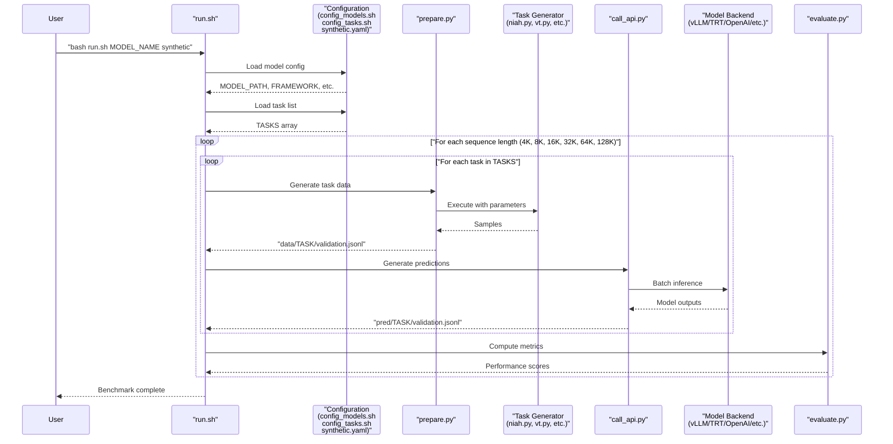
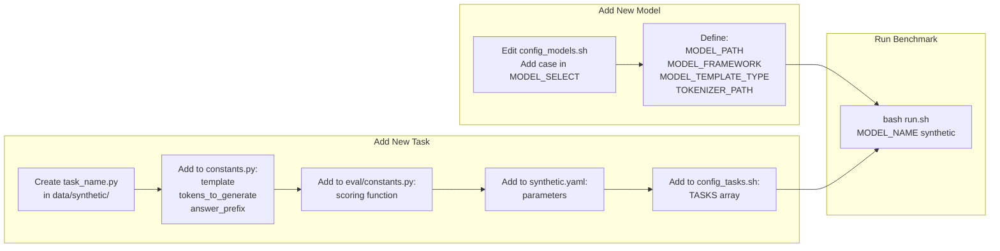

<!-- source: DeepWiki mcp.deepwiki.com · repo NVIDIA/RULER · page 1 Overview · fetched 2026-10-26 -->

# Overview

<details>
<summary>Relevant source files</summary>

The following files were used as context for generating this wiki page:

- [README.md](README.md)

</details>


## Purpose and Scope

This document provides an introduction to RULER (Real-world Usage-driven Long-context Evaluation Representation), a comprehensive benchmarking framework for evaluating the long-context capabilities of Large Language Models (LLMs). RULER generates synthetic evaluation tasks with configurable sequence lengths and complexity to measure how well models can effectively utilize their claimed context windows.

For detailed information about specific components:
- System architecture and execution flow: see [System Architecture](#2)
- Individual task implementations: see [Benchmark Tasks](#3)
- Configuration and customization: see [Configuration System](#4)
- Running benchmarks: see [Running RULER](#5)
- Extending with custom tasks or models: see [Extending RULER](#6)

## What is RULER?

RULER is a synthetic benchmarking framework designed to evaluate the *real* context handling capabilities of long-context language models. While many models claim to support context windows of 32K, 128K, or even 1M tokens, RULER systematically tests whether models can actually maintain performance as sequence length increases.

The framework evaluates models on **13 tasks** organized into **4 categories**: Retrieval, Multi-hop Tracing, Aggregation, and Question Answering. Each task is configurable with parameters that control complexity, allowing researchers to test models under various difficulty levels.

Sources: [README.md:1-3]()

## Key Concepts

### Effective Length vs Claimed Length

```mermaid
graph LR
    subgraph "Model Claims"
        CLAIMED["Claimed Context<br/>128K tokens"]
    end
    
    subgraph "RULER Evaluation"
        TEST_4K["Test @ 4K<br/>Performance: 96%"]
        TEST_8K["Test @ 8K<br/>Performance: 95%"]
        TEST_16K["Test @ 16K<br/>Performance: 93%"]
        TEST_32K["Test @ 32K<br/>Performance: 87%"]
        TEST_64K["Test @ 64K<br/>Performance: 82%"]
        TEST_128K["Test @ 128K<br/>Performance: 71%"]
    end
    
    subgraph "Determination"
        THRESHOLD["Threshold: 85.6%<br/>(Llama-2-7b @ 4K)"]
        EFFECTIVE["Effective Length:<br/>32K tokens"]
    end
    
    CLAIMED --> TEST_4K
    TEST_4K --> TEST_8K
    TEST_8K --> TEST_16K
    TEST_16K --> TEST_32K
    TEST_32K --> TEST_64K
    TEST_64K --> TEST_128K
    
    TEST_128K --> THRESHOLD
    THRESHOLD --> EFFECTIVE
    
    style EFFECTIVE fill:#f9f9f9
    style THRESHOLD fill:#f9f9f9
```



**Effective Length**: The maximum sequence length at which a model maintains performance above the 85.6% threshold. This threshold is set based on Llama-2-7b's performance at 4K tokens, its claimed context length, providing a consistent baseline for comparison across all models.

**Claimed Length**: The context window size advertised by model developers, often based on training or positional encoding capabilities rather than empirical performance.

RULER's evaluation reveals that most models fall significantly short of their claimed context lengths. For example, GPT-4-1106-preview claims 128K but has an effective length of 64K, while many 32K models only achieve 4K-16K effective lengths.

Sources: [README.md:3-54]()

### The 85.6% Threshold

The threshold of 85.6% represents the aggregate performance of Llama-2-7b-chat on RULER tasks at 4K tokens (its claimed context length). This baseline serves multiple purposes:

- **Consistency**: Provides a fixed reference point for comparing all models
- **Qualitative Significance**: Represents "acceptable" performance where a model still functions reasonably well
- **Fair Comparison**: Accounts for the fact that not all models perform perfectly even at short lengths

When a model's performance drops below this threshold, it indicates the model is struggling to utilize the longer context effectively, even if it can technically process longer inputs.

Sources: [README.md:53-55]()

## Task Categories

RULER evaluates models across four distinct categories of long-context tasks:

| Category | Task Names | Core Capability Tested |
|----------|-----------|----------------------|
| **Retrieval** | `niah_single_1`, `niah_single_2`, `niah_single_3`, `niah_multikey_1`, `niah_multikey_2`, `niah_multikey_3`, `niah_multivalue`, `niah_multiquery` | Finding specific information within long contexts |
| **Multi-hop Tracing** | `vt` | Following chains of references across the context |
| **Aggregation** | `cwe`, `fwe` | Extracting and summarizing patterns from the entire context |
| **Question Answering** | `qa_1`, `qa_2` | Answering questions based on multiple documents |

Each task accepts configuration parameters that control its difficulty. For example, `niah_multikey_1` uses 1 key-value pair, while `niah_multikey_3` uses 3 pairs, progressively increasing complexity. Task configurations are defined in [synthetic.yaml]() and detailed task implementations are in [Benchmark Tasks](#3).

Sources: [README.md:138-147]()

## System Architecture Overview

```mermaid
graph TB
    subgraph "Entry Point"
        RUN_SH["run.sh<br/>Main orchestrator"]
    end
    
    subgraph "Configuration Layer"
        CONFIG_MODELS["config_models.sh<br/>MODEL_SELECT()"]
        CONFIG_TASKS["config_tasks.sh<br/>TASKS array"]
        SYNTHETIC_YAML["synthetic.yaml<br/>Task parameters"]
    end
    
    subgraph "Core Pipeline Stages"
        PREPARE["prepare.py<br/>Data generation controller"]
        CALL_API["call_api.py<br/>Inference controller<br/>get_llm()"]
        EVALUATE["evaluate.py<br/>Metrics computation"]
    end
    
    subgraph "Task Generators"
        NIAH["niah.py"]
        VT["variable_tracking.py"]
        CWE["common_words_extraction.py"]
        FWE["freq_words_extraction.py"]
        QA["qa.py"]
    end
    
    subgraph "Model Backends"
        VLLM["serve_vllm.py<br/>vLLM server"]
        TRTLLM["serve_trt.py<br/>TensorRT-LLM server"]
        SGLANG["sglang<br/>SGLang server"]
        HF["HuggingFaceModel<br/>Direct loading"]
        OPENAI["OpenAIClient<br/>API client"]
    end
    
    subgraph "Utilities"
        TOKENIZER["tokenizer.py<br/>Multi-framework support"]
        TEMPLATE["template.py<br/>Templates dict"]
        MANIFEST["manifest_utils.py<br/>JSONL I/O"]
    end
    
    subgraph "Data Flow"
        INPUT["data/TASK/validation.jsonl"]
        PRED["pred/TASK/validation.jsonl"]
        RESULTS["results/"]
    end
    
    RUN_SH --> CONFIG_MODELS
    RUN_SH --> CONFIG_TASKS
    RUN_SH --> SYNTHETIC_YAML
    
    RUN_SH --> PREPARE
    RUN_SH --> CALL_API
    RUN_SH --> EVALUATE
    
    PREPARE --> NIAH
    PREPARE --> VT
    PREPARE --> CWE
    PREPARE --> FWE
    PREPARE --> QA
    
    CALL_API --> VLLM
    CALL_API --> TRTLLM
    CALL_API --> SGLANG
    CALL_API --> HF
    CALL_API --> OPENAI
    
    NIAH --> TOKENIZER
    NIAH --> TEMPLATE
    NIAH --> MANIFEST
    
    PREPARE --> INPUT
    CALL_API --> INPUT
    CALL_API --> PRED
    EVALUATE --> PRED
    EVALUATE --> RESULTS
```



RULER's architecture consists of:

1. **Entry Point**: [run.sh]() orchestrates the entire benchmark pipeline
2. **Configuration Layer**: Shell scripts and YAML files define models, tasks, and parameters without code changes
3. **Core Pipeline**: Three Python scripts handle data generation, inference, and evaluation sequentially
4. **Task Generators**: Five task-specific scripts generate synthetic evaluation samples
5. **Model Backends**: Support for seven inference backends (3 local servers, 2 direct loaders, 2 external APIs)
6. **Utilities**: Shared modules for tokenization, prompt templating, and data I/O
7. **Data Flow**: Standardized JSONL format for task samples, predictions, and results

Sources: [README.md:92-136](), High-level architecture diagrams

## Execution Pipeline

The typical RULER workflow follows this sequence:



**Key execution characteristics**:

1. **Sequential Processing**: Runs tests at increasing sequence lengths (4K → 128K)
2. **Task Iteration**: For each length, evaluates all configured tasks
3. **Three-Stage Processing**: Data generation → Inference → Evaluation
4. **Incremental Results**: Evaluation runs after all tasks at each sequence length
5. **Resource Efficiency**: Model server starts once and serves all inference requests

The pipeline outputs results in a standardized format showing performance at each sequence length, enabling determination of effective length.

Sources: [README.md:92-136](), Pipeline execution diagram

## Example Benchmark Results

RULER produces comprehensive performance tables showing model degradation across sequence lengths:

| Model | Claimed Length | Effective Length | 4K | 8K | 16K | 32K | 64K | 128K |
|-------|---------------|-----------------|-----|-----|------|------|------|-------|
| Gemini-1.5-pro | 1M | >128K | 96.7 | 95.8 | 96.0 | 95.9 | 95.9 | 94.4 |
| GPT-4-1106-preview | 128K | 64K | 96.6 | 96.3 | 95.2 | 93.2 | 87.0 | 81.2 |
| Llama3.1-70B | 128K | 64K | 96.5 | 95.8 | 95.4 | 94.8 | 88.4 | 66.6 |
| Mixtral-8x22B | 64K | 32K | 95.6 | 94.9 | 93.4 | 90.9 | 84.7 | 31.7 |
| Mistral-7B | 32K | 16K | 93.6 | 91.2 | 87.2 | 75.4 | 49.0 | 13.8 |

**Key observations from RULER results**:

- Performance values exceeding 85.6% are underlined in the original table
- Most models show significant degradation before reaching claimed context length
- Only a few models (Gemini-1.5-pro, Jamba-1.5) maintain performance beyond 128K
- The gap between claimed and effective length is often 2-4x

The effective length metric provides a standardized way to compare models, revealing that many long-context models cannot reliably utilize their full claimed capacity.

Sources: [README.md:5-51]()

## Configuration-Driven Design

RULER's architecture emphasizes configurability without code changes:



**Extension Points**:

1. **Models**: Add cases to `MODEL_SELECT()` in [config_models.sh:103-129]()
2. **Tasks**: Five-step process documented in [Adding Custom Tasks](#6.1)
3. **Templates**: Extend `Templates` dictionary in [template.py]()
4. **Metrics**: Add scoring functions to [eval/constants.py]()

This design allows researchers to contribute new evaluation tasks or test new models without understanding the entire system internals.

Sources: [README.md:137-166](), Configuration extensibility diagram

## Output Structure

RULER generates outputs in a structured directory hierarchy:

```
ROOT_DIR/
├── data/
│   └── TASK_NAME/
│       └── validation.jsonl        # Generated task samples
├── pred/
│   └── TASK_NAME/
│       └── validation.jsonl        # Model predictions
└── results/
    └── MODEL_NAME/
        └── synthetic/
            └── results.json        # Performance metrics
```

Each `validation.jsonl` file contains one JSON object per line with fields:
- `index`: Sample identifier
- `input`: Formatted prompt with context
- `outputs`: Expected answer(s)
- `length`: Actual token count
- `pred`: Model's prediction (in pred/ files only)

The final `results.json` aggregates performance across all tasks and sequence lengths, enabling effective length determination.

Sources: [README.md:92-136]()

## Getting Started

To run RULER benchmarks:

1. **Setup environment**: Build Docker container or install requirements
2. **Download data**: Paul Graham essays for NIAH, SQuAD/HotpotQA for QA tasks
3. **Configure model**: Add model to [config_models.sh]()
4. **Run pipeline**: Execute `bash run.sh MODEL_NAME synthetic`

For detailed setup instructions, see [Running RULER](#5). For customization options, see [Configuration System](#4).

Sources: [README.md:67-136]()

---

