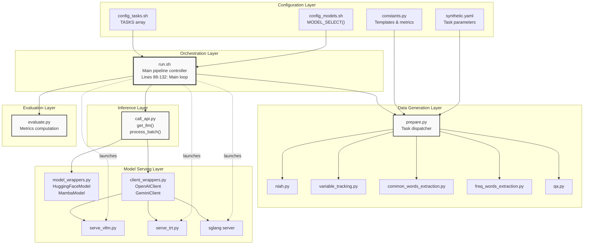
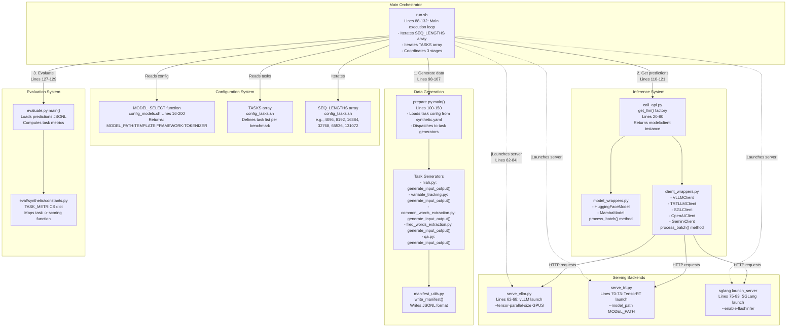
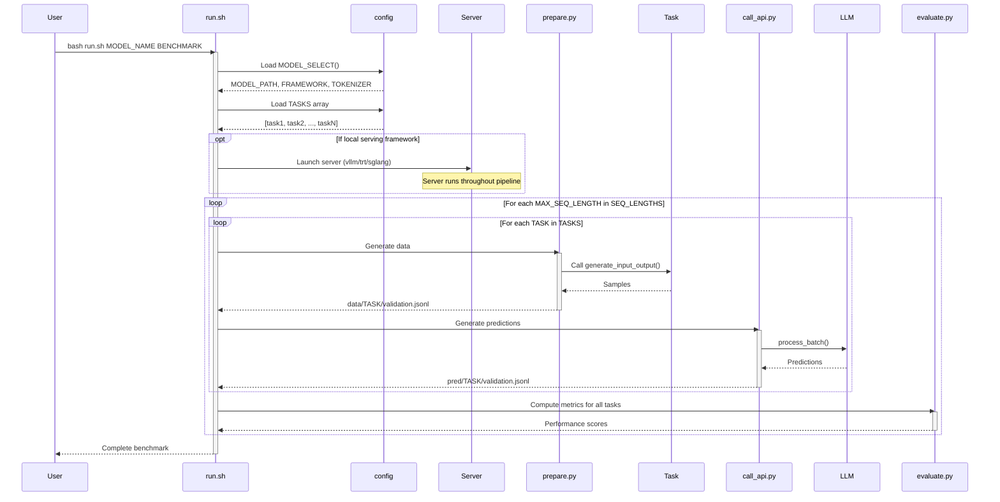
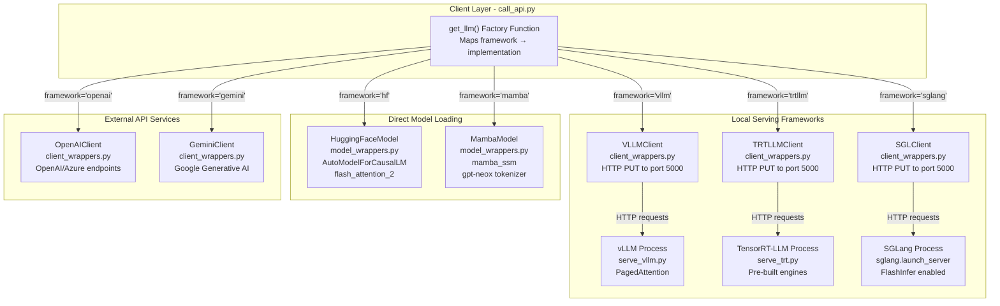
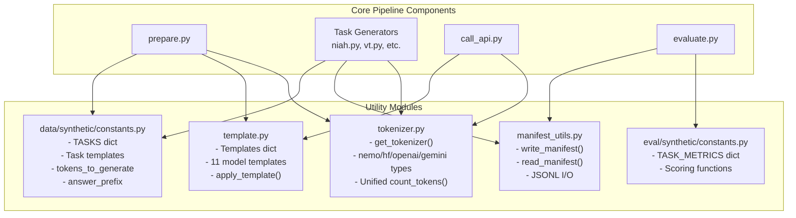

<!-- source: DeepWiki mcp.deepwiki.com · repo NVIDIA/RULER · page 2 System Architecture · fetched 2026-10-26 -->

# System Architecture

<details>
<summary>Relevant source files</summary>

The following files were used as context for generating this wiki page:

- [README.md](README.md)
- [scripts/run.sh](scripts/run.sh)

</details>


## Purpose and Scope

This page provides a high-level architectural overview of the RULER framework, describing the major components, their responsibilities, and how they interact to perform long-context LLM evaluation. RULER operates as a sequential pipeline that generates synthetic benchmark data, obtains model predictions, and computes evaluation metrics across varying sequence lengths.

For detailed information about specific subsystems, see:
- Pipeline execution flow: [Pipeline Overview](#2.1)
- Data generation mechanics: [Data Generation Pipeline](#2.2)
- Model serving and inference: [Inference and Serving](#2.3)
- Metrics and evaluation: [Evaluation System](#2.4)
- Task-specific implementations: [Benchmark Tasks](#3)
- Configuration details: [Configuration System](#4)

## Architectural Layers

RULER is organized into five distinct layers that separate concerns and enable modular development:



**Sources:** [scripts/run.sh](), [scripts/config_models.sh](), [scripts/config_tasks.sh](), [scripts/synthetic.yaml](), [scripts/data/synthetic/constants.py](), [scripts/data/prepare.py](), [scripts/pred/call_api.py](), [scripts/eval/evaluate.py]()

### Layer Responsibilities

| Layer | Responsibility | Key Components |
|-------|---------------|----------------|
| **Configuration** | Define models, tasks, and parameters | `config_models.sh`, `config_tasks.sh`, `synthetic.yaml` |
| **Orchestration** | Control execution flow and coordinate components | `run.sh` |
| **Data Generation** | Create synthetic benchmark samples | `prepare.py`, task-specific generators |
| **Model Serving** | Provide model inference backends | `serve_vllm.py`, `serve_trt.py`, `sglang`, API clients |
| **Inference** | Generate predictions from models | `call_api.py`, wrappers in `model_wrappers.py`, `client_wrappers.py` |
| **Evaluation** | Compute metrics and determine effective length | `evaluate.py`, metrics in `eval/synthetic/constants.py` |

**Sources:** [scripts/run.sh:1-133](), [scripts/data/prepare.py](), [scripts/pred/call_api.py](), [scripts/eval/evaluate.py]()

## Core Component Architecture

The following diagram maps system components to their code implementations:



**Sources:** [scripts/run.sh:88-132](), [scripts/config_models.sh:16-200](), [scripts/config_tasks.sh](), [scripts/data/prepare.py:100-150](), [scripts/pred/call_api.py:20-80](), [scripts/pred/model_wrappers.py](), [scripts/pred/client_wrappers.py](), [scripts/eval/evaluate.py](), [scripts/eval/synthetic/constants.py]()

## Data Flow Architecture

The following diagram shows how data flows through the system from configuration to results:

```mermaid
graph LR
    subgraph Inputs["Input Artifacts"]
        config_files["Config Files<br/>- MODEL_PATH<br/>- TASKS array<br/>- synthetic.yaml"]
        external_data["External Data<br/>- Paul Graham essays<br/>- SQuAD JSON<br/>- HotpotQA JSON"]
    end
    
    subgraph Stage1["Stage 1: Data Generation"]
        prepare["prepare.py<br/>Dispatcher"]
        task_gen["Task Generator<br/>generate_input_output()"]
        data_jsonl["data/TASK/validation.jsonl<br/>{index, input, outputs, length}"]
    end
    
    subgraph Stage2["Stage 2: Prediction Generation"]
        call_api_load["call_api.py<br/>Load data JSONL"]
        llm_instance["LLM Instance<br/>process_batch()"]
        pred_jsonl["pred/TASK/validation.jsonl<br/>{index, input, outputs, pred}"]
    end
    
    subgraph Stage3["Stage 3: Evaluation"]
        eval_load["evaluate.py<br/>Load pred JSONL"]
        metrics_compute["Compute metrics<br/>TASK_METRICS[task]"]
        results["Results<br/>- Task scores<br/>- Effective length<br/>- Performance table"]
    end
    
    config_files --> prepare
    external_data --> task_gen
    prepare --> task_gen
    task_gen --> data_jsonl
    
    data_jsonl --> call_api_load
    call_api_load --> llm_instance
    llm_instance --> pred_jsonl
    
    pred_jsonl --> eval_load
    eval_load --> metrics_compute
    metrics_compute --> results
    
    style data_jsonl fill:#f9f9f9,stroke:#333,stroke-width:2px
    style pred_jsonl fill:#f9f9f9,stroke:#333,stroke-width:2px
    style results fill:#f9f9f9,stroke:#333,stroke-width:2px
```



**Sources:** [scripts/run.sh:98-129](), [scripts/data/prepare.py](), [scripts/pred/call_api.py](), [scripts/eval/evaluate.py]()

### Directory Structure

The pipeline creates a consistent directory structure for each model, benchmark, and sequence length:

```
ROOT_DIR/
└── MODEL_NAME/
    └── BENCHMARK/
        └── MAX_SEQ_LENGTH/
            ├── data/
            │   └── TASK/
            │       └── validation.jsonl
            └── pred/
                └── TASK/
                    └── validation.jsonl
```

**Sources:** [scripts/run.sh:91-95]()

## Execution Flow

The system executes as a nested loop controlled by `run.sh`:



**Sources:** [scripts/run.sh:88-132]()

### Key Control Flow Patterns

| Pattern | Implementation | Purpose |
|---------|----------------|---------|
| **Outer Loop** | `for MAX_SEQ_LENGTH in "${SEQ_LENGTHS[@]}"` [run.sh:89]() | Test multiple context lengths |
| **Inner Loop** | `for TASK in "${TASKS[@]}"` [run.sh:97]() | Evaluate all tasks at each length |
| **Sequential Stages** | Lines 98→110→127 [run.sh]() | Data generation → Inference → Evaluation |
| **Conditional Serving** | `if [ "$MODEL_FRAMEWORK" == "vllm" ]` [run.sh:62]() | Launch appropriate server |
| **Factory Pattern** | `get_llm()` in [call_api.py]() | Abstract backend differences |

**Sources:** [scripts/run.sh:62-84](), [scripts/run.sh:88-132](), [scripts/pred/call_api.py]()

## Model Serving Architecture

RULER supports seven distinct inference backends through a unified interface:



**Sources:** [scripts/pred/call_api.py](), [scripts/pred/client_wrappers.py](), [scripts/pred/model_wrappers.py](), [scripts/pred/serve_vllm.py](), [scripts/pred/serve_trt.py]()

### Backend Comparison

| Backend | Framework Value | Wrapper Class | Launch Method |
|---------|----------------|---------------|---------------|
| **vLLM** | `vllm` | `VLLMClient` | `serve_vllm.py` [run.sh:62-68]() |
| **TensorRT-LLM** | `trtllm` | `TRTLLMClient` | `serve_trt.py` [run.sh:70-73]() |
| **SGLang** | `sglang` | `SGLClient` | `sglang.launch_server` [run.sh:75-83]() |
| **HuggingFace** | `hf` | `HuggingFaceModel` | Direct loading |
| **Mamba** | `mamba` | `MambaModel` | Direct loading |
| **OpenAI** | `openai` | `OpenAIClient` | API calls |
| **Gemini** | `gemini` | `GeminiClient` | API calls |

**Sources:** [scripts/run.sh:62-84](), [scripts/pred/call_api.py](), [scripts/pred/client_wrappers.py](), [scripts/pred/model_wrappers.py]()

## Shared Utility Subsystem

All components rely on shared utilities for cross-cutting concerns:



**Sources:** [scripts/data/tokenizer.py](), [scripts/data/template.py](), [scripts/data/manifest_utils.py](), [scripts/data/synthetic/constants.py](), [scripts/eval/synthetic/constants.py]()

### Utility Module Responsibilities

| Module | Key Functions | Purpose |
|--------|---------------|---------|
| **tokenizer.py** | `get_tokenizer()`, `count_tokens()` | Multi-framework tokenization (NeMo, HuggingFace, OpenAI, Gemini) |
| **template.py** | `apply_template()`, `Templates` dict | Model-specific prompt formatting (11 templates) |
| **manifest_utils.py** | `write_manifest()`, `read_manifest()` | Standardized JSONL file I/O |
| **constants.py (data)** | `TASKS` dict | Task metadata: templates, token limits, answer prefixes |
| **constants.py (eval)** | `TASK_METRICS` dict | Task-specific scoring functions |

**Sources:** [scripts/data/tokenizer.py](), [scripts/data/template.py](), [scripts/data/manifest_utils.py](), [scripts/data/synthetic/constants.py](), [scripts/eval/synthetic/constants.py]()

## Key Design Principles

### 1. Configuration-Driven Architecture

All system behavior is controlled through configuration files rather than code modification:

- **Model Configuration:** `config_models.sh` `MODEL_SELECT()` function maps model names to paths, frameworks, and tokenizers
- **Task Selection:** `config_tasks.sh` defines task arrays per benchmark
- **Task Complexity:** `synthetic.yaml` specifies parameters controlling task difficulty
- **Templates:** `template.py` `Templates` dict defines prompt formats

**Sources:** [scripts/config_models.sh](), [scripts/config_tasks.sh](), [scripts/synthetic.yaml](), [scripts/data/template.py]()

### 2. Factory Pattern for Backend Abstraction

The `get_llm()` factory function [call_api.py]() provides a uniform interface across all seven inference backends. Every implementation provides a `process_batch()` method with consistent semantics:

```python
llm = get_llm(server_type, model_name_or_path, ...)
predictions = llm.process_batch(inputs, **generation_kwargs)
```

**Sources:** [scripts/pred/call_api.py]()

### 3. Sequential Processing Model

The nested loop structure [run.sh:88-132]() ensures:
- Data is generated once per (task, sequence_length) pair
- Predictions are generated immediately after data generation
- Evaluation occurs after all tasks complete at a given sequence length
- Results are incrementally available as the pipeline progresses

**Sources:** [scripts/run.sh:88-132]()

### 4. Tokenizer-Aware Generation

All task generators accept a tokenizer instance and use binary search to maximize context utilization while respecting `max_seq_length` constraints. This ensures samples precisely fit within model context windows.

**Sources:** [scripts/data/prepare.py](), [scripts/data/synthetic/niah.py](), [scripts/data/synthetic/variable_tracking.py](), [scripts/data/synthetic/common_words_extraction.py](), [scripts/data/synthetic/freq_words_extraction.py](), [scripts/data/synthetic/qa.py]()

### 5. Standardized Data Format

All pipeline stages communicate through JSONL files with consistent schema:

**Data Generation Output:**
```json
{
  "index": 0,
  "input": "prompt text...",
  "outputs": ["expected answer"],
  "length": 4096
}
```

**Prediction Output:**
```json
{
  "index": 0,
  "input": "prompt text...",
  "outputs": ["expected answer"],
  "pred": "model prediction"
}
```

**Sources:** [scripts/data/manifest_utils.py](), [scripts/data/prepare.py](), [scripts/pred/call_api.py]()

---

