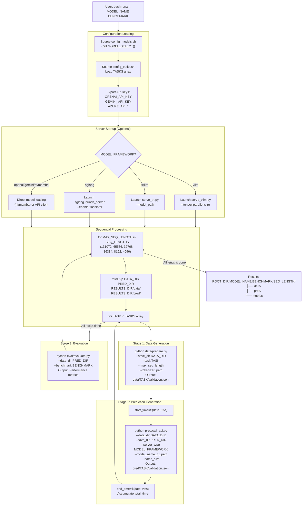
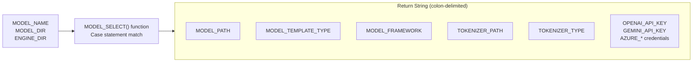
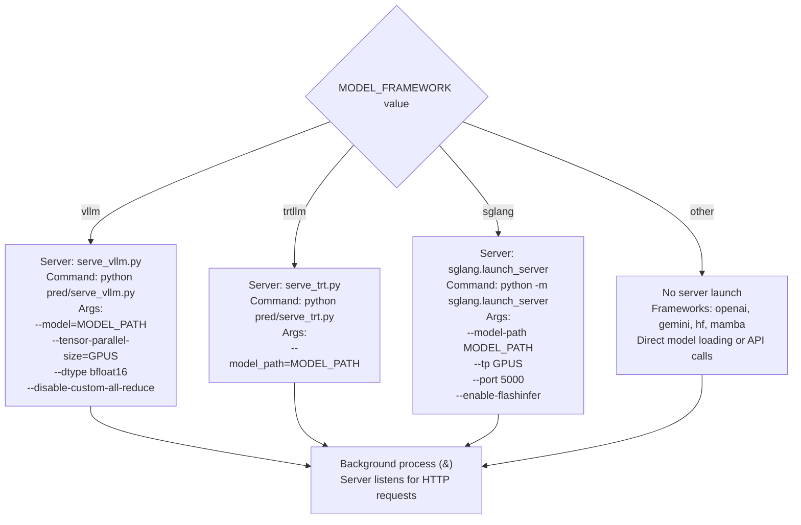
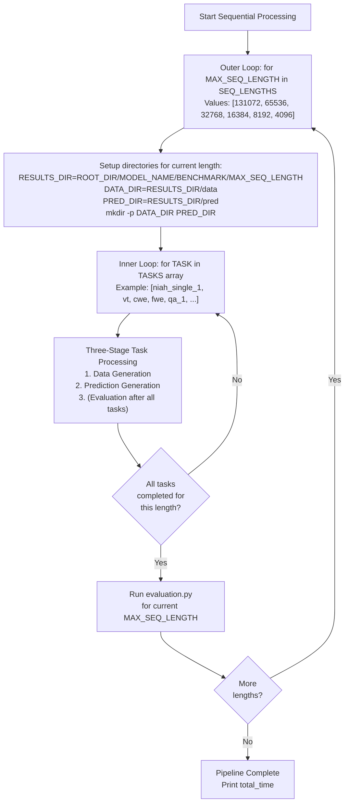
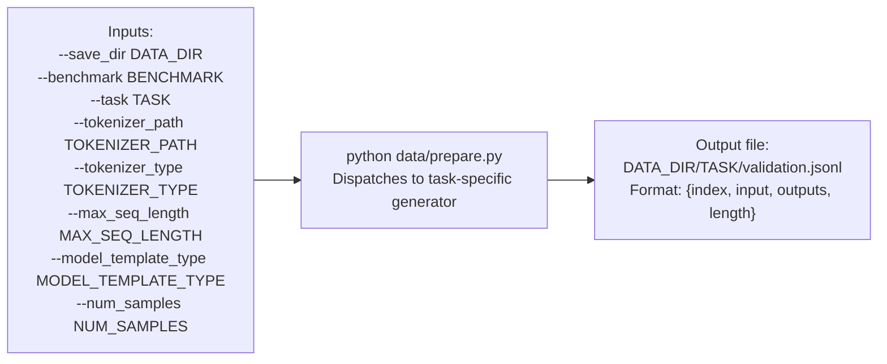
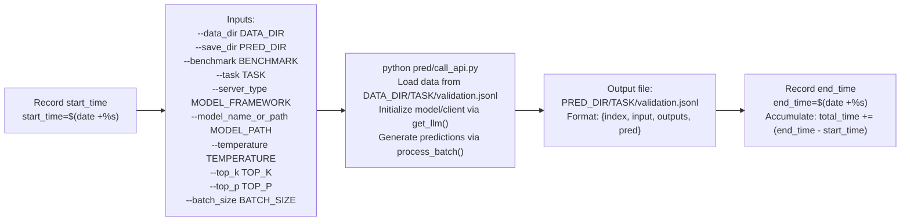
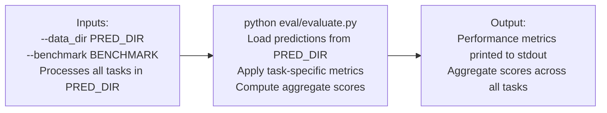
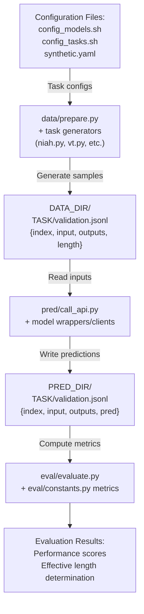

<!-- source: DeepWiki mcp.deepwiki.com · repo NVIDIA/RULER · page 2.1 Pipeline Overview · fetched 2026-10-26 -->

# Pipeline Overview

<details>
<summary>Relevant source files</summary>

The following files were used as context for generating this wiki page:

- [README.md](README.md)
- [scripts/config_models.sh](scripts/config_models.sh)
- [scripts/run.sh](scripts/run.sh)

</details>


## Purpose and Scope

This document explains the complete execution flow of RULER benchmarks from configuration to final results. It covers the orchestration role of `run.sh`, the configuration loading mechanism, server startup, and the sequential processing model that iterates through sequence lengths and tasks.

For details on individual stages:
- Data generation internals: see [Data Generation Pipeline](#2.2)
- Model serving and inference: see [Inference and Serving](#2.3)
- Evaluation metrics and effective length: see [Evaluation System](#2.4)
- Specific task configurations: see [Task Configuration](#4.2)

---

## Pipeline Execution Flow

The RULER pipeline is orchestrated by `run.sh`, which executes a three-stage process for each task at each sequence length: **data generation**, **prediction generation**, and **evaluation**. The pipeline uses a nested loop structure where the outer loop iterates through sequence lengths (4K to 128K tokens) and the inner loop processes individual tasks.

### Complete Pipeline Diagram



**Sources:** [scripts/run.sh:1-133]()

---

## Configuration Loading Phase

The pipeline begins by loading configuration from two shell scripts that define model properties and task selections.

### Model Configuration

The `MODEL_SELECT()` function in `config_models.sh` maps a model name to its configuration parameters:



The returned configuration string is parsed using `IFS=":" read` to extract individual variables:

| Variable | Purpose | Examples |
|----------|---------|----------|
| `MODEL_PATH` | Model location or API identifier | `${MODEL_DIR}/llama3.1-8b-Instruct`, `gpt-4` |
| `MODEL_TEMPLATE_TYPE` | Prompt format identifier | `meta-chat`, `meta-llama3`, `jamba`, `base` |
| `MODEL_FRAMEWORK` | Inference backend | `vllm`, `trtllm`, `sglang`, `openai`, `gemini`, `hf`, `mamba` |
| `TOKENIZER_PATH` | Tokenizer location | Model path, `cl100k_base`, `gemini-1.5-pro-latest` |
| `TOKENIZER_TYPE` | Tokenizer framework | `nemo`, `hf`, `openai`, `gemini` |

**Sources:** [scripts/config_models.sh:27-101](), [scripts/run.sh:34-41]()

### Task Configuration

The `config_tasks.sh` file defines task arrays for different benchmarks. The `run.sh` script uses bash's `declare -n` to create a nameref to the appropriate array:

```bash
# From run.sh
source config_tasks.sh
BENCHMARK=${2}
declare -n TASKS=$BENCHMARK  # Create reference to benchmark array
```

For the `synthetic` benchmark, the `TASKS` array contains task names like `niah_single_1`, `vt`, `cwe`, etc. Each task has corresponding configuration in `synthetic.yaml`.

**Sources:** [scripts/run.sh:52-58](), [scripts/config_tasks.sh]()

### Environment Variable Export

API credentials are exported as environment variables for use by client wrappers:

```bash
export OPENAI_API_KEY=${OPENAI_API_KEY}
export GEMINI_API_KEY=${GEMINI_API_KEY}
export AZURE_API_ID=${AZURE_ID}
export AZURE_API_SECRET=${AZURE_SECRET}
export AZURE_API_ENDPOINT=${AZURE_ENDPOINT}
```

**Sources:** [scripts/run.sh:44-48]()

---

## Server Startup

For local model frameworks (`vllm`, `trtllm`, `sglang`), the pipeline launches a server process before entering the main processing loop. This server runs throughout the entire benchmark execution.



**Key details:**

- Servers are launched with `&` to run in background
- HTTP endpoint defaults to port 5000 for client communication
- Servers persist across all sequence lengths and tasks
- For `hf` and `mamba` frameworks, models are loaded directly in `call_api.py`
- For API frameworks (`openai`, `gemini`), no local server is needed

**Sources:** [scripts/run.sh:61-84]()

---

## Sequential Processing Model

The core pipeline uses nested loops to process all combinations of sequence lengths and tasks sequentially.

### Nested Loop Structure



**Sequence length array:** Defined in `config_models.sh` as `SEQ_LENGTHS=(131072 65536 32768 16384 8192 4096)`. The pipeline processes from longest to shortest to enable early termination if needed.

**Sources:** [scripts/run.sh:88-130](), [scripts/config_models.sh:18-25]()

---

## Three-Stage Task Processing

For each task at each sequence length, the pipeline executes three distinct stages.

### Stage 1: Data Generation



The `prepare.py` script orchestrates task-specific data generation. It loads task configuration from `synthetic.yaml`, initializes the appropriate tokenizer, and calls the task generator script (e.g., `niah.py`, `vt.py`).

**Sources:** [scripts/run.sh:98-107]()

### Stage 2: Prediction Generation



This stage runs model inference on the generated samples. The pipeline tracks execution time for each task to measure inference performance. Generation parameters are controlled via `TEMPERATURE`, `TOP_K`, and `TOP_P` variables.

**Sources:** [scripts/run.sh:109-124]()

### Stage 3: Evaluation



Evaluation runs **once** after all tasks at a given sequence length are complete. The `evaluate.py` script loads predictions from all task directories and computes metrics defined in `eval/constants.py`.

**Sources:** [scripts/run.sh:127-129]()

---

## Directory Structure and Data Flow

The pipeline organizes outputs in a hierarchical directory structure based on model, benchmark, and sequence length:

```
ROOT_DIR/
└── MODEL_NAME/
    └── BENCHMARK/
        └── MAX_SEQ_LENGTH/
            ├── data/
            │   ├── niah_single_1/
            │   │   └── validation.jsonl
            │   ├── vt/
            │   │   └── validation.jsonl
            │   └── ...
            └── pred/
                ├── niah_single_1/
                │   └── validation.jsonl
                ├── vt/
                │   └── validation.jsonl
                └── ...
```

### Data Flow Diagram



**Sources:** [scripts/run.sh:91-95]()

---

## Pipeline Variables and Parameters

Key variables that control pipeline execution:

| Variable | Source | Purpose | Example Values |
|----------|--------|---------|----------------|
| `GPUS` | `run.sh` line 26 | Tensor parallelism size | `1`, `2`, `4`, `8` |
| `ROOT_DIR` | `run.sh` line 27 | Output root directory | `benchmark_root` |
| `MODEL_DIR` | `run.sh` line 28 | HuggingFace models location | `../..` |
| `ENGINE_DIR` | `run.sh` line 29 | TensorRT-LLM engines location | `.` |
| `BATCH_SIZE` | `run.sh` line 30 | Inference batch size | `1` (increase for better GPU utilization) |
| `TEMPERATURE` | `config_models.sh` line 15 | Sampling temperature | `0.0` (greedy decoding) |
| `TOP_P` | `config_models.sh` line 16 | Nucleus sampling threshold | `1.0` |
| `TOP_K` | `config_models.sh` line 17 | Top-K sampling limit | `32` |
| `SEQ_LENGTHS` | `config_models.sh` lines 18-25 | Sequence length sweep | `[131072, 65536, 32768, 16384, 8192, 4096]` |
| `NUM_SAMPLES` | `config_tasks.sh` | Samples per task | Task-specific (e.g., `500`) |

**Sources:** [scripts/run.sh:26-30](), [scripts/config_models.sh:15-25]()

---

## Execution Summary

The RULER pipeline executes with the following characteristics:

1. **Sequential processing:** One sequence length at a time, one task at a time
2. **Server persistence:** Local servers run throughout all tasks and lengths
3. **Incremental results:** Each task generates separate output files
4. **Time tracking:** Inference time is measured per task and accumulated
5. **Batch evaluation:** Metrics computed once per sequence length after all tasks complete

**Total execution time:** For 6 sequence lengths × 13 tasks = 78 data generation runs + 78 inference runs + 6 evaluation runs.

**Sources:** [scripts/run.sh:88-133]()

---

