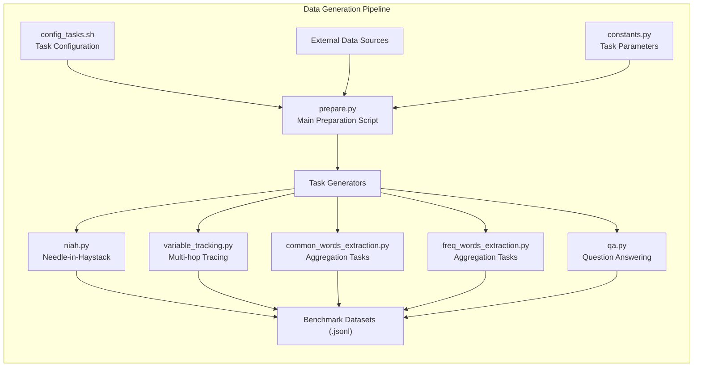
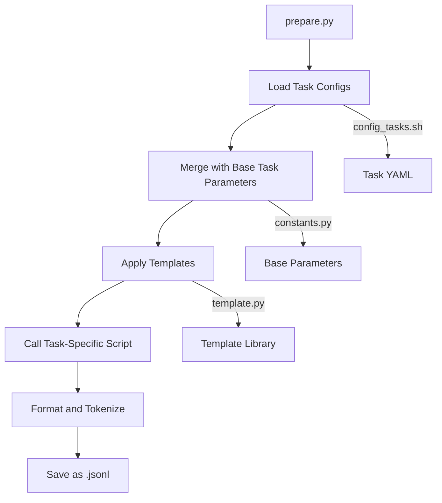
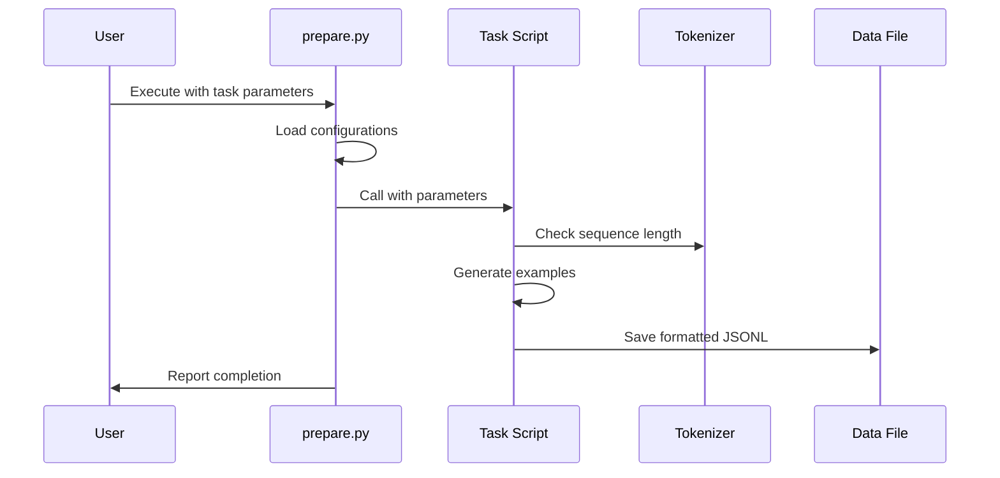
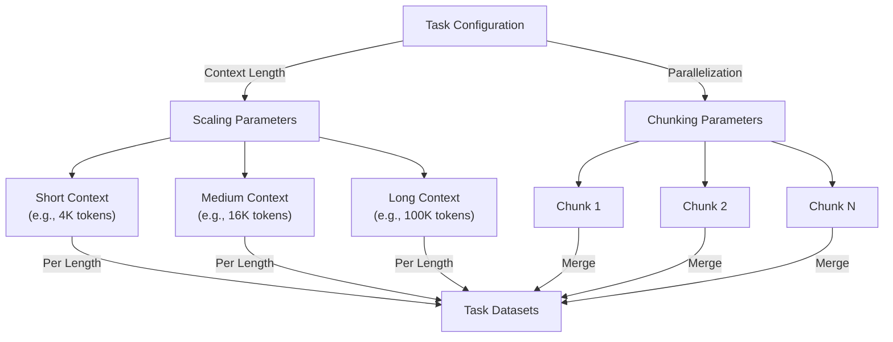
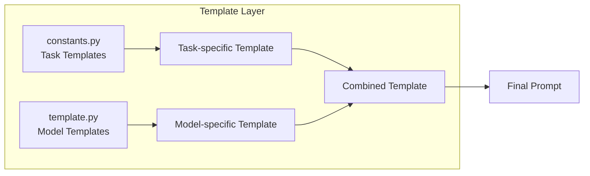
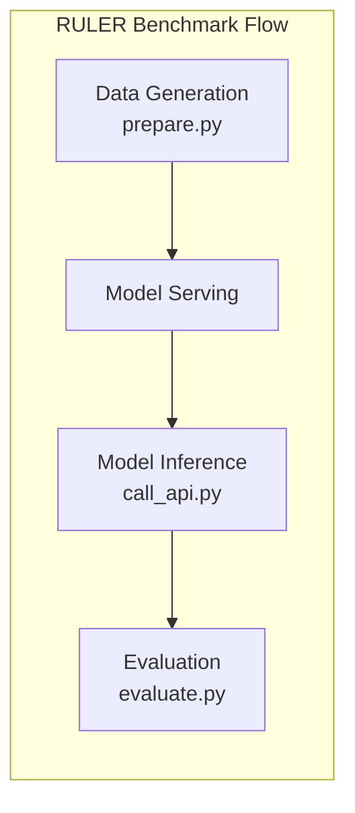

<!-- source: DeepWiki mcp.deepwiki.com · repo NVIDIA/RULER · page 2.2 Data Generation Pipeline · fetched 2026-10-26 -->

# Data Generation Pipeline

<details>
<summary>Relevant source files</summary>

The following files were used as context for generating this wiki page:

- [scripts/data/manifest_utils.py](scripts/data/manifest_utils.py)
- [scripts/data/prepare.py](scripts/data/prepare.py)
- [scripts/data/synthetic/niah.py](scripts/data/synthetic/niah.py)
- [scripts/data/synthetic/variable_tracking.py](scripts/data/synthetic/variable_tracking.py)
- [scripts/synthetic.yaml](scripts/synthetic.yaml)

</details>


The Data Generation Pipeline in RULER is responsible for creating synthetic task data used to evaluate the effective context utilization capabilities of long-context language models. This component transforms source materials and templates into structured test sets that measure specific aspects of model performance across varying context lengths.

For information about running inference with these generated datasets, see [Inference Pipeline](#2.2).

## Overview

The Data Generation Pipeline prepares benchmark datasets by generating synthetic tasks with controlled complexity and known ground-truth answers. This enables precise evaluation of how effectively models utilize information across long contexts.



Sources: [scripts/data/prepare.py:15-62](), [scripts/data/synthetic/constants.py:15-54]()

## Core Components

### Preparation Script

The primary entry point for data generation is `prepare.py`, which orchestrates the creation of task-specific datasets. This script:

1. Loads task configurations from YAML files
2. Merges them with base task parameters
3. Applies appropriate templates
4. Calls task-specific generation scripts
5. Ensures output is properly formatted and tokenized



Sources: [scripts/data/prepare.py:65-147]()

### External Data Sources

RULER uses several external data sources for creating realistic contexts:

| Data Source | Description | Used For |
|-------------|-------------|----------|
| Paul Graham Essays | Collection of essays downloaded from paulgraham.com | Needle-in-a-Haystack tasks |
| SQuAD | Stanford Question Answering Dataset | QA tasks |
| HotpotQA | Multi-hop question answering dataset | QA tasks |
| Word Lists | Common nouns, verbs, and adjectives | Word extraction tasks |

The system includes utilities to download and preprocess these external sources. For example, Paul Graham essays are downloaded and compiled into a single JSON file using the provided script.

Sources: [scripts/data/synthetic/json/download_paulgraham_essay.py:15-82]()

## Data Generation Workflow

The data generation process follows these steps:

1. **Configuration**: Task parameters are defined in `config_tasks.sh` and merged with base parameters
2. **Preparation**: `prepare.py` orchestrates the generation process
3. **Task-specific generation**: Specialized scripts generate data for each task type
4. **Tokenization**: Content is tokenized to ensure it fits within model context limits
5. **Output**: Formatted data is saved as JSONL files with inputs and expected outputs



Sources: [scripts/data/prepare.py:65-147]()

## Task Types and Templates

RULER includes several synthetic task types, each designed to evaluate different aspects of context utilization:

| Task Type | Purpose | Key Parameters |
|-----------|---------|----------------|
| Needle-in-a-Haystack | Tests retrieval of specific information from long context | `type_haystack`, `type_needle`, `num_needle_k/v/q` |
| Variable Tracking | Tests multi-hop logical reasoning through variable chains | `num_chains`, `num_hops` |
| Common Words Extraction | Tests ability to identify and count repeated items | `freq_cw`, `freq_ucw`, `num_cw` |
| Frequent Words Extraction | Tests ability to identify patterns in noisy text | `alpha` |
| Question Answering | Tests comprehension using existing QA datasets | `dataset` (squad/hotpotqa) |

Each task has a template defined in `constants.py` that structures how the prompt is presented to the model. Templates include placeholders for `{context}`, `{query}`, and task-specific parameters.

Sources: [scripts/data/synthetic/constants.py:24-54](), [scripts/data/synthetic/common_words_extraction.py:15-166]()

## JSONL Output Format

The pipeline generates datasets in JSONL format with the following structure:

```
{
    "index": int,
    "input": str,
    "outputs": [str],
    "length": int
}
```

Where:
- `index`: Sequential sample identifier
- `input`: Formatted prompt including context and query
- `outputs`: Expected output (ground truth answers)
- `length`: Token count of the input (for verification of context length)

Sources: [scripts/data/prepare.py:15-32]()

## Data Scaling and Chunking

The pipeline supports generating datasets at different context lengths to evaluate how model performance scales with context size. Additionally, it includes chunking capabilities to split large generation jobs:



Sources: [scripts/data/prepare.py:93-96]()

## Template System

The template system in RULER allows for flexibility in prompt construction across different model types:



The system merges task-specific templates (defining the task structure) with model-specific templates (formatting for specific model types like chat models vs. base models).

Sources: [scripts/data/prepare.py:84-91]()

## Integration with Benchmark System

The Data Generation Pipeline is the first stage in the RULER benchmark workflow:



This pipeline creates the data that flows through the rest of the system for model evaluation.

Sources: [scripts/data/prepare.py:15-32]()

## Command Line Interface

The Data Generation Pipeline is driven by command-line parameters that control various aspects of data generation:

| Parameter | Description | Example |
|-----------|-------------|---------|
| `--save_dir` | Directory to save generated datasets | `./datasets` |
| `--benchmark` | Benchmark type (currently only synthetic) | `synthetic` |
| `--task` | Specific task to generate | `niah_single_1` |
| `--tokenizer_path` | Path to tokenizer model | `tokenizer.model` |
| `--tokenizer_type` | Type of tokenizer | `nemo`, `hf`, `openai` |
| `--max_seq_length` | Maximum sequence length | `4096`, `16384`, `100000` |
| `--num_samples` | Number of samples to generate | `500` |
| `--model_template_type` | Template formatting type | `base`, `vicuna-chat` |

Sources: [scripts/data/prepare.py:48-62]()

---

