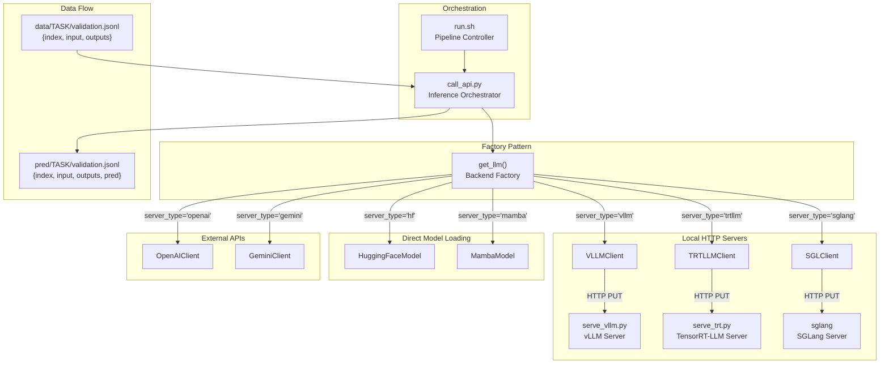
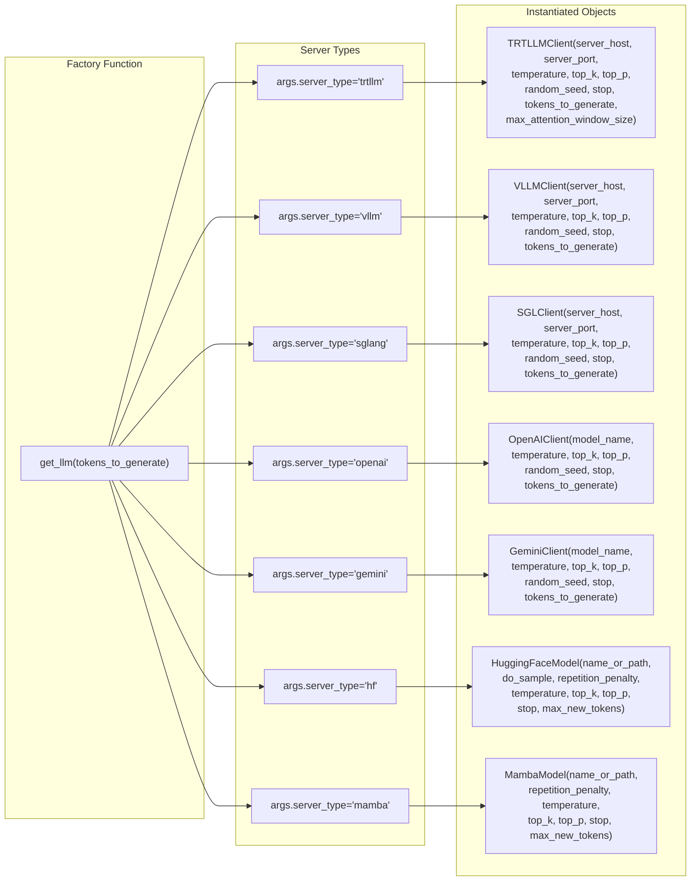
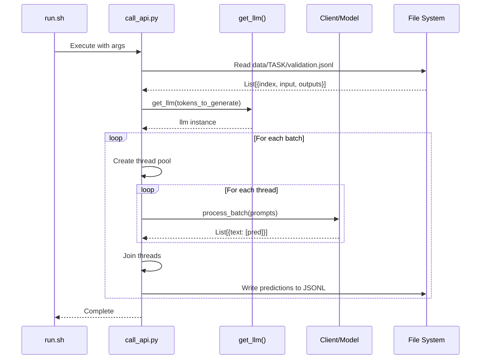

<!-- source: DeepWiki mcp.deepwiki.com · repo NVIDIA/RULER · page 2.3 Inference and Serving · fetched 2026-10-26 -->

# Inference and Serving

<details>
<summary>Relevant source files</summary>

The following files were used as context for generating this wiki page:

- [scripts/pred/call_api.py](scripts/pred/call_api.py)
- [scripts/pred/client_wrappers.py](scripts/pred/client_wrappers.py)
- [scripts/pred/model_wrappers.py](scripts/pred/model_wrappers.py)

</details>


This document describes RULER's inference and serving architecture, which provides a unified interface for generating predictions across seven different model backends. The system abstracts three serving paradigms: local HTTP servers (vLLM, TensorRT-LLM, SGLang), direct model loading (HuggingFace, Mamba), and external APIs (OpenAI, Gemini). For information about data generation, see [2.2](#2.2). For evaluation of predictions, see [2.4](#2.4).

## Architecture Overview

The inference layer centers around [scripts/pred/call_api.py]() as the main orchestrator. It implements a factory pattern through the `get_llm()` function that instantiates the appropriate client or model wrapper based on the `--server_type` parameter. All backends implement a consistent interface with `process_batch()` methods for parallel inference.



**Sources:** [scripts/pred/call_api.py:1-334](), [scripts/pred/client_wrappers.py:1-417](), [scripts/pred/model_wrappers.py:1-133]()

## Backend Selection Factory

The `get_llm()` function in [scripts/pred/call_api.py:98-199]() implements the factory pattern, instantiating the appropriate backend based on command-line arguments. All backends accept a `tokens_to_generate` parameter and return objects implementing the `process_batch()` interface.



**Sources:** [scripts/pred/call_api.py:98-199]()

## Local HTTP Server Clients

Three client classes handle communication with locally-hosted inference servers. All inherit from the base `Client` class and communicate via HTTP PUT requests to `/generate` endpoints.

### Client Base Class

The `Client` abstract base class [scripts/pred/client_wrappers.py:36-106]() provides:
- SSH tunneling support via `sshtunnel_requests` for remote servers
- Retry logic with exponential backoff using `tenacity` decorators
- Parallel batch processing via `ThreadPoolExecutor` with 96+ threads
- Consistent request/response handling

Key methods:
- `_single_call()`: Abstract method implemented by subclasses
- `_send_request()`: HTTP communication with retry logic [scripts/pred/client_wrappers.py:73-90]()
- `process_batch()`: Parallel processing with thread pooling [scripts/pred/client_wrappers.py:92-105]()

### TRTLLMClient

The `TRTLLMClient` class [scripts/pred/client_wrappers.py:108-133]() communicates with TensorRT-LLM servers. Request format includes:

| Parameter | Type | Description |
|-----------|------|-------------|
| `prompts` | List[str] | Input prompts |
| `tokens_to_generate` | int | Max new tokens |
| `temperature` | float | Sampling temperature |
| `top_k` | int | Top-k sampling |
| `top_p` | float | Nucleus sampling |
| `random_seed` | int | Random seed for reproducibility |
| `stop_words_list` | str | Comma-separated stop sequences |
| `max_attention_window_size` | int (optional) | Sliding window size |

**Sources:** [scripts/pred/client_wrappers.py:108-133]()

### VLLMClient

The `VLLMClient` class [scripts/pred/client_wrappers.py:136-158]() communicates with vLLM servers using the OpenAI-compatible API format. Request format:

| Parameter | Type | Description |
|-----------|------|-------------|
| `prompt` | str | Single input prompt (not batched) |
| `max_tokens` | int | Max new tokens |
| `temperature` | float | Sampling temperature |
| `top_k` | int | Top-k sampling |
| `top_p` | float | Nucleus sampling |
| `stop` | List[str] | Stop sequences |

Note: Random seed is not supported by the vLLM server endpoint.

**Sources:** [scripts/pred/client_wrappers.py:136-158]()

### SGLClient

The `SGLClient` class [scripts/pred/client_wrappers.py:161-185]() communicates with SGLang servers. Request format nests sampling parameters:

```
{
    "text": str,
    "sampling_params": {
        "max_new_tokens": int,
        "temperature": float,
        "top_k": int,
        "top_p": float,
        "stop": List[str]
    }
}
```

Note: Random seed is not supported by the SGLang server endpoint.

**Sources:** [scripts/pred/client_wrappers.py:161-185]()

## External API Clients

Two client classes handle communication with external commercial APIs: OpenAI (including Azure) and Google Gemini.

### OpenAIClient

The `OpenAIClient` class [scripts/pred/client_wrappers.py:188-339]() supports both OpenAI and Azure OpenAI APIs. Key features:

**Environment Variables:**
- `OPENAI_API_KEY`: Direct OpenAI API access
- `AZURE_API_ID`, `AZURE_API_SECRET`, `AZURE_API_ENDPOINT`: Azure OAuth authentication

**Token Management:**
- Uses `tiktoken.get_encoding("cl100k_base")` for token counting
- Dynamically reduces `tokens_to_generate` if prompt exceeds model limits [scripts/pred/client_wrappers.py:295-298]()
- Caches Azure OAuth tokens with automatic renewal [scripts/pred/client_wrappers.py:306-339]()

**Model Support:**

| Model Family | Context Length |
|--------------|----------------|
| gpt-4 series | 8K - 128K |
| gpt-3.5-turbo series | 4K - 16K |
| Azure gpt-4 | 32K - 128K |
| Azure gpt-35-turbo | 16K |

**Sources:** [scripts/pred/client_wrappers.py:188-339]()

### GeminiClient

The `GeminiClient` class [scripts/pred/client_wrappers.py:342-416]() interfaces with Google's Generative AI API. Key features:

**Model Support:**

| Model | Max Input Tokens | Max Output Tokens |
|-------|------------------|-------------------|
| gemini-1.0-pro-latest | 30,720 | 2,048 |
| gemini-1.5-pro-latest | 1,048,576 | 8,192 |

**Safety Settings:**
Disables all content filtering to prevent blocking of synthetic evaluation data [scripts/pred/client_wrappers.py:370-376]():
- `HARM_CATEGORY_HARASSMENT`: BLOCK_NONE
- `HARM_CATEGORY_HATE_SPEECH`: BLOCK_NONE
- `HARM_CATEGORY_SEXUALLY_EXPLICIT`: BLOCK_NONE
- `HARM_CATEGORY_DANGEROUS_CONTENT`: BLOCK_NONE

**Error Handling:**
Implements custom retry logic with 60-second fixed intervals and returns empty text on failure [scripts/pred/client_wrappers.py:403-408]().

**Sources:** [scripts/pred/client_wrappers.py:342-416]()

## Direct Model Loading

Two wrapper classes enable direct model loading without separate servers, useful for models not supported by serving frameworks.

### HuggingFaceModel

The `HuggingFaceModel` class [scripts/pred/model_wrappers.py:22-94]() loads models via Transformers library with optimizations:

**Features:**
- Attempts FlashAttention-2 via `attn_implementation="flash_attention_2"` [scripts/pred/model_wrappers.py:31]()
- Fallback to standard attention for Yarn-Llama models
- Uses `torch.bfloat16` precision and `device_map="auto"` for multi-GPU inference
- Supports both `pipeline` API and direct `model.generate()` [scripts/pred/model_wrappers.py:61-74]()
- Handles left-padding for batch inference [scripts/pred/model_wrappers.py:50-54]()

**Llama3 Tokenizer Workaround:**
Implements a fix for tokenizer non-determinism by re-tokenizing and decoding the prompt before comparison [scripts/pred/model_wrappers.py:82-86](). See issue [NVIDIA/RULER#54]() for details.

**Stop Sequence Handling:**
Post-processes generation output by splitting on stop sequences [scripts/pred/model_wrappers.py:88-90]().

**Sources:** [scripts/pred/model_wrappers.py:22-94]()

### MambaModel

The `MambaModel` class [scripts/pred/model_wrappers.py:97-132]() loads Mamba state-space models using the `mamba_ssm` library:

**Features:**
- Uses `EleutherAI/gpt-neox-20b` tokenizer [scripts/pred/model_wrappers.py:102]()
- Loads models with `torch.bfloat16` precision
- Uses Mamba's custom generation function with `cg=True` for computational efficiency [scripts/pred/model_wrappers.py:117-125]()
- Returns only generated tokens (excludes prompt from output) [scripts/pred/model_wrappers.py:128]()

**Batch Processing:**
Currently implements naive sequential processing rather than true batching [scripts/pred/model_wrappers.py:130-132]().

**Sources:** [scripts/pred/model_wrappers.py:97-132]()

## Prediction Generation Process

The main inference workflow in `call_api.py` orchestrates data loading, parallel inference, and result writing.



**Sources:** [scripts/pred/call_api.py:202-333]()

### Data Loading and Resumption

The system supports resuming interrupted runs by checking for existing predictions [scripts/pred/call_api.py:234-238]():

```python
if os.path.exists(pred_file):
    pred_index = [sample['index'] for sample in read_manifest(pred_file)]
    data = [sample for sample in read_manifest(task_file) 
            if sample['index'] not in pred_index]
```

### Parallel Batch Processing

Inference uses a thread-based parallelism model [scripts/pred/call_api.py:274-327]():

1. **Batching:** Data is grouped into batches of size `args.batch_size` [scripts/pred/call_api.py:277-289]()
2. **Threading:** Each batch is processed in a separate thread, with up to `args.threads` concurrent threads [scripts/pred/call_api.py:300-320]()
3. **Incremental Writing:** Results are written to disk as each thread group completes [scripts/pred/call_api.py:322-327]()

The `get_output()` function [scripts/pred/call_api.py:243-272]() implements retry logic that repeatedly calls `llm.process_batch()` until successful.

**Sources:** [scripts/pred/call_api.py:243-327]()

## Data Formats

### Input Format

Task data loaded from `data/TASK/validation.jsonl` contains:

| Field | Type | Description |
|-------|------|-------------|
| `index` | int | Unique sample identifier |
| `input` | str | Formatted prompt for the model |
| `outputs` | List[str] | Ground truth answers |
| `length` | int (optional) | Token count of input |
| `truncation` | int (optional) | Truncation indicator |
| `others` | dict (optional) | Task-specific metadata |

**Sources:** [scripts/pred/call_api.py:17-31]()

### Output Format

Predictions written to `pred/TASK/validation.jsonl` contain all input fields plus:

| Field | Type | Description |
|-------|------|-------------|
| `pred` | str | Model's generated prediction |

The prediction extraction handles various response formats [scripts/pred/call_api.py:256-262]():
- String responses: Used directly
- List responses: First element extracted
- Empty responses: Stored as empty string

**Sources:** [scripts/pred/call_api.py:256-272]()

## Generation Parameters

All backends accept a consistent set of generation parameters:

| Parameter | CLI Argument | Type | Default | Description |
|-----------|--------------|------|---------|-------------|
| Temperature | `--temperature` | float | 1.0 | Sampling temperature (0=greedy) |
| Top-K | `--top_k` | int | 32 | Top-k sampling parameter |
| Top-P | `--top_p` | float | 1.0 | Nucleus sampling threshold |
| Random Seed | `--random_seed` | int | 0 | Seed for reproducibility |
| Stop Words | `--stop_words` | str | '' | Comma-separated stop sequences |
| Sliding Window | `--sliding_window_size` | int | None | Attention window size (TensorRT only) |
| Batch Size | `--batch_size` | int | 1 | Samples per batch |
| Threads | `--threads` | int | 4 | Concurrent inference threads |

Note: HuggingFace and Gemini backends force `threads=1` due to limitations [scripts/pred/call_api.py:94-95]().

**Sources:** [scripts/pred/call_api.py:83-95]()

## Error Handling and Retry Logic

The system implements multiple layers of error resilience:

### HTTP Client Retry

All server-based clients use `tenacity` decorators for automatic retry [scripts/pred/client_wrappers.py:73]():
- Exponential backoff with random jitter: 15-60 seconds
- Maximum 3 retry attempts
- Applies to network errors and HTTP failures

### Azure Token Renewal

The OpenAI client automatically renews Azure OAuth tokens on 401 errors [scripts/pred/client_wrappers.py:278-280]():
```python
if self.azure_api_id and self.azure_api_secret and e.status_code == 401:
    # token expired
    self._create_client()
```

### Inference Loop Retry

The main inference loop implements infinite retry with exception printing [scripts/pred/call_api.py:246-251]():
```python
while True:
    try:
        pred_list = llm.process_batch(prompts=input_list)
        break
    except Exception as e:
        traceback.print_exc()
```

This ensures that transient errors (e.g., server restarts, network issues) do not cause data loss.

**Sources:** [scripts/pred/client_wrappers.py:73-90](), [scripts/pred/call_api.py:246-251]()

## Command-Line Interface

The `call_api.py` script accepts the following arguments:

**Data Arguments:**
- `--data_dir`: Path to load dataset JSONL files
- `--save_dir`: Path to save prediction JSONL files
- `--benchmark`: Benchmark name (default: 'synthetic')
- `--task`: Task name within benchmark
- `--subset`: Data subset (default: 'validation')
- `--chunk_idx`, `--chunk_amount`: For distributed processing across multiple workers

**Server Arguments:**
- `--server_type`: Backend selection (trtllm, vllm, sglang, openai, gemini, hf, mamba)
- `--server_host`: Server hostname (default: '127.0.0.1')
- `--server_port`: Server port (default: '5000')
- `--ssh_server`, `--ssh_key_path`: For SSH tunneling
- `--model_name_or_path`: Model identifier (API name or local path)

**Inference Arguments:**
- See Generation Parameters table above

**Sources:** [scripts/pred/call_api.py:63-93]()

---

