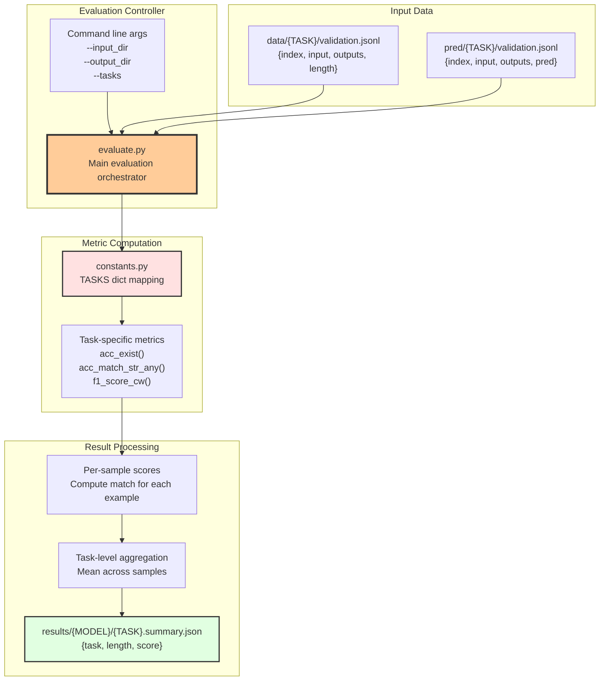
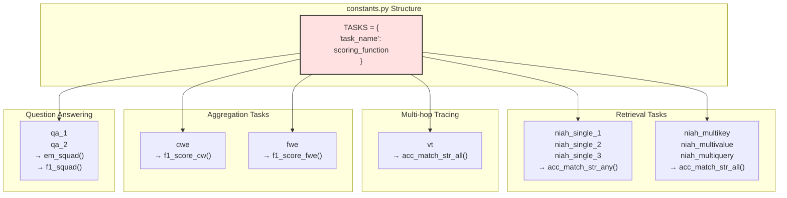
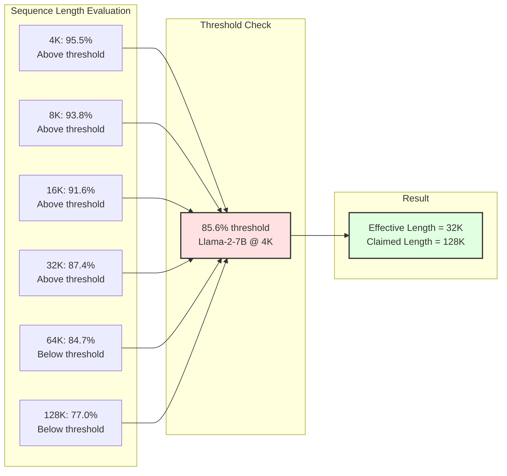

<!-- source: DeepWiki mcp.deepwiki.com · repo NVIDIA/RULER · page 2.4 Evaluation System · fetched 2026-10-26 -->

# Evaluation System

<details>
<summary>Relevant source files</summary>

The following files were used as context for generating this wiki page:

- [README.md](README.md)

</details>


## Purpose and Scope

This document describes RULER's evaluation system, which computes performance metrics from model predictions and determines the "effective context length" of long-context language models. The evaluation system implements the core methodology described in the RULER paper: comparing model performance against an 85.6% threshold to determine at what sequence length models maintain acceptable performance.

For information about generating predictions, see [Inference and Serving](#2.3). For information about interpreting benchmark results, see [Understanding Results](#5.3).

---

## Core Concepts

### Effective Length vs Claimed Length

RULER distinguishes between two measures of model capability:

- **Claimed Length**: The maximum context size advertised by model creators (e.g., 128K tokens)
- **Effective Length**: The maximum sequence length at which a model maintains performance above the 85.6% threshold

The **85.6% threshold** is derived from Llama-2-7B's average performance at 4K tokens, which represents a baseline for "acceptable" long-context performance. This threshold serves as a qualitative benchmark: models that score below this threshold are considered to have degraded capabilities at that sequence length.

**Example from README.md**:
```
Llama3.1 (70B): Claimed Length = 128K, Effective Length = 64K
- Performance: 96.5% (4K), 95.8% (8K), 95.4% (16K), 94.8% (32K), 88.4% (64K), 66.6% (128K)
- Drops below 85.6% threshold at 128K
```

Sources: [README.md:5-54]()

---

## Evaluation Pipeline Architecture



**Evaluation Flow**:

1. **Input Loading**: Read gold standard labels from `data/` and model predictions from `pred/`
2. **Metric Selection**: Look up task-specific metric from `constants.TASKS` dictionary
3. **Per-Sample Scoring**: Apply metric function to each (gold, prediction) pair
4. **Aggregation**: Compute mean score across all samples for the task
5. **Output Storage**: Write summary statistics to results directory

Sources: [README.md:1-179]()

---

## Metric Definitions by Task Category

The evaluation system defines task-specific metrics in `scripts/eval/synthetic/constants.py`. Each task has a dedicated scoring function that implements domain-appropriate evaluation logic.

### Metric Architecture



### Core Metric Functions

| Task Category | Task Names | Metric Function | Description |
|--------------|------------|-----------------|-------------|
| **Retrieval** (Single) | `niah_single_1`, `niah_single_2`, `niah_single_3` | `acc_match_str_any()` | Checks if prediction contains any of the gold answers |
| **Retrieval** (Multi) | `niah_multikey`, `niah_multivalue`, `niah_multiquery` | `acc_match_str_all()` | Checks if prediction contains all gold answers |
| **Multi-hop** | `vt` | `acc_match_str_all()` | Verifies all variable values are correctly traced |
| **Aggregation** | `cwe` | `f1_score_cw()` | F1 score for common word extraction |
| **Aggregation** | `fwe` | `f1_score_fwe()` | F1 score for frequent word extraction |
| **QA** | `qa_1`, `qa_2` | `em_squad()`, `f1_squad()` | SQuAD-style exact match and F1 |

**Key Metric Characteristics**:

- **String Matching**: Most metrics use flexible string matching to handle whitespace and formatting variations
- **Partial Credit**: F1 metrics (CWE, FWE, QA) provide partial credit for partially correct answers
- **Binary Accuracy**: NIAH and VT tasks use binary accuracy (0 or 1 per sample)
- **Case Sensitivity**: Metrics typically normalize for case differences

Sources: [README.md:140-146]()

---

## Evaluation Execution

### Input File Format

Evaluation requires two JSONL files per task:

**Ground Truth** (`data/{TASK}/validation.jsonl`):
```json
{"index": 0, "input": "...", "outputs": ["answer1", "answer2"], "length": 32000}
```

**Predictions** (`pred/{TASK}/validation.jsonl`):
```json
{"index": 0, "input": "...", "outputs": ["answer1", "answer2"], "pred": "model output"}
```

The evaluation script matches samples by `index` and compares `outputs` (gold) with `pred` (model prediction).

### Evaluation Invocation

The evaluation script is called from `run.sh` after all predictions are generated for a given sequence length:

```bash
# Pattern from run.sh
for MAX_SEQ_LENGTH in "${MAX_SEQ_LENGTH_LIST[@]}"; do
    for TASK in "${TASKS[@]}"; do
        # Generate data
        # Generate predictions
    done
    # Evaluate all tasks at this sequence length
    python evaluate.py --input_dir data/ --output_dir pred/ --tasks $TASKS
done
```

This nested loop structure ensures:
1. Data and predictions are generated for all tasks at a sequence length
2. Evaluation happens once per sequence length (not per task)
3. Results are aggregated across tasks for each length

Sources: [README.md:92-135]()

---

## Result Aggregation and Weighted Averaging

### Per-Task Results

Each task produces a score between 0 and 100 representing the percentage of correctly answered samples. These scores are stored in summary JSON files:

```json
{
    "task": "niah_single_1",
    "seq_length": 32768,
    "num_samples": 500,
    "score": 94.2
}
```

### Cross-Task Aggregation

RULER computes three aggregate metrics per sequence length:

| Metric | Description | Calculation |
|--------|-------------|-------------|
| **Avg.** | Simple average across all 13 tasks | `sum(task_scores) / 13` |
| **wAvg. (inc)** | Weighted average with increasing depth weights | Emphasizes later needle positions |
| **wAvg. (dec)** | Weighted average with decreasing depth weights | Emphasizes earlier needle positions |

The weighted averages account for needle position in NIAH tasks (single_1, single_2, single_3 represent needles at different depths).

### Effective Length Determination



**Effective length** is determined as the **maximum sequence length** where the model's average score remains **at or above 85.6%**. In the README table, scores exceeding this threshold are underlined.

**Example** (Llama3.1-8B from README):
- 4K: 95.5% ✓
- 8K: 93.8% ✓
- 16K: 91.6% ✓
- 32K: 87.4% ✓ ← Last sequence length above threshold
- 64K: 84.7% ✗
- 128K: 77.0% ✗

**Result**: Effective length = 32K (despite 128K claimed length)

Sources: [README.md:5-54]()

---

## Result Output Structure

### Directory Organization

```
results/
├── {MODEL_NAME}/
│   ├── niah_single_1.summary.json
│   ├── niah_single_2.summary.json
│   ├── niah_single_3.summary.json
│   ├── niah_multikey.summary.json
│   ├── vt.summary.json
│   ├── cwe.summary.json
│   ├── fwe.summary.json
│   ├── qa_1.summary.json
│   └── qa_2.summary.json
└── aggregate_scores.json
```

Each summary file contains per-length performance for one task. The aggregate file combines all tasks into a single performance table, similar to the README table format.

### Performance Table Format

The final output table includes:

| Column | Description |
|--------|-------------|
| Model | Model name and parameter count |
| Claimed Length | Advertised maximum context size |
| Effective Length | Maximum length maintaining 85.6% performance |
| 4K - 128K | Per-length average scores |
| Avg. | Simple average across all tasks |
| wAvg. (inc) | Weighted average (increasing depth) |
| wAvg. (dec) | Weighted average (decreasing depth) |

Scores **exceeding the 85.6% threshold** are underlined in the README table to visually indicate effective context ranges.

Sources: [README.md:5-54]()

---

## Evaluation Configuration

The evaluation system is configured through:

1. **Task Registration**: Tasks must be defined in `scripts/config_tasks.sh` to be included
2. **Metric Mapping**: Each task name must have a corresponding entry in `eval/constants.py`
3. **Sequence Lengths**: Evaluated lengths are specified in `run.sh` via `MAX_SEQ_LENGTH_LIST`
4. **Sample Count**: Number of evaluation samples per task is set during data generation

**Default Configuration**:
- **Sequence Lengths**: [4096, 8192, 16384, 32768, 65536, 131072]
- **Sample Count**: Varies by task (typically 500 samples)
- **Tasks**: 13 tasks across 4 categories (configurable in `config_tasks.sh`)

Sources: [README.md:92-166]()

---

## Extending the Evaluation System

To add a new metric for a custom task:

1. **Define Metric Function** in `scripts/eval/synthetic/constants.py`:
   ```python
   def my_custom_metric(outputs, pred):
       # outputs: list of gold answers
       # pred: model prediction string
       # return: float score (0-100)
       pass
   ```

2. **Register Task** in `TASKS` dictionary:
   ```python
   TASKS = {
       'my_task': my_custom_metric,
       # ... other tasks
   }
   ```

3. **Ensure Consistency**: Metric function signature must match `(outputs, pred) -> float`

4. **Test Metric**: Verify metric behavior on edge cases (empty predictions, partial matches, etc.)

The modular design allows metric functions to implement arbitrary evaluation logic while maintaining a consistent interface.

Sources: [README.md:150-165]()

---

