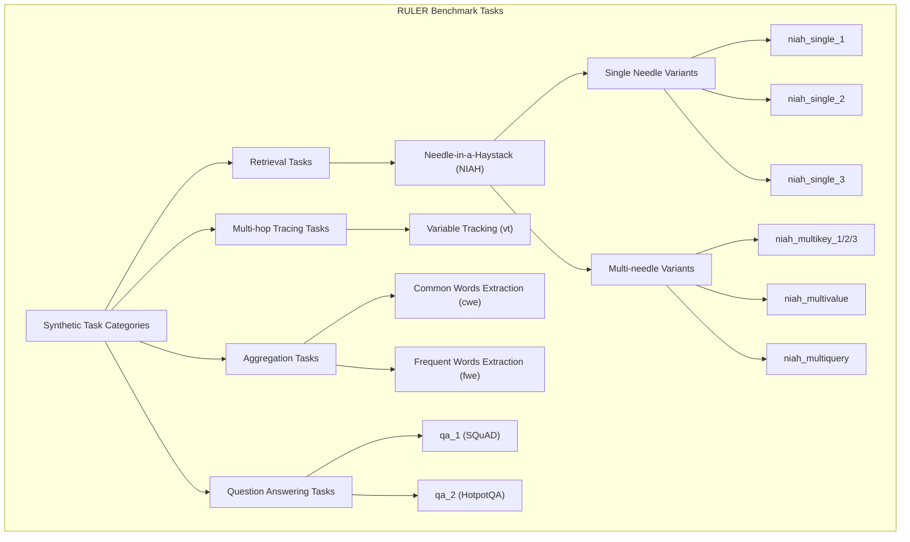
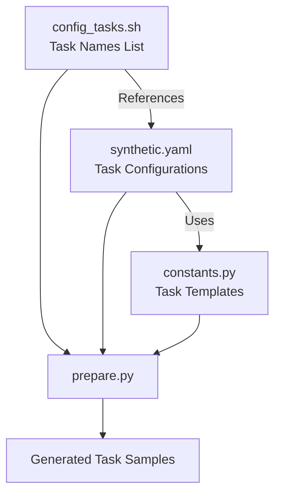
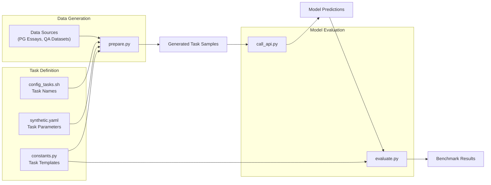

<!-- source: DeepWiki mcp.deepwiki.com · repo NVIDIA/RULER · page 3 Benchmark Tasks · fetched 2026-10-26 -->

# Benchmark Tasks

<details>
<summary>Relevant source files</summary>

The following files were used as context for generating this wiki page:

- [README.md](README.md)
- [scripts/data/synthetic/variable_tracking.py](scripts/data/synthetic/variable_tracking.py)
- [scripts/synthetic.yaml](scripts/synthetic.yaml)

</details>


This page provides an overview of the synthetic tasks used in RULER to evaluate context utilization capabilities of long-context language models. RULER implements a set of configurable benchmark tasks that can be used to systematically test how effectively models utilize information across different context lengths.

For information about how the data for these tasks is generated, see [Data Generation Pipeline](#2.1). For details on how models are evaluated on these tasks, see [Inference Pipeline](#2.2).

## Task Categories Overview

RULER includes four main categories of benchmark tasks, each designed to test different aspects of a model's context utilization capabilities.



Sources: [scripts/config_tasks.sh:32-46](), [README.md:123-129]()

## Task Design Principles

Each benchmark task in RULER follows these design principles:

1. **Controllable difficulty**: Tasks can be configured to increase or decrease in difficulty by adjusting parameters
2. **Length scalability**: Tasks can be evaluated across different context lengths (4K to 128K)
3. **Baseline performance**: Tasks are designed so models can achieve high performance at short context lengths (4K)
4. **Clear evaluation**: Each task has a well-defined correct answer for straightforward evaluation

The tasks are intentionally synthetic to provide a clear upper bound on expected performance and to allow for systematic measurement of context length effects.

Sources: [README.md:123-129](), [README.md:150-151]()

## Task Configuration System

Tasks in RULER are configured through a combination of:

1. Task names defined in `scripts/config_tasks.sh`
2. Task configurations specified in `scripts/synthetic.yaml`
3. Task templates and constants defined in `scripts/data/synthetic/constants.py`



Sources: [README.md:120-121](), [scripts/config_tasks.sh:32-46](), [scripts/data/synthetic/constants.py:15-53]()

## Retrieval Tasks: Needle-in-a-Haystack (NIAH)

Needle-in-a-Haystack tasks test a model's ability to retrieve specific information embedded within a long context. The task involves finding "needles" (key-value pairs) hidden within a "haystack" (the context).

### Task Template

```
Some special magic {type_needle_v} are hidden within the following text. Make sure to memorize it. I will quiz you about the {type_needle_v} afterwards.
{context}
What are all the special magic {type_needle_v} for {query} mentioned in the provided text?
```

### Task Variants

| Variant | Description | Configuration Parameters |
|---------|-------------|-------------------------|
| Single Needle | Basic retrieval of individual key-value pairs | **type_haystack**: What type of haystack to use (repeat/essay/needle)<br>**type_needle_k/v**: Type of needle keys/values (words/numbers/uuids) |
| Multi-key | Multiple keys hidden in the haystack | **num_needle_k**: Number of needles in the haystack |
| Multi-value | Multiple values for a single key | **num_needle_v**: Number of values for each key |
| Multi-query | Multiple query keys | **num_needle_q**: Number of keys to query |

### NIAH Complexity Parameters

- **Haystack Type**:
  - `repeat`: Repeated noise sentences
  - `essay`: Paul Graham Essays
  - `needle`: Distracted needles
- **Needle Type**:
  - `words`: adjective-noun pairs
  - `numbers`: 7-digit numbers
  - `uuids`: 32-digit identifiers

Sources: [README.md:123-129](), [scripts/data/synthetic/constants.py:25-29]()

## Multi-hop Tracing Tasks: Variable Tracking

Variable Tracking tasks test a model's ability to follow chains of references in a long context. The task involves tracking variable assignments across multiple hops to determine which variables ultimately hold a specific value.

### Task Template

```
Memorize and track the chain(s) of variable assignment hidden in the following text.

{context}
Question: Find all variables that are assigned the value {query} in the text above.
```

### Complexity Parameters

- **num_chains**: Number of variable name-binding chains
- **num_hops**: Number of times binding variable names in each chain

This task becomes increasingly difficult as the number of chains and hops increases, requiring the model to maintain and update multiple threads of information across the context.

Sources: [README.md:123-129](), [scripts/data/synthetic/constants.py:31-35]()

## Aggregation Tasks

Aggregation tasks test a model's ability to collect and summarize information scattered throughout a long context.

### Common Words Extraction (CWE)

The Common Words Extraction task requires identifying the most frequently occurring words in a numbered list.

#### Task Template

```
Below is a numbered list of words. In these words, some appear more often than others. Memorize the ones that appear most often.
{context}
Question: What are the 10 most common words in the above list?
```

#### Complexity Parameters

- **freq_cw**: Frequency of common words
- **freq_ucw**: Frequency of uncommon words
- **num_cw**: Number of common words

### Frequent Words Extraction (FWE)

The Frequent Words Extraction task involves identifying the most frequently occurring words in an encoded text.

#### Task Template

```
Read the following coded text and track the frequency of each coded word. Find the three most frequently appeared coded words. {context}
Question: Do not provide any explanation. Please ignore the dots '....'. What are the three most frequently appeared words in the above coded text?
```

#### Complexity Parameters

- **alpha**: Parameter of the distribution to draw synthetic words (lower alpha increases difficulty)

Sources: [README.md:123-129](), [scripts/data/synthetic/constants.py:37-47]()

## Question Answering Tasks

Question Answering tasks test a model's ability to extract relevant information to answer questions based on provided documents.

### Task Template

```
Answer the question based on the given documents. Only give me the answer and do not output any other words.

The following are given documents.

{context}

Answer the question based on the given documents. Only give me the answer and do not output any other words.

Question: {query}
```

### Dataset Sources

- **SQuAD**: Stanford Question Answering Dataset
- **HotpotQA**: Multi-hop question answering dataset

These datasets are processed to fit the RULER framework, with passages combined to reach the desired context length.

Sources: [README.md:123-129](), [scripts/data/synthetic/constants.py:49-53]()

## Benchmark Task Lifecycle

The following diagram illustrates how benchmark tasks are processed through the RULER system:



Sources: [README.md:75-118]()

## Adding Custom Tasks

RULER's benchmark system is designed to be extendable. To add a new task:

1. Create a Python script for data preparation in `scripts/data/synthetic/`
2. Add task template and tokens to generate in `scripts/data/synthetic/constants.py`
3. Add evaluation metric in `scripts/eval/synthetic/constants.py`
4. Define task name and complexity configurations in `scripts/synthetic.yaml`
5. Add task name in `scripts/config_tasks.sh`

Custom tasks should be designed to be reproducible given a tokenizer, sequence length, and random seed.

Sources: [README.md:133-148]()

---

