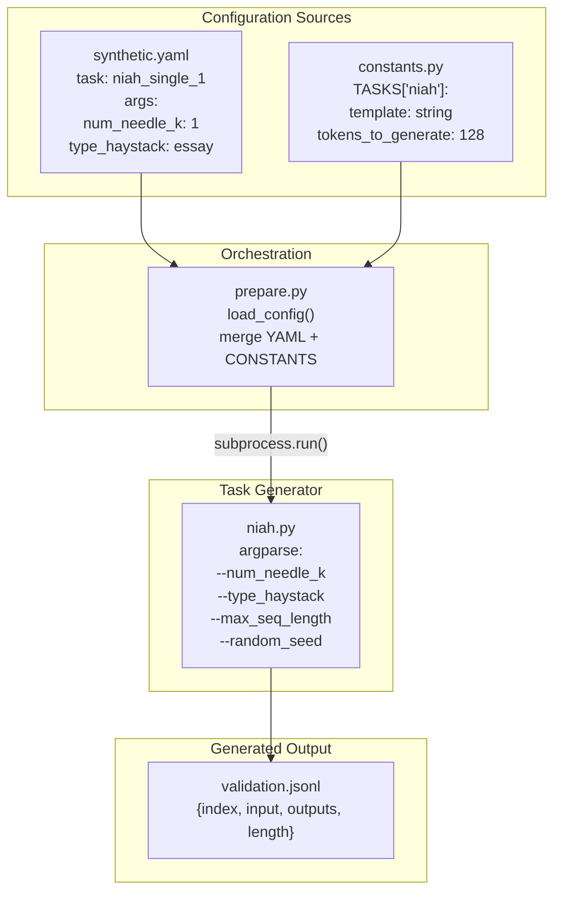
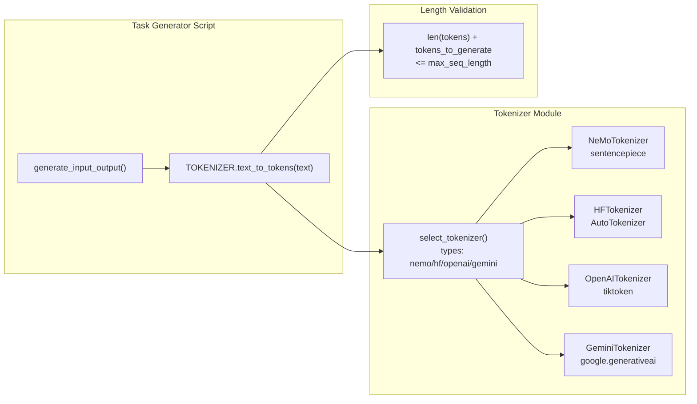
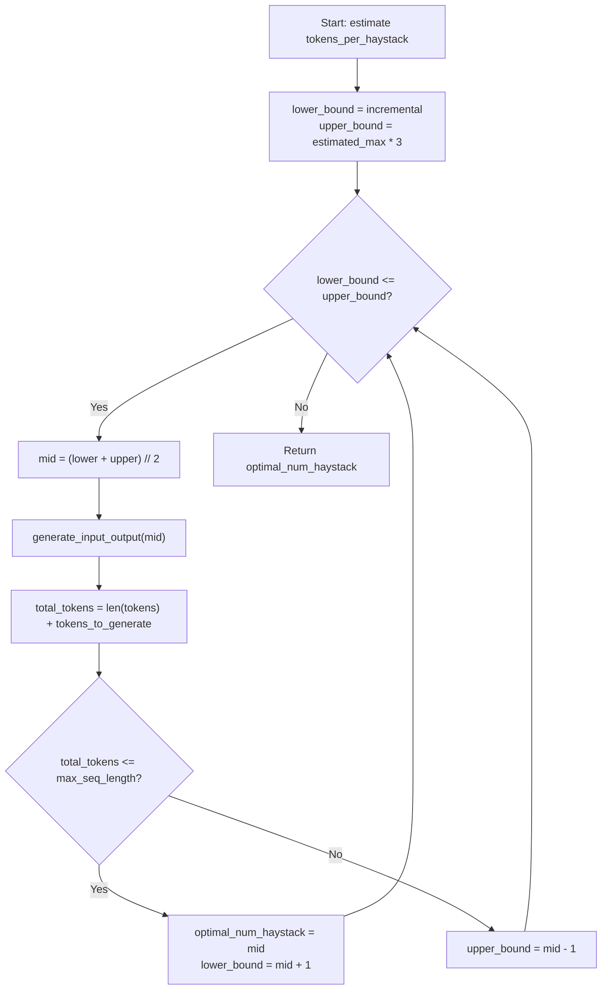
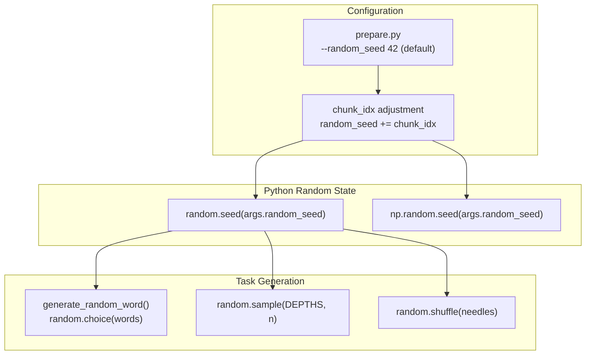
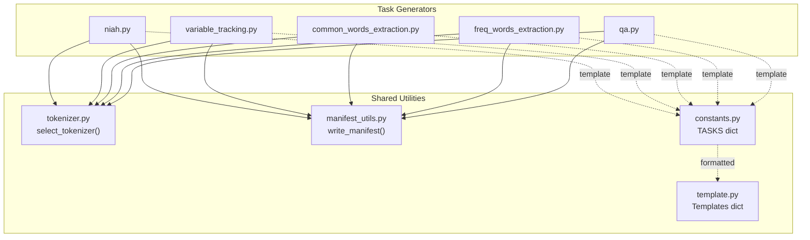
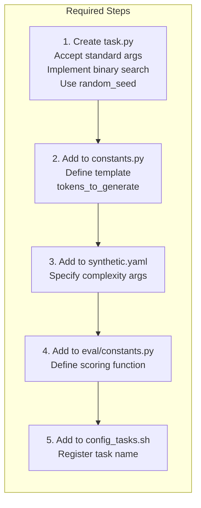

<!-- source: DeepWiki mcp.deepwiki.com · repo NVIDIA/RULER · page 3.1 Task Design Principles · fetched 2026-10-26 -->

# Task Design Principles

<details>
<summary>Relevant source files</summary>

The following files were used as context for generating this wiki page:

- [README.md](README.md)
- [scripts/data/prepare.py](scripts/data/prepare.py)
- [scripts/data/synthetic/niah.py](scripts/data/synthetic/niah.py)

</details>


## Purpose and Scope

This page documents the common design patterns and principles that govern synthetic task generation in RULER. These principles ensure that all 13 benchmark tasks share consistent behavior, enabling fair comparison across sequence lengths and models while maintaining reproducibility and extensibility.

For details on specific task implementations, see:
- Needle-in-a-Haystack: [NIAH](#3.2)
- Variable Tracking: [Variable Tracking](#3.3)
- Common Words Extraction: [CWE](#3.4)
- Frequent Words Extraction: [FWE](#3.5)
- Question Answering: [QA](#3.6)

For information on how tasks are configured and executed, see [Task Configuration](#4.2).

## Overview

All synthetic tasks in RULER adhere to four core design principles:

1. **Parameter-Driven Complexity**: Task difficulty is controlled through configuration parameters, not code changes
2. **Tokenizer-Aware Generation**: All tasks respect `max_seq_length` constraints using the model's tokenizer
3. **Binary Search Optimization**: Tasks automatically maximize context usage within length constraints
4. **Reproducibility**: Deterministic generation through mandatory `random_seed` parameters

These principles are implemented consistently across all task generation scripts in [scripts/data/synthetic/]().

## Parameter-Driven Complexity

### Concept

Each task accepts complexity parameters that control its difficulty without requiring code modifications. This enables researchers to stress-test models by adjusting task complexity independently of sequence length.

### Configuration Flow



**Sources**: [scripts/data/prepare.py:67-102](), [scripts/synthetic.yaml](), [scripts/data/synthetic/constants.py]()

### Task-Specific Parameters

Each task category implements distinct complexity parameters:

| Task Category | Parameters | Effect on Complexity |
|--------------|------------|---------------------|
| **NIAH** | `num_needle_k`<br>`num_needle_v`<br>`num_needle_q`<br>`type_haystack`<br>`type_needle_k/v` | More needles increase retrieval difficulty<br>Multiple values per key test multi-output<br>Essay haystack harder than noise<br>UUIDs harder than words/numbers |
| **Variable Tracking** | `num_chains`<br>`num_hops` | More chains increase working memory load<br>Longer chains require deeper tracing |
| **Common Words** | `freq_cw`<br>`freq_ucw`<br>`num_cw` | Higher common word frequency makes extraction easier<br>More words to extract increases difficulty |
| **Frequent Words** | `alpha`<br>`num_words` | Lower alpha (1.0-2.0) creates flatter distribution<br>More words to return increases difficulty |

**Sources**: [README.md:140-146](), [scripts/data/synthetic/niah.py:66-72](), [scripts/data/synthetic/variable_tracking.py]()

### Implementation Pattern

All task scripts follow a standardized argument pattern:

```python
# Required arguments (present in all tasks)
parser.add_argument("--tokenizer_path", type=str, required=True)
parser.add_argument("--tokenizer_type", type=str, default='nemo')
parser.add_argument("--max_seq_length", type=int, required=True)
parser.add_argument("--tokens_to_generate", type=int, required=True)
parser.add_argument("--num_samples", type=int, required=True)
parser.add_argument("--random_seed", type=int, default=42)
parser.add_argument("--template", type=str, default='')

# Task-specific complexity arguments
parser.add_argument("--num_needle_k", type=int, default=1)
parser.add_argument("--type_haystack", type=str, default='essay')
```

**Sources**: [scripts/data/synthetic/niah.py:51-72]()

## Tokenizer-Aware Generation

### Concept

All tasks generate samples that precisely fit within `max_seq_length` by using the model's tokenizer during generation. This ensures that benchmarks test the actual context window, not approximate word counts.

### Tokenization Architecture



**Sources**: [scripts/data/tokenizer.py](), [scripts/data/synthetic/niah.py:80]()

### Token Count Enforcement

Every task validates token counts before writing samples:

```python
# From niah.py generation loop
input_text, answer = generate_input_output(num_haystack)
length = len(TOKENIZER.text_to_tokens(input_text)) + tokens_to_generate
assert length <= max_seq_length, f"{length} exceeds max_seq_length."
```

**Sources**: [scripts/data/synthetic/niah.py:268-269]()

### Model Template Token Accounting

For non-base templates, RULER accounts for additional tokens added by model-specific formatting:

```python
# In prepare.py
if args.prepare_for_ns:
    TOKENIZER = select_tokenizer(args.tokenizer_type, args.tokenizer_path)
    model_template_token = len(TOKENIZER.text_to_tokens(model_template))
    # Subtract from available budget
    max_seq_length -= model_template_token
```

This ensures that `[INST]...[/INST]` tags, system prompts, or other template additions don't cause samples to exceed the limit.

**Sources**: [scripts/data/prepare.py:90-94](), [scripts/data/synthetic/niah.py:212]()

## Binary Search Optimization

### Concept

Tasks use binary search to find the maximum haystack size (number of context units) that fits within `max_seq_length`. This maximizes the use of available context, ensuring consistent evaluation across sequence lengths.

### Algorithm Visualization



**Sources**: [scripts/data/synthetic/niah.py:233-258]()

### Implementation Details

The binary search implementation in NIAH (representative of all tasks):

```python
# Estimate tokens per haystack unit
sample_input_text, _ = generate_input_output(incremental)
sample_tokens = len(TOKENIZER.text_to_tokens(sample_input_text))
tokens_per_haystack = sample_tokens / incremental

# 3x upper bound for sampling variance
estimated_max_questions = int((max_seq_length / tokens_per_haystack) * 3)

# Binary search
lower_bound = incremental
upper_bound = max(estimated_max_questions, incremental * 2)
optimal_num_haystack = None

while lower_bound <= upper_bound:
    mid = (lower_bound + upper_bound) // 2
    input_text, answer = generate_input_output(mid)
    total_tokens = len(TOKENIZER.text_to_tokens(input_text)) + tokens_to_generate
    
    if total_tokens <= max_seq_length:
        optimal_num_haystack = mid
        lower_bound = mid + 1  # Try larger
    else:
        upper_bound = mid - 1  # Too large
```

**Sources**: [scripts/data/synthetic/niah.py:224-256]()

### Haystack Unit Sizes

Different tasks use different `incremental` values based on their haystack types:

| Haystack Type | Incremental | Reasoning |
|--------------|-------------|-----------|
| Essay (`essay`) | 500 words | Paul Graham essays are word-based |
| Noise (`noise`) | 25 sentences | Repeated sentences are short |
| Needle (`needle`) | 25 needles | Each needle is one sentence |
| Small sequences (<4096) | 5 units | Finer granularity for short contexts |

**Sources**: [scripts/data/synthetic/niah.py:214-222]()

### Fallback Mechanism

If binary search fails (e.g., due to unlucky sampling), tasks implement a fallback:

```python
# Generate samples with fallback
for index in range(num_samples):
    used_haystack = num_haystack
    while True:
        try:
            input_text, answer = generate_input_output(used_haystack)
            length = len(TOKENIZER.text_to_tokens(input_text)) + tokens_to_generate
            assert length <= max_seq_length
            break
        except:
            if used_haystack > incremental:
                used_haystack -= incremental  # Reduce and retry
```

**Sources**: [scripts/data/synthetic/niah.py:263-273]()

## Reproducibility via Random Seeds

### Concept

All tasks require a `random_seed` parameter to ensure deterministic generation. This enables exact reproduction of benchmark datasets across runs, which is critical for debugging and fair comparison.

### Seed Propagation Flow



**Sources**: [scripts/data/prepare.py:108](), [scripts/data/synthetic/niah.py:75-76]()

### Seed Usage Patterns

Tasks set random seeds at the beginning and use them throughout generation:

```python
# At script start
random.seed(args.random_seed)
np.random.seed(args.random_seed)

# In generation functions
keys = [generate_random(args.type_needle_k) for _ in range(args.num_needle_k)]
random.Random(args.random_seed).shuffle(needles)
indices = random.sample(range(args.num_needle_k), args.num_needle_q)
insertion_positions = sorted([int(len(document_sents) * (depth / 100)) 
                              for depth in random.sample(DEPTHS, len(needles))])
```

**Sources**: [scripts/data/synthetic/niah.py:75-76](), [scripts/data/synthetic/niah.py:144](), [scripts/data/synthetic/niah.py:186]()

### Chunked Generation

When splitting task generation across multiple processes, seeds are adjusted to maintain reproducibility:

```python
# In prepare.py
random_seed = args.random_seed + args.chunk_idx

# This ensures:
# - Chunk 0 uses seed 42
# - Chunk 1 uses seed 43
# - Chunk 2 uses seed 44, etc.
```

This guarantees that combining chunks produces the same dataset as generating all samples in one process.

**Sources**: [scripts/data/prepare.py:108]()

## Common Infrastructure

### Shared Utilities

All tasks leverage common utility modules to avoid code duplication:



**Sources**: [scripts/data/tokenizer.py](), [scripts/data/manifest_utils.py](), [scripts/data/synthetic/constants.py](), [scripts/data/template.py]()

### Standard Output Format

All tasks produce JSONL files with a consistent schema:

```python
{
    "index": int,           # Sample index
    "input": str,           # Input text without model template
    "outputs": [str],       # Expected answer(s)
    "length": int,          # Token count (input + tokens_to_generate)
    "answer_prefix": str,   # Text preceding answer for model prompting
    # Task-specific fields may be added
}
```

**Sources**: [scripts/data/prepare.py:16-21](), [scripts/data/synthetic/niah.py:283-292]()

### Template Integration

Tasks receive templates that combine model-specific formatting with task-specific instructions:

```python
# In prepare.py
model_template = Templates[args.model_template_type]  # e.g., "[INST] {task_template} [/INST]"
task_template = config['template']                     # Task instructions
answer_prefix = config['answer_prefix']                # Force answer format

config['template'] = model_template.format(task_template=task_template) + answer_prefix
```

This ensures consistent model prompting while allowing task-specific content.

**Sources**: [scripts/data/prepare.py:88-101]()

## Extensibility Benefits

These design principles enable straightforward extension of RULER with new tasks:

### Adding a New Task (High-Level)



**Sources**: [README.md:150-166]()

### Guaranteed Properties

By following these principles, new tasks automatically gain:

- **Length Compliance**: Binary search ensures samples fit within any `max_seq_length`
- **Cross-Model Compatibility**: Tokenizer-aware generation works with any model
- **Reproducibility**: Deterministic generation enables debugging and verification
- **Configuration Flexibility**: Parameters allow difficulty tuning without code changes
- **Pipeline Integration**: Standard argument interface works with [prepare.py]() orchestration

### Example: Minimal Task Implementation

A minimal new task following these principles:

```python
import argparse
import random
from tokenizer import select_tokenizer
from manifest_utils import write_manifest

parser = argparse.ArgumentParser()
# Standard arguments (required)
parser.add_argument("--tokenizer_path", type=str, required=True)
parser.add_argument("--max_seq_length", type=int, required=True)
parser.add_argument("--random_seed", type=int, default=42)
# Task-specific complexity arguments
parser.add_argument("--difficulty_level", type=int, default=1)

args = parser.parse_args()
random.seed(args.random_seed)
TOKENIZER = select_tokenizer(args.tokenizer_type, args.tokenizer_path)

# Binary search for optimal haystack
lower, upper = 100, estimated_max
while lower <= upper:
    mid = (lower + upper) // 2
    sample = generate_sample(mid, args.difficulty_level)
    tokens = len(TOKENIZER.text_to_tokens(sample))
    if tokens <= args.max_seq_length:
        optimal_size = mid
        lower = mid + 1
    else:
        upper = mid - 1

# Generate deterministic samples
samples = [generate_sample(optimal_size, args.difficulty_level) 
           for _ in range(args.num_samples)]
write_manifest(output_file, samples)
```

For complete implementation guidance, see [Adding Custom Tasks](#6.1).

**Sources**: [scripts/data/synthetic/niah.py:51-310](), [README.md:150-166]()

---

**Page Sources**: [README.md:1-181](), [scripts/data/synthetic/niah.py:1-310](), [scripts/data/prepare.py:1-166](), [scripts/data/tokenizer.py](), [scripts/data/manifest_utils.py](), [scripts/data/synthetic/constants.py](), [scripts/data/template.py]()

---

