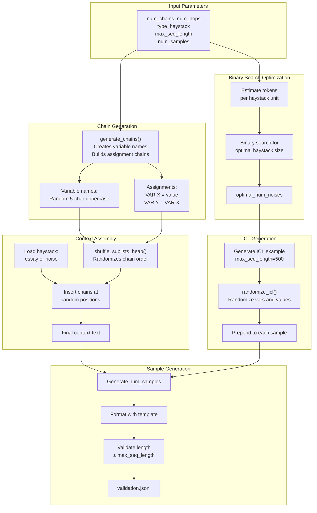
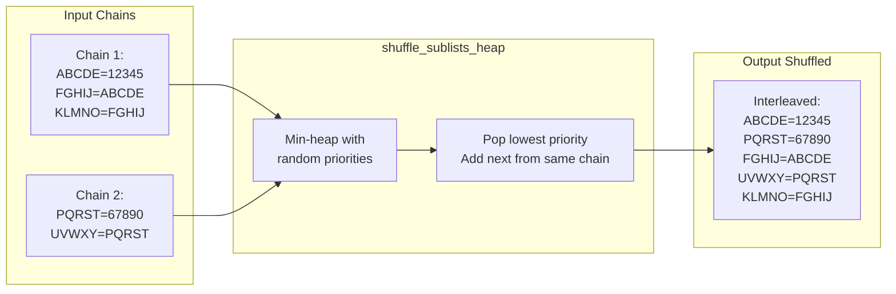
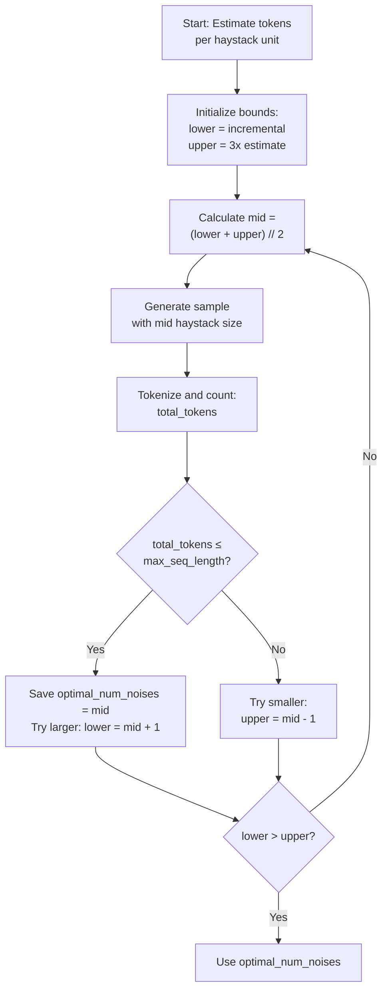
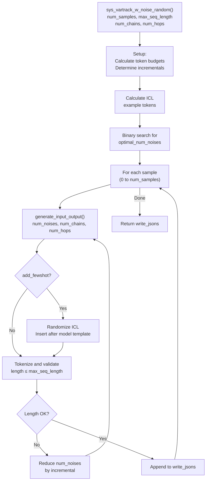

<!-- source: DeepWiki mcp.deepwiki.com · repo NVIDIA/RULER · page 3.3 Variable Tracking · fetched 2026-10-26 -->

# Variable Tracking

<details>
<summary>Relevant source files</summary>

The following files were used as context for generating this wiki page:

- [scripts/data/synthetic/variable_tracking.py](scripts/data/synthetic/variable_tracking.py)
- [scripts/synthetic.yaml](scripts/synthetic.yaml)

</details>


## Purpose and Scope

This page documents the Variable Tracking task, one of RULER's synthetic benchmark tasks for evaluating multi-hop reasoning capabilities in long-context language models. Variable Tracking tests a model's ability to follow chains of variable assignments hidden throughout long contexts and identify all variables that resolve to a specific value.

For information about other task types, see [Benchmark Tasks](#3). For implementation details of the data generation pipeline, see [Data Generation Pipeline](#2.2).

## Overview

Variable Tracking evaluates multi-hop tracing by generating synthetic contexts containing chains of variable assignments. The model must traverse these chains to determine which variables ultimately hold a queried value. Unlike simple retrieval tasks (see [Needle-in-a-Haystack](#3.2)), Variable Tracking requires models to perform multiple reasoning steps, making it a more challenging test of long-context understanding.

**Sources:** [scripts/data/synthetic/variable_tracking.py:15-29]()

## Core Concepts

### Variable Chains

A variable chain is a sequence of assignments where each variable is assigned the value of the previous variable. For example:

```
VAR ABCDE = 54321
VAR FGHIJ = VAR ABCDE
VAR KLMNO = VAR FGHIJ
VAR PQRST = VAR KLMNO
```

In this 4-hop chain, if the query asks for variables assigned value `54321`, the correct answer includes all four variables: `ABCDE, FGHIJ, KLMNO, PQRST`.

**Key properties:**
- **Initial assignment**: The first variable in a chain is assigned a random 5-digit number
- **Variable names**: Randomly generated uppercase letter sequences (5 characters by default)
- **Uniqueness**: All variable names across all chains are guaranteed to be unique

**Sources:** [scripts/data/synthetic/variable_tracking.py:93-114]()

### Hops and Multi-hop Reasoning

The number of **hops** determines the length of each variable chain:
- `num_hops=1`: 2 variables total (initial + 1 hop)
- `num_hops=4`: 5 variables total (initial + 4 hops)
- `num_hops=N`: N+1 variables total

The number of **chains** determines how many independent variable chains are inserted into the context:
- `num_chains=1`: Single chain to track
- `num_chains>1`: Multiple independent chains, increasing task complexity

**Sources:** [scripts/data/synthetic/variable_tracking.py:68-69]()

### Haystack Types

Variable Tracking supports two haystack types for context generation:

| Haystack Type | Description | Source |
|---------------|-------------|--------|
| `noise` | Repetitive sentences: "The grass is green. The sky is blue..." | Hardcoded string |
| `essay` | Paul Graham essays, tokenized and split into sentences | `json/PaulGrahamEssays.json` |

The `essay` type provides more realistic, diverse text that better simulates real-world long-context scenarios.

**Sources:** [scripts/data/synthetic/variable_tracking.py:81-88]()

## Task Generation Architecture



**Diagram: Variable Tracking Generation Pipeline**

**Sources:** [scripts/data/synthetic/variable_tracking.py:191-296](), [scripts/data/synthetic/variable_tracking.py:299-317]()

## Chain Generation Process

### Variable Name Generation

Variable names are randomly generated uppercase letter sequences. The generation process ensures uniqueness across all chains:

```python
# From generate_chains()
k = 5  # variable name length
vars_all = [''.join(random.choices(string.ascii_uppercase, k=k)).upper() 
            for _ in range((num_hops+1) * num_chains)]
# Ensure uniqueness
while len(set(vars_all)) < num_chains * (num_hops+1):
    vars_all.append(''.join(random.choices(string.ascii_uppercase, k=k)).upper())
```

**Sources:** [scripts/data/synthetic/variable_tracking.py:93-101]()

### Assignment Chain Construction

Each chain begins with an initial assignment to a random 5-digit number, followed by sequential assignments:

| Step | Example | Description |
|------|---------|-------------|
| Initial | `VAR ABCDE = 54321` | First variable assigned random 5-digit number |
| Hop 1 | `VAR FGHIJ = VAR ABCDE` | Second variable assigned to first |
| Hop 2 | `VAR KLMNO = VAR FGHIJ` | Third variable assigned to second |
| Hop N | `VAR X = VAR Y` | Continue for num_hops |

**Sources:** [scripts/data/synthetic/variable_tracking.py:108-113]()

### Chain Shuffling

To prevent models from exploiting positional patterns, chains are shuffled using a heap-based algorithm that randomizes the order of assignments while maintaining the sequential dependencies within each chain:



**Diagram: Chain Shuffling Algorithm**

**Sources:** [scripts/data/synthetic/variable_tracking.py:116-128](), [scripts/data/synthetic/variable_tracking.py:138]()

## Context Assembly

### Essay-Based Haystack

When `type_haystack='essay'`, the system loads Paul Graham essays and inserts variable chains at random sentence positions:

1. **Load and tokenize**: Essay text is split into sentences using `sent_tokenize()`
2. **Select depth positions**: Random positions sampled from 40 evenly-spaced depths (0-100%)
3. **Insert chains**: Chains inserted between sentences at selected positions
4. **Assemble context**: Sentences and chains concatenated with proper spacing

**Sources:** [scripts/data/synthetic/variable_tracking.py:135-149]()

### Noise-Based Haystack

When `type_haystack='noise'`, repetitive sentences are used:

1. **Repeat base sentence**: "The grass is green. The sky is blue..." repeated `num_noises` times
2. **Random insertion**: Each chain element inserted at a random position in the repeated sentences
3. **Newline separation**: Sentences separated by newlines

**Sources:** [scripts/data/synthetic/variable_tracking.py:151-157]()

## Binary Search Optimization

The system uses binary search to maximize haystack size while respecting the `max_seq_length` constraint:



**Diagram: Binary Search for Optimal Haystack Size**

The algorithm:
1. **Estimates** tokens per haystack unit by sampling
2. **Calculates** an upper bound at 3x the estimate (with slack for sampling variance)
3. **Binary searches** between `incremental` and upper bound
4. **Finds** the largest haystack size that fits within `max_seq_length`

**Sources:** [scripts/data/synthetic/variable_tracking.py:221-254]()

## In-Context Learning (ICL)

### ICL Example Generation

Variable Tracking optionally generates an in-context learning example to help models understand the task format. The ICL example:

- **Generated separately** with `max_seq_length=500` and `incremental=5`
- **Uses fixed value** `12345` for consistency
- **Shorter chains**: Limited to 10 hops even if task uses more
- **Shorter variable names**: 3 characters instead of 5

**Sources:** [scripts/data/synthetic/variable_tracking.py:93-98](), [scripts/data/synthetic/variable_tracking.py:303-307]()

### ICL Randomization

Before inserting the ICL example into each sample, it is randomized to prevent models from memorizing the specific example:

| Randomization | Method |
|---------------|--------|
| Variable names | Replace each variable with new random 3-char sequence |
| Initial value | Replace `12345` with new random 5-digit number |
| Structure | Maintain same format and template |

The randomized ICL example is prepended to each sample after the model template but before the task-specific prompt.

**Sources:** [scripts/data/synthetic/variable_tracking.py:179-189](), [scripts/data/synthetic/variable_tracking.py:262-265]()

## Template and Output Format

### Prompt Template

The default prompt template instructs the model to track variable chains:

```
[INST] Memorize and track the chain(s) of variable assignment hidden in the following text.

{context}
Question: Find all variables that are assigned the value {query} in the text above. [/INST] 
Answer: According to the chain(s) of variable assignment in the text above, {num_v} variables 
are assigned the value {query}, they are:
```

Template variables:
- `{context}`: The generated context with haystack and variable chains
- `{query}`: The initial value to search for (e.g., `54321`)
- `{num_v}`: Number of variables in the chain (`num_hops + 1`)

**Sources:** [scripts/data/synthetic/variable_tracking.py:28](), [scripts/data/synthetic/variable_tracking.py:171-175]()

### Output Format

The generated samples are written to JSONL files with the following structure:

```json
{
  "index": 0,
  "input": "Full prompt with context and question",
  "outputs": ["ABCDE", "FGHIJ", "KLMNO", "PQRST"],
  "length": 4096,
  "length_w_model_temp": 4106,
  "answer_prefix": "Answer: According to the chain(s)..."
}
```

| Field | Description |
|-------|-------------|
| `index` | Sample index (0 to num_samples-1) |
| `input` | Complete input text without answer prefix |
| `outputs` | List of variable names in the chain |
| `length` | Token count excluding model template tokens |
| `length_w_model_temp` | Total token count including model template |
| `answer_prefix` | Text that follows the input for generation |

**Sources:** [scripts/data/synthetic/variable_tracking.py:275-286]()

## Configuration Parameters

### Command-Line Arguments

The Variable Tracking task accepts the following parameters via `prepare.py`:

| Parameter | Type | Default | Description |
|-----------|------|---------|-------------|
| `--type_haystack` | str | `'noise'` | Haystack type: `'noise'` or `'essay'` |
| `--num_chains` | int | 1 | Number of independent variable chains |
| `--num_hops` | int | 4 | Number of hops in each chain |
| `--add_fewshot` | flag | False | Include randomized ICL example |
| `--max_seq_length` | int | Required | Maximum sequence length (tokens) |
| `--num_samples` | int | Required | Number of samples to generate |
| `--random_seed` | int | 42 | Random seed for reproducibility |
| `--template` | str | Empty | Prompt template (from constants.py) |
| `--remove_newline_tab` | flag | False | Remove newlines and tabs from output |
| `--model_template_token` | int | 0 | Model-specific template token count to subtract |

**Sources:** [scripts/data/synthetic/variable_tracking.py:54-72]()

### Configuration File

The `synthetic.yaml` configuration file defines the Variable Tracking task:

```yaml
vt:
  task: variable_tracking
  args:
    type_haystack: noise
    num_chains: 1
    num_hops: 4
```

This configuration creates a Variable Tracking task with:
- Noise-based haystack
- Single variable chain
- 4 hops (5 variables total)

**Sources:** [scripts/synthetic.yaml:95-100]()

## Implementation Details

### Entry Point Function

The main generation function is `sys_vartrack_w_noise_random()`:



**Diagram: sys_vartrack_w_noise_random() Execution Flow**

**Sources:** [scripts/data/synthetic/variable_tracking.py:191-296]()

### Key Helper Functions

| Function | Purpose | Returns |
|----------|---------|---------|
| `generate_chains()` | Generate variable names and assignment chains | `vars_all, chains_ret` |
| `shuffle_sublists_heap()` | Shuffle chains using heap-based randomization | `shuffled_result` |
| `generate_input_output()` | Create context with inserted chains | `input_text, answer` |
| `randomize_icl()` | Randomize ICL example variables and values | `modified_icl_example` |

**Sources:** [scripts/data/synthetic/variable_tracking.py:93-189]()

### Incremental Strategy

The system uses different incremental values based on haystack type and sequence length:

| Haystack Type | Context | Incremental Value |
|---------------|---------|-------------------|
| Essay | ICL generation | 500 |
| Essay | Final generation | 50 |
| Noise | ICL generation (seq < 4096) | 5 |
| Noise | ICL generation (seq ≥ 4096) | 10 |
| Noise | Final generation | 5 |

These values control the granularity of binary search and retry logic.

**Sources:** [scripts/data/synthetic/variable_tracking.py:201-213]()

## Integration with RULER Pipeline

Variable Tracking integrates with the broader RULER system through:

1. **Tokenizer selection**: Uses `select_tokenizer()` to support multiple tokenizer frameworks (nemo, hf, openai, gemini)
2. **Template system**: Retrieves templates from `constants.TASKS['variable_tracking']`
3. **Manifest output**: Writes results using `write_manifest()` to standardized JSONL format
4. **prepare.py orchestration**: Called by `prepare.py` with parameters from `synthetic.yaml`

**Sources:** [scripts/data/synthetic/variable_tracking.py:38-43](), [scripts/data/synthetic/variable_tracking.py:78](), [scripts/data/synthetic/variable_tracking.py:316]()

## Usage Example

To generate Variable Tracking data:

```bash
python scripts/data/synthetic/variable_tracking.py \
    --save_dir=./data \
    --save_name=vt \
    --tokenizer_path='EleutherAI/gpt-neox-20b' \
    --tokenizer_type=hf \
    --max_seq_length=4096 \
    --tokens_to_generate=30 \
    --num_samples=10 \
    --random_seed=42 \
    --num_chains=1 \
    --num_hops=4 \
    --type_haystack=noise \
    --add_fewshot
```

This generates 10 samples with:
- 4-hop variable chain (5 variables)
- Noise-based haystack
- Maximum 4096 tokens
- ICL example included
- Output: `./data/vt/validation.jsonl`

**Sources:** [scripts/data/synthetic/variable_tracking.py:18-28]()

---

