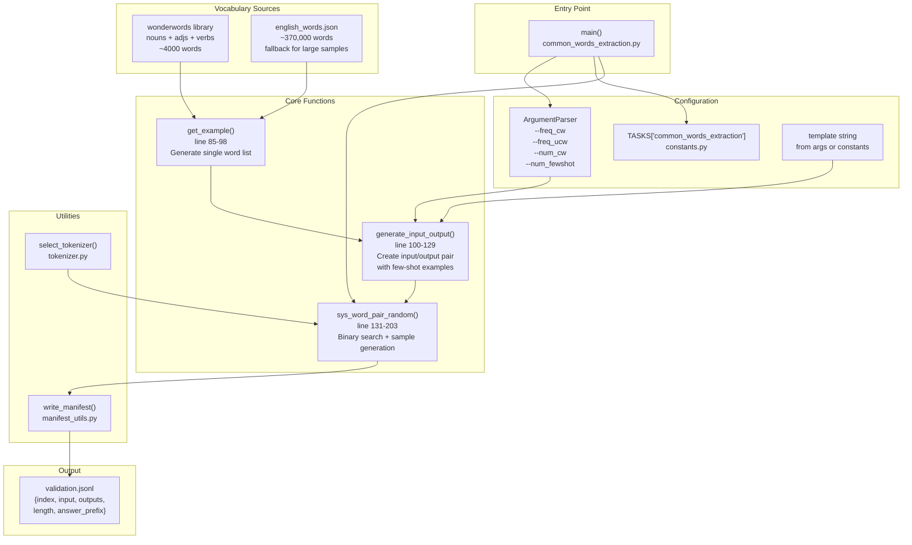
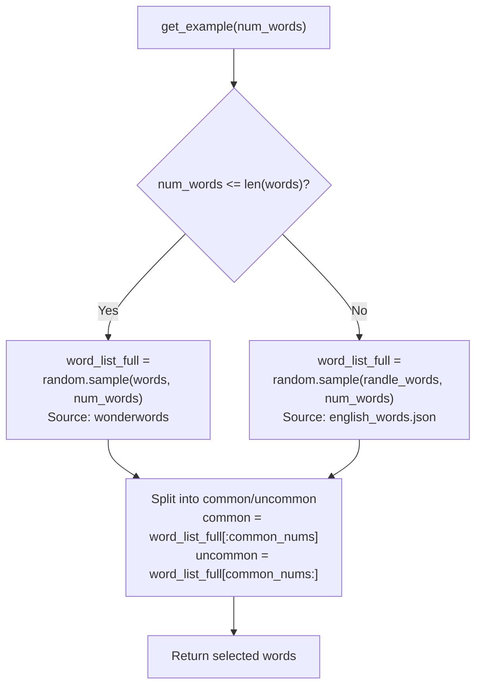
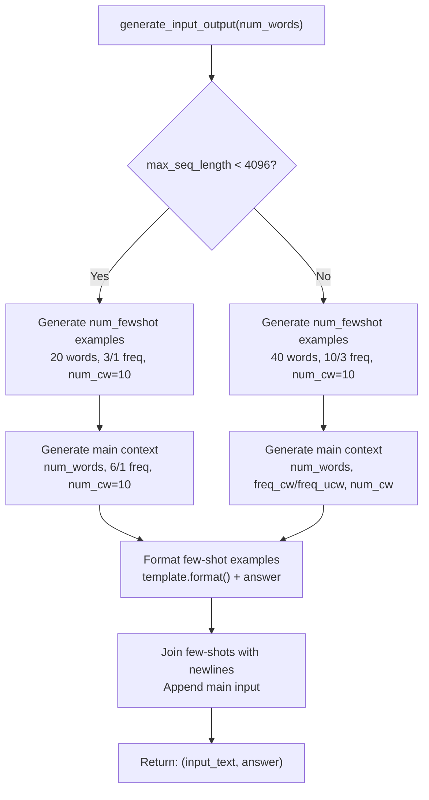
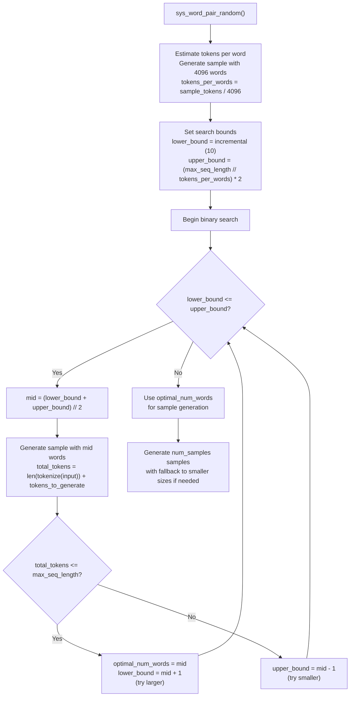
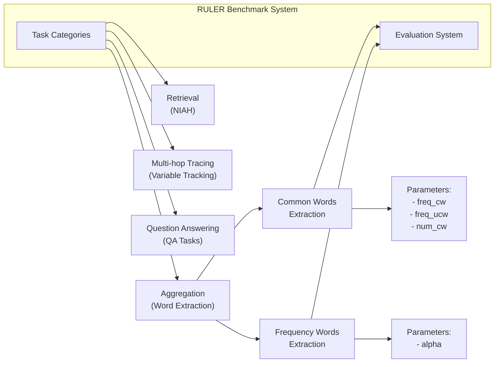

<!-- source: DeepWiki mcp.deepwiki.com · repo NVIDIA/RULER · page 3.4 Common Words Extraction · fetched 2026-10-26 -->

# Common Words Extraction

<details>
<summary>Relevant source files</summary>

The following files were used as context for generating this wiki page:

- [scripts/data/synthetic/common_words_extraction.py](scripts/data/synthetic/common_words_extraction.py)
- [scripts/data/synthetic/json/english_words.json](scripts/data/synthetic/json/english_words.json)

</details>


## Overview

The Common Words Extraction task is an aggregation-focused benchmark that evaluates a language model's ability to track word frequencies across a long context and identify the most frequently occurring items. Unlike simple information retrieval (see page 3.2) or multi-hop reasoning (see page 3.3), this task requires maintaining accurate frequency counts throughout the entire input sequence.

The task presents the model with a numbered list of words where certain words ("common words") appear significantly more frequently than others ("uncommon words"). The model must identify the N most common words (typically 10) from the list.

## Task Architecture

**Diagram: Common Words Extraction System Components**



Sources: [scripts/data/synthetic/common_words_extraction.py:1-215]()

## Vocabulary Sources

The task uses two vocabulary sources depending on the required number of unique words:

### Wonderwords Library
For smaller samples (≤ ~4000 unique words), the task uses the `wonderwords` Python library to load three word lists:
- **nouns**: from `nounlist.txt`
- **adjectives**: from `adjectivelist.txt`
- **verbs**: from `verblist.txt`

These are combined, deduplicated, sorted, and shuffled to create a pool of approximately 4,000 words.

### Randle Words Dictionary
For larger samples requiring more unique words, the task falls back to `english_words.json`, which contains approximately 370,000 English words. This fallback occurs when the requested `num_words` exceeds the wonderwords vocabulary size.

**Diagram: Vocabulary Selection Logic**



Sources: [scripts/data/synthetic/common_words_extraction.py:72-89]()

## Word Frequency Manipulation

The core of the task involves creating a word list where certain words appear with controlled frequencies. This is handled by the `get_example()` function.

### Frequency Generation Algorithm

1. **Word Selection**: Sample `num_words` unique words from the vocabulary
2. **Categorization**: Split into two groups:
   - First `common_nums` words → **common words**
   - Remaining words → **uncommon words**
3. **Repetition**: 
   - Common words are repeated `common_repeats` times (default: 30)
   - Uncommon words are repeated `uncommon_repeats` times (default: 3)
4. **Shuffling**: The combined list is shuffled using the task's random seed
5. **Formatting**: Words are formatted as a numbered list: `"1. word1 2. word2 3. word3 ..."`

**Example**: If `num_words=100`, `common_nums=10`, `common_repeats=30`, `uncommon_repeats=3`:
- 10 common words × 30 repetitions = 300 word instances
- 90 uncommon words × 3 repetitions = 270 word instances
- Total list length: 570 words

### Context-Dependent Parameters

The task adapts its difficulty based on the target sequence length (`max_seq_length`):

| Sequence Length | Few-shot Words | Few-shot Common Freq | Few-shot Uncommon Freq | Main Common Freq | Main Uncommon Freq |
|-----------------|----------------|----------------------|------------------------|------------------|--------------------|
| < 4096 tokens   | 20             | 3                    | 1                      | 6                | 1                  |
| ≥ 4096 tokens   | 40             | 10                   | 3                      | args.freq_cw (30) | args.freq_ucw (3)  |

This ensures that shorter contexts receive simpler examples while longer contexts are tested more rigorously.

Sources: [scripts/data/synthetic/common_words_extraction.py:85-111]()

## Few-Shot Example Generation

The task supports in-context learning by generating few-shot examples before the main query. The `generate_input_output()` function creates these examples:

**Diagram: Few-Shot Example Construction**



Each few-shot example includes:
1. The template-formatted context with numbered word list
2. The correct answer as a numbered list of common words
3. A newline separator before the next example

Sources: [scripts/data/synthetic/common_words_extraction.py:100-129]()

## Binary Search for Optimal Haystack Size

A critical feature of this task is the binary search algorithm that maximizes context utilization while ensuring samples fit within `max_seq_length`. This is implemented in the `sys_word_pair_random()` function.

**Diagram: Binary Search Process**



### Algorithm Details

1. **Estimation Phase** (lines 138-144):
   - Generate a sample input with 4096 words
   - Tokenize and calculate `tokens_per_words` ratio
   - Set `upper_bound = (max_seq_length // tokens_per_words) * 2` (with 2× safety margin)

2. **Binary Search Phase** (lines 146-168):
   - Test the midpoint: `mid = (lower_bound + upper_bound) // 2`
   - Generate input and tokenize to get `total_tokens`
   - If `total_tokens ≤ max_seq_length`: this size works, try larger (`lower_bound = mid + 1`)
   - If `total_tokens > max_seq_length`: too large, try smaller (`upper_bound = mid - 1`)
   - Continue until bounds converge

3. **Sample Generation Phase** (lines 173-201):
   - Use the `optimal_num_words` found by binary search
   - For each sample, generate with `optimal_num_words`
   - If generation fails (e.g., tokenization exceeds limit), reduce by `incremental` (10) and retry
   - This ensures all samples fit within the specified length

### Safety Mechanisms

- **Upper bound multiplier**: 2× multiplier accounts for tokenization variance
- **Fallback reduction**: If a sample exceeds limits, reduce word count by 10 and retry
- **Assertion check**: Final samples must satisfy `length ≤ max_seq_length`

Sources: [scripts/data/synthetic/common_words_extraction.py:131-203]()

## Task Template and Output Format

### Template Structure

The task uses a template string that can be provided via command-line argument or loaded from `constants.py`. The template contains placeholders for:
- `{num_cw}`: Number of common words to identify
- `{context}`: The numbered word list
- `{query}`: Additional query text (typically empty)

A typical template:
```
Below is a numbered list of words. In these words, some appear more often than others. 
Memorize the ones that appear most often.
{context}
Question: What are the 10 most common words in the above list?
```

### Answer Prefix Extraction

The task separates the input prompt from the expected answer prefix using `TASKS['common_words_extraction']['answer_prefix']`. This allows the model to:
1. Process the full context in the `input` field
2. Continue generation from the `answer_prefix` field

The answer prefix is typically the last portion of the template (e.g., "Answer: The top 10 words that appear most often in the list are:").

### Output Format

Each generated sample is written to `validation.jsonl` with the following structure:

| Field | Type | Description |
|-------|------|-------------|
| `index` | int | Sample index (0 to num_samples-1) |
| `input` | str | Full prompt with word list (excluding answer prefix) |
| `outputs` | list[str] | List of common words (ground truth answer) |
| `length` | int | Total tokens (input + tokens_to_generate) |
| `length_w_model_temp` | int | Total tokens including model template overhead |
| `answer_prefix` | str | The answer prefix string for generation |

Sources: [scripts/data/synthetic/common_words_extraction.py:186-201]()

### Example Sample

Given a configuration with `num_cw=10`, `freq_cw=30`, `freq_ucw=3`, a sample might look like:

**Input**:
```
1. happy 2. house 3. bright 4. house 5. explore 6. happy 7. enjoy 8. house 9. bright 
10. happy 11. garden 12. house 13. bright 14. curious 15. house ...
```
(570 words total: 10 common words × 30 + 90 uncommon words × 3)

**Outputs**:
```json
["happy", "house", "bright", "garden", "curious", "wonder", "create", "journey", "peaceful", "discover"]
```

These 10 words each appear 30 times, while all other words appear only 3 times.

Sources: [scripts/data/synthetic/common_words_extraction.py:85-98](), [scripts/data/synthetic/common_words_extraction.py:193-200]()


## Configuration Parameters

The Common Words Extraction task accepts the following configuration parameters:

### Required Parameters

| Parameter | Type | Description |
|-----------|------|-------------|
| `--save_dir` | Path | Directory to save the generated dataset |
| `--save_name` | str | Name of the dataset (determines subdirectory) |
| `--tokenizer_path` | str | Path to the tokenizer model |
| `--tokenizer_type` | str | Tokenizer framework: `nemo`, `hf`, `openai`, or `gemini` |
| `--max_seq_length` | int | Maximum sequence length (input + output tokens) |
| `--tokens_to_generate` | int | Expected number of tokens in the model's response |
| `--num_samples` | int | Number of samples to generate |

### Task-Specific Parameters

| Parameter | Type | Default | Description |
|-----------|------|---------|-------------|
| `--freq_cw` | int | 30 | Frequency of common words (how many times each appears) |
| `--freq_ucw` | int | 3 | Frequency of uncommon words |
| `--num_cw` | int | 10 | Number of common words to identify |
| `--num_fewshot` | int | 1 | Number of few-shot in-context examples |

### Optional Parameters

| Parameter | Type | Default | Description |
|-----------|------|---------|-------------|
| `--random_seed` | int | 42 | Random seed for reproducibility |
| `--template` | str | '' | Custom prompt template (overrides constants.py) |
| `--subset` | str | 'validation' | Dataset split: `validation` or `test` |
| `--remove_newline_tab` | flag | False | Remove newlines and tabs from strings |
| `--model_template_token` | int | 0 | Subtract model template token count from max_seq_length |

### Example Usage

```bash
python common_words_extraction.py \
    --save_dir=./data \
    --save_name=common_words_extraction \
    --tokenizer_path=tokenizer.model \
    --tokenizer_type=nemo \
    --max_seq_length=4096 \
    --tokens_to_generate=30 \
    --num_samples=10 \
    --random_seed=42 \
    --freq_cw=30 \
    --freq_ucw=3 \
    --num_cw=10
```

### Configuration via YAML

When run through RULER's pipeline, these parameters are specified in `scripts/synthetic.yaml`:

```yaml
common_words_extraction:
  freq_cw: 30
  freq_ucw: 3
  num_cw: 10
  num_fewshot: 1
```

The orchestration system in `prepare.py` merges these task-specific parameters with global parameters (tokenizer, sequence length, etc.) before invoking the script.

Sources: [scripts/data/synthetic/common_words_extraction.py:48-66]()

## Integration with RULER Benchmark

The Word Extraction Tasks are part of the Aggregation category in the RULER benchmark system. They contribute to evaluating language models' capabilities beyond simple information retrieval and provide insights into how well models can process and summarize frequency-based information across contexts of different lengths.



Sources: [README.md:123-129]()

## Usage and Evaluation

Word Extraction Tasks are executed as part of the standard RULER benchmark flow. To specifically evaluate models on these tasks:

1. Ensure proper configuration in `scripts/config_tasks.sh`
2. Set desired parameters in `scripts/synthetic.yaml`
3. Run the benchmark with the command:
   ```
   bash run.sh YOUR_MODEL_NAME synthetic
   ```

The tasks provide a clear measurement of how well models maintain accuracy in tracking and aggregating word frequencies as context length increases, serving as an important metric for evaluating long-context capabilities beyond simple retrieval.

Sources: [README.md:115-118]()

---

