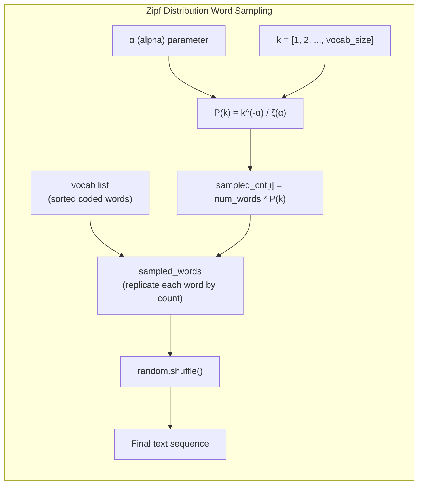
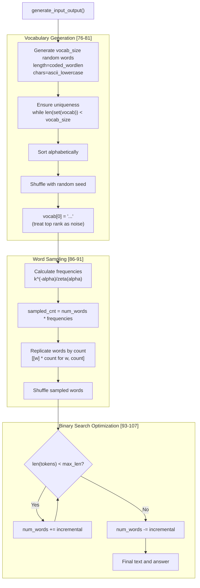
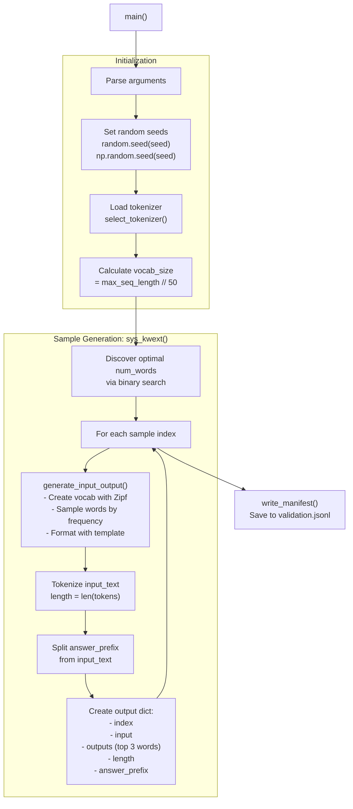
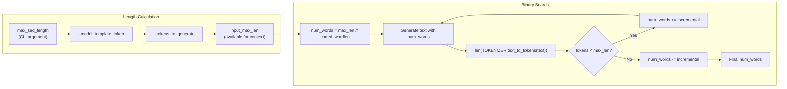

<!-- source: DeepWiki mcp.deepwiki.com · repo NVIDIA/RULER · page 3.5 Frequent Words Extraction · fetched 2026-10-26 -->

# Frequent Words Extraction

<details>
<summary>Relevant source files</summary>

The following files were used as context for generating this wiki page:

- [scripts/data/synthetic/freq_words_extraction.py](scripts/data/synthetic/freq_words_extraction.py)

</details>


This document describes the Frequent Words Extraction task, one of RULER's synthetic aggregation benchmarks. This task evaluates a model's ability to track and identify the most frequently occurring words in long contexts using a statistically realistic frequency distribution.

For information about the related Common Words Extraction task which uses deterministic frequency manipulation, see [Common Words Extraction](#3.4). For an overview of all benchmark tasks, see [Benchmark Tasks](#3).

## Purpose and Scope

The Frequent Words Extraction task tests long-context aggregation capabilities by:
- Generating synthetic "coded words" (random letter sequences) with frequencies following a Zipf/zeta distribution
- Requiring models to identify the three most frequently appearing words from thousands of word occurrences
- Providing a more realistic word frequency distribution compared to deterministic approaches

Unlike Common Words Extraction which uses predetermined frequency counts, this task creates naturally skewed distributions where the most common words appear far more frequently than others, mimicking real-world text statistics.

**Sources:** [scripts/data/synthetic/freq_words_extraction.py:15-29]()

## Task Overview

The Frequent Words Extraction task presents models with a long sequence of synthetic words where:
1. A vocabulary of coded words is generated (e.g., `"xjkpqw"`, `"mnctvz"`)
2. Words are sampled according to a Zipf/zeta distribution controlled by parameter α (alpha)
3. The top-ranked word in the distribution is replaced with `"..."` to serve as noise
4. Words are shuffled randomly in the context
5. The model must identify the three most frequent words (excluding the noise)

**Sources:** [scripts/data/synthetic/freq_words_extraction.py:74-107]()

## Zipf/Zeta Distribution Model

The task uses the generalized Zipf distribution (also called the zeta distribution) to model word frequencies, which is mathematically defined as:

```
P(k) ∝ k^(-α) / ζ(α)
```

Where:
- `k` is the rank of the word (1 for most frequent, 2 for second most frequent, etc.)
- `α` (alpha) is the distribution parameter controlling steepness
- `ζ(α)` is the Riemann zeta function for normalization

### Distribution Properties



**Sources:** [scripts/data/synthetic/freq_words_extraction.py:86-91]()

### Alpha Parameter Impact

| Alpha Value | Distribution Shape | Example Frequencies (top 3 words) |
|-------------|-------------------|-----------------------------------|
| α = 1.0 | Extremely steep | Very unbalanced (harmonic series) |
| α = 2.0 (default) | Steep but stable | Realistic text-like distribution |
| α = 3.0 | Moderate | More balanced frequency |

Higher α values create steeper frequency drop-offs, making the top words much more frequent than lower-ranked words.

**Sources:** [scripts/data/synthetic/freq_words_extraction.py:63]()

## Word Generation Process

### Vocabulary Creation

The system generates a synthetic vocabulary of coded words:



**Sources:** [scripts/data/synthetic/freq_words_extraction.py:74-107]()

### Key Implementation Details

1. **Coded Word Length**: Default 6 characters (`coded_wordlen=6`)
2. **Vocabulary Size**: Dynamically calculated as `max_seq_length // 50` if not specified
3. **Noise Injection**: The most frequent word (`vocab[0]`) is replaced with `"..."` to test filtering
4. **Answer Generation**: Returns `vocab[1:4]` (ranks 2-4, which become the top 3 after noise removal)

**Sources:** [scripts/data/synthetic/freq_words_extraction.py:61-62, 81, 91, 114]()

## Configuration Parameters

### Command-Line Arguments

| Parameter | Type | Default | Description |
|-----------|------|---------|-------------|
| `--alpha` | float | 2.0 | Zipf distribution exponent (higher = steeper) |
| `--vocab_size` | int | -1 | Synthetic vocabulary size (-1 = auto-calculate) |
| `--coded_wordlen` | int | 6 | Length of each synthetic word |
| `--max_seq_length` | int | Required | Maximum sequence length in tokens |
| `--tokens_to_generate` | int | 50 | Reserved tokens for model output |
| `--num_samples` | int | Required | Number of samples to generate |
| `--random_seed` | int | 42 | Seed for reproducibility |
| `--template` | str | '' | Prompt template with `{context}` placeholder |

**Sources:** [scripts/data/synthetic/freq_words_extraction.py:49-66]()

### Template Format

The default template structure (embedded in prompts):
```
Read the following coded text and track the frequency of each coded word. 
Find the three most frequently appeared coded words. 
{context}
Question: Do not provide any explanation. Please ignore the dots '....'. 
What are the three most frequently appeared words in the above coded text?
```

The answer prefix extracted from the template is used to separate input from expected output.

**Sources:** [scripts/data/synthetic/freq_words_extraction.py:28](), [scripts/data/synthetic/freq_words_extraction.py:142-144]()

## Implementation Architecture

### Main Generation Flow



**Sources:** [scripts/data/synthetic/freq_words_extraction.py:158-167](), [scripts/data/synthetic/freq_words_extraction.py:109-155]()

### Core Functions

#### `generate_input_output()`
[scripts/data/synthetic/freq_words_extraction.py:74-107]()

Generates a single input-output pair with the following steps:
1. Create vocabulary of `vocab_size` coded words
2. Apply Zipf distribution to determine word frequencies
3. Sample words according to frequencies
4. Use binary search to maximize context length
5. Return formatted text, answer (top 3 words), and word count

#### `sys_kwext()`
[scripts/data/synthetic/freq_words_extraction.py:109-155]()

Main orchestration function that:
1. Calculates effective `max_seq_length` (subtracting template and generation tokens)
2. Determines optimal vocabulary size if not specified
3. Discovers optimal `num_example_words` via initial binary search
4. Generates all samples using the discovered word count
5. Formats outputs with answer prefix separation

### Tokenization and Length Management



**Sources:** [scripts/data/synthetic/freq_words_extraction.py:113-123](), [scripts/data/synthetic/freq_words_extraction.py:96-107]()

The system uses binary search with an `incremental` step size (default `max_len // 32`) to find the maximum number of words that fit within the token budget.

## Output Format

### JSONL Structure

Each sample in the output `validation.jsonl` file contains:

```json
{
  "index": 0,
  "input": "Read the following coded text... [shuffled coded words] ...",
  "outputs": ["xjkpqw", "mnctvz", "qbdfgh"],
  "length": 4096,
  "length_w_model_temp": 4196,
  "answer_prefix": "Answer: According to the coded text above, the three most frequently appeared words are:"
}
```

| Field | Description |
|-------|-------------|
| `index` | Sample index (0-based) |
| `input` | Full prompt with coded words (excluding answer prefix) |
| `outputs` | List of three most frequent words (ranks 2-4 from vocab) |
| `length` | Total token length (input + tokens_to_generate) |
| `length_w_model_temp` | Length including model template tokens |
| `answer_prefix` | Extracted completion prefix for generation |

**Sources:** [scripts/data/synthetic/freq_words_extraction.py:145-152]()

### Answer Extraction

The system extracts the `answer_prefix` from the formatted template:
1. Locates the answer prefix using `rfind()` with first 10 characters
2. Splits the text at this point
3. Stores prefix separately for use during inference
4. Ensures input doesn't include the expected completion start

**Sources:** [scripts/data/synthetic/freq_words_extraction.py:142-144]()

## Comparison with Common Words Extraction

| Aspect | Frequent Words Extraction | Common Words Extraction |
|--------|--------------------------|-------------------------|
| **Distribution** | Zipf/zeta (k^-α) | Deterministic (fixed counts) |
| **Frequency Control** | α parameter (steepness) | freq_cw and freq_ucw parameters |
| **Vocabulary Source** | Synthetic coded words | Real words from Paul Graham essays |
| **Noise Handling** | Top rank replaced with '...' | No explicit noise |
| **Realism** | Models natural language statistics | Models exact frequency targets |
| **Configuration** | `alpha`, `vocab_size`, `coded_wordlen` | `freq_cw`, `freq_ucw`, `num_cw` |

The Frequent Words Extraction task provides a more statistically realistic challenge by using power-law distributions common in natural language, while Common Words Extraction allows precise control over target frequencies for controlled evaluation.

**Sources:** [scripts/data/synthetic/freq_words_extraction.py:86-88]()

## Integration with RULER Pipeline

The task integrates into RULER's pipeline through:

1. **Configuration**: Defined in `synthetic.yaml` with task-specific parameters
2. **Invocation**: Called by `prepare.py` with standardized arguments
3. **Output**: Generates `data/freq_words_extraction/validation.jsonl`
4. **Template**: Uses template from `constants.TASKS['freq_words_extraction']`
5. **Evaluation**: Metrics defined in `eval/constants.py` (see [Evaluation System](#2.4))

**Sources:** [scripts/data/synthetic/freq_words_extraction.py:47](), [scripts/data/synthetic/freq_words_extraction.py:142](), [scripts/data/synthetic/freq_words_extraction.py:159-164]()

---

