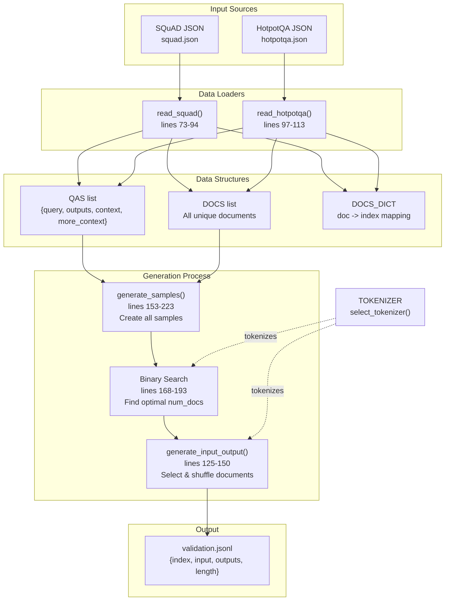
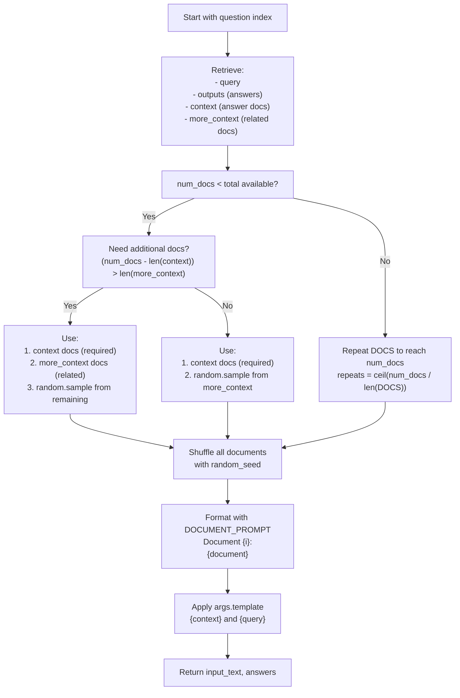
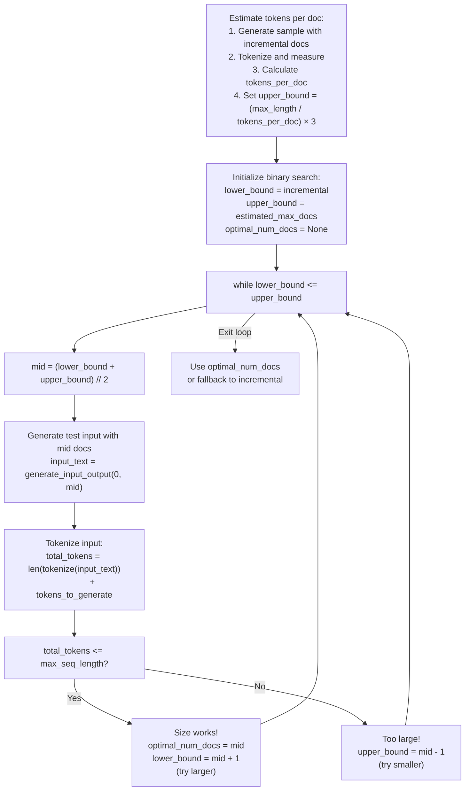

<!-- source: DeepWiki mcp.deepwiki.com · repo NVIDIA/RULER · page 3.6 Question Answering · fetched 2026-10-26 -->

# Question Answering

<details>
<summary>Relevant source files</summary>

The following files were used as context for generating this wiki page:

- [scripts/data/synthetic/qa.py](scripts/data/synthetic/qa.py)

</details>


## Purpose and Scope

This document describes the Question Answering (QA) task in RULER, which evaluates a model's ability to answer questions based on information contained in multiple provided documents. Unlike other RULER tasks that generate fully synthetic data, the QA task leverages existing QA datasets (SQuAD and HotpotQA) and embeds their questions and documents within long contexts to test retrieval and comprehension at scale.

For information about task design principles common across all RULER tasks, see [Task Design Principles](#3.1). For details on how this task fits into the overall data generation pipeline, see [Data Generation Pipeline](#2.2).

---

## Task Overview

The QA task tests a model's ability to:

1. **Locate relevant information** within a large collection of documents
2. **Extract specific answers** to questions based on provided context
3. **Ignore irrelevant distractors** when documents are shuffled and interleaved

The task differs from traditional QA benchmarks by:
- **Scaling document count**: Uses binary search to maximize the number of documents that fit within the target sequence length
- **Random shuffling**: Shuffles document order to prevent positional bias
- **Context dilution**: Adds documents that are topically related but don't contain the answer
- **Template-based prompting**: Wraps documents in a consistent format for model consumption

Sources: [scripts/data/synthetic/qa.py:15-27]()

---

## Architecture

### QA Task Generation Flow



Sources: [scripts/data/synthetic/qa.py:73-223]()

---

## Dataset Sources

### SQuAD (Stanford Question Answering Dataset)

The `read_squad()` function processes SQuAD format data:

| Component | Description | Implementation |
|-----------|-------------|----------------|
| **Documents** | Unique paragraph contexts from all articles | Extracted and deduplicated [scripts/data/synthetic/qa.py:77-79]() |
| **Questions** | Questions with multiple valid answers | From `qas` field, filtering `is_impossible=True` [scripts/data/synthetic/qa.py:86-92]() |
| **Context mapping** | Each question mapped to its source document | Stored as document index [scripts/data/synthetic/qa.py:90]() |
| **More context** | Related documents from the same article | Used as topically-related distractors [scripts/data/synthetic/qa.py:91]() |

**Data structure returned:**
```python
total_qas = [{
    'query': str,              # The question
    'outputs': [str, ...],     # List of acceptable answers
    'context': [int],          # Index of document containing answer
    'more_context': [int, ...] # Indices of related documents
}]
total_docs = [str, ...]        # All unique documents
```

Sources: [scripts/data/synthetic/qa.py:73-94]()

### HotpotQA

The `read_hotpotqa()` function processes multi-hop QA data:

| Component | Description | Implementation |
|-----------|-------------|----------------|
| **Documents** | Title + concatenated paragraphs | Format: `"{title}\n{joined_paragraphs}"` [scripts/data/synthetic/qa.py:101]() |
| **Questions** | Multi-hop reasoning questions | From `question` field [scripts/data/synthetic/qa.py:108]() |
| **Context mapping** | Multiple documents needed for answer | All documents from `context` field [scripts/data/synthetic/qa.py:110]() |
| **More context** | Not extracted for HotpotQA | Field omitted [scripts/data/synthetic/qa.py:105-111]() |

**Data structure returned:**
```python
total_qas = [{
    'query': str,          # The question
    'outputs': [str],      # Single answer (wrapped in list)
    'context': [int, ...], # Indices of all supporting documents
}]
total_docs = [str, ...]    # All unique documents
```

Sources: [scripts/data/synthetic/qa.py:97-113]()

---

## Data Generation Process

### Document Selection Strategy

The `generate_input_output()` function implements a three-tier document selection strategy:



**Document priority levels:**

1. **Required context** (`context`): Documents containing the answer - always included
2. **Related context** (`more_context`): Documents from the same article/topic - used as informed distractors
3. **Random context**: Any other documents - used as uninformed distractors

Sources: [scripts/data/synthetic/qa.py:125-150]()

### Shuffling Mechanism

Document shuffling is critical for preventing positional bias:

```python
random.Random(args.random_seed).shuffle(all_docs)  # Line 143
```

The shuffle uses a seeded random generator to ensure:
- **Reproducibility**: Same seed produces same order
- **Unpredictability**: Answer location varies across samples
- **Position independence**: Models must search entire context

Sources: [scripts/data/synthetic/qa.py:143]()

---

## Binary Search Optimization

The QA task uses binary search to maximize context usage within sequence length constraints.

### Binary Search Algorithm



**Key parameters:**

| Parameter | Purpose | Value |
|-----------|---------|-------|
| `incremental` | Minimum document count | 10 (default) |
| `estimated_max_docs` | Upper bound estimate | `(max_seq_length / tokens_per_doc) × 3` |
| `3x multiplier` | Safety factor for sampling variation | Accounts for tokenization variance [scripts/data/synthetic/qa.py:166]() |

Sources: [scripts/data/synthetic/qa.py:159-193]()

### Sample Generation with Fallback

After binary search determines the optimal document count, each sample is generated with a fallback mechanism:

```python
# Generate samples with fallback (lines 196-207)
used_docs = num_docs
while(True):
    try:
        input_text, answer = generate_input_output(index + args.pre_samples, used_docs)
        length = len(TOKENIZER.text_to_tokens(input_text)) + tokens_to_generate
        assert length <= max_seq_length
        break
    except:
        if used_docs > incremental:
            used_docs -= incremental
```

This ensures individual samples that exceed the limit (due to tokenization variance) are automatically adjusted by reducing document count.

Sources: [scripts/data/synthetic/qa.py:196-207]()

---

## Configuration Parameters

### Command-Line Arguments

| Argument | Type | Required | Description |
|----------|------|----------|-------------|
| `--save_dir` | Path | Yes | Output directory for dataset |
| `--save_name` | str | Yes | Task identifier (e.g., `qa_1`) |
| `--subset` | str | No | Split name, default: `validation` |
| `--tokenizer_path` | str | Yes | Path to tokenizer model |
| `--tokenizer_type` | str | No | Tokenizer framework: `nemo`, `hf`, `openai` |
| `--max_seq_length` | int | Yes | Maximum total tokens (input + output) |
| `--tokens_to_generate` | int | Yes | Expected answer length in tokens |
| `--num_samples` | int | Yes | Number of QA samples to generate |
| `--pre_samples` | int | No | Offset for sample indexing, default: 0 |
| `--random_seed` | int | No | Seed for reproducibility, default: 42 |
| `--template` | str | Yes | Prompt template with `{context}` and `{query}` placeholders |
| `--remove_newline_tab` | flag | No | Clean whitespace from input text |
| `--model_template_token` | int | No | Tokens reserved for model-specific template, default: 0 |
| `--dataset` | str | Yes | Dataset source: `squad` or `hotpotqa` |

Sources: [scripts/data/synthetic/qa.py:47-64]()

### Template Format

The `--template` argument expects placeholders for context and query:

```python
template = """Answer the question based on the given documents. Only give me the answer and do not output any other words.

The following are given documents.

{context}

Answer the question based on the given documents. Only give me the answer and do not output any other words.

Question: {query} Answer:"""
```

**Placeholder substitution:**
- `{context}`: Replaced with formatted documents
- `{query}`: Replaced with the question

Sources: [scripts/data/synthetic/qa.py:26](), [scripts/data/synthetic/qa.py:146-149]()

### Document Formatting

Each document is formatted using `DOCUMENT_PROMPT`:

```python
DOCUMENT_PROMPT = "Document {i}:\n{document}"  # Line 116
```

Documents are concatenated with double newlines:

```python
context = '\n\n'.join([DOCUMENT_PROMPT.format(i=i+1, document=d) 
                       for i, d in enumerate(all_docs)])  # Lines 145-146
```

Sources: [scripts/data/synthetic/qa.py:116](), [scripts/data/synthetic/qa.py:145-146]()

---

## Output Format

### JSONL Structure

Each generated sample is written as a JSON object with the following fields:

| Field | Type | Description |
|-------|------|-------------|
| `index` | int | Sample index (0 to num_samples-1) |
| `input` | str | Full prompt with documents and question (template applied, answer prefix removed) |
| `outputs` | list[str] | List of acceptable answers from the dataset |
| `length` | int | Total tokens: `len(tokenize(input)) + tokens_to_generate` |
| `length_w_model_temp` | int | Length including model template tokens |
| `answer_prefix` | str | The final portion of the template (e.g., "Question: ... Answer:") |

**Sample output:**
```json
{
  "index": 0,
  "input": "Answer the question based on the given documents...\n\nDocument 1:\n...\n\nDocument 15:\n...\n\nAnswer the question based on the given documents...\n\n",
  "outputs": ["1789", "1789."],
  "length": 3847,
  "length_w_model_temp": 3847,
  "answer_prefix": "Question: When was the French Revolution? Answer:"
}
```

Sources: [scripts/data/synthetic/qa.py:213-221]()

### Answer Prefix Extraction

The answer prefix is extracted from the input to enable proper evaluation:

```python
# Extract and separate answer prefix (lines 210-212)
answer_prefix_index = input_text.rfind(TASKS['qa']['answer_prefix'][:10])
answer_prefix = input_text[answer_prefix_index:]
input_text = input_text[:answer_prefix_index]
```

This allows the evaluation system to:
1. Use the `answer_prefix` during inference to continue generation
2. Compare the model's generated answer against `outputs`
3. Handle multi-turn or continuation-based evaluation strategies

Sources: [scripts/data/synthetic/qa.py:210-212]()

---

## Integration with RULER Pipeline

### Usage in Configuration

The QA task is configured in `synthetic.yaml` with dataset-specific parameters:

```yaml
- task: qa_1
  dataset: squad
  
- task: qa_2  
  dataset: hotpotqa
```

The task generator is invoked by `prepare.py` which passes all required arguments including tokenizer, sequence length, and template from the configuration system.

For complete details on task configuration, see [Task Configuration](#4.2).

### Evaluation Metrics

The QA task uses string matching metrics defined in `eval/constants.py`. Common metrics include:
- **Exact Match (EM)**: Checks if prediction exactly matches any answer in `outputs`
- **F1 Score**: Token-level overlap between prediction and answers
- **Substring Match**: Checks if any answer appears in the prediction

For evaluation methodology, see [Evaluation System](#2.4).

Sources: [scripts/data/synthetic/qa.py:45]()

---

## Implementation Notes

### Whitespace Handling

When `--remove_newline_tab` is enabled, the input text is normalized:

```python
if args.remove_newline_tab:
    input_text = ' '.join(input_text.replace('\n', ' ').replace('\t', ' ').strip().split())
```

This ensures:
- Consistent token counting across tokenizers
- Removal of formatting artifacts
- Single-space separation between all tokens

Sources: [scripts/data/synthetic/qa.py:208-209]()

### Tokenizer Selection

The task uses the shared `select_tokenizer()` utility:

```python
TOKENIZER = select_tokenizer(args.tokenizer_type, args.tokenizer_path)  # Line 70
```

This supports multiple tokenizer types:
- `nemo`: NeMo framework tokenizers (SentencePiece, tiktoken)
- `hf`: HuggingFace transformers tokenizers
- `openai`: OpenAI tiktoken tokenizers
- `gemini`: Google Gemini tokenizers

For tokenizer implementation details, see [Templates and Tokenizers](#4.3).

Sources: [scripts/data/synthetic/qa.py:70]()

### Dataset Paths

QA datasets are expected at fixed paths relative to the script:

```python
# SQuAD path (line 118)
os.path.join(os.path.dirname(os.path.abspath(__file__)), "json/squad.json")

# HotpotQA path (line 120)
os.path.join(os.path.dirname(os.path.abspath(__file__)), "json/hotpotqa.json")
```

These files must be placed in `scripts/data/synthetic/json/` directory.

Sources: [scripts/data/synthetic/qa.py:118](), [scripts/data/synthetic/qa.py:120]()

---

