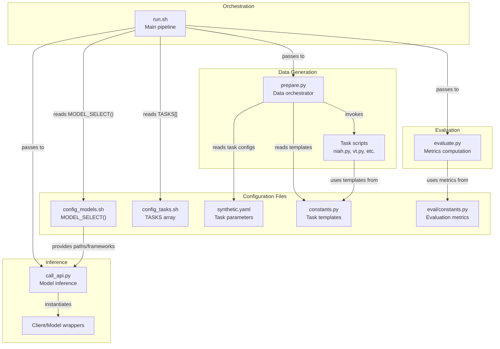
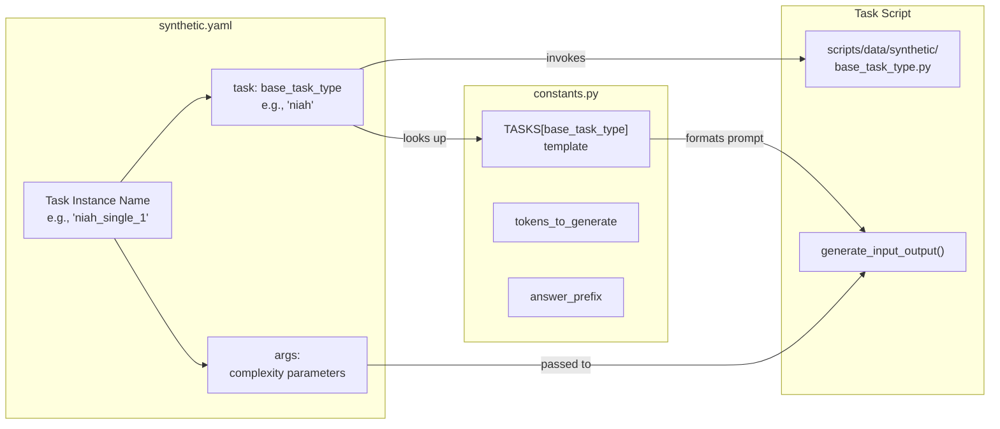
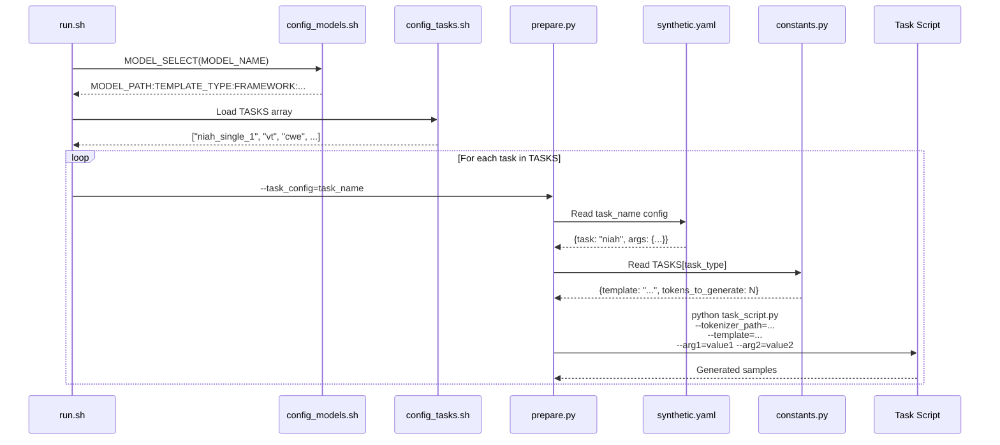

<!-- source: DeepWiki mcp.deepwiki.com · repo NVIDIA/RULER · page 4 Configuration System · fetched 2026-10-26 -->

# Configuration System

<details>
<summary>Relevant source files</summary>

The following files were used as context for generating this wiki page:

- [README.md](README.md)
- [scripts/config_models.sh](scripts/config_models.sh)
- [scripts/data/synthetic/variable_tracking.py](scripts/data/synthetic/variable_tracking.py)
- [scripts/synthetic.yaml](scripts/synthetic.yaml)

</details>


This page documents RULER's configuration-driven architecture, which allows users to define models, tasks, and evaluation parameters without modifying code. The configuration system consists of shell scripts, YAML files, and Python constants that control every aspect of the benchmark pipeline, from data generation to model inference and evaluation.

For details on specific configuration components, see:
- [Model Configuration](#4.1) - Adding and configuring models
- [Task Configuration](#4.2) - Defining synthetic tasks and their complexity
- [Templates and Tokenizers](#4.3) - Model-specific prompt templates and tokenizer handling

For information on using these configurations to run benchmarks, see [Running Benchmarks](#5.2).

## Configuration Architecture

RULER's configuration system separates concerns into distinct configuration files, each responsible for a specific aspect of the benchmark pipeline. This design enables extensibility without code modifications.



**Configuration Flow**: `run.sh` orchestrates the pipeline by reading model configurations from `config_models.sh` and task definitions from `config_tasks.sh`. For each task, `prepare.py` merges parameters from `synthetic.yaml` with templates from `constants.py`. The model configuration determines which inference backend is used, while evaluation metrics are defined in `eval/constants.py`.

Sources: [scripts/config_models.sh:1-101](), [scripts/synthetic.yaml:1-122](), [README.md:94-166]()

## Configuration Components

RULER's configuration system consists of five primary components, each serving a distinct purpose:

| Component | File | Purpose | Key Entities |
|-----------|------|---------|--------------|
| **Model Configuration** | `config_models.sh` | Define model paths, frameworks, templates, tokenizers | `MODEL_SELECT()`, `MODEL_PATH`, `MODEL_FRAMEWORK`, `TOKENIZER_PATH` |
| **Task Selection** | `config_tasks.sh` | Specify which tasks to evaluate | `TASKS` array |
| **Task Parameters** | `synthetic.yaml` | Configure task complexity and behavior | Task names mapped to `args` dictionaries |
| **Task Templates** | `constants.py` | Define prompt templates, answer prefixes, token limits | `TASKS` dictionary with `template`, `tokens_to_generate`, `answer_prefix` |
| **Evaluation Metrics** | `eval/constants.py` | Define scoring functions for each task | `TASKS` dictionary with metric functions |

### Model Configuration Structure

The `MODEL_SELECT()` function in [scripts/config_models.sh:27-101]() returns a colon-separated string containing all model parameters:

```
MODEL_PATH:MODEL_TEMPLATE_TYPE:MODEL_FRAMEWORK:TOKENIZER_PATH:TOKENIZER_TYPE:OPENAI_API_KEY:GEMINI_API_KEY:AZURE_ID:AZURE_SECRET:AZURE_ENDPOINT
```

**Example Configuration** [scripts/config_models.sh:38-42]():
```bash
llama3.1-8b-chat)
    MODEL_PATH="${MODEL_DIR}/llama3.1-8b-Instruct"
    MODEL_TEMPLATE_TYPE="meta-llama3"
    MODEL_FRAMEWORK="vllm"
    ;;
```

**Supported Frameworks**: The `MODEL_FRAMEWORK` variable determines the inference backend:
- `vllm` - vLLM server with PagedAttention
- `trtllm` - TensorRT-LLM optimized engines
- `sglang` - SGLang with FlashInfer
- `openai` - OpenAI API (includes Azure)
- `gemini` - Google Gemini API
- `hf` - HuggingFace Transformers direct loading
- `mamba` - Mamba state-space models

**Tokenizer Auto-Detection** [scripts/config_models.sh:89-97](): If `TOKENIZER_PATH` is not explicitly set, the system automatically detects whether to use NeMo tokenizers (`.model` files) or HuggingFace tokenizers.

Sources: [scripts/config_models.sh:1-101](), [README.md:101-130]()

### Task Configuration Structure

Task configurations are defined in [scripts/synthetic.yaml:1-122]() using a two-level hierarchy:



**Configuration Example** [scripts/synthetic.yaml:95-100]():
```yaml
vt:
  task: variable_tracking
  args:
    type_haystack: noise
    num_chains: 1
    num_hops: 4
```

This configuration creates a task instance named `vt` based on the `variable_tracking` task type, with specific complexity parameters controlling haystack type, number of variable chains, and hop depth.

Sources: [scripts/synthetic.yaml:1-122](), [scripts/data/synthetic/variable_tracking.py:1-320]()

## Configuration Loading and Merging

The configuration system follows a specific loading sequence to merge parameters from multiple sources:



**Parameter Precedence**:
1. **Command-line arguments** to `run.sh` (highest priority)
2. **synthetic.yaml** task-specific `args`
3. **constants.py** default templates and token limits
4. **Task script defaults** in argument parsers (lowest priority)

**Template Construction**: Task scripts receive a fully formatted template string by combining [scripts/data/synthetic/variable_tracking.py:161-175]():
- Base template from `TASKS[task_type]['template']`
- Answer prefix from `TASKS[task_type]['answer_prefix']`
- Task-specific placeholders (e.g., `{context}`, `{query}`, `{num_v}`)

Sources: [scripts/data/synthetic/variable_tracking.py:28-73](), [scripts/synthetic.yaml:1-122]()

## Global Configuration Parameters

Several configuration parameters apply across all tasks and models, defined in [scripts/config_models.sh:15-25]():

```bash
TEMPERATURE="0.0"  # Greedy decoding
TOP_P="1.0"
TOP_K="32"
SEQ_LENGTHS=(
    131072  # 128K
    65536   # 64K
    32768   # 32K
    16384   # 16K
    8192    # 8K
    4096    # 4K
)
```

**Sequence Length Iteration**: The `SEQ_LENGTHS` array defines which context lengths to evaluate. The pipeline iterates through these lengths in descending order, generating new data at each length with optimized haystack sizes.

**Generation Parameters**: `TEMPERATURE`, `TOP_P`, and `TOP_K` control model sampling behavior. The default configuration uses greedy decoding (`TEMPERATURE=0.0`) for deterministic, reproducible results.

Sources: [scripts/config_models.sh:15-25]()

## Configuration Validation

The configuration system performs validation at multiple stages:

```mermaid
graph TD
    subgraph "Model Validation"
        M1["MODEL_SELECT() returns<br/>configuration string"]
        M2["run.sh parses<br/>colon-separated fields"]
        M3{"MODEL_FRAMEWORK<br/>recognized?"}
        M4["Proceed with<br/>appropriate backend"]
        M5["Error: Unknown framework"]
        
        M1 --> M2
        M2 --> M3
        M3 -->|Yes| M4
        M3 -->|No| M5
    end
    
    subgraph "Task Validation"
        T1["Task name from<br/>config_tasks.sh"]
        T2["Look up in<br/>synthetic.yaml"]
        T3{"Task config<br/>exists?"}
        T4["Merge args with<br/>constants.py"]
        T5["Error: Task not found"]
        
        T1 --> T2
        T2 --> T3
        T3 -->|Yes| T4
        T3 -->|No| T5
    end
    
    subgraph "Data Generation Validation"
        D1["Task script generates<br/>sample"]
        D2["Tokenize input +<br/>answer_prefix"]
        D3{"length <= max_seq_length?"}
        D4["Binary search for<br/>optimal haystack"]
        D5["Accept sample"]
        
        D1 --> D2
        D2 --> D3
        D3 -->|No| D4
        D4 --> D1
        D3 -->|Yes| D5
    end
```



**Length Validation**: Task generation scripts use binary search algorithms to find the maximum haystack size that fits within `max_seq_length` [scripts/data/synthetic/variable_tracking.py:230-254](). This ensures all generated samples respect token limits while maximizing context usage.

**Assertion Checks**: Task scripts include assertions to catch configuration errors [scripts/data/synthetic/variable_tracking.py:269]():
```python
assert length <= max_seq_length, f"{length} exceeds max_seq_length."
```

Sources: [scripts/data/synthetic/variable_tracking.py:191-296](), [scripts/config_models.sh:27-101]()

## Configuration Extension Points

RULER's configuration system provides clear extension points for adding new components:

### Adding a New Model

**Required Changes**:
1. Add a new case block in `MODEL_SELECT()` [scripts/config_models.sh:32-86]()
2. Set `MODEL_PATH`, `MODEL_TEMPLATE_TYPE`, `MODEL_FRAMEWORK`
3. (Optional) Set `TOKENIZER_PATH`, `TOKENIZER_TYPE` if non-standard
4. (Optional) Set API keys for external services

**Example Addition**:
```bash
my_new_model)
    MODEL_PATH="${MODEL_DIR}/my-model-folder"
    MODEL_TEMPLATE_TYPE="meta-chat"  # or create new template
    MODEL_FRAMEWORK="vllm"
    ;;
```

### Adding a New Task Configuration

**Required Changes**:
1. Create task instance in `synthetic.yaml` with `task` and `args` fields [scripts/synthetic.yaml:15-122]()
2. Add task name to `TASKS` array in `config_tasks.sh`
3. Ensure base task type exists in `constants.py`

**Example Addition**:
```yaml
my_difficult_vt:
  task: variable_tracking
  args:
    type_haystack: essay
    num_chains: 5
    num_hops: 8
```

For comprehensive guides on extending RULER, see:
- [Adding Custom Tasks](#6.1) - Creating new task types
- [Adding Custom Models](#6.2) - Supporting new model architectures

Sources: [README.md:137-166](), [scripts/synthetic.yaml:1-122]()

## Configuration File Reference

Complete listing of configuration files and their primary purpose:

| File Path | Primary Function | Key Exports |
|-----------|------------------|-------------|
| `scripts/config_models.sh` | Model and inference backend configuration | `MODEL_SELECT()`, `SEQ_LENGTHS[]`, `TEMPERATURE` |
| `scripts/config_tasks.sh` | Task selection for benchmark runs | `TASKS[]` array |
| `scripts/synthetic.yaml` | Task complexity parameter definitions | Task instance configurations |
| `scripts/data/synthetic/constants.py` | Task templates and generation parameters | `TASKS` dict with templates |
| `scripts/eval/synthetic/constants.py` | Evaluation metrics and scoring functions | `TASKS` dict with metric functions |
| `scripts/data/template.py` | Model-specific prompt templates | `Templates` dict, `MODEL_TEMPLATE_TYPE` mappings |
| `scripts/data/tokenizer.py` | Multi-framework tokenizer abstraction | `select_tokenizer()` function |

Sources: [scripts/config_models.sh:1-101](), [scripts/synthetic.yaml:1-122](), [README.md:94-166]()

---

