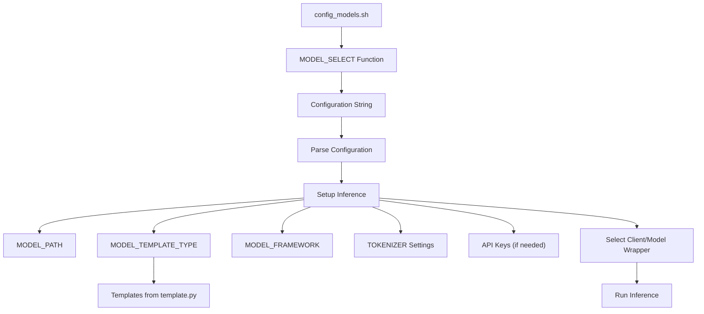
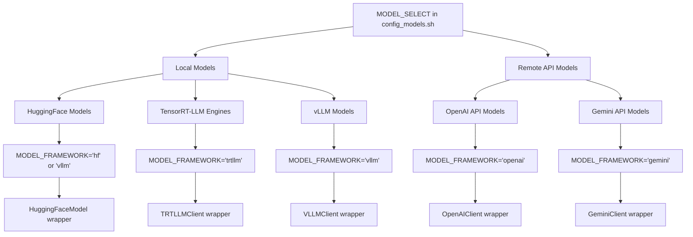
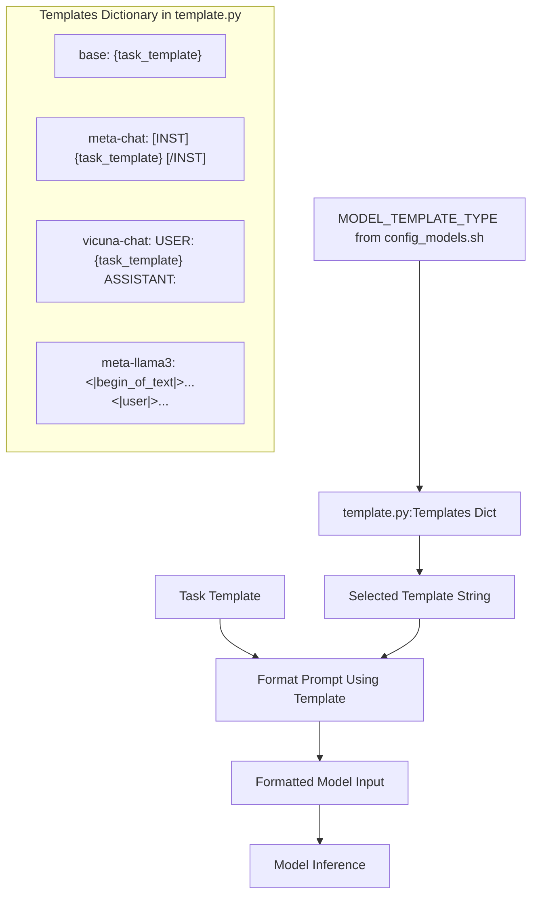

<!-- source: DeepWiki mcp.deepwiki.com · repo NVIDIA/RULER · page 4.1 Model Configuration · fetched 2026-10-26 -->

# Model Configuration

<details>
<summary>Relevant source files</summary>

The following files were used as context for generating this wiki page:

- [README.md](README.md)
- [scripts/config_models.sh](scripts/config_models.sh)

</details>


This document details how to configure different types of models for evaluation in the RULER benchmark system. It covers the configuration process for local models (HuggingFace, TensorRT-LLM, vLLM) and remote API models (OpenAI, Gemini). For information about client wrappers that interface with these models, see [Client Wrappers](#4.2). For details on prompt templates used by models, see [Prompt Templates](#4.3).

## Overview

The Model Configuration subsystem handles:
- Model selection and configuration
- Prompt template specification for different model families
- Inference parameter settings (temperature, top_p, top_k)
- Model-specific configuration (paths, API keys)
- Sequence length definition for contextual evaluation

The core component is the `MODEL_SELECT` function in `config_models.sh`, which transforms a model name into a complete configuration specification.

## Model Configuration Flow



Sources: [scripts/config_models.sh:27-101](), [README.md:75-104]()

## Supported Model Types

RULER supports multiple model types and frameworks, which are configured differently based on their requirements:



Sources: [scripts/config_models.sh:27-85](), [README.md:85-113]()

## Configuration Parameters

The `MODEL_SELECT` function configures the following key parameters:

| Parameter | Description | Example |
|-----------|-------------|---------|
| MODEL_PATH | Path to model directory or API model name | "${MODEL_DIR}/llama2-7b-chat-hf" |
| MODEL_TEMPLATE_TYPE | Template type for input formatting | "meta-chat" |
| MODEL_FRAMEWORK | Inference framework | "vllm", "trtllm", "openai" |
| TOKENIZER_PATH | Path to tokenizer | "${MODEL_PATH}" |
| TOKENIZER_TYPE | Type of tokenizer | "hf", "nemo", "openai" |
| API_KEYS | API keys for remote models | OPENAI_API_KEY, GEMINI_API_KEY |

The function returns a colon-separated string with all these parameters:
```
MODEL_PATH:MODEL_TEMPLATE_TYPE:MODEL_FRAMEWORK:TOKENIZER_PATH:TOKENIZER_TYPE:OPENAI_API_KEY:GEMINI_API_KEY:AZURE_ID:AZURE_SECRET:AZURE_ENDPOINT
```

Sources: [scripts/config_models.sh:100]()

### Inference Parameters

RULER sets global inference parameters in `config_models.sh`:

```
TEMPERATURE="0.0" # greedy decoding
TOP_P="1.0"
TOP_K="32"
```

It also defines sequence lengths for evaluating context window capabilities:

```
SEQ_LENGTHS=(
    131072
    65536
    32768
    16384
    8192
    4096
)
```

Sources: [scripts/config_models.sh:15-25]()

### Tokenizer Auto-detection

If `TOKENIZER_PATH` is not explicitly specified, RULER will auto-detect the tokenizer:

```
if [ -z "${TOKENIZER_PATH}" ]; then
    if [ -f ${MODEL_PATH}/tokenizer.model ]; then
        TOKENIZER_PATH=${MODEL_PATH}/tokenizer.model
        TOKENIZER_TYPE="nemo"
    else
        TOKENIZER_PATH=${MODEL_PATH}
        TOKENIZER_TYPE="hf"
    fi
fi
```

Sources: [scripts/config_models.sh:89-97]()

## Template System

The model's `MODEL_TEMPLATE_TYPE` parameter selects a template from the `Templates` dictionary in `template.py`. This template formats task instructions into model-specific prompt formats.



Available template types include:

| Template Type | Format | Used For |
|--------------|--------|----------|
| base | "{task_template}" | Simple models with no special formatting |
| meta-chat | "[INST] {task_template} [/INST]" | Meta's Llama2 chat models |
| vicuna-chat | "USER: {task_template} ASSISTANT:" | Vicuna-style chat models |
| lwm-chat | "USER: {task_template} ASSISTANT: " | LWM chat format |
| meta-llama3 | "<\|begin_of_text\|>...<\|user\|>..." | Meta's Llama3 models |
| jamba | "<\|startoftext\|>...<\|user\|>..." | Jamba models |

Sources: [scripts/data/template.py:15-35]()

## Adding New Models

To add a new model to RULER, you need to:

1. Edit `config_models.sh` and add a new case to the `MODEL_SELECT` function
2. Configure the model parameters appropriately
3. Add a new template to `template.py` if the model requires a unique format

### Example: HuggingFace Model

```
case $MODEL_NAME in
    YOUR_HF_MODEL_NAME)
        MODEL_PATH=${MODEL_DIR}/YOUR_MODEL_FOLDER
        MODEL_TEMPLATE_TYPE="meta-chat"  # Choose appropriate template
        MODEL_FRAMEWORK="vllm"  # or "hf" for direct HF inference
        ;;
```

### Example: TensorRT-LLM Engine

```
case $MODEL_NAME in
    YOUR_TRTLLM_ENGINE_NAME)
        MODEL_PATH=${ENGINE_DIR}/YOUR_ENGINE_FOLDER
        MODEL_TEMPLATE_TYPE="meta-chat"  # Choose appropriate template
        MODEL_FRAMEWORK="trtllm"
        ;;
```

### Example: OpenAI API Model

```
case $MODEL_NAME in
    YOUR_OPENAI_MODEL_NAME)
        MODEL_PATH="gpt-4"  # OpenAI model name
        MODEL_TEMPLATE_TYPE="base"
        MODEL_FRAMEWORK="openai"
        TOKENIZER_PATH="cl100k_base"
        TOKENIZER_TYPE="openai"
        OPENAI_API_KEY=""  # Your API key
        ;;
```

### Example: Gemini API Model

```
case $MODEL_NAME in
    YOUR_GEMINI_MODEL_NAME)
        MODEL_PATH="gemini-1.5-pro-latest"
        MODEL_TEMPLATE_TYPE="base"
        MODEL_FRAMEWORK="gemini"
        TOKENIZER_PATH=$MODEL_PATH
        TOKENIZER_TYPE="gemini"
        GEMINI_API_KEY=""  # Your API key
        ;;
```

Sources: [README.md:85-113](), [scripts/config_models.sh:32-85]()

## Integration with Benchmark System

The model configuration integrates with the RULER benchmark pipeline as follows:

1. `run.sh` calls `config_models.sh` with a model name
2. `MODEL_SELECT` returns the configuration string
3. `run.sh` parses this string and sets up the appropriate environment variables
4. Based on the `MODEL_FRAMEWORK`, the system selects the appropriate client or model wrapper
5. The model is used to run inference on the benchmark tasks with the configured template

Sources: [README.md:77-113]()

---

