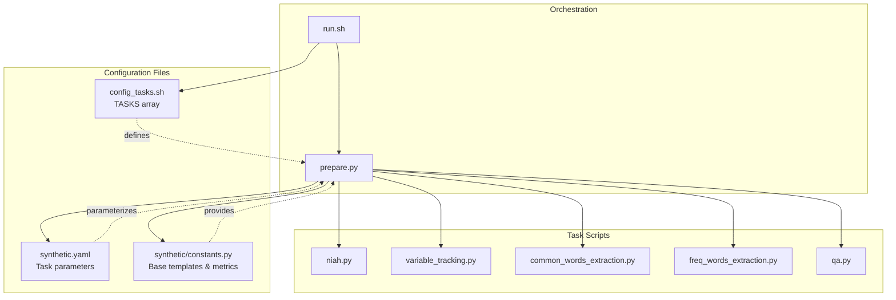
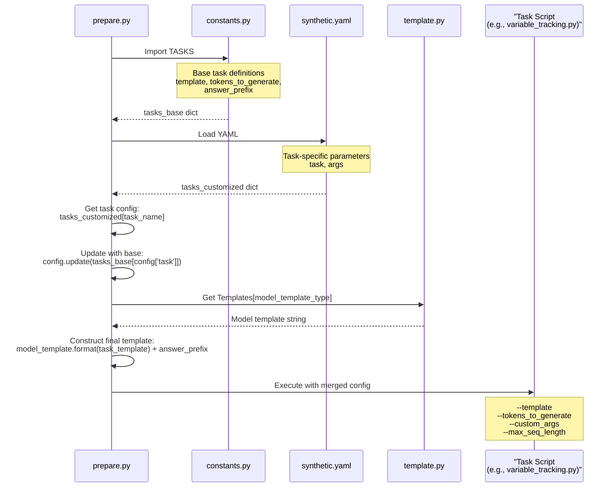
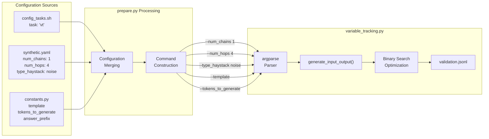
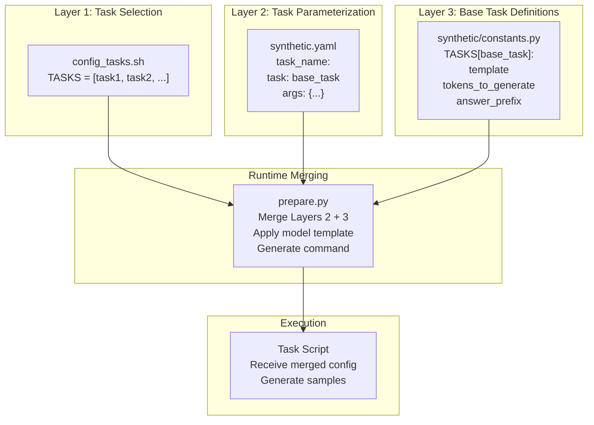

<!-- source: DeepWiki mcp.deepwiki.com · repo NVIDIA/RULER · page 4.2 Task Configuration · fetched 2026-10-26 -->

# Task Configuration

<details>
<summary>Relevant source files</summary>

The following files were used as context for generating this wiki page:

- [README.md](README.md)
- [scripts/data/prepare.py](scripts/data/prepare.py)
- [scripts/data/synthetic/variable_tracking.py](scripts/data/synthetic/variable_tracking.py)
- [scripts/synthetic.yaml](scripts/synthetic.yaml)

</details>


This document describes RULER's task configuration system, which controls which synthetic tasks are evaluated and their complexity parameters. Task configurations are split across two files: `config_tasks.sh` defines the task selection array, while `synthetic.yaml` defines task-specific parameters. For information about model configuration (frameworks, paths, tokenizers), see [Model Configuration](#4.1). For details on implementing custom tasks, see [Adding Custom Tasks](#6.1).

## Configuration File Structure

RULER's task configuration system uses a two-file architecture that separates task selection from task parameterization:



**Sources:** [scripts/data/prepare.py](), [scripts/synthetic.yaml](), [README.md:132-147]()

### config_tasks.sh: Task Selection

The `config_tasks.sh` file defines which tasks to evaluate through the `TASKS` array. This file is sourced by `run.sh` during benchmark execution.

**Example structure:**
```bash
TASKS=(
    "niah_single_1"
    "niah_single_2"
    "niah_single_3"
    "niah_multikey_1"
    "niah_multikey_2"
    "niah_multikey_3"
    "niah_multivalue"
    "niah_multiquery"
    "vt"
    "cwe"
    "fwe"
    "qa_1"
    "qa_2"
)
```

Each string in the `TASKS` array must correspond to a top-level key in `synthetic.yaml`. The tasks are executed sequentially in the order defined by this array.

**Sources:** [README.md:132-147]()

### synthetic.yaml: Task Parameterization

The `synthetic.yaml` file defines complexity parameters for each task. Each task entry maps to configuration parameters that control the difficulty and characteristics of generated samples.

**Structure:**
```yaml
task_name:
  task: base_task_type
  args:
    parameter1: value1
    parameter2: value2
    ...
```

- **task_name**: Unique identifier used in `config_tasks.sh` TASKS array
- **task**: Base task type (e.g., `niah`, `variable_tracking`, `qa`)
- **args**: Dictionary of task-specific complexity parameters

**Sources:** [scripts/synthetic.yaml:1-122]()

## Task Configuration Schema

RULER defines 13 task configurations across 4 task categories. Below is the complete configuration mapping:

| Task Name | Base Task | Key Parameters | Description |
|-----------|-----------|----------------|-------------|
| `niah_single_1` | `niah` | `type_haystack: noise`<br/>`type_needle_k: words`<br/>`type_needle_v: numbers` | Single needle in noise haystack |
| `niah_single_2` | `niah` | `type_haystack: essay`<br/>`type_needle_k: words`<br/>`type_needle_v: numbers` | Single needle in essay haystack |
| `niah_single_3` | `niah` | `type_haystack: essay`<br/>`type_needle_k: words`<br/>`type_needle_v: uuids` | Single needle with UUID values |
| `niah_multikey_1` | `niah` | `num_needle_k: 4` | Multiple keys (4) to retrieve |
| `niah_multikey_2` | `niah` | `type_haystack: needle` | Distractor needles |
| `niah_multikey_3` | `niah` | `type_needle_k: uuids`<br/>`type_needle_v: uuids` | UUID keys and values |
| `niah_multivalue` | `niah` | `num_needle_v: 4` | Multiple values (4) per key |
| `niah_multiquery` | `niah` | `num_needle_q: 4` | Multiple queries (4) |
| `vt` | `variable_tracking` | `type_haystack: noise`<br/>`num_chains: 1`<br/>`num_hops: 4` | Variable tracking with 4 hops |
| `cwe` | `common_words_extraction` | `freq_cw: 30`<br/>`freq_ucw: 3`<br/>`num_cw: 10` | Common word extraction |
| `fwe` | `freq_words_extraction` | `alpha: 2.0` | Zipf distribution (α=2.0) |
| `qa_1` | `qa` | `dataset: squad` | SQuAD-based QA |
| `qa_2` | `qa` | `dataset: hotpotqa` | HotpotQA-based QA |

**Sources:** [scripts/synthetic.yaml:15-122](), [README.md:140-146]()

### Configuration Parameters by Task Category

#### Needle-in-a-Haystack (NIAH)

```yaml
niah_single_1:
  task: niah
  args:
    type_haystack: noise      # Options: repeat/essay/needle
    type_needle_k: words      # Options: words/numbers/uuids
    type_needle_v: numbers    # Options: words/numbers/uuids
    num_needle_k: 1           # Number of keys (int >= 1)
    num_needle_v: 1           # Number of values per key (int >= 1)
    num_needle_q: 1           # Number of queries (int >= 1)
```

- **type_haystack**: Type of background text
  - `repeat`: Repeated noise sentences
  - `essay`: Paul Graham essays
  - `needle`: Distractor needles
- **type_needle_k/v**: Format of keys/values
  - `words`: Adjective-noun pairs
  - `numbers`: 7-digit numbers
  - `uuids`: 32-digit UUIDs
- **num_needle_k**: Number of different keys to insert
- **num_needle_v**: Number of values associated with each key
- **num_needle_q**: Number of keys to query

**Sources:** [scripts/synthetic.yaml:15-93](), [README.md:142]()

#### Variable Tracking (VT)

```yaml
vt:
  task: variable_tracking
  args:
    type_haystack: noise      # Options: noise/essay
    num_chains: 1             # Number of variable chains (int >= 1)
    num_hops: 4               # Number of hops per chain (int >= 1)
```

- **type_haystack**: Background text type (`noise` or `essay`)
- **num_chains**: Number of independent variable assignment chains
- **num_hops**: Number of variable reassignments in each chain

**Sources:** [scripts/synthetic.yaml:95-100](), [README.md:143]()

#### Common Words Extraction (CWE)

```yaml
cwe:
  task: common_words_extraction
  args:
    freq_cw: 30               # Frequency of common words (int >= 1)
    freq_ucw: 3               # Frequency of uncommon words (int >= 1)
    num_cw: 10                # Number of common words to return (int >= 1)
```

- **freq_cw**: Number of occurrences of common words
- **freq_ucw**: Number of occurrences of uncommon words
- **num_cw**: Number of common words to extract

**Sources:** [scripts/synthetic.yaml:102-107](), [README.md:144]()

#### Frequent Words Extraction (FWE)

```yaml
fwe:
  task: freq_words_extraction
  args:
    alpha: 2.0                # Zipf distribution parameter (float > 1.0)
```

- **alpha**: Shape parameter for Zipf/zeta distribution. Lower values increase difficulty by making frequency distribution more uniform.

**Sources:** [scripts/synthetic.yaml:109-112](), [README.md:145]()

#### Question Answering (QA)

```yaml
qa_1:
  task: qa
  args:
    dataset: squad            # Options: squad/hotpotqa
```

- **dataset**: Short-context QA dataset to use as source

**Sources:** [scripts/synthetic.yaml:114-122](), [README.md:146]()

## Configuration Merging Process

RULER merges configurations from multiple sources to construct the final task parameters. The `prepare.py` script orchestrates this merging process:



**Sources:** [scripts/data/prepare.py:67-101]()

### Merging Logic

The configuration merging follows this sequence in [scripts/data/prepare.py:67-101]():

1. **Import base task definitions** from `synthetic/constants.py`:
   ```python
   module = importlib.import_module(f"{args.benchmark}.constants")
   tasks_base = module.TASKS
   ```
   This provides `template`, `tokens_to_generate`, and `answer_prefix`.

2. **Load customized task configurations** from `synthetic.yaml`:
   ```python
   with open(os.path.join(curr_folder, f"../{args.benchmark}.yaml"), "r") as f:
       tasks_customized = yaml.safe_load(f)
   ```

3. **Retrieve and merge configurations**:
   ```python
   config = tasks_customized.get(args.task)
   config.update(tasks_base[config['task']])
   ```
   The `config['task']` field maps to base task definitions in `constants.py`.

4. **Apply model template**:
   ```python
   model_template = Templates[args.model_template_type]
   task_template = config['template']
   answer_prefix = config['answer_prefix'] if 'answer_prefix' in config else ''
   config['template'] = model_template.format(task_template=task_template) + answer_prefix
   ```

5. **Pass merged config to task script** via command-line arguments:
   ```python
   additional_args = " ".join([f"--{k} {v}" for k, v in config['args'].items()])
   command = f"""python {script} ... {additional_args} --template "{config['template']}" """
   ```

**Sources:** [scripts/data/prepare.py:67-142]()

## Configuration Flow to Task Scripts

Task generation scripts receive configurations through command-line arguments. Here's how the variable tracking task consumes its configuration:



**Sources:** [scripts/data/prepare.py:122-142](), [scripts/data/synthetic/variable_tracking.py:54-73]()

### Command-Line Interface

Task scripts define standard and task-specific arguments. Standard arguments (required for all tasks):

| Argument | Purpose | Source |
|----------|---------|--------|
| `--save_dir` | Output directory | Command-line |
| `--save_name` | Task name | Command-line |
| `--tokenizer_path` | Tokenizer path | Command-line |
| `--tokenizer_type` | Tokenizer framework | Command-line |
| `--max_seq_length` | Maximum sequence length | Command-line |
| `--tokens_to_generate` | Reserved tokens for output | `constants.py` |
| `--num_samples` | Number of samples to generate | Command-line |
| `--random_seed` | Random seed for reproducibility | Command-line |
| `--template` | Full prompt template | Merged config |

Task-specific arguments (from `synthetic.yaml` args):

**Variable Tracking Example:**
```python
parser.add_argument("--type_haystack", type=str, default='noise')
parser.add_argument("--num_chains", type=int, default=1)
parser.add_argument("--num_hops", type=int, default=4)
```

**Sources:** [scripts/data/synthetic/variable_tracking.py:54-72](), [scripts/data/prepare.py:123-138]()

## Adding New Task Configurations

To add a new task configuration without creating a new task type:

### 1. Define Configuration in synthetic.yaml

Add a new entry mapping to an existing base task:

```yaml
vt_harder:
  task: variable_tracking
  args:
    type_haystack: essay
    num_chains: 3
    num_hops: 8
```

**Sources:** [scripts/synthetic.yaml:95-100]()

### 2. Register in config_tasks.sh

Add the task name to the `TASKS` array:

```bash
TASKS=(
    # ... existing tasks ...
    "vt_harder"
)
```

The task will now be included in benchmark runs when executing `run.sh`.

**Sources:** [README.md:132-147]()

### 3. Verify Configuration Validity

Ensure all arguments in the `args` section are supported by the base task script. For example, `variable_tracking.py` supports:

- `type_haystack`: Must be `noise` or `essay` [scripts/data/synthetic/variable_tracking.py:67]()
- `num_chains`: Integer >= 1 [scripts/data/synthetic/variable_tracking.py:68]()
- `num_hops`: Integer >= 1 [scripts/data/synthetic/variable_tracking.py:69]()

Invalid arguments will cause the task script to fail during execution.

**Sources:** [scripts/data/synthetic/variable_tracking.py:67-70]()

## Configuration Schema Summary

The complete configuration schema consists of three layers:



**Key Properties:**

1. **Separation of Concerns**: Task selection (config_tasks.sh) is independent from parameterization (synthetic.yaml)
2. **Two-Level Hierarchy**: Customized configs reference base task types
3. **Template Composition**: Model templates wrap task templates at runtime
4. **Extensibility**: New configurations can be added without code changes
5. **Type Safety**: Task scripts validate arguments through argparse

**Sources:** [scripts/data/prepare.py:67-142](), [scripts/synthetic.yaml:1-122]()

---

