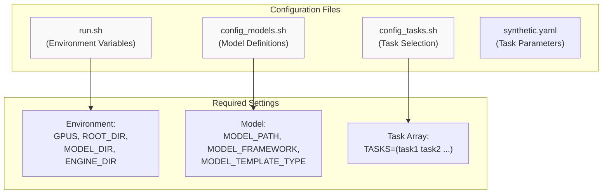
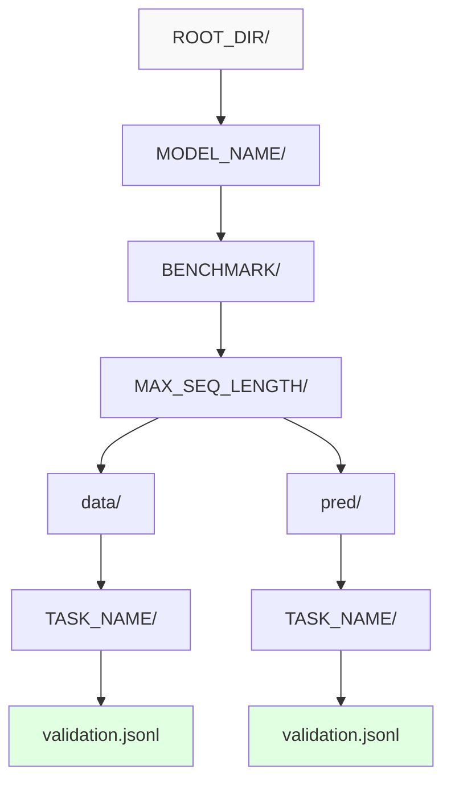
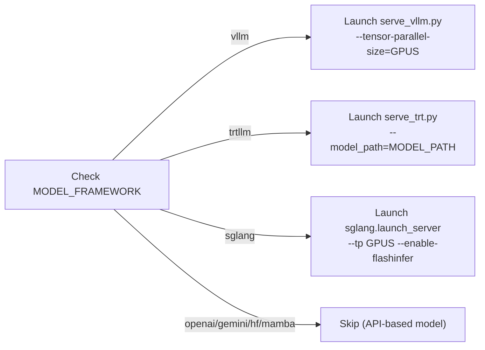

<!-- source: DeepWiki mcp.deepwiki.com · repo NVIDIA/RULER · page 5 Running RULER · fetched 2026-10-26 -->

# Running RULER

<details>
<summary>Relevant source files</summary>

The following files were used as context for generating this wiki page:

- [README.md](README.md)
- [scripts/run.sh](scripts/run.sh)

</details>


This page provides a practical guide for setting up and executing RULER benchmarks. It covers the essential prerequisites, configuration steps, and execution workflow needed to evaluate long-context language models using the RULER framework.

For detailed information about specific aspects of running RULER:
- Docker environment setup and dependencies: See [Docker Environment](#5.1)
- Step-by-step execution guide and command-line usage: See [Running Benchmarks](#5.2)
- Interpreting benchmark results and output files: See [Understanding Results](#5.3)

## Prerequisites

Before running RULER benchmarks, you must prepare the following components:

### Data Sources

RULER requires external data for certain tasks:

| Data Source | Task(s) | Download Method |
|-------------|---------|-----------------|
| Paul Graham Essays | NIAH variants | Run `scripts/data/synthetic/json/download_paulgraham_essay.py` |
| SQuAD Dataset | Question Answering | Run `scripts/data/synthetic/json/download_qa_dataset.sh` |
| HotpotQA Dataset | Question Answering | Run `scripts/data/synthetic/json/download_qa_dataset.sh` |

**Sources:** [README.md:78-85]()

### Model Preparation

Models must be downloaded and prepared before evaluation:

1. **Download models** from HuggingFace or other sources
2. **Configure model templates** in `scripts/data/template.py` if your model uses a custom chat format
3. **Adjust `max_position_embeddings`** in the model's `config.json` if testing beyond the model's default context length
4. **(Optional)** Build TensorRT-LLM engines for NVIDIA-optimized inference using TensorRT-LLM example scripts

**Sources:** [README.md:86-90]()

## Configuration Overview

RULER uses a configuration-driven approach with three primary configuration files that must be set up before execution:



**Configuration: Environment Variables in run.sh**

The main execution script requires these environment variables at [scripts/run.sh:26-30]():

| Variable | Purpose | Example |
|----------|---------|---------|
| `GPUS` | Number of GPUs for tensor parallelism | `"1"` |
| `ROOT_DIR` | Output directory for samples and predictions | `"benchmark_root"` |
| `MODEL_DIR` | Directory containing HuggingFace model folders | `"../.."` |
| `ENGINE_DIR` | Directory containing TensorRT-LLM engine folders | `"."` |
| `BATCH_SIZE` | Inference batch size for GPU utilization | `1` |

**Sources:** [scripts/run.sh:26-30]()

### Model Configuration

Models are registered in `config_models.sh` using a case statement in the `MODEL_SELECT` function. Each model requires:

| Parameter | Description |
|-----------|-------------|
| `MODEL_PATH` | Full path to model or API model name |
| `MODEL_TEMPLATE_TYPE` | Template identifier from `template.py` (e.g., `base`, `meta-chat`) |
| `MODEL_FRAMEWORK` | Backend framework: `hf`, `vllm`, `trtllm`, `sglang`, `openai`, `gemini`, `mamba` |
| `TOKENIZER_PATH` | Path to tokenizer or tokenizer name |
| `TOKENIZER_TYPE` | Tokenizer type: `nemo`, `hf`, `openai`, `gemini` |

Example model configurations from [README.md:103-129]():

```bash
# HuggingFace/vLLM model
YOUR_HF_MODEL_NAME)
    MODEL_PATH=${MODEL_DIR}/YOUR_MODEL_FOLDER
    MODEL_TEMPLATE_TYPE="meta-chat"
    MODEL_FRAMEWORK="vllm"
    ;;

# OpenAI API model
YOUR_OPENAI_MODEL_NAME)
    MODEL_PATH="gpt-4-turbo"
    MODEL_TEMPLATE_TYPE="base"
    MODEL_FRAMEWORK="openai"
    TOKENIZER_PATH="cl100k_base"
    TOKENIZER_TYPE="openai"
    OPENAI_API_KEY="your-api-key"
    ;;
```

**Sources:** [README.md:101-129](), [scripts/run.sh:34-41]()

## Execution Flow

The main execution is orchestrated by `run.sh`, which coordinates data generation, model inference, and evaluation in a sequential pipeline.

### High-Level Pipeline

```mermaid
sequenceDiagram
    participant User
    participant run.sh
    participant Server["Model Server<br/>(vllm/trtllm/sglang)"]
    participant prepare.py
    participant call_api.py
    participant evaluate.py
    
    User->>run.sh: bash run.sh MODEL_NAME synthetic
    
    Note over run.sh: Load configurations from<br/>config_models.sh and config_tasks.sh
    
    alt Local Model (vllm/trtllm/sglang)
        run.sh->>Server: Start model server (background)
        Note over Server: Server runs for entire benchmark
    end
    
    loop For each MAX_SEQ_LENGTH in SEQ_LENGTHS
        loop For each TASK in TASKS
            run.sh->>prepare.py: Generate task data
            Note over prepare.py: Creates data/TASK/validation.jsonl
            
            run.sh->>call_api.py: Generate predictions
            Note over call_api.py: Creates pred/TASK/validation.jsonl
        end
        
        run.sh->>evaluate.py: Compute metrics for all tasks
        Note over evaluate.py: Outputs performance scores
    end
    
    Note over run.sh: Report total inference time
```

**Sources:** [scripts/run.sh:61-132]()

### Data and Prediction Directory Structure

The execution creates a structured directory hierarchy under `ROOT_DIR`:



Example path structure:
- Input data: `benchmark_root/llama3-8b/synthetic/4096/data/niah_single_1/validation.jsonl`
- Predictions: `benchmark_root/llama3-8b/synthetic/4096/pred/niah_single_1/validation.jsonl`

**Sources:** [scripts/run.sh:91-95]()

### Detailed Execution Steps

The execution follows this sequence at [scripts/run.sh:87-132]():

**1. Configuration Loading** [scripts/run.sh:34-58]()
- Source `config_models.sh` to retrieve model configuration via `MODEL_SELECT` function
- Source `config_tasks.sh` to load task array for the specified benchmark
- Export API keys as environment variables (`OPENAI_API_KEY`, `GEMINI_API_KEY`, etc.)

**2. Server Initialization** [scripts/run.sh:61-84]()
- If `MODEL_FRAMEWORK` is `vllm`, `trtllm`, or `sglang`, launch the appropriate server in background
- Server parameters include tensor parallelism size (`GPUS`) and model path
- Servers run for the entire benchmark duration

**3. Sequence Length Loop** [scripts/run.sh:89-130]()
- Iterate through `SEQ_LENGTHS` array (typically `[4096, 8192, 16384, 32768, 65536, 131072]`)
- Create output directories for current sequence length

**4. Task Loop** [scripts/run.sh:97-125]()

For each task in the `TASKS` array:

a. **Data Generation** [scripts/run.sh:98-107]()
```bash
python data/prepare.py \
    --save_dir ${DATA_DIR} \
    --benchmark ${BENCHMARK} \
    --task ${TASK} \
    --tokenizer_path ${TOKENIZER_PATH} \
    --tokenizer_type ${TOKENIZER_TYPE} \
    --max_seq_length ${MAX_SEQ_LENGTH} \
    --model_template_type ${MODEL_TEMPLATE_TYPE} \
    --num_samples ${NUM_SAMPLES}
```

b. **Inference** [scripts/run.sh:109-122]()
```bash
python pred/call_api.py \
    --data_dir ${DATA_DIR} \
    --save_dir ${PRED_DIR} \
    --benchmark ${BENCHMARK} \
    --task ${TASK} \
    --server_type ${MODEL_FRAMEWORK} \
    --model_name_or_path ${MODEL_PATH} \
    --temperature ${TEMPERATURE} \
    --top_k ${TOP_K} \
    --top_p ${TOP_P} \
    --batch_size ${BATCH_SIZE}
```

**5. Evaluation** [scripts/run.sh:127-129]()

After all tasks complete for a sequence length:
```bash
python eval/evaluate.py \
    --data_dir ${PRED_DIR} \
    --benchmark ${BENCHMARK}
```

**6. Timing Report** [scripts/run.sh:132]()
- Output total time spent on `call_api.py` across all tasks and sequence lengths

**Sources:** [scripts/run.sh:87-132]()

## Invocation Command

The standard command to run RULER benchmarks:

```bash
bash run.sh MODEL_NAME BENCHMARK_NAME
```

Where:
- `MODEL_NAME`: A case identifier from `config_models.sh` (e.g., `llama3-8b`, `gpt-4-turbo`)
- `BENCHMARK_NAME`: A task array variable from `config_tasks.sh` (e.g., `synthetic`)

Example:
```bash
bash run.sh llama3-8b synthetic
```

**Sources:** [README.md:132-135](), [scripts/run.sh:17-22]()

## Server Management

### Local Model Serving

For local models using `vllm`, `trtllm`, or `sglang` frameworks, the server is automatically started in the background by `run.sh`:

| Framework | Server Script | Default Port |
|-----------|--------------|--------------|
| vLLM | `pred/serve_vllm.py` | 5000 |
| TensorRT-LLM | `pred/serve_trt.py` | 5000 |
| SGLang | `sglang.launch_server` | 5000 |

The server initialization logic at [scripts/run.sh:62-84]():



### External API Models

For API-based models (`openai`, `gemini`), no server startup is required. API keys must be configured in `config_models.sh` and will be exported as environment variables.

**Sources:** [scripts/run.sh:61-84]()

## Monitoring Execution

During execution, you can monitor:

1. **Server logs**: Check that model servers started successfully (vLLM, TensorRT-LLM, SGLang output)
2. **Task progress**: Each `prepare.py` and `call_api.py` invocation outputs progress information
3. **Directory creation**: Verify that data and prediction directories are being populated
4. **Evaluation output**: `evaluate.py` prints performance metrics after each sequence length completes

The script tracks and reports total inference time at completion [scripts/run.sh:132]().

**Sources:** [scripts/run.sh:109-132]()

## Common Configuration Parameters

Additional parameters that affect execution behavior (defined in `config_tasks.sh`):

| Parameter | Purpose | Typical Values |
|-----------|---------|----------------|
| `SEQ_LENGTHS` | Array of sequence lengths to test | `(4096 8192 16384 32768 65536 131072)` |
| `NUM_SAMPLES` | Number of test samples per task | `500` |
| `TEMPERATURE` | Sampling temperature for generation | `0.0` |
| `TOP_K` | Top-k sampling parameter | `32` |
| `TOP_P` | Nucleus sampling parameter | `1.0` |
| `STOP_WORDS` | Stop token configuration | `--stop_words \n\n` |
| `REMOVE_NEWLINE_TAB` | Data preprocessing flag | `--remove_newline_tab` |

**Sources:** [scripts/run.sh:103-121]()

## Error Handling

The script includes basic validation:

1. **Argument validation** [scripts/run.sh:19-22](): Ensures exactly 2 arguments are provided
2. **Model validation** [scripts/run.sh:38-41](): Exits if `MODEL_NAME` is not found in `config_models.sh`
3. **Benchmark validation** [scripts/run.sh:55-58](): Exits if `BENCHMARK_NAME` is not defined in `config_tasks.sh`

If errors occur during execution:
- Server startup failures will prevent inference from completing
- Missing data files will cause `call_api.py` to fail
- API authentication errors will manifest during inference calls

**Sources:** [scripts/run.sh:19-58]()

---

