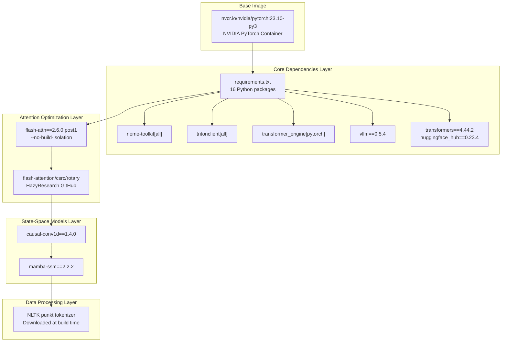
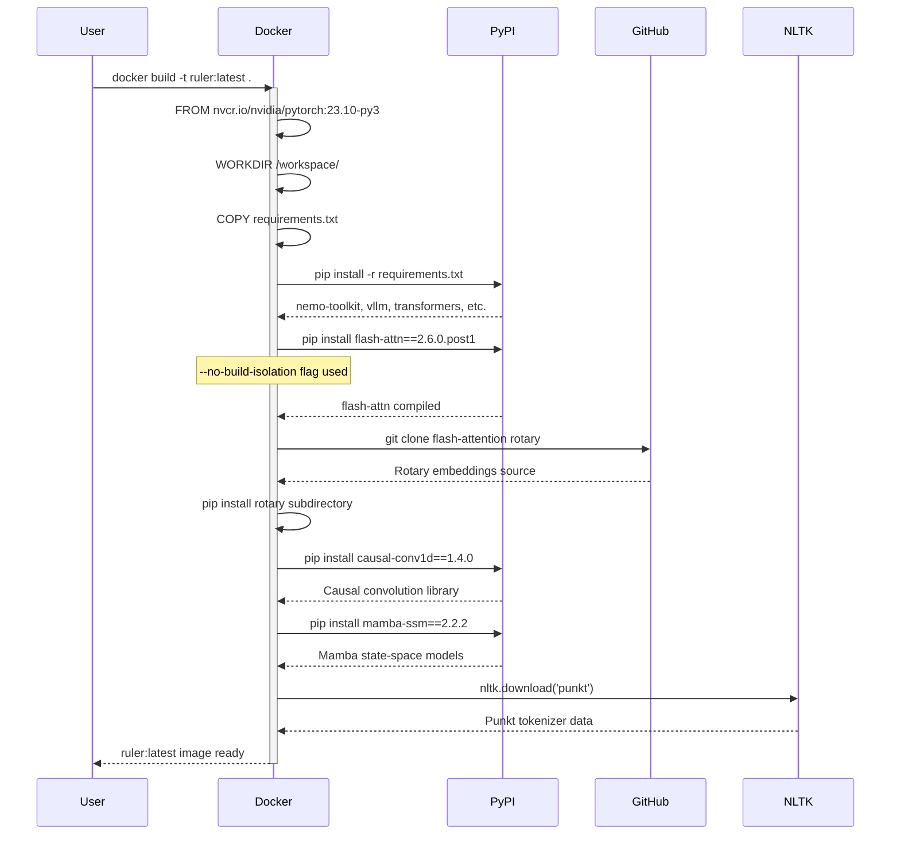

<!-- source: DeepWiki mcp.deepwiki.com · repo NVIDIA/RULER · page 5.1 Docker Environment · fetched 2026-10-26 -->

# Docker Environment

<details>
<summary>Relevant source files</summary>

The following files were used as context for generating this wiki page:

- [docker/Dockerfile](docker/Dockerfile)
- [docker/requirements.txt](docker/requirements.txt)

</details>


**Purpose**: This page documents the Docker container setup for RULER, including the base image, required dependencies, build process, and key package configurations. The Docker environment provides a reproducible execution environment with all necessary dependencies for running RULER benchmarks across multiple serving frameworks.

For information about actually running benchmarks in the Docker environment, see [Running Benchmarks](#5.2). For details on specific serving frameworks, see [Inference and Serving](#2.3).

---

## Docker Image Overview

RULER uses a containerized environment built on NVIDIA's PyTorch container to ensure consistent execution across different systems. The container includes dependencies for multiple inference frameworks, API clients, and data processing utilities.

### Base Image and Build Process



**Sources**: [docker/Dockerfile:1-29]()

The Dockerfile follows a layered installation approach:

1. **Base Layer**: NVIDIA PyTorch 23.10 container with CUDA support
2. **Core Dependencies**: Standard Python packages from requirements.txt
3. **Attention Optimizations**: Flash attention packages built from source
4. **State-Space Models**: Mamba-specific dependencies
5. **Data Processing**: NLTK data files

---

## Core Dependencies

The container includes dependencies organized by functional purpose:

| Category | Package | Version | Purpose |
|----------|---------|---------|---------|
| **Model Serving** | `vllm` | 0.5.4 | High-throughput inference server with PagedAttention |
| | `tritonclient[all]` | latest | Client for TensorRT-LLM serving |
| | `flask` | latest | REST API server for custom endpoints |
| | `flask_restful` | latest | RESTful API utilities |
| **Model Frameworks** | `nemo-toolkit[all]` | latest | NVIDIA's neural module toolkit |
| | `transformers` | 4.44.2 | HuggingFace transformer models |
| | `huggingface_hub` | 0.23.4 | Model repository access |
| | `accelerate` | latest | Multi-GPU and mixed precision support |
| **Optimization** | `transformer_engine[pytorch]` | latest | NVIDIA FP8 transformer optimization |
| | `flash-attn` | 2.6.0.post1 | Memory-efficient attention implementation |
| | `causal-conv1d` | 1.4.0 | Optimized convolutions for Mamba |
| | `mamba-ssm` | 2.2.2 | State-space model implementation |
| **External APIs** | `openai` | latest | OpenAI and Azure API client |
| | `tiktoken` | latest | OpenAI tokenizer |
| | `google-generativeai` | latest | Gemini API client |
| **Utilities** | `html2text` | latest | HTML to text conversion for data processing |
| | `wonderwords` | latest | Random word generation for synthetic tasks |
| | `tenacity` | latest | Retry logic for API calls |
| | `sshtunnel_requests` | latest | SSH tunneling for secure requests |

**Sources**: [docker/requirements.txt:1-16](), [docker/Dockerfile:20-25]()

---

## Building the Container

### Build Command

```bash
cd docker
docker build -t ruler:latest .
```

The build process performs the following steps in sequence:

1. **Pull base image**: Downloads `nvcr.io/nvidia/pytorch:23.10-py3`
2. **Install core dependencies**: Installs packages from `requirements.txt`
3. **Build Flash Attention**: Compiles `flash-attn==2.6.0.post1` without build isolation
4. **Install rotary embeddings**: Clones and installs HazyResearch's Flash Attention rotary implementation
5. **Install Mamba dependencies**: Installs `causal-conv1d` and `mamba-ssm`
6. **Download NLTK data**: Downloads punkt tokenizer for text processing

**Sources**: [docker/Dockerfile:15-28]()

### Build Process Flow



**Sources**: [docker/Dockerfile:19-28]()

---

## Key Package Details

### Inference Frameworks

**vLLM (0.5.4)**: High-throughput inference server used by RULER for local model serving. Provides PagedAttention for efficient memory management during long-context inference. RULER launches vLLM servers via `serve_vllm.py` for models configured with `MODEL_FRAMEWORK="vllm"`.

**NeMo Toolkit**: NVIDIA's neural module framework used for tokenization and model handling. RULER uses NeMo's tokenizer implementation for models with `TOKENIZER_TYPE="nemo"` in configuration.

**Transformers (4.44.2)**: HuggingFace's library for loading and running transformer models. RULER uses this for direct model inference with `MODEL_FRAMEWORK="hf"` and for tokenization across all frameworks.

**Sources**: [docker/requirements.txt:1-16]()

### Attention Optimization

**Flash Attention (2.6.0.post1)**: Memory-efficient attention implementation that reduces memory usage during attention computation. Critical for handling long contexts (4K-128K tokens) in RULER benchmarks. The `--no-build-isolation` flag ensures proper compilation against the container's CUDA libraries.

**Rotary Embeddings**: Custom rotary position embedding implementation from HazyResearch's Flash Attention repository. Installed from the `csrc/rotary` subdirectory to support models using rotary position embeddings.

**Sources**: [docker/Dockerfile:22-23]()

### State-Space Models

**Mamba-SSM (2.2.2)**: Implementation of Mamba state-space models, an alternative architecture to transformers. RULER supports Mamba models through dedicated model wrappers with `MODEL_FRAMEWORK="mamba"`.

**Causal-Conv1D (1.4.0)**: Optimized causal convolution operations required by Mamba models. Installed as a dependency before Mamba-SSM.

**Sources**: [docker/Dockerfile:24-25]()

### API Client Libraries

**OpenAI**: Client library for OpenAI and Azure OpenAI APIs. Used by `OpenAIClient` in `client_wrappers.py` for external model inference.

**Tiktoken**: OpenAI's tokenizer library, used for token counting when benchmarking OpenAI models.

**Google Generative AI**: Client for Google's Gemini API. Used by `GeminiClient` in `client_wrappers.py` for Gemini model inference.

**Sources**: [docker/requirements.txt:7-11]()

### Data Processing Utilities

**Wonderwords**: Random word generator used by synthetic task generators (e.g., `niah.py`, `variable_tracking.py`) to create vocabulary for test samples.

**HTML2Text**: Converts HTML to plain text, used for processing external data sources like Paul Graham essays.

**NLTK**: Natural Language Toolkit with punkt tokenizer downloaded at build time. Used for sentence segmentation during data generation.

**Sources**: [docker/requirements.txt:9](), [docker/Dockerfile:27]()

### Network and Retry Logic

**Tenacity**: Retry library used by API clients to handle transient failures during external API calls. Provides exponential backoff and retry strategies.

**SSHTunnel Requests**: Enables SSH tunneling for HTTP requests, useful for accessing models behind firewalls or in restricted network environments.

**Sources**: [docker/requirements.txt:12-13]()

---

## Container Usage

Once built, the container provides the complete environment for RULER execution:

```bash
# Run interactive shell
docker run --gpus all -it -v /path/to/models:/workspace/models ruler:latest bash

# Run RULER benchmark (example)
docker run --gpus all \
  -v /path/to/models:/workspace/models \
  -v /path/to/RULER:/workspace/RULER \
  ruler:latest \
  bash -c "cd /workspace/RULER && bash scripts/run.sh MODEL_NAME synthetic"
```

The working directory is set to `/workspace/`, which serves as the base for mounting external directories containing models and the RULER codebase.

**Sources**: [docker/Dockerfile:17]()

---

## Version Pinning Strategy

RULER pins critical packages to ensure reproducibility:

| Package | Version | Reason for Pinning |
|---------|---------|-------------------|
| `huggingface_hub` | 0.23.4 | API stability for model downloads |
| `transformers` | 4.44.2 | Model loading compatibility |
| `vllm` | 0.5.4 | Inference behavior consistency |
| `flash-attn` | 2.6.0.post1 | Attention kernel stability |
| `causal-conv1d` | 1.4.0 | Mamba compatibility |
| `mamba-ssm` | 2.2.2 | Model implementation stability |

Other packages use latest versions to incorporate bug fixes and improvements while maintaining compatibility with pinned versions.

**Sources**: [docker/requirements.txt:14-16](), [docker/Dockerfile:22-25]()

---

