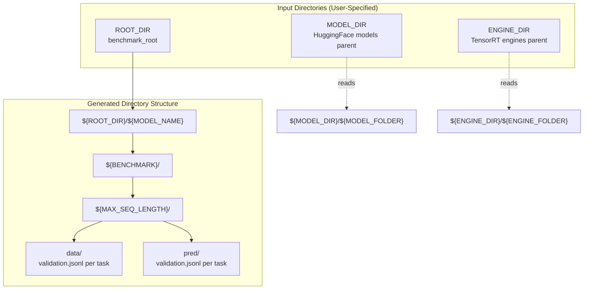
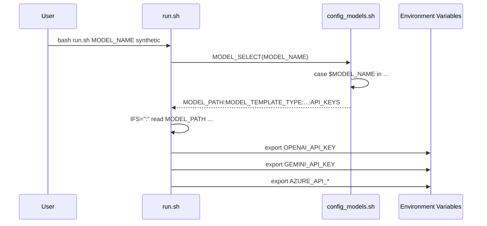
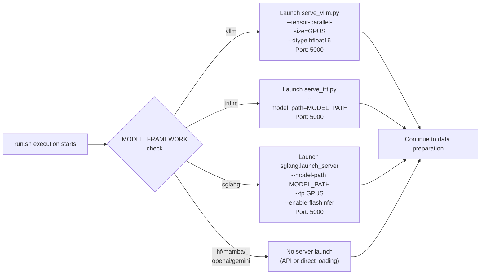
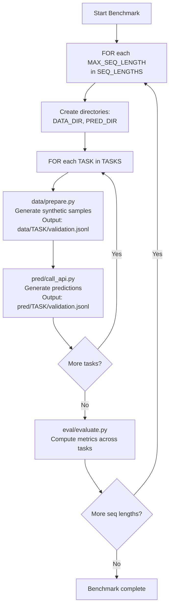

<!-- source: DeepWiki mcp.deepwiki.com · repo NVIDIA/RULER · page 5.2 Running Benchmarks · fetched 2026-10-26 -->

# Running Benchmarks

<details>
<summary>Relevant source files</summary>

The following files were used as context for generating this wiki page:

- [README.md](README.md)
- [scripts/run.sh](scripts/run.sh)

</details>


This page provides a step-by-step guide to executing RULER benchmarks. It covers setting environment variables, configuring models and tasks, executing the `run.sh` orchestration script, and monitoring benchmark progress. For Docker environment setup, see [Docker Environment](#5.1). For interpreting benchmark results, see [Understanding Results](#5.3).

## Prerequisites

Before running benchmarks, ensure:
1. Docker environment is set up (see [Docker Environment](#5.1))
2. Required data files are downloaded (Paul Graham essays, SQuAD, HotpotQA)
3. Model weights are available locally or API credentials are configured
4. Sufficient disk space for generated data and predictions

Sources: [README.md:78-91]()

## Configuration Setup

### Directory Structure and Environment Variables

The benchmark pipeline requires four primary directory variables to be configured in [scripts/run.sh:25-30]():

```bash
GPUS="1"                    # Number of GPUs for tensor parallelism
ROOT_DIR="benchmark_root"   # Root directory for outputs
MODEL_DIR="../.."           # Directory containing HuggingFace model folders
ENGINE_DIR="."              # Directory containing TensorRT-LLM engine folders
BATCH_SIZE=1                # Batch size for inference
```

**Directory Structure**:
- `ROOT_DIR`: Contains all generated data and predictions, organized as `${ROOT_DIR}/${MODEL_NAME}/${BENCHMARK}/${MAX_SEQ_LENGTH}/`
- `MODEL_DIR`: Parent directory containing individual model folders downloaded from HuggingFace
- `ENGINE_DIR`: Parent directory containing pre-built TensorRT-LLM engine folders

The benchmark creates the following subdirectory structure during execution:

```
ROOT_DIR/
└── ${MODEL_NAME}/
    └── ${BENCHMARK}/
        └── ${MAX_SEQ_LENGTH}/
            ├── data/          # Generated synthetic samples (validation.jsonl)
            └── pred/          # Model predictions (validation.jsonl)
```

Sources: [scripts/run.sh:25-30](), [scripts/run.sh:91-95]()



**Diagram: Directory Configuration and Output Structure**

Sources: [scripts/run.sh:91-95]()

### Model Configuration

Models are configured via the `MODEL_SELECT` function in [scripts/config_models.sh](). When `run.sh` is invoked with a model name, it calls this function to retrieve model-specific parameters:

```bash
bash run.sh YOUR_MODEL_NAME synthetic
```

The script parses the model configuration at [scripts/run.sh:34-41]():

```bash
MODEL_CONFIG=$(MODEL_SELECT ${MODEL_NAME} ${MODEL_DIR} ${ENGINE_DIR})
IFS=":" read MODEL_PATH MODEL_TEMPLATE_TYPE MODEL_FRAMEWORK \
    TOKENIZER_PATH TOKENIZER_TYPE OPENAI_API_KEY GEMINI_API_KEY \
    AZURE_ID AZURE_SECRET AZURE_ENDPOINT <<< "$MODEL_CONFIG"
```

**Configuration Fields**:

| Field | Purpose | Example Values |
|-------|---------|----------------|
| `MODEL_PATH` | Path to model weights or engine | `${MODEL_DIR}/meta-llama/Llama-2-7b-chat-hf` |
| `MODEL_TEMPLATE_TYPE` | Prompt template format | `base`, `meta-chat`, `mistral`, `gemma` |
| `MODEL_FRAMEWORK` | Inference backend | `vllm`, `trtllm`, `sglang`, `hf`, `mamba`, `openai`, `gemini` |
| `TOKENIZER_PATH` | Path to tokenizer | Same as `MODEL_PATH` for local models |
| `TOKENIZER_TYPE` | Tokenizer implementation | `nemo`, `hf`, `openai`, `gemini` |

For API-based models (OpenAI, Gemini, Azure), additional authentication fields are exported as environment variables at [scripts/run.sh:44-48]().

Sources: [scripts/run.sh:34-48](), [README.md:101-130]()



**Diagram: Model Configuration Loading Sequence**

Sources: [scripts/run.sh:34-48]()

### Task Configuration

Tasks are selected via the `BENCHMARK` argument and configured through two files:

1. **Task List**: [scripts/config_tasks.sh]() defines task arrays for each benchmark
2. **Task Parameters**: [scripts/synthetic.yaml]() defines complexity parameters per task

The script loads tasks at [scripts/run.sh:52-58]():

```bash
source config_tasks.sh
BENCHMARK=${2}  # e.g., "synthetic"
declare -n TASKS=$BENCHMARK  # References the array from config_tasks.sh
```

Additional configuration variables loaded from `config_tasks.sh`:

| Variable | Purpose | Typical Value |
|----------|---------|---------------|
| `SEQ_LENGTHS` | Array of sequence lengths to test | `(4096 8192 16384 32768 65536 131072)` |
| `NUM_SAMPLES` | Number of samples per task | `500` |
| `TEMPERATURE` | Sampling temperature | `0.0` (greedy decoding) |
| `TOP_K` | Top-k sampling parameter | `32` |
| `TOP_P` | Top-p (nucleus) sampling parameter | `1.0` |
| `REMOVE_NEWLINE_TAB` | Flag to remove newlines/tabs | `--remove_newline_tab` or empty |
| `STOP_WORDS` | Stop token specification | `--stop_words newline` or empty |

Sources: [scripts/run.sh:52-58](), [scripts/config_tasks.sh]()

## Executing the Benchmark Pipeline

### Basic Execution Command

The main entry point is [scripts/run.sh](). Execute with two arguments:

```bash
bash run.sh <MODEL_NAME> <BENCHMARK_NAME>
```

**Arguments**:
- `MODEL_NAME`: Must match a case in `config_models.sh` (e.g., `llama2-7b-chat`, `gpt-4`)
- `BENCHMARK_NAME`: Must match an array name in `config_tasks.sh` (e.g., `synthetic`)

**Example**:
```bash
bash scripts/run.sh llama2-7b-chat synthetic
```

The script validates inputs at [scripts/run.sh:19-22]() and [scripts/run.sh:38-41](), [scripts/run.sh:55-58]().

Sources: [scripts/run.sh:17-22](), [README.md:132-135]()

### Server Startup Process

For local inference frameworks (`vllm`, `trtllm`, `sglang`), `run.sh` automatically launches model servers in the background at [scripts/run.sh:62-84]():



**Diagram: Conditional Server Startup Based on MODEL_FRAMEWORK**

**Server Details**:

| Framework | Script | Port | Key Parameters |
|-----------|--------|------|----------------|
| vLLM | [pred/serve_vllm.py]() | 5000 | `--tensor-parallel-size`, `--dtype`, `--disable-custom-all-reduce` |
| TensorRT-LLM | [pred/serve_trt.py]() | 5000 | `--model_path` |
| SGLang | `sglang.launch_server` | 5000 | `--tp`, `--enable-flashinfer` |

The servers run in the background (`&` operator) throughout the entire benchmark execution. For HuggingFace and Mamba frameworks, models are loaded directly in `call_api.py` without separate servers. For OpenAI/Gemini, external APIs are used.

Sources: [scripts/run.sh:62-84]()

### Pipeline Execution Flow

The benchmark executes in nested loops over sequence lengths and tasks:



**Diagram: Nested Loop Execution Structure**

**Stage 1: Data Generation** [scripts/run.sh:98-107]()

For each task, `prepare.py` is invoked:
```bash
python data/prepare.py \
    --save_dir ${DATA_DIR} \
    --benchmark ${BENCHMARK} \
    --task ${TASK} \
    --tokenizer_path ${TOKENIZER_PATH} \
    --tokenizer_type ${TOKENIZER_TYPE} \
    --max_seq_length ${MAX_SEQ_LENGTH} \
    --model_template_type ${MODEL_TEMPLATE_TYPE} \
    --num_samples ${NUM_SAMPLES}
```

This generates `${DATA_DIR}/${TASK}/validation.jsonl` containing synthetic samples.

**Stage 2: Inference** [scripts/run.sh:109-122]()

For each task, `call_api.py` generates predictions:
```bash
python pred/call_api.py \
    --data_dir ${DATA_DIR} \
    --save_dir ${PRED_DIR} \
    --benchmark ${BENCHMARK} \
    --task ${TASK} \
    --server_type ${MODEL_FRAMEWORK} \
    --model_name_or_path ${MODEL_PATH} \
    --temperature ${TEMPERATURE} \
    --batch_size ${BATCH_SIZE}
```

Timing is tracked per task at [scripts/run.sh:109-124](), accumulating in `total_time`.

This produces `${PRED_DIR}/${TASK}/validation.jsonl` with model predictions.

**Stage 3: Evaluation** [scripts/run.sh:127-129]()

After all tasks complete for a sequence length, metrics are computed:
```bash
python eval/evaluate.py \
    --data_dir ${PRED_DIR} \
    --benchmark ${BENCHMARK}
```

This computes per-task scores and aggregate metrics.

Sources: [scripts/run.sh:88-132]()

## Monitoring Progress

### Console Output

The pipeline produces output from multiple stages:

**Data Generation**: Shows task-specific progress, e.g.:
- Sample count and binary search iterations for optimal haystack size
- Tokenization statistics
- File write confirmations

**Inference**: Shows:
- Batch processing progress
- Request/response counts
- Timing information (captured in `total_time` variable)

**Evaluation**: Displays:
- Per-task accuracy/scores
- Aggregate metrics
- Effective length determination (if 85.6% threshold is crossed)

The final line shows total inference time at [scripts/run.sh:132]():
```
Total time spent on call_api: $total_time seconds
```

Sources: [scripts/run.sh:109-132]()

### Directory Monitoring

Monitor benchmark progress by examining the output directory structure:

```bash
# Check what's been generated
ls -lR ${ROOT_DIR}/${MODEL_NAME}/${BENCHMARK}/

# View sample data for a task
head ${ROOT_DIR}/${MODEL_NAME}/${BENCHMARK}/4096/data/niah_multikey_1/validation.jsonl

# View predictions for a task
head ${ROOT_DIR}/${MODEL_NAME}/${BENCHMARK}/4096/pred/niah_multikey_1/validation.jsonl

# Check evaluation output (printed to console, not saved by default)
```

**Expected Files per Task**:
- `data/${TASK}/validation.jsonl`: Input samples (JSON lines format)
- `pred/${TASK}/validation.jsonl`: Predictions (JSON lines format with added `pred` field)

**File Format**: Each line is a JSON object with fields:
- Data files: `index`, `input`, `outputs`, `length`
- Prediction files: Same as data files plus `pred` (model's prediction)

Sources: [scripts/run.sh:91-95]()

### Troubleshooting Common Issues

**Server Launch Failures**:
- Check if port 5000 is already in use
- Verify GPU availability with `nvidia-smi`
- Check server logs (redirected to background process)
- For SGLang, use `sglang/test/killall_sglang.sh` if server hangs

**Out of Memory**:
- Reduce `BATCH_SIZE` in [scripts/run.sh:30]()
- Reduce `GPUS` (tensor parallelism) if model is large
- Use smaller `MAX_SEQ_LENGTH` values

**Model Not Found**:
- Verify `MODEL_NAME` exists in `config_models.sh`
- Check `MODEL_DIR` and `ENGINE_DIR` paths are correct
- Ensure model weights are downloaded to correct location

**Task Configuration Errors**:
- Verify task name matches entry in `synthetic.yaml`
- Check task is included in `TASKS` array in `config_tasks.sh`
- Ensure required data files (Paul Graham essays, QA datasets) are downloaded

Sources: [scripts/run.sh:62-84](), [README.md:78-91]()

### Execution Time Estimates

Benchmark execution time varies significantly based on:

| Factor | Impact |
|--------|--------|
| Sequence lengths | Linear with number of lengths in `SEQ_LENGTHS` |
| Number of tasks | Linear with size of `TASKS` array |
| Samples per task | Linear with `NUM_SAMPLES` |
| Model size | Scales with inference time per token |
| Batch size | Inversely proportional (higher is faster) |
| Framework | vLLM/TensorRT-LLM are typically faster than HF |

**Example**: For a 7B model on a single GPU:
- 13 tasks × 6 sequence lengths × 500 samples = 39,000 total samples
- At ~10 samples/minute: ~65 hours of continuous execution
- Increase `BATCH_SIZE` to reduce wall-clock time

Time tracking at [scripts/run.sh:109-124]() only measures `call_api.py` execution, not data generation or evaluation.

Sources: [scripts/run.sh:109-124](), [scripts/run.sh:30]()

---

