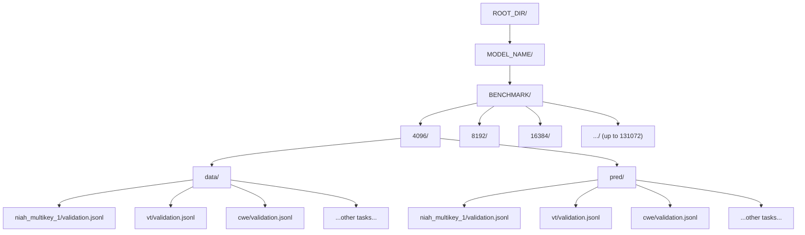
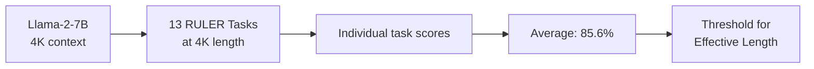
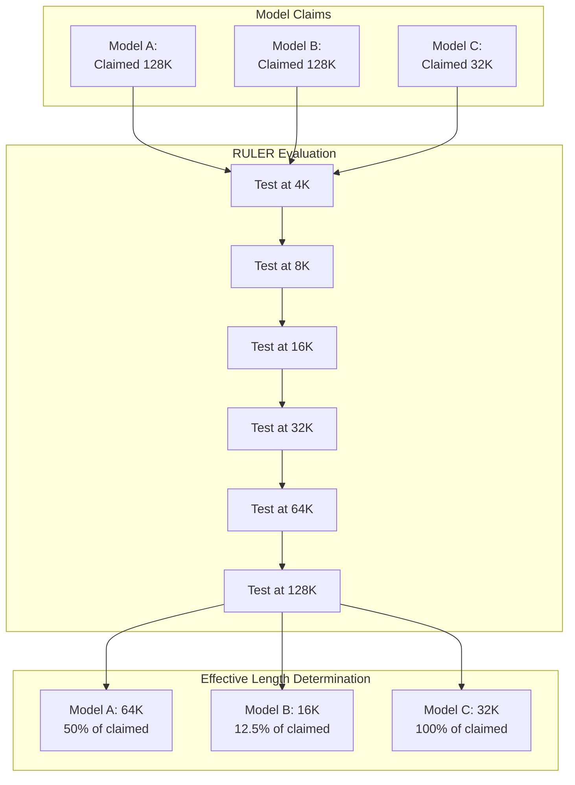
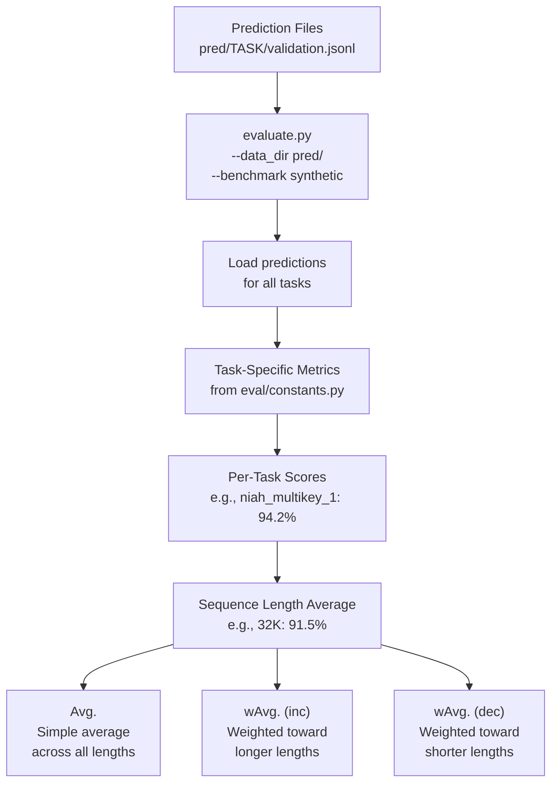
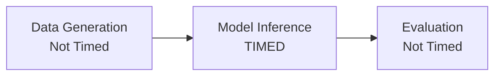

<!-- source: DeepWiki mcp.deepwiki.com · repo NVIDIA/RULER · page 5.3 Understanding Results · fetched 2026-10-26 -->

# Understanding Results

<details>
<summary>Relevant source files</summary>

The following files were used as context for generating this wiki page:

- [README.md](README.md)
- [scripts/run.sh](scripts/run.sh)

</details>


This page explains how to interpret RULER benchmark results, including output directory structure, performance metrics, the 85.6% threshold concept, and the distinction between claimed and effective context lengths. For information on running the benchmark pipeline, see [Running Benchmarks](#5.2). For details on the evaluation methodology itself, see [Evaluation System](#2.4).

## Purpose and Scope

After executing RULER benchmarks via `run.sh`, the system generates predictions and computes performance scores across multiple sequence lengths and tasks. This page documents:

- The directory structure of generated outputs
- How to interpret the 85.6% performance threshold
- The distinction between claimed length and effective length
- Result file formats and their contents
- How scores are aggregated across tasks and sequence lengths

## Output Directory Structure

RULER organizes results hierarchically by model, benchmark, sequence length, and processing stage. The root directory is specified by the `ROOT_DIR` variable in `run.sh`.



**Directory Hierarchy Overview**

Sources: [scripts/run.sh:91-95]()

### Data Directory Contents

The `data/` subdirectory contains generated synthetic samples for each task. Each task has its own folder with a `validation.jsonl` file.

**JSONL Record Structure (Data)**:
```json
{
  "index": 0,
  "input": "System prompt and task context...",
  "outputs": ["expected_answer1", "expected_answer2"],
  "length": 8192
}
```

| Field | Description |
|-------|-------------|
| `index` | Sequential sample identifier |
| `input` | Complete formatted prompt including template, haystack, and question |
| `outputs` | List of ground truth answers (may contain multiple valid answers) |
| `length` | Actual token count of the input |

Sources: [scripts/data/prepare.py](), [scripts/data/synthetic/manifest_utils.py]()

### Prediction Directory Contents

The `pred/` subdirectory contains model predictions for each task, mirroring the structure of the `data/` directory.

**JSONL Record Structure (Predictions)**:
```json
{
  "index": 0,
  "input": "System prompt and task context...",
  "outputs": ["expected_answer1", "expected_answer2"],
  "pred": "model_generated_answer",
  "length": 8192
}
```

| Field | Description |
|-------|-------------|
| `index` | Sample identifier matching data file |
| `input` | Original input prompt (copied from data) |
| `outputs` | Ground truth answers (copied from data) |
| `pred` | Model's generated response |
| `length` | Token count (copied from data) |

The `pred` field contains the raw output from the model after stop token truncation and post-processing.

Sources: [scripts/pred/call_api.py](), [scripts/pred/client_wrappers.py](), [scripts/pred/model_wrappers.py]()

## The 85.6% Threshold

RULER uses a qualitative performance threshold to determine effective context length. This threshold is derived from **Llama-2-7B's average performance at 4K sequence length**, which represents a baseline for acceptable long-context capability.

### Threshold Derivation



**Rationale**: Llama-2-7B is a well-studied model with a claimed 4K context window. At this length, the model demonstrates competent performance across RULER's task categories. Any model that cannot exceed 85.6% at longer sequence lengths is considered to have degraded below acceptable performance, indicating the context length is not effectively utilized.

Sources: [README.md:7](), [README.md:54]()

### Threshold Application in Results

In the main results table (README.md), performance scores that exceed 85.6% are underlined. This visual indicator shows which sequence lengths a model can effectively handle.

**Example Interpretation**:

| Model | Claimed Length | 4K | 8K | 16K | 32K | 64K | 128K | Effective Length |
|-------|----------------|----|----|-----|-----|-----|------|------------------|
| Model A | 128K | <ins>96.5</ins> | <ins>95.8</ins> | <ins>90.2</ins> | <ins>87.0</ins> | 80.1 | 65.3 | 32K |
| Model B | 128K | <ins>95.1</ins> | <ins>93.2</ins> | 83.5 | 75.2 | 60.8 | 45.1 | 8K |

- **Model A**: Maintains >85.6% performance through 32K, so its effective length is 32K
- **Model B**: Drops below threshold after 8K, so its effective length is 8K

Sources: [README.md:5-51](), [README.md:53-55]()

## Effective Length vs Claimed Length

One of RULER's key findings is the discrepancy between claimed context window sizes and actual effective lengths.



### Key Findings

From the main results table:

1. **Large gaps are common**: Most models claiming 128K context can only effectively handle 32K-64K
2. **Some models meet claims**: A few models (Jamba-1.5-large, Gemini-1.5-pro, several Qwen models) maintain >85.6% at or beyond their claimed lengths
3. **Catastrophic drops**: Some models (DBRX, Qwen1.5-72B) show near-zero performance well before claimed length
4. **Threshold position matters**: The last sequence length where performance exceeds 85.6% defines the effective length

Sources: [README.md:5-51](), [README.md:53-55]()

### Why Claimed Length Differs from Effective Length

Several technical factors contribute to this gap:

| Factor | Impact |
|--------|--------|
| **Training distribution** | Models may be trained primarily on shorter sequences despite positional encoding support |
| **Position interpolation** | RoPE and other position embedding schemes may not extrapolate well |
| **Attention degradation** | Quality of attention distributions may degrade at longer distances |
| **Task complexity** | Simple retrieval (NIAH) may succeed while aggregation/reasoning fails |

RULER's multi-task design reveals these limitations by testing beyond simple needle-in-a-haystack scenarios.

Sources: [README.md:53-55]()

## Interpreting Performance Scores

RULER reports three types of aggregated scores in the main results table, plus per-task and per-length scores in detailed outputs.

### Score Computation Flow



Sources: [scripts/eval/evaluate.py](), [scripts/run.sh:127-129]()

### Per-Task Metrics

Each task uses a task-specific evaluation metric defined in `eval/constants.py`. Common metric types:

| Task Type | Metric | Description |
|-----------|--------|-------------|
| NIAH variants | Exact match | Checks if predicted key-value pairs match ground truth |
| Variable Tracking | Exact match | Verifies correct final variable value |
| Common/Freq Words | Set F1 score | Measures overlap between predicted and ground truth word sets |
| QA (SQuAD/HotpotQA) | Token F1 | Computes word-level F1 between prediction and reference answers |

Scores are computed per sample, then averaged across all samples for that task at that sequence length.

Sources: [scripts/eval/synthetic/constants.py]()

### Sequence Length Averages

For each sequence length (4K, 8K, 16K, 32K, 64K, 128K), RULER computes the average score across all 13 tasks:

```
Avg_32K = (score_niah_multikey_1 + score_niah_multikey_2 + ... + score_qa_2) / 13
```

These averages appear as columns in the main results table.

### Overall Aggregation Methods

RULER reports three different aggregations across sequence lengths:

**1. Simple Average (Avg.)**
```
Avg = (Avg_4K + Avg_8K + Avg_16K + Avg_32K + Avg_64K + Avg_128K) / 6
```
Equal weight to all sequence lengths, regardless of model's strengths.

**2. Weighted Average - Increasing (wAvg. inc)**

Assigns higher weight to longer sequence lengths, reflecting the importance of long-context capability:

```
wAvg_inc = (1×Avg_4K + 2×Avg_8K + 3×Avg_16K + 4×Avg_32K + 5×Avg_64K + 6×Avg_128K) / 21
```

This metric favors models that maintain performance at extreme lengths.

**3. Weighted Average - Decreasing (wAvg. dec)**

Assigns higher weight to shorter sequence lengths, reflecting the importance of baseline capability:

```
wAvg_dec = (6×Avg_4K + 5×Avg_8K + 4×Avg_16K + 3×Avg_32K + 2×Avg_64K + 1×Avg_128K) / 21
```

This metric favors models that excel at shorter lengths even if they degrade at longer ones.

**Interpretation**: Comparing wAvg. inc and wAvg. dec reveals different performance profiles:
- **wAvg. inc >> wAvg. dec**: Model maintains quality at long contexts
- **wAvg. dec >> wAvg. inc**: Model excels at short contexts but degrades quickly

Sources: [README.md:5-51]()

## Result File Formats

### Console Output Format

When `evaluate.py` completes, it prints a formatted table to the console:

```
Benchmark: synthetic

Task                      | Score
--------------------------|--------
niah_multikey_1          | 95.2
niah_multikey_2          | 93.8
niah_multikey_3          | 92.1
niah_multivalue_1        | 94.5
niah_multivalue_2        | 91.7
...
vt                       | 88.3
cwe                      | 85.1
fwe                      | 82.9
qa_1                     | 90.4
qa_2                     | 89.1
--------------------------|--------
Average                  | 90.6
```

This output is generated for each sequence length directory during the pipeline execution.

Sources: [scripts/eval/evaluate.py](), [scripts/run.sh:127-129]()

### Detailed Results Structure

After running the full pipeline, results are organized as:

```
ROOT_DIR/
└── MODEL_NAME/
    └── BENCHMARK/
        ├── 4096/
        │   ├── data/
        │   │   ├── niah_multikey_1/validation.jsonl
        │   │   ├── niah_multikey_2/validation.jsonl
        │   │   └── ...
        │   └── pred/
        │       ├── niah_multikey_1/validation.jsonl (with 'pred' field)
        │       ├── niah_multikey_2/validation.jsonl (with 'pred' field)
        │       └── ...
        ├── 8192/
        │   └── ...
        ├── 16384/
        │   └── ...
        ├── 32768/
        │   └── ...
        ├── 65536/
        │   └── ...
        └── 131072/
            └── ...
```

Each `validation.jsonl` file in the `pred/` directories contains the full predictions that can be manually inspected or re-evaluated with different metrics.

Sources: [scripts/run.sh:91-95]()

## Analyzing Results: Practical Examples

### Example 1: Identifying Effective Length

To determine a model's effective length:

1. **Locate the prediction directories**:
   ```
   ROOT_DIR/your-model/synthetic/*/pred/
   ```

2. **Review console output** from each sequence length run:
   - Look for the "Average" score printed by `evaluate.py`
   - Identify the last length where Average > 85.6%

3. **Compare with claimed length**:
   - Check the model's documentation for claimed context window
   - Calculate the ratio: effective_length / claimed_length

### Example 2: Task-Level Analysis

To understand which tasks cause performance degradation:

1. **Compare scores across lengths** for a specific task:
   ```
   grep "niah_multikey_3" ROOT_DIR/your-model/synthetic/*/pred/*.log
   ```

2. **Identify weak tasks**:
   - Tasks that drop below 85.6% first indicate model weaknesses
   - Common patterns:
     - **Aggregation tasks** (cwe, fwe) often degrade faster
     - **Multi-hop tasks** (vt with high hop counts) challenge reasoning
     - **QA tasks** require both retrieval and comprehension

3. **Inspect failure cases**:
   - Open `pred/TASK/validation.jsonl` files directly
   - Compare `pred` field with `outputs` field for samples where the model failed

Sources: [scripts/eval/evaluate.py](), [scripts/eval/synthetic/constants.py]()

### Example 3: Comparing Models

When comparing multiple models, use the wAvg scores for different perspectives:

| Metric | Best For |
|--------|----------|
| **Avg.** | Overall capability without bias toward length |
| **wAvg. (inc)** | Ranking models for long-context applications (e.g., document analysis) |
| **wAvg. (dec)** | Ranking models for applications with mixed context lengths |

Check the main results table to identify which models maintain consistent performance versus those that excel only at shorter lengths.

Sources: [README.md:5-51]()

## Understanding Timing Information

The pipeline prints total inference time at completion:

```bash
Total time spent on call_api: 1847 seconds
```

This measures only the time spent in `call_api.py` making inference requests, excluding:
- Data generation time
- Server startup time
- Evaluation computation time

**Timing Breakdown**:


The timing is accumulated across all tasks and sequence lengths, providing a measure of total computational cost for the benchmark run.

Sources: [scripts/run.sh:88](), [scripts/run.sh:109-124](), [scripts/run.sh:132]()

## Common Result Patterns

Based on the main results table, several patterns emerge:

### Pattern 1: Rapid Degradation After Claimed Length

Models like Qwen1.5-72B and DBRX show near-zero performance beyond their claimed length despite using positional encoding schemes that theoretically support extrapolation.

### Pattern 2: Gradual Decline

Models like Llama3.1-70B maintain >85.6% through 64K but drop to 66.6% at 128K, showing more graceful degradation.

### Pattern 3: Sustained Performance

Models like Jamba-1.5-large and Gemini-1.5-pro maintain >94% across all tested lengths, indicating robust long-context capabilities.

### Pattern 4: Short Context Specialists

Models like InternLM2.5 perform well only at 4K despite claiming 1M context, suggesting insufficient long-context training.

These patterns help identify which models are suitable for different application requirements.

Sources: [README.md:5-51](), [README.md:53-55]()

---

