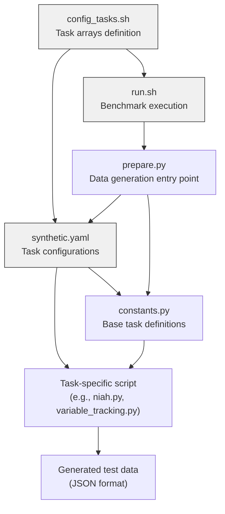
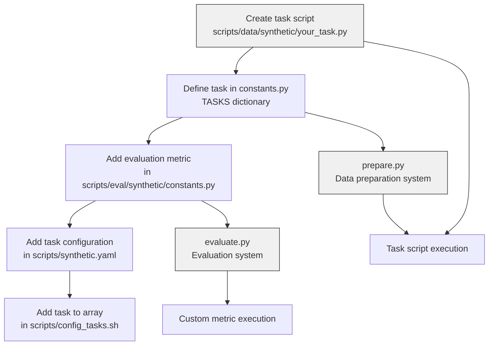
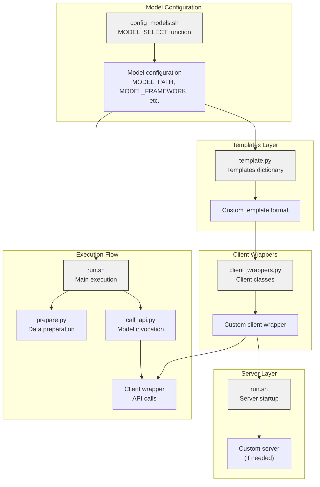
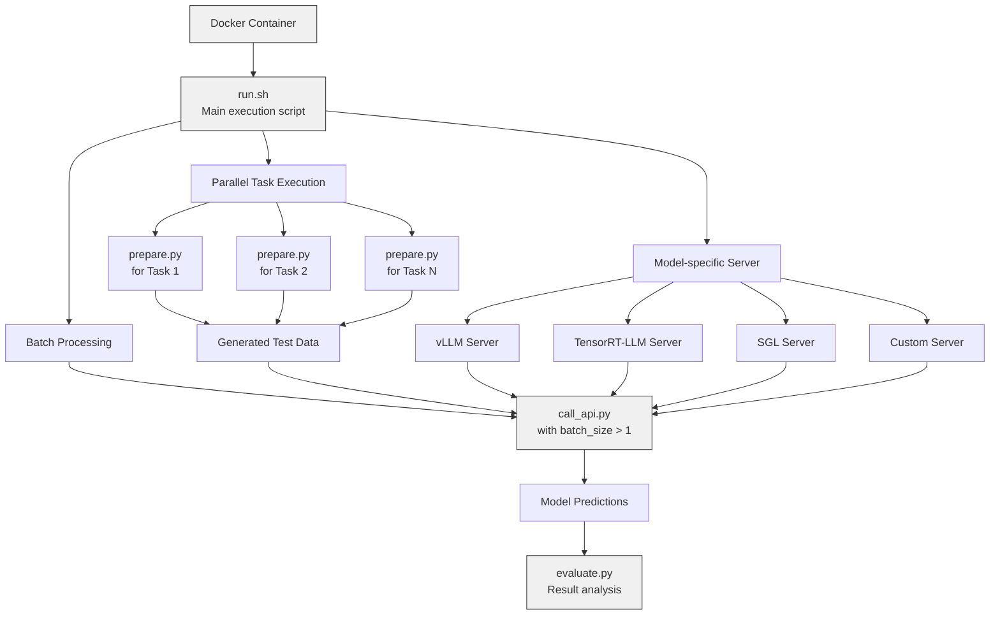

<!-- source: DeepWiki mcp.deepwiki.com · repo NVIDIA/RULER · page 6 Extending RULER · fetched 2026-10-26 -->

# Advanced Topics

<details>
<summary>Relevant source files</summary>

The following files were used as context for generating this wiki page:

- [README.md](README.md)
- [scripts/data/prepare.py](scripts/data/prepare.py)

</details>


This document covers advanced usage and customization of the RULER benchmark system, focusing on extending its capabilities with custom tasks and models. These topics are intended for users who want to adapt RULER for specialized evaluation needs beyond the provided benchmark tasks. For basic setup and usage information, see [Setup and Usage](#5).

## Customizing Task Complexity

RULER allows fine-grained control over task complexity through configuration parameters. Each task type has specific parameters that can be adjusted to increase or decrease difficulty.

Task complexity configurations are defined in `scripts/synthetic.yaml` and referenced in `scripts/config_tasks.sh`. The following table summarizes the key parameters for each task type:

| Task Type | Parameter | Description | Effect on Difficulty |
|-----------|-----------|-------------|---------------------|
| Needle-in-a-Haystack | `type_haystack` | Type of content containing the needle (`repeat`, `essay`, `needle`) | `needle` > `essay` > `repeat` |
| | `type_needle_k`, `type_needle_v` | Type of needles to find (`words`, `numbers`, `uuids`) | `uuids` > `numbers` > `words` |
| | `num_needle_k` | Number of needles in haystack | Higher = more difficult |
| | `num_needle_v` | Values to retrieve per key | Higher = more difficult |
| | `num_needle_q` | Keys to query | Higher = more difficult |
| Variable Tracking | `num_chains` | Number of variable binding chains | Higher = more difficult |
| | `num_hops` | Number of hops per chain | Higher = more difficult |
| Common Words Extraction | `freq_cw` | Frequency of common words | Lower = more difficult |
| | `freq_ucw` | Frequency of uncommon words | Higher = more difficult |
| | `num_cw` | Number of common words to extract | Higher = more difficult |
| Frequent Words Extraction | `alpha` | Distribution parameter for word frequency | Lower = more difficult |
| Question Answering | `dataset` | Source dataset (`squad`, `hotpotqa`) | `hotpotqa` > `squad` |

To customize task complexity, modify the corresponding parameters in `scripts/synthetic.yaml`:

```yaml
your_custom_task:
  task: niah  # Base task type
  args:
    type_haystack: essay
    type_needle_k: uuids
    type_needle_v: uuids
    num_needle_k: 5
    num_needle_v: 3
    num_needle_q: 2
```

After modifying the configuration, add your task to the appropriate array in `scripts/config_tasks.sh`.

Sources: [README.md:120-130](), [scripts/data/prepare.py:68-82](), [scripts/run.sh:52-58]()

## Task Configuration Flow



Sources: [scripts/data/prepare.py:65-82](), [scripts/run.sh:52-58](), [README.md:120-130]()

## Adding Custom Tasks

RULER can be extended with custom tasks to evaluate specific model capabilities. The process involves creating data generation scripts, defining templates, implementing evaluation metrics, and adding configuration entries.

### 1. Create a Data Preparation Script

Create a Python script in the `scripts/data/synthetic/` directory. This script should:

- Accept standard arguments like `--save_dir`, `--tokenizer_path`, `--max_seq_length`
- Include specific complexity parameters for your task
- Generate synthetic data in a reproducible manner
- Output JSON files with `input` and `outputs` fields

Example script structure:

```python
def parse_args():
    parser = argparse.ArgumentParser()
    # Add standard arguments
    parser.add_argument("--save_dir", type=Path, required=True)
    parser.add_argument("--tokenizer_path", type=str, required=True)
    parser.add_argument("--max_seq_length", type=int, required=True)
    # Add task-specific arguments
    parser.add_argument("--custom_parameter", type=int, default=1)
    return parser.parse_args()

def generate_sample(args):
    # Generate a synthetic sample
    return {"input": input_text, "outputs": [expected_output]}

def main():
    args = parse_args()
    # Generate data
    data = [generate_sample(args) for _ in range(args.num_samples)]
    # Save results
    save_jsonl(data, args.save_dir / args.save_name / f"{args.subset}.jsonl")
```

### 2. Add Task Templates

Add your task template and configuration to `scripts/data/synthetic/constants.py`:

```python
TASKS = {
    "your_custom_task": {
        "template": "Your task description: {context}\n\nYour query: {query}",
        "tokens_to_generate": 50,
        "answer_prefix": "Answer:",
    },
    # existing tasks...
}
```

The template should include placeholders for the context and query, which will be replaced by your data generation script.

### 3. Add Evaluation Metric

Define an evaluation metric for your task in `scripts/eval/synthetic/constants.py`:

```python
METRICS = {
    "your_custom_task": {
        "metric": YourMetricFunction,
        "args": {"additional_args": value},
    },
    # existing metrics...
}
```

The metric function should calculate a score between the model's prediction and the ground truth.

### 4. Add Configuration

Add your task configuration to `scripts/synthetic.yaml`:

```yaml
your_custom_task_config:
  task: your_custom_task
  args:
    custom_parameter: 5
    # other parameters...
```

Finally, add your task to the appropriate array in `scripts/config_tasks.sh`.

Sources: [README.md:133-148](), [scripts/data/prepare.py:1-150]()

## Task Creation Workflow



Sources: [README.md:133-148](), [scripts/data/prepare.py:97-140]()

## Adding Custom Models

RULER supports multiple model types including local HuggingFace models, TensorRT-LLM engines, and API-based services. You can extend RULER to support custom models by following these steps.

### 1. Update Model Configuration

Modify `scripts/config_models.sh` to add your custom model:

```bash
case $MODEL_NAME in
    YOUR_CUSTOM_MODEL)
        MODEL_PATH=/path/to/your/model
        MODEL_TEMPLATE_TYPE="your_template_type"
        MODEL_FRAMEWORK="your_framework"
        TOKENIZER_PATH=/path/to/tokenizer
        TOKENIZER_TYPE="tokenizer_type"
        ;;
    # existing models...
esac
```

The key components are:
- `MODEL_PATH`: Path to your model or model identifier
- `MODEL_TEMPLATE_TYPE`: Template format for your model (defined in `scripts/data/template.py`)
- `MODEL_FRAMEWORK`: Framework for serving your model (e.g., `hf`, `vllm`, `trtllm`, `openai`, `gemini`, or a custom one)
- `TOKENIZER_PATH`: Path to your tokenizer
- `TOKENIZER_TYPE`: Type of tokenizer (e.g., `hf`, `nemo`, `openai`)

### 2. Add Custom Template

If your model requires a specific prompt template, add it to `scripts/data/template.py`:

```python
Templates = {
    "your_template_type": """Your custom template format with {task_template} placeholder""",
    # existing templates...
}
```

The template should include a `{task_template}` placeholder where the task-specific template will be inserted.

### 3. Create Client Wrapper

If your model uses a custom serving framework, create a client wrapper in `scripts/pred/client_wrappers.py`:

```python
class YourCustomClient(BaseClient):
    def __init__(self, model_name_or_path, **kwargs):
        super().__init__(model_name_or_path, **kwargs)
        # Initialize your client
        
    def generate(self, inputs, **kwargs):
        # Implement generation logic
        # Return generated text
```

### 4. Update Server Startup (Optional)

If your model requires a custom server, modify `scripts/run.sh` to start it:

```bash
elif [ "$MODEL_FRAMEWORK" == "your_framework" ]; then
    python pred/serve_your_framework.py \
        --model=${MODEL_PATH} \
        --your_custom_args \
        &
fi
```

Sources: [README.md:84-113](), [scripts/run.sh:61-84]()

## Model Integration Architecture



Sources: [scripts/run.sh:33-48](), [scripts/run.sh:61-84](), [README.md:84-113]()

## Performance Optimization

RULER can be optimized for faster execution and more efficient resource usage through several configuration options.

### Batch Processing

Increase the batch size in `scripts/run.sh` to process multiple samples in parallel:

```bash
BATCH_SIZE=8  # Adjust based on your GPU memory
```

Higher batch sizes typically improve GPU utilization but require more memory.

### Parallelizing Across Tasks

You can parallelize the execution of different tasks by modifying the loop in `scripts/run.sh` to use GNU Parallel or a similar tool:

```bash
echo "${TASKS[@]}" | tr ' ' '\n' | parallel -j N "python data/prepare.py --task {} ..."
```

Replace `N` with the number of parallel processes you want to run.

### GPU Configuration

For models that support tensor parallelism, adjust the `GPUS` variable in `scripts/run.sh`:

```bash
GPUS="2"  # Number of GPUs for tensor parallelism
```

This is particularly useful for large models that don't fit in a single GPU's memory.

### Docker Resource Allocation

When running in Docker, allocate appropriate resources:

```bash
docker run --gpus all --shm-size=16g --ulimit memlock=-1 --ulimit stack=67108864 -it your_image
```

Increasing shared memory (`--shm-size`) and memory limits can prevent out-of-memory errors when running large models or processing many samples in parallel.

Sources: [scripts/run.sh:26-30](), [scripts/run.sh:110-121]()

## Advanced Execution Options



Sources: [scripts/run.sh:61-84](), [scripts/run.sh:88-132]()

## Debugging and Troubleshooting

When developing custom tasks or integrating new models, you may encounter issues. Here are some troubleshooting strategies:

### Validating Data Generation

To validate that your task generates correct data:

1. Run the prepare script with a small number of samples:
   ```
   python data/prepare.py --save_dir ./debug --benchmark synthetic --task your_task --num_samples 2
   ```

2. Inspect the generated JSON files to ensure they have the correct format and content.

### Debugging Model Integration

For issues with model integration:

1. Test the server in isolation:
   ```
   python pred/serve_your_framework.py --model=/path/to/model
   ```

2. Try a simple inference request to verify basic functionality:
   ```
   curl -X POST http://localhost:8000/generate -H "Content-Type: application/json" -d '{"prompt": "Hello", "max_tokens": 10}'
   ```

3. Check server logs for error messages related to model loading or inference.

### Performance Analysis

To diagnose performance issues:

1. Enable more verbose logging in your scripts
2. Profile GPU memory usage with `nvidia-smi` during execution
3. Monitor CPU and memory usage with `top` or `htop`
4. Use smaller sequence lengths for initial testing

Sources: [scripts/run.sh:97-107](), [scripts/run.sh:110-125]()

---

