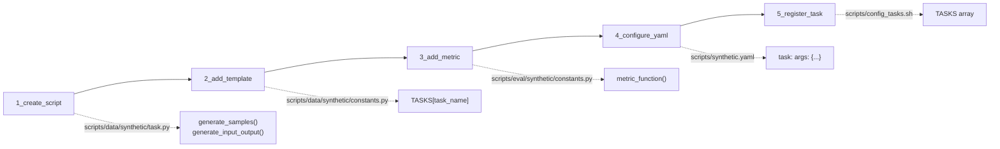
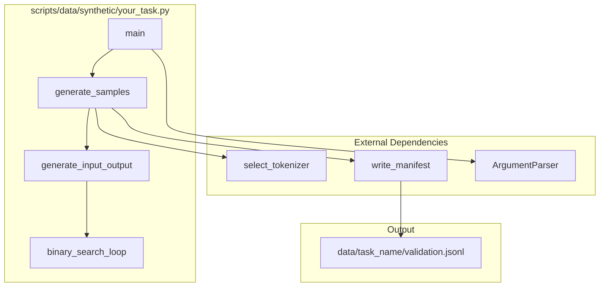
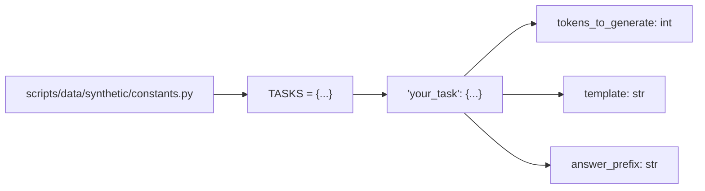
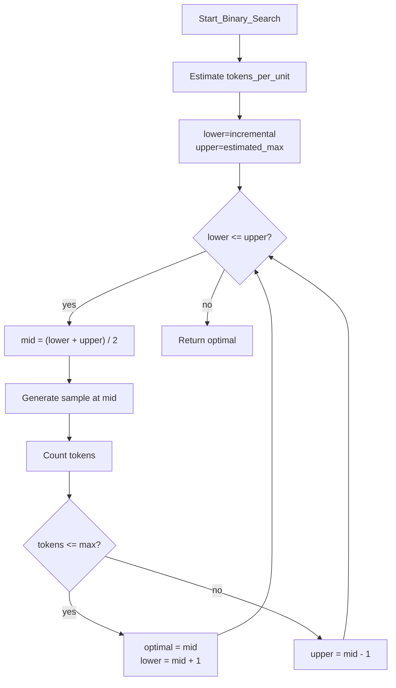
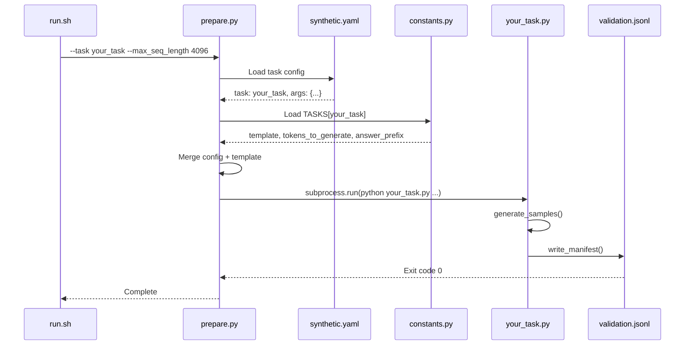
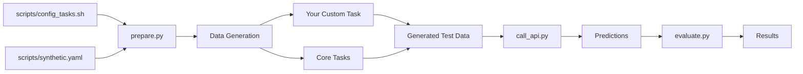

<!-- source: DeepWiki mcp.deepwiki.com · repo NVIDIA/RULER · page 6.1 Adding Custom Tasks · fetched 2026-10-26 -->

# Adding Custom Tasks

<details>
<summary>Relevant source files</summary>

The following files were used as context for generating this wiki page:

- [README.md](README.md)
- [scripts/data/manifest_utils.py](scripts/data/manifest_utils.py)
- [scripts/data/prepare.py](scripts/data/prepare.py)
- [scripts/data/synthetic/niah.py](scripts/data/synthetic/niah.py)

</details>


This page provides a technical guide for extending RULER with custom synthetic evaluation tasks. The process involves creating a data generation script, defining templates and metrics, and registering the task in the configuration system. For adding custom models, see page 6.2.

## Five-Step Integration Process

Adding a new task to RULER follows a standardized five-step workflow:

**Task Integration Workflow**


Sources: [README.md:150-166]()

## RULER Task Categories

RULER organizes tasks into four categories based on the capabilities they evaluate:

| Category | Tasks | Implementation Files |
|----------|-------|---------------------|
| Retrieval | NIAH variants | `niah.py` |
| Multi-hop Tracing | Variable Tracking | `variable_tracking.py` |
| Aggregation | Common Words, Frequent Words | `common_words_extraction.py`, `freq_words_extraction.py` |
| Question Answering | SQuAD, HotpotQA | `qa.py` |

Sources: [README.md:140-147]()

## Step 1: Create Data Generation Script

Create a Python script in `scripts/data/synthetic/` that generates synthetic examples. The script must implement a standardized interface that `prepare.py` can invoke.

**Task Script Architecture**


Sources: [scripts/data/synthetic/niah.py:1-310](), [scripts/data/prepare.py:121-158]()

### Required Arguments

Every task script must accept these standard command-line arguments:

**Required Arguments Table**

| Argument | Type | Purpose | Example |
|----------|------|---------|---------|
| `--save_dir` | Path | Output directory | `./data` |
| `--save_name` | str | Task identifier | `niah_single_1` |
| `--tokenizer_path` | str | Path to tokenizer | `tokenizer.model` |
| `--tokenizer_type` | str | Tokenizer framework | `nemo`, `hf`, `openai`, `gemini` |
| `--max_seq_length` | int | Maximum tokens (input + generation) | `4096` |
| `--tokens_to_generate` | int | Expected generation length | `128` |
| `--num_samples` | int | Number of examples | `500` |
| `--random_seed` | int | Reproducibility seed | `42` |
| `--template` | str | Prompt template with placeholders | See below |

Sources: [scripts/data/synthetic/niah.py:51-63]()

### Task-Specific Complexity Arguments

Beyond required arguments, define parameters that control task difficulty. These are task-specific and passed via `synthetic.yaml`.

**Example: NIAH Task Parameters**
```python
parser.add_argument("--num_needle_k", type=int, default=1)
parser.add_argument("--num_needle_v", type=int, default=1)
parser.add_argument("--num_needle_q", type=int, default=1)
parser.add_argument("--type_haystack", type=str, default='essay')
parser.add_argument("--type_needle_k", type=str, default='words')
parser.add_argument("--type_needle_v", type=str, default='numbers')
```

Sources: [scripts/data/synthetic/niah.py:66-72]()

### Core Functions to Implement

Each task script must implement two key functions:

**Function: `generate_input_output()`**
- Creates a single synthetic example
- Returns `(input_text, expected_outputs)`
- Must be deterministic given the random seed

**Function: `generate_samples(num_samples, max_seq_length, save_dir)`**
- Orchestrates generation of all examples
- Uses binary search to maximize context utilization
- Returns list of formatted dictionaries

Sources: [scripts/data/synthetic/niah.py:130-207](), [scripts/data/synthetic/niah.py:209-294]()

### Output Format

The script must write JSONL where each line is a JSON object with this schema:

```json
{
    "index": 0,
    "input": "prompt text without answer prefix",
    "outputs": ["expected", "answer", "tokens"],
    "length": 4096,
    "answer_prefix": " The answer is"
}
```

The `write_manifest()` function from `manifest_utils.py` handles serialization.

Sources: [scripts/data/synthetic/niah.py:283-292](), [scripts/data/manifest_utils.py:18-32]()

## Step 2: Define Task Template

Add an entry to the `TASKS` dictionary in `scripts/data/synthetic/constants.py`. This defines the prompt structure and generation parameters.

**Template Structure in constants.py**


**Example Entry**
```python
TASKS = {
    'your_task': {
        'tokens_to_generate': 128,
        'template': """Instructions for the task.
{context}
Question: {query}""",
        'answer_prefix': """ Answer:"""
    }
}
```

**Template Placeholders**
- `{context}`: Will contain the generated task context
- `{query}`: Will contain the question/prompt
- Additional placeholders can be added for task-specific needs

The `answer_prefix` prevents models from refusing to answer and helps with parsing.

Sources: [scripts/data/prepare.py:96-102](), [README.md:156-159]()

## Step 3: Implement Evaluation Metric

Add a scoring function to `scripts/eval/synthetic/constants.py` that compares model predictions to expected outputs.

**Metric Function Signature**
```python
def your_task_metric(prediction: str, ground_truth: List[str]) -> float:
    """
    Args:
        prediction: Model's generated output
        ground_truth: List of acceptable answers
    
    Returns:
        Score between 0.0 and 1.0
    """
    # Implement scoring logic
    pass
```

The metric function is called by `evaluate.py` for each prediction. Common patterns include exact match, F1 score, or custom logic.

Sources: [README.md:160-161]()

## Step 4: Configure Task Parameters

Define your task's complexity parameters in `scripts/synthetic.yaml`. This file maps task names to their configuration.

**YAML Configuration Format**
```yaml
your_task_variant_1:
  task: your_task  # Maps to script name and TASKS key
  args:
    param1: value1
    param2: value2
    # Task-specific parameters
```

The `prepare.py` script merges this configuration with the template from `constants.py`.

Sources: [scripts/data/prepare.py:76-84](), [README.md:164]()

## Step 5: Register Task in config_tasks.sh

Add your task name to the `TASKS` array in `scripts/config_tasks.sh`:

```bash
TASKS=(
    "niah_single_1"
    "variable_tracking"
    "your_task_variant_1"  # Add your task here
    # ... other tasks
)
```

This makes the task available when running `bash run.sh MODEL_NAME synthetic`.

Sources: [README.md:165]()

## Binary Search Optimization Pattern

RULER tasks use binary search to maximize context utilization while staying within `max_seq_length`. This is a critical pattern to implement.

**Binary Search Implementation**


**Example from niah.py**
```python
# Estimate tokens per haystack unit
sample_input_text, _ = generate_input_output(incremental)
sample_tokens = len(TOKENIZER.text_to_tokens(sample_input_text))
tokens_per_haystack = sample_tokens / incremental

# Binary search for optimal size
lower_bound = incremental
upper_bound = int((max_seq_length / tokens_per_haystack) * 3)

while lower_bound <= upper_bound:
    mid = (lower_bound + upper_bound) // 2
    input_text, answer = generate_input_output(mid)
    total_tokens = len(TOKENIZER.text_to_tokens(input_text)) + tokens_to_generate
    
    if total_tokens <= max_seq_length:
        optimal_num_haystack = mid
        lower_bound = mid + 1
    else:
        upper_bound = mid - 1
```

This ensures each sample uses the maximum available context.

Sources: [scripts/data/synthetic/niah.py:224-258]()

## Data Flow Through prepare.py

The `prepare.py` orchestrator invokes your task script via subprocess:

**prepare.py Execution Flow**


The subprocess command constructed by `prepare.py`:

```python
command = f"""python {script} \
    --save_dir {args.save_dir} \
    --save_name {args.task} \
    --tokenizer_path {args.tokenizer_path} \
    --max_seq_length {args.max_seq_length} \
    --tokens_to_generate {config['tokens_to_generate']} \
    --num_samples {num_samples} \
    --random_seed {random_seed} \
    {additional_args} \
    --template "{config['template']}" \
"""
```

Sources: [scripts/data/prepare.py:121-158]()

## Complete Implementation Example: NIAH Task

The NIAH task demonstrates all required components:

**1. Task Script Structure** (`scripts/data/synthetic/niah.py`)
- Lines 51-73: Argument parsing (required + task-specific)
- Lines 130-207: `generate_input_output()` creates one example
- Lines 209-294: `generate_samples()` uses binary search
- Lines 297-309: `main()` orchestrates and writes output

**2. Template Definition** (`scripts/data/synthetic/constants.py`)
```python
'niah': {
    'tokens_to_generate': 128,
    'template': """Some special magic {type_needle_v} are hidden...
{context}
What are all the special magic {type_needle_v} for {query}...""",
    'answer_prefix': """ The special magic {type_needle_v}..."""
}
```

**3. YAML Configuration** (`scripts/synthetic.yaml`)
```yaml
niah_single_1:
  task: niah
  args:
    num_needle_k: 1
    num_needle_v: 1
    type_haystack: essay
```

**4. Registration** (`scripts/config_tasks.sh`)
```bash
TASKS=("niah_single_1" ...)
```

Sources: [scripts/data/synthetic/niah.py:1-310](), [README.md:140-147]()

## Best Practices

When creating a custom task, follow these best practices:

1. **Start Simple**: Begin with a basic version of your task and gradually add complexity parameters
2. **Ensure Reproducibility**: Always use the provided random seed for any random operations
3. **Test at Multiple Lengths**: Verify your task works correctly at different context lengths
4. **Verify Difficulty Curve**: Your task should show a degradation pattern as context length increases
5. **Document Parameters**: Clearly document how each parameter affects task difficulty

## Troubleshooting

Common issues when developing custom tasks:

- **Tokenization Inconsistencies**: Different tokenizers may produce different token counts, affecting sequence length calculations
- **Template Formatting**: Ensure your template includes all required placeholders
- **Evaluation Edge Cases**: Consider edge cases in your evaluation metric (e.g., partial matches, different formats)

## Integration with RULER Pipeline

The diagram below shows how your custom task integrates into the overall RULER execution pipeline:



Sources: [README.md:75-83]()

By following this guide, you can successfully extend RULER with new tasks that evaluate additional aspects of long-context language model capabilities.

---

