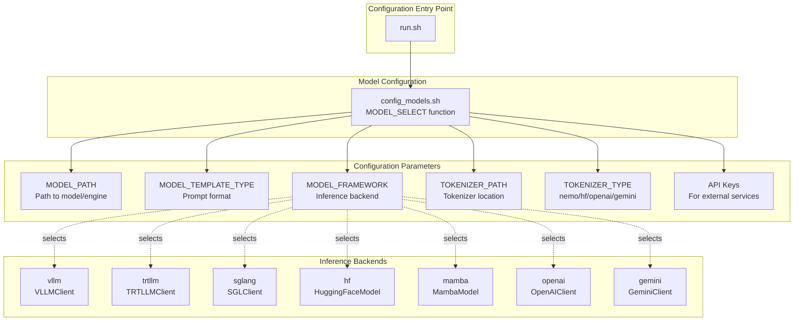
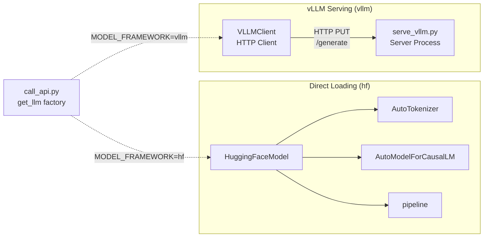
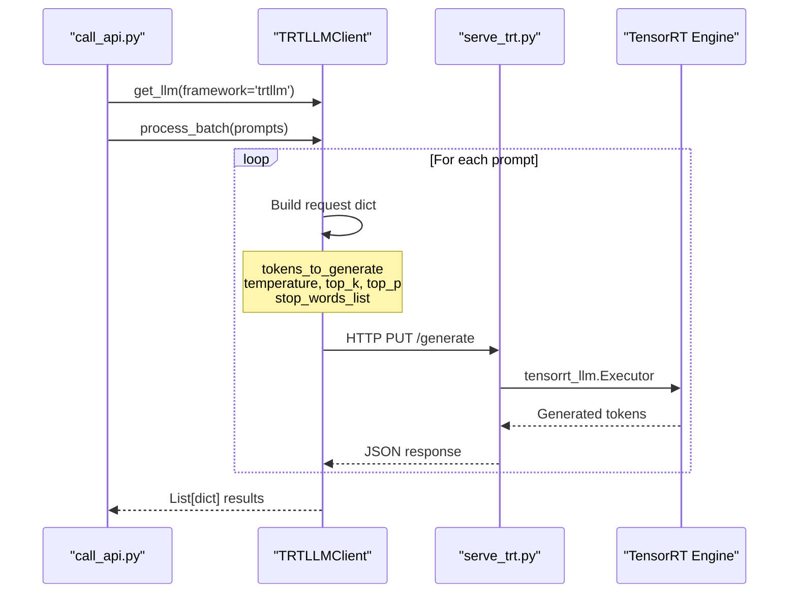
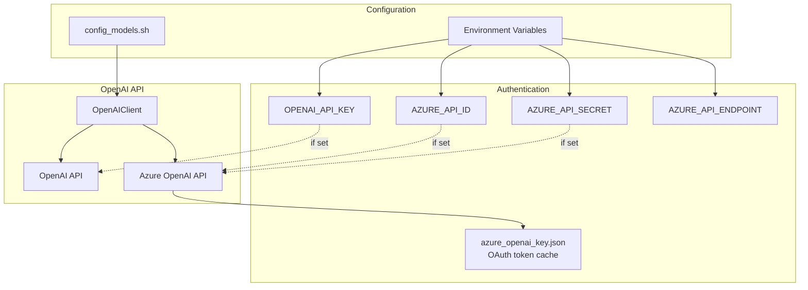
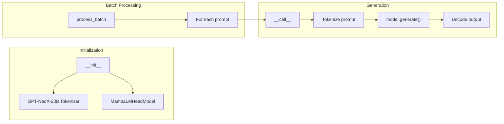
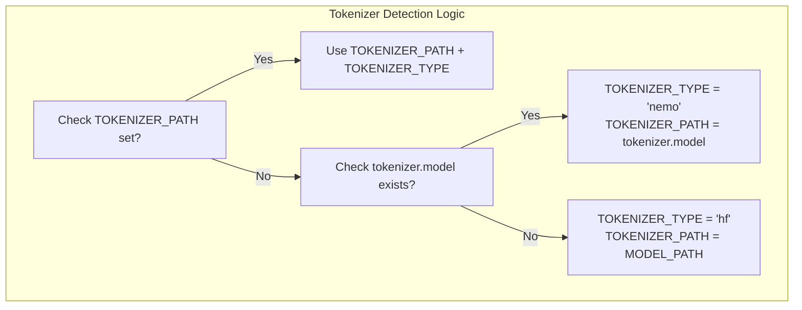
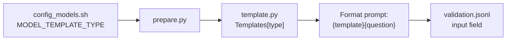

<!-- source: DeepWiki mcp.deepwiki.com · repo NVIDIA/RULER · page 6.2 Adding Custom Models · fetched 2026-10-26 -->

# Adding Custom Models

<details>
<summary>Relevant source files</summary>

The following files were used as context for generating this wiki page:

- [README.md](README.md)
- [scripts/config_models.sh](scripts/config_models.sh)
- [scripts/pred/client_wrappers.py](scripts/pred/client_wrappers.py)
- [scripts/pred/model_wrappers.py](scripts/pred/model_wrappers.py)

</details>


This page provides a technical guide for adding new model support to RULER. It covers the configuration system, supported inference backends, and the steps required to integrate custom models into the evaluation pipeline.

For information about running benchmarks with existing models, see [Running Benchmarks](#5.2). For adding custom evaluation tasks, see [Adding Custom Tasks](#6.1).

---

## Model Configuration System

RULER uses a centralized configuration system where models are defined in `config_models.sh` through the `MODEL_SELECT` function. This function maps model names to their paths, templates, frameworks, and tokenizers without requiring code changes to the core system.



**Sources:** [scripts/config_models.sh:27-101](), [README.md:94-130]()

### Required Configuration Parameters

| Parameter | Description | Example Values |
|-----------|-------------|----------------|
| `MODEL_PATH` | Local model directory or API model name | `${MODEL_DIR}/llama3.1-8b-Instruct`<br/>`gpt-4-turbo` |
| `MODEL_TEMPLATE_TYPE` | Prompt format template name | `meta-llama3`, `base`, `jamba` |
| `MODEL_FRAMEWORK` | Inference backend framework | `vllm`, `trtllm`, `sglang`, `hf`, `mamba`, `openai`, `gemini` |
| `TOKENIZER_PATH` | Path or name for tokenizer | Auto-detected or explicit path |
| `TOKENIZER_TYPE` | Tokenizer implementation | `nemo`, `hf`, `openai`, `gemini` |

**Sources:** [scripts/config_models.sh:27-101]()

---

## Adding a HuggingFace Model

HuggingFace models can be served either directly through the `HuggingFaceModel` wrapper or via vLLM for higher throughput.

### Configuration Steps

1. **Add case to MODEL_SELECT function** in `config_models.sh`:

```bash
case $MODEL_NAME in
    your-model-name)
        MODEL_PATH="${MODEL_DIR}/your-model-folder"
        MODEL_TEMPLATE_TYPE="base"  # or meta-chat, meta-llama3, etc.
        MODEL_FRAMEWORK="hf"        # or "vllm" for vLLM serving
        ;;
```

2. **Set environment variables** in `run.sh`:
   - `MODEL_DIR`: Base directory containing model folders
   - `GPUS`: Number of GPUs for tensor parallelism

3. **Run benchmark**:
```bash
bash run.sh your-model-name synthetic
```

### Framework Selection: Direct vs vLLM



**When to use each:**
- **Direct (`hf`)**: Single GPU, smaller models, debugging
- **vLLM (`vllm`)**: Multi-GPU, production throughput, PagedAttention benefits

**Sources:** [scripts/pred/model_wrappers.py:22-94](), [scripts/pred/client_wrappers.py:136-159]()

### HuggingFaceModel Implementation Details

The `HuggingFaceModel` class [scripts/pred/model_wrappers.py:22-94]() provides:

- **Flash Attention 2** support for compatible models [scripts/pred/model_wrappers.py:31]()
- **Automatic padding token setup** for batched generation [scripts/pred/model_wrappers.py:50-54]()
- **Pipeline fallback** if direct model loading fails [scripts/pred/model_wrappers.py:34-45]()
- **Stop sequence handling** via post-processing [scripts/pred/model_wrappers.py:88-90]()
- **Prompt removal** from generated text [scripts/pred/model_wrappers.py:82-86]()

**Sources:** [scripts/pred/model_wrappers.py:22-94]()

---

## Adding a TensorRT-LLM Model

TensorRT-LLM requires pre-built engine files and uses a client-server architecture.

### Prerequisites

1. **Build engine** using TensorRT-LLM's build scripts (e.g., for Llama: [TensorRT-LLM Llama example](https://github.com/NVIDIA/TensorRT-LLM/tree/main/examples/llama))
2. **Store engine** in `ENGINE_DIR` directory

### Configuration Steps

```bash
case $MODEL_NAME in
    your-trtllm-model)
        MODEL_PATH="${ENGINE_DIR}/your-engine-folder"
        MODEL_TEMPLATE_TYPE="meta-llama3"
        MODEL_FRAMEWORK="trtllm"
        ;;
```

### TensorRT-LLM Request Flow



**Sources:** [scripts/pred/client_wrappers.py:108-133]()

### TRTLLMClient Parameters

The `TRTLLMClient` [scripts/pred/client_wrappers.py:108-133]() sends requests with:

| Parameter | Description | Source |
|-----------|-------------|--------|
| `tokens_to_generate` | Maximum output tokens | Task configuration |
| `temperature` | Sampling temperature | `config_models.sh` (default: 0.0) |
| `top_k` | Top-k sampling | `config_models.sh` (default: 32) |
| `top_p` | Nucleus sampling | `config_models.sh` (default: 1.0) |
| `stop_words_list` | Comma-separated stop sequences | Task template |
| `max_attention_window_size` | Sliding window size (optional) | Runtime |

**Sources:** [scripts/pred/client_wrappers.py:109-133](), [scripts/config_models.sh:15-25]()

---

## Adding a SGLang Model

SGLang provides efficient serving with FlashInfer support.

### Configuration Example

```bash
case $MODEL_NAME in
    your-sglang-model)
        MODEL_PATH="${MODEL_DIR}/your-model-folder"
        MODEL_TEMPLATE_TYPE="base"
        MODEL_FRAMEWORK="sglang"
        ;;
```

### SGLClient Implementation

The `SGLClient` [scripts/pred/client_wrappers.py:161-185]() differs from vLLM in request format:

```json
{
    "text": "prompt string",
    "sampling_params": {
        "max_new_tokens": 128,
        "temperature": 0.0,
        "top_k": 32,
        "top_p": 1.0,
        "stop": ["</s>", "\n\n"]
    }
}
```

**Sources:** [scripts/pred/client_wrappers.py:161-185]()

---

## Adding External API Models

RULER supports OpenAI (including Azure) and Google Gemini APIs.

### OpenAI Configuration



**Configuration in config_models.sh:**

```bash
case $MODEL_NAME in
    gpt-4-turbo)
        MODEL_PATH="gpt-4-1106-preview"  # OpenAI model identifier
        MODEL_TEMPLATE_TYPE="base"
        MODEL_FRAMEWORK="openai"
        TOKENIZER_PATH="cl100k_base"
        TOKENIZER_TYPE="openai"
        OPENAI_API_KEY=""                # Set your key
        # Optional Azure configuration
        AZURE_ID=""
        AZURE_SECRET=""
        AZURE_ENDPOINT=""
        ;;
```

**Sources:** [scripts/config_models.sh:48-68](), [scripts/pred/client_wrappers.py:188-340]()

### OpenAI Token Management

The `OpenAIClient` [scripts/pred/client_wrappers.py:188-340]() handles:

1. **Context length limits** - Automatically reduces `tokens_to_generate` if prompt + output exceeds model limits [scripts/pred/client_wrappers.py:295-298]()
2. **Token counting** - Uses tiktoken for accurate token estimation [scripts/pred/client_wrappers.py:251-262]()
3. **Azure OAuth** - Caches access tokens and auto-refreshes on expiration [scripts/pred/client_wrappers.py:306-339]()

**Model-specific context limits** [scripts/pred/client_wrappers.py:194-212]():

| Model | Context Length |
|-------|----------------|
| `gpt-4-1106-preview` | 128,000 tokens |
| `gpt-4-turbo-preview` | 128,000 tokens |
| `gpt-3.5-turbo-0125` | 16,385 tokens |
| `gpt-4-32k` (Azure) | 32,768 tokens |

**Sources:** [scripts/pred/client_wrappers.py:188-340]()

### Gemini Configuration

```bash
case $MODEL_NAME in
    gemini_1.5_pro)
        MODEL_PATH="gemini-1.5-pro-latest"
        MODEL_TEMPLATE_TYPE="base"
        MODEL_FRAMEWORK="gemini"
        TOKENIZER_PATH=$MODEL_PATH
        TOKENIZER_TYPE="gemini"
        GEMINI_API_KEY=""  # Set your key
        ;;
```

**Key differences from OpenAI:**

1. **Safety settings** - All harm categories set to BLOCK_NONE [scripts/pred/client_wrappers.py:371-376]()
2. **Native token counting** - Uses Gemini's built-in `count_tokens` API [scripts/pred/client_wrappers.py:393]()
3. **Larger context windows** - Up to 1M tokens for Gemini 1.5 Pro [scripts/pred/client_wrappers.py:348-351]()

**Sources:** [scripts/config_models.sh:70-85](), [scripts/pred/client_wrappers.py:342-416]()

---

## Adding a Mamba Model

Mamba (state-space models) requires a specialized wrapper due to different generation APIs.

### Configuration

```bash
case $MODEL_NAME in
    mamba-model)
        MODEL_PATH="${MODEL_DIR}/mamba-folder"
        MODEL_TEMPLATE_TYPE="base"
        MODEL_FRAMEWORK="mamba"
        ;;
```

### MambaModel Implementation

The `MambaModel` class [scripts/pred/model_wrappers.py:97-133]() implements:



**Key characteristics:**

- **Fixed tokenizer**: Uses EleutherAI GPT-NeoX-20B tokenizer [scripts/pred/model_wrappers.py:102]()
- **Single-sample generation**: `process_batch` calls `__call__` sequentially [scripts/pred/model_wrappers.py:130-132]()
- **Custom generation kwargs**: Requires `cg=True` for causal generation [scripts/pred/model_wrappers.py:120]()

**Sources:** [scripts/pred/model_wrappers.py:97-133]()

---

## Tokenizer Configuration

RULER automatically detects tokenizer type based on model structure, but you can override this behavior.



**Tokenizer types and their use cases:**

| Type | Implementation | Use Case | Example Models |
|------|----------------|----------|----------------|
| `nemo` | NeMo SentencePiece | Models with `tokenizer.model` file | Llama, Mistral (base) |
| `hf` | HuggingFace Transformers | Standard HuggingFace models | Most instruction-tuned models |
| `openai` | tiktoken | OpenAI API models | GPT-3.5, GPT-4 |
| `gemini` | Google GenerativeAI | Gemini API models | Gemini 1.0/1.5 Pro |

**Sources:** [scripts/config_models.sh:89-97]()

### Manual Tokenizer Override

Override auto-detection for special cases:

```bash
case $MODEL_NAME in
    special-model)
        MODEL_PATH="${MODEL_DIR}/special-model"
        MODEL_TEMPLATE_TYPE="base"
        MODEL_FRAMEWORK="hf"
        TOKENIZER_PATH="${MODEL_DIR}/custom-tokenizer"  # Override
        TOKENIZER_TYPE="hf"
        ;;
```

**Sources:** [scripts/config_models.sh:89-97]()

---

## Creating Custom Model Wrappers

When existing backends don't support your model, create a custom wrapper.

### Wrapper Interface Requirements

All wrappers must implement:

```python
class CustomModelWrapper:
    def __init__(self, name_or_path: str, **generation_kwargs) -> None:
        """
        Initialize model and store generation parameters.
        
        Args:
            name_or_path: Model path or identifier
            **generation_kwargs: Contains:
                - temperature: float
                - top_p: float
                - top_k: int
                - max_new_tokens: int
                - stop: List[str] - stop sequences
        """
        pass
    
    def __call__(self, prompt: str, **kwargs) -> dict:
        """
        Generate for single prompt.
        
        Returns:
            dict with key 'text': List[str] containing single generation
        """
        pass
    
    def process_batch(self, prompts: List[str], **kwargs) -> List[dict]:
        """
        Generate for multiple prompts (can be parallel or sequential).
        
        Returns:
            List[dict], each with key 'text': List[str]
        """
        pass
```

### Integration Steps

1. **Create wrapper file** in `scripts/pred/`:
   - For direct models: Add class to `model_wrappers.py`
   - For client wrappers: Add class to `client_wrappers.py`

2. **Update call_api.py factory**:
   - Add case in `get_llm` function to instantiate your wrapper

3. **Configure in config_models.sh**:
   ```bash
   case $MODEL_NAME in
       your-custom-model)
           MODEL_PATH="${MODEL_DIR}/your-model"
           MODEL_TEMPLATE_TYPE="base"
           MODEL_FRAMEWORK="your-framework-name"  # New framework identifier
           ;;
   ```

**Sources:** [scripts/pred/model_wrappers.py:22-133](), [scripts/pred/client_wrappers.py:36-106]()

### Client Wrapper Base Class

For server-based models, extend the `Client` base class [scripts/pred/client_wrappers.py:36-106]():

```python
class Client(abc.ABC):
    def __init__(self, server_host, server_port='5000', 
                 ssh_server=None, ssh_key_path=None, **generation_kwargs):
        # Supports SSH tunneling for remote servers
        pass
    
    @abc.abstractmethod
    def _single_call(self, prompts, ...):
        # Implement actual HTTP request logic
        pass
    
    @retry(wait=wait_random_exponential(min=15, max=60), 
           stop=stop_after_attempt(3))
    def _send_request(self, request, route="generate"):
        # Built-in retry logic with exponential backoff
        pass
    
    def process_batch(self, prompts: List[str], **kwargs) -> List[dict]:
        # Built-in parallel processing with ThreadPoolExecutor
        pass
```

**Built-in features:**

- **Retry logic** with exponential backoff [scripts/pred/client_wrappers.py:73]()
- **SSH tunneling** support for remote servers [scripts/pred/client_wrappers.py:47-48](), [scripts/pred/client_wrappers.py:75-83]()
- **Parallel processing** using ThreadPoolExecutor [scripts/pred/client_wrappers.py:92-105]()

**Sources:** [scripts/pred/client_wrappers.py:36-106]()

---

## Template Configuration

Models require appropriate prompt templates. RULER provides 11 pre-defined templates in `template.py`.

### Available Templates

| Template Name | Description | Example Use |
|---------------|-------------|-------------|
| `base` | No formatting, raw prompt | API models, base models |
| `meta-chat` | Llama 2 chat format | Llama 2-7B-chat |
| `meta-llama3` | Llama 3/3.1 format | Llama 3.1-8B-Instruct |
| `jamba` | AI21 Jamba format | Jamba 1.5 Mini/Large |
| `qwen` | Qwen chat format | Qwen models |
| `yi` | Yi chat format | Yi models |
| `chatglm` | ChatGLM format | GLM-3, GLM-4 |
| `phi` | Microsoft Phi format | Phi-3 models |
| `mistral` | Mistral instruct format | Mistral-7B-instruct |
| `gemma` | Google Gemma format | Gemma models |
| `cohere` | Cohere Command-R format | Command-R models |

### Adding Custom Templates

If your model requires a different format:

1. **Add template to constants.py** in the `Templates` dictionary
2. **Specify in config_models.sh**:
   ```bash
   MODEL_TEMPLATE_TYPE="your-custom-template"
   ```

**Template selection in pipeline:**



**Sources:** [scripts/data/template.py]() (referenced in [README.md:88]())

---

## Testing Your Model

After adding configuration, verify integration:

### 1. Test Data Generation

```bash
# Generate small test dataset
cd scripts/data/synthetic
python niah.py \
    --save_dir test_output \
    --tokenizer_path ${TOKENIZER_PATH} \
    --tokenizer_type ${TOKENIZER_TYPE} \
    --max_seq_length 4096 \
    --num_samples 5
```

### 2. Test Inference

```bash
# Run on single task at short length
TASKS="niah_single_1" bash run.sh your-model-name synthetic
```

**Check outputs:**

- **Data**: `${ROOT_DIR}/data/niah_single_1/validation.jsonl`
- **Predictions**: `${ROOT_DIR}/pred/niah_single_1/validation.jsonl`
- **Evaluation**: `${ROOT_DIR}/results/4096/your-model-name/metrics.json`

### 3. Verify Generation Quality

```python
import json

# Load predictions
with open('pred/niah_single_1/validation.jsonl') as f:
    samples = [json.loads(line) for line in f]

# Check format
for sample in samples[:3]:
    print(f"Input length: {len(sample['input'])}")
    print(f"Prediction: {sample['pred']}")
    print(f"Expected: {sample['outputs']}")
    print("---")
```

### Common Issues

| Issue | Symptom | Solution |
|-------|---------|----------|
| **Tokenizer mismatch** | Data generation fails | Verify `TOKENIZER_PATH` and `TOKENIZER_TYPE` |
| **Template mismatch** | Model refuses to answer | Check `MODEL_TEMPLATE_TYPE` matches model's training format |
| **OOM errors** | CUDA out of memory | Reduce `max_seq_length` or increase GPU count (`GPUS`) |
| **Empty predictions** | `pred` field is empty | Check server logs, verify `stop` sequences |
| **API rate limits** | Requests fail intermittently | Retry logic should handle this automatically |

**Sources:** [README.md:78-135]()

---

## Summary

Adding a custom model to RULER requires:

1. **Configuration** - Add case to `MODEL_SELECT` in `config_models.sh`
2. **Framework selection** - Choose from 7 supported backends or create custom wrapper
3. **Tokenizer setup** - Configure or use auto-detection
4. **Template selection** - Pick appropriate prompt format
5. **Testing** - Verify with small dataset before full evaluation

The modular architecture allows adding new models without modifying core evaluation logic, supporting both local and API-based inference.

**Sources:** [scripts/config_models.sh:27-101](), [scripts/pred/model_wrappers.py:22-133](), [scripts/pred/client_wrappers.py:36-416](), [README.md:86-135]()

---

