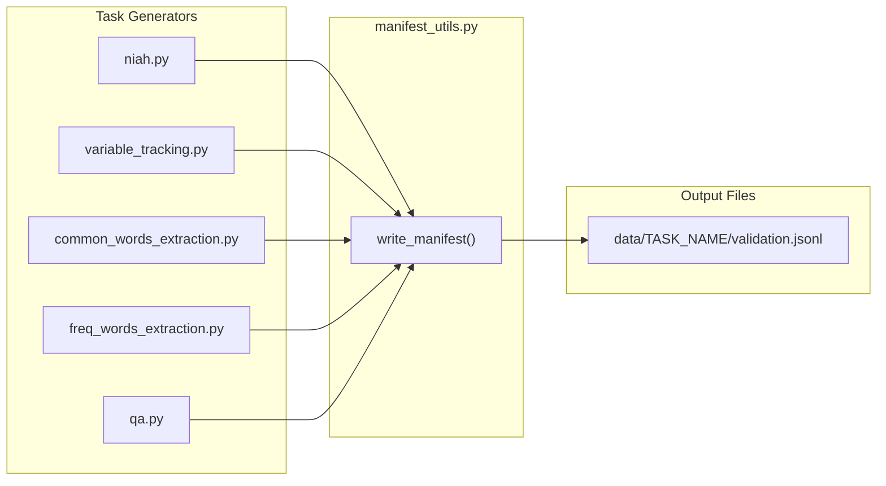
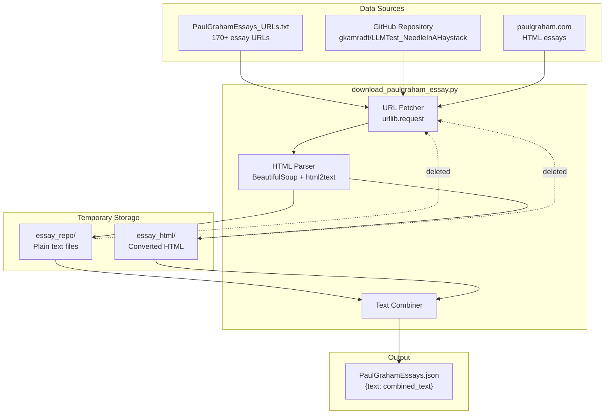
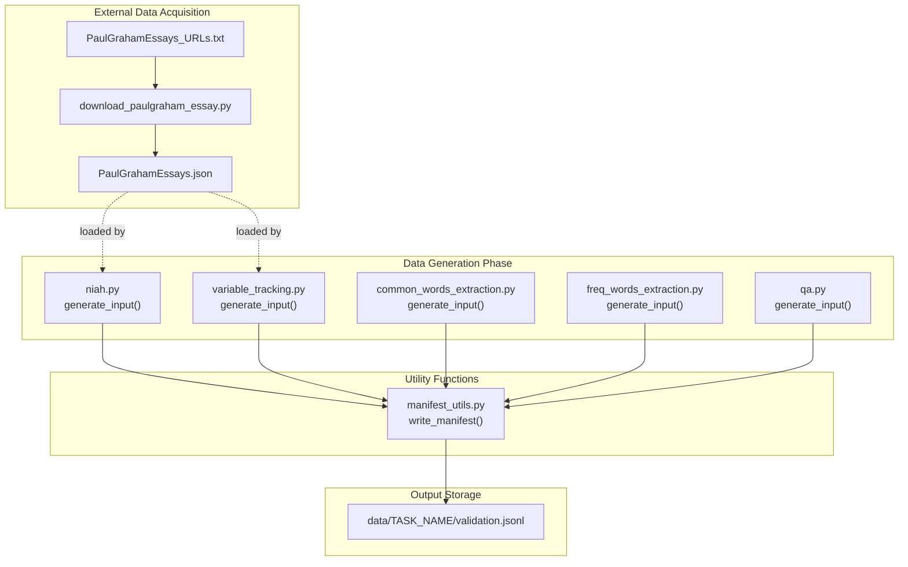

<!-- source: DeepWiki mcp.deepwiki.com · repo NVIDIA/RULER · page 6.3 Utility Modules · fetched 2026-10-26 -->

# Utility Modules

<details>
<summary>Relevant source files</summary>

The following files were used as context for generating this wiki page:

- [scripts/data/manifest_utils.py](scripts/data/manifest_utils.py)
- [scripts/data/synthetic/json/PaulGrahamEssays_URLs.txt](scripts/data/synthetic/json/PaulGrahamEssays_URLs.txt)
- [scripts/data/synthetic/json/download_paulgraham_essay.py](scripts/data/synthetic/json/download_paulgraham_essay.py)
- [scripts/data/template.py](scripts/data/template.py)
- [scripts/data/tokenizer.py](scripts/data/tokenizer.py)

</details>


## Purpose and Scope

This page documents the utility modules in RULER that provide shared functionality across the data generation pipeline. These modules handle common operations such as JSONL file I/O, external data acquisition, and other helper functions used by multiple task generators.

For information about tokenizer configuration and template configuration from a user perspective, see [Templates and Tokenizers](#4.3). For information about how these utilities are used within specific task implementations, see the task-specific pages in section 3.

The utility modules covered here include:
- **manifest_utils.py**: Standardized JSONL file writing for task outputs
- **Data download scripts**: Automated retrieval of external datasets (Paul Graham essays)

---

## JSONL Manifest I/O

RULER uses a standardized JSONL (JSON Lines) format for all generated task data and predictions. The `manifest_utils.py` module provides a centralized function for writing these files consistently across all task generators.

### File Format

All task generators output files in JSONL format where each line is a complete JSON object. The standard schema includes:

| Field | Type | Description |
|-------|------|-------------|
| `index` | integer | Zero-based index of the sample |
| `input` | string | The full prompt text including task template and context |
| `outputs` | list[string] | Ground truth answer(s) for the task |
| `length` | integer | Token count of the input sequence |

Additional task-specific fields may be included (e.g., `needles` for NIAH tasks, `chains` for variable tracking).

### write_manifest Function

The core utility function for writing JSONL files is `write_manifest()`:



**Function Signature and Parameters**

The `write_manifest()` function is defined in [scripts/data/manifest_utils.py:18-32]():

| Parameter | Type | Default | Description |
|-----------|------|---------|-------------|
| `output_path` | str or Path | Required | Path to the output JSONL file |
| `target_manifest` | list | Required | List of dictionaries, each representing one sample |
| `ensure_ascii` | bool | True | If True, all non-ASCII characters are escaped; if False, UTF-8 characters are preserved |

**Implementation Details**

The function writes each dictionary in `target_manifest` as a separate JSON line:

- Opens the file with UTF-8 encoding
- Iterates through the manifest list
- Serializes each entry using `json.dump()`
- Writes a newline character after each entry
- The `ensure_ascii` parameter controls Unicode handling

**Usage Pattern**

All task generators follow this pattern:

1. Generate a list of sample dictionaries
2. Each dictionary contains required fields (`index`, `input`, `outputs`, `length`)
3. Call `write_manifest()` with the list and output path
4. The function handles all file I/O operations

**Example from Task Generators**

Task generators typically accumulate samples in a list and write once:

```python
# Pattern used across all task generators
samples = []
for i in range(num_samples):
    sample = {
        'index': i,
        'input': generated_prompt,
        'outputs': [ground_truth],
        'length': token_count
    }
    samples.append(sample)

write_manifest(output_path, samples)
```

Sources: [scripts/data/manifest_utils.py:1-33]()

---

## Data Download Utilities

RULER includes automated scripts for downloading external data sources used in benchmark tasks. The primary utility is the Paul Graham essay downloader, which provides text content for the NIAH and Variable Tracking tasks.

### Paul Graham Essay Downloader

The `download_paulgraham_essay.py` script downloads and processes essays from two sources to create a unified text corpus.



**Script Location and Execution**

The downloader is located at [scripts/data/synthetic/json/download_paulgraham_essay.py:1-83]() and must be executed from the `scripts/data/synthetic/json/` directory before running NIAH or variable tracking tasks.

**Download Sources**

The script reads URLs from [scripts/data/synthetic/json/PaulGrahamEssays_URLs.txt:1-218](), which contains:

| Source Type | Count | Format | Example |
|-------------|-------|--------|---------|
| paulgraham.com HTML | ~170 essays | `.html` URLs | `http://www.paulgraham.com/essay.html` |
| GitHub repository | ~48 essays | `.txt` raw URLs | `https://github.com/.../addiction.txt` |

**Processing Pipeline**

The script executes the following steps:

1. **Create temporary directories** [scripts/data/synthetic/json/download_paulgraham_essay.py:24-27]():
   - `essay_repo/` for GitHub plain text files
   - `essay_html/` for converted HTML files

2. **Configure HTML parser** [scripts/data/synthetic/json/download_paulgraham_essay.py:29-34]():
   - Uses `html2text` library with specific settings
   - Ignores images and tables
   - Escapes all special characters
   - Disables reference links and code marking

3. **Download and process files** [scripts/data/synthetic/json/download_paulgraham_essay.py:39-65]():
   - For HTML URLs: fetch, parse with BeautifulSoup, extract `<font>` tag content, convert to plain text
   - For TXT URLs: fetch and save directly
   - Each file is saved with error handling for failed downloads

4. **Combine all text** [scripts/data/synthetic/json/download_paulgraham_essay.py:72-78]():
   - Concatenates all downloaded essays into a single string
   - Writes to `PaulGrahamEssays.json` as a JSON object with a `text` key

5. **Cleanup** [scripts/data/synthetic/json/download_paulgraham_essay.py:81-82]():
   - Removes temporary directories after successful combination

**Output Format**

The final output is a JSON file with this structure:

```json
{
  "text": "concatenated text of all essays..."
}
```

This file is read by task generators that use essay content:
- NIAH tasks with `type_haystack: essay`
- Variable tracking tasks with `type_haystack: essay`

**Dependencies**

The script requires the following Python packages:
- `urllib.request` (standard library) for HTTP downloads
- `BeautifulSoup` from `bs4` for HTML parsing
- `html2text` for converting HTML to plain text
- `tqdm` for progress bars during downloads

**Error Handling**

The script includes basic error handling [scripts/data/synthetic/json/download_paulgraham_essay.py:52-53]() and [scripts/data/synthetic/json/download_paulgraham_essay.py:64-65]():
- Failed downloads print an error message with the filename and exception
- Processing continues even if individual files fail
- The script reports download counts for both sources [scripts/data/synthetic/json/download_paulgraham_essay.py:69-70]()

Sources: [scripts/data/synthetic/json/download_paulgraham_essay.py:1-83](), [scripts/data/synthetic/json/PaulGrahamEssays_URLs.txt:1-218]()

---

## Utility Module Integration

The following diagram shows how utility modules integrate with the data generation pipeline:



**Execution Flow**

1. **Pre-generation**: `download_paulgraham_essay.py` is run once to acquire external data
2. **Task generation**: Each task generator loads necessary external data and generates samples
3. **Output writing**: All generators call `write_manifest()` to write samples in standardized format
4. **Consumption**: The `call_api.py` module reads these JSONL files to generate predictions

**Shared Characteristics**

All utility modules follow these design principles:

| Principle | Description | Example |
|-----------|-------------|---------|
| **Single responsibility** | Each module handles one specific concern | `manifest_utils.py` only handles JSONL writing |
| **Framework agnostic** | No dependencies on specific ML frameworks | Uses only standard library and common packages |
| **Error handling** | Graceful degradation with informative messages | Download script continues on individual failures |
| **Stateless operations** | Functions don't maintain state between calls | `write_manifest()` is a pure I/O operation |

Sources: [scripts/data/manifest_utils.py:1-33](), [scripts/data/synthetic/json/download_paulgraham_essay.py:1-83]()

---

## Usage Examples

### Writing Task Output

All task generators use this pattern to write their output:

```python
from manifest_utils import write_manifest

# Generate samples
samples = []
for i in range(num_samples):
    # ... generate sample ...
    samples.append({
        'index': i,
        'input': prompt,
        'outputs': [answer],
        'length': len(tokenizer.text_to_tokens(prompt))
    })

# Write to file
output_path = f"data/{task_name}/validation.jsonl"
write_manifest(output_path, samples)
```

### Downloading External Data

Before running tasks that require Paul Graham essays:

```bash
cd scripts/data/synthetic/json/
python download_paulgraham_essay.py
```

This creates `PaulGrahamEssays.json` which is then loaded by task generators:

```python
import json

# Load essays (used in niah.py and variable_tracking.py)
with open('scripts/data/synthetic/json/PaulGrahamEssays.json') as f:
    essay_text = json.load(f)['text']
```

Sources: [scripts/data/manifest_utils.py:18-32](), [scripts/data/synthetic/json/download_paulgraham_essay.py:1-83]()

---

## Extension Points

When adding new functionality to RULER, consider these utility module patterns:

### Adding New Data Sources

To add a new external data source:

1. Create a download script in `scripts/data/synthetic/json/`
2. Follow the pattern from `download_paulgraham_essay.py`:
   - Accept URLs from a configuration file or command-line arguments
   - Include error handling for network failures
   - Process downloaded content into a standard format
   - Output to a JSON file in the same directory
   - Clean up temporary files

3. Update task generators to load the new data source

### Adding New Output Formats

While JSONL is the standard format, to support additional formats:

1. Add new functions to `manifest_utils.py` following the `write_manifest()` pattern
2. Accept the same `target_manifest` list structure
3. Implement format-specific serialization
4. Maintain consistent parameter naming and behavior

### Adding Cross-Task Utilities

For utilities used by multiple tasks:

1. Create new modules in `scripts/data/` directory
2. Keep functions stateless and focused on single responsibilities
3. Document parameters and return values clearly
4. Add unit tests if modifying core logic
5. Update this documentation page

Sources: [scripts/data/manifest_utils.py:1-33](), [scripts/data/synthetic/json/download_paulgraham_essay.py:1-83]()