# Page: Overview

# Overview

<details>
<summary>Relevant source files</summary>

The following files were used as context for generating this wiki page:

- [README.md](README.md)

</details>


## Purpose and Scope

This document provides an introduction to RULER (Real-world Usage-driven Long-context Evaluation Representation), a comprehensive benchmarking framework for evaluating the long-context capabilities of Large Language Models (LLMs). RULER generates synthetic evaluation tasks with configurable sequence lengths and complexity to measure how well models can effectively utilize their claimed context windows.

For detailed information about specific components:
- System architecture and execution flow: see [System Architecture](#2)
- Individual task implementations: see [Benchmark Tasks](#3)
- Configuration and customization: see [Configuration System](#4)
- Running benchmarks: see [Running RULER](#5)
- Extending with custom tasks or models: see [Extending RULER](#6)

## What is RULER?

RULER is a synthetic benchmarking framework designed to evaluate the *real* context handling capabilities of long-context language models. While many models claim to support context windows of 32K, 128K, or even 1M tokens, RULER systematically tests whether models can actually maintain performance as sequence length increases.

The framework evaluates models on **13 tasks** organized into **4 categories**: Retrieval, Multi-hop Tracing, Aggregation, and Question Answering. Each task is configurable with parameters that control complexity, allowing researchers to test models under various difficulty levels.

Sources: [README.md:1-3]()

## Key Concepts

### Effective Length vs Claimed Length

```mermaid
graph LR
    subgraph "Model Claims"
        CLAIMED["Claimed Context<br/>128K tokens"]
    end
    
    subgraph "RULER Evaluation"
        TEST_4K["Test @ 4K<br/>Performance: 96%"]
        TEST_8K["Test @ 8K<br/>Performance: 95%"]
        TEST_16K["Test @ 16K<br/>Performance: 93%"]
        TEST_32K["Test @ 32K<br/>Performance: 87%"]
        TEST_64K["Test @ 64K<br/>Performance: 82%"]
        TEST_128K["Test @ 128K<br/>Performance: 71%"]
    end
    
    subgraph "Determination"
        THRESHOLD["Threshold: 85.6%<br/>(Llama-2-7b @ 4K)"]
        EFFECTIVE["Effective Length:<br/>32K tokens"]
    end
    
    CLAIMED --> TEST_4K
    TEST_4K --> TEST_8K
    TEST_8K --> TEST_16K
    TEST_16K --> TEST_32K
    TEST_32K --> TEST_64K
    TEST_64K --> TEST_128K
    
    TEST_128K --> THRESHOLD
    THRESHOLD --> EFFECTIVE
    
    style EFFECTIVE fill:#f9f9f9
    style THRESHOLD fill:#f9f9f9
```

**Effective Length**: The maximum sequence length at which a model maintains performance above the 85.6% threshold. This threshold is set based on Llama-2-7b's performance at 4K tokens, its claimed context length, providing a consistent baseline for comparison across all models.

**Claimed Length**: The context window size advertised by model developers, often based on training or positional encoding capabilities rather than empirical performance.

RULER's evaluation reveals that most models fall significantly short of their claimed context lengths. For example, GPT-4-1106-preview claims 128K but has an effective length of 64K, while many 32K models only achieve 4K-16K effective lengths.

Sources: [README.md:3-54]()

### The 85.6% Threshold

The threshold of 85.6% represents the aggregate performance of Llama-2-7b-chat on RULER tasks at 4K tokens (its claimed context length). This baseline serves multiple purposes:

- **Consistency**: Provides a fixed reference point for comparing all models
- **Qualitative Significance**: Represents "acceptable" performance where a model still functions reasonably well
- **Fair Comparison**: Accounts for the fact that not all models perform perfectly even at short lengths

When a model's performance drops below this threshold, it indicates the model is struggling to utilize the longer context effectively, even if it can technically process longer inputs.

Sources: [README.md:53-55]()

## Task Categories

RULER evaluates models across four distinct categories of long-context tasks:

| Category | Task Names | Core Capability Tested |
|----------|-----------|----------------------|
| **Retrieval** | `niah_single_1`, `niah_single_2`, `niah_single_3`, `niah_multikey_1`, `niah_multikey_2`, `niah_multikey_3`, `niah_multivalue`, `niah_multiquery` | Finding specific information within long contexts |
| **Multi-hop Tracing** | `vt` | Following chains of references across the context |
| **Aggregation** | `cwe`, `fwe` | Extracting and summarizing patterns from the entire context |
| **Question Answering** | `qa_1`, `qa_2` | Answering questions based on multiple documents |

Each task accepts configuration parameters that control its difficulty. For example, `niah_multikey_1` uses 1 key-value pair, while `niah_multikey_3` uses 3 pairs, progressively increasing complexity. Task configurations are defined in [synthetic.yaml]() and detailed task implementations are in [Benchmark Tasks](#3).

Sources: [README.md:138-147]()

## System Architecture Overview

```mermaid
graph TB
    subgraph "Entry Point"
        RUN_SH["run.sh<br/>Main orchestrator"]
    end
    
    subgraph "Configuration Layer"
        CONFIG_MODELS["config_models.sh<br/>MODEL_SELECT()"]
        CONFIG_TASKS["config_tasks.sh<br/>TASKS array"]
        SYNTHETIC_YAML["synthetic.yaml<br/>Task parameters"]
    end
    
    subgraph "Core Pipeline Stages"
        PREPARE["prepare.py<br/>Data generation controller"]
        CALL_API["call_api.py<br/>Inference controller<br/>get_llm()"]
        EVALUATE["evaluate.py<br/>Metrics computation"]
    end
    
    subgraph "Task Generators"
        NIAH["niah.py"]
        VT["variable_tracking.py"]
        CWE["common_words_extraction.py"]
        FWE["freq_words_extraction.py"]
        QA["qa.py"]
    end
    
    subgraph "Model Backends"
        VLLM["serve_vllm.py<br/>vLLM server"]
        TRTLLM["serve_trt.py<br/>TensorRT-LLM server"]
        SGLANG["sglang<br/>SGLang server"]
        HF["HuggingFaceModel<br/>Direct loading"]
        OPENAI["OpenAIClient<br/>API client"]
    end
    
    subgraph "Utilities"
        TOKENIZER["tokenizer.py<br/>Multi-framework support"]
        TEMPLATE["template.py<br/>Templates dict"]
        MANIFEST["manifest_utils.py<br/>JSONL I/O"]
    end
    
    subgraph "Data Flow"
        INPUT["data/TASK/validation.jsonl"]
        PRED["pred/TASK/validation.jsonl"]
        RESULTS["results/"]
    end
    
    RUN_SH --> CONFIG_MODELS
    RUN_SH --> CONFIG_TASKS
    RUN_SH --> SYNTHETIC_YAML
    
    RUN_SH --> PREPARE
    RUN_SH --> CALL_API
    RUN_SH --> EVALUATE
    
    PREPARE --> NIAH
    PREPARE --> VT
    PREPARE --> CWE
    PREPARE --> FWE
    PREPARE --> QA
    
    CALL_API --> VLLM
    CALL_API --> TRTLLM
    CALL_API --> SGLANG
    CALL_API --> HF
    CALL_API --> OPENAI
    
    NIAH --> TOKENIZER
    NIAH --> TEMPLATE
    NIAH --> MANIFEST
    
    PREPARE --> INPUT
    CALL_API --> INPUT
    CALL_API --> PRED
    EVALUATE --> PRED
    EVALUATE --> RESULTS
```

RULER's architecture consists of:

1. **Entry Point**: [run.sh]() orchestrates the entire benchmark pipeline
2. **Configuration Layer**: Shell scripts and YAML files define models, tasks, and parameters without code changes
3. **Core Pipeline**: Three Python scripts handle data generation, inference, and evaluation sequentially
4. **Task Generators**: Five task-specific scripts generate synthetic evaluation samples
5. **Model Backends**: Support for seven inference backends (3 local servers, 2 direct loaders, 2 external APIs)
6. **Utilities**: Shared modules for tokenization, prompt templating, and data I/O
7. **Data Flow**: Standardized JSONL format for task samples, predictions, and results

Sources: [README.md:92-136](), High-level architecture diagrams

## Execution Pipeline

The typical RULER workflow follows this sequence:

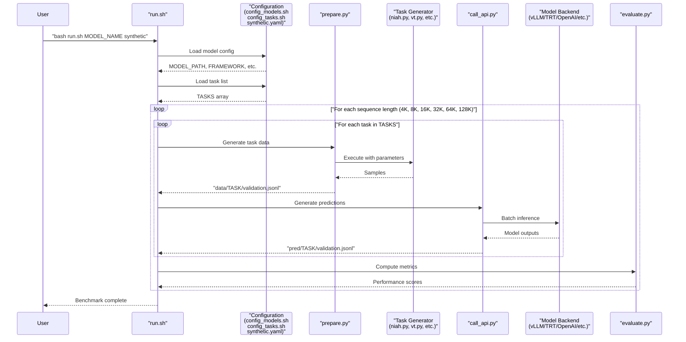

**Key execution characteristics**:

1. **Sequential Processing**: Runs tests at increasing sequence lengths (4K → 128K)
2. **Task Iteration**: For each length, evaluates all configured tasks
3. **Three-Stage Processing**: Data generation → Inference → Evaluation
4. **Incremental Results**: Evaluation runs after all tasks at each sequence length
5. **Resource Efficiency**: Model server starts once and serves all inference requests

The pipeline outputs results in a standardized format showing performance at each sequence length, enabling determination of effective length.

Sources: [README.md:92-136](), Pipeline execution diagram

## Example Benchmark Results

RULER produces comprehensive performance tables showing model degradation across sequence lengths:

| Model | Claimed Length | Effective Length | 4K | 8K | 16K | 32K | 64K | 128K |
|-------|---------------|-----------------|-----|-----|------|------|------|-------|
| Gemini-1.5-pro | 1M | >128K | 96.7 | 95.8 | 96.0 | 95.9 | 95.9 | 94.4 |
| GPT-4-1106-preview | 128K | 64K | 96.6 | 96.3 | 95.2 | 93.2 | 87.0 | 81.2 |
| Llama3.1-70B | 128K | 64K | 96.5 | 95.8 | 95.4 | 94.8 | 88.4 | 66.6 |
| Mixtral-8x22B | 64K | 32K | 95.6 | 94.9 | 93.4 | 90.9 | 84.7 | 31.7 |
| Mistral-7B | 32K | 16K | 93.6 | 91.2 | 87.2 | 75.4 | 49.0 | 13.8 |

**Key observations from RULER results**:

- Performance values exceeding 85.6% are underlined in the original table
- Most models show significant degradation before reaching claimed context length
- Only a few models (Gemini-1.5-pro, Jamba-1.5) maintain performance beyond 128K
- The gap between claimed and effective length is often 2-4x

The effective length metric provides a standardized way to compare models, revealing that many long-context models cannot reliably utilize their full claimed capacity.

Sources: [README.md:5-51]()

## Configuration-Driven Design

RULER's architecture emphasizes configurability without code changes:

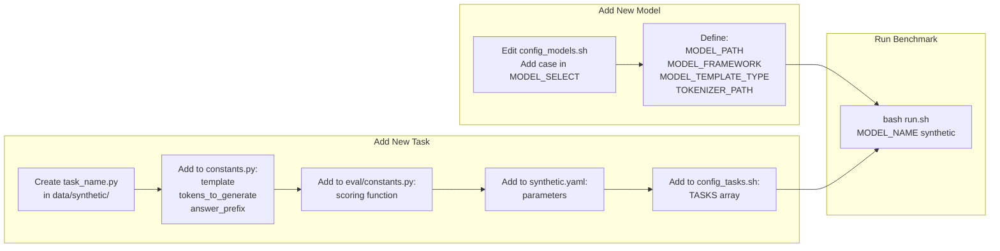

**Extension Points**:

1. **Models**: Add cases to `MODEL_SELECT()` in [config_models.sh:103-129]()
2. **Tasks**: Five-step process documented in [Adding Custom Tasks](#6.1)
3. **Templates**: Extend `Templates` dictionary in [template.py]()
4. **Metrics**: Add scoring functions to [eval/constants.py]()

This design allows researchers to contribute new evaluation tasks or test new models without understanding the entire system internals.

Sources: [README.md:137-166](), Configuration extensibility diagram

## Output Structure

RULER generates outputs in a structured directory hierarchy:

```
ROOT_DIR/
├── data/
│   └── TASK_NAME/
│       └── validation.jsonl        # Generated task samples
├── pred/
│   └── TASK_NAME/
│       └── validation.jsonl        # Model predictions
└── results/
    └── MODEL_NAME/
        └── synthetic/
            └── results.json        # Performance metrics
```

Each `validation.jsonl` file contains one JSON object per line with fields:
- `index`: Sample identifier
- `input`: Formatted prompt with context
- `outputs`: Expected answer(s)
- `length`: Actual token count
- `pred`: Model's prediction (in pred/ files only)

The final `results.json` aggregates performance across all tasks and sequence lengths, enabling effective length determination.

Sources: [README.md:92-136]()

## Getting Started

To run RULER benchmarks:

1. **Setup environment**: Build Docker container or install requirements
2. **Download data**: Paul Graham essays for NIAH, SQuAD/HotpotQA for QA tasks
3. **Configure model**: Add model to [config_models.sh]()
4. **Run pipeline**: Execute `bash run.sh MODEL_NAME synthetic`

For detailed setup instructions, see [Running RULER](#5). For customization options, see [Configuration System](#4).

Sources: [README.md:67-136]()

---

# Page: System Architecture

# System Architecture

<details>
<summary>Relevant source files</summary>

The following files were used as context for generating this wiki page:

- [README.md](README.md)
- [scripts/run.sh](scripts/run.sh)

</details>


## Purpose and Scope

This page provides a high-level architectural overview of the RULER framework, describing the major components, their responsibilities, and how they interact to perform long-context LLM evaluation. RULER operates as a sequential pipeline that generates synthetic benchmark data, obtains model predictions, and computes evaluation metrics across varying sequence lengths.

For detailed information about specific subsystems, see:
- Pipeline execution flow: [Pipeline Overview](#2.1)
- Data generation mechanics: [Data Generation Pipeline](#2.2)
- Model serving and inference: [Inference and Serving](#2.3)
- Metrics and evaluation: [Evaluation System](#2.4)
- Task-specific implementations: [Benchmark Tasks](#3)
- Configuration details: [Configuration System](#4)

## Architectural Layers

RULER is organized into five distinct layers that separate concerns and enable modular development:

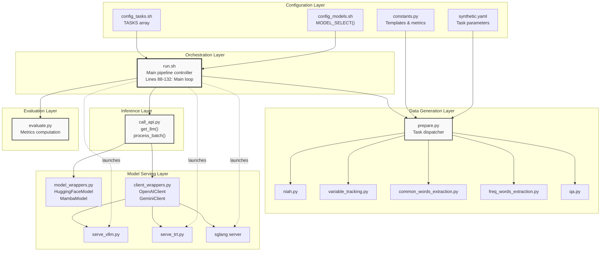

**Sources:** [scripts/run.sh](), [scripts/config_models.sh](), [scripts/config_tasks.sh](), [scripts/synthetic.yaml](), [scripts/data/synthetic/constants.py](), [scripts/data/prepare.py](), [scripts/pred/call_api.py](), [scripts/eval/evaluate.py]()

### Layer Responsibilities

| Layer | Responsibility | Key Components |
|-------|---------------|----------------|
| **Configuration** | Define models, tasks, and parameters | `config_models.sh`, `config_tasks.sh`, `synthetic.yaml` |
| **Orchestration** | Control execution flow and coordinate components | `run.sh` |
| **Data Generation** | Create synthetic benchmark samples | `prepare.py`, task-specific generators |
| **Model Serving** | Provide model inference backends | `serve_vllm.py`, `serve_trt.py`, `sglang`, API clients |
| **Inference** | Generate predictions from models | `call_api.py`, wrappers in `model_wrappers.py`, `client_wrappers.py` |
| **Evaluation** | Compute metrics and determine effective length | `evaluate.py`, metrics in `eval/synthetic/constants.py` |

**Sources:** [scripts/run.sh:1-133](), [scripts/data/prepare.py](), [scripts/pred/call_api.py](), [scripts/eval/evaluate.py]()

## Core Component Architecture

The following diagram maps system components to their code implementations:

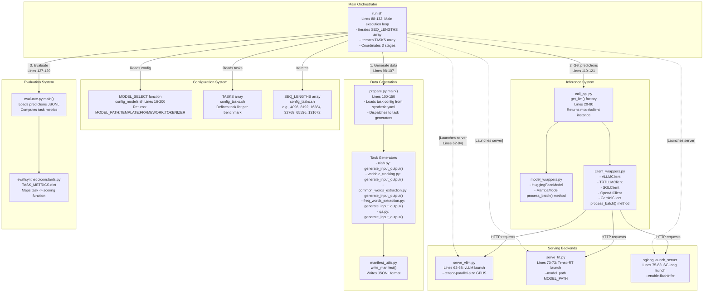

**Sources:** [scripts/run.sh:88-132](), [scripts/config_models.sh:16-200](), [scripts/config_tasks.sh](), [scripts/data/prepare.py:100-150](), [scripts/pred/call_api.py:20-80](), [scripts/pred/model_wrappers.py](), [scripts/pred/client_wrappers.py](), [scripts/eval/evaluate.py](), [scripts/eval/synthetic/constants.py]()

## Data Flow Architecture

The following diagram shows how data flows through the system from configuration to results:

```mermaid
graph LR
    subgraph Inputs["Input Artifacts"]
        config_files["Config Files<br/>- MODEL_PATH<br/>- TASKS array<br/>- synthetic.yaml"]
        external_data["External Data<br/>- Paul Graham essays<br/>- SQuAD JSON<br/>- HotpotQA JSON"]
    end
    
    subgraph Stage1["Stage 1: Data Generation"]
        prepare["prepare.py<br/>Dispatcher"]
        task_gen["Task Generator<br/>generate_input_output()"]
        data_jsonl["data/TASK/validation.jsonl<br/>{index, input, outputs, length}"]
    end
    
    subgraph Stage2["Stage 2: Prediction Generation"]
        call_api_load["call_api.py<br/>Load data JSONL"]
        llm_instance["LLM Instance<br/>process_batch()"]
        pred_jsonl["pred/TASK/validation.jsonl<br/>{index, input, outputs, pred}"]
    end
    
    subgraph Stage3["Stage 3: Evaluation"]
        eval_load["evaluate.py<br/>Load pred JSONL"]
        metrics_compute["Compute metrics<br/>TASK_METRICS[task]"]
        results["Results<br/>- Task scores<br/>- Effective length<br/>- Performance table"]
    end
    
    config_files --> prepare
    external_data --> task_gen
    prepare --> task_gen
    task_gen --> data_jsonl
    
    data_jsonl --> call_api_load
    call_api_load --> llm_instance
    llm_instance --> pred_jsonl
    
    pred_jsonl --> eval_load
    eval_load --> metrics_compute
    metrics_compute --> results
    
    style data_jsonl fill:#f9f9f9,stroke:#333,stroke-width:2px
    style pred_jsonl fill:#f9f9f9,stroke:#333,stroke-width:2px
    style results fill:#f9f9f9,stroke:#333,stroke-width:2px
```

**Sources:** [scripts/run.sh:98-129](), [scripts/data/prepare.py](), [scripts/pred/call_api.py](), [scripts/eval/evaluate.py]()

### Directory Structure

The pipeline creates a consistent directory structure for each model, benchmark, and sequence length:

```
ROOT_DIR/
└── MODEL_NAME/
    └── BENCHMARK/
        └── MAX_SEQ_LENGTH/
            ├── data/
            │   └── TASK/
            │       └── validation.jsonl
            └── pred/
                └── TASK/
                    └── validation.jsonl
```

**Sources:** [scripts/run.sh:91-95]()

## Execution Flow

The system executes as a nested loop controlled by `run.sh`:

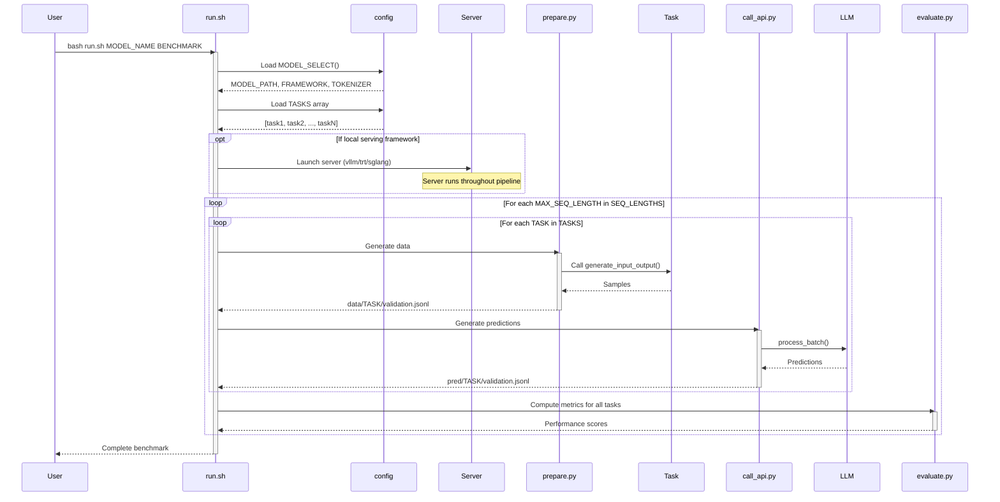

**Sources:** [scripts/run.sh:88-132]()

### Key Control Flow Patterns

| Pattern | Implementation | Purpose |
|---------|----------------|---------|
| **Outer Loop** | `for MAX_SEQ_LENGTH in "${SEQ_LENGTHS[@]}"` [run.sh:89]() | Test multiple context lengths |
| **Inner Loop** | `for TASK in "${TASKS[@]}"` [run.sh:97]() | Evaluate all tasks at each length |
| **Sequential Stages** | Lines 98→110→127 [run.sh]() | Data generation → Inference → Evaluation |
| **Conditional Serving** | `if [ "$MODEL_FRAMEWORK" == "vllm" ]` [run.sh:62]() | Launch appropriate server |
| **Factory Pattern** | `get_llm()` in [call_api.py]() | Abstract backend differences |

**Sources:** [scripts/run.sh:62-84](), [scripts/run.sh:88-132](), [scripts/pred/call_api.py]()

## Model Serving Architecture

RULER supports seven distinct inference backends through a unified interface:

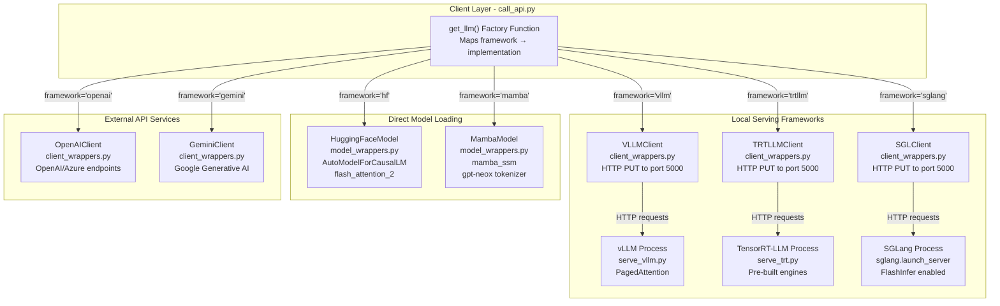

**Sources:** [scripts/pred/call_api.py](), [scripts/pred/client_wrappers.py](), [scripts/pred/model_wrappers.py](), [scripts/pred/serve_vllm.py](), [scripts/pred/serve_trt.py]()

### Backend Comparison

| Backend | Framework Value | Wrapper Class | Launch Method |
|---------|----------------|---------------|---------------|
| **vLLM** | `vllm` | `VLLMClient` | `serve_vllm.py` [run.sh:62-68]() |
| **TensorRT-LLM** | `trtllm` | `TRTLLMClient` | `serve_trt.py` [run.sh:70-73]() |
| **SGLang** | `sglang` | `SGLClient` | `sglang.launch_server` [run.sh:75-83]() |
| **HuggingFace** | `hf` | `HuggingFaceModel` | Direct loading |
| **Mamba** | `mamba` | `MambaModel` | Direct loading |
| **OpenAI** | `openai` | `OpenAIClient` | API calls |
| **Gemini** | `gemini` | `GeminiClient` | API calls |

**Sources:** [scripts/run.sh:62-84](), [scripts/pred/call_api.py](), [scripts/pred/client_wrappers.py](), [scripts/pred/model_wrappers.py]()

## Shared Utility Subsystem

All components rely on shared utilities for cross-cutting concerns:

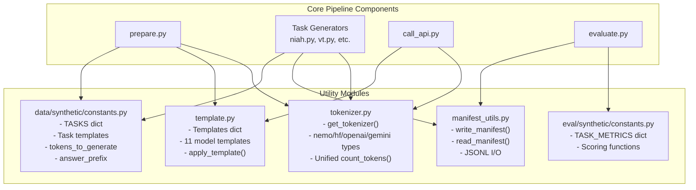

**Sources:** [scripts/data/tokenizer.py](), [scripts/data/template.py](), [scripts/data/manifest_utils.py](), [scripts/data/synthetic/constants.py](), [scripts/eval/synthetic/constants.py]()

### Utility Module Responsibilities

| Module | Key Functions | Purpose |
|--------|---------------|---------|
| **tokenizer.py** | `get_tokenizer()`, `count_tokens()` | Multi-framework tokenization (NeMo, HuggingFace, OpenAI, Gemini) |
| **template.py** | `apply_template()`, `Templates` dict | Model-specific prompt formatting (11 templates) |
| **manifest_utils.py** | `write_manifest()`, `read_manifest()` | Standardized JSONL file I/O |
| **constants.py (data)** | `TASKS` dict | Task metadata: templates, token limits, answer prefixes |
| **constants.py (eval)** | `TASK_METRICS` dict | Task-specific scoring functions |

**Sources:** [scripts/data/tokenizer.py](), [scripts/data/template.py](), [scripts/data/manifest_utils.py](), [scripts/data/synthetic/constants.py](), [scripts/eval/synthetic/constants.py]()

## Key Design Principles

### 1. Configuration-Driven Architecture

All system behavior is controlled through configuration files rather than code modification:

- **Model Configuration:** `config_models.sh` `MODEL_SELECT()` function maps model names to paths, frameworks, and tokenizers
- **Task Selection:** `config_tasks.sh` defines task arrays per benchmark
- **Task Complexity:** `synthetic.yaml` specifies parameters controlling task difficulty
- **Templates:** `template.py` `Templates` dict defines prompt formats

**Sources:** [scripts/config_models.sh](), [scripts/config_tasks.sh](), [scripts/synthetic.yaml](), [scripts/data/template.py]()

### 2. Factory Pattern for Backend Abstraction

The `get_llm()` factory function [call_api.py]() provides a uniform interface across all seven inference backends. Every implementation provides a `process_batch()` method with consistent semantics:

```python
llm = get_llm(server_type, model_name_or_path, ...)
predictions = llm.process_batch(inputs, **generation_kwargs)
```

**Sources:** [scripts/pred/call_api.py]()

### 3. Sequential Processing Model

The nested loop structure [run.sh:88-132]() ensures:
- Data is generated once per (task, sequence_length) pair
- Predictions are generated immediately after data generation
- Evaluation occurs after all tasks complete at a given sequence length
- Results are incrementally available as the pipeline progresses

**Sources:** [scripts/run.sh:88-132]()

### 4. Tokenizer-Aware Generation

All task generators accept a tokenizer instance and use binary search to maximize context utilization while respecting `max_seq_length` constraints. This ensures samples precisely fit within model context windows.

**Sources:** [scripts/data/prepare.py](), [scripts/data/synthetic/niah.py](), [scripts/data/synthetic/variable_tracking.py](), [scripts/data/synthetic/common_words_extraction.py](), [scripts/data/synthetic/freq_words_extraction.py](), [scripts/data/synthetic/qa.py]()

### 5. Standardized Data Format

All pipeline stages communicate through JSONL files with consistent schema:

**Data Generation Output:**
```json
{
  "index": 0,
  "input": "prompt text...",
  "outputs": ["expected answer"],
  "length": 4096
}
```

**Prediction Output:**
```json
{
  "index": 0,
  "input": "prompt text...",
  "outputs": ["expected answer"],
  "pred": "model prediction"
}
```

**Sources:** [scripts/data/manifest_utils.py](), [scripts/data/prepare.py](), [scripts/pred/call_api.py]()

---

# Page: Pipeline Overview

# Pipeline Overview

<details>
<summary>Relevant source files</summary>

The following files were used as context for generating this wiki page:

- [README.md](README.md)
- [scripts/config_models.sh](scripts/config_models.sh)
- [scripts/run.sh](scripts/run.sh)

</details>


## Purpose and Scope

This document explains the complete execution flow of RULER benchmarks from configuration to final results. It covers the orchestration role of `run.sh`, the configuration loading mechanism, server startup, and the sequential processing model that iterates through sequence lengths and tasks.

For details on individual stages:
- Data generation internals: see [Data Generation Pipeline](#2.2)
- Model serving and inference: see [Inference and Serving](#2.3)
- Evaluation metrics and effective length: see [Evaluation System](#2.4)
- Specific task configurations: see [Task Configuration](#4.2)

---

## Pipeline Execution Flow

The RULER pipeline is orchestrated by `run.sh`, which executes a three-stage process for each task at each sequence length: **data generation**, **prediction generation**, and **evaluation**. The pipeline uses a nested loop structure where the outer loop iterates through sequence lengths (4K to 128K tokens) and the inner loop processes individual tasks.

### Complete Pipeline Diagram

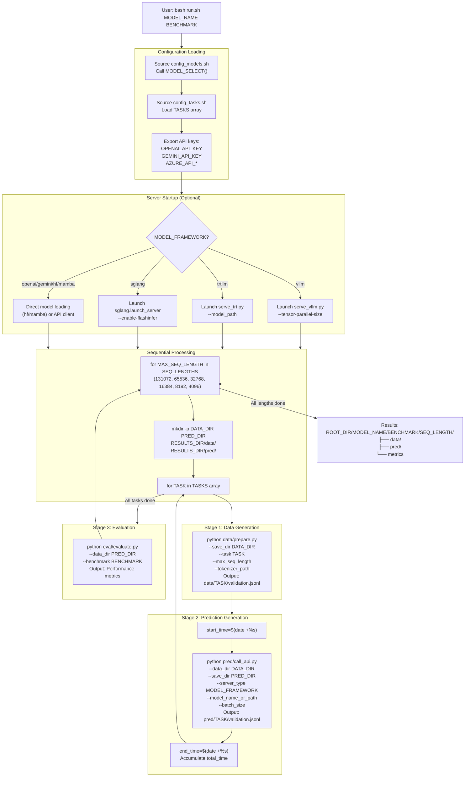

**Sources:** [scripts/run.sh:1-133]()

---

## Configuration Loading Phase

The pipeline begins by loading configuration from two shell scripts that define model properties and task selections.

### Model Configuration

The `MODEL_SELECT()` function in `config_models.sh` maps a model name to its configuration parameters:

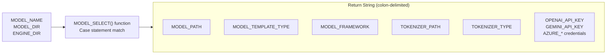

The returned configuration string is parsed using `IFS=":" read` to extract individual variables:

| Variable | Purpose | Examples |
|----------|---------|----------|
| `MODEL_PATH` | Model location or API identifier | `${MODEL_DIR}/llama3.1-8b-Instruct`, `gpt-4` |
| `MODEL_TEMPLATE_TYPE` | Prompt format identifier | `meta-chat`, `meta-llama3`, `jamba`, `base` |
| `MODEL_FRAMEWORK` | Inference backend | `vllm`, `trtllm`, `sglang`, `openai`, `gemini`, `hf`, `mamba` |
| `TOKENIZER_PATH` | Tokenizer location | Model path, `cl100k_base`, `gemini-1.5-pro-latest` |
| `TOKENIZER_TYPE` | Tokenizer framework | `nemo`, `hf`, `openai`, `gemini` |

**Sources:** [scripts/config_models.sh:27-101](), [scripts/run.sh:34-41]()

### Task Configuration

The `config_tasks.sh` file defines task arrays for different benchmarks. The `run.sh` script uses bash's `declare -n` to create a nameref to the appropriate array:

```bash
# From run.sh
source config_tasks.sh
BENCHMARK=${2}
declare -n TASKS=$BENCHMARK  # Create reference to benchmark array
```

For the `synthetic` benchmark, the `TASKS` array contains task names like `niah_single_1`, `vt`, `cwe`, etc. Each task has corresponding configuration in `synthetic.yaml`.

**Sources:** [scripts/run.sh:52-58](), [scripts/config_tasks.sh]()

### Environment Variable Export

API credentials are exported as environment variables for use by client wrappers:

```bash
export OPENAI_API_KEY=${OPENAI_API_KEY}
export GEMINI_API_KEY=${GEMINI_API_KEY}
export AZURE_API_ID=${AZURE_ID}
export AZURE_API_SECRET=${AZURE_SECRET}
export AZURE_API_ENDPOINT=${AZURE_ENDPOINT}
```

**Sources:** [scripts/run.sh:44-48]()

---

## Server Startup

For local model frameworks (`vllm`, `trtllm`, `sglang`), the pipeline launches a server process before entering the main processing loop. This server runs throughout the entire benchmark execution.

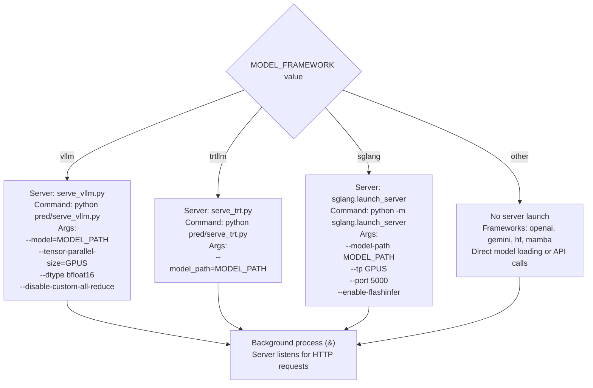

**Key details:**

- Servers are launched with `&` to run in background
- HTTP endpoint defaults to port 5000 for client communication
- Servers persist across all sequence lengths and tasks
- For `hf` and `mamba` frameworks, models are loaded directly in `call_api.py`
- For API frameworks (`openai`, `gemini`), no local server is needed

**Sources:** [scripts/run.sh:61-84]()

---

## Sequential Processing Model

The core pipeline uses nested loops to process all combinations of sequence lengths and tasks sequentially.

### Nested Loop Structure

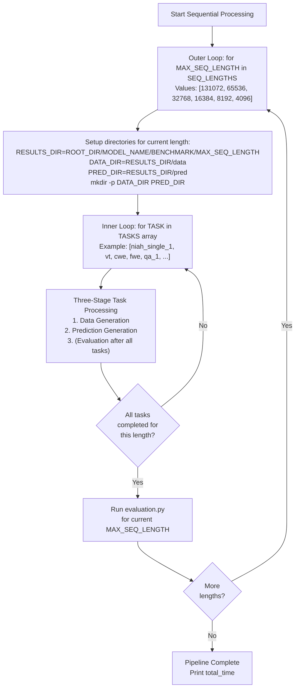

**Sequence length array:** Defined in `config_models.sh` as `SEQ_LENGTHS=(131072 65536 32768 16384 8192 4096)`. The pipeline processes from longest to shortest to enable early termination if needed.

**Sources:** [scripts/run.sh:88-130](), [scripts/config_models.sh:18-25]()

---

## Three-Stage Task Processing

For each task at each sequence length, the pipeline executes three distinct stages.

### Stage 1: Data Generation

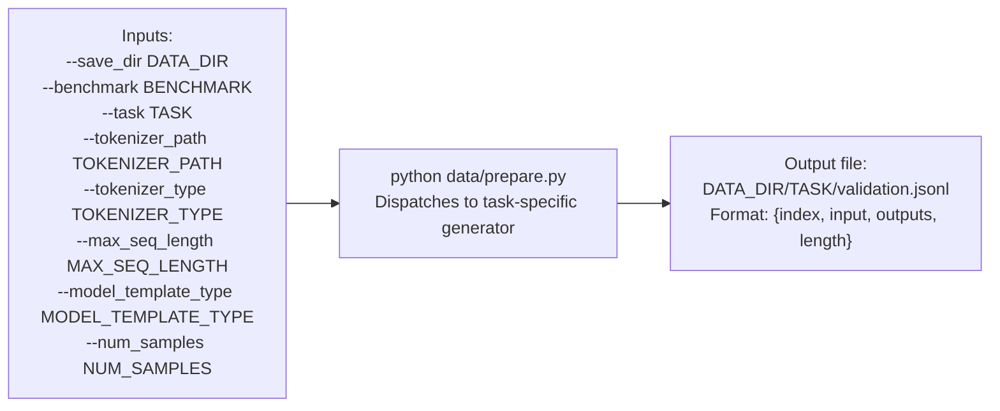

The `prepare.py` script orchestrates task-specific data generation. It loads task configuration from `synthetic.yaml`, initializes the appropriate tokenizer, and calls the task generator script (e.g., `niah.py`, `vt.py`).

**Sources:** [scripts/run.sh:98-107]()

### Stage 2: Prediction Generation

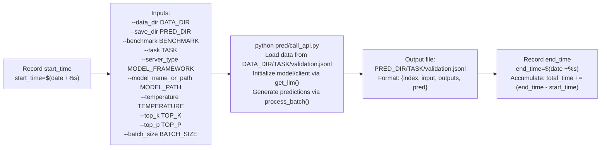

This stage runs model inference on the generated samples. The pipeline tracks execution time for each task to measure inference performance. Generation parameters are controlled via `TEMPERATURE`, `TOP_K`, and `TOP_P` variables.

**Sources:** [scripts/run.sh:109-124]()

### Stage 3: Evaluation

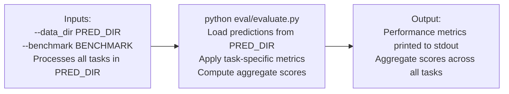

Evaluation runs **once** after all tasks at a given sequence length are complete. The `evaluate.py` script loads predictions from all task directories and computes metrics defined in `eval/constants.py`.

**Sources:** [scripts/run.sh:127-129]()

---

## Directory Structure and Data Flow

The pipeline organizes outputs in a hierarchical directory structure based on model, benchmark, and sequence length:

```
ROOT_DIR/
└── MODEL_NAME/
    └── BENCHMARK/
        └── MAX_SEQ_LENGTH/
            ├── data/
            │   ├── niah_single_1/
            │   │   └── validation.jsonl
            │   ├── vt/
            │   │   └── validation.jsonl
            │   └── ...
            └── pred/
                ├── niah_single_1/
                │   └── validation.jsonl
                ├── vt/
                │   └── validation.jsonl
                └── ...
```

### Data Flow Diagram

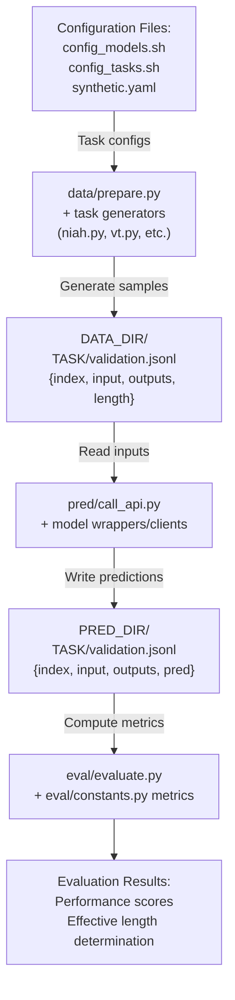

**Sources:** [scripts/run.sh:91-95]()

---

## Pipeline Variables and Parameters

Key variables that control pipeline execution:

| Variable | Source | Purpose | Example Values |
|----------|--------|---------|----------------|
| `GPUS` | `run.sh` line 26 | Tensor parallelism size | `1`, `2`, `4`, `8` |
| `ROOT_DIR` | `run.sh` line 27 | Output root directory | `benchmark_root` |
| `MODEL_DIR` | `run.sh` line 28 | HuggingFace models location | `../..` |
| `ENGINE_DIR` | `run.sh` line 29 | TensorRT-LLM engines location | `.` |
| `BATCH_SIZE` | `run.sh` line 30 | Inference batch size | `1` (increase for better GPU utilization) |
| `TEMPERATURE` | `config_models.sh` line 15 | Sampling temperature | `0.0` (greedy decoding) |
| `TOP_P` | `config_models.sh` line 16 | Nucleus sampling threshold | `1.0` |
| `TOP_K` | `config_models.sh` line 17 | Top-K sampling limit | `32` |
| `SEQ_LENGTHS` | `config_models.sh` lines 18-25 | Sequence length sweep | `[131072, 65536, 32768, 16384, 8192, 4096]` |
| `NUM_SAMPLES` | `config_tasks.sh` | Samples per task | Task-specific (e.g., `500`) |

**Sources:** [scripts/run.sh:26-30](), [scripts/config_models.sh:15-25]()

---

## Execution Summary

The RULER pipeline executes with the following characteristics:

1. **Sequential processing:** One sequence length at a time, one task at a time
2. **Server persistence:** Local servers run throughout all tasks and lengths
3. **Incremental results:** Each task generates separate output files
4. **Time tracking:** Inference time is measured per task and accumulated
5. **Batch evaluation:** Metrics computed once per sequence length after all tasks complete

**Total execution time:** For 6 sequence lengths × 13 tasks = 78 data generation runs + 78 inference runs + 6 evaluation runs.

**Sources:** [scripts/run.sh:88-133]()

---

# Page: Data Generation Pipeline

# Data Generation Pipeline

<details>
<summary>Relevant source files</summary>

The following files were used as context for generating this wiki page:

- [scripts/data/manifest_utils.py](scripts/data/manifest_utils.py)
- [scripts/data/prepare.py](scripts/data/prepare.py)
- [scripts/data/synthetic/niah.py](scripts/data/synthetic/niah.py)
- [scripts/data/synthetic/variable_tracking.py](scripts/data/synthetic/variable_tracking.py)
- [scripts/synthetic.yaml](scripts/synthetic.yaml)

</details>


The Data Generation Pipeline in RULER is responsible for creating synthetic task data used to evaluate the effective context utilization capabilities of long-context language models. This component transforms source materials and templates into structured test sets that measure specific aspects of model performance across varying context lengths.

For information about running inference with these generated datasets, see [Inference Pipeline](#2.2).

## Overview

The Data Generation Pipeline prepares benchmark datasets by generating synthetic tasks with controlled complexity and known ground-truth answers. This enables precise evaluation of how effectively models utilize information across long contexts.

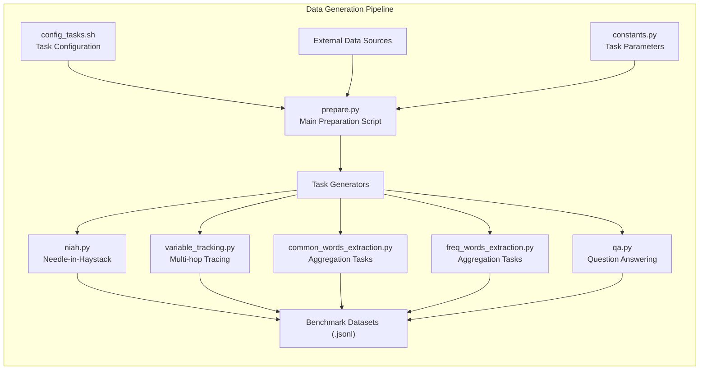

Sources: [scripts/data/prepare.py:15-62](), [scripts/data/synthetic/constants.py:15-54]()

## Core Components

### Preparation Script

The primary entry point for data generation is `prepare.py`, which orchestrates the creation of task-specific datasets. This script:

1. Loads task configurations from YAML files
2. Merges them with base task parameters
3. Applies appropriate templates
4. Calls task-specific generation scripts
5. Ensures output is properly formatted and tokenized

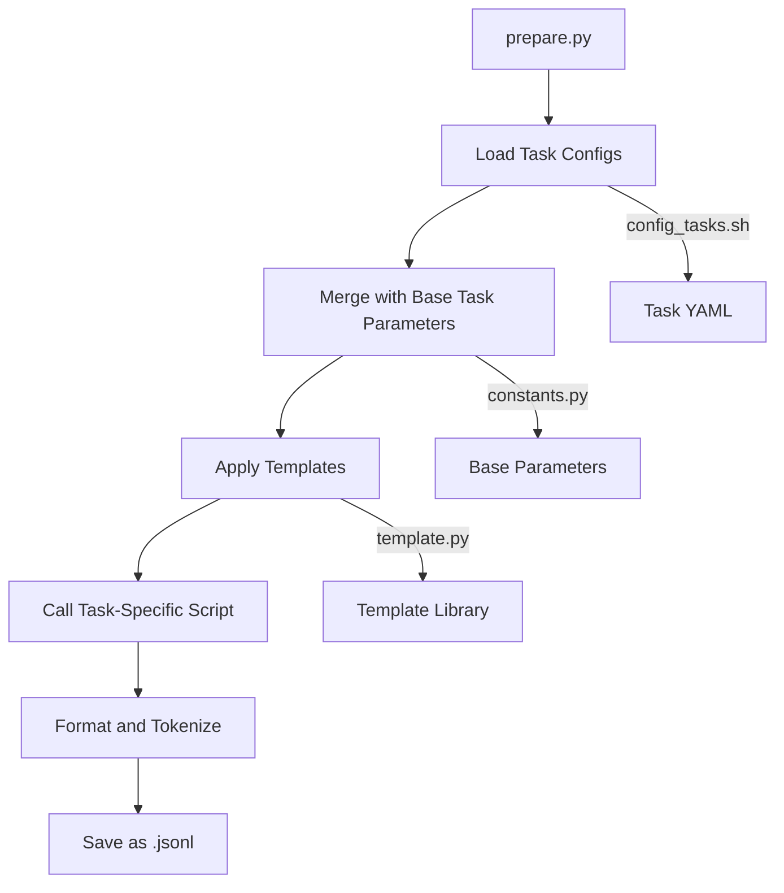

Sources: [scripts/data/prepare.py:65-147]()

### External Data Sources

RULER uses several external data sources for creating realistic contexts:

| Data Source | Description | Used For |
|-------------|-------------|----------|
| Paul Graham Essays | Collection of essays downloaded from paulgraham.com | Needle-in-a-Haystack tasks |
| SQuAD | Stanford Question Answering Dataset | QA tasks |
| HotpotQA | Multi-hop question answering dataset | QA tasks |
| Word Lists | Common nouns, verbs, and adjectives | Word extraction tasks |

The system includes utilities to download and preprocess these external sources. For example, Paul Graham essays are downloaded and compiled into a single JSON file using the provided script.

Sources: [scripts/data/synthetic/json/download_paulgraham_essay.py:15-82]()

## Data Generation Workflow

The data generation process follows these steps:

1. **Configuration**: Task parameters are defined in `config_tasks.sh` and merged with base parameters
2. **Preparation**: `prepare.py` orchestrates the generation process
3. **Task-specific generation**: Specialized scripts generate data for each task type
4. **Tokenization**: Content is tokenized to ensure it fits within model context limits
5. **Output**: Formatted data is saved as JSONL files with inputs and expected outputs

```mermaid
sequenceDiagram
    participant User
    participant prepare.py
    participant Task Script
    participant Tokenizer
    participant Data File
    
    User->>prepare.py: Execute with task parameters
    prepare.py->>prepare.py: Load configurations
    prepare.py->>Task Script: Call with parameters
    Task Script->>Tokenizer: Check sequence length
    Task Script->>Task Script: Generate examples
    Task Script->>Data File: Save formatted JSONL
    prepare.py->>User: Report completion
```

Sources: [scripts/data/prepare.py:65-147]()

## Task Types and Templates

RULER includes several synthetic task types, each designed to evaluate different aspects of context utilization:

| Task Type | Purpose | Key Parameters |
|-----------|---------|----------------|
| Needle-in-a-Haystack | Tests retrieval of specific information from long context | `type_haystack`, `type_needle`, `num_needle_k/v/q` |
| Variable Tracking | Tests multi-hop logical reasoning through variable chains | `num_chains`, `num_hops` |
| Common Words Extraction | Tests ability to identify and count repeated items | `freq_cw`, `freq_ucw`, `num_cw` |
| Frequent Words Extraction | Tests ability to identify patterns in noisy text | `alpha` |
| Question Answering | Tests comprehension using existing QA datasets | `dataset` (squad/hotpotqa) |

Each task has a template defined in `constants.py` that structures how the prompt is presented to the model. Templates include placeholders for `{context}`, `{query}`, and task-specific parameters.

Sources: [scripts/data/synthetic/constants.py:24-54](), [scripts/data/synthetic/common_words_extraction.py:15-166]()

## JSONL Output Format

The pipeline generates datasets in JSONL format with the following structure:

```
{
    "index": int,
    "input": str,
    "outputs": [str],
    "length": int
}
```

Where:
- `index`: Sequential sample identifier
- `input`: Formatted prompt including context and query
- `outputs`: Expected output (ground truth answers)
- `length`: Token count of the input (for verification of context length)

Sources: [scripts/data/prepare.py:15-32]()

## Data Scaling and Chunking

The pipeline supports generating datasets at different context lengths to evaluate how model performance scales with context size. Additionally, it includes chunking capabilities to split large generation jobs:

```mermaid
flowchart TD
    CONFIG["Task Configuration"] --> |"Context Length"| SCALING["Scaling Parameters"]
    SCALING --> SHORT["Short Context<br>(e.g., 4K tokens)"]
    SCALING --> MEDIUM["Medium Context<br>(e.g., 16K tokens)"]
    SCALING --> LONG["Long Context<br>(e.g., 100K tokens)"]
    
    CONFIG --> |"Parallelization"| CHUNKING["Chunking Parameters"]
    CHUNKING --> CHUNK1["Chunk 1"]
    CHUNKING --> CHUNK2["Chunk 2"]
    CHUNKING --> CHUNKN["Chunk N"]
    
    SHORT & MEDIUM & LONG --> |"Per Length"| DATASETS["Task Datasets"]
    CHUNK1 & CHUNK2 & CHUNKN --> |"Merge"| DATASETS
```

Sources: [scripts/data/prepare.py:93-96]()

## Template System

The template system in RULER allows for flexibility in prompt construction across different model types:

```mermaid
flowchart LR
    subgraph "Template Layer"
        CONSTANTS["constants.py<br>Task Templates"] --> BASE_TEMPLATE["Task-specific Template"]
        TEMPLATE_PY["template.py<br>Model Templates"] --> MODEL_TEMPLATE["Model-specific Template"]
        
        BASE_TEMPLATE --> COMBINED["Combined Template"]
        MODEL_TEMPLATE --> COMBINED
    end
    
    COMBINED --> FINAL["Final Prompt"]
```

The system merges task-specific templates (defining the task structure) with model-specific templates (formatting for specific model types like chat models vs. base models).

Sources: [scripts/data/prepare.py:84-91]()

## Integration with Benchmark System

The Data Generation Pipeline is the first stage in the RULER benchmark workflow:

```mermaid
flowchart LR
    subgraph "RULER Benchmark Flow"
        DATA["Data Generation<br>prepare.py"] --> SERVE["Model Serving"]
        SERVE --> INFERENCE["Model Inference<br>call_api.py"]
        INFERENCE --> EVALUATE["Evaluation<br>evaluate.py"]
    end
```

This pipeline creates the data that flows through the rest of the system for model evaluation.

Sources: [scripts/data/prepare.py:15-32]()

## Command Line Interface

The Data Generation Pipeline is driven by command-line parameters that control various aspects of data generation:

| Parameter | Description | Example |
|-----------|-------------|---------|
| `--save_dir` | Directory to save generated datasets | `./datasets` |
| `--benchmark` | Benchmark type (currently only synthetic) | `synthetic` |
| `--task` | Specific task to generate | `niah_single_1` |
| `--tokenizer_path` | Path to tokenizer model | `tokenizer.model` |
| `--tokenizer_type` | Type of tokenizer | `nemo`, `hf`, `openai` |
| `--max_seq_length` | Maximum sequence length | `4096`, `16384`, `100000` |
| `--num_samples` | Number of samples to generate | `500` |
| `--model_template_type` | Template formatting type | `base`, `vicuna-chat` |

Sources: [scripts/data/prepare.py:48-62]()

---

# Page: Inference and Serving

# Inference and Serving

<details>
<summary>Relevant source files</summary>

The following files were used as context for generating this wiki page:

- [scripts/pred/call_api.py](scripts/pred/call_api.py)
- [scripts/pred/client_wrappers.py](scripts/pred/client_wrappers.py)
- [scripts/pred/model_wrappers.py](scripts/pred/model_wrappers.py)

</details>


This document describes RULER's inference and serving architecture, which provides a unified interface for generating predictions across seven different model backends. The system abstracts three serving paradigms: local HTTP servers (vLLM, TensorRT-LLM, SGLang), direct model loading (HuggingFace, Mamba), and external APIs (OpenAI, Gemini). For information about data generation, see [2.2](#2.2). For evaluation of predictions, see [2.4](#2.4).

## Architecture Overview

The inference layer centers around [scripts/pred/call_api.py]() as the main orchestrator. It implements a factory pattern through the `get_llm()` function that instantiates the appropriate client or model wrapper based on the `--server_type` parameter. All backends implement a consistent interface with `process_batch()` methods for parallel inference.

```mermaid
graph TB
    subgraph "Orchestration"
        RUN["run.sh<br/>Pipeline Controller"]
        CALL["call_api.py<br/>Inference Orchestrator"]
    end
    
    subgraph "Factory Pattern"
        FACTORY["get_llm()<br/>Backend Factory"]
    end
    
    subgraph "Local HTTP Servers"
        SERVE_V["serve_vllm.py<br/>vLLM Server"]
        SERVE_T["serve_trt.py<br/>TensorRT-LLM Server"]
        SERVE_S["sglang<br/>SGLang Server"]
        
        CLIENT_V["VLLMClient"]
        CLIENT_T["TRTLLMClient"]
        CLIENT_S["SGLClient"]
    end
    
    subgraph "Direct Model Loading"
        MODEL_HF["HuggingFaceModel"]
        MODEL_M["MambaModel"]
    end
    
    subgraph "External APIs"
        CLIENT_O["OpenAIClient"]
        CLIENT_G["GeminiClient"]
    end
    
    subgraph "Data Flow"
        INPUT["data/TASK/validation.jsonl<br/>{index, input, outputs}"]
        OUTPUT["pred/TASK/validation.jsonl<br/>{index, input, outputs, pred}"]
    end
    
    RUN --> CALL
    CALL --> FACTORY
    
    FACTORY -->|"server_type='vllm'"| CLIENT_V
    FACTORY -->|"server_type='trtllm'"| CLIENT_T
    FACTORY -->|"server_type='sglang'"| CLIENT_S
    FACTORY -->|"server_type='hf'"| MODEL_HF
    FACTORY -->|"server_type='mamba'"| MODEL_M
    FACTORY -->|"server_type='openai'"| CLIENT_O
    FACTORY -->|"server_type='gemini'"| CLIENT_G
    
    CLIENT_V -->|"HTTP PUT"| SERVE_V
    CLIENT_T -->|"HTTP PUT"| SERVE_T
    CLIENT_S -->|"HTTP PUT"| SERVE_S
    
    INPUT --> CALL
    CALL --> OUTPUT
```

**Sources:** [scripts/pred/call_api.py:1-334](), [scripts/pred/client_wrappers.py:1-417](), [scripts/pred/model_wrappers.py:1-133]()

## Backend Selection Factory

The `get_llm()` function in [scripts/pred/call_api.py:98-199]() implements the factory pattern, instantiating the appropriate backend based on command-line arguments. All backends accept a `tokens_to_generate` parameter and return objects implementing the `process_batch()` interface.

```mermaid
graph LR
    subgraph "Factory Function"
        FACTORY["get_llm(tokens_to_generate)"]
    end
    
    subgraph "Server Types"
        TYPE_T["args.server_type='trtllm'"]
        TYPE_V["args.server_type='vllm'"]
        TYPE_S["args.server_type='sglang'"]
        TYPE_O["args.server_type='openai'"]
        TYPE_G["args.server_type='gemini'"]
        TYPE_H["args.server_type='hf'"]
        TYPE_M["args.server_type='mamba'"]
    end
    
    subgraph "Instantiated Objects"
        OBJ_T["TRTLLMClient(server_host, server_port,<br/>temperature, top_k, top_p,<br/>random_seed, stop, tokens_to_generate,<br/>max_attention_window_size)"]
        OBJ_V["VLLMClient(server_host, server_port,<br/>temperature, top_k, top_p,<br/>random_seed, stop, tokens_to_generate)"]
        OBJ_S["SGLClient(server_host, server_port,<br/>temperature, top_k, top_p,<br/>random_seed, stop, tokens_to_generate)"]
        OBJ_O["OpenAIClient(model_name,<br/>temperature, top_k, top_p,<br/>random_seed, stop, tokens_to_generate)"]
        OBJ_G["GeminiClient(model_name,<br/>temperature, top_k, top_p,<br/>random_seed, stop, tokens_to_generate)"]
        OBJ_H["HuggingFaceModel(name_or_path,<br/>do_sample, repetition_penalty,<br/>temperature, top_k, top_p,<br/>stop, max_new_tokens)"]
        OBJ_M["MambaModel(name_or_path,<br/>repetition_penalty, temperature,<br/>top_k, top_p, stop, max_new_tokens)"]
    end
    
    FACTORY --> TYPE_T
    FACTORY --> TYPE_V
    FACTORY --> TYPE_S
    FACTORY --> TYPE_O
    FACTORY --> TYPE_G
    FACTORY --> TYPE_H
    FACTORY --> TYPE_M
    
    TYPE_T --> OBJ_T
    TYPE_V --> OBJ_V
    TYPE_S --> OBJ_S
    TYPE_O --> OBJ_O
    TYPE_G --> OBJ_G
    TYPE_H --> OBJ_H
    TYPE_M --> OBJ_M
```

**Sources:** [scripts/pred/call_api.py:98-199]()

## Local HTTP Server Clients

Three client classes handle communication with locally-hosted inference servers. All inherit from the base `Client` class and communicate via HTTP PUT requests to `/generate` endpoints.

### Client Base Class

The `Client` abstract base class [scripts/pred/client_wrappers.py:36-106]() provides:
- SSH tunneling support via `sshtunnel_requests` for remote servers
- Retry logic with exponential backoff using `tenacity` decorators
- Parallel batch processing via `ThreadPoolExecutor` with 96+ threads
- Consistent request/response handling

Key methods:
- `_single_call()`: Abstract method implemented by subclasses
- `_send_request()`: HTTP communication with retry logic [scripts/pred/client_wrappers.py:73-90]()
- `process_batch()`: Parallel processing with thread pooling [scripts/pred/client_wrappers.py:92-105]()

### TRTLLMClient

The `TRTLLMClient` class [scripts/pred/client_wrappers.py:108-133]() communicates with TensorRT-LLM servers. Request format includes:

| Parameter | Type | Description |
|-----------|------|-------------|
| `prompts` | List[str] | Input prompts |
| `tokens_to_generate` | int | Max new tokens |
| `temperature` | float | Sampling temperature |
| `top_k` | int | Top-k sampling |
| `top_p` | float | Nucleus sampling |
| `random_seed` | int | Random seed for reproducibility |
| `stop_words_list` | str | Comma-separated stop sequences |
| `max_attention_window_size` | int (optional) | Sliding window size |

**Sources:** [scripts/pred/client_wrappers.py:108-133]()

### VLLMClient

The `VLLMClient` class [scripts/pred/client_wrappers.py:136-158]() communicates with vLLM servers using the OpenAI-compatible API format. Request format:

| Parameter | Type | Description |
|-----------|------|-------------|
| `prompt` | str | Single input prompt (not batched) |
| `max_tokens` | int | Max new tokens |
| `temperature` | float | Sampling temperature |
| `top_k` | int | Top-k sampling |
| `top_p` | float | Nucleus sampling |
| `stop` | List[str] | Stop sequences |

Note: Random seed is not supported by the vLLM server endpoint.

**Sources:** [scripts/pred/client_wrappers.py:136-158]()

### SGLClient

The `SGLClient` class [scripts/pred/client_wrappers.py:161-185]() communicates with SGLang servers. Request format nests sampling parameters:

```
{
    "text": str,
    "sampling_params": {
        "max_new_tokens": int,
        "temperature": float,
        "top_k": int,
        "top_p": float,
        "stop": List[str]
    }
}
```

Note: Random seed is not supported by the SGLang server endpoint.

**Sources:** [scripts/pred/client_wrappers.py:161-185]()

## External API Clients

Two client classes handle communication with external commercial APIs: OpenAI (including Azure) and Google Gemini.

### OpenAIClient

The `OpenAIClient` class [scripts/pred/client_wrappers.py:188-339]() supports both OpenAI and Azure OpenAI APIs. Key features:

**Environment Variables:**
- `OPENAI_API_KEY`: Direct OpenAI API access
- `AZURE_API_ID`, `AZURE_API_SECRET`, `AZURE_API_ENDPOINT`: Azure OAuth authentication

**Token Management:**
- Uses `tiktoken.get_encoding("cl100k_base")` for token counting
- Dynamically reduces `tokens_to_generate` if prompt exceeds model limits [scripts/pred/client_wrappers.py:295-298]()
- Caches Azure OAuth tokens with automatic renewal [scripts/pred/client_wrappers.py:306-339]()

**Model Support:**

| Model Family | Context Length |
|--------------|----------------|
| gpt-4 series | 8K - 128K |
| gpt-3.5-turbo series | 4K - 16K |
| Azure gpt-4 | 32K - 128K |
| Azure gpt-35-turbo | 16K |

**Sources:** [scripts/pred/client_wrappers.py:188-339]()

### GeminiClient

The `GeminiClient` class [scripts/pred/client_wrappers.py:342-416]() interfaces with Google's Generative AI API. Key features:

**Model Support:**

| Model | Max Input Tokens | Max Output Tokens |
|-------|------------------|-------------------|
| gemini-1.0-pro-latest | 30,720 | 2,048 |
| gemini-1.5-pro-latest | 1,048,576 | 8,192 |

**Safety Settings:**
Disables all content filtering to prevent blocking of synthetic evaluation data [scripts/pred/client_wrappers.py:370-376]():
- `HARM_CATEGORY_HARASSMENT`: BLOCK_NONE
- `HARM_CATEGORY_HATE_SPEECH`: BLOCK_NONE
- `HARM_CATEGORY_SEXUALLY_EXPLICIT`: BLOCK_NONE
- `HARM_CATEGORY_DANGEROUS_CONTENT`: BLOCK_NONE

**Error Handling:**
Implements custom retry logic with 60-second fixed intervals and returns empty text on failure [scripts/pred/client_wrappers.py:403-408]().

**Sources:** [scripts/pred/client_wrappers.py:342-416]()

## Direct Model Loading

Two wrapper classes enable direct model loading without separate servers, useful for models not supported by serving frameworks.

### HuggingFaceModel

The `HuggingFaceModel` class [scripts/pred/model_wrappers.py:22-94]() loads models via Transformers library with optimizations:

**Features:**
- Attempts FlashAttention-2 via `attn_implementation="flash_attention_2"` [scripts/pred/model_wrappers.py:31]()
- Fallback to standard attention for Yarn-Llama models
- Uses `torch.bfloat16` precision and `device_map="auto"` for multi-GPU inference
- Supports both `pipeline` API and direct `model.generate()` [scripts/pred/model_wrappers.py:61-74]()
- Handles left-padding for batch inference [scripts/pred/model_wrappers.py:50-54]()

**Llama3 Tokenizer Workaround:**
Implements a fix for tokenizer non-determinism by re-tokenizing and decoding the prompt before comparison [scripts/pred/model_wrappers.py:82-86](). See issue [NVIDIA/RULER#54]() for details.

**Stop Sequence Handling:**
Post-processes generation output by splitting on stop sequences [scripts/pred/model_wrappers.py:88-90]().

**Sources:** [scripts/pred/model_wrappers.py:22-94]()

### MambaModel

The `MambaModel` class [scripts/pred/model_wrappers.py:97-132]() loads Mamba state-space models using the `mamba_ssm` library:

**Features:**
- Uses `EleutherAI/gpt-neox-20b` tokenizer [scripts/pred/model_wrappers.py:102]()
- Loads models with `torch.bfloat16` precision
- Uses Mamba's custom generation function with `cg=True` for computational efficiency [scripts/pred/model_wrappers.py:117-125]()
- Returns only generated tokens (excludes prompt from output) [scripts/pred/model_wrappers.py:128]()

**Batch Processing:**
Currently implements naive sequential processing rather than true batching [scripts/pred/model_wrappers.py:130-132]().

**Sources:** [scripts/pred/model_wrappers.py:97-132]()

## Prediction Generation Process

The main inference workflow in `call_api.py` orchestrates data loading, parallel inference, and result writing.

```mermaid
sequenceDiagram
    participant Run as run.sh
    participant CallAPI as call_api.py
    participant Factory as get_llm()
    participant LLM as Client/Model
    participant File as File System
    
    Run->>CallAPI: Execute with args
    CallAPI->>File: Read data/TASK/validation.jsonl
    File-->>CallAPI: List[{index, input, outputs}]
    
    CallAPI->>Factory: get_llm(tokens_to_generate)
    Factory-->>CallAPI: llm instance
    
    loop For each batch
        CallAPI->>CallAPI: Create thread pool
        loop For each thread
            CallAPI->>LLM: process_batch(prompts)
            LLM-->>CallAPI: List[{text: [pred]}]
        end
        CallAPI->>CallAPI: Join threads
        CallAPI->>File: Write predictions to JSONL
    end
    
    CallAPI-->>Run: Complete
```

**Sources:** [scripts/pred/call_api.py:202-333]()

### Data Loading and Resumption

The system supports resuming interrupted runs by checking for existing predictions [scripts/pred/call_api.py:234-238]():

```python
if os.path.exists(pred_file):
    pred_index = [sample['index'] for sample in read_manifest(pred_file)]
    data = [sample for sample in read_manifest(task_file) 
            if sample['index'] not in pred_index]
```

### Parallel Batch Processing

Inference uses a thread-based parallelism model [scripts/pred/call_api.py:274-327]():

1. **Batching:** Data is grouped into batches of size `args.batch_size` [scripts/pred/call_api.py:277-289]()
2. **Threading:** Each batch is processed in a separate thread, with up to `args.threads` concurrent threads [scripts/pred/call_api.py:300-320]()
3. **Incremental Writing:** Results are written to disk as each thread group completes [scripts/pred/call_api.py:322-327]()

The `get_output()` function [scripts/pred/call_api.py:243-272]() implements retry logic that repeatedly calls `llm.process_batch()` until successful.

**Sources:** [scripts/pred/call_api.py:243-327]()

## Data Formats

### Input Format

Task data loaded from `data/TASK/validation.jsonl` contains:

| Field | Type | Description |
|-------|------|-------------|
| `index` | int | Unique sample identifier |
| `input` | str | Formatted prompt for the model |
| `outputs` | List[str] | Ground truth answers |
| `length` | int (optional) | Token count of input |
| `truncation` | int (optional) | Truncation indicator |
| `others` | dict (optional) | Task-specific metadata |

**Sources:** [scripts/pred/call_api.py:17-31]()

### Output Format

Predictions written to `pred/TASK/validation.jsonl` contain all input fields plus:

| Field | Type | Description |
|-------|------|-------------|
| `pred` | str | Model's generated prediction |

The prediction extraction handles various response formats [scripts/pred/call_api.py:256-262]():
- String responses: Used directly
- List responses: First element extracted
- Empty responses: Stored as empty string

**Sources:** [scripts/pred/call_api.py:256-272]()

## Generation Parameters

All backends accept a consistent set of generation parameters:

| Parameter | CLI Argument | Type | Default | Description |
|-----------|--------------|------|---------|-------------|
| Temperature | `--temperature` | float | 1.0 | Sampling temperature (0=greedy) |
| Top-K | `--top_k` | int | 32 | Top-k sampling parameter |
| Top-P | `--top_p` | float | 1.0 | Nucleus sampling threshold |
| Random Seed | `--random_seed` | int | 0 | Seed for reproducibility |
| Stop Words | `--stop_words` | str | '' | Comma-separated stop sequences |
| Sliding Window | `--sliding_window_size` | int | None | Attention window size (TensorRT only) |
| Batch Size | `--batch_size` | int | 1 | Samples per batch |
| Threads | `--threads` | int | 4 | Concurrent inference threads |

Note: HuggingFace and Gemini backends force `threads=1` due to limitations [scripts/pred/call_api.py:94-95]().

**Sources:** [scripts/pred/call_api.py:83-95]()

## Error Handling and Retry Logic

The system implements multiple layers of error resilience:

### HTTP Client Retry

All server-based clients use `tenacity` decorators for automatic retry [scripts/pred/client_wrappers.py:73]():
- Exponential backoff with random jitter: 15-60 seconds
- Maximum 3 retry attempts
- Applies to network errors and HTTP failures

### Azure Token Renewal

The OpenAI client automatically renews Azure OAuth tokens on 401 errors [scripts/pred/client_wrappers.py:278-280]():
```python
if self.azure_api_id and self.azure_api_secret and e.status_code == 401:
    # token expired
    self._create_client()
```

### Inference Loop Retry

The main inference loop implements infinite retry with exception printing [scripts/pred/call_api.py:246-251]():
```python
while True:
    try:
        pred_list = llm.process_batch(prompts=input_list)
        break
    except Exception as e:
        traceback.print_exc()
```

This ensures that transient errors (e.g., server restarts, network issues) do not cause data loss.

**Sources:** [scripts/pred/client_wrappers.py:73-90](), [scripts/pred/call_api.py:246-251]()

## Command-Line Interface

The `call_api.py` script accepts the following arguments:

**Data Arguments:**
- `--data_dir`: Path to load dataset JSONL files
- `--save_dir`: Path to save prediction JSONL files
- `--benchmark`: Benchmark name (default: 'synthetic')
- `--task`: Task name within benchmark
- `--subset`: Data subset (default: 'validation')
- `--chunk_idx`, `--chunk_amount`: For distributed processing across multiple workers

**Server Arguments:**
- `--server_type`: Backend selection (trtllm, vllm, sglang, openai, gemini, hf, mamba)
- `--server_host`: Server hostname (default: '127.0.0.1')
- `--server_port`: Server port (default: '5000')
- `--ssh_server`, `--ssh_key_path`: For SSH tunneling
- `--model_name_or_path`: Model identifier (API name or local path)

**Inference Arguments:**
- See Generation Parameters table above

**Sources:** [scripts/pred/call_api.py:63-93]()

---

# Page: Evaluation System

# Evaluation System

<details>
<summary>Relevant source files</summary>

The following files were used as context for generating this wiki page:

- [README.md](README.md)

</details>


## Purpose and Scope

This document describes RULER's evaluation system, which computes performance metrics from model predictions and determines the "effective context length" of long-context language models. The evaluation system implements the core methodology described in the RULER paper: comparing model performance against an 85.6% threshold to determine at what sequence length models maintain acceptable performance.

For information about generating predictions, see [Inference and Serving](#2.3). For information about interpreting benchmark results, see [Understanding Results](#5.3).

---

## Core Concepts

### Effective Length vs Claimed Length

RULER distinguishes between two measures of model capability:

- **Claimed Length**: The maximum context size advertised by model creators (e.g., 128K tokens)
- **Effective Length**: The maximum sequence length at which a model maintains performance above the 85.6% threshold

The **85.6% threshold** is derived from Llama-2-7B's average performance at 4K tokens, which represents a baseline for "acceptable" long-context performance. This threshold serves as a qualitative benchmark: models that score below this threshold are considered to have degraded capabilities at that sequence length.

**Example from README.md**:
```
Llama3.1 (70B): Claimed Length = 128K, Effective Length = 64K
- Performance: 96.5% (4K), 95.8% (8K), 95.4% (16K), 94.8% (32K), 88.4% (64K), 66.6% (128K)
- Drops below 85.6% threshold at 128K
```

Sources: [README.md:5-54]()

---

## Evaluation Pipeline Architecture

```mermaid
graph TB
    subgraph "Input Data"
        GOLD["data/{TASK}/validation.jsonl<br/>{index, input, outputs, length}"]
        PRED["pred/{TASK}/validation.jsonl<br/>{index, input, outputs, pred}"]
    end
    
    subgraph "Evaluation Controller"
        EVAL["evaluate.py<br/>Main evaluation orchestrator"]
        ARGS["Command line args<br/>--input_dir<br/>--output_dir<br/>--tasks"]
    end
    
    subgraph "Metric Computation"
        CONSTANTS["constants.py<br/>TASKS dict mapping"]
        METRICS["Task-specific metrics<br/>acc_exist()<br/>acc_match_str_any()<br/>f1_score_cw()"]
    end
    
    subgraph "Result Processing"
        PER_SAMPLE["Per-sample scores<br/>Compute match for each example"]
        AGGREGATE["Task-level aggregation<br/>Mean across samples"]
        FINAL["results/{MODEL}/{TASK}.summary.json<br/>{task, length, score}"]
    end
    
    ARGS --> EVAL
    GOLD --> EVAL
    PRED --> EVAL
    
    EVAL --> CONSTANTS
    CONSTANTS --> METRICS
    
    METRICS --> PER_SAMPLE
    PER_SAMPLE --> AGGREGATE
    AGGREGATE --> FINAL
    
    style EVAL fill:#ffcc99,stroke:#333,stroke-width:3px
    style CONSTANTS fill:#ffe1e1,stroke:#333,stroke-width:2px
    style FINAL fill:#e1ffe1,stroke:#333,stroke-width:2px
```

**Evaluation Flow**:

1. **Input Loading**: Read gold standard labels from `data/` and model predictions from `pred/`
2. **Metric Selection**: Look up task-specific metric from `constants.TASKS` dictionary
3. **Per-Sample Scoring**: Apply metric function to each (gold, prediction) pair
4. **Aggregation**: Compute mean score across all samples for the task
5. **Output Storage**: Write summary statistics to results directory

Sources: [README.md:1-179]()

---

## Metric Definitions by Task Category

The evaluation system defines task-specific metrics in `scripts/eval/synthetic/constants.py`. Each task has a dedicated scoring function that implements domain-appropriate evaluation logic.

### Metric Architecture

```mermaid
graph TB
    subgraph "constants.py Structure"
        TASKS_DICT["TASKS = {<br/>'task_name': scoring_function<br/>}"]
    end
    
    subgraph "Retrieval Tasks"
        NIAH_S["niah_single_1<br/>niah_single_2<br/>niah_single_3<br/>→ acc_match_str_any()"]
        NIAH_M["niah_multikey<br/>niah_multivalue<br/>niah_multiquery<br/>→ acc_match_str_all()"]
    end
    
    subgraph "Multi-hop Tracing"
        VT["vt<br/>→ acc_match_str_all()"]
    end
    
    subgraph "Aggregation Tasks"
        CWE["cwe<br/>→ f1_score_cw()"]
        FWE["fwe<br/>→ f1_score_fwe()"]
    end
    
    subgraph "Question Answering"
        QA["qa_1<br/>qa_2<br/>→ em_squad()<br/>→ f1_squad()"]
    end
    
    TASKS_DICT --> NIAH_S
    TASKS_DICT --> NIAH_M
    TASKS_DICT --> VT
    TASKS_DICT --> CWE
    TASKS_DICT --> FWE
    TASKS_DICT --> QA
    
    style TASKS_DICT fill:#ffe1e1,stroke:#333,stroke-width:2px
```

### Core Metric Functions

| Task Category | Task Names | Metric Function | Description |
|--------------|------------|-----------------|-------------|
| **Retrieval** (Single) | `niah_single_1`, `niah_single_2`, `niah_single_3` | `acc_match_str_any()` | Checks if prediction contains any of the gold answers |
| **Retrieval** (Multi) | `niah_multikey`, `niah_multivalue`, `niah_multiquery` | `acc_match_str_all()` | Checks if prediction contains all gold answers |
| **Multi-hop** | `vt` | `acc_match_str_all()` | Verifies all variable values are correctly traced |
| **Aggregation** | `cwe` | `f1_score_cw()` | F1 score for common word extraction |
| **Aggregation** | `fwe` | `f1_score_fwe()` | F1 score for frequent word extraction |
| **QA** | `qa_1`, `qa_2` | `em_squad()`, `f1_squad()` | SQuAD-style exact match and F1 |

**Key Metric Characteristics**:

- **String Matching**: Most metrics use flexible string matching to handle whitespace and formatting variations
- **Partial Credit**: F1 metrics (CWE, FWE, QA) provide partial credit for partially correct answers
- **Binary Accuracy**: NIAH and VT tasks use binary accuracy (0 or 1 per sample)
- **Case Sensitivity**: Metrics typically normalize for case differences

Sources: [README.md:140-146]()

---

## Evaluation Execution

### Input File Format

Evaluation requires two JSONL files per task:

**Ground Truth** (`data/{TASK}/validation.jsonl`):
```json
{"index": 0, "input": "...", "outputs": ["answer1", "answer2"], "length": 32000}
```

**Predictions** (`pred/{TASK}/validation.jsonl`):
```json
{"index": 0, "input": "...", "outputs": ["answer1", "answer2"], "pred": "model output"}
```

The evaluation script matches samples by `index` and compares `outputs` (gold) with `pred` (model prediction).

### Evaluation Invocation

The evaluation script is called from `run.sh` after all predictions are generated for a given sequence length:

```bash
# Pattern from run.sh
for MAX_SEQ_LENGTH in "${MAX_SEQ_LENGTH_LIST[@]}"; do
    for TASK in "${TASKS[@]}"; do
        # Generate data
        # Generate predictions
    done
    # Evaluate all tasks at this sequence length
    python evaluate.py --input_dir data/ --output_dir pred/ --tasks $TASKS
done
```

This nested loop structure ensures:
1. Data and predictions are generated for all tasks at a sequence length
2. Evaluation happens once per sequence length (not per task)
3. Results are aggregated across tasks for each length

Sources: [README.md:92-135]()

---

## Result Aggregation and Weighted Averaging

### Per-Task Results

Each task produces a score between 0 and 100 representing the percentage of correctly answered samples. These scores are stored in summary JSON files:

```json
{
    "task": "niah_single_1",
    "seq_length": 32768,
    "num_samples": 500,
    "score": 94.2
}
```

### Cross-Task Aggregation

RULER computes three aggregate metrics per sequence length:

| Metric | Description | Calculation |
|--------|-------------|-------------|
| **Avg.** | Simple average across all 13 tasks | `sum(task_scores) / 13` |
| **wAvg. (inc)** | Weighted average with increasing depth weights | Emphasizes later needle positions |
| **wAvg. (dec)** | Weighted average with decreasing depth weights | Emphasizes earlier needle positions |

The weighted averages account for needle position in NIAH tasks (single_1, single_2, single_3 represent needles at different depths).

### Effective Length Determination

```mermaid
graph LR
    subgraph "Sequence Length Evaluation"
        L4K["4K: 95.5%<br/>Above threshold"]
        L8K["8K: 93.8%<br/>Above threshold"]
        L16K["16K: 91.6%<br/>Above threshold"]
        L32K["32K: 87.4%<br/>Above threshold"]
        L64K["64K: 84.7%<br/>Below threshold"]
        L128K["128K: 77.0%<br/>Below threshold"]
    end
    
    subgraph "Threshold Check"
        THRESHOLD["85.6% threshold<br/>Llama-2-7B @ 4K"]
    end
    
    subgraph "Result"
        EFFECTIVE["Effective Length = 32K<br/>Claimed Length = 128K"]
    end
    
    L4K --> THRESHOLD
    L8K --> THRESHOLD
    L16K --> THRESHOLD
    L32K --> THRESHOLD
    L64K --> THRESHOLD
    L128K --> THRESHOLD
    
    THRESHOLD --> EFFECTIVE
    
    style THRESHOLD fill:#ffe1e1,stroke:#333,stroke-width:2px
    style EFFECTIVE fill:#e1ffe1,stroke:#333,stroke-width:2px
```

**Effective length** is determined as the **maximum sequence length** where the model's average score remains **at or above 85.6%**. In the README table, scores exceeding this threshold are underlined.

**Example** (Llama3.1-8B from README):
- 4K: 95.5% ✓
- 8K: 93.8% ✓
- 16K: 91.6% ✓
- 32K: 87.4% ✓ ← Last sequence length above threshold
- 64K: 84.7% ✗
- 128K: 77.0% ✗

**Result**: Effective length = 32K (despite 128K claimed length)

Sources: [README.md:5-54]()

---

## Result Output Structure

### Directory Organization

```
results/
├── {MODEL_NAME}/
│   ├── niah_single_1.summary.json
│   ├── niah_single_2.summary.json
│   ├── niah_single_3.summary.json
│   ├── niah_multikey.summary.json
│   ├── vt.summary.json
│   ├── cwe.summary.json
│   ├── fwe.summary.json
│   ├── qa_1.summary.json
│   └── qa_2.summary.json
└── aggregate_scores.json
```

Each summary file contains per-length performance for one task. The aggregate file combines all tasks into a single performance table, similar to the README table format.

### Performance Table Format

The final output table includes:

| Column | Description |
|--------|-------------|
| Model | Model name and parameter count |
| Claimed Length | Advertised maximum context size |
| Effective Length | Maximum length maintaining 85.6% performance |
| 4K - 128K | Per-length average scores |
| Avg. | Simple average across all tasks |
| wAvg. (inc) | Weighted average (increasing depth) |
| wAvg. (dec) | Weighted average (decreasing depth) |

Scores **exceeding the 85.6% threshold** are underlined in the README table to visually indicate effective context ranges.

Sources: [README.md:5-54]()

---

## Evaluation Configuration

The evaluation system is configured through:

1. **Task Registration**: Tasks must be defined in `scripts/config_tasks.sh` to be included
2. **Metric Mapping**: Each task name must have a corresponding entry in `eval/constants.py`
3. **Sequence Lengths**: Evaluated lengths are specified in `run.sh` via `MAX_SEQ_LENGTH_LIST`
4. **Sample Count**: Number of evaluation samples per task is set during data generation

**Default Configuration**:
- **Sequence Lengths**: [4096, 8192, 16384, 32768, 65536, 131072]
- **Sample Count**: Varies by task (typically 500 samples)
- **Tasks**: 13 tasks across 4 categories (configurable in `config_tasks.sh`)

Sources: [README.md:92-166]()

---

## Extending the Evaluation System

To add a new metric for a custom task:

1. **Define Metric Function** in `scripts/eval/synthetic/constants.py`:
   ```python
   def my_custom_metric(outputs, pred):
       # outputs: list of gold answers
       # pred: model prediction string
       # return: float score (0-100)
       pass
   ```

2. **Register Task** in `TASKS` dictionary:
   ```python
   TASKS = {
       'my_task': my_custom_metric,
       # ... other tasks
   }
   ```

3. **Ensure Consistency**: Metric function signature must match `(outputs, pred) -> float`

4. **Test Metric**: Verify metric behavior on edge cases (empty predictions, partial matches, etc.)

The modular design allows metric functions to implement arbitrary evaluation logic while maintaining a consistent interface.

Sources: [README.md:150-165]()

---

# Page: Benchmark Tasks

# Benchmark Tasks

<details>
<summary>Relevant source files</summary>

The following files were used as context for generating this wiki page:

- [README.md](README.md)
- [scripts/data/synthetic/variable_tracking.py](scripts/data/synthetic/variable_tracking.py)
- [scripts/synthetic.yaml](scripts/synthetic.yaml)

</details>


This page provides an overview of the synthetic tasks used in RULER to evaluate context utilization capabilities of long-context language models. RULER implements a set of configurable benchmark tasks that can be used to systematically test how effectively models utilize information across different context lengths.

For information about how the data for these tasks is generated, see [Data Generation Pipeline](#2.1). For details on how models are evaluated on these tasks, see [Inference Pipeline](#2.2).

## Task Categories Overview

RULER includes four main categories of benchmark tasks, each designed to test different aspects of a model's context utilization capabilities.

```mermaid
graph TD
    subgraph "RULER Benchmark Tasks"
        TASKS["Synthetic Task Categories"]
        
        TASKS --> RETRIEVAL["Retrieval Tasks"]
        TASKS --> MULTIHOP["Multi-hop Tracing Tasks"]
        TASKS --> AGGREGATION["Aggregation Tasks"]
        TASKS --> QA["Question Answering Tasks"]
        
        RETRIEVAL --> NIAH["Needle-in-a-Haystack (NIAH)"]
        NIAH --> NIAH_SINGLE["Single Needle Variants"]
        NIAH --> NIAH_MULTI["Multi-needle Variants"]
        
        NIAH_SINGLE --> NIAH_S1["niah_single_1"]
        NIAH_SINGLE --> NIAH_S2["niah_single_2"]
        NIAH_SINGLE --> NIAH_S3["niah_single_3"]
        
        NIAH_MULTI --> NIAH_MK["niah_multikey_1/2/3"]
        NIAH_MULTI --> NIAH_MV["niah_multivalue"]
        NIAH_MULTI --> NIAH_MQ["niah_multiquery"]
        
        MULTIHOP --> VT["Variable Tracking (vt)"]
        
        AGGREGATION --> CWE["Common Words Extraction (cwe)"]
        AGGREGATION --> FWE["Frequent Words Extraction (fwe)"]
        
        QA --> QA1["qa_1 (SQuAD)"]
        QA --> QA2["qa_2 (HotpotQA)"]
    end
```

Sources: [scripts/config_tasks.sh:32-46](), [README.md:123-129]()

## Task Design Principles

Each benchmark task in RULER follows these design principles:

1. **Controllable difficulty**: Tasks can be configured to increase or decrease in difficulty by adjusting parameters
2. **Length scalability**: Tasks can be evaluated across different context lengths (4K to 128K)
3. **Baseline performance**: Tasks are designed so models can achieve high performance at short context lengths (4K)
4. **Clear evaluation**: Each task has a well-defined correct answer for straightforward evaluation

The tasks are intentionally synthetic to provide a clear upper bound on expected performance and to allow for systematic measurement of context length effects.

Sources: [README.md:123-129](), [README.md:150-151]()

## Task Configuration System

Tasks in RULER are configured through a combination of:

1. Task names defined in `scripts/config_tasks.sh`
2. Task configurations specified in `scripts/synthetic.yaml`
3. Task templates and constants defined in `scripts/data/synthetic/constants.py`

```mermaid
flowchart TD
    CONFIG_TASKS["config_tasks.sh\nTask Names List"]
    SYNTHETIC_YAML["synthetic.yaml\nTask Configurations"]
    CONSTANTS["constants.py\nTask Templates"]
    
    CONFIG_TASKS --> |References| SYNTHETIC_YAML
    SYNTHETIC_YAML --> |Uses| CONSTANTS
    
    PREPARE["prepare.py"]
    
    CONFIG_TASKS --> PREPARE
    SYNTHETIC_YAML --> PREPARE
    CONSTANTS --> PREPARE
    
    PREPARE --> GENERATED_DATA["Generated Task Samples"]
```

Sources: [README.md:120-121](), [scripts/config_tasks.sh:32-46](), [scripts/data/synthetic/constants.py:15-53]()

## Retrieval Tasks: Needle-in-a-Haystack (NIAH)

Needle-in-a-Haystack tasks test a model's ability to retrieve specific information embedded within a long context. The task involves finding "needles" (key-value pairs) hidden within a "haystack" (the context).

### Task Template

```
Some special magic {type_needle_v} are hidden within the following text. Make sure to memorize it. I will quiz you about the {type_needle_v} afterwards.
{context}
What are all the special magic {type_needle_v} for {query} mentioned in the provided text?
```

### Task Variants

| Variant | Description | Configuration Parameters |
|---------|-------------|-------------------------|
| Single Needle | Basic retrieval of individual key-value pairs | **type_haystack**: What type of haystack to use (repeat/essay/needle)<br>**type_needle_k/v**: Type of needle keys/values (words/numbers/uuids) |
| Multi-key | Multiple keys hidden in the haystack | **num_needle_k**: Number of needles in the haystack |
| Multi-value | Multiple values for a single key | **num_needle_v**: Number of values for each key |
| Multi-query | Multiple query keys | **num_needle_q**: Number of keys to query |

### NIAH Complexity Parameters

- **Haystack Type**:
  - `repeat`: Repeated noise sentences
  - `essay`: Paul Graham Essays
  - `needle`: Distracted needles
- **Needle Type**:
  - `words`: adjective-noun pairs
  - `numbers`: 7-digit numbers
  - `uuids`: 32-digit identifiers

Sources: [README.md:123-129](), [scripts/data/synthetic/constants.py:25-29]()

## Multi-hop Tracing Tasks: Variable Tracking

Variable Tracking tasks test a model's ability to follow chains of references in a long context. The task involves tracking variable assignments across multiple hops to determine which variables ultimately hold a specific value.

### Task Template

```
Memorize and track the chain(s) of variable assignment hidden in the following text.

{context}
Question: Find all variables that are assigned the value {query} in the text above.
```

### Complexity Parameters

- **num_chains**: Number of variable name-binding chains
- **num_hops**: Number of times binding variable names in each chain

This task becomes increasingly difficult as the number of chains and hops increases, requiring the model to maintain and update multiple threads of information across the context.

Sources: [README.md:123-129](), [scripts/data/synthetic/constants.py:31-35]()

## Aggregation Tasks

Aggregation tasks test a model's ability to collect and summarize information scattered throughout a long context.

### Common Words Extraction (CWE)

The Common Words Extraction task requires identifying the most frequently occurring words in a numbered list.

#### Task Template

```
Below is a numbered list of words. In these words, some appear more often than others. Memorize the ones that appear most often.
{context}
Question: What are the 10 most common words in the above list?
```

#### Complexity Parameters

- **freq_cw**: Frequency of common words
- **freq_ucw**: Frequency of uncommon words
- **num_cw**: Number of common words

### Frequent Words Extraction (FWE)

The Frequent Words Extraction task involves identifying the most frequently occurring words in an encoded text.

#### Task Template

```
Read the following coded text and track the frequency of each coded word. Find the three most frequently appeared coded words. {context}
Question: Do not provide any explanation. Please ignore the dots '....'. What are the three most frequently appeared words in the above coded text?
```

#### Complexity Parameters

- **alpha**: Parameter of the distribution to draw synthetic words (lower alpha increases difficulty)

Sources: [README.md:123-129](), [scripts/data/synthetic/constants.py:37-47]()

## Question Answering Tasks

Question Answering tasks test a model's ability to extract relevant information to answer questions based on provided documents.

### Task Template

```
Answer the question based on the given documents. Only give me the answer and do not output any other words.

The following are given documents.

{context}

Answer the question based on the given documents. Only give me the answer and do not output any other words.

Question: {query}
```

### Dataset Sources

- **SQuAD**: Stanford Question Answering Dataset
- **HotpotQA**: Multi-hop question answering dataset

These datasets are processed to fit the RULER framework, with passages combined to reach the desired context length.

Sources: [README.md:123-129](), [scripts/data/synthetic/constants.py:49-53]()

## Benchmark Task Lifecycle

The following diagram illustrates how benchmark tasks are processed through the RULER system:

```mermaid
flowchart LR
    subgraph "Task Definition"
        TASK_CONFIG["config_tasks.sh\nTask Names"]
        TASK_YAML["synthetic.yaml\nTask Parameters"]
        CONSTANTS["constants.py\nTask Templates"]
    end
    
    subgraph "Data Generation"
        PREPARE["prepare.py"]
        DATA_SOURCES["Data Sources\n(PG Essays, QA Datasets)"]
    end
    
    subgraph "Model Evaluation"
        CALL_API["call_api.py"]
        EVALUATE["evaluate.py"]
    end
    
    TASK_CONFIG --> PREPARE
    TASK_YAML --> PREPARE
    CONSTANTS --> PREPARE
    DATA_SOURCES --> PREPARE
    
    PREPARE --> TASK_SAMPLES["Generated Task Samples"]
    TASK_SAMPLES --> CALL_API
    CALL_API --> MODEL_OUTPUTS["Model Predictions"]
    MODEL_OUTPUTS --> EVALUATE
    CONSTANTS --> EVALUATE
    
    EVALUATE --> RESULTS["Benchmark Results"]
```

Sources: [README.md:75-118]()

## Adding Custom Tasks

RULER's benchmark system is designed to be extendable. To add a new task:

1. Create a Python script for data preparation in `scripts/data/synthetic/`
2. Add task template and tokens to generate in `scripts/data/synthetic/constants.py`
3. Add evaluation metric in `scripts/eval/synthetic/constants.py`
4. Define task name and complexity configurations in `scripts/synthetic.yaml`
5. Add task name in `scripts/config_tasks.sh`

Custom tasks should be designed to be reproducible given a tokenizer, sequence length, and random seed.

Sources: [README.md:133-148]()

---

# Page: Task Design Principles

# Task Design Principles

<details>
<summary>Relevant source files</summary>

The following files were used as context for generating this wiki page:

- [README.md](README.md)
- [scripts/data/prepare.py](scripts/data/prepare.py)
- [scripts/data/synthetic/niah.py](scripts/data/synthetic/niah.py)

</details>


## Purpose and Scope

This page documents the common design patterns and principles that govern synthetic task generation in RULER. These principles ensure that all 13 benchmark tasks share consistent behavior, enabling fair comparison across sequence lengths and models while maintaining reproducibility and extensibility.

For details on specific task implementations, see:
- Needle-in-a-Haystack: [NIAH](#3.2)
- Variable Tracking: [Variable Tracking](#3.3)
- Common Words Extraction: [CWE](#3.4)
- Frequent Words Extraction: [FWE](#3.5)
- Question Answering: [QA](#3.6)

For information on how tasks are configured and executed, see [Task Configuration](#4.2).

## Overview

All synthetic tasks in RULER adhere to four core design principles:

1. **Parameter-Driven Complexity**: Task difficulty is controlled through configuration parameters, not code changes
2. **Tokenizer-Aware Generation**: All tasks respect `max_seq_length` constraints using the model's tokenizer
3. **Binary Search Optimization**: Tasks automatically maximize context usage within length constraints
4. **Reproducibility**: Deterministic generation through mandatory `random_seed` parameters

These principles are implemented consistently across all task generation scripts in [scripts/data/synthetic/]().

## Parameter-Driven Complexity

### Concept

Each task accepts complexity parameters that control its difficulty without requiring code modifications. This enables researchers to stress-test models by adjusting task complexity independently of sequence length.

### Configuration Flow

```mermaid
graph TB
    subgraph "Configuration Sources"
        YAML["synthetic.yaml<br/>task: niah_single_1<br/>args:<br/>  num_needle_k: 1<br/>  type_haystack: essay"]
        CONSTANTS["constants.py<br/>TASKS['niah']:<br/>  template: string<br/>  tokens_to_generate: 128"]
    end
    
    subgraph "Orchestration"
        PREPARE["prepare.py<br/>load_config()<br/>merge YAML + CONSTANTS"]
    end
    
    subgraph "Task Generator"
        NIAH["niah.py<br/>argparse:<br/>  --num_needle_k<br/>  --type_haystack<br/>  --max_seq_length<br/>  --random_seed"]
    end
    
    subgraph "Generated Output"
        JSONL["validation.jsonl<br/>{index, input, outputs, length}"]
    end
    
    YAML --> PREPARE
    CONSTANTS --> PREPARE
    PREPARE -->|"subprocess.run()"| NIAH
    NIAH --> JSONL
```

**Sources**: [scripts/data/prepare.py:67-102](), [scripts/synthetic.yaml](), [scripts/data/synthetic/constants.py]()

### Task-Specific Parameters

Each task category implements distinct complexity parameters:

| Task Category | Parameters | Effect on Complexity |
|--------------|------------|---------------------|
| **NIAH** | `num_needle_k`<br>`num_needle_v`<br>`num_needle_q`<br>`type_haystack`<br>`type_needle_k/v` | More needles increase retrieval difficulty<br>Multiple values per key test multi-output<br>Essay haystack harder than noise<br>UUIDs harder than words/numbers |
| **Variable Tracking** | `num_chains`<br>`num_hops` | More chains increase working memory load<br>Longer chains require deeper tracing |
| **Common Words** | `freq_cw`<br>`freq_ucw`<br>`num_cw` | Higher common word frequency makes extraction easier<br>More words to extract increases difficulty |
| **Frequent Words** | `alpha`<br>`num_words` | Lower alpha (1.0-2.0) creates flatter distribution<br>More words to return increases difficulty |

**Sources**: [README.md:140-146](), [scripts/data/synthetic/niah.py:66-72](), [scripts/data/synthetic/variable_tracking.py]()

### Implementation Pattern

All task scripts follow a standardized argument pattern:

```python
# Required arguments (present in all tasks)
parser.add_argument("--tokenizer_path", type=str, required=True)
parser.add_argument("--tokenizer_type", type=str, default='nemo')
parser.add_argument("--max_seq_length", type=int, required=True)
parser.add_argument("--tokens_to_generate", type=int, required=True)
parser.add_argument("--num_samples", type=int, required=True)
parser.add_argument("--random_seed", type=int, default=42)
parser.add_argument("--template", type=str, default='')

# Task-specific complexity arguments
parser.add_argument("--num_needle_k", type=int, default=1)
parser.add_argument("--type_haystack", type=str, default='essay')
```

**Sources**: [scripts/data/synthetic/niah.py:51-72]()

## Tokenizer-Aware Generation

### Concept

All tasks generate samples that precisely fit within `max_seq_length` by using the model's tokenizer during generation. This ensures that benchmarks test the actual context window, not approximate word counts.

### Tokenization Architecture

```mermaid
graph LR
    subgraph "Task Generator Script"
        GEN["generate_input_output()"]
        TOK_CALL["TOKENIZER.text_to_tokens(text)"]
    end
    
    subgraph "Tokenizer Module"
        SELECT["select_tokenizer()<br/>types: nemo/hf/openai/gemini"]
        NEMO["NeMoTokenizer<br/>sentencepiece"]
        HF["HFTokenizer<br/>AutoTokenizer"]
        OPENAI["OpenAITokenizer<br/>tiktoken"]
        GEMINI["GeminiTokenizer<br/>google.generativeai"]
    end
    
    subgraph "Length Validation"
        CHECK["len(tokens) + tokens_to_generate<br/><= max_seq_length"]
    end
    
    GEN --> TOK_CALL
    TOK_CALL --> SELECT
    SELECT --> NEMO
    SELECT --> HF
    SELECT --> OPENAI
    SELECT --> GEMINI
    TOK_CALL --> CHECK
```

**Sources**: [scripts/data/tokenizer.py](), [scripts/data/synthetic/niah.py:80]()

### Token Count Enforcement

Every task validates token counts before writing samples:

```python
# From niah.py generation loop
input_text, answer = generate_input_output(num_haystack)
length = len(TOKENIZER.text_to_tokens(input_text)) + tokens_to_generate
assert length <= max_seq_length, f"{length} exceeds max_seq_length."
```

**Sources**: [scripts/data/synthetic/niah.py:268-269]()

### Model Template Token Accounting

For non-base templates, RULER accounts for additional tokens added by model-specific formatting:

```python
# In prepare.py
if args.prepare_for_ns:
    TOKENIZER = select_tokenizer(args.tokenizer_type, args.tokenizer_path)
    model_template_token = len(TOKENIZER.text_to_tokens(model_template))
    # Subtract from available budget
    max_seq_length -= model_template_token
```

This ensures that `[INST]...[/INST]` tags, system prompts, or other template additions don't cause samples to exceed the limit.

**Sources**: [scripts/data/prepare.py:90-94](), [scripts/data/synthetic/niah.py:212]()

## Binary Search Optimization

### Concept

Tasks use binary search to find the maximum haystack size (number of context units) that fits within `max_seq_length`. This maximizes the use of available context, ensuring consistent evaluation across sequence lengths.

### Algorithm Visualization

```mermaid
graph TD
    START["Start: estimate tokens_per_haystack"]
    INIT["lower_bound = incremental<br/>upper_bound = estimated_max * 3"]
    LOOP{"lower_bound <= upper_bound?"}
    MID["mid = (lower + upper) // 2"]
    GEN["generate_input_output(mid)"]
    TOK["total_tokens = len(tokens) + tokens_to_generate"]
    CHECK{"total_tokens <= max_seq_length?"}
    FIT["optimal_num_haystack = mid<br/>lower_bound = mid + 1"]
    NOFIT["upper_bound = mid - 1"]
    DONE["Return optimal_num_haystack"]
    
    START --> INIT
    INIT --> LOOP
    LOOP -->|Yes| MID
    MID --> GEN
    GEN --> TOK
    TOK --> CHECK
    CHECK -->|Yes| FIT
    CHECK -->|No| NOFIT
    FIT --> LOOP
    NOFIT --> LOOP
    LOOP -->|No| DONE
```

**Sources**: [scripts/data/synthetic/niah.py:233-258]()

### Implementation Details

The binary search implementation in NIAH (representative of all tasks):

```python
# Estimate tokens per haystack unit
sample_input_text, _ = generate_input_output(incremental)
sample_tokens = len(TOKENIZER.text_to_tokens(sample_input_text))
tokens_per_haystack = sample_tokens / incremental

# 3x upper bound for sampling variance
estimated_max_questions = int((max_seq_length / tokens_per_haystack) * 3)

# Binary search
lower_bound = incremental
upper_bound = max(estimated_max_questions, incremental * 2)
optimal_num_haystack = None

while lower_bound <= upper_bound:
    mid = (lower_bound + upper_bound) // 2
    input_text, answer = generate_input_output(mid)
    total_tokens = len(TOKENIZER.text_to_tokens(input_text)) + tokens_to_generate
    
    if total_tokens <= max_seq_length:
        optimal_num_haystack = mid
        lower_bound = mid + 1  # Try larger
    else:
        upper_bound = mid - 1  # Too large
```

**Sources**: [scripts/data/synthetic/niah.py:224-256]()

### Haystack Unit Sizes

Different tasks use different `incremental` values based on their haystack types:

| Haystack Type | Incremental | Reasoning |
|--------------|-------------|-----------|
| Essay (`essay`) | 500 words | Paul Graham essays are word-based |
| Noise (`noise`) | 25 sentences | Repeated sentences are short |
| Needle (`needle`) | 25 needles | Each needle is one sentence |
| Small sequences (<4096) | 5 units | Finer granularity for short contexts |

**Sources**: [scripts/data/synthetic/niah.py:214-222]()

### Fallback Mechanism

If binary search fails (e.g., due to unlucky sampling), tasks implement a fallback:

```python
# Generate samples with fallback
for index in range(num_samples):
    used_haystack = num_haystack
    while True:
        try:
            input_text, answer = generate_input_output(used_haystack)
            length = len(TOKENIZER.text_to_tokens(input_text)) + tokens_to_generate
            assert length <= max_seq_length
            break
        except:
            if used_haystack > incremental:
                used_haystack -= incremental  # Reduce and retry
```

**Sources**: [scripts/data/synthetic/niah.py:263-273]()

## Reproducibility via Random Seeds

### Concept

All tasks require a `random_seed` parameter to ensure deterministic generation. This enables exact reproduction of benchmark datasets across runs, which is critical for debugging and fair comparison.

### Seed Propagation Flow

```mermaid
graph TB
    subgraph "Configuration"
        BASE_SEED["prepare.py<br/>--random_seed 42 (default)"]
        CHUNK["chunk_idx adjustment<br/>random_seed += chunk_idx"]
    end
    
    subgraph "Python Random State"
        PY_RANDOM["random.seed(args.random_seed)"]
        NP_RANDOM["np.random.seed(args.random_seed)"]
    end
    
    subgraph "Task Generation"
        KEYS["generate_random_word()<br/>random.choice(words)"]
        POSITIONS["random.sample(DEPTHS, n)"]
        SHUFFLE["random.shuffle(needles)"]
    end
    
    BASE_SEED --> CHUNK
    CHUNK --> PY_RANDOM
    CHUNK --> NP_RANDOM
    PY_RANDOM --> KEYS
    PY_RANDOM --> POSITIONS
    PY_RANDOM --> SHUFFLE
```

**Sources**: [scripts/data/prepare.py:108](), [scripts/data/synthetic/niah.py:75-76]()

### Seed Usage Patterns

Tasks set random seeds at the beginning and use them throughout generation:

```python
# At script start
random.seed(args.random_seed)
np.random.seed(args.random_seed)

# In generation functions
keys = [generate_random(args.type_needle_k) for _ in range(args.num_needle_k)]
random.Random(args.random_seed).shuffle(needles)
indices = random.sample(range(args.num_needle_k), args.num_needle_q)
insertion_positions = sorted([int(len(document_sents) * (depth / 100)) 
                              for depth in random.sample(DEPTHS, len(needles))])
```

**Sources**: [scripts/data/synthetic/niah.py:75-76](), [scripts/data/synthetic/niah.py:144](), [scripts/data/synthetic/niah.py:186]()

### Chunked Generation

When splitting task generation across multiple processes, seeds are adjusted to maintain reproducibility:

```python
# In prepare.py
random_seed = args.random_seed + args.chunk_idx

# This ensures:
# - Chunk 0 uses seed 42
# - Chunk 1 uses seed 43
# - Chunk 2 uses seed 44, etc.
```

This guarantees that combining chunks produces the same dataset as generating all samples in one process.

**Sources**: [scripts/data/prepare.py:108]()

## Common Infrastructure

### Shared Utilities

All tasks leverage common utility modules to avoid code duplication:

```mermaid
graph TB
    subgraph "Task Generators"
        NIAH["niah.py"]
        VT["variable_tracking.py"]
        CWE["common_words_extraction.py"]
        FWE["freq_words_extraction.py"]
        QA["qa.py"]
    end
    
    subgraph "Shared Utilities"
        TOK["tokenizer.py<br/>select_tokenizer()"]
        MAN["manifest_utils.py<br/>write_manifest()"]
        CONST["constants.py<br/>TASKS dict"]
        TEMP["template.py<br/>Templates dict"]
    end
    
    NIAH --> TOK
    NIAH --> MAN
    VT --> TOK
    VT --> MAN
    CWE --> TOK
    CWE --> MAN
    FWE --> TOK
    FWE --> MAN
    QA --> TOK
    QA --> MAN
    
    NIAH -.template.-> CONST
    VT -.template.-> CONST
    CWE -.template.-> CONST
    FWE -.template.-> CONST
    QA -.template.-> CONST
    
    CONST -.formatted.-> TEMP
```

**Sources**: [scripts/data/tokenizer.py](), [scripts/data/manifest_utils.py](), [scripts/data/synthetic/constants.py](), [scripts/data/template.py]()

### Standard Output Format

All tasks produce JSONL files with a consistent schema:

```python
{
    "index": int,           # Sample index
    "input": str,           # Input text without model template
    "outputs": [str],       # Expected answer(s)
    "length": int,          # Token count (input + tokens_to_generate)
    "answer_prefix": str,   # Text preceding answer for model prompting
    # Task-specific fields may be added
}
```

**Sources**: [scripts/data/prepare.py:16-21](), [scripts/data/synthetic/niah.py:283-292]()

### Template Integration

Tasks receive templates that combine model-specific formatting with task-specific instructions:

```python
# In prepare.py
model_template = Templates[args.model_template_type]  # e.g., "[INST] {task_template} [/INST]"
task_template = config['template']                     # Task instructions
answer_prefix = config['answer_prefix']                # Force answer format

config['template'] = model_template.format(task_template=task_template) + answer_prefix
```

This ensures consistent model prompting while allowing task-specific content.

**Sources**: [scripts/data/prepare.py:88-101]()

## Extensibility Benefits

These design principles enable straightforward extension of RULER with new tasks:

### Adding a New Task (High-Level)

```mermaid
graph LR
    subgraph "Required Steps"
        SCRIPT["1. Create task.py<br/>Accept standard args<br/>Implement binary search<br/>Use random_seed"]
        CONST["2. Add to constants.py<br/>Define template<br/>tokens_to_generate"]
        YAML["3. Add to synthetic.yaml<br/>Specify complexity args"]
        METRIC["4. Add to eval/constants.py<br/>Define scoring function"]
        CONFIG["5. Add to config_tasks.sh<br/>Register task name"]
    end
    
    SCRIPT --> CONST
    CONST --> YAML
    YAML --> METRIC
    METRIC --> CONFIG
```

**Sources**: [README.md:150-166]()

### Guaranteed Properties

By following these principles, new tasks automatically gain:

- **Length Compliance**: Binary search ensures samples fit within any `max_seq_length`
- **Cross-Model Compatibility**: Tokenizer-aware generation works with any model
- **Reproducibility**: Deterministic generation enables debugging and verification
- **Configuration Flexibility**: Parameters allow difficulty tuning without code changes
- **Pipeline Integration**: Standard argument interface works with [prepare.py]() orchestration

### Example: Minimal Task Implementation

A minimal new task following these principles:

```python
import argparse
import random
from tokenizer import select_tokenizer
from manifest_utils import write_manifest

parser = argparse.ArgumentParser()
# Standard arguments (required)
parser.add_argument("--tokenizer_path", type=str, required=True)
parser.add_argument("--max_seq_length", type=int, required=True)
parser.add_argument("--random_seed", type=int, default=42)
# Task-specific complexity arguments
parser.add_argument("--difficulty_level", type=int, default=1)

args = parser.parse_args()
random.seed(args.random_seed)
TOKENIZER = select_tokenizer(args.tokenizer_type, args.tokenizer_path)

# Binary search for optimal haystack
lower, upper = 100, estimated_max
while lower <= upper:
    mid = (lower + upper) // 2
    sample = generate_sample(mid, args.difficulty_level)
    tokens = len(TOKENIZER.text_to_tokens(sample))
    if tokens <= args.max_seq_length:
        optimal_size = mid
        lower = mid + 1
    else:
        upper = mid - 1

# Generate deterministic samples
samples = [generate_sample(optimal_size, args.difficulty_level) 
           for _ in range(args.num_samples)]
write_manifest(output_file, samples)
```

For complete implementation guidance, see [Adding Custom Tasks](#6.1).

**Sources**: [scripts/data/synthetic/niah.py:51-310](), [README.md:150-166]()

---

**Page Sources**: [README.md:1-181](), [scripts/data/synthetic/niah.py:1-310](), [scripts/data/prepare.py:1-166](), [scripts/data/tokenizer.py](), [scripts/data/manifest_utils.py](), [scripts/data/synthetic/constants.py](), [scripts/data/template.py]()

---

# Page: Needle-in-a-Haystack (NIAH)

# Needle-in-a-Haystack (NIAH)

<details>
<summary>Relevant source files</summary>

The following files were used as context for generating this wiki page:

- [scripts/data/synthetic/json/PaulGrahamEssays_URLs.txt](scripts/data/synthetic/json/PaulGrahamEssays_URLs.txt)
- [scripts/data/synthetic/json/download_paulgraham_essay.py](scripts/data/synthetic/json/download_paulgraham_essay.py)
- [scripts/data/synthetic/niah.py](scripts/data/synthetic/niah.py)

</details>


## Purpose and Scope

The Needle-in-a-Haystack (NIAH) task is a retrieval-based evaluation method within the RULER benchmark that assesses a language model's ability to locate and retrieve specific information embedded within a much larger context. This page documents the NIAH task implementation, its configurations, data sources, and how it functions within the overall RULER evaluation system. For information about other benchmark tasks in RULER, see [Benchmark Tasks](#3).

## Task Definition

NIAH is designed to test a model's ability to find specific pieces of information (needles) hidden within a large amount of text (haystack). The task presents a simple yet effective challenge: can the model retrieve the specific information when prompted, even when that information is buried deep within a long context?

This task is inspired by prior work in evaluating LLM context utilization but extends it with configurable complexity parameters that allow for a more nuanced assessment of model capabilities.

```mermaid
graph TD
    subgraph "NIAH Task Structure"
        A["Haystack Generation"] --> B["Needle Insertion"]
        B --> C["Context Assembly"]
        C --> D["Query Generation"]
        D --> E["Model Evaluation"]
    end

    A --> A1["Select haystack type<br>(essay/repeat/needle)"]
    B --> B1["Select needle type<br>(words/numbers/uuids)"]
    B --> B2["Place needles at<br>strategic positions"]
    D --> D1["Generate query for<br>specific needle(s)"]
    E --> E1["Measure retrieval<br>accuracy"]
```

Sources: [scripts/data/synthetic/constants.py:25-29]()

## Key Components

### Haystack Types

The NIAH task supports three types of haystacks:

1. **essay**: Uses Paul Graham essays as the haystack content, providing natural language text
2. **repeat**: Uses repeated noise sentences to create a uniform haystack
3. **needle**: Creates a haystack with "distracted needles" - additional needles scattered throughout to create confusion

### Needle Types

Needles are the specific pieces of information that the model must retrieve. They come in three forms:

1. **words**: Adjective-noun combinations (e.g., "green elephant")
2. **numbers**: 7-digit numerical sequences (e.g., "3856294")
3. **uuids**: 32-character alphanumeric identifiers (e.g., "7a91c25b8e4fd63052f9ec18d27c4609")

### Task Parameters

NIAH allows for precise configuration of task complexity through several parameters:

| Parameter | Description | Default |
|-----------|-------------|---------|
| type_haystack | Type of haystack (essay/repeat/needle) | essay |
| type_needle_k | Type of needle key (words/numbers/uuids) | words |
| type_needle_v | Type of needle value (words/numbers/uuids) | words |
| num_needle_k | Number of different needle keys to insert | 1 |
| num_needle_v | Number of values to retrieve from a single key | 1 |
| num_needle_q | Number of keys to query | 1 |

Sources: [README.md:123-126]()

## System Integration

```mermaid
flowchart TD
    subgraph "NIAH in RULER System"
        CONFIG["config_tasks.sh<br>Task Configuration"] --> PREPARE["prepare.py<br>Data Generation"]
        PREPARE --> NIAH_GEN["NIAH Task Generation"]
        NIAH_GEN --> TEST_DATA["Generated Test Data"]
        TEST_DATA --> MODEL["Model Inference"]
        MODEL --> EVAL["evaluate.py<br>Evaluation"]
    end

    NIAH_GEN --> PG["Paul Graham Essays"]
    NIAH_GEN --> NEEDLE_GEN["Needle Generation"]
    
    PG --> PG_FETCH["download_paulgraham_essay.py"]
    
    NIAH_GEN --> TASK_PARAMS["Task Parameters<br>- type_haystack<br>- type_needle_k/v<br>- num_needle_k/v/q"]
    
    TASK_PARAMS --> DIFFICULTY["Task Difficulty Control"]
    
    TEST_DATA --> TEMPLATE["NIAH Template Application"]
    TEMPLATE --> FULL_PROMPT["Complete Test Prompt"]
```

Sources: [README.md:43-45](), [scripts/data/synthetic/constants.py:25-29](), [scripts/data/synthetic/json/download_paulgraham_essay.py:1-83]()

## Data Sources

The NIAH task utilizes Paul Graham essays as one of its primary data sources for the haystack text. These essays are downloaded from two sources:

1. The [LLMTest_NeedleInAHaystack GitHub repository](https://github.com/gkamradt/LLMTest_NeedleInAHaystack/)
2. Paul Graham's personal website (http://www.paulgraham.com/)

The download process is handled by the `download_paulgraham_essay.py` script, which fetches the essays from the URLs listed in `PaulGrahamEssays_URLs.txt` and combines them into a single JSON file.

Sources: [scripts/data/synthetic/json/download_paulgraham_essay.py:1-83](), [scripts/data/synthetic/json/PaulGrahamEssays_URLs.txt:1-218]()

## Task Template and Generation

The NIAH task uses a specific template defined in `constants.py`:

```
Some special magic {type_needle_v} are hidden within the following text. Make sure to memorize it. I will quiz you about the {type_needle_v} afterwards.
{context}
What are all the special magic {type_needle_v} for {query} mentioned in the provided text?
```

The evaluation system expects models to generate 128 tokens in response. The template includes an answer prefix to guide the model's response format:

```
The special magic {type_needle_v} for {query} mentioned in the provided text are
```

Sources: [scripts/data/synthetic/constants.py:25-29]()

## Implementation Process

```mermaid
sequenceDiagram
    participant Config as "config_tasks.sh"
    participant Prepare as "prepare.py"
    participant DataSource as "PaulGrahamEssays.json"
    participant Constants as "constants.py"
    participant Generated as "Generated Test Data"
    participant Model as "Model Under Test"
    participant Eval as "evaluate.py"

    Config->>Prepare: Configure NIAH task parameters
    Prepare->>DataSource: Fetch haystack text
    Prepare->>Prepare: Generate needles
    Prepare->>Prepare: Insert needles into haystack
    Prepare->>Constants: Get task template
    Prepare->>Generated: Create test prompts
    Generated->>Model: Feed prompts to model
    Model->>Eval: Generate responses
    Eval->>Eval: Extract retrieved needles
    Eval->>Eval: Compare with ground truth
```

Sources: [scripts/data/synthetic/constants.py:25-29]()

## NIAH Test Progression

When evaluating a model using NIAH, the task is typically administered at increasing context lengths to assess how the model's retrieval ability degrades with longer contexts. The standard progression in RULER includes context lengths of 4K, 8K, 16K, 32K, 64K, and 128K tokens.

This progression allows for determining the "effective context length" of a model - the maximum length at which the model can still perform the task with acceptable accuracy.

## Use Cases

NIAH serves several evaluation purposes:

1. **Context Utilization**: Tests whether models can access information throughout their claimed context window
2. **Long-range Retrieval**: Evaluates models' ability to find and extract specific information from long contexts
3. **Effective Context Length**: Helps determine the true usable context length of models, which often differs from the claimed length

## Performance Analysis

Models generally show high performance (often >95%) on NIAH with short contexts (4K tokens) but exhibit varying degrees of degradation as context length increases. This pattern helps identify each model's effective context length, which is often shorter than the advertised maximum context length.

The NIAH task is particularly valuable because:

1. It has a clear upper bound on performance
2. It isolates a specific capability (retrieval)
3. It can be parameterized to create varying levels of difficulty

Sources: [README.md:43-45]()

---

# Page: Variable Tracking

# Variable Tracking

<details>
<summary>Relevant source files</summary>

The following files were used as context for generating this wiki page:

- [scripts/data/synthetic/variable_tracking.py](scripts/data/synthetic/variable_tracking.py)
- [scripts/synthetic.yaml](scripts/synthetic.yaml)

</details>


## Purpose and Scope

This page documents the Variable Tracking task, one of RULER's synthetic benchmark tasks for evaluating multi-hop reasoning capabilities in long-context language models. Variable Tracking tests a model's ability to follow chains of variable assignments hidden throughout long contexts and identify all variables that resolve to a specific value.

For information about other task types, see [Benchmark Tasks](#3). For implementation details of the data generation pipeline, see [Data Generation Pipeline](#2.2).

## Overview

Variable Tracking evaluates multi-hop tracing by generating synthetic contexts containing chains of variable assignments. The model must traverse these chains to determine which variables ultimately hold a queried value. Unlike simple retrieval tasks (see [Needle-in-a-Haystack](#3.2)), Variable Tracking requires models to perform multiple reasoning steps, making it a more challenging test of long-context understanding.

**Sources:** [scripts/data/synthetic/variable_tracking.py:15-29]()

## Core Concepts

### Variable Chains

A variable chain is a sequence of assignments where each variable is assigned the value of the previous variable. For example:

```
VAR ABCDE = 54321
VAR FGHIJ = VAR ABCDE
VAR KLMNO = VAR FGHIJ
VAR PQRST = VAR KLMNO
```

In this 4-hop chain, if the query asks for variables assigned value `54321`, the correct answer includes all four variables: `ABCDE, FGHIJ, KLMNO, PQRST`.

**Key properties:**
- **Initial assignment**: The first variable in a chain is assigned a random 5-digit number
- **Variable names**: Randomly generated uppercase letter sequences (5 characters by default)
- **Uniqueness**: All variable names across all chains are guaranteed to be unique

**Sources:** [scripts/data/synthetic/variable_tracking.py:93-114]()

### Hops and Multi-hop Reasoning

The number of **hops** determines the length of each variable chain:
- `num_hops=1`: 2 variables total (initial + 1 hop)
- `num_hops=4`: 5 variables total (initial + 4 hops)
- `num_hops=N`: N+1 variables total

The number of **chains** determines how many independent variable chains are inserted into the context:
- `num_chains=1`: Single chain to track
- `num_chains>1`: Multiple independent chains, increasing task complexity

**Sources:** [scripts/data/synthetic/variable_tracking.py:68-69]()

### Haystack Types

Variable Tracking supports two haystack types for context generation:

| Haystack Type | Description | Source |
|---------------|-------------|--------|
| `noise` | Repetitive sentences: "The grass is green. The sky is blue..." | Hardcoded string |
| `essay` | Paul Graham essays, tokenized and split into sentences | `json/PaulGrahamEssays.json` |

The `essay` type provides more realistic, diverse text that better simulates real-world long-context scenarios.

**Sources:** [scripts/data/synthetic/variable_tracking.py:81-88]()

## Task Generation Architecture

```mermaid
graph TB
    subgraph "Input Parameters"
        PARAMS["num_chains, num_hops<br/>type_haystack<br/>max_seq_length<br/>num_samples"]
    end
    
    subgraph "Chain Generation"
        GEN_CHAINS["generate_chains()<br/>Creates variable names<br/>Builds assignment chains"]
        VARS["Variable names:<br/>Random 5-char uppercase"]
        ASSIGNMENTS["Assignments:<br/>VAR X = value<br/>VAR Y = VAR X"]
    end
    
    subgraph "Context Assembly"
        HAYSTACK_LOAD["Load haystack:<br/>essay or noise"]
        SHUFFLE["shuffle_sublists_heap()<br/>Randomizes chain order"]
        INSERT["Insert chains at<br/>random positions"]
        CONTEXT["Final context text"]
    end
    
    subgraph "Binary Search Optimization"
        ESTIMATE["Estimate tokens<br/>per haystack unit"]
        BINARY["Binary search for<br/>optimal haystack size"]
        OPTIMAL["optimal_num_noises"]
    end
    
    subgraph "ICL Generation"
        ICL_GEN["Generate ICL example<br/>max_seq_length=500"]
        RANDOMIZE["randomize_icl()<br/>Randomize vars and values"]
        ICL_PREPEND["Prepend to each sample"]
    end
    
    subgraph "Sample Generation"
        LOOP["Generate num_samples"]
        FORMAT["Format with template"]
        VALIDATE["Validate length<br/>≤ max_seq_length"]
        OUTPUT["validation.jsonl"]
    end
    
    PARAMS --> GEN_CHAINS
    GEN_CHAINS --> VARS
    GEN_CHAINS --> ASSIGNMENTS
    
    VARS --> SHUFFLE
    ASSIGNMENTS --> SHUFFLE
    HAYSTACK_LOAD --> INSERT
    SHUFFLE --> INSERT
    INSERT --> CONTEXT
    
    PARAMS --> ESTIMATE
    ESTIMATE --> BINARY
    BINARY --> OPTIMAL
    
    OPTIMAL --> ICL_GEN
    ICL_GEN --> RANDOMIZE
    
    CONTEXT --> LOOP
    RANDOMIZE --> ICL_PREPEND
    ICL_PREPEND --> LOOP
    LOOP --> FORMAT
    FORMAT --> VALIDATE
    VALIDATE --> OUTPUT
```

**Diagram: Variable Tracking Generation Pipeline**

**Sources:** [scripts/data/synthetic/variable_tracking.py:191-296](), [scripts/data/synthetic/variable_tracking.py:299-317]()

## Chain Generation Process

### Variable Name Generation

Variable names are randomly generated uppercase letter sequences. The generation process ensures uniqueness across all chains:

```python
# From generate_chains()
k = 5  # variable name length
vars_all = [''.join(random.choices(string.ascii_uppercase, k=k)).upper() 
            for _ in range((num_hops+1) * num_chains)]
# Ensure uniqueness
while len(set(vars_all)) < num_chains * (num_hops+1):
    vars_all.append(''.join(random.choices(string.ascii_uppercase, k=k)).upper())
```

**Sources:** [scripts/data/synthetic/variable_tracking.py:93-101]()

### Assignment Chain Construction

Each chain begins with an initial assignment to a random 5-digit number, followed by sequential assignments:

| Step | Example | Description |
|------|---------|-------------|
| Initial | `VAR ABCDE = 54321` | First variable assigned random 5-digit number |
| Hop 1 | `VAR FGHIJ = VAR ABCDE` | Second variable assigned to first |
| Hop 2 | `VAR KLMNO = VAR FGHIJ` | Third variable assigned to second |
| Hop N | `VAR X = VAR Y` | Continue for num_hops |

**Sources:** [scripts/data/synthetic/variable_tracking.py:108-113]()

### Chain Shuffling

To prevent models from exploiting positional patterns, chains are shuffled using a heap-based algorithm that randomizes the order of assignments while maintaining the sequential dependencies within each chain:

```mermaid
graph LR
    subgraph "Input Chains"
        C1["Chain 1:<br/>ABCDE=12345<br/>FGHIJ=ABCDE<br/>KLMNO=FGHIJ"]
        C2["Chain 2:<br/>PQRST=67890<br/>UVWXY=PQRST"]
    end
    
    subgraph "shuffle_sublists_heap"
        HEAP["Min-heap with<br/>random priorities"]
        POP["Pop lowest priority<br/>Add next from same chain"]
    end
    
    subgraph "Output Shuffled"
        SHUFFLED["Interleaved:<br/>ABCDE=12345<br/>PQRST=67890<br/>FGHIJ=ABCDE<br/>UVWXY=PQRST<br/>KLMNO=FGHIJ"]
    end
    
    C1 --> HEAP
    C2 --> HEAP
    HEAP --> POP
    POP --> SHUFFLED
```

**Diagram: Chain Shuffling Algorithm**

**Sources:** [scripts/data/synthetic/variable_tracking.py:116-128](), [scripts/data/synthetic/variable_tracking.py:138]()

## Context Assembly

### Essay-Based Haystack

When `type_haystack='essay'`, the system loads Paul Graham essays and inserts variable chains at random sentence positions:

1. **Load and tokenize**: Essay text is split into sentences using `sent_tokenize()`
2. **Select depth positions**: Random positions sampled from 40 evenly-spaced depths (0-100%)
3. **Insert chains**: Chains inserted between sentences at selected positions
4. **Assemble context**: Sentences and chains concatenated with proper spacing

**Sources:** [scripts/data/synthetic/variable_tracking.py:135-149]()

### Noise-Based Haystack

When `type_haystack='noise'`, repetitive sentences are used:

1. **Repeat base sentence**: "The grass is green. The sky is blue..." repeated `num_noises` times
2. **Random insertion**: Each chain element inserted at a random position in the repeated sentences
3. **Newline separation**: Sentences separated by newlines

**Sources:** [scripts/data/synthetic/variable_tracking.py:151-157]()

## Binary Search Optimization

The system uses binary search to maximize haystack size while respecting the `max_seq_length` constraint:

```mermaid
graph TD
    START["Start: Estimate tokens<br/>per haystack unit"]
    INIT["Initialize bounds:<br/>lower = incremental<br/>upper = 3x estimate"]
    
    MID["Calculate mid =<br/>(lower + upper) // 2"]
    GENERATE["Generate sample<br/>with mid haystack size"]
    TOKENIZE["Tokenize and count:<br/>total_tokens"]
    
    CHECK{"total_tokens ≤<br/>max_seq_length?"}
    
    SAVE["Save optimal_num_noises = mid<br/>Try larger: lower = mid + 1"]
    REDUCE["Try smaller:<br/>upper = mid - 1"]
    
    DONE{"lower > upper?"}
    FINAL["Use optimal_num_noises"]
    
    START --> INIT
    INIT --> MID
    MID --> GENERATE
    GENERATE --> TOKENIZE
    TOKENIZE --> CHECK
    
    CHECK -->|Yes| SAVE
    CHECK -->|No| REDUCE
    
    SAVE --> DONE
    REDUCE --> DONE
    
    DONE -->|No| MID
    DONE -->|Yes| FINAL
```

**Diagram: Binary Search for Optimal Haystack Size**

The algorithm:
1. **Estimates** tokens per haystack unit by sampling
2. **Calculates** an upper bound at 3x the estimate (with slack for sampling variance)
3. **Binary searches** between `incremental` and upper bound
4. **Finds** the largest haystack size that fits within `max_seq_length`

**Sources:** [scripts/data/synthetic/variable_tracking.py:221-254]()

## In-Context Learning (ICL)

### ICL Example Generation

Variable Tracking optionally generates an in-context learning example to help models understand the task format. The ICL example:

- **Generated separately** with `max_seq_length=500` and `incremental=5`
- **Uses fixed value** `12345` for consistency
- **Shorter chains**: Limited to 10 hops even if task uses more
- **Shorter variable names**: 3 characters instead of 5

**Sources:** [scripts/data/synthetic/variable_tracking.py:93-98](), [scripts/data/synthetic/variable_tracking.py:303-307]()

### ICL Randomization

Before inserting the ICL example into each sample, it is randomized to prevent models from memorizing the specific example:

| Randomization | Method |
|---------------|--------|
| Variable names | Replace each variable with new random 3-char sequence |
| Initial value | Replace `12345` with new random 5-digit number |
| Structure | Maintain same format and template |

The randomized ICL example is prepended to each sample after the model template but before the task-specific prompt.

**Sources:** [scripts/data/synthetic/variable_tracking.py:179-189](), [scripts/data/synthetic/variable_tracking.py:262-265]()

## Template and Output Format

### Prompt Template

The default prompt template instructs the model to track variable chains:

```
[INST] Memorize and track the chain(s) of variable assignment hidden in the following text.

{context}
Question: Find all variables that are assigned the value {query} in the text above. [/INST] 
Answer: According to the chain(s) of variable assignment in the text above, {num_v} variables 
are assigned the value {query}, they are:
```

Template variables:
- `{context}`: The generated context with haystack and variable chains
- `{query}`: The initial value to search for (e.g., `54321`)
- `{num_v}`: Number of variables in the chain (`num_hops + 1`)

**Sources:** [scripts/data/synthetic/variable_tracking.py:28](), [scripts/data/synthetic/variable_tracking.py:171-175]()

### Output Format

The generated samples are written to JSONL files with the following structure:

```json
{
  "index": 0,
  "input": "Full prompt with context and question",
  "outputs": ["ABCDE", "FGHIJ", "KLMNO", "PQRST"],
  "length": 4096,
  "length_w_model_temp": 4106,
  "answer_prefix": "Answer: According to the chain(s)..."
}
```

| Field | Description |
|-------|-------------|
| `index` | Sample index (0 to num_samples-1) |
| `input` | Complete input text without answer prefix |
| `outputs` | List of variable names in the chain |
| `length` | Token count excluding model template tokens |
| `length_w_model_temp` | Total token count including model template |
| `answer_prefix` | Text that follows the input for generation |

**Sources:** [scripts/data/synthetic/variable_tracking.py:275-286]()

## Configuration Parameters

### Command-Line Arguments

The Variable Tracking task accepts the following parameters via `prepare.py`:

| Parameter | Type | Default | Description |
|-----------|------|---------|-------------|
| `--type_haystack` | str | `'noise'` | Haystack type: `'noise'` or `'essay'` |
| `--num_chains` | int | 1 | Number of independent variable chains |
| `--num_hops` | int | 4 | Number of hops in each chain |
| `--add_fewshot` | flag | False | Include randomized ICL example |
| `--max_seq_length` | int | Required | Maximum sequence length (tokens) |
| `--num_samples` | int | Required | Number of samples to generate |
| `--random_seed` | int | 42 | Random seed for reproducibility |
| `--template` | str | Empty | Prompt template (from constants.py) |
| `--remove_newline_tab` | flag | False | Remove newlines and tabs from output |
| `--model_template_token` | int | 0 | Model-specific template token count to subtract |

**Sources:** [scripts/data/synthetic/variable_tracking.py:54-72]()

### Configuration File

The `synthetic.yaml` configuration file defines the Variable Tracking task:

```yaml
vt:
  task: variable_tracking
  args:
    type_haystack: noise
    num_chains: 1
    num_hops: 4
```

This configuration creates a Variable Tracking task with:
- Noise-based haystack
- Single variable chain
- 4 hops (5 variables total)

**Sources:** [scripts/synthetic.yaml:95-100]()

## Implementation Details

### Entry Point Function

The main generation function is `sys_vartrack_w_noise_random()`:

```mermaid
graph TD
    ENTRY["sys_vartrack_w_noise_random()<br/>num_samples, max_seq_length<br/>num_chains, num_hops"]
    
    SETUP["Setup:<br/>Calculate token budgets<br/>Determine incrementals"]
    
    ICL_TOKENS["Calculate ICL<br/>example tokens"]
    
    BINARY_SEARCH["Binary search for<br/>optimal_num_noises"]
    
    LOOP_START["For each sample<br/>(0 to num_samples)"]
    
    GEN_SAMPLE["generate_input_output()<br/>num_noises, num_chains, num_hops"]
    
    INSERT_ICL{"add_fewshot?"}
    
    RANDOMIZE_INSERT["Randomize ICL<br/>Insert after model template"]
    
    VALIDATE["Tokenize and validate<br/>length ≤ max_seq_length"]
    
    RETRY{"Length OK?"}
    
    REDUCE["Reduce num_noises<br/>by incremental"]
    
    APPEND["Append to write_jsons"]
    
    RETURN["Return write_jsons"]
    
    ENTRY --> SETUP
    SETUP --> ICL_TOKENS
    ICL_TOKENS --> BINARY_SEARCH
    BINARY_SEARCH --> LOOP_START
    LOOP_START --> GEN_SAMPLE
    GEN_SAMPLE --> INSERT_ICL
    
    INSERT_ICL -->|Yes| RANDOMIZE_INSERT
    INSERT_ICL -->|No| VALIDATE
    RANDOMIZE_INSERT --> VALIDATE
    
    VALIDATE --> RETRY
    RETRY -->|No| REDUCE
    REDUCE --> GEN_SAMPLE
    RETRY -->|Yes| APPEND
    
    APPEND --> LOOP_START
    LOOP_START -->|Done| RETURN
```

**Diagram: sys_vartrack_w_noise_random() Execution Flow**

**Sources:** [scripts/data/synthetic/variable_tracking.py:191-296]()

### Key Helper Functions

| Function | Purpose | Returns |
|----------|---------|---------|
| `generate_chains()` | Generate variable names and assignment chains | `vars_all, chains_ret` |
| `shuffle_sublists_heap()` | Shuffle chains using heap-based randomization | `shuffled_result` |
| `generate_input_output()` | Create context with inserted chains | `input_text, answer` |
| `randomize_icl()` | Randomize ICL example variables and values | `modified_icl_example` |

**Sources:** [scripts/data/synthetic/variable_tracking.py:93-189]()

### Incremental Strategy

The system uses different incremental values based on haystack type and sequence length:

| Haystack Type | Context | Incremental Value |
|---------------|---------|-------------------|
| Essay | ICL generation | 500 |
| Essay | Final generation | 50 |
| Noise | ICL generation (seq < 4096) | 5 |
| Noise | ICL generation (seq ≥ 4096) | 10 |
| Noise | Final generation | 5 |

These values control the granularity of binary search and retry logic.

**Sources:** [scripts/data/synthetic/variable_tracking.py:201-213]()

## Integration with RULER Pipeline

Variable Tracking integrates with the broader RULER system through:

1. **Tokenizer selection**: Uses `select_tokenizer()` to support multiple tokenizer frameworks (nemo, hf, openai, gemini)
2. **Template system**: Retrieves templates from `constants.TASKS['variable_tracking']`
3. **Manifest output**: Writes results using `write_manifest()` to standardized JSONL format
4. **prepare.py orchestration**: Called by `prepare.py` with parameters from `synthetic.yaml`

**Sources:** [scripts/data/synthetic/variable_tracking.py:38-43](), [scripts/data/synthetic/variable_tracking.py:78](), [scripts/data/synthetic/variable_tracking.py:316]()

## Usage Example

To generate Variable Tracking data:

```bash
python scripts/data/synthetic/variable_tracking.py \
    --save_dir=./data \
    --save_name=vt \
    --tokenizer_path='EleutherAI/gpt-neox-20b' \
    --tokenizer_type=hf \
    --max_seq_length=4096 \
    --tokens_to_generate=30 \
    --num_samples=10 \
    --random_seed=42 \
    --num_chains=1 \
    --num_hops=4 \
    --type_haystack=noise \
    --add_fewshot
```

This generates 10 samples with:
- 4-hop variable chain (5 variables)
- Noise-based haystack
- Maximum 4096 tokens
- ICL example included
- Output: `./data/vt/validation.jsonl`

**Sources:** [scripts/data/synthetic/variable_tracking.py:18-28]()

---

# Page: Common Words Extraction

# Common Words Extraction

<details>
<summary>Relevant source files</summary>

The following files were used as context for generating this wiki page:

- [scripts/data/synthetic/common_words_extraction.py](scripts/data/synthetic/common_words_extraction.py)
- [scripts/data/synthetic/json/english_words.json](scripts/data/synthetic/json/english_words.json)

</details>


## Overview

The Common Words Extraction task is an aggregation-focused benchmark that evaluates a language model's ability to track word frequencies across a long context and identify the most frequently occurring items. Unlike simple information retrieval (see page 3.2) or multi-hop reasoning (see page 3.3), this task requires maintaining accurate frequency counts throughout the entire input sequence.

The task presents the model with a numbered list of words where certain words ("common words") appear significantly more frequently than others ("uncommon words"). The model must identify the N most common words (typically 10) from the list.

## Task Architecture

**Diagram: Common Words Extraction System Components**

```mermaid
flowchart TD
    subgraph "Entry Point"
        MAIN["main()<br/>common_words_extraction.py"]
    end
    
    subgraph "Configuration"
        ARGS["ArgumentParser<br/>--freq_cw<br/>--freq_ucw<br/>--num_cw<br/>--num_fewshot"]
        CONSTANTS["TASKS['common_words_extraction']<br/>constants.py"]
        TEMPLATE["template string<br/>from args or constants"]
    end
    
    subgraph "Vocabulary Sources"
        WONDERWORDS["wonderwords library<br/>nouns + adjs + verbs<br/>~4000 words"]
        RANDLE["english_words.json<br/>~370,000 words<br/>fallback for large samples"]
    end
    
    subgraph "Core Functions"
        GET_EXAMPLE["get_example()<br/>line 85-98<br/>Generate single word list"]
        GEN_INPUT["generate_input_output()<br/>line 100-129<br/>Create input/output pair<br/>with few-shot examples"]
        SYS_WORD["sys_word_pair_random()<br/>line 131-203<br/>Binary search + sample generation"]
    end
    
    subgraph "Utilities"
        TOKENIZER["select_tokenizer()<br/>tokenizer.py"]
        MANIFEST["write_manifest()<br/>manifest_utils.py"]
    end
    
    subgraph "Output"
        JSONL["validation.jsonl<br/>{index, input, outputs,<br/>length, answer_prefix}"]
    end
    
    MAIN --> ARGS
    MAIN --> CONSTANTS
    MAIN --> SYS_WORD
    
    ARGS --> GEN_INPUT
    TEMPLATE --> GEN_INPUT
    
    WONDERWORDS --> GET_EXAMPLE
    RANDLE --> GET_EXAMPLE
    
    GET_EXAMPLE --> GEN_INPUT
    GEN_INPUT --> SYS_WORD
    
    TOKENIZER --> SYS_WORD
    SYS_WORD --> MANIFEST
    MANIFEST --> JSONL
```

Sources: [scripts/data/synthetic/common_words_extraction.py:1-215]()

## Vocabulary Sources

The task uses two vocabulary sources depending on the required number of unique words:

### Wonderwords Library
For smaller samples (≤ ~4000 unique words), the task uses the `wonderwords` Python library to load three word lists:
- **nouns**: from `nounlist.txt`
- **adjectives**: from `adjectivelist.txt`
- **verbs**: from `verblist.txt`

These are combined, deduplicated, sorted, and shuffled to create a pool of approximately 4,000 words.

### Randle Words Dictionary
For larger samples requiring more unique words, the task falls back to `english_words.json`, which contains approximately 370,000 English words. This fallback occurs when the requested `num_words` exceeds the wonderwords vocabulary size.

**Diagram: Vocabulary Selection Logic**

```mermaid
flowchart TD
    START["get_example(num_words)"] --> CHECK{"num_words <= len(words)?"}
    
    CHECK -->|"Yes"| WONDER["word_list_full =<br/>random.sample(words, num_words)<br/>Source: wonderwords"]
    CHECK -->|"No"| RANDLE["word_list_full =<br/>random.sample(randle_words, num_words)<br/>Source: english_words.json"]
    
    WONDER --> SPLIT["Split into common/uncommon<br/>common = word_list_full[:common_nums]<br/>uncommon = word_list_full[common_nums:]"]
    RANDLE --> SPLIT
    
    SPLIT --> OUTPUT["Return selected words"]
```

Sources: [scripts/data/synthetic/common_words_extraction.py:72-89]()

## Word Frequency Manipulation

The core of the task involves creating a word list where certain words appear with controlled frequencies. This is handled by the `get_example()` function.

### Frequency Generation Algorithm

1. **Word Selection**: Sample `num_words` unique words from the vocabulary
2. **Categorization**: Split into two groups:
   - First `common_nums` words → **common words**
   - Remaining words → **uncommon words**
3. **Repetition**: 
   - Common words are repeated `common_repeats` times (default: 30)
   - Uncommon words are repeated `uncommon_repeats` times (default: 3)
4. **Shuffling**: The combined list is shuffled using the task's random seed
5. **Formatting**: Words are formatted as a numbered list: `"1. word1 2. word2 3. word3 ..."`

**Example**: If `num_words=100`, `common_nums=10`, `common_repeats=30`, `uncommon_repeats=3`:
- 10 common words × 30 repetitions = 300 word instances
- 90 uncommon words × 3 repetitions = 270 word instances
- Total list length: 570 words

### Context-Dependent Parameters

The task adapts its difficulty based on the target sequence length (`max_seq_length`):

| Sequence Length | Few-shot Words | Few-shot Common Freq | Few-shot Uncommon Freq | Main Common Freq | Main Uncommon Freq |
|-----------------|----------------|----------------------|------------------------|------------------|--------------------|
| < 4096 tokens   | 20             | 3                    | 1                      | 6                | 1                  |
| ≥ 4096 tokens   | 40             | 10                   | 3                      | args.freq_cw (30) | args.freq_ucw (3)  |

This ensures that shorter contexts receive simpler examples while longer contexts are tested more rigorously.

Sources: [scripts/data/synthetic/common_words_extraction.py:85-111]()

## Few-Shot Example Generation

The task supports in-context learning by generating few-shot examples before the main query. The `generate_input_output()` function creates these examples:

**Diagram: Few-Shot Example Construction**

```mermaid
flowchart TD
    START["generate_input_output(num_words)"] --> CHECK_LEN{"max_seq_length < 4096?"}
    
    CHECK_LEN -->|"Yes"| FEW_SHORT["Generate num_fewshot examples<br/>20 words, 3/1 freq, num_cw=10"]
    CHECK_LEN -->|"No"| FEW_LONG["Generate num_fewshot examples<br/>40 words, 10/3 freq, num_cw=10"]
    
    FEW_SHORT --> MAIN_SHORT["Generate main context<br/>num_words, 6/1 freq, num_cw=10"]
    FEW_LONG --> MAIN_LONG["Generate main context<br/>num_words, freq_cw/freq_ucw, num_cw"]
    
    MAIN_SHORT --> FORMAT_FEW["Format few-shot examples<br/>template.format() + answer"]
    MAIN_LONG --> FORMAT_FEW
    
    FORMAT_FEW --> JOIN["Join few-shots with newlines<br/>Append main input"]
    
    JOIN --> RETURN["Return: (input_text, answer)"]
```

Each few-shot example includes:
1. The template-formatted context with numbered word list
2. The correct answer as a numbered list of common words
3. A newline separator before the next example

Sources: [scripts/data/synthetic/common_words_extraction.py:100-129]()

## Binary Search for Optimal Haystack Size

A critical feature of this task is the binary search algorithm that maximizes context utilization while ensuring samples fit within `max_seq_length`. This is implemented in the `sys_word_pair_random()` function.

**Diagram: Binary Search Process**

```mermaid
flowchart TD
    START["sys_word_pair_random()"] --> ESTIMATE["Estimate tokens per word<br/>Generate sample with 4096 words<br/>tokens_per_words = sample_tokens / 4096"]
    
    ESTIMATE --> BOUNDS["Set search bounds<br/>lower_bound = incremental (10)<br/>upper_bound = (max_seq_length // tokens_per_words) * 2"]
    
    BOUNDS --> SEARCH_START["Begin binary search"]
    
    SEARCH_START --> CHECK{"lower_bound <= upper_bound?"}
    
    CHECK -->|"Yes"| MID["mid = (lower_bound + upper_bound) // 2"]
    
    MID --> GENERATE["Generate sample with mid words<br/>total_tokens = len(tokenize(input)) + tokens_to_generate"]
    
    GENERATE --> FITS{"total_tokens <= max_seq_length?"}
    
    FITS -->|"Yes"| UPDATE_OPT["optimal_num_words = mid<br/>lower_bound = mid + 1<br/>(try larger)"]
    FITS -->|"No"| UPDATE_HIGH["upper_bound = mid - 1<br/>(try smaller)"]
    
    UPDATE_OPT --> CHECK
    UPDATE_HIGH --> CHECK
    
    CHECK -->|"No"| FINAL["Use optimal_num_words<br/>for sample generation"]
    
    FINAL --> GENERATE_SAMPLES["Generate num_samples samples<br/>with fallback to smaller sizes if needed"]
```

### Algorithm Details

1. **Estimation Phase** (lines 138-144):
   - Generate a sample input with 4096 words
   - Tokenize and calculate `tokens_per_words` ratio
   - Set `upper_bound = (max_seq_length // tokens_per_words) * 2` (with 2× safety margin)

2. **Binary Search Phase** (lines 146-168):
   - Test the midpoint: `mid = (lower_bound + upper_bound) // 2`
   - Generate input and tokenize to get `total_tokens`
   - If `total_tokens ≤ max_seq_length`: this size works, try larger (`lower_bound = mid + 1`)
   - If `total_tokens > max_seq_length`: too large, try smaller (`upper_bound = mid - 1`)
   - Continue until bounds converge

3. **Sample Generation Phase** (lines 173-201):
   - Use the `optimal_num_words` found by binary search
   - For each sample, generate with `optimal_num_words`
   - If generation fails (e.g., tokenization exceeds limit), reduce by `incremental` (10) and retry
   - This ensures all samples fit within the specified length

### Safety Mechanisms

- **Upper bound multiplier**: 2× multiplier accounts for tokenization variance
- **Fallback reduction**: If a sample exceeds limits, reduce word count by 10 and retry
- **Assertion check**: Final samples must satisfy `length ≤ max_seq_length`

Sources: [scripts/data/synthetic/common_words_extraction.py:131-203]()

## Task Template and Output Format

### Template Structure

The task uses a template string that can be provided via command-line argument or loaded from `constants.py`. The template contains placeholders for:
- `{num_cw}`: Number of common words to identify
- `{context}`: The numbered word list
- `{query}`: Additional query text (typically empty)

A typical template:
```
Below is a numbered list of words. In these words, some appear more often than others. 
Memorize the ones that appear most often.
{context}
Question: What are the 10 most common words in the above list?
```

### Answer Prefix Extraction

The task separates the input prompt from the expected answer prefix using `TASKS['common_words_extraction']['answer_prefix']`. This allows the model to:
1. Process the full context in the `input` field
2. Continue generation from the `answer_prefix` field

The answer prefix is typically the last portion of the template (e.g., "Answer: The top 10 words that appear most often in the list are:").

### Output Format

Each generated sample is written to `validation.jsonl` with the following structure:

| Field | Type | Description |
|-------|------|-------------|
| `index` | int | Sample index (0 to num_samples-1) |
| `input` | str | Full prompt with word list (excluding answer prefix) |
| `outputs` | list[str] | List of common words (ground truth answer) |
| `length` | int | Total tokens (input + tokens_to_generate) |
| `length_w_model_temp` | int | Total tokens including model template overhead |
| `answer_prefix` | str | The answer prefix string for generation |

Sources: [scripts/data/synthetic/common_words_extraction.py:186-201]()

### Example Sample

Given a configuration with `num_cw=10`, `freq_cw=30`, `freq_ucw=3`, a sample might look like:

**Input**:
```
1. happy 2. house 3. bright 4. house 5. explore 6. happy 7. enjoy 8. house 9. bright 
10. happy 11. garden 12. house 13. bright 14. curious 15. house ...
```
(570 words total: 10 common words × 30 + 90 uncommon words × 3)

**Outputs**:
```json
["happy", "house", "bright", "garden", "curious", "wonder", "create", "journey", "peaceful", "discover"]
```

These 10 words each appear 30 times, while all other words appear only 3 times.

Sources: [scripts/data/synthetic/common_words_extraction.py:85-98](), [scripts/data/synthetic/common_words_extraction.py:193-200]()


## Configuration Parameters

The Common Words Extraction task accepts the following configuration parameters:

### Required Parameters

| Parameter | Type | Description |
|-----------|------|-------------|
| `--save_dir` | Path | Directory to save the generated dataset |
| `--save_name` | str | Name of the dataset (determines subdirectory) |
| `--tokenizer_path` | str | Path to the tokenizer model |
| `--tokenizer_type` | str | Tokenizer framework: `nemo`, `hf`, `openai`, or `gemini` |
| `--max_seq_length` | int | Maximum sequence length (input + output tokens) |
| `--tokens_to_generate` | int | Expected number of tokens in the model's response |
| `--num_samples` | int | Number of samples to generate |

### Task-Specific Parameters

| Parameter | Type | Default | Description |
|-----------|------|---------|-------------|
| `--freq_cw` | int | 30 | Frequency of common words (how many times each appears) |
| `--freq_ucw` | int | 3 | Frequency of uncommon words |
| `--num_cw` | int | 10 | Number of common words to identify |
| `--num_fewshot` | int | 1 | Number of few-shot in-context examples |

### Optional Parameters

| Parameter | Type | Default | Description |
|-----------|------|---------|-------------|
| `--random_seed` | int | 42 | Random seed for reproducibility |
| `--template` | str | '' | Custom prompt template (overrides constants.py) |
| `--subset` | str | 'validation' | Dataset split: `validation` or `test` |
| `--remove_newline_tab` | flag | False | Remove newlines and tabs from strings |
| `--model_template_token` | int | 0 | Subtract model template token count from max_seq_length |

### Example Usage

```bash
python common_words_extraction.py \
    --save_dir=./data \
    --save_name=common_words_extraction \
    --tokenizer_path=tokenizer.model \
    --tokenizer_type=nemo \
    --max_seq_length=4096 \
    --tokens_to_generate=30 \
    --num_samples=10 \
    --random_seed=42 \
    --freq_cw=30 \
    --freq_ucw=3 \
    --num_cw=10
```

### Configuration via YAML

When run through RULER's pipeline, these parameters are specified in `scripts/synthetic.yaml`:

```yaml
common_words_extraction:
  freq_cw: 30
  freq_ucw: 3
  num_cw: 10
  num_fewshot: 1
```

The orchestration system in `prepare.py` merges these task-specific parameters with global parameters (tokenizer, sequence length, etc.) before invoking the script.

Sources: [scripts/data/synthetic/common_words_extraction.py:48-66]()

## Integration with RULER Benchmark

The Word Extraction Tasks are part of the Aggregation category in the RULER benchmark system. They contribute to evaluating language models' capabilities beyond simple information retrieval and provide insights into how well models can process and summarize frequency-based information across contexts of different lengths.

```mermaid
flowchart LR
    subgraph "RULER Benchmark System"
        TASKS["Task Categories"]
        RULER_EVAL["Evaluation System"]
    end
    
    TASKS --> RETRIEVAL["Retrieval
    (NIAH)"]
    TASKS --> MULTIHOP["Multi-hop Tracing
    (Variable Tracking)"]
    TASKS --> AGGREGATION["Aggregation
    (Word Extraction)"]
    TASKS --> QA["Question Answering
    (QA Tasks)"]
    
    AGGREGATION --> CWE["Common Words
    Extraction"]
    AGGREGATION --> FWE["Frequency Words
    Extraction"]
    
    CWE --> PARAMS_CWE["Parameters:
    - freq_cw
    - freq_ucw
    - num_cw"]
    
    FWE --> PARAMS_FWE["Parameters:
    - alpha"]
    
    CWE --> RULER_EVAL
    FWE --> RULER_EVAL
```

Sources: [README.md:123-129]()

## Usage and Evaluation

Word Extraction Tasks are executed as part of the standard RULER benchmark flow. To specifically evaluate models on these tasks:

1. Ensure proper configuration in `scripts/config_tasks.sh`
2. Set desired parameters in `scripts/synthetic.yaml`
3. Run the benchmark with the command:
   ```
   bash run.sh YOUR_MODEL_NAME synthetic
   ```

The tasks provide a clear measurement of how well models maintain accuracy in tracking and aggregating word frequencies as context length increases, serving as an important metric for evaluating long-context capabilities beyond simple retrieval.

Sources: [README.md:115-118]()

---

# Page: Frequent Words Extraction

# Frequent Words Extraction

<details>
<summary>Relevant source files</summary>

The following files were used as context for generating this wiki page:

- [scripts/data/synthetic/freq_words_extraction.py](scripts/data/synthetic/freq_words_extraction.py)

</details>


This document describes the Frequent Words Extraction task, one of RULER's synthetic aggregation benchmarks. This task evaluates a model's ability to track and identify the most frequently occurring words in long contexts using a statistically realistic frequency distribution.

For information about the related Common Words Extraction task which uses deterministic frequency manipulation, see [Common Words Extraction](#3.4). For an overview of all benchmark tasks, see [Benchmark Tasks](#3).

## Purpose and Scope

The Frequent Words Extraction task tests long-context aggregation capabilities by:
- Generating synthetic "coded words" (random letter sequences) with frequencies following a Zipf/zeta distribution
- Requiring models to identify the three most frequently appearing words from thousands of word occurrences
- Providing a more realistic word frequency distribution compared to deterministic approaches

Unlike Common Words Extraction which uses predetermined frequency counts, this task creates naturally skewed distributions where the most common words appear far more frequently than others, mimicking real-world text statistics.

**Sources:** [scripts/data/synthetic/freq_words_extraction.py:15-29]()

## Task Overview

The Frequent Words Extraction task presents models with a long sequence of synthetic words where:
1. A vocabulary of coded words is generated (e.g., `"xjkpqw"`, `"mnctvz"`)
2. Words are sampled according to a Zipf/zeta distribution controlled by parameter α (alpha)
3. The top-ranked word in the distribution is replaced with `"..."` to serve as noise
4. Words are shuffled randomly in the context
5. The model must identify the three most frequent words (excluding the noise)

**Sources:** [scripts/data/synthetic/freq_words_extraction.py:74-107]()

## Zipf/Zeta Distribution Model

The task uses the generalized Zipf distribution (also called the zeta distribution) to model word frequencies, which is mathematically defined as:

```
P(k) ∝ k^(-α) / ζ(α)
```

Where:
- `k` is the rank of the word (1 for most frequent, 2 for second most frequent, etc.)
- `α` (alpha) is the distribution parameter controlling steepness
- `ζ(α)` is the Riemann zeta function for normalization

### Distribution Properties

```mermaid
graph LR
    subgraph "Zipf Distribution Word Sampling"
        ALPHA["α (alpha) parameter"]
        VOCAB["vocab list<br/>(sorted coded words)"]
        RANKS["k = [1, 2, ..., vocab_size]"]
        
        ALPHA --> PROB["P(k) = k^(-α) / ζ(α)"]
        RANKS --> PROB
        PROB --> COUNTS["sampled_cnt[i] = num_words * P(k)"]
        VOCAB --> SAMPLE["sampled_words<br/>(replicate each word by count)"]
        COUNTS --> SAMPLE
        SAMPLE --> SHUFFLE["random.shuffle()"]
        SHUFFLE --> TEXT["Final text sequence"]
    end
```

**Sources:** [scripts/data/synthetic/freq_words_extraction.py:86-91]()

### Alpha Parameter Impact

| Alpha Value | Distribution Shape | Example Frequencies (top 3 words) |
|-------------|-------------------|-----------------------------------|
| α = 1.0 | Extremely steep | Very unbalanced (harmonic series) |
| α = 2.0 (default) | Steep but stable | Realistic text-like distribution |
| α = 3.0 | Moderate | More balanced frequency |

Higher α values create steeper frequency drop-offs, making the top words much more frequent than lower-ranked words.

**Sources:** [scripts/data/synthetic/freq_words_extraction.py:63]()

## Word Generation Process

### Vocabulary Creation

The system generates a synthetic vocabulary of coded words:

```mermaid
flowchart TB
    START["generate_input_output()"]
    
    subgraph "Vocabulary Generation [76-81]"
        GEN["Generate vocab_size random words<br/>length=coded_wordlen<br/>chars=ascii_lowercase"]
        DEDUP["Ensure uniqueness<br/>while len(set(vocab)) < vocab_size"]
        SORT["Sort alphabetically"]
        SHUFFLE["Shuffle with random seed"]
        NOISE["vocab[0] = '...'<br/>(treat top rank as noise)"]
    end
    
    subgraph "Word Sampling [86-91]"
        ZIPF["Calculate frequencies<br/>k^(-alpha)/zeta(alpha)"]
        COUNT["sampled_cnt = num_words * frequencies"]
        REPLICATE["Replicate words by count<br/>[[w] * count for w, count]"]
        SHUFFLE2["Shuffle sampled words"]
    end
    
    subgraph "Binary Search Optimization [93-107]"
        CHECK{"len(tokens) < max_len?"}
        INC["num_words += incremental"]
        DEC["num_words -= incremental"]
        FINAL["Final text and answer"]
    end
    
    START --> GEN
    GEN --> DEDUP
    DEDUP --> SORT
    SORT --> SHUFFLE
    SHUFFLE --> NOISE
    
    NOISE --> ZIPF
    ZIPF --> COUNT
    COUNT --> REPLICATE
    REPLICATE --> SHUFFLE2
    
    SHUFFLE2 --> CHECK
    CHECK -->|Yes| INC
    INC --> CHECK
    CHECK -->|No| DEC
    DEC --> FINAL
```

**Sources:** [scripts/data/synthetic/freq_words_extraction.py:74-107]()

### Key Implementation Details

1. **Coded Word Length**: Default 6 characters (`coded_wordlen=6`)
2. **Vocabulary Size**: Dynamically calculated as `max_seq_length // 50` if not specified
3. **Noise Injection**: The most frequent word (`vocab[0]`) is replaced with `"..."` to test filtering
4. **Answer Generation**: Returns `vocab[1:4]` (ranks 2-4, which become the top 3 after noise removal)

**Sources:** [scripts/data/synthetic/freq_words_extraction.py:61-62, 81, 91, 114]()

## Configuration Parameters

### Command-Line Arguments

| Parameter | Type | Default | Description |
|-----------|------|---------|-------------|
| `--alpha` | float | 2.0 | Zipf distribution exponent (higher = steeper) |
| `--vocab_size` | int | -1 | Synthetic vocabulary size (-1 = auto-calculate) |
| `--coded_wordlen` | int | 6 | Length of each synthetic word |
| `--max_seq_length` | int | Required | Maximum sequence length in tokens |
| `--tokens_to_generate` | int | 50 | Reserved tokens for model output |
| `--num_samples` | int | Required | Number of samples to generate |
| `--random_seed` | int | 42 | Seed for reproducibility |
| `--template` | str | '' | Prompt template with `{context}` placeholder |

**Sources:** [scripts/data/synthetic/freq_words_extraction.py:49-66]()

### Template Format

The default template structure (embedded in prompts):
```
Read the following coded text and track the frequency of each coded word. 
Find the three most frequently appeared coded words. 
{context}
Question: Do not provide any explanation. Please ignore the dots '....'. 
What are the three most frequently appeared words in the above coded text?
```

The answer prefix extracted from the template is used to separate input from expected output.

**Sources:** [scripts/data/synthetic/freq_words_extraction.py:28](), [scripts/data/synthetic/freq_words_extraction.py:142-144]()

## Implementation Architecture

### Main Generation Flow

```mermaid
flowchart TD
    MAIN["main()"]
    
    subgraph "Initialization"
        ARGS["Parse arguments"]
        SEED["Set random seeds<br/>random.seed(seed)<br/>np.random.seed(seed)"]
        TOK["Load tokenizer<br/>select_tokenizer()"]
        VOCAB["Calculate vocab_size<br/>= max_seq_length // 50"]
    end
    
    subgraph "Sample Generation: sys_kwext()"
        DISCOVER["Discover optimal num_words<br/>via binary search"]
        
        LOOP["For each sample index"]
        
        GEN["generate_input_output()<br/>- Create vocab with Zipf<br/>- Sample words by frequency<br/>- Format with template"]
        
        TOKEN["Tokenize input_text<br/>length = len(tokens)"]
        
        SPLIT["Split answer_prefix<br/>from input_text"]
        
        FORMAT["Create output dict:<br/>- index<br/>- input<br/>- outputs (top 3 words)<br/>- length<br/>- answer_prefix"]
    end
    
    WRITE["write_manifest()<br/>Save to validation.jsonl"]
    
    MAIN --> ARGS
    ARGS --> SEED
    SEED --> TOK
    TOK --> VOCAB
    
    VOCAB --> DISCOVER
    DISCOVER --> LOOP
    LOOP --> GEN
    GEN --> TOKEN
    TOKEN --> SPLIT
    SPLIT --> FORMAT
    FORMAT --> LOOP
    
    LOOP --> WRITE
```

**Sources:** [scripts/data/synthetic/freq_words_extraction.py:158-167](), [scripts/data/synthetic/freq_words_extraction.py:109-155]()

### Core Functions

#### `generate_input_output()`
[scripts/data/synthetic/freq_words_extraction.py:74-107]()

Generates a single input-output pair with the following steps:
1. Create vocabulary of `vocab_size` coded words
2. Apply Zipf distribution to determine word frequencies
3. Sample words according to frequencies
4. Use binary search to maximize context length
5. Return formatted text, answer (top 3 words), and word count

#### `sys_kwext()`
[scripts/data/synthetic/freq_words_extraction.py:109-155]()

Main orchestration function that:
1. Calculates effective `max_seq_length` (subtracting template and generation tokens)
2. Determines optimal vocabulary size if not specified
3. Discovers optimal `num_example_words` via initial binary search
4. Generates all samples using the discovered word count
5. Formats outputs with answer prefix separation

### Tokenization and Length Management

```mermaid
graph LR
    subgraph "Length Calculation"
        MAX["max_seq_length<br/>(CLI argument)"]
        MINUS1["- model_template_token"]
        MINUS2["- tokens_to_generate"]
        EFFECTIVE["input_max_len<br/>(available for context)"]
        
        MAX --> MINUS1
        MINUS1 --> MINUS2
        MINUS2 --> EFFECTIVE
    end
    
    subgraph "Binary Search"
        INIT["num_words = max_len // coded_wordlen"]
        GEN["Generate text with num_words"]
        TOK["len(TOKENIZER.text_to_tokens(text))"]
        CMP{"tokens < max_len?"}
        UP["num_words += incremental"]
        DOWN["num_words -= incremental"]
        
        INIT --> GEN
        GEN --> TOK
        TOK --> CMP
        CMP -->|Yes| UP
        UP --> GEN
        CMP -->|No| DOWN
        DOWN --> FINAL["Final num_words"]
    end
    
    EFFECTIVE --> INIT
```

**Sources:** [scripts/data/synthetic/freq_words_extraction.py:113-123](), [scripts/data/synthetic/freq_words_extraction.py:96-107]()

The system uses binary search with an `incremental` step size (default `max_len // 32`) to find the maximum number of words that fit within the token budget.

## Output Format

### JSONL Structure

Each sample in the output `validation.jsonl` file contains:

```json
{
  "index": 0,
  "input": "Read the following coded text... [shuffled coded words] ...",
  "outputs": ["xjkpqw", "mnctvz", "qbdfgh"],
  "length": 4096,
  "length_w_model_temp": 4196,
  "answer_prefix": "Answer: According to the coded text above, the three most frequently appeared words are:"
}
```

| Field | Description |
|-------|-------------|
| `index` | Sample index (0-based) |
| `input` | Full prompt with coded words (excluding answer prefix) |
| `outputs` | List of three most frequent words (ranks 2-4 from vocab) |
| `length` | Total token length (input + tokens_to_generate) |
| `length_w_model_temp` | Length including model template tokens |
| `answer_prefix` | Extracted completion prefix for generation |

**Sources:** [scripts/data/synthetic/freq_words_extraction.py:145-152]()

### Answer Extraction

The system extracts the `answer_prefix` from the formatted template:
1. Locates the answer prefix using `rfind()` with first 10 characters
2. Splits the text at this point
3. Stores prefix separately for use during inference
4. Ensures input doesn't include the expected completion start

**Sources:** [scripts/data/synthetic/freq_words_extraction.py:142-144]()

## Comparison with Common Words Extraction

| Aspect | Frequent Words Extraction | Common Words Extraction |
|--------|--------------------------|-------------------------|
| **Distribution** | Zipf/zeta (k^-α) | Deterministic (fixed counts) |
| **Frequency Control** | α parameter (steepness) | freq_cw and freq_ucw parameters |
| **Vocabulary Source** | Synthetic coded words | Real words from Paul Graham essays |
| **Noise Handling** | Top rank replaced with '...' | No explicit noise |
| **Realism** | Models natural language statistics | Models exact frequency targets |
| **Configuration** | `alpha`, `vocab_size`, `coded_wordlen` | `freq_cw`, `freq_ucw`, `num_cw` |

The Frequent Words Extraction task provides a more statistically realistic challenge by using power-law distributions common in natural language, while Common Words Extraction allows precise control over target frequencies for controlled evaluation.

**Sources:** [scripts/data/synthetic/freq_words_extraction.py:86-88]()

## Integration with RULER Pipeline

The task integrates into RULER's pipeline through:

1. **Configuration**: Defined in `synthetic.yaml` with task-specific parameters
2. **Invocation**: Called by `prepare.py` with standardized arguments
3. **Output**: Generates `data/freq_words_extraction/validation.jsonl`
4. **Template**: Uses template from `constants.TASKS['freq_words_extraction']`
5. **Evaluation**: Metrics defined in `eval/constants.py` (see [Evaluation System](#2.4))

**Sources:** [scripts/data/synthetic/freq_words_extraction.py:47](), [scripts/data/synthetic/freq_words_extraction.py:142](), [scripts/data/synthetic/freq_words_extraction.py:159-164]()

---

# Page: Question Answering

# Question Answering

<details>
<summary>Relevant source files</summary>

The following files were used as context for generating this wiki page:

- [scripts/data/synthetic/qa.py](scripts/data/synthetic/qa.py)

</details>


## Purpose and Scope

This document describes the Question Answering (QA) task in RULER, which evaluates a model's ability to answer questions based on information contained in multiple provided documents. Unlike other RULER tasks that generate fully synthetic data, the QA task leverages existing QA datasets (SQuAD and HotpotQA) and embeds their questions and documents within long contexts to test retrieval and comprehension at scale.

For information about task design principles common across all RULER tasks, see [Task Design Principles](#3.1). For details on how this task fits into the overall data generation pipeline, see [Data Generation Pipeline](#2.2).

---

## Task Overview

The QA task tests a model's ability to:

1. **Locate relevant information** within a large collection of documents
2. **Extract specific answers** to questions based on provided context
3. **Ignore irrelevant distractors** when documents are shuffled and interleaved

The task differs from traditional QA benchmarks by:
- **Scaling document count**: Uses binary search to maximize the number of documents that fit within the target sequence length
- **Random shuffling**: Shuffles document order to prevent positional bias
- **Context dilution**: Adds documents that are topically related but don't contain the answer
- **Template-based prompting**: Wraps documents in a consistent format for model consumption

Sources: [scripts/data/synthetic/qa.py:15-27]()

---

## Architecture

### QA Task Generation Flow

```mermaid
graph TB
    subgraph "Input Sources"
        SQUAD["SQuAD JSON<br/>squad.json"]
        HOTPOT["HotpotQA JSON<br/>hotpotqa.json"]
    end
    
    subgraph "Data Loaders"
        READ_SQUAD["read_squad()<br/>lines 73-94"]
        READ_HOTPOT["read_hotpotqa()<br/>lines 97-113"]
    end
    
    subgraph "Data Structures"
        QAS["QAS list<br/>{query, outputs, context, more_context}"]
        DOCS["DOCS list<br/>All unique documents"]
        DOCS_DICT["DOCS_DICT<br/>doc -> index mapping"]
    end
    
    subgraph "Generation Process"
        BINARY["Binary Search<br/>lines 168-193<br/>Find optimal num_docs"]
        GEN_IO["generate_input_output()<br/>lines 125-150<br/>Select & shuffle documents"]
        GEN_SAMPLES["generate_samples()<br/>lines 153-223<br/>Create all samples"]
    end
    
    subgraph "Output"
        JSONL["validation.jsonl<br/>{index, input, outputs, length}"]
    end
    
    SQUAD --> READ_SQUAD
    HOTPOT --> READ_HOTPOT
    
    READ_SQUAD --> QAS
    READ_SQUAD --> DOCS
    READ_SQUAD --> DOCS_DICT
    
    READ_HOTPOT --> QAS
    READ_HOTPOT --> DOCS
    READ_HOTPOT --> DOCS_DICT
    
    QAS --> GEN_SAMPLES
    DOCS --> GEN_SAMPLES
    
    GEN_SAMPLES --> BINARY
    BINARY --> GEN_IO
    GEN_IO --> JSONL
    
    TOKENIZER["TOKENIZER<br/>select_tokenizer()"] -.tokenizes.-> BINARY
    TOKENIZER -.tokenizes.-> GEN_IO
```

Sources: [scripts/data/synthetic/qa.py:73-223]()

---

## Dataset Sources

### SQuAD (Stanford Question Answering Dataset)

The `read_squad()` function processes SQuAD format data:

| Component | Description | Implementation |
|-----------|-------------|----------------|
| **Documents** | Unique paragraph contexts from all articles | Extracted and deduplicated [scripts/data/synthetic/qa.py:77-79]() |
| **Questions** | Questions with multiple valid answers | From `qas` field, filtering `is_impossible=True` [scripts/data/synthetic/qa.py:86-92]() |
| **Context mapping** | Each question mapped to its source document | Stored as document index [scripts/data/synthetic/qa.py:90]() |
| **More context** | Related documents from the same article | Used as topically-related distractors [scripts/data/synthetic/qa.py:91]() |

**Data structure returned:**
```python
total_qas = [{
    'query': str,              # The question
    'outputs': [str, ...],     # List of acceptable answers
    'context': [int],          # Index of document containing answer
    'more_context': [int, ...] # Indices of related documents
}]
total_docs = [str, ...]        # All unique documents
```

Sources: [scripts/data/synthetic/qa.py:73-94]()

### HotpotQA

The `read_hotpotqa()` function processes multi-hop QA data:

| Component | Description | Implementation |
|-----------|-------------|----------------|
| **Documents** | Title + concatenated paragraphs | Format: `"{title}\n{joined_paragraphs}"` [scripts/data/synthetic/qa.py:101]() |
| **Questions** | Multi-hop reasoning questions | From `question` field [scripts/data/synthetic/qa.py:108]() |
| **Context mapping** | Multiple documents needed for answer | All documents from `context` field [scripts/data/synthetic/qa.py:110]() |
| **More context** | Not extracted for HotpotQA | Field omitted [scripts/data/synthetic/qa.py:105-111]() |

**Data structure returned:**
```python
total_qas = [{
    'query': str,          # The question
    'outputs': [str],      # Single answer (wrapped in list)
    'context': [int, ...], # Indices of all supporting documents
}]
total_docs = [str, ...]    # All unique documents
```

Sources: [scripts/data/synthetic/qa.py:97-113]()

---

## Data Generation Process

### Document Selection Strategy

The `generate_input_output()` function implements a three-tier document selection strategy:

```mermaid
graph TB
    START["Start with question index"]
    
    GET_DATA["Retrieve:<br/>- query<br/>- outputs (answers)<br/>- context (answer docs)<br/>- more_context (related docs)"]
    
    CHECK["num_docs < total available?"]
    
    NEED_SAMPLE["Need additional docs?<br/>(num_docs - len(context)) > len(more_context)"]
    
    SAMPLE_ALL["Use:<br/>1. context docs (required)<br/>2. more_context docs (related)<br/>3. random.sample from remaining"]
    
    SAMPLE_MORE["Use:<br/>1. context docs (required)<br/>2. random.sample from more_context"]
    
    REPEAT["Repeat DOCS to reach num_docs<br/>repeats = ceil(num_docs / len(DOCS))"]
    
    SHUFFLE["Shuffle all documents<br/>with random_seed"]
    
    FORMAT["Format with DOCUMENT_PROMPT<br/>Document {i}:<br/>{document}"]
    
    TEMPLATE["Apply args.template<br/>{context} and {query}"]
    
    RETURN["Return input_text, answers"]
    
    START --> GET_DATA
    GET_DATA --> CHECK
    
    CHECK -->|Yes| NEED_SAMPLE
    CHECK -->|No| REPEAT
    
    NEED_SAMPLE -->|Yes| SAMPLE_ALL
    NEED_SAMPLE -->|No| SAMPLE_MORE
    
    SAMPLE_ALL --> SHUFFLE
    SAMPLE_MORE --> SHUFFLE
    REPEAT --> SHUFFLE
    
    SHUFFLE --> FORMAT
    FORMAT --> TEMPLATE
    TEMPLATE --> RETURN
```

**Document priority levels:**

1. **Required context** (`context`): Documents containing the answer - always included
2. **Related context** (`more_context`): Documents from the same article/topic - used as informed distractors
3. **Random context**: Any other documents - used as uninformed distractors

Sources: [scripts/data/synthetic/qa.py:125-150]()

### Shuffling Mechanism

Document shuffling is critical for preventing positional bias:

```python
random.Random(args.random_seed).shuffle(all_docs)  # Line 143
```

The shuffle uses a seeded random generator to ensure:
- **Reproducibility**: Same seed produces same order
- **Unpredictability**: Answer location varies across samples
- **Position independence**: Models must search entire context

Sources: [scripts/data/synthetic/qa.py:143]()

---

## Binary Search Optimization

The QA task uses binary search to maximize context usage within sequence length constraints.

### Binary Search Algorithm

```mermaid
graph TB
    ESTIMATE["Estimate tokens per doc:<br/>1. Generate sample with incremental docs<br/>2. Tokenize and measure<br/>3. Calculate tokens_per_doc<br/>4. Set upper_bound = (max_length / tokens_per_doc) × 3"]
    
    INIT["Initialize binary search:<br/>lower_bound = incremental<br/>upper_bound = estimated_max_docs<br/>optimal_num_docs = None"]
    
    LOOP_START["while lower_bound <= upper_bound"]
    
    MID["mid = (lower_bound + upper_bound) // 2"]
    
    GENERATE["Generate test input with mid docs<br/>input_text = generate_input_output(0, mid)"]
    
    TOKENIZE["Tokenize input:<br/>total_tokens = len(tokenize(input_text))<br/>                + tokens_to_generate"]
    
    CHECK["total_tokens <= max_seq_length?"]
    
    SUCCESS["Size works!<br/>optimal_num_docs = mid<br/>lower_bound = mid + 1<br/>(try larger)"]
    
    FAILURE["Too large!<br/>upper_bound = mid - 1<br/>(try smaller)"]
    
    FINAL["Use optimal_num_docs<br/>or fallback to incremental"]
    
    ESTIMATE --> INIT
    INIT --> LOOP_START
    LOOP_START --> MID
    MID --> GENERATE
    GENERATE --> TOKENIZE
    TOKENIZE --> CHECK
    
    CHECK -->|Yes| SUCCESS
    CHECK -->|No| FAILURE
    
    SUCCESS --> LOOP_START
    FAILURE --> LOOP_START
    LOOP_START -->|Exit loop| FINAL
```

**Key parameters:**

| Parameter | Purpose | Value |
|-----------|---------|-------|
| `incremental` | Minimum document count | 10 (default) |
| `estimated_max_docs` | Upper bound estimate | `(max_seq_length / tokens_per_doc) × 3` |
| `3x multiplier` | Safety factor for sampling variation | Accounts for tokenization variance [scripts/data/synthetic/qa.py:166]() |

Sources: [scripts/data/synthetic/qa.py:159-193]()

### Sample Generation with Fallback

After binary search determines the optimal document count, each sample is generated with a fallback mechanism:

```python
# Generate samples with fallback (lines 196-207)
used_docs = num_docs
while(True):
    try:
        input_text, answer = generate_input_output(index + args.pre_samples, used_docs)
        length = len(TOKENIZER.text_to_tokens(input_text)) + tokens_to_generate
        assert length <= max_seq_length
        break
    except:
        if used_docs > incremental:
            used_docs -= incremental
```

This ensures individual samples that exceed the limit (due to tokenization variance) are automatically adjusted by reducing document count.

Sources: [scripts/data/synthetic/qa.py:196-207]()

---

## Configuration Parameters

### Command-Line Arguments

| Argument | Type | Required | Description |
|----------|------|----------|-------------|
| `--save_dir` | Path | Yes | Output directory for dataset |
| `--save_name` | str | Yes | Task identifier (e.g., `qa_1`) |
| `--subset` | str | No | Split name, default: `validation` |
| `--tokenizer_path` | str | Yes | Path to tokenizer model |
| `--tokenizer_type` | str | No | Tokenizer framework: `nemo`, `hf`, `openai` |
| `--max_seq_length` | int | Yes | Maximum total tokens (input + output) |
| `--tokens_to_generate` | int | Yes | Expected answer length in tokens |
| `--num_samples` | int | Yes | Number of QA samples to generate |
| `--pre_samples` | int | No | Offset for sample indexing, default: 0 |
| `--random_seed` | int | No | Seed for reproducibility, default: 42 |
| `--template` | str | Yes | Prompt template with `{context}` and `{query}` placeholders |
| `--remove_newline_tab` | flag | No | Clean whitespace from input text |
| `--model_template_token` | int | No | Tokens reserved for model-specific template, default: 0 |
| `--dataset` | str | Yes | Dataset source: `squad` or `hotpotqa` |

Sources: [scripts/data/synthetic/qa.py:47-64]()

### Template Format

The `--template` argument expects placeholders for context and query:

```python
template = """Answer the question based on the given documents. Only give me the answer and do not output any other words.

The following are given documents.

{context}

Answer the question based on the given documents. Only give me the answer and do not output any other words.

Question: {query} Answer:"""
```

**Placeholder substitution:**
- `{context}`: Replaced with formatted documents
- `{query}`: Replaced with the question

Sources: [scripts/data/synthetic/qa.py:26](), [scripts/data/synthetic/qa.py:146-149]()

### Document Formatting

Each document is formatted using `DOCUMENT_PROMPT`:

```python
DOCUMENT_PROMPT = "Document {i}:\n{document}"  # Line 116
```

Documents are concatenated with double newlines:

```python
context = '\n\n'.join([DOCUMENT_PROMPT.format(i=i+1, document=d) 
                       for i, d in enumerate(all_docs)])  # Lines 145-146
```

Sources: [scripts/data/synthetic/qa.py:116](), [scripts/data/synthetic/qa.py:145-146]()

---

## Output Format

### JSONL Structure

Each generated sample is written as a JSON object with the following fields:

| Field | Type | Description |
|-------|------|-------------|
| `index` | int | Sample index (0 to num_samples-1) |
| `input` | str | Full prompt with documents and question (template applied, answer prefix removed) |
| `outputs` | list[str] | List of acceptable answers from the dataset |
| `length` | int | Total tokens: `len(tokenize(input)) + tokens_to_generate` |
| `length_w_model_temp` | int | Length including model template tokens |
| `answer_prefix` | str | The final portion of the template (e.g., "Question: ... Answer:") |

**Sample output:**
```json
{
  "index": 0,
  "input": "Answer the question based on the given documents...\n\nDocument 1:\n...\n\nDocument 15:\n...\n\nAnswer the question based on the given documents...\n\n",
  "outputs": ["1789", "1789."],
  "length": 3847,
  "length_w_model_temp": 3847,
  "answer_prefix": "Question: When was the French Revolution? Answer:"
}
```

Sources: [scripts/data/synthetic/qa.py:213-221]()

### Answer Prefix Extraction

The answer prefix is extracted from the input to enable proper evaluation:

```python
# Extract and separate answer prefix (lines 210-212)
answer_prefix_index = input_text.rfind(TASKS['qa']['answer_prefix'][:10])
answer_prefix = input_text[answer_prefix_index:]
input_text = input_text[:answer_prefix_index]
```

This allows the evaluation system to:
1. Use the `answer_prefix` during inference to continue generation
2. Compare the model's generated answer against `outputs`
3. Handle multi-turn or continuation-based evaluation strategies

Sources: [scripts/data/synthetic/qa.py:210-212]()

---

## Integration with RULER Pipeline

### Usage in Configuration

The QA task is configured in `synthetic.yaml` with dataset-specific parameters:

```yaml
- task: qa_1
  dataset: squad
  
- task: qa_2  
  dataset: hotpotqa
```

The task generator is invoked by `prepare.py` which passes all required arguments including tokenizer, sequence length, and template from the configuration system.

For complete details on task configuration, see [Task Configuration](#4.2).

### Evaluation Metrics

The QA task uses string matching metrics defined in `eval/constants.py`. Common metrics include:
- **Exact Match (EM)**: Checks if prediction exactly matches any answer in `outputs`
- **F1 Score**: Token-level overlap between prediction and answers
- **Substring Match**: Checks if any answer appears in the prediction

For evaluation methodology, see [Evaluation System](#2.4).

Sources: [scripts/data/synthetic/qa.py:45]()

---

## Implementation Notes

### Whitespace Handling

When `--remove_newline_tab` is enabled, the input text is normalized:

```python
if args.remove_newline_tab:
    input_text = ' '.join(input_text.replace('\n', ' ').replace('\t', ' ').strip().split())
```

This ensures:
- Consistent token counting across tokenizers
- Removal of formatting artifacts
- Single-space separation between all tokens

Sources: [scripts/data/synthetic/qa.py:208-209]()

### Tokenizer Selection

The task uses the shared `select_tokenizer()` utility:

```python
TOKENIZER = select_tokenizer(args.tokenizer_type, args.tokenizer_path)  # Line 70
```

This supports multiple tokenizer types:
- `nemo`: NeMo framework tokenizers (SentencePiece, tiktoken)
- `hf`: HuggingFace transformers tokenizers
- `openai`: OpenAI tiktoken tokenizers
- `gemini`: Google Gemini tokenizers

For tokenizer implementation details, see [Templates and Tokenizers](#4.3).

Sources: [scripts/data/synthetic/qa.py:70]()

### Dataset Paths

QA datasets are expected at fixed paths relative to the script:

```python
# SQuAD path (line 118)
os.path.join(os.path.dirname(os.path.abspath(__file__)), "json/squad.json")

# HotpotQA path (line 120)
os.path.join(os.path.dirname(os.path.abspath(__file__)), "json/hotpotqa.json")
```

These files must be placed in `scripts/data/synthetic/json/` directory.

Sources: [scripts/data/synthetic/qa.py:118](), [scripts/data/synthetic/qa.py:120]()

---

# Page: Configuration System

# Configuration System

<details>
<summary>Relevant source files</summary>

The following files were used as context for generating this wiki page:

- [README.md](README.md)
- [scripts/config_models.sh](scripts/config_models.sh)
- [scripts/data/synthetic/variable_tracking.py](scripts/data/synthetic/variable_tracking.py)
- [scripts/synthetic.yaml](scripts/synthetic.yaml)

</details>


This page documents RULER's configuration-driven architecture, which allows users to define models, tasks, and evaluation parameters without modifying code. The configuration system consists of shell scripts, YAML files, and Python constants that control every aspect of the benchmark pipeline, from data generation to model inference and evaluation.

For details on specific configuration components, see:
- [Model Configuration](#4.1) - Adding and configuring models
- [Task Configuration](#4.2) - Defining synthetic tasks and their complexity
- [Templates and Tokenizers](#4.3) - Model-specific prompt templates and tokenizer handling

For information on using these configurations to run benchmarks, see [Running Benchmarks](#5.2).

## Configuration Architecture

RULER's configuration system separates concerns into distinct configuration files, each responsible for a specific aspect of the benchmark pipeline. This design enables extensibility without code modifications.

```mermaid
graph TB
    subgraph "Configuration Files"
        CM["config_models.sh<br/>MODEL_SELECT()"]
        CT["config_tasks.sh<br/>TASKS array"]
        SY["synthetic.yaml<br/>Task parameters"]
        CONST_DATA["constants.py<br/>Task templates"]
        CONST_EVAL["eval/constants.py<br/>Evaluation metrics"]
    end
    
    subgraph "Orchestration"
        RUN["run.sh<br/>Main pipeline"]
    end
    
    subgraph "Data Generation"
        PREPARE["prepare.py<br/>Data orchestrator"]
        TASK_SCRIPTS["Task scripts<br/>niah.py, vt.py, etc."]
    end
    
    subgraph "Inference"
        CALL_API["call_api.py<br/>Model inference"]
        WRAPPERS["Client/Model wrappers"]
    end
    
    subgraph "Evaluation"
        EVALUATE["evaluate.py<br/>Metrics computation"]
    end
    
    RUN -->|"reads MODEL_SELECT()"| CM
    RUN -->|"reads TASKS[]"| CT
    RUN -->|"passes to"| PREPARE
    RUN -->|"passes to"| CALL_API
    RUN -->|"passes to"| EVALUATE
    
    PREPARE -->|"reads task configs"| SY
    PREPARE -->|"reads templates"| CONST_DATA
    PREPARE -->|"invokes"| TASK_SCRIPTS
    
    TASK_SCRIPTS -->|"uses templates from"| CONST_DATA
    
    CM -->|"provides paths/frameworks"| CALL_API
    CALL_API -->|"instantiates"| WRAPPERS
    
    EVALUATE -->|"uses metrics from"| CONST_EVAL
```

**Configuration Flow**: `run.sh` orchestrates the pipeline by reading model configurations from `config_models.sh` and task definitions from `config_tasks.sh`. For each task, `prepare.py` merges parameters from `synthetic.yaml` with templates from `constants.py`. The model configuration determines which inference backend is used, while evaluation metrics are defined in `eval/constants.py`.

Sources: [scripts/config_models.sh:1-101](), [scripts/synthetic.yaml:1-122](), [README.md:94-166]()

## Configuration Components

RULER's configuration system consists of five primary components, each serving a distinct purpose:

| Component | File | Purpose | Key Entities |
|-----------|------|---------|--------------|
| **Model Configuration** | `config_models.sh` | Define model paths, frameworks, templates, tokenizers | `MODEL_SELECT()`, `MODEL_PATH`, `MODEL_FRAMEWORK`, `TOKENIZER_PATH` |
| **Task Selection** | `config_tasks.sh` | Specify which tasks to evaluate | `TASKS` array |
| **Task Parameters** | `synthetic.yaml` | Configure task complexity and behavior | Task names mapped to `args` dictionaries |
| **Task Templates** | `constants.py` | Define prompt templates, answer prefixes, token limits | `TASKS` dictionary with `template`, `tokens_to_generate`, `answer_prefix` |
| **Evaluation Metrics** | `eval/constants.py` | Define scoring functions for each task | `TASKS` dictionary with metric functions |

### Model Configuration Structure

The `MODEL_SELECT()` function in [scripts/config_models.sh:27-101]() returns a colon-separated string containing all model parameters:

```
MODEL_PATH:MODEL_TEMPLATE_TYPE:MODEL_FRAMEWORK:TOKENIZER_PATH:TOKENIZER_TYPE:OPENAI_API_KEY:GEMINI_API_KEY:AZURE_ID:AZURE_SECRET:AZURE_ENDPOINT
```

**Example Configuration** [scripts/config_models.sh:38-42]():
```bash
llama3.1-8b-chat)
    MODEL_PATH="${MODEL_DIR}/llama3.1-8b-Instruct"
    MODEL_TEMPLATE_TYPE="meta-llama3"
    MODEL_FRAMEWORK="vllm"
    ;;
```

**Supported Frameworks**: The `MODEL_FRAMEWORK` variable determines the inference backend:
- `vllm` - vLLM server with PagedAttention
- `trtllm` - TensorRT-LLM optimized engines
- `sglang` - SGLang with FlashInfer
- `openai` - OpenAI API (includes Azure)
- `gemini` - Google Gemini API
- `hf` - HuggingFace Transformers direct loading
- `mamba` - Mamba state-space models

**Tokenizer Auto-Detection** [scripts/config_models.sh:89-97](): If `TOKENIZER_PATH` is not explicitly set, the system automatically detects whether to use NeMo tokenizers (`.model` files) or HuggingFace tokenizers.

Sources: [scripts/config_models.sh:1-101](), [README.md:101-130]()

### Task Configuration Structure

Task configurations are defined in [scripts/synthetic.yaml:1-122]() using a two-level hierarchy:

```mermaid
graph LR
    subgraph "synthetic.yaml"
        TASK_NAME["Task Instance Name<br/>e.g., 'niah_single_1'"]
        TASK_TYPE["task: base_task_type<br/>e.g., 'niah'"]
        TASK_ARGS["args:<br/>complexity parameters"]
    end
    
    subgraph "constants.py"
        TEMPLATE["TASKS[base_task_type]<br/>template"]
        TOKENS["tokens_to_generate"]
        PREFIX["answer_prefix"]
    end
    
    subgraph "Task Script"
        SCRIPT["scripts/data/synthetic/<br/>base_task_type.py"]
        GEN["generate_input_output()"]
    end
    
    TASK_NAME --> TASK_TYPE
    TASK_NAME --> TASK_ARGS
    
    TASK_TYPE -->|"looks up"| TEMPLATE
    TASK_TYPE -->|"invokes"| SCRIPT
    
    TASK_ARGS -->|"passed to"| GEN
    TEMPLATE -->|"formats prompt"| GEN
```

**Configuration Example** [scripts/synthetic.yaml:95-100]():
```yaml
vt:
  task: variable_tracking
  args:
    type_haystack: noise
    num_chains: 1
    num_hops: 4
```

This configuration creates a task instance named `vt` based on the `variable_tracking` task type, with specific complexity parameters controlling haystack type, number of variable chains, and hop depth.

Sources: [scripts/synthetic.yaml:1-122](), [scripts/data/synthetic/variable_tracking.py:1-320]()

## Configuration Loading and Merging

The configuration system follows a specific loading sequence to merge parameters from multiple sources:

```mermaid
sequenceDiagram
    participant run.sh
    participant config_models.sh
    participant config_tasks.sh
    participant prepare.py
    participant synthetic.yaml
    participant constants.py
    participant task_script as Task Script
    
    run.sh->>config_models.sh: MODEL_SELECT(MODEL_NAME)
    config_models.sh-->>run.sh: MODEL_PATH:TEMPLATE_TYPE:FRAMEWORK:...
    
    run.sh->>config_tasks.sh: Load TASKS array
    config_tasks.sh-->>run.sh: ["niah_single_1", "vt", "cwe", ...]
    
    loop For each task in TASKS
        run.sh->>prepare.py: --task_config=task_name
        prepare.py->>synthetic.yaml: Read task_name config
        synthetic.yaml-->>prepare.py: {task: "niah", args: {...}}
        
        prepare.py->>constants.py: Read TASKS[task_type]
        constants.py-->>prepare.py: {template: "...", tokens_to_generate: N}
        
        prepare.py->>task_script: python task_script.py<br/>--tokenizer_path=...<br/>--template=...<br/>--arg1=value1 --arg2=value2
        task_script-->>prepare.py: Generated samples
    end
```

**Parameter Precedence**:
1. **Command-line arguments** to `run.sh` (highest priority)
2. **synthetic.yaml** task-specific `args`
3. **constants.py** default templates and token limits
4. **Task script defaults** in argument parsers (lowest priority)

**Template Construction**: Task scripts receive a fully formatted template string by combining [scripts/data/synthetic/variable_tracking.py:161-175]():
- Base template from `TASKS[task_type]['template']`
- Answer prefix from `TASKS[task_type]['answer_prefix']`
- Task-specific placeholders (e.g., `{context}`, `{query}`, `{num_v}`)

Sources: [scripts/data/synthetic/variable_tracking.py:28-73](), [scripts/synthetic.yaml:1-122]()

## Global Configuration Parameters

Several configuration parameters apply across all tasks and models, defined in [scripts/config_models.sh:15-25]():

```bash
TEMPERATURE="0.0"  # Greedy decoding
TOP_P="1.0"
TOP_K="32"
SEQ_LENGTHS=(
    131072  # 128K
    65536   # 64K
    32768   # 32K
    16384   # 16K
    8192    # 8K
    4096    # 4K
)
```

**Sequence Length Iteration**: The `SEQ_LENGTHS` array defines which context lengths to evaluate. The pipeline iterates through these lengths in descending order, generating new data at each length with optimized haystack sizes.

**Generation Parameters**: `TEMPERATURE`, `TOP_P`, and `TOP_K` control model sampling behavior. The default configuration uses greedy decoding (`TEMPERATURE=0.0`) for deterministic, reproducible results.

Sources: [scripts/config_models.sh:15-25]()

## Configuration Validation

The configuration system performs validation at multiple stages:

```mermaid
graph TD
    subgraph "Model Validation"
        M1["MODEL_SELECT() returns<br/>configuration string"]
        M2["run.sh parses<br/>colon-separated fields"]
        M3{"MODEL_FRAMEWORK<br/>recognized?"}
        M4["Proceed with<br/>appropriate backend"]
        M5["Error: Unknown framework"]
        
        M1 --> M2
        M2 --> M3
        M3 -->|Yes| M4
        M3 -->|No| M5
    end
    
    subgraph "Task Validation"
        T1["Task name from<br/>config_tasks.sh"]
        T2["Look up in<br/>synthetic.yaml"]
        T3{"Task config<br/>exists?"}
        T4["Merge args with<br/>constants.py"]
        T5["Error: Task not found"]
        
        T1 --> T2
        T2 --> T3
        T3 -->|Yes| T4
        T3 -->|No| T5
    end
    
    subgraph "Data Generation Validation"
        D1["Task script generates<br/>sample"]
        D2["Tokenize input +<br/>answer_prefix"]
        D3{"length <= max_seq_length?"}
        D4["Binary search for<br/>optimal haystack"]
        D5["Accept sample"]
        
        D1 --> D2
        D2 --> D3
        D3 -->|No| D4
        D4 --> D1
        D3 -->|Yes| D5
    end
```

**Length Validation**: Task generation scripts use binary search algorithms to find the maximum haystack size that fits within `max_seq_length` [scripts/data/synthetic/variable_tracking.py:230-254](). This ensures all generated samples respect token limits while maximizing context usage.

**Assertion Checks**: Task scripts include assertions to catch configuration errors [scripts/data/synthetic/variable_tracking.py:269]():
```python
assert length <= max_seq_length, f"{length} exceeds max_seq_length."
```

Sources: [scripts/data/synthetic/variable_tracking.py:191-296](), [scripts/config_models.sh:27-101]()

## Configuration Extension Points

RULER's configuration system provides clear extension points for adding new components:

### Adding a New Model

**Required Changes**:
1. Add a new case block in `MODEL_SELECT()` [scripts/config_models.sh:32-86]()
2. Set `MODEL_PATH`, `MODEL_TEMPLATE_TYPE`, `MODEL_FRAMEWORK`
3. (Optional) Set `TOKENIZER_PATH`, `TOKENIZER_TYPE` if non-standard
4. (Optional) Set API keys for external services

**Example Addition**:
```bash
my_new_model)
    MODEL_PATH="${MODEL_DIR}/my-model-folder"
    MODEL_TEMPLATE_TYPE="meta-chat"  # or create new template
    MODEL_FRAMEWORK="vllm"
    ;;
```

### Adding a New Task Configuration

**Required Changes**:
1. Create task instance in `synthetic.yaml` with `task` and `args` fields [scripts/synthetic.yaml:15-122]()
2. Add task name to `TASKS` array in `config_tasks.sh`
3. Ensure base task type exists in `constants.py`

**Example Addition**:
```yaml
my_difficult_vt:
  task: variable_tracking
  args:
    type_haystack: essay
    num_chains: 5
    num_hops: 8
```

For comprehensive guides on extending RULER, see:
- [Adding Custom Tasks](#6.1) - Creating new task types
- [Adding Custom Models](#6.2) - Supporting new model architectures

Sources: [README.md:137-166](), [scripts/synthetic.yaml:1-122]()

## Configuration File Reference

Complete listing of configuration files and their primary purpose:

| File Path | Primary Function | Key Exports |
|-----------|------------------|-------------|
| `scripts/config_models.sh` | Model and inference backend configuration | `MODEL_SELECT()`, `SEQ_LENGTHS[]`, `TEMPERATURE` |
| `scripts/config_tasks.sh` | Task selection for benchmark runs | `TASKS[]` array |
| `scripts/synthetic.yaml` | Task complexity parameter definitions | Task instance configurations |
| `scripts/data/synthetic/constants.py` | Task templates and generation parameters | `TASKS` dict with templates |
| `scripts/eval/synthetic/constants.py` | Evaluation metrics and scoring functions | `TASKS` dict with metric functions |
| `scripts/data/template.py` | Model-specific prompt templates | `Templates` dict, `MODEL_TEMPLATE_TYPE` mappings |
| `scripts/data/tokenizer.py` | Multi-framework tokenizer abstraction | `select_tokenizer()` function |

Sources: [scripts/config_models.sh:1-101](), [scripts/synthetic.yaml:1-122](), [README.md:94-166]()

---

# Page: Model Configuration

# Model Configuration

<details>
<summary>Relevant source files</summary>

The following files were used as context for generating this wiki page:

- [README.md](README.md)
- [scripts/config_models.sh](scripts/config_models.sh)

</details>


This document details how to configure different types of models for evaluation in the RULER benchmark system. It covers the configuration process for local models (HuggingFace, TensorRT-LLM, vLLM) and remote API models (OpenAI, Gemini). For information about client wrappers that interface with these models, see [Client Wrappers](#4.2). For details on prompt templates used by models, see [Prompt Templates](#4.3).

## Overview

The Model Configuration subsystem handles:
- Model selection and configuration
- Prompt template specification for different model families
- Inference parameter settings (temperature, top_p, top_k)
- Model-specific configuration (paths, API keys)
- Sequence length definition for contextual evaluation

The core component is the `MODEL_SELECT` function in `config_models.sh`, which transforms a model name into a complete configuration specification.

## Model Configuration Flow

```mermaid
graph TD
    A["config_models.sh"] --> B["MODEL_SELECT Function"]
    B --> C["Configuration String"]
    C --> D["Parse Configuration"]
    D --> E["Setup Inference"]
    
    E --> F1["MODEL_PATH"]
    E --> F2["MODEL_TEMPLATE_TYPE"]
    E --> F3["MODEL_FRAMEWORK"]
    E --> F4["TOKENIZER Settings"]
    E --> F5["API Keys (if needed)"]
    
    F2 --> G["Templates from template.py"]
    E --> H["Select Client/Model Wrapper"]
    H --> I["Run Inference"]
```

Sources: [scripts/config_models.sh:27-101](), [README.md:75-104]()

## Supported Model Types

RULER supports multiple model types and frameworks, which are configured differently based on their requirements:

```mermaid
graph TD
    A["MODEL_SELECT in config_models.sh"] --> B["Local Models"]
    A --> C["Remote API Models"]
    
    B --> D["HuggingFace Models"]
    B --> E["TensorRT-LLM Engines"]
    B --> F["vLLM Models"]
    
    C --> G["OpenAI API Models"]
    C --> H["Gemini API Models"]
    
    D --> I["MODEL_FRAMEWORK='hf' or 'vllm'"]
    E --> J["MODEL_FRAMEWORK='trtllm'"]
    F --> K["MODEL_FRAMEWORK='vllm'"]
    G --> L["MODEL_FRAMEWORK='openai'"]
    H --> M["MODEL_FRAMEWORK='gemini'"]
    
    I --> N["HuggingFaceModel wrapper"]
    J --> O["TRTLLMClient wrapper"]
    K --> P["VLLMClient wrapper"]
    L --> Q["OpenAIClient wrapper"]
    M --> R["GeminiClient wrapper"]
```

Sources: [scripts/config_models.sh:27-85](), [README.md:85-113]()

## Configuration Parameters

The `MODEL_SELECT` function configures the following key parameters:

| Parameter | Description | Example |
|-----------|-------------|---------|
| MODEL_PATH | Path to model directory or API model name | "${MODEL_DIR}/llama2-7b-chat-hf" |
| MODEL_TEMPLATE_TYPE | Template type for input formatting | "meta-chat" |
| MODEL_FRAMEWORK | Inference framework | "vllm", "trtllm", "openai" |
| TOKENIZER_PATH | Path to tokenizer | "${MODEL_PATH}" |
| TOKENIZER_TYPE | Type of tokenizer | "hf", "nemo", "openai" |
| API_KEYS | API keys for remote models | OPENAI_API_KEY, GEMINI_API_KEY |

The function returns a colon-separated string with all these parameters:
```
MODEL_PATH:MODEL_TEMPLATE_TYPE:MODEL_FRAMEWORK:TOKENIZER_PATH:TOKENIZER_TYPE:OPENAI_API_KEY:GEMINI_API_KEY:AZURE_ID:AZURE_SECRET:AZURE_ENDPOINT
```

Sources: [scripts/config_models.sh:100]()

### Inference Parameters

RULER sets global inference parameters in `config_models.sh`:

```
TEMPERATURE="0.0" # greedy decoding
TOP_P="1.0"
TOP_K="32"
```

It also defines sequence lengths for evaluating context window capabilities:

```
SEQ_LENGTHS=(
    131072
    65536
    32768
    16384
    8192
    4096
)
```

Sources: [scripts/config_models.sh:15-25]()

### Tokenizer Auto-detection

If `TOKENIZER_PATH` is not explicitly specified, RULER will auto-detect the tokenizer:

```
if [ -z "${TOKENIZER_PATH}" ]; then
    if [ -f ${MODEL_PATH}/tokenizer.model ]; then
        TOKENIZER_PATH=${MODEL_PATH}/tokenizer.model
        TOKENIZER_TYPE="nemo"
    else
        TOKENIZER_PATH=${MODEL_PATH}
        TOKENIZER_TYPE="hf"
    fi
fi
```

Sources: [scripts/config_models.sh:89-97]()

## Template System

The model's `MODEL_TEMPLATE_TYPE` parameter selects a template from the `Templates` dictionary in `template.py`. This template formats task instructions into model-specific prompt formats.

```mermaid
flowchart TD
    A["MODEL_TEMPLATE_TYPE from config_models.sh"] --> B["template.py:Templates Dict"]
    B --> C["Selected Template String"]
    
    D["Task Template"] --> E["Format Prompt Using Template"]
    C --> E
    
    E --> F["Formatted Model Input"]
    F --> G["Model Inference"]
    
    subgraph "Templates Dictionary in template.py"
        T1["base: {task_template}"]
        T2["meta-chat: [INST] {task_template} [/INST]"]
        T3["vicuna-chat: USER: {task_template} ASSISTANT:"]
        T4["meta-llama3: <|begin_of_text|>...<|user|>..."]
    end
```

Available template types include:

| Template Type | Format | Used For |
|--------------|--------|----------|
| base | "{task_template}" | Simple models with no special formatting |
| meta-chat | "[INST] {task_template} [/INST]" | Meta's Llama2 chat models |
| vicuna-chat | "USER: {task_template} ASSISTANT:" | Vicuna-style chat models |
| lwm-chat | "USER: {task_template} ASSISTANT: " | LWM chat format |
| meta-llama3 | "<\|begin_of_text\|>...<\|user\|>..." | Meta's Llama3 models |
| jamba | "<\|startoftext\|>...<\|user\|>..." | Jamba models |

Sources: [scripts/data/template.py:15-35]()

## Adding New Models

To add a new model to RULER, you need to:

1. Edit `config_models.sh` and add a new case to the `MODEL_SELECT` function
2. Configure the model parameters appropriately
3. Add a new template to `template.py` if the model requires a unique format

### Example: HuggingFace Model

```
case $MODEL_NAME in
    YOUR_HF_MODEL_NAME)
        MODEL_PATH=${MODEL_DIR}/YOUR_MODEL_FOLDER
        MODEL_TEMPLATE_TYPE="meta-chat"  # Choose appropriate template
        MODEL_FRAMEWORK="vllm"  # or "hf" for direct HF inference
        ;;
```

### Example: TensorRT-LLM Engine

```
case $MODEL_NAME in
    YOUR_TRTLLM_ENGINE_NAME)
        MODEL_PATH=${ENGINE_DIR}/YOUR_ENGINE_FOLDER
        MODEL_TEMPLATE_TYPE="meta-chat"  # Choose appropriate template
        MODEL_FRAMEWORK="trtllm"
        ;;
```

### Example: OpenAI API Model

```
case $MODEL_NAME in
    YOUR_OPENAI_MODEL_NAME)
        MODEL_PATH="gpt-4"  # OpenAI model name
        MODEL_TEMPLATE_TYPE="base"
        MODEL_FRAMEWORK="openai"
        TOKENIZER_PATH="cl100k_base"
        TOKENIZER_TYPE="openai"
        OPENAI_API_KEY=""  # Your API key
        ;;
```

### Example: Gemini API Model

```
case $MODEL_NAME in
    YOUR_GEMINI_MODEL_NAME)
        MODEL_PATH="gemini-1.5-pro-latest"
        MODEL_TEMPLATE_TYPE="base"
        MODEL_FRAMEWORK="gemini"
        TOKENIZER_PATH=$MODEL_PATH
        TOKENIZER_TYPE="gemini"
        GEMINI_API_KEY=""  # Your API key
        ;;
```

Sources: [README.md:85-113](), [scripts/config_models.sh:32-85]()

## Integration with Benchmark System

The model configuration integrates with the RULER benchmark pipeline as follows:

1. `run.sh` calls `config_models.sh` with a model name
2. `MODEL_SELECT` returns the configuration string
3. `run.sh` parses this string and sets up the appropriate environment variables
4. Based on the `MODEL_FRAMEWORK`, the system selects the appropriate client or model wrapper
5. The model is used to run inference on the benchmark tasks with the configured template

Sources: [README.md:77-113]()

---

# Page: Task Configuration

# Task Configuration

<details>
<summary>Relevant source files</summary>

The following files were used as context for generating this wiki page:

- [README.md](README.md)
- [scripts/data/prepare.py](scripts/data/prepare.py)
- [scripts/data/synthetic/variable_tracking.py](scripts/data/synthetic/variable_tracking.py)
- [scripts/synthetic.yaml](scripts/synthetic.yaml)

</details>


This document describes RULER's task configuration system, which controls which synthetic tasks are evaluated and their complexity parameters. Task configurations are split across two files: `config_tasks.sh` defines the task selection array, while `synthetic.yaml` defines task-specific parameters. For information about model configuration (frameworks, paths, tokenizers), see [Model Configuration](#4.1). For details on implementing custom tasks, see [Adding Custom Tasks](#6.1).

## Configuration File Structure

RULER's task configuration system uses a two-file architecture that separates task selection from task parameterization:

```mermaid
graph TB
    subgraph "Configuration Files"
        CT["config_tasks.sh<br/>TASKS array"]
        SY["synthetic.yaml<br/>Task parameters"]
        CONST["synthetic/constants.py<br/>Base templates & metrics"]
    end
    
    subgraph "Orchestration"
        RUN["run.sh"]
        PREP["prepare.py"]
    end
    
    subgraph "Task Scripts"
        NIAH["niah.py"]
        VT["variable_tracking.py"]
        CWE["common_words_extraction.py"]
        FWE["freq_words_extraction.py"]
        QA["qa.py"]
    end
    
    RUN --> CT
    RUN --> PREP
    PREP --> SY
    PREP --> CONST
    
    CT -.defines.-> PREP
    SY -.parameterizes.-> PREP
    CONST -.provides.-> PREP
    
    PREP --> NIAH
    PREP --> VT
    PREP --> CWE
    PREP --> FWE
    PREP --> QA
```

**Sources:** [scripts/data/prepare.py](), [scripts/synthetic.yaml](), [README.md:132-147]()

### config_tasks.sh: Task Selection

The `config_tasks.sh` file defines which tasks to evaluate through the `TASKS` array. This file is sourced by `run.sh` during benchmark execution.

**Example structure:**
```bash
TASKS=(
    "niah_single_1"
    "niah_single_2"
    "niah_single_3"
    "niah_multikey_1"
    "niah_multikey_2"
    "niah_multikey_3"
    "niah_multivalue"
    "niah_multiquery"
    "vt"
    "cwe"
    "fwe"
    "qa_1"
    "qa_2"
)
```

Each string in the `TASKS` array must correspond to a top-level key in `synthetic.yaml`. The tasks are executed sequentially in the order defined by this array.

**Sources:** [README.md:132-147]()

### synthetic.yaml: Task Parameterization

The `synthetic.yaml` file defines complexity parameters for each task. Each task entry maps to configuration parameters that control the difficulty and characteristics of generated samples.

**Structure:**
```yaml
task_name:
  task: base_task_type
  args:
    parameter1: value1
    parameter2: value2
    ...
```

- **task_name**: Unique identifier used in `config_tasks.sh` TASKS array
- **task**: Base task type (e.g., `niah`, `variable_tracking`, `qa`)
- **args**: Dictionary of task-specific complexity parameters

**Sources:** [scripts/synthetic.yaml:1-122]()

## Task Configuration Schema

RULER defines 13 task configurations across 4 task categories. Below is the complete configuration mapping:

| Task Name | Base Task | Key Parameters | Description |
|-----------|-----------|----------------|-------------|
| `niah_single_1` | `niah` | `type_haystack: noise`<br/>`type_needle_k: words`<br/>`type_needle_v: numbers` | Single needle in noise haystack |
| `niah_single_2` | `niah` | `type_haystack: essay`<br/>`type_needle_k: words`<br/>`type_needle_v: numbers` | Single needle in essay haystack |
| `niah_single_3` | `niah` | `type_haystack: essay`<br/>`type_needle_k: words`<br/>`type_needle_v: uuids` | Single needle with UUID values |
| `niah_multikey_1` | `niah` | `num_needle_k: 4` | Multiple keys (4) to retrieve |
| `niah_multikey_2` | `niah` | `type_haystack: needle` | Distractor needles |
| `niah_multikey_3` | `niah` | `type_needle_k: uuids`<br/>`type_needle_v: uuids` | UUID keys and values |
| `niah_multivalue` | `niah` | `num_needle_v: 4` | Multiple values (4) per key |
| `niah_multiquery` | `niah` | `num_needle_q: 4` | Multiple queries (4) |
| `vt` | `variable_tracking` | `type_haystack: noise`<br/>`num_chains: 1`<br/>`num_hops: 4` | Variable tracking with 4 hops |
| `cwe` | `common_words_extraction` | `freq_cw: 30`<br/>`freq_ucw: 3`<br/>`num_cw: 10` | Common word extraction |
| `fwe` | `freq_words_extraction` | `alpha: 2.0` | Zipf distribution (α=2.0) |
| `qa_1` | `qa` | `dataset: squad` | SQuAD-based QA |
| `qa_2` | `qa` | `dataset: hotpotqa` | HotpotQA-based QA |

**Sources:** [scripts/synthetic.yaml:15-122](), [README.md:140-146]()

### Configuration Parameters by Task Category

#### Needle-in-a-Haystack (NIAH)

```yaml
niah_single_1:
  task: niah
  args:
    type_haystack: noise      # Options: repeat/essay/needle
    type_needle_k: words      # Options: words/numbers/uuids
    type_needle_v: numbers    # Options: words/numbers/uuids
    num_needle_k: 1           # Number of keys (int >= 1)
    num_needle_v: 1           # Number of values per key (int >= 1)
    num_needle_q: 1           # Number of queries (int >= 1)
```

- **type_haystack**: Type of background text
  - `repeat`: Repeated noise sentences
  - `essay`: Paul Graham essays
  - `needle`: Distractor needles
- **type_needle_k/v**: Format of keys/values
  - `words`: Adjective-noun pairs
  - `numbers`: 7-digit numbers
  - `uuids`: 32-digit UUIDs
- **num_needle_k**: Number of different keys to insert
- **num_needle_v**: Number of values associated with each key
- **num_needle_q**: Number of keys to query

**Sources:** [scripts/synthetic.yaml:15-93](), [README.md:142]()

#### Variable Tracking (VT)

```yaml
vt:
  task: variable_tracking
  args:
    type_haystack: noise      # Options: noise/essay
    num_chains: 1             # Number of variable chains (int >= 1)
    num_hops: 4               # Number of hops per chain (int >= 1)
```

- **type_haystack**: Background text type (`noise` or `essay`)
- **num_chains**: Number of independent variable assignment chains
- **num_hops**: Number of variable reassignments in each chain

**Sources:** [scripts/synthetic.yaml:95-100](), [README.md:143]()

#### Common Words Extraction (CWE)

```yaml
cwe:
  task: common_words_extraction
  args:
    freq_cw: 30               # Frequency of common words (int >= 1)
    freq_ucw: 3               # Frequency of uncommon words (int >= 1)
    num_cw: 10                # Number of common words to return (int >= 1)
```

- **freq_cw**: Number of occurrences of common words
- **freq_ucw**: Number of occurrences of uncommon words
- **num_cw**: Number of common words to extract

**Sources:** [scripts/synthetic.yaml:102-107](), [README.md:144]()

#### Frequent Words Extraction (FWE)

```yaml
fwe:
  task: freq_words_extraction
  args:
    alpha: 2.0                # Zipf distribution parameter (float > 1.0)
```

- **alpha**: Shape parameter for Zipf/zeta distribution. Lower values increase difficulty by making frequency distribution more uniform.

**Sources:** [scripts/synthetic.yaml:109-112](), [README.md:145]()

#### Question Answering (QA)

```yaml
qa_1:
  task: qa
  args:
    dataset: squad            # Options: squad/hotpotqa
```

- **dataset**: Short-context QA dataset to use as source

**Sources:** [scripts/synthetic.yaml:114-122](), [README.md:146]()

## Configuration Merging Process

RULER merges configurations from multiple sources to construct the final task parameters. The `prepare.py` script orchestrates this merging process:

```mermaid
sequenceDiagram
    participant prepare.py
    participant constants.py
    participant synthetic.yaml
    participant template.py
    participant TaskScript as "Task Script<br/>(e.g., variable_tracking.py)"
    
    prepare.py->>constants.py: Import TASKS
    Note over constants.py: Base task definitions<br/>template, tokens_to_generate,<br/>answer_prefix
    constants.py-->>prepare.py: tasks_base dict
    
    prepare.py->>synthetic.yaml: Load YAML
    Note over synthetic.yaml: Task-specific parameters<br/>task, args
    synthetic.yaml-->>prepare.py: tasks_customized dict
    
    prepare.py->>prepare.py: Get task config:<br/>tasks_customized[task_name]
    prepare.py->>prepare.py: Update with base:<br/>config.update(tasks_base[config['task']])
    
    prepare.py->>template.py: Get Templates[model_template_type]
    template.py-->>prepare.py: Model template string
    
    prepare.py->>prepare.py: Construct final template:<br/>model_template.format(task_template) + answer_prefix
    
    prepare.py->>TaskScript: Execute with merged config
    Note over TaskScript: --template<br/>--tokens_to_generate<br/>--custom_args<br/>--max_seq_length
```

**Sources:** [scripts/data/prepare.py:67-101]()

### Merging Logic

The configuration merging follows this sequence in [scripts/data/prepare.py:67-101]():

1. **Import base task definitions** from `synthetic/constants.py`:
   ```python
   module = importlib.import_module(f"{args.benchmark}.constants")
   tasks_base = module.TASKS
   ```
   This provides `template`, `tokens_to_generate`, and `answer_prefix`.

2. **Load customized task configurations** from `synthetic.yaml`:
   ```python
   with open(os.path.join(curr_folder, f"../{args.benchmark}.yaml"), "r") as f:
       tasks_customized = yaml.safe_load(f)
   ```

3. **Retrieve and merge configurations**:
   ```python
   config = tasks_customized.get(args.task)
   config.update(tasks_base[config['task']])
   ```
   The `config['task']` field maps to base task definitions in `constants.py`.

4. **Apply model template**:
   ```python
   model_template = Templates[args.model_template_type]
   task_template = config['template']
   answer_prefix = config['answer_prefix'] if 'answer_prefix' in config else ''
   config['template'] = model_template.format(task_template=task_template) + answer_prefix
   ```

5. **Pass merged config to task script** via command-line arguments:
   ```python
   additional_args = " ".join([f"--{k} {v}" for k, v in config['args'].items()])
   command = f"""python {script} ... {additional_args} --template "{config['template']}" """
   ```

**Sources:** [scripts/data/prepare.py:67-142]()

## Configuration Flow to Task Scripts

Task generation scripts receive configurations through command-line arguments. Here's how the variable tracking task consumes its configuration:

```mermaid
graph LR
    subgraph "Configuration Sources"
        CT["config_tasks.sh<br/>task: 'vt'"]
        SY["synthetic.yaml<br/>num_chains: 1<br/>num_hops: 4<br/>type_haystack: noise"]
        CONST["constants.py<br/>template<br/>tokens_to_generate<br/>answer_prefix"]
    end
    
    subgraph "prepare.py Processing"
        MERGE["Configuration<br/>Merging"]
        CMD["Command<br/>Construction"]
    end
    
    subgraph "variable_tracking.py"
        PARSE["argparse<br/>Parser"]
        GEN["generate_input_output()"]
        BINARY["Binary Search<br/>Optimization"]
        OUT["validation.jsonl"]
    end
    
    CT --> MERGE
    SY --> MERGE
    CONST --> MERGE
    
    MERGE --> CMD
    
    CMD -->|--num_chains 1| PARSE
    CMD -->|--num_hops 4| PARSE
    CMD -->|--type_haystack noise| PARSE
    CMD -->|--template| PARSE
    CMD -->|--tokens_to_generate| PARSE
    
    PARSE --> GEN
    GEN --> BINARY
    BINARY --> OUT
```

**Sources:** [scripts/data/prepare.py:122-142](), [scripts/data/synthetic/variable_tracking.py:54-73]()

### Command-Line Interface

Task scripts define standard and task-specific arguments. Standard arguments (required for all tasks):

| Argument | Purpose | Source |
|----------|---------|--------|
| `--save_dir` | Output directory | Command-line |
| `--save_name` | Task name | Command-line |
| `--tokenizer_path` | Tokenizer path | Command-line |
| `--tokenizer_type` | Tokenizer framework | Command-line |
| `--max_seq_length` | Maximum sequence length | Command-line |
| `--tokens_to_generate` | Reserved tokens for output | `constants.py` |
| `--num_samples` | Number of samples to generate | Command-line |
| `--random_seed` | Random seed for reproducibility | Command-line |
| `--template` | Full prompt template | Merged config |

Task-specific arguments (from `synthetic.yaml` args):

**Variable Tracking Example:**
```python
parser.add_argument("--type_haystack", type=str, default='noise')
parser.add_argument("--num_chains", type=int, default=1)
parser.add_argument("--num_hops", type=int, default=4)
```

**Sources:** [scripts/data/synthetic/variable_tracking.py:54-72](), [scripts/data/prepare.py:123-138]()

## Adding New Task Configurations

To add a new task configuration without creating a new task type:

### 1. Define Configuration in synthetic.yaml

Add a new entry mapping to an existing base task:

```yaml
vt_harder:
  task: variable_tracking
  args:
    type_haystack: essay
    num_chains: 3
    num_hops: 8
```

**Sources:** [scripts/synthetic.yaml:95-100]()

### 2. Register in config_tasks.sh

Add the task name to the `TASKS` array:

```bash
TASKS=(
    # ... existing tasks ...
    "vt_harder"
)
```

The task will now be included in benchmark runs when executing `run.sh`.

**Sources:** [README.md:132-147]()

### 3. Verify Configuration Validity

Ensure all arguments in the `args` section are supported by the base task script. For example, `variable_tracking.py` supports:

- `type_haystack`: Must be `noise` or `essay` [scripts/data/synthetic/variable_tracking.py:67]()
- `num_chains`: Integer >= 1 [scripts/data/synthetic/variable_tracking.py:68]()
- `num_hops`: Integer >= 1 [scripts/data/synthetic/variable_tracking.py:69]()

Invalid arguments will cause the task script to fail during execution.

**Sources:** [scripts/data/synthetic/variable_tracking.py:67-70]()

## Configuration Schema Summary

The complete configuration schema consists of three layers:

```mermaid
graph TB
    subgraph "Layer 1: Task Selection"
        TS["config_tasks.sh<br/>TASKS = [task1, task2, ...]"]
    end
    
    subgraph "Layer 2: Task Parameterization"
        TP1["synthetic.yaml<br/>task_name:<br/>  task: base_task<br/>  args: {...}"]
    end
    
    subgraph "Layer 3: Base Task Definitions"
        TP2["synthetic/constants.py<br/>TASKS[base_task]:<br/>  template<br/>  tokens_to_generate<br/>  answer_prefix"]
    end
    
    subgraph "Runtime Merging"
        PREP["prepare.py<br/>Merge Layers 2 + 3<br/>Apply model template<br/>Generate command"]
    end
    
    subgraph "Execution"
        SCRIPT["Task Script<br/>Receive merged config<br/>Generate samples"]
    end
    
    TS --> PREP
    TP1 --> PREP
    TP2 --> PREP
    PREP --> SCRIPT
```

**Key Properties:**

1. **Separation of Concerns**: Task selection (config_tasks.sh) is independent from parameterization (synthetic.yaml)
2. **Two-Level Hierarchy**: Customized configs reference base task types
3. **Template Composition**: Model templates wrap task templates at runtime
4. **Extensibility**: New configurations can be added without code changes
5. **Type Safety**: Task scripts validate arguments through argparse

**Sources:** [scripts/data/prepare.py:67-142](), [scripts/synthetic.yaml:1-122]()

---

# Page: Templates and Tokenizers

# Templates and Tokenizers

<details>
<summary>Relevant source files</summary>

The following files were used as context for generating this wiki page:

- [README.md](README.md)
- [scripts/data/template.py](scripts/data/template.py)
- [scripts/data/tokenizer.py](scripts/data/tokenizer.py)

</details>


This page documents RULER's template and tokenizer abstraction layers. Templates define model-specific prompt formats for task instructions, while tokenizers provide a unified interface across multiple tokenization frameworks. Together, these components enable RULER to support diverse model architectures without hardcoding format-specific logic in task generators.

For information about how templates and tokenizers are configured for specific models, see [Model Configuration](#4.1). For details on how they are used during data generation, see [Data Generation Pipeline](#2.2).

## Purpose and Scope

RULER supports models with different:
- **Chat templates**: Some models use special tokens (e.g., `[INST]`, `<|user|>`), others use plain text formats
- **Tokenization schemes**: NeMo SentencePiece, HuggingFace tokenizers, OpenAI's tiktoken, Google's Gemini tokenizer

The template and tokenizer systems provide abstraction layers that allow task generators to be model-agnostic. Task generation scripts receive a tokenizer interface and produce samples that fit within specified token budgets, regardless of the underlying tokenization implementation.

## Template System

### Template Registry

RULER maintains a centralized registry of model-specific prompt templates in [scripts/data/template.py:15-37](). The `Templates` dictionary maps template identifiers to format strings with a `{task_template}` placeholder where task instructions are injected.

```mermaid
graph TB
    TaskGen["Task Generator<br/>(niah.py, qa.py, etc.)"]
    Const["constants.py<br/>TASKS dictionary"]
    TemplateDict["template.py<br/>Templates dictionary"]
    ConfigModels["config_models.sh<br/>MODEL_TEMPLATE_TYPE"]
    
    TaskGen --> |"reads task template"| Const
    TaskGen --> |"reads model template"| TemplateDict
    ConfigModels --> |"specifies template type"| TemplateDict
    
    Const --> |"task_template string"| Format["Format String<br/>template.format(task_template=...)"]
    TemplateDict --> |"model wrapper string"| Format
    Format --> |"final prompt"| Output["Formatted Prompt"]
```

**Diagram: Template Selection and Formatting Flow**

Sources: [scripts/data/template.py:15-37]()

### Supported Templates

| Template ID | Format | Special Tokens | Target Models |
|-------------|--------|----------------|---------------|
| `base` | `{task_template}` | None | Base models, API models |
| `meta-chat` | `[INST] {task_template} [/INST]` | `[INST]`, `[/INST]` | Llama-2 chat models |
| `vicuna-chat` | `A chat between...USER: {task_template} ASSISTANT:` | `USER:`, `ASSISTANT:` | Vicuna models |
| `lwm-chat` | `You are...USER: {task_template} ASSISTANT: ` | `USER:`, `ASSISTANT:` | Large World Model |
| `command-r-chat` | `<BOS_TOKEN>...<\|USER_TOKEN\|>{task_template}...` | Multiple special tokens | Command-R models |
| `chatglm-chat` | `[gMASK]sop<\|user\|> \n {task_template}<\|assistant\|>` | `[gMASK]`, `<\|user\|>`, `<\|assistant\|>` | ChatGLM models |
| `RWKV` | `User: hi\n\nAssistant:...User: {task_template}\n\nAssistant:` | None | RWKV models |
| `Phi3` | `<\|user\|>\n{task_template}<\|end\|>\n<\|assistant\|>\n` | `<\|user\|>`, `<\|end\|>`, `<\|assistant\|>` | Phi-3 models |
| `meta-llama3` | `<\|begin_of_text\|>...<\|start_header_id\|>user<\|end_header_id\|>...` | Multiple special tokens | Llama-3 models |
| `jamba` | `<\|startoftext\|>...<\|user\|> {task_template}<\|eom\|>...` | Multiple special tokens | Jamba models |
| `nemotron5-instruct` | `<SPECIAL_10>System\n\n<SPECIAL_11>User\n{task_template}...` | `<SPECIAL_10>`, `<SPECIAL_11>` | Nemotron models |

Sources: [scripts/data/template.py:15-37]()

### Template Usage Pattern

Templates are applied during data generation to ensure task instructions conform to each model's expected format. The typical usage pattern is:

1. Task configuration in [scripts/data/synthetic/constants.py]() defines the base task template
2. Model configuration in [scripts/config_models.sh]() specifies `MODEL_TEMPLATE_TYPE`
3. Data generator retrieves both templates and applies formatting
4. Final prompt = `Templates[MODEL_TEMPLATE_TYPE].format(task_template=base_task_template)`

The template string may also include additional formatting such as system prompts or few-shot examples specific to certain model families.

Sources: [scripts/data/template.py:15-37](), [README.md:88-130]()

## Tokenizer System

### Tokenizer Architecture

RULER implements a factory pattern for tokenizer instantiation, providing a unified interface across five different tokenization frameworks. The architecture enables token-aware data generation where samples are constrained to fit within specified sequence lengths.

```mermaid
graph TB
    subgraph "Factory Layer"
        Factory["select_tokenizer(type, path)<br/>tokenizer.py:26-38"]
    end
    
    subgraph "Tokenizer Implementations"
        NeMoSP["NeMoSentencePieceTokenizer<br/>tokenizer.py:41-56"]
        NeMoTik["NeMoTikTokenTokenizer<br/>tokenizer.py:57-71"]
        HF["HFTokenizer<br/>tokenizer.py:74-88"]
        OpenAI["OpenAITokenizer<br/>tokenizer.py:91-105"]
        Gemini["GeminiTokenizer<br/>tokenizer.py:108-123"]
    end
    
    subgraph "External Dependencies"
        NeMoLib["nemo.collections.common.tokenizers"]
        HFLib["transformers.AutoTokenizer"]
        TikToken["tiktoken"]
        GenAI["google.generativeai"]
    end
    
    Factory --> |"type='nemo'"| NeMoSP
    Factory --> |"type='nemo_tiktoken'"| NeMoTik
    Factory --> |"type='hf'"| HF
    Factory --> |"type='openai'"| OpenAI
    Factory --> |"type='gemini'"| Gemini
    
    NeMoSP --> NeMoLib
    NeMoTik --> NeMoLib
    HF --> HFLib
    OpenAI --> TikToken
    Gemini --> GenAI
```

**Diagram: Tokenizer Factory Pattern and Dependencies**

Sources: [scripts/data/tokenizer.py:26-123]()

### Factory Function

The `select_tokenizer` function [scripts/data/tokenizer.py:26-38]() serves as the central entry point for tokenizer instantiation:

```python
def select_tokenizer(tokenizer_type, tokenizer_path):
    if tokenizer_type == 'nemo':
        return NeMoSentencePieceTokenizer(model_path=tokenizer_path)
    elif tokenizer_type == 'nemo_tiktoken':
        return NeMoTikTokenTokenizer(model_path=tokenizer_path)
    elif tokenizer_type == 'hf':
        return HFTokenizer(model_path=tokenizer_path)
    elif tokenizer_type == 'openai':
        return OpenAITokenizer(model_path=tokenizer_path)
    elif tokenizer_type == 'gemini':
        return GeminiTokenizer(model_path=tokenizer_path)
    else:
        raise ValueError(f"Unknown tokenizer_type {tokenizer_type}")
```

The `tokenizer_type` parameter determines which implementation to instantiate, while `tokenizer_path` specifies the model or encoding name.

Sources: [scripts/data/tokenizer.py:26-38]()

### Common Interface

All tokenizer implementations provide a consistent interface:

| Method | Input | Output | Purpose |
|--------|-------|--------|---------|
| `text_to_tokens(text)` | `str` | `List[str]` or `List[int]` | Convert text to token sequence |
| `tokens_to_text(tokens)` | `List[int]` | `str` | Convert token sequence to text |

**Note**: The `GeminiTokenizer` does not implement `tokens_to_text` as it only provides token counting functionality via the API.

Sources: [scripts/data/tokenizer.py:26-123]()

### Tokenizer Implementations

#### NeMoSentencePieceTokenizer

Implementation: [scripts/data/tokenizer.py:41-56]()

Wraps NVIDIA NeMo's SentencePiece tokenizer for models trained with SentencePiece encoding.

**Usage**:
- `tokenizer_type`: `'nemo'`
- `tokenizer_path`: Path to `.model` SentencePiece file
- Returns: Token strings via `text_to_tokens`, reconstructs text via `tokens_to_text`

**Dependencies**: `nemo.collections.common.tokenizers.sentencepiece_tokenizer.SentencePieceTokenizer`

#### NeMoTikTokenTokenizer

Implementation: [scripts/data/tokenizer.py:57-71]()

Wraps NVIDIA NeMo's TikToken tokenizer for models using OpenAI-style tokenization.

**Usage**:
- `tokenizer_type`: `'nemo_tiktoken'`
- `tokenizer_path`: Path to vocab file
- Returns: Token strings via `text_to_tokens`, reconstructs text via `tokens_to_text`

**Dependencies**: `nemo.collections.common.tokenizers.tiktoken_tokenizer.TiktokenTokenizer`

#### HFTokenizer

Implementation: [scripts/data/tokenizer.py:74-88]()

Wraps HuggingFace's AutoTokenizer for broad compatibility with HuggingFace model hub.

**Usage**:
- `tokenizer_type`: `'hf'`
- `tokenizer_path`: HuggingFace model identifier or path
- Returns: Token strings via `tokenize()`, converts back via `convert_tokens_to_string()`

**Configuration**: Uses `trust_remote_code=True` to support custom tokenizers.

**Dependencies**: `transformers.AutoTokenizer`

#### OpenAITokenizer

Implementation: [scripts/data/tokenizer.py:91-105]()

Wraps OpenAI's tiktoken library for GPT-series models and Azure OpenAI endpoints.

**Usage**:
- `tokenizer_type`: `'openai'`
- `tokenizer_path`: Encoding name (e.g., `'cl100k_base'` for GPT-4)
- Returns: Token IDs (integers) via `text_to_tokens`, decodes to text via `tokens_to_text`

**Dependencies**: `tiktoken.get_encoding()`

#### GeminiTokenizer

Implementation: [scripts/data/tokenizer.py:108-123]()

Wraps Google's Gemini API tokenizer with retry logic for rate limiting.

**Usage**:
- `tokenizer_type`: `'gemini'`
- `tokenizer_path`: Gemini model name (e.g., `'gemini-1.5-pro-latest'`)
- Returns: Synthetic token IDs (range list) based on token count
- **Note**: Does not implement `tokens_to_text` (API limitation)

**Configuration**: Requires `GEMINI_API_KEY` environment variable.

**Retry Policy**: [scripts/data/tokenizer.py:117]() implements exponential backoff with 3 attempts, 60-second base wait, and random jitter to handle API rate limits.

**Dependencies**: `google.generativeai`

Sources: [scripts/data/tokenizer.py:41-123]()

## Integration with Data Generation

### Configuration Flow

```mermaid
sequenceDiagram
    participant CM as config_models.sh
    participant Prepare as prepare.py
    participant TaskGen as Task Generator
    participant Tok as Tokenizer
    participant Temp as Templates
    
    CM->>Prepare: MODEL_TEMPLATE_TYPE<br/>TOKENIZER_TYPE<br/>TOKENIZER_PATH
    Prepare->>Tok: select_tokenizer(type, path)
    Tok-->>Prepare: tokenizer instance
    Prepare->>TaskGen: tokenizer, max_seq_length,<br/>template_type, ...
    TaskGen->>Temp: Templates[template_type]
    TaskGen->>Tok: text_to_tokens(sample)
    Tok-->>TaskGen: tokens
    TaskGen->>TaskGen: adjust sample to fit<br/>max_seq_length
    TaskGen->>Temp: format(task_template=...)
    Temp-->>TaskGen: final prompt
    TaskGen-->>Prepare: generated samples
```

**Diagram: Template and Tokenizer Integration in Data Generation Pipeline**

Sources: [scripts/data/tokenizer.py:26-38](), [scripts/data/template.py:15-37](), [README.md:94-130]()

### Token Budget Management

Task generators use tokenizers to implement token-aware generation:

1. **Binary Search Optimization**: Tasks like NIAH and Variable Tracking use binary search to maximize haystack size while staying within `max_seq_length` token budget
2. **Template Overhead Calculation**: Generators tokenize the model template wrapper to account for special tokens
3. **Dynamic Adjustment**: Content is iteratively added/removed until the sample fits within constraints

Example workflow from needle-in-a-haystack task:
1. Tokenize the base template: `tokens = tokenizer.text_to_tokens(Templates[template_type])`
2. Calculate available tokens: `available = max_seq_length - len(tokens) - tokens_to_generate`
3. Fill haystack using binary search to maximize context usage
4. Verify final sample length stays within budget

Sources: [README.md:138-147](), [scripts/data/template.py:15-37](), [scripts/data/tokenizer.py:26-123]()

### Configuration Example

From [README.md:94-130](), model configuration specifies both template and tokenizer:

```bash
# HuggingFace model example
case $MODEL_NAME in
    YOUR_HF_MODEL_NAME)
        MODEL_PATH=${MODEL_DIR}/YOUR_MODEL_FOLDER
        MODEL_TEMPLATE_TYPE="meta-chat"  # References Templates['meta-chat']
        MODEL_FRAMEWORK="hf"
        TOKENIZER_TYPE="hf"              # References select_tokenizer('hf', ...)
        TOKENIZER_PATH=$MODEL_PATH
        ;;
    
    # OpenAI API example
    YOUR_OPENAI_MODEL_NAME)
        MODEL_PATH="gpt-4-turbo"
        MODEL_TEMPLATE_TYPE="base"       # No special formatting
        MODEL_FRAMEWORK="openai"
        TOKENIZER_PATH="cl100k_base"     # tiktoken encoding
        TOKENIZER_TYPE="openai"
        ;;
esac
```

The configuration values are passed through the pipeline:
- `MODEL_TEMPLATE_TYPE` → used to lookup template in `Templates` dictionary
- `TOKENIZER_TYPE` + `TOKENIZER_PATH` → passed to `select_tokenizer()`

Sources: [README.md:94-130](), [scripts/data/template.py:15-37](), [scripts/data/tokenizer.py:26-38]()

## Adding New Templates and Tokenizers

### Adding a New Template

To support a new model with different prompt format:

1. Add entry to `Templates` dictionary in [scripts/data/template.py:15-37]()
2. Use `{task_template}` placeholder for task injection
3. Include all necessary special tokens and formatting
4. Reference the new template ID in [scripts/config_models.sh]() via `MODEL_TEMPLATE_TYPE`

Example:
```python
Templates = {
    # ... existing templates ...
    'your-model-chat': "<start>{task_template}<end>",
}
```

### Adding a New Tokenizer

To support a new tokenization framework:

1. Create new tokenizer class in [scripts/data/tokenizer.py]() with `text_to_tokens` and `tokens_to_text` methods
2. Add new case to `select_tokenizer` function [scripts/data/tokenizer.py:26-38]()
3. Handle model loading and API configuration in `__init__`
4. Ensure consistent interface with existing implementations

Example structure:
```python
class YourTokenizer:
    def __init__(self, model_path) -> None:
        # Initialize tokenizer
        pass
    
    def text_to_tokens(self, text: str) -> List[int]:
        # Tokenization logic
        pass
    
    def tokens_to_text(self, tokens: List[int]) -> str:
        # Detokenization logic
        pass
```

Sources: [scripts/data/template.py:15-37](), [scripts/data/tokenizer.py:26-123]()

---

# Page: Running RULER

# Running RULER

<details>
<summary>Relevant source files</summary>

The following files were used as context for generating this wiki page:

- [README.md](README.md)
- [scripts/run.sh](scripts/run.sh)

</details>


This page provides a practical guide for setting up and executing RULER benchmarks. It covers the essential prerequisites, configuration steps, and execution workflow needed to evaluate long-context language models using the RULER framework.

For detailed information about specific aspects of running RULER:
- Docker environment setup and dependencies: See [Docker Environment](#5.1)
- Step-by-step execution guide and command-line usage: See [Running Benchmarks](#5.2)
- Interpreting benchmark results and output files: See [Understanding Results](#5.3)

## Prerequisites

Before running RULER benchmarks, you must prepare the following components:

### Data Sources

RULER requires external data for certain tasks:

| Data Source | Task(s) | Download Method |
|-------------|---------|-----------------|
| Paul Graham Essays | NIAH variants | Run `scripts/data/synthetic/json/download_paulgraham_essay.py` |
| SQuAD Dataset | Question Answering | Run `scripts/data/synthetic/json/download_qa_dataset.sh` |
| HotpotQA Dataset | Question Answering | Run `scripts/data/synthetic/json/download_qa_dataset.sh` |

**Sources:** [README.md:78-85]()

### Model Preparation

Models must be downloaded and prepared before evaluation:

1. **Download models** from HuggingFace or other sources
2. **Configure model templates** in `scripts/data/template.py` if your model uses a custom chat format
3. **Adjust `max_position_embeddings`** in the model's `config.json` if testing beyond the model's default context length
4. **(Optional)** Build TensorRT-LLM engines for NVIDIA-optimized inference using TensorRT-LLM example scripts

**Sources:** [README.md:86-90]()

## Configuration Overview

RULER uses a configuration-driven approach with three primary configuration files that must be set up before execution:

```mermaid
graph TB
    subgraph "Configuration Files"
        RUNSH["run.sh<br/>(Environment Variables)"]
        CONFIG_M["config_models.sh<br/>(Model Definitions)"]
        CONFIG_T["config_tasks.sh<br/>(Task Selection)"]
        YAML["synthetic.yaml<br/>(Task Parameters)"]
    end
    
    subgraph "Required Settings"
        ENV["Environment:<br/>GPUS, ROOT_DIR,<br/>MODEL_DIR, ENGINE_DIR"]
        MODEL["Model:<br/>MODEL_PATH, MODEL_FRAMEWORK,<br/>MODEL_TEMPLATE_TYPE"]
        TASKS["Task Array:<br/>TASKS=(task1 task2 ...)"]
    end
    
    RUNSH --> ENV
    CONFIG_M --> MODEL
    CONFIG_T --> TASKS
    
    style RUNSH fill:#f9f9f9
    style CONFIG_M fill:#f9f9f9
    style CONFIG_T fill:#f9f9f9
```

**Configuration: Environment Variables in run.sh**

The main execution script requires these environment variables at [scripts/run.sh:26-30]():

| Variable | Purpose | Example |
|----------|---------|---------|
| `GPUS` | Number of GPUs for tensor parallelism | `"1"` |
| `ROOT_DIR` | Output directory for samples and predictions | `"benchmark_root"` |
| `MODEL_DIR` | Directory containing HuggingFace model folders | `"../.."` |
| `ENGINE_DIR` | Directory containing TensorRT-LLM engine folders | `"."` |
| `BATCH_SIZE` | Inference batch size for GPU utilization | `1` |

**Sources:** [scripts/run.sh:26-30]()

### Model Configuration

Models are registered in `config_models.sh` using a case statement in the `MODEL_SELECT` function. Each model requires:

| Parameter | Description |
|-----------|-------------|
| `MODEL_PATH` | Full path to model or API model name |
| `MODEL_TEMPLATE_TYPE` | Template identifier from `template.py` (e.g., `base`, `meta-chat`) |
| `MODEL_FRAMEWORK` | Backend framework: `hf`, `vllm`, `trtllm`, `sglang`, `openai`, `gemini`, `mamba` |
| `TOKENIZER_PATH` | Path to tokenizer or tokenizer name |
| `TOKENIZER_TYPE` | Tokenizer type: `nemo`, `hf`, `openai`, `gemini` |

Example model configurations from [README.md:103-129]():

```bash
# HuggingFace/vLLM model
YOUR_HF_MODEL_NAME)
    MODEL_PATH=${MODEL_DIR}/YOUR_MODEL_FOLDER
    MODEL_TEMPLATE_TYPE="meta-chat"
    MODEL_FRAMEWORK="vllm"
    ;;

# OpenAI API model
YOUR_OPENAI_MODEL_NAME)
    MODEL_PATH="gpt-4-turbo"
    MODEL_TEMPLATE_TYPE="base"
    MODEL_FRAMEWORK="openai"
    TOKENIZER_PATH="cl100k_base"
    TOKENIZER_TYPE="openai"
    OPENAI_API_KEY="your-api-key"
    ;;
```

**Sources:** [README.md:101-129](), [scripts/run.sh:34-41]()

## Execution Flow

The main execution is orchestrated by `run.sh`, which coordinates data generation, model inference, and evaluation in a sequential pipeline.

### High-Level Pipeline

```mermaid
sequenceDiagram
    participant User
    participant run.sh
    participant Server["Model Server<br/>(vllm/trtllm/sglang)"]
    participant prepare.py
    participant call_api.py
    participant evaluate.py
    
    User->>run.sh: bash run.sh MODEL_NAME synthetic
    
    Note over run.sh: Load configurations from<br/>config_models.sh and config_tasks.sh
    
    alt Local Model (vllm/trtllm/sglang)
        run.sh->>Server: Start model server (background)
        Note over Server: Server runs for entire benchmark
    end
    
    loop For each MAX_SEQ_LENGTH in SEQ_LENGTHS
        loop For each TASK in TASKS
            run.sh->>prepare.py: Generate task data
            Note over prepare.py: Creates data/TASK/validation.jsonl
            
            run.sh->>call_api.py: Generate predictions
            Note over call_api.py: Creates pred/TASK/validation.jsonl
        end
        
        run.sh->>evaluate.py: Compute metrics for all tasks
        Note over evaluate.py: Outputs performance scores
    end
    
    Note over run.sh: Report total inference time
```

**Sources:** [scripts/run.sh:61-132]()

### Data and Prediction Directory Structure

The execution creates a structured directory hierarchy under `ROOT_DIR`:

```mermaid
graph TB
    ROOT["ROOT_DIR/"]
    MODEL["MODEL_NAME/"]
    BENCH["BENCHMARK/"]
    SEQ["MAX_SEQ_LENGTH/"]
    DATA["data/"]
    PRED["pred/"]
    TASK1["TASK_NAME/"]
    TASK2["TASK_NAME/"]
    VAL1["validation.jsonl"]
    VAL2["validation.jsonl"]
    
    ROOT --> MODEL
    MODEL --> BENCH
    BENCH --> SEQ
    SEQ --> DATA
    SEQ --> PRED
    DATA --> TASK1
    PRED --> TASK2
    TASK1 --> VAL1
    TASK2 --> VAL2
    
    style ROOT fill:#f9f9f9
    style VAL1 fill:#e1ffe1
    style VAL2 fill:#e1ffe1
```

Example path structure:
- Input data: `benchmark_root/llama3-8b/synthetic/4096/data/niah_single_1/validation.jsonl`
- Predictions: `benchmark_root/llama3-8b/synthetic/4096/pred/niah_single_1/validation.jsonl`

**Sources:** [scripts/run.sh:91-95]()

### Detailed Execution Steps

The execution follows this sequence at [scripts/run.sh:87-132]():

**1. Configuration Loading** [scripts/run.sh:34-58]()
- Source `config_models.sh` to retrieve model configuration via `MODEL_SELECT` function
- Source `config_tasks.sh` to load task array for the specified benchmark
- Export API keys as environment variables (`OPENAI_API_KEY`, `GEMINI_API_KEY`, etc.)

**2. Server Initialization** [scripts/run.sh:61-84]()
- If `MODEL_FRAMEWORK` is `vllm`, `trtllm`, or `sglang`, launch the appropriate server in background
- Server parameters include tensor parallelism size (`GPUS`) and model path
- Servers run for the entire benchmark duration

**3. Sequence Length Loop** [scripts/run.sh:89-130]()
- Iterate through `SEQ_LENGTHS` array (typically `[4096, 8192, 16384, 32768, 65536, 131072]`)
- Create output directories for current sequence length

**4. Task Loop** [scripts/run.sh:97-125]()

For each task in the `TASKS` array:

a. **Data Generation** [scripts/run.sh:98-107]()
```bash
python data/prepare.py \
    --save_dir ${DATA_DIR} \
    --benchmark ${BENCHMARK} \
    --task ${TASK} \
    --tokenizer_path ${TOKENIZER_PATH} \
    --tokenizer_type ${TOKENIZER_TYPE} \
    --max_seq_length ${MAX_SEQ_LENGTH} \
    --model_template_type ${MODEL_TEMPLATE_TYPE} \
    --num_samples ${NUM_SAMPLES}
```

b. **Inference** [scripts/run.sh:109-122]()
```bash
python pred/call_api.py \
    --data_dir ${DATA_DIR} \
    --save_dir ${PRED_DIR} \
    --benchmark ${BENCHMARK} \
    --task ${TASK} \
    --server_type ${MODEL_FRAMEWORK} \
    --model_name_or_path ${MODEL_PATH} \
    --temperature ${TEMPERATURE} \
    --top_k ${TOP_K} \
    --top_p ${TOP_P} \
    --batch_size ${BATCH_SIZE}
```

**5. Evaluation** [scripts/run.sh:127-129]()

After all tasks complete for a sequence length:
```bash
python eval/evaluate.py \
    --data_dir ${PRED_DIR} \
    --benchmark ${BENCHMARK}
```

**6. Timing Report** [scripts/run.sh:132]()
- Output total time spent on `call_api.py` across all tasks and sequence lengths

**Sources:** [scripts/run.sh:87-132]()

## Invocation Command

The standard command to run RULER benchmarks:

```bash
bash run.sh MODEL_NAME BENCHMARK_NAME
```

Where:
- `MODEL_NAME`: A case identifier from `config_models.sh` (e.g., `llama3-8b`, `gpt-4-turbo`)
- `BENCHMARK_NAME`: A task array variable from `config_tasks.sh` (e.g., `synthetic`)

Example:
```bash
bash run.sh llama3-8b synthetic
```

**Sources:** [README.md:132-135](), [scripts/run.sh:17-22]()

## Server Management

### Local Model Serving

For local models using `vllm`, `trtllm`, or `sglang` frameworks, the server is automatically started in the background by `run.sh`:

| Framework | Server Script | Default Port |
|-----------|--------------|--------------|
| vLLM | `pred/serve_vllm.py` | 5000 |
| TensorRT-LLM | `pred/serve_trt.py` | 5000 |
| SGLang | `sglang.launch_server` | 5000 |

The server initialization logic at [scripts/run.sh:62-84]():

```mermaid
graph LR
    CHECK["Check MODEL_FRAMEWORK"]
    VLLM["Launch serve_vllm.py<br/>--tensor-parallel-size=GPUS"]
    TRTLLM["Launch serve_trt.py<br/>--model_path=MODEL_PATH"]
    SGLANG["Launch sglang.launch_server<br/>--tp GPUS --enable-flashinfer"]
    SKIP["Skip (API-based model)"]
    
    CHECK -->|"vllm"| VLLM
    CHECK -->|"trtllm"| TRTLLM
    CHECK -->|"sglang"| SGLANG
    CHECK -->|"openai/gemini/hf/mamba"| SKIP
```

### External API Models

For API-based models (`openai`, `gemini`), no server startup is required. API keys must be configured in `config_models.sh` and will be exported as environment variables.

**Sources:** [scripts/run.sh:61-84]()

## Monitoring Execution

During execution, you can monitor:

1. **Server logs**: Check that model servers started successfully (vLLM, TensorRT-LLM, SGLang output)
2. **Task progress**: Each `prepare.py` and `call_api.py` invocation outputs progress information
3. **Directory creation**: Verify that data and prediction directories are being populated
4. **Evaluation output**: `evaluate.py` prints performance metrics after each sequence length completes

The script tracks and reports total inference time at completion [scripts/run.sh:132]().

**Sources:** [scripts/run.sh:109-132]()

## Common Configuration Parameters

Additional parameters that affect execution behavior (defined in `config_tasks.sh`):

| Parameter | Purpose | Typical Values |
|-----------|---------|----------------|
| `SEQ_LENGTHS` | Array of sequence lengths to test | `(4096 8192 16384 32768 65536 131072)` |
| `NUM_SAMPLES` | Number of test samples per task | `500` |
| `TEMPERATURE` | Sampling temperature for generation | `0.0` |
| `TOP_K` | Top-k sampling parameter | `32` |
| `TOP_P` | Nucleus sampling parameter | `1.0` |
| `STOP_WORDS` | Stop token configuration | `--stop_words \n\n` |
| `REMOVE_NEWLINE_TAB` | Data preprocessing flag | `--remove_newline_tab` |

**Sources:** [scripts/run.sh:103-121]()

## Error Handling

The script includes basic validation:

1. **Argument validation** [scripts/run.sh:19-22](): Ensures exactly 2 arguments are provided
2. **Model validation** [scripts/run.sh:38-41](): Exits if `MODEL_NAME` is not found in `config_models.sh`
3. **Benchmark validation** [scripts/run.sh:55-58](): Exits if `BENCHMARK_NAME` is not defined in `config_tasks.sh`

If errors occur during execution:
- Server startup failures will prevent inference from completing
- Missing data files will cause `call_api.py` to fail
- API authentication errors will manifest during inference calls

**Sources:** [scripts/run.sh:19-58]()

---

# Page: Docker Environment

# Docker Environment

<details>
<summary>Relevant source files</summary>

The following files were used as context for generating this wiki page:

- [docker/Dockerfile](docker/Dockerfile)
- [docker/requirements.txt](docker/requirements.txt)

</details>


**Purpose**: This page documents the Docker container setup for RULER, including the base image, required dependencies, build process, and key package configurations. The Docker environment provides a reproducible execution environment with all necessary dependencies for running RULER benchmarks across multiple serving frameworks.

For information about actually running benchmarks in the Docker environment, see [Running Benchmarks](#5.2). For details on specific serving frameworks, see [Inference and Serving](#2.3).

---

## Docker Image Overview

RULER uses a containerized environment built on NVIDIA's PyTorch container to ensure consistent execution across different systems. The container includes dependencies for multiple inference frameworks, API clients, and data processing utilities.

### Base Image and Build Process

```mermaid
graph TB
    subgraph "Base Image"
        BASE["nvcr.io/nvidia/pytorch:23.10-py3<br/>NVIDIA PyTorch Container"]
    end
    
    subgraph "Core Dependencies Layer"
        REQ["requirements.txt<br/>16 Python packages"]
        NEMO["nemo-toolkit[all]"]
        TRITON["tritonclient[all]"]
        TRANSFORM_ENGINE["transformer_engine[pytorch]"]
        VLLM["vllm==0.5.4"]
        HF["transformers==4.44.2<br/>huggingface_hub==0.23.4"]
    end
    
    subgraph "Attention Optimization Layer"
        FLASH_ATTN["flash-attn==2.6.0.post1<br/>--no-build-isolation"]
        ROTARY["flash-attention/csrc/rotary<br/>HazyResearch GitHub"]
    end
    
    subgraph "State-Space Models Layer"
        CAUSAL_CONV["causal-conv1d==1.4.0"]
        MAMBA["mamba-ssm==2.2.2"]
    end
    
    subgraph "Data Processing Layer"
        NLTK["NLTK punkt tokenizer<br/>Downloaded at build time"]
    end
    
    BASE --> REQ
    REQ --> NEMO
    REQ --> TRITON
    REQ --> TRANSFORM_ENGINE
    REQ --> VLLM
    REQ --> HF
    REQ --> FLASH_ATTN
    FLASH_ATTN --> ROTARY
    ROTARY --> CAUSAL_CONV
    CAUSAL_CONV --> MAMBA
    MAMBA --> NLTK
```

**Sources**: [docker/Dockerfile:1-29]()

The Dockerfile follows a layered installation approach:

1. **Base Layer**: NVIDIA PyTorch 23.10 container with CUDA support
2. **Core Dependencies**: Standard Python packages from requirements.txt
3. **Attention Optimizations**: Flash attention packages built from source
4. **State-Space Models**: Mamba-specific dependencies
5. **Data Processing**: NLTK data files

---

## Core Dependencies

The container includes dependencies organized by functional purpose:

| Category | Package | Version | Purpose |
|----------|---------|---------|---------|
| **Model Serving** | `vllm` | 0.5.4 | High-throughput inference server with PagedAttention |
| | `tritonclient[all]` | latest | Client for TensorRT-LLM serving |
| | `flask` | latest | REST API server for custom endpoints |
| | `flask_restful` | latest | RESTful API utilities |
| **Model Frameworks** | `nemo-toolkit[all]` | latest | NVIDIA's neural module toolkit |
| | `transformers` | 4.44.2 | HuggingFace transformer models |
| | `huggingface_hub` | 0.23.4 | Model repository access |
| | `accelerate` | latest | Multi-GPU and mixed precision support |
| **Optimization** | `transformer_engine[pytorch]` | latest | NVIDIA FP8 transformer optimization |
| | `flash-attn` | 2.6.0.post1 | Memory-efficient attention implementation |
| | `causal-conv1d` | 1.4.0 | Optimized convolutions for Mamba |
| | `mamba-ssm` | 2.2.2 | State-space model implementation |
| **External APIs** | `openai` | latest | OpenAI and Azure API client |
| | `tiktoken` | latest | OpenAI tokenizer |
| | `google-generativeai` | latest | Gemini API client |
| **Utilities** | `html2text` | latest | HTML to text conversion for data processing |
| | `wonderwords` | latest | Random word generation for synthetic tasks |
| | `tenacity` | latest | Retry logic for API calls |
| | `sshtunnel_requests` | latest | SSH tunneling for secure requests |

**Sources**: [docker/requirements.txt:1-16](), [docker/Dockerfile:20-25]()

---

## Building the Container

### Build Command

```bash
cd docker
docker build -t ruler:latest .
```

The build process performs the following steps in sequence:

1. **Pull base image**: Downloads `nvcr.io/nvidia/pytorch:23.10-py3`
2. **Install core dependencies**: Installs packages from `requirements.txt`
3. **Build Flash Attention**: Compiles `flash-attn==2.6.0.post1` without build isolation
4. **Install rotary embeddings**: Clones and installs HazyResearch's Flash Attention rotary implementation
5. **Install Mamba dependencies**: Installs `causal-conv1d` and `mamba-ssm`
6. **Download NLTK data**: Downloads punkt tokenizer for text processing

**Sources**: [docker/Dockerfile:15-28]()

### Build Process Flow

```mermaid
sequenceDiagram
    participant User
    participant Docker
    participant PyPI
    participant GitHub
    participant NLTK
    
    User->>Docker: docker build -t ruler:latest .
    activate Docker
    
    Docker->>Docker: FROM nvcr.io/nvidia/pytorch:23.10-py3
    Docker->>Docker: WORKDIR /workspace/
    Docker->>Docker: COPY requirements.txt
    
    Docker->>PyPI: pip install -r requirements.txt
    PyPI-->>Docker: nemo-toolkit, vllm, transformers, etc.
    
    Docker->>PyPI: pip install flash-attn==2.6.0.post1
    Note over Docker: --no-build-isolation flag used
    PyPI-->>Docker: flash-attn compiled
    
    Docker->>GitHub: git clone flash-attention rotary
    GitHub-->>Docker: Rotary embeddings source
    Docker->>Docker: pip install rotary subdirectory
    
    Docker->>PyPI: pip install causal-conv1d==1.4.0
    PyPI-->>Docker: Causal convolution library
    
    Docker->>PyPI: pip install mamba-ssm==2.2.2
    PyPI-->>Docker: Mamba state-space models
    
    Docker->>NLTK: nltk.download('punkt')
    NLTK-->>Docker: Punkt tokenizer data
    
    Docker-->>User: ruler:latest image ready
    deactivate Docker
```

**Sources**: [docker/Dockerfile:19-28]()

---

## Key Package Details

### Inference Frameworks

**vLLM (0.5.4)**: High-throughput inference server used by RULER for local model serving. Provides PagedAttention for efficient memory management during long-context inference. RULER launches vLLM servers via `serve_vllm.py` for models configured with `MODEL_FRAMEWORK="vllm"`.

**NeMo Toolkit**: NVIDIA's neural module framework used for tokenization and model handling. RULER uses NeMo's tokenizer implementation for models with `TOKENIZER_TYPE="nemo"` in configuration.

**Transformers (4.44.2)**: HuggingFace's library for loading and running transformer models. RULER uses this for direct model inference with `MODEL_FRAMEWORK="hf"` and for tokenization across all frameworks.

**Sources**: [docker/requirements.txt:1-16]()

### Attention Optimization

**Flash Attention (2.6.0.post1)**: Memory-efficient attention implementation that reduces memory usage during attention computation. Critical for handling long contexts (4K-128K tokens) in RULER benchmarks. The `--no-build-isolation` flag ensures proper compilation against the container's CUDA libraries.

**Rotary Embeddings**: Custom rotary position embedding implementation from HazyResearch's Flash Attention repository. Installed from the `csrc/rotary` subdirectory to support models using rotary position embeddings.

**Sources**: [docker/Dockerfile:22-23]()

### State-Space Models

**Mamba-SSM (2.2.2)**: Implementation of Mamba state-space models, an alternative architecture to transformers. RULER supports Mamba models through dedicated model wrappers with `MODEL_FRAMEWORK="mamba"`.

**Causal-Conv1D (1.4.0)**: Optimized causal convolution operations required by Mamba models. Installed as a dependency before Mamba-SSM.

**Sources**: [docker/Dockerfile:24-25]()

### API Client Libraries

**OpenAI**: Client library for OpenAI and Azure OpenAI APIs. Used by `OpenAIClient` in `client_wrappers.py` for external model inference.

**Tiktoken**: OpenAI's tokenizer library, used for token counting when benchmarking OpenAI models.

**Google Generative AI**: Client for Google's Gemini API. Used by `GeminiClient` in `client_wrappers.py` for Gemini model inference.

**Sources**: [docker/requirements.txt:7-11]()

### Data Processing Utilities

**Wonderwords**: Random word generator used by synthetic task generators (e.g., `niah.py`, `variable_tracking.py`) to create vocabulary for test samples.

**HTML2Text**: Converts HTML to plain text, used for processing external data sources like Paul Graham essays.

**NLTK**: Natural Language Toolkit with punkt tokenizer downloaded at build time. Used for sentence segmentation during data generation.

**Sources**: [docker/requirements.txt:9](), [docker/Dockerfile:27]()

### Network and Retry Logic

**Tenacity**: Retry library used by API clients to handle transient failures during external API calls. Provides exponential backoff and retry strategies.

**SSHTunnel Requests**: Enables SSH tunneling for HTTP requests, useful for accessing models behind firewalls or in restricted network environments.

**Sources**: [docker/requirements.txt:12-13]()

---

## Container Usage

Once built, the container provides the complete environment for RULER execution:

```bash
# Run interactive shell
docker run --gpus all -it -v /path/to/models:/workspace/models ruler:latest bash

# Run RULER benchmark (example)
docker run --gpus all \
  -v /path/to/models:/workspace/models \
  -v /path/to/RULER:/workspace/RULER \
  ruler:latest \
  bash -c "cd /workspace/RULER && bash scripts/run.sh MODEL_NAME synthetic"
```

The working directory is set to `/workspace/`, which serves as the base for mounting external directories containing models and the RULER codebase.

**Sources**: [docker/Dockerfile:17]()

---

## Version Pinning Strategy

RULER pins critical packages to ensure reproducibility:

| Package | Version | Reason for Pinning |
|---------|---------|-------------------|
| `huggingface_hub` | 0.23.4 | API stability for model downloads |
| `transformers` | 4.44.2 | Model loading compatibility |
| `vllm` | 0.5.4 | Inference behavior consistency |
| `flash-attn` | 2.6.0.post1 | Attention kernel stability |
| `causal-conv1d` | 1.4.0 | Mamba compatibility |
| `mamba-ssm` | 2.2.2 | Model implementation stability |

Other packages use latest versions to incorporate bug fixes and improvements while maintaining compatibility with pinned versions.

**Sources**: [docker/requirements.txt:14-16](), [docker/Dockerfile:22-25]()

---

# Page: Running Benchmarks

# Running Benchmarks

<details>
<summary>Relevant source files</summary>

The following files were used as context for generating this wiki page:

- [README.md](README.md)
- [scripts/run.sh](scripts/run.sh)

</details>


This page provides a step-by-step guide to executing RULER benchmarks. It covers setting environment variables, configuring models and tasks, executing the `run.sh` orchestration script, and monitoring benchmark progress. For Docker environment setup, see [Docker Environment](#5.1). For interpreting benchmark results, see [Understanding Results](#5.3).

## Prerequisites

Before running benchmarks, ensure:
1. Docker environment is set up (see [Docker Environment](#5.1))
2. Required data files are downloaded (Paul Graham essays, SQuAD, HotpotQA)
3. Model weights are available locally or API credentials are configured
4. Sufficient disk space for generated data and predictions

Sources: [README.md:78-91]()

## Configuration Setup

### Directory Structure and Environment Variables

The benchmark pipeline requires four primary directory variables to be configured in [scripts/run.sh:25-30]():

```bash
GPUS="1"                    # Number of GPUs for tensor parallelism
ROOT_DIR="benchmark_root"   # Root directory for outputs
MODEL_DIR="../.."           # Directory containing HuggingFace model folders
ENGINE_DIR="."              # Directory containing TensorRT-LLM engine folders
BATCH_SIZE=1                # Batch size for inference
```

**Directory Structure**:
- `ROOT_DIR`: Contains all generated data and predictions, organized as `${ROOT_DIR}/${MODEL_NAME}/${BENCHMARK}/${MAX_SEQ_LENGTH}/`
- `MODEL_DIR`: Parent directory containing individual model folders downloaded from HuggingFace
- `ENGINE_DIR`: Parent directory containing pre-built TensorRT-LLM engine folders

The benchmark creates the following subdirectory structure during execution:

```
ROOT_DIR/
└── ${MODEL_NAME}/
    └── ${BENCHMARK}/
        └── ${MAX_SEQ_LENGTH}/
            ├── data/          # Generated synthetic samples (validation.jsonl)
            └── pred/          # Model predictions (validation.jsonl)
```

Sources: [scripts/run.sh:25-30](), [scripts/run.sh:91-95]()

```mermaid
graph TB
    subgraph "Input Directories (User-Specified)"
        ROOT_DIR["ROOT_DIR<br/>benchmark_root"]
        MODEL_DIR["MODEL_DIR<br/>HuggingFace models parent"]
        ENGINE_DIR["ENGINE_DIR<br/>TensorRT engines parent"]
    end
    
    subgraph "Generated Directory Structure"
        MODEL_FOLDER["${ROOT_DIR}/${MODEL_NAME}"]
        BENCHMARK_FOLDER["${BENCHMARK}/"]
        SEQ_FOLDER["${MAX_SEQ_LENGTH}/"]
        DATA_DIR["data/<br/>validation.jsonl per task"]
        PRED_DIR["pred/<br/>validation.jsonl per task"]
    end
    
    ROOT_DIR --> MODEL_FOLDER
    MODEL_FOLDER --> BENCHMARK_FOLDER
    BENCHMARK_FOLDER --> SEQ_FOLDER
    SEQ_FOLDER --> DATA_DIR
    SEQ_FOLDER --> PRED_DIR
    
    MODEL_DIR -.reads.-> MODEL_PATH["${MODEL_DIR}/${MODEL_FOLDER}"]
    ENGINE_DIR -.reads.-> ENGINE_PATH["${ENGINE_DIR}/${ENGINE_FOLDER}"]
```

**Diagram: Directory Configuration and Output Structure**

Sources: [scripts/run.sh:91-95]()

### Model Configuration

Models are configured via the `MODEL_SELECT` function in [scripts/config_models.sh](). When `run.sh` is invoked with a model name, it calls this function to retrieve model-specific parameters:

```bash
bash run.sh YOUR_MODEL_NAME synthetic
```

The script parses the model configuration at [scripts/run.sh:34-41]():

```bash
MODEL_CONFIG=$(MODEL_SELECT ${MODEL_NAME} ${MODEL_DIR} ${ENGINE_DIR})
IFS=":" read MODEL_PATH MODEL_TEMPLATE_TYPE MODEL_FRAMEWORK \
    TOKENIZER_PATH TOKENIZER_TYPE OPENAI_API_KEY GEMINI_API_KEY \
    AZURE_ID AZURE_SECRET AZURE_ENDPOINT <<< "$MODEL_CONFIG"
```

**Configuration Fields**:

| Field | Purpose | Example Values |
|-------|---------|----------------|
| `MODEL_PATH` | Path to model weights or engine | `${MODEL_DIR}/meta-llama/Llama-2-7b-chat-hf` |
| `MODEL_TEMPLATE_TYPE` | Prompt template format | `base`, `meta-chat`, `mistral`, `gemma` |
| `MODEL_FRAMEWORK` | Inference backend | `vllm`, `trtllm`, `sglang`, `hf`, `mamba`, `openai`, `gemini` |
| `TOKENIZER_PATH` | Path to tokenizer | Same as `MODEL_PATH` for local models |
| `TOKENIZER_TYPE` | Tokenizer implementation | `nemo`, `hf`, `openai`, `gemini` |

For API-based models (OpenAI, Gemini, Azure), additional authentication fields are exported as environment variables at [scripts/run.sh:44-48]().

Sources: [scripts/run.sh:34-48](), [README.md:101-130]()

```mermaid
sequenceDiagram
    participant User
    participant run_sh as run.sh
    participant config_models as config_models.sh
    participant env as Environment Variables
    
    User->>run_sh: bash run.sh MODEL_NAME synthetic
    run_sh->>config_models: MODEL_SELECT(MODEL_NAME)
    config_models->>config_models: case $MODEL_NAME in ...
    config_models-->>run_sh: MODEL_PATH:MODEL_TEMPLATE_TYPE:...:API_KEYS
    run_sh->>run_sh: IFS=":" read MODEL_PATH ...
    run_sh->>env: export OPENAI_API_KEY
    run_sh->>env: export GEMINI_API_KEY
    run_sh->>env: export AZURE_API_*
```

**Diagram: Model Configuration Loading Sequence**

Sources: [scripts/run.sh:34-48]()

### Task Configuration

Tasks are selected via the `BENCHMARK` argument and configured through two files:

1. **Task List**: [scripts/config_tasks.sh]() defines task arrays for each benchmark
2. **Task Parameters**: [scripts/synthetic.yaml]() defines complexity parameters per task

The script loads tasks at [scripts/run.sh:52-58]():

```bash
source config_tasks.sh
BENCHMARK=${2}  # e.g., "synthetic"
declare -n TASKS=$BENCHMARK  # References the array from config_tasks.sh
```

Additional configuration variables loaded from `config_tasks.sh`:

| Variable | Purpose | Typical Value |
|----------|---------|---------------|
| `SEQ_LENGTHS` | Array of sequence lengths to test | `(4096 8192 16384 32768 65536 131072)` |
| `NUM_SAMPLES` | Number of samples per task | `500` |
| `TEMPERATURE` | Sampling temperature | `0.0` (greedy decoding) |
| `TOP_K` | Top-k sampling parameter | `32` |
| `TOP_P` | Top-p (nucleus) sampling parameter | `1.0` |
| `REMOVE_NEWLINE_TAB` | Flag to remove newlines/tabs | `--remove_newline_tab` or empty |
| `STOP_WORDS` | Stop token specification | `--stop_words newline` or empty |

Sources: [scripts/run.sh:52-58](), [scripts/config_tasks.sh]()

## Executing the Benchmark Pipeline

### Basic Execution Command

The main entry point is [scripts/run.sh](). Execute with two arguments:

```bash
bash run.sh <MODEL_NAME> <BENCHMARK_NAME>
```

**Arguments**:
- `MODEL_NAME`: Must match a case in `config_models.sh` (e.g., `llama2-7b-chat`, `gpt-4`)
- `BENCHMARK_NAME`: Must match an array name in `config_tasks.sh` (e.g., `synthetic`)

**Example**:
```bash
bash scripts/run.sh llama2-7b-chat synthetic
```

The script validates inputs at [scripts/run.sh:19-22]() and [scripts/run.sh:38-41](), [scripts/run.sh:55-58]().

Sources: [scripts/run.sh:17-22](), [README.md:132-135]()

### Server Startup Process

For local inference frameworks (`vllm`, `trtllm`, `sglang`), `run.sh` automatically launches model servers in the background at [scripts/run.sh:62-84]():

```mermaid
flowchart LR
    START["run.sh execution starts"]
    CHECK{"MODEL_FRAMEWORK<br/>check"}
    
    VLLM["Launch serve_vllm.py<br/>--tensor-parallel-size=GPUS<br/>--dtype bfloat16<br/>Port: 5000"]
    TRTLLM["Launch serve_trt.py<br/>--model_path=MODEL_PATH<br/>Port: 5000"]
    SGLANG["Launch sglang.launch_server<br/>--model-path MODEL_PATH<br/>--tp GPUS<br/>--enable-flashinfer<br/>Port: 5000"]
    NONE["No server launch<br/>(API or direct loading)"]
    
    CONTINUE["Continue to data preparation"]
    
    START --> CHECK
    CHECK -->|"vllm"| VLLM
    CHECK -->|"trtllm"| TRTLLM
    CHECK -->|"sglang"| SGLANG
    CHECK -->|"hf/mamba/<br/>openai/gemini"| NONE
    
    VLLM --> CONTINUE
    TRTLLM --> CONTINUE
    SGLANG --> CONTINUE
    NONE --> CONTINUE
```

**Diagram: Conditional Server Startup Based on MODEL_FRAMEWORK**

**Server Details**:

| Framework | Script | Port | Key Parameters |
|-----------|--------|------|----------------|
| vLLM | [pred/serve_vllm.py]() | 5000 | `--tensor-parallel-size`, `--dtype`, `--disable-custom-all-reduce` |
| TensorRT-LLM | [pred/serve_trt.py]() | 5000 | `--model_path` |
| SGLang | `sglang.launch_server` | 5000 | `--tp`, `--enable-flashinfer` |

The servers run in the background (`&` operator) throughout the entire benchmark execution. For HuggingFace and Mamba frameworks, models are loaded directly in `call_api.py` without separate servers. For OpenAI/Gemini, external APIs are used.

Sources: [scripts/run.sh:62-84]()

### Pipeline Execution Flow

The benchmark executes in nested loops over sequence lengths and tasks:

```mermaid
flowchart TD
    START["Start Benchmark"]
    LOOP_SEQ["FOR each MAX_SEQ_LENGTH<br/>in SEQ_LENGTHS"]
    CREATE_DIRS["Create directories:<br/>DATA_DIR, PRED_DIR"]
    LOOP_TASK["FOR each TASK in TASKS"]
    
    PREPARE["data/prepare.py<br/>Generate synthetic samples<br/>Output: data/TASK/validation.jsonl"]
    CALL_API["pred/call_api.py<br/>Generate predictions<br/>Output: pred/TASK/validation.jsonl"]
    
    NEXT_TASK{"More tasks?"}
    EVALUATE["eval/evaluate.py<br/>Compute metrics across tasks"]
    NEXT_SEQ{"More seq lengths?"}
    END["Benchmark complete"]
    
    START --> LOOP_SEQ
    LOOP_SEQ --> CREATE_DIRS
    CREATE_DIRS --> LOOP_TASK
    LOOP_TASK --> PREPARE
    PREPARE --> CALL_API
    CALL_API --> NEXT_TASK
    NEXT_TASK -->|Yes| LOOP_TASK
    NEXT_TASK -->|No| EVALUATE
    EVALUATE --> NEXT_SEQ
    NEXT_SEQ -->|Yes| LOOP_SEQ
    NEXT_SEQ -->|No| END
```

**Diagram: Nested Loop Execution Structure**

**Stage 1: Data Generation** [scripts/run.sh:98-107]()

For each task, `prepare.py` is invoked:
```bash
python data/prepare.py \
    --save_dir ${DATA_DIR} \
    --benchmark ${BENCHMARK} \
    --task ${TASK} \
    --tokenizer_path ${TOKENIZER_PATH} \
    --tokenizer_type ${TOKENIZER_TYPE} \
    --max_seq_length ${MAX_SEQ_LENGTH} \
    --model_template_type ${MODEL_TEMPLATE_TYPE} \
    --num_samples ${NUM_SAMPLES}
```

This generates `${DATA_DIR}/${TASK}/validation.jsonl` containing synthetic samples.

**Stage 2: Inference** [scripts/run.sh:109-122]()

For each task, `call_api.py` generates predictions:
```bash
python pred/call_api.py \
    --data_dir ${DATA_DIR} \
    --save_dir ${PRED_DIR} \
    --benchmark ${BENCHMARK} \
    --task ${TASK} \
    --server_type ${MODEL_FRAMEWORK} \
    --model_name_or_path ${MODEL_PATH} \
    --temperature ${TEMPERATURE} \
    --batch_size ${BATCH_SIZE}
```

Timing is tracked per task at [scripts/run.sh:109-124](), accumulating in `total_time`.

This produces `${PRED_DIR}/${TASK}/validation.jsonl` with model predictions.

**Stage 3: Evaluation** [scripts/run.sh:127-129]()

After all tasks complete for a sequence length, metrics are computed:
```bash
python eval/evaluate.py \
    --data_dir ${PRED_DIR} \
    --benchmark ${BENCHMARK}
```

This computes per-task scores and aggregate metrics.

Sources: [scripts/run.sh:88-132]()

## Monitoring Progress

### Console Output

The pipeline produces output from multiple stages:

**Data Generation**: Shows task-specific progress, e.g.:
- Sample count and binary search iterations for optimal haystack size
- Tokenization statistics
- File write confirmations

**Inference**: Shows:
- Batch processing progress
- Request/response counts
- Timing information (captured in `total_time` variable)

**Evaluation**: Displays:
- Per-task accuracy/scores
- Aggregate metrics
- Effective length determination (if 85.6% threshold is crossed)

The final line shows total inference time at [scripts/run.sh:132]():
```
Total time spent on call_api: $total_time seconds
```

Sources: [scripts/run.sh:109-132]()

### Directory Monitoring

Monitor benchmark progress by examining the output directory structure:

```bash
# Check what's been generated
ls -lR ${ROOT_DIR}/${MODEL_NAME}/${BENCHMARK}/

# View sample data for a task
head ${ROOT_DIR}/${MODEL_NAME}/${BENCHMARK}/4096/data/niah_multikey_1/validation.jsonl

# View predictions for a task
head ${ROOT_DIR}/${MODEL_NAME}/${BENCHMARK}/4096/pred/niah_multikey_1/validation.jsonl

# Check evaluation output (printed to console, not saved by default)
```

**Expected Files per Task**:
- `data/${TASK}/validation.jsonl`: Input samples (JSON lines format)
- `pred/${TASK}/validation.jsonl`: Predictions (JSON lines format with added `pred` field)

**File Format**: Each line is a JSON object with fields:
- Data files: `index`, `input`, `outputs`, `length`
- Prediction files: Same as data files plus `pred` (model's prediction)

Sources: [scripts/run.sh:91-95]()

### Troubleshooting Common Issues

**Server Launch Failures**:
- Check if port 5000 is already in use
- Verify GPU availability with `nvidia-smi`
- Check server logs (redirected to background process)
- For SGLang, use `sglang/test/killall_sglang.sh` if server hangs

**Out of Memory**:
- Reduce `BATCH_SIZE` in [scripts/run.sh:30]()
- Reduce `GPUS` (tensor parallelism) if model is large
- Use smaller `MAX_SEQ_LENGTH` values

**Model Not Found**:
- Verify `MODEL_NAME` exists in `config_models.sh`
- Check `MODEL_DIR` and `ENGINE_DIR` paths are correct
- Ensure model weights are downloaded to correct location

**Task Configuration Errors**:
- Verify task name matches entry in `synthetic.yaml`
- Check task is included in `TASKS` array in `config_tasks.sh`
- Ensure required data files (Paul Graham essays, QA datasets) are downloaded

Sources: [scripts/run.sh:62-84](), [README.md:78-91]()

### Execution Time Estimates

Benchmark execution time varies significantly based on:

| Factor | Impact |
|--------|--------|
| Sequence lengths | Linear with number of lengths in `SEQ_LENGTHS` |
| Number of tasks | Linear with size of `TASKS` array |
| Samples per task | Linear with `NUM_SAMPLES` |
| Model size | Scales with inference time per token |
| Batch size | Inversely proportional (higher is faster) |
| Framework | vLLM/TensorRT-LLM are typically faster than HF |

**Example**: For a 7B model on a single GPU:
- 13 tasks × 6 sequence lengths × 500 samples = 39,000 total samples
- At ~10 samples/minute: ~65 hours of continuous execution
- Increase `BATCH_SIZE` to reduce wall-clock time

Time tracking at [scripts/run.sh:109-124]() only measures `call_api.py` execution, not data generation or evaluation.

Sources: [scripts/run.sh:109-124](), [scripts/run.sh:30]()

---

# Page: Understanding Results

# Understanding Results

<details>
<summary>Relevant source files</summary>

The following files were used as context for generating this wiki page:

- [README.md](README.md)
- [scripts/run.sh](scripts/run.sh)

</details>


This page explains how to interpret RULER benchmark results, including output directory structure, performance metrics, the 85.6% threshold concept, and the distinction between claimed and effective context lengths. For information on running the benchmark pipeline, see [Running Benchmarks](#5.2). For details on the evaluation methodology itself, see [Evaluation System](#2.4).

## Purpose and Scope

After executing RULER benchmarks via `run.sh`, the system generates predictions and computes performance scores across multiple sequence lengths and tasks. This page documents:

- The directory structure of generated outputs
- How to interpret the 85.6% performance threshold
- The distinction between claimed length and effective length
- Result file formats and their contents
- How scores are aggregated across tasks and sequence lengths

## Output Directory Structure

RULER organizes results hierarchically by model, benchmark, sequence length, and processing stage. The root directory is specified by the `ROOT_DIR` variable in `run.sh`.

```mermaid
graph TB
    ROOT["ROOT_DIR/"]
    MODEL["MODEL_NAME/"]
    BENCH["BENCHMARK/"]
    SEQ1["4096/"]
    SEQ2["8192/"]
    SEQ3["16384/"]
    SEQN[".../ (up to 131072)"]
    
    DATA1["data/"]
    PRED1["pred/"]
    
    DATA_NIAH["niah_multikey_1/validation.jsonl"]
    DATA_VT["vt/validation.jsonl"]
    DATA_CWE["cwe/validation.jsonl"]
    DATA_OTHER["...other tasks..."]
    
    PRED_NIAH["niah_multikey_1/validation.jsonl"]
    PRED_VT["vt/validation.jsonl"]
    PRED_CWE["cwe/validation.jsonl"]
    PRED_OTHER["...other tasks..."]
    
    ROOT --> MODEL
    MODEL --> BENCH
    BENCH --> SEQ1
    BENCH --> SEQ2
    BENCH --> SEQ3
    BENCH --> SEQN
    
    SEQ1 --> DATA1
    SEQ1 --> PRED1
    
    DATA1 --> DATA_NIAH
    DATA1 --> DATA_VT
    DATA1 --> DATA_CWE
    DATA1 --> DATA_OTHER
    
    PRED1 --> PRED_NIAH
    PRED1 --> PRED_VT
    PRED1 --> PRED_CWE
    PRED1 --> PRED_OTHER
```

**Directory Hierarchy Overview**

Sources: [scripts/run.sh:91-95]()

### Data Directory Contents

The `data/` subdirectory contains generated synthetic samples for each task. Each task has its own folder with a `validation.jsonl` file.

**JSONL Record Structure (Data)**:
```json
{
  "index": 0,
  "input": "System prompt and task context...",
  "outputs": ["expected_answer1", "expected_answer2"],
  "length": 8192
}
```

| Field | Description |
|-------|-------------|
| `index` | Sequential sample identifier |
| `input` | Complete formatted prompt including template, haystack, and question |
| `outputs` | List of ground truth answers (may contain multiple valid answers) |
| `length` | Actual token count of the input |

Sources: [scripts/data/prepare.py](), [scripts/data/synthetic/manifest_utils.py]()

### Prediction Directory Contents

The `pred/` subdirectory contains model predictions for each task, mirroring the structure of the `data/` directory.

**JSONL Record Structure (Predictions)**:
```json
{
  "index": 0,
  "input": "System prompt and task context...",
  "outputs": ["expected_answer1", "expected_answer2"],
  "pred": "model_generated_answer",
  "length": 8192
}
```

| Field | Description |
|-------|-------------|
| `index` | Sample identifier matching data file |
| `input` | Original input prompt (copied from data) |
| `outputs` | Ground truth answers (copied from data) |
| `pred` | Model's generated response |
| `length` | Token count (copied from data) |

The `pred` field contains the raw output from the model after stop token truncation and post-processing.

Sources: [scripts/pred/call_api.py](), [scripts/pred/client_wrappers.py](), [scripts/pred/model_wrappers.py]()

## The 85.6% Threshold

RULER uses a qualitative performance threshold to determine effective context length. This threshold is derived from **Llama-2-7B's average performance at 4K sequence length**, which represents a baseline for acceptable long-context capability.

### Threshold Derivation

```mermaid
graph LR
    LLAMA2["Llama-2-7B<br/>4K context"]
    TASKS["13 RULER Tasks<br/>at 4K length"]
    SCORES["Individual task scores"]
    AVG["Average: 85.6%"]
    THRESHOLD["Threshold for<br/>Effective Length"]
    
    LLAMA2 --> TASKS
    TASKS --> SCORES
    SCORES --> AVG
    AVG --> THRESHOLD
```

**Rationale**: Llama-2-7B is a well-studied model with a claimed 4K context window. At this length, the model demonstrates competent performance across RULER's task categories. Any model that cannot exceed 85.6% at longer sequence lengths is considered to have degraded below acceptable performance, indicating the context length is not effectively utilized.

Sources: [README.md:7](), [README.md:54]()

### Threshold Application in Results

In the main results table (README.md), performance scores that exceed 85.6% are underlined. This visual indicator shows which sequence lengths a model can effectively handle.

**Example Interpretation**:

| Model | Claimed Length | 4K | 8K | 16K | 32K | 64K | 128K | Effective Length |
|-------|----------------|----|----|-----|-----|-----|------|------------------|
| Model A | 128K | <ins>96.5</ins> | <ins>95.8</ins> | <ins>90.2</ins> | <ins>87.0</ins> | 80.1 | 65.3 | 32K |
| Model B | 128K | <ins>95.1</ins> | <ins>93.2</ins> | 83.5 | 75.2 | 60.8 | 45.1 | 8K |

- **Model A**: Maintains >85.6% performance through 32K, so its effective length is 32K
- **Model B**: Drops below threshold after 8K, so its effective length is 8K

Sources: [README.md:5-51](), [README.md:53-55]()

## Effective Length vs Claimed Length

One of RULER's key findings is the discrepancy between claimed context window sizes and actual effective lengths.

```mermaid
graph TB
    subgraph "Model Claims"
        CLAIM_A["Model A:<br/>Claimed 128K"]
        CLAIM_B["Model B:<br/>Claimed 128K"]
        CLAIM_C["Model C:<br/>Claimed 32K"]
    end
    
    subgraph "RULER Evaluation"
        TEST_4K["Test at 4K"]
        TEST_8K["Test at 8K"]
        TEST_16K["Test at 16K"]
        TEST_32K["Test at 32K"]
        TEST_64K["Test at 64K"]
        TEST_128K["Test at 128K"]
    end
    
    subgraph "Effective Length Determination"
        EFF_A["Model A: 64K<br/>50% of claimed"]
        EFF_B["Model B: 16K<br/>12.5% of claimed"]
        EFF_C["Model C: 32K<br/>100% of claimed"]
    end
    
    CLAIM_A --> TEST_4K
    CLAIM_B --> TEST_4K
    CLAIM_C --> TEST_4K
    
    TEST_4K --> TEST_8K
    TEST_8K --> TEST_16K
    TEST_16K --> TEST_32K
    TEST_32K --> TEST_64K
    TEST_64K --> TEST_128K
    
    TEST_128K --> EFF_A
    TEST_128K --> EFF_B
    TEST_128K --> EFF_C
```

### Key Findings

From the main results table:

1. **Large gaps are common**: Most models claiming 128K context can only effectively handle 32K-64K
2. **Some models meet claims**: A few models (Jamba-1.5-large, Gemini-1.5-pro, several Qwen models) maintain >85.6% at or beyond their claimed lengths
3. **Catastrophic drops**: Some models (DBRX, Qwen1.5-72B) show near-zero performance well before claimed length
4. **Threshold position matters**: The last sequence length where performance exceeds 85.6% defines the effective length

Sources: [README.md:5-51](), [README.md:53-55]()

### Why Claimed Length Differs from Effective Length

Several technical factors contribute to this gap:

| Factor | Impact |
|--------|--------|
| **Training distribution** | Models may be trained primarily on shorter sequences despite positional encoding support |
| **Position interpolation** | RoPE and other position embedding schemes may not extrapolate well |
| **Attention degradation** | Quality of attention distributions may degrade at longer distances |
| **Task complexity** | Simple retrieval (NIAH) may succeed while aggregation/reasoning fails |

RULER's multi-task design reveals these limitations by testing beyond simple needle-in-a-haystack scenarios.

Sources: [README.md:53-55]()

## Interpreting Performance Scores

RULER reports three types of aggregated scores in the main results table, plus per-task and per-length scores in detailed outputs.

### Score Computation Flow

```mermaid
graph TD
    PRED_FILES["Prediction Files<br/>pred/TASK/validation.jsonl"]
    EVAL_SCRIPT["evaluate.py<br/>--data_dir pred/<br/>--benchmark synthetic"]
    LOAD_PREDS["Load predictions<br/>for all tasks"]
    METRICS["Task-Specific Metrics<br/>from eval/constants.py"]
    
    TASK_SCORES["Per-Task Scores<br/>e.g., niah_multikey_1: 94.2%"]
    SEQ_AVG["Sequence Length Average<br/>e.g., 32K: 91.5%"]
    
    OVERALL_AVG["Avg.<br/>Simple average<br/>across all lengths"]
    WAVG_INC["wAvg. (inc)<br/>Weighted toward<br/>longer lengths"]
    WAVG_DEC["wAvg. (dec)<br/>Weighted toward<br/>shorter lengths"]
    
    PRED_FILES --> EVAL_SCRIPT
    EVAL_SCRIPT --> LOAD_PREDS
    LOAD_PREDS --> METRICS
    
    METRICS --> TASK_SCORES
    TASK_SCORES --> SEQ_AVG
    
    SEQ_AVG --> OVERALL_AVG
    SEQ_AVG --> WAVG_INC
    SEQ_AVG --> WAVG_DEC
```

Sources: [scripts/eval/evaluate.py](), [scripts/run.sh:127-129]()

### Per-Task Metrics

Each task uses a task-specific evaluation metric defined in `eval/constants.py`. Common metric types:

| Task Type | Metric | Description |
|-----------|--------|-------------|
| NIAH variants | Exact match | Checks if predicted key-value pairs match ground truth |
| Variable Tracking | Exact match | Verifies correct final variable value |
| Common/Freq Words | Set F1 score | Measures overlap between predicted and ground truth word sets |
| QA (SQuAD/HotpotQA) | Token F1 | Computes word-level F1 between prediction and reference answers |

Scores are computed per sample, then averaged across all samples for that task at that sequence length.

Sources: [scripts/eval/synthetic/constants.py]()

### Sequence Length Averages

For each sequence length (4K, 8K, 16K, 32K, 64K, 128K), RULER computes the average score across all 13 tasks:

```
Avg_32K = (score_niah_multikey_1 + score_niah_multikey_2 + ... + score_qa_2) / 13
```

These averages appear as columns in the main results table.

### Overall Aggregation Methods

RULER reports three different aggregations across sequence lengths:

**1. Simple Average (Avg.)**
```
Avg = (Avg_4K + Avg_8K + Avg_16K + Avg_32K + Avg_64K + Avg_128K) / 6
```
Equal weight to all sequence lengths, regardless of model's strengths.

**2. Weighted Average - Increasing (wAvg. inc)**

Assigns higher weight to longer sequence lengths, reflecting the importance of long-context capability:

```
wAvg_inc = (1×Avg_4K + 2×Avg_8K + 3×Avg_16K + 4×Avg_32K + 5×Avg_64K + 6×Avg_128K) / 21
```

This metric favors models that maintain performance at extreme lengths.

**3. Weighted Average - Decreasing (wAvg. dec)**

Assigns higher weight to shorter sequence lengths, reflecting the importance of baseline capability:

```
wAvg_dec = (6×Avg_4K + 5×Avg_8K + 4×Avg_16K + 3×Avg_32K + 2×Avg_64K + 1×Avg_128K) / 21
```

This metric favors models that excel at shorter lengths even if they degrade at longer ones.

**Interpretation**: Comparing wAvg. inc and wAvg. dec reveals different performance profiles:
- **wAvg. inc >> wAvg. dec**: Model maintains quality at long contexts
- **wAvg. dec >> wAvg. inc**: Model excels at short contexts but degrades quickly

Sources: [README.md:5-51]()

## Result File Formats

### Console Output Format

When `evaluate.py` completes, it prints a formatted table to the console:

```
Benchmark: synthetic

Task                      | Score
--------------------------|--------
niah_multikey_1          | 95.2
niah_multikey_2          | 93.8
niah_multikey_3          | 92.1
niah_multivalue_1        | 94.5
niah_multivalue_2        | 91.7
...
vt                       | 88.3
cwe                      | 85.1
fwe                      | 82.9
qa_1                     | 90.4
qa_2                     | 89.1
--------------------------|--------
Average                  | 90.6
```

This output is generated for each sequence length directory during the pipeline execution.

Sources: [scripts/eval/evaluate.py](), [scripts/run.sh:127-129]()

### Detailed Results Structure

After running the full pipeline, results are organized as:

```
ROOT_DIR/
└── MODEL_NAME/
    └── BENCHMARK/
        ├── 4096/
        │   ├── data/
        │   │   ├── niah_multikey_1/validation.jsonl
        │   │   ├── niah_multikey_2/validation.jsonl
        │   │   └── ...
        │   └── pred/
        │       ├── niah_multikey_1/validation.jsonl (with 'pred' field)
        │       ├── niah_multikey_2/validation.jsonl (with 'pred' field)
        │       └── ...
        ├── 8192/
        │   └── ...
        ├── 16384/
        │   └── ...
        ├── 32768/
        │   └── ...
        ├── 65536/
        │   └── ...
        └── 131072/
            └── ...
```

Each `validation.jsonl` file in the `pred/` directories contains the full predictions that can be manually inspected or re-evaluated with different metrics.

Sources: [scripts/run.sh:91-95]()

## Analyzing Results: Practical Examples

### Example 1: Identifying Effective Length

To determine a model's effective length:

1. **Locate the prediction directories**:
   ```
   ROOT_DIR/your-model/synthetic/*/pred/
   ```

2. **Review console output** from each sequence length run:
   - Look for the "Average" score printed by `evaluate.py`
   - Identify the last length where Average > 85.6%

3. **Compare with claimed length**:
   - Check the model's documentation for claimed context window
   - Calculate the ratio: effective_length / claimed_length

### Example 2: Task-Level Analysis

To understand which tasks cause performance degradation:

1. **Compare scores across lengths** for a specific task:
   ```
   grep "niah_multikey_3" ROOT_DIR/your-model/synthetic/*/pred/*.log
   ```

2. **Identify weak tasks**:
   - Tasks that drop below 85.6% first indicate model weaknesses
   - Common patterns:
     - **Aggregation tasks** (cwe, fwe) often degrade faster
     - **Multi-hop tasks** (vt with high hop counts) challenge reasoning
     - **QA tasks** require both retrieval and comprehension

3. **Inspect failure cases**:
   - Open `pred/TASK/validation.jsonl` files directly
   - Compare `pred` field with `outputs` field for samples where the model failed

Sources: [scripts/eval/evaluate.py](), [scripts/eval/synthetic/constants.py]()

### Example 3: Comparing Models

When comparing multiple models, use the wAvg scores for different perspectives:

| Metric | Best For |
|--------|----------|
| **Avg.** | Overall capability without bias toward length |
| **wAvg. (inc)** | Ranking models for long-context applications (e.g., document analysis) |
| **wAvg. (dec)** | Ranking models for applications with mixed context lengths |

Check the main results table to identify which models maintain consistent performance versus those that excel only at shorter lengths.

Sources: [README.md:5-51]()

## Understanding Timing Information

The pipeline prints total inference time at completion:

```bash
Total time spent on call_api: 1847 seconds
```

This measures only the time spent in `call_api.py` making inference requests, excluding:
- Data generation time
- Server startup time
- Evaluation computation time

**Timing Breakdown**:
```mermaid
graph LR
    PREPARE["Data Generation<br/>Not Timed"]
    API["Model Inference<br/>TIMED"]
    EVAL["Evaluation<br/>Not Timed"]
    
    PREPARE --> API
    API --> EVAL
```

The timing is accumulated across all tasks and sequence lengths, providing a measure of total computational cost for the benchmark run.

Sources: [scripts/run.sh:88](), [scripts/run.sh:109-124](), [scripts/run.sh:132]()

## Common Result Patterns

Based on the main results table, several patterns emerge:

### Pattern 1: Rapid Degradation After Claimed Length

Models like Qwen1.5-72B and DBRX show near-zero performance beyond their claimed length despite using positional encoding schemes that theoretically support extrapolation.

### Pattern 2: Gradual Decline

Models like Llama3.1-70B maintain >85.6% through 64K but drop to 66.6% at 128K, showing more graceful degradation.

### Pattern 3: Sustained Performance

Models like Jamba-1.5-large and Gemini-1.5-pro maintain >94% across all tested lengths, indicating robust long-context capabilities.

### Pattern 4: Short Context Specialists

Models like InternLM2.5 perform well only at 4K despite claiming 1M context, suggesting insufficient long-context training.

These patterns help identify which models are suitable for different application requirements.

Sources: [README.md:5-51](), [README.md:53-55]()

---

# Page: Extending RULER

# Advanced Topics

<details>
<summary>Relevant source files</summary>

The following files were used as context for generating this wiki page:

- [README.md](README.md)
- [scripts/data/prepare.py](scripts/data/prepare.py)

</details>


This document covers advanced usage and customization of the RULER benchmark system, focusing on extending its capabilities with custom tasks and models. These topics are intended for users who want to adapt RULER for specialized evaluation needs beyond the provided benchmark tasks. For basic setup and usage information, see [Setup and Usage](#5).

## Customizing Task Complexity

RULER allows fine-grained control over task complexity through configuration parameters. Each task type has specific parameters that can be adjusted to increase or decrease difficulty.

Task complexity configurations are defined in `scripts/synthetic.yaml` and referenced in `scripts/config_tasks.sh`. The following table summarizes the key parameters for each task type:

| Task Type | Parameter | Description | Effect on Difficulty |
|-----------|-----------|-------------|---------------------|
| Needle-in-a-Haystack | `type_haystack` | Type of content containing the needle (`repeat`, `essay`, `needle`) | `needle` > `essay` > `repeat` |
| | `type_needle_k`, `type_needle_v` | Type of needles to find (`words`, `numbers`, `uuids`) | `uuids` > `numbers` > `words` |
| | `num_needle_k` | Number of needles in haystack | Higher = more difficult |
| | `num_needle_v` | Values to retrieve per key | Higher = more difficult |
| | `num_needle_q` | Keys to query | Higher = more difficult |
| Variable Tracking | `num_chains` | Number of variable binding chains | Higher = more difficult |
| | `num_hops` | Number of hops per chain | Higher = more difficult |
| Common Words Extraction | `freq_cw` | Frequency of common words | Lower = more difficult |
| | `freq_ucw` | Frequency of uncommon words | Higher = more difficult |
| | `num_cw` | Number of common words to extract | Higher = more difficult |
| Frequent Words Extraction | `alpha` | Distribution parameter for word frequency | Lower = more difficult |
| Question Answering | `dataset` | Source dataset (`squad`, `hotpotqa`) | `hotpotqa` > `squad` |

To customize task complexity, modify the corresponding parameters in `scripts/synthetic.yaml`:

```yaml
your_custom_task:
  task: niah  # Base task type
  args:
    type_haystack: essay
    type_needle_k: uuids
    type_needle_v: uuids
    num_needle_k: 5
    num_needle_v: 3
    num_needle_q: 2
```

After modifying the configuration, add your task to the appropriate array in `scripts/config_tasks.sh`.

Sources: [README.md:120-130](), [scripts/data/prepare.py:68-82](), [scripts/run.sh:52-58]()

## Task Configuration Flow

```mermaid
flowchart TD
    A["config_tasks.sh<br>Task arrays definition"] --> B["synthetic.yaml<br>Task configurations"]
    B --> C["constants.py<br>Base task definitions"]
    
    D["prepare.py<br>Data generation entry point"] --> B
    D --> C
    
    B --> E["Task-specific script<br>(e.g., niah.py, variable_tracking.py)"]
    C --> E
    
    E --> F["Generated test data<br>(JSON format)"]
    
    A --> G["run.sh<br>Benchmark execution"]
    G --> D
    
    style A fill:#f0f0f0,stroke:#333
    style B fill:#f0f0f0,stroke:#333
    style G fill:#f0f0f0,stroke:#333
```

Sources: [scripts/data/prepare.py:65-82](), [scripts/run.sh:52-58](), [README.md:120-130]()

## Adding Custom Tasks

RULER can be extended with custom tasks to evaluate specific model capabilities. The process involves creating data generation scripts, defining templates, implementing evaluation metrics, and adding configuration entries.

### 1. Create a Data Preparation Script

Create a Python script in the `scripts/data/synthetic/` directory. This script should:

- Accept standard arguments like `--save_dir`, `--tokenizer_path`, `--max_seq_length`
- Include specific complexity parameters for your task
- Generate synthetic data in a reproducible manner
- Output JSON files with `input` and `outputs` fields

Example script structure:

```python
def parse_args():
    parser = argparse.ArgumentParser()
    # Add standard arguments
    parser.add_argument("--save_dir", type=Path, required=True)
    parser.add_argument("--tokenizer_path", type=str, required=True)
    parser.add_argument("--max_seq_length", type=int, required=True)
    # Add task-specific arguments
    parser.add_argument("--custom_parameter", type=int, default=1)
    return parser.parse_args()

def generate_sample(args):
    # Generate a synthetic sample
    return {"input": input_text, "outputs": [expected_output]}

def main():
    args = parse_args()
    # Generate data
    data = [generate_sample(args) for _ in range(args.num_samples)]
    # Save results
    save_jsonl(data, args.save_dir / args.save_name / f"{args.subset}.jsonl")
```

### 2. Add Task Templates

Add your task template and configuration to `scripts/data/synthetic/constants.py`:

```python
TASKS = {
    "your_custom_task": {
        "template": "Your task description: {context}\n\nYour query: {query}",
        "tokens_to_generate": 50,
        "answer_prefix": "Answer:",
    },
    # existing tasks...
}
```

The template should include placeholders for the context and query, which will be replaced by your data generation script.

### 3. Add Evaluation Metric

Define an evaluation metric for your task in `scripts/eval/synthetic/constants.py`:

```python
METRICS = {
    "your_custom_task": {
        "metric": YourMetricFunction,
        "args": {"additional_args": value},
    },
    # existing metrics...
}
```

The metric function should calculate a score between the model's prediction and the ground truth.

### 4. Add Configuration

Add your task configuration to `scripts/synthetic.yaml`:

```yaml
your_custom_task_config:
  task: your_custom_task
  args:
    custom_parameter: 5
    # other parameters...
```

Finally, add your task to the appropriate array in `scripts/config_tasks.sh`.

Sources: [README.md:133-148](), [scripts/data/prepare.py:1-150]()

## Task Creation Workflow

```mermaid
graph TD
    A["Create task script<br>scripts/data/synthetic/your_task.py"] --> B["Define task in constants.py<br>TASKS dictionary"]
    B --> C["Add evaluation metric<br>in scripts/eval/synthetic/constants.py"]
    C --> D["Add task configuration<br>in scripts/synthetic.yaml"]
    D --> E["Add task to array<br>in scripts/config_tasks.sh"]
    
    F["prepare.py<br>Data preparation system"] --> G["Task script execution"]
    B --> F
    A --> G
    
    H["evaluate.py<br>Evaluation system"] --> I["Custom metric execution"]
    C --> H
    
    style A fill:#f0f0f0,stroke:#333
    style F fill:#f0f0f0,stroke:#333
    style H fill:#f0f0f0,stroke:#333
```

Sources: [README.md:133-148](), [scripts/data/prepare.py:97-140]()

## Adding Custom Models

RULER supports multiple model types including local HuggingFace models, TensorRT-LLM engines, and API-based services. You can extend RULER to support custom models by following these steps.

### 1. Update Model Configuration

Modify `scripts/config_models.sh` to add your custom model:

```bash
case $MODEL_NAME in
    YOUR_CUSTOM_MODEL)
        MODEL_PATH=/path/to/your/model
        MODEL_TEMPLATE_TYPE="your_template_type"
        MODEL_FRAMEWORK="your_framework"
        TOKENIZER_PATH=/path/to/tokenizer
        TOKENIZER_TYPE="tokenizer_type"
        ;;
    # existing models...
esac
```

The key components are:
- `MODEL_PATH`: Path to your model or model identifier
- `MODEL_TEMPLATE_TYPE`: Template format for your model (defined in `scripts/data/template.py`)
- `MODEL_FRAMEWORK`: Framework for serving your model (e.g., `hf`, `vllm`, `trtllm`, `openai`, `gemini`, or a custom one)
- `TOKENIZER_PATH`: Path to your tokenizer
- `TOKENIZER_TYPE`: Type of tokenizer (e.g., `hf`, `nemo`, `openai`)

### 2. Add Custom Template

If your model requires a specific prompt template, add it to `scripts/data/template.py`:

```python
Templates = {
    "your_template_type": """Your custom template format with {task_template} placeholder""",
    # existing templates...
}
```

The template should include a `{task_template}` placeholder where the task-specific template will be inserted.

### 3. Create Client Wrapper

If your model uses a custom serving framework, create a client wrapper in `scripts/pred/client_wrappers.py`:

```python
class YourCustomClient(BaseClient):
    def __init__(self, model_name_or_path, **kwargs):
        super().__init__(model_name_or_path, **kwargs)
        # Initialize your client
        
    def generate(self, inputs, **kwargs):
        # Implement generation logic
        # Return generated text
```

### 4. Update Server Startup (Optional)

If your model requires a custom server, modify `scripts/run.sh` to start it:

```bash
elif [ "$MODEL_FRAMEWORK" == "your_framework" ]; then
    python pred/serve_your_framework.py \
        --model=${MODEL_PATH} \
        --your_custom_args \
        &
fi
```

Sources: [README.md:84-113](), [scripts/run.sh:61-84]()

## Model Integration Architecture

```mermaid
flowchart TD
    subgraph "Model Configuration"
        A["config_models.sh<br>MODEL_SELECT function"] --> B["Model configuration<br>MODEL_PATH, MODEL_FRAMEWORK, etc."]
    end
    
    subgraph "Templates Layer"
        C["template.py<br>Templates dictionary"] --> D["Custom template format"]
    end
    
    subgraph "Client Wrappers"
        E["client_wrappers.py<br>Client classes"] --> F["Custom client wrapper"]
    end
    
    subgraph "Server Layer"
        G["run.sh<br>Server startup"] --> H["Custom server<br>(if needed)"]
    end
    
    B --> C
    D --> E
    F --> G
    
    subgraph "Execution Flow"
        I["run.sh<br>Main execution"] --> J["prepare.py<br>Data preparation"]
        I --> K["call_api.py<br>Model invocation"]
        K --> L["Client wrapper<br>API calls"]
    end
    
    B --> I
    F --> L
    
    style A fill:#f0f0f0,stroke:#333
    style C fill:#f0f0f0,stroke:#333
    style E fill:#f0f0f0,stroke:#333
    style G fill:#f0f0f0,stroke:#333
    style I fill:#f0f0f0,stroke:#333
```

Sources: [scripts/run.sh:33-48](), [scripts/run.sh:61-84](), [README.md:84-113]()

## Performance Optimization

RULER can be optimized for faster execution and more efficient resource usage through several configuration options.

### Batch Processing

Increase the batch size in `scripts/run.sh` to process multiple samples in parallel:

```bash
BATCH_SIZE=8  # Adjust based on your GPU memory
```

Higher batch sizes typically improve GPU utilization but require more memory.

### Parallelizing Across Tasks

You can parallelize the execution of different tasks by modifying the loop in `scripts/run.sh` to use GNU Parallel or a similar tool:

```bash
echo "${TASKS[@]}" | tr ' ' '\n' | parallel -j N "python data/prepare.py --task {} ..."
```

Replace `N` with the number of parallel processes you want to run.

### GPU Configuration

For models that support tensor parallelism, adjust the `GPUS` variable in `scripts/run.sh`:

```bash
GPUS="2"  # Number of GPUs for tensor parallelism
```

This is particularly useful for large models that don't fit in a single GPU's memory.

### Docker Resource Allocation

When running in Docker, allocate appropriate resources:

```bash
docker run --gpus all --shm-size=16g --ulimit memlock=-1 --ulimit stack=67108864 -it your_image
```

Increasing shared memory (`--shm-size`) and memory limits can prevent out-of-memory errors when running large models or processing many samples in parallel.

Sources: [scripts/run.sh:26-30](), [scripts/run.sh:110-121]()

## Advanced Execution Options

```mermaid
graph TD
    A["Docker Container"] --> B["run.sh<br>Main execution script"]
    
    B --> C["Parallel Task Execution"]
    B --> D["Batch Processing"]
    B --> E["Model-specific Server"]
    
    C --> F["prepare.py<br>for Task 1"]
    C --> G["prepare.py<br>for Task 2"]
    C --> H["prepare.py<br>for Task N"]
    
    D --> I["call_api.py<br>with batch_size > 1"]
    
    E --> J["vLLM Server"]
    E --> K["TensorRT-LLM Server"]
    E --> L["SGL Server"]
    E --> M["Custom Server"]
    
    F & G & H --> N["Generated Test Data"]
    
    I --> O["Model Predictions"]
    
    N --> I
    J & K & L & M --> I
    
    O --> P["evaluate.py<br>Result analysis"]
    
    style A fill:#f0f0f0,stroke:#333
    style B fill:#f0f0f0,stroke:#333
    style I fill:#f0f0f0,stroke:#333
    style P fill:#f0f0f0,stroke:#333
```

Sources: [scripts/run.sh:61-84](), [scripts/run.sh:88-132]()

## Debugging and Troubleshooting

When developing custom tasks or integrating new models, you may encounter issues. Here are some troubleshooting strategies:

### Validating Data Generation

To validate that your task generates correct data:

1. Run the prepare script with a small number of samples:
   ```
   python data/prepare.py --save_dir ./debug --benchmark synthetic --task your_task --num_samples 2
   ```

2. Inspect the generated JSON files to ensure they have the correct format and content.

### Debugging Model Integration

For issues with model integration:

1. Test the server in isolation:
   ```
   python pred/serve_your_framework.py --model=/path/to/model
   ```

2. Try a simple inference request to verify basic functionality:
   ```
   curl -X POST http://localhost:8000/generate -H "Content-Type: application/json" -d '{"prompt": "Hello", "max_tokens": 10}'
   ```

3. Check server logs for error messages related to model loading or inference.

### Performance Analysis

To diagnose performance issues:

1. Enable more verbose logging in your scripts
2. Profile GPU memory usage with `nvidia-smi` during execution
3. Monitor CPU and memory usage with `top` or `htop`
4. Use smaller sequence lengths for initial testing

Sources: [scripts/run.sh:97-107](), [scripts/run.sh:110-125]()

---

# Page: Adding Custom Tasks

# Adding Custom Tasks

<details>
<summary>Relevant source files</summary>

The following files were used as context for generating this wiki page:

- [README.md](README.md)
- [scripts/data/manifest_utils.py](scripts/data/manifest_utils.py)
- [scripts/data/prepare.py](scripts/data/prepare.py)
- [scripts/data/synthetic/niah.py](scripts/data/synthetic/niah.py)

</details>


This page provides a technical guide for extending RULER with custom synthetic evaluation tasks. The process involves creating a data generation script, defining templates and metrics, and registering the task in the configuration system. For adding custom models, see page 6.2.

## Five-Step Integration Process

Adding a new task to RULER follows a standardized five-step workflow:

**Task Integration Workflow**
```mermaid
graph LR
    STEP1[1_create_script] --> STEP2[2_add_template]
    STEP2 --> STEP3[3_add_metric]
    STEP3 --> STEP4[4_configure_yaml]
    STEP4 --> STEP5[5_register_task]
    
    STEP1 -.->|"scripts/data/synthetic/task.py"| FILE1["generate_samples()<br/>generate_input_output()"]
    STEP2 -.->|"scripts/data/synthetic/constants.py"| FILE2["TASKS[task_name]"]
    STEP3 -.->|"scripts/eval/synthetic/constants.py"| FILE3["metric_function()"]
    STEP4 -.->|"scripts/synthetic.yaml"| FILE4["task: args: {...}"]
    STEP5 -.->|"scripts/config_tasks.sh"| FILE5["TASKS array"]
```

Sources: [README.md:150-166]()

## RULER Task Categories

RULER organizes tasks into four categories based on the capabilities they evaluate:

| Category | Tasks | Implementation Files |
|----------|-------|---------------------|
| Retrieval | NIAH variants | `niah.py` |
| Multi-hop Tracing | Variable Tracking | `variable_tracking.py` |
| Aggregation | Common Words, Frequent Words | `common_words_extraction.py`, `freq_words_extraction.py` |
| Question Answering | SQuAD, HotpotQA | `qa.py` |

Sources: [README.md:140-147]()

## Step 1: Create Data Generation Script

Create a Python script in `scripts/data/synthetic/` that generates synthetic examples. The script must implement a standardized interface that `prepare.py` can invoke.

**Task Script Architecture**
```mermaid
graph TB
    subgraph "scripts/data/synthetic/your_task.py"
        MAIN[main]
        GEN_SAMPLES[generate_samples]
        GEN_IO[generate_input_output]
        
        MAIN --> GEN_SAMPLES
        GEN_SAMPLES --> GEN_IO
        GEN_IO --> BIN_SEARCH[binary_search_loop]
    end
    
    subgraph "External Dependencies"
        TOKENIZER[select_tokenizer]
        MANIFEST[write_manifest]
        ARGPARSE[ArgumentParser]
    end
    
    subgraph "Output"
        JSONL["data/task_name/validation.jsonl"]
    end
    
    MAIN --> ARGPARSE
    GEN_SAMPLES --> TOKENIZER
    GEN_SAMPLES --> MANIFEST
    MANIFEST --> JSONL
```

Sources: [scripts/data/synthetic/niah.py:1-310](), [scripts/data/prepare.py:121-158]()

### Required Arguments

Every task script must accept these standard command-line arguments:

**Required Arguments Table**

| Argument | Type | Purpose | Example |
|----------|------|---------|---------|
| `--save_dir` | Path | Output directory | `./data` |
| `--save_name` | str | Task identifier | `niah_single_1` |
| `--tokenizer_path` | str | Path to tokenizer | `tokenizer.model` |
| `--tokenizer_type` | str | Tokenizer framework | `nemo`, `hf`, `openai`, `gemini` |
| `--max_seq_length` | int | Maximum tokens (input + generation) | `4096` |
| `--tokens_to_generate` | int | Expected generation length | `128` |
| `--num_samples` | int | Number of examples | `500` |
| `--random_seed` | int | Reproducibility seed | `42` |
| `--template` | str | Prompt template with placeholders | See below |

Sources: [scripts/data/synthetic/niah.py:51-63]()

### Task-Specific Complexity Arguments

Beyond required arguments, define parameters that control task difficulty. These are task-specific and passed via `synthetic.yaml`.

**Example: NIAH Task Parameters**
```python
parser.add_argument("--num_needle_k", type=int, default=1)
parser.add_argument("--num_needle_v", type=int, default=1)
parser.add_argument("--num_needle_q", type=int, default=1)
parser.add_argument("--type_haystack", type=str, default='essay')
parser.add_argument("--type_needle_k", type=str, default='words')
parser.add_argument("--type_needle_v", type=str, default='numbers')
```

Sources: [scripts/data/synthetic/niah.py:66-72]()

### Core Functions to Implement

Each task script must implement two key functions:

**Function: `generate_input_output()`**
- Creates a single synthetic example
- Returns `(input_text, expected_outputs)`
- Must be deterministic given the random seed

**Function: `generate_samples(num_samples, max_seq_length, save_dir)`**
- Orchestrates generation of all examples
- Uses binary search to maximize context utilization
- Returns list of formatted dictionaries

Sources: [scripts/data/synthetic/niah.py:130-207](), [scripts/data/synthetic/niah.py:209-294]()

### Output Format

The script must write JSONL where each line is a JSON object with this schema:

```json
{
    "index": 0,
    "input": "prompt text without answer prefix",
    "outputs": ["expected", "answer", "tokens"],
    "length": 4096,
    "answer_prefix": " The answer is"
}
```

The `write_manifest()` function from `manifest_utils.py` handles serialization.

Sources: [scripts/data/synthetic/niah.py:283-292](), [scripts/data/manifest_utils.py:18-32]()

## Step 2: Define Task Template

Add an entry to the `TASKS` dictionary in `scripts/data/synthetic/constants.py`. This defines the prompt structure and generation parameters.

**Template Structure in constants.py**
```mermaid
graph LR
    CONST["scripts/data/synthetic/constants.py"] --> TASKS_DICT["TASKS = {...}"]
    TASKS_DICT --> TASK_ENTRY["'your_task': {...}"]
    
    TASK_ENTRY --> FIELD1["tokens_to_generate: int"]
    TASK_ENTRY --> FIELD2["template: str"]
    TASK_ENTRY --> FIELD3["answer_prefix: str"]
```

**Example Entry**
```python
TASKS = {
    'your_task': {
        'tokens_to_generate': 128,
        'template': """Instructions for the task.
{context}
Question: {query}""",
        'answer_prefix': """ Answer:"""
    }
}
```

**Template Placeholders**
- `{context}`: Will contain the generated task context
- `{query}`: Will contain the question/prompt
- Additional placeholders can be added for task-specific needs

The `answer_prefix` prevents models from refusing to answer and helps with parsing.

Sources: [scripts/data/prepare.py:96-102](), [README.md:156-159]()

## Step 3: Implement Evaluation Metric

Add a scoring function to `scripts/eval/synthetic/constants.py` that compares model predictions to expected outputs.

**Metric Function Signature**
```python
def your_task_metric(prediction: str, ground_truth: List[str]) -> float:
    """
    Args:
        prediction: Model's generated output
        ground_truth: List of acceptable answers
    
    Returns:
        Score between 0.0 and 1.0
    """
    # Implement scoring logic
    pass
```

The metric function is called by `evaluate.py` for each prediction. Common patterns include exact match, F1 score, or custom logic.

Sources: [README.md:160-161]()

## Step 4: Configure Task Parameters

Define your task's complexity parameters in `scripts/synthetic.yaml`. This file maps task names to their configuration.

**YAML Configuration Format**
```yaml
your_task_variant_1:
  task: your_task  # Maps to script name and TASKS key
  args:
    param1: value1
    param2: value2
    # Task-specific parameters
```

The `prepare.py` script merges this configuration with the template from `constants.py`.

Sources: [scripts/data/prepare.py:76-84](), [README.md:164]()

## Step 5: Register Task in config_tasks.sh

Add your task name to the `TASKS` array in `scripts/config_tasks.sh`:

```bash
TASKS=(
    "niah_single_1"
    "variable_tracking"
    "your_task_variant_1"  # Add your task here
    # ... other tasks
)
```

This makes the task available when running `bash run.sh MODEL_NAME synthetic`.

Sources: [README.md:165]()

## Binary Search Optimization Pattern

RULER tasks use binary search to maximize context utilization while staying within `max_seq_length`. This is a critical pattern to implement.

**Binary Search Implementation**
```mermaid
graph TD
    START[Start_Binary_Search] --> ESTIMATE["Estimate tokens_per_unit"]
    ESTIMATE --> SET_BOUNDS["lower=incremental<br/>upper=estimated_max"]
    SET_BOUNDS --> LOOP{lower <= upper?}
    
    LOOP -->|yes| MID["mid = (lower + upper) / 2"]
    MID --> GEN["Generate sample at mid"]
    GEN --> COUNT["Count tokens"]
    COUNT --> CHECK{tokens <= max?}
    
    CHECK -->|yes| SAVE["optimal = mid<br/>lower = mid + 1"]
    CHECK -->|no| SHRINK["upper = mid - 1"]
    
    SAVE --> LOOP
    SHRINK --> LOOP
    LOOP -->|no| RETURN["Return optimal"]
```

**Example from niah.py**
```python
# Estimate tokens per haystack unit
sample_input_text, _ = generate_input_output(incremental)
sample_tokens = len(TOKENIZER.text_to_tokens(sample_input_text))
tokens_per_haystack = sample_tokens / incremental

# Binary search for optimal size
lower_bound = incremental
upper_bound = int((max_seq_length / tokens_per_haystack) * 3)

while lower_bound <= upper_bound:
    mid = (lower_bound + upper_bound) // 2
    input_text, answer = generate_input_output(mid)
    total_tokens = len(TOKENIZER.text_to_tokens(input_text)) + tokens_to_generate
    
    if total_tokens <= max_seq_length:
        optimal_num_haystack = mid
        lower_bound = mid + 1
    else:
        upper_bound = mid - 1
```

This ensures each sample uses the maximum available context.

Sources: [scripts/data/synthetic/niah.py:224-258]()

## Data Flow Through prepare.py

The `prepare.py` orchestrator invokes your task script via subprocess:

**prepare.py Execution Flow**
```mermaid
sequenceDiagram
    participant RUN as run.sh
    participant PREP as prepare.py
    participant YAML as synthetic.yaml
    participant CONST as constants.py
    participant TASK as your_task.py
    participant OUT as validation.jsonl
    
    RUN->>PREP: --task your_task --max_seq_length 4096
    PREP->>YAML: Load task config
    YAML-->>PREP: task: your_task, args: {...}
    PREP->>CONST: Load TASKS[your_task]
    CONST-->>PREP: template, tokens_to_generate, answer_prefix
    PREP->>PREP: Merge config + template
    PREP->>TASK: subprocess.run(python your_task.py ...)
    TASK->>TASK: generate_samples()
    TASK->>OUT: write_manifest()
    OUT-->>PREP: Exit code 0
    PREP-->>RUN: Complete
```

The subprocess command constructed by `prepare.py`:

```python
command = f"""python {script} \
    --save_dir {args.save_dir} \
    --save_name {args.task} \
    --tokenizer_path {args.tokenizer_path} \
    --max_seq_length {args.max_seq_length} \
    --tokens_to_generate {config['tokens_to_generate']} \
    --num_samples {num_samples} \
    --random_seed {random_seed} \
    {additional_args} \
    --template "{config['template']}" \
"""
```

Sources: [scripts/data/prepare.py:121-158]()

## Complete Implementation Example: NIAH Task

The NIAH task demonstrates all required components:

**1. Task Script Structure** (`scripts/data/synthetic/niah.py`)
- Lines 51-73: Argument parsing (required + task-specific)
- Lines 130-207: `generate_input_output()` creates one example
- Lines 209-294: `generate_samples()` uses binary search
- Lines 297-309: `main()` orchestrates and writes output

**2. Template Definition** (`scripts/data/synthetic/constants.py`)
```python
'niah': {
    'tokens_to_generate': 128,
    'template': """Some special magic {type_needle_v} are hidden...
{context}
What are all the special magic {type_needle_v} for {query}...""",
    'answer_prefix': """ The special magic {type_needle_v}..."""
}
```

**3. YAML Configuration** (`scripts/synthetic.yaml`)
```yaml
niah_single_1:
  task: niah
  args:
    num_needle_k: 1
    num_needle_v: 1
    type_haystack: essay
```

**4. Registration** (`scripts/config_tasks.sh`)
```bash
TASKS=("niah_single_1" ...)
```

Sources: [scripts/data/synthetic/niah.py:1-310](), [README.md:140-147]()

## Best Practices

When creating a custom task, follow these best practices:

1. **Start Simple**: Begin with a basic version of your task and gradually add complexity parameters
2. **Ensure Reproducibility**: Always use the provided random seed for any random operations
3. **Test at Multiple Lengths**: Verify your task works correctly at different context lengths
4. **Verify Difficulty Curve**: Your task should show a degradation pattern as context length increases
5. **Document Parameters**: Clearly document how each parameter affects task difficulty

## Troubleshooting

Common issues when developing custom tasks:

- **Tokenization Inconsistencies**: Different tokenizers may produce different token counts, affecting sequence length calculations
- **Template Formatting**: Ensure your template includes all required placeholders
- **Evaluation Edge Cases**: Consider edge cases in your evaluation metric (e.g., partial matches, different formats)

## Integration with RULER Pipeline

The diagram below shows how your custom task integrates into the overall RULER execution pipeline:

```mermaid
flowchart LR
    CFG["scripts/config_tasks.sh"] --> PREP["prepare.py"]
    YAML["scripts/synthetic.yaml"] --> PREP
    
    PREP --> DG["Data Generation"]
    DG --> YT["Your Custom Task"]
    DG --> CT["Core Tasks"]
    
    YT & CT --> TEST["Generated Test Data"]
    TEST --> CALL["call_api.py"]
    CALL --> PRED["Predictions"]
    PRED --> EVAL["evaluate.py"]
    EVAL --> RES["Results"]
```

Sources: [README.md:75-83]()

By following this guide, you can successfully extend RULER with new tasks that evaluate additional aspects of long-context language model capabilities.

---

# Page: Adding Custom Models

# Adding Custom Models

<details>
<summary>Relevant source files</summary>

The following files were used as context for generating this wiki page:

- [README.md](README.md)
- [scripts/config_models.sh](scripts/config_models.sh)
- [scripts/pred/client_wrappers.py](scripts/pred/client_wrappers.py)
- [scripts/pred/model_wrappers.py](scripts/pred/model_wrappers.py)

</details>


This page provides a technical guide for adding new model support to RULER. It covers the configuration system, supported inference backends, and the steps required to integrate custom models into the evaluation pipeline.

For information about running benchmarks with existing models, see [Running Benchmarks](#5.2). For adding custom evaluation tasks, see [Adding Custom Tasks](#6.1).

---

## Model Configuration System

RULER uses a centralized configuration system where models are defined in `config_models.sh` through the `MODEL_SELECT` function. This function maps model names to their paths, templates, frameworks, and tokenizers without requiring code changes to the core system.

```mermaid
graph TB
    subgraph "Configuration Entry Point"
        RUN["run.sh"]
    end
    
    subgraph "Model Configuration"
        CONFIG["config_models.sh<br/>MODEL_SELECT function"]
    end
    
    subgraph "Configuration Parameters"
        PATH["MODEL_PATH<br/>Path to model/engine"]
        TEMPLATE["MODEL_TEMPLATE_TYPE<br/>Prompt format"]
        FRAMEWORK["MODEL_FRAMEWORK<br/>Inference backend"]
        TOK_PATH["TOKENIZER_PATH<br/>Tokenizer location"]
        TOK_TYPE["TOKENIZER_TYPE<br/>nemo/hf/openai/gemini"]
        API_KEYS["API Keys<br/>For external services"]
    end
    
    subgraph "Inference Backends"
        VLLM["vllm<br/>VLLMClient"]
        TRTLLM["trtllm<br/>TRTLLMClient"]
        SGLANG["sglang<br/>SGLClient"]
        HF["hf<br/>HuggingFaceModel"]
        MAMBA["mamba<br/>MambaModel"]
        OPENAI["openai<br/>OpenAIClient"]
        GEMINI["gemini<br/>GeminiClient"]
    end
    
    RUN --> CONFIG
    CONFIG --> PATH
    CONFIG --> TEMPLATE
    CONFIG --> FRAMEWORK
    CONFIG --> TOK_PATH
    CONFIG --> TOK_TYPE
    CONFIG --> API_KEYS
    
    FRAMEWORK -.selects.-> VLLM
    FRAMEWORK -.selects.-> TRTLLM
    FRAMEWORK -.selects.-> SGLANG
    FRAMEWORK -.selects.-> HF
    FRAMEWORK -.selects.-> MAMBA
    FRAMEWORK -.selects.-> OPENAI
    FRAMEWORK -.selects.-> GEMINI
```

**Sources:** [scripts/config_models.sh:27-101](), [README.md:94-130]()

### Required Configuration Parameters

| Parameter | Description | Example Values |
|-----------|-------------|----------------|
| `MODEL_PATH` | Local model directory or API model name | `${MODEL_DIR}/llama3.1-8b-Instruct`<br/>`gpt-4-turbo` |
| `MODEL_TEMPLATE_TYPE` | Prompt format template name | `meta-llama3`, `base`, `jamba` |
| `MODEL_FRAMEWORK` | Inference backend framework | `vllm`, `trtllm`, `sglang`, `hf`, `mamba`, `openai`, `gemini` |
| `TOKENIZER_PATH` | Path or name for tokenizer | Auto-detected or explicit path |
| `TOKENIZER_TYPE` | Tokenizer implementation | `nemo`, `hf`, `openai`, `gemini` |

**Sources:** [scripts/config_models.sh:27-101]()

---

## Adding a HuggingFace Model

HuggingFace models can be served either directly through the `HuggingFaceModel` wrapper or via vLLM for higher throughput.

### Configuration Steps

1. **Add case to MODEL_SELECT function** in `config_models.sh`:

```bash
case $MODEL_NAME in
    your-model-name)
        MODEL_PATH="${MODEL_DIR}/your-model-folder"
        MODEL_TEMPLATE_TYPE="base"  # or meta-chat, meta-llama3, etc.
        MODEL_FRAMEWORK="hf"        # or "vllm" for vLLM serving
        ;;
```

2. **Set environment variables** in `run.sh`:
   - `MODEL_DIR`: Base directory containing model folders
   - `GPUS`: Number of GPUs for tensor parallelism

3. **Run benchmark**:
```bash
bash run.sh your-model-name synthetic
```

### Framework Selection: Direct vs vLLM

```mermaid
graph LR
    subgraph "Direct Loading (hf)"
        HF_WRAPPER["HuggingFaceModel"]
        HF_TOKENIZER["AutoTokenizer"]
        HF_MODEL["AutoModelForCausalLM"]
        HF_PIPELINE["pipeline"]
        
        HF_WRAPPER --> HF_TOKENIZER
        HF_WRAPPER --> HF_MODEL
        HF_WRAPPER --> HF_PIPELINE
    end
    
    subgraph "vLLM Serving (vllm)"
        VLLM_SERVER["serve_vllm.py<br/>Server Process"]
        VLLM_CLIENT["VLLMClient<br/>HTTP Client"]
        
        VLLM_CLIENT -->|"HTTP PUT<br/>/generate"| VLLM_SERVER
    end
    
    CALL_API["call_api.py<br/>get_llm factory"] -.MODEL_FRAMEWORK=hf.-> HF_WRAPPER
    CALL_API -.MODEL_FRAMEWORK=vllm.-> VLLM_CLIENT
```

**When to use each:**
- **Direct (`hf`)**: Single GPU, smaller models, debugging
- **vLLM (`vllm`)**: Multi-GPU, production throughput, PagedAttention benefits

**Sources:** [scripts/pred/model_wrappers.py:22-94](), [scripts/pred/client_wrappers.py:136-159]()

### HuggingFaceModel Implementation Details

The `HuggingFaceModel` class [scripts/pred/model_wrappers.py:22-94]() provides:

- **Flash Attention 2** support for compatible models [scripts/pred/model_wrappers.py:31]()
- **Automatic padding token setup** for batched generation [scripts/pred/model_wrappers.py:50-54]()
- **Pipeline fallback** if direct model loading fails [scripts/pred/model_wrappers.py:34-45]()
- **Stop sequence handling** via post-processing [scripts/pred/model_wrappers.py:88-90]()
- **Prompt removal** from generated text [scripts/pred/model_wrappers.py:82-86]()

**Sources:** [scripts/pred/model_wrappers.py:22-94]()

---

## Adding a TensorRT-LLM Model

TensorRT-LLM requires pre-built engine files and uses a client-server architecture.

### Prerequisites

1. **Build engine** using TensorRT-LLM's build scripts (e.g., for Llama: [TensorRT-LLM Llama example](https://github.com/NVIDIA/TensorRT-LLM/tree/main/examples/llama))
2. **Store engine** in `ENGINE_DIR` directory

### Configuration Steps

```bash
case $MODEL_NAME in
    your-trtllm-model)
        MODEL_PATH="${ENGINE_DIR}/your-engine-folder"
        MODEL_TEMPLATE_TYPE="meta-llama3"
        MODEL_FRAMEWORK="trtllm"
        ;;
```

### TensorRT-LLM Request Flow

```mermaid
sequenceDiagram
    participant call_api as "call_api.py"
    participant client as "TRTLLMClient"
    participant server as "serve_trt.py"
    participant engine as "TensorRT Engine"
    
    call_api->>client: get_llm(framework='trtllm')
    call_api->>client: process_batch(prompts)
    
    loop For each prompt
        client->>client: Build request dict
        Note over client: tokens_to_generate<br/>temperature, top_k, top_p<br/>stop_words_list
        client->>server: HTTP PUT /generate
        server->>engine: tensorrt_llm.Executor
        engine-->>server: Generated tokens
        server-->>client: JSON response
    end
    
    client-->>call_api: List[dict] results
```

**Sources:** [scripts/pred/client_wrappers.py:108-133]()

### TRTLLMClient Parameters

The `TRTLLMClient` [scripts/pred/client_wrappers.py:108-133]() sends requests with:

| Parameter | Description | Source |
|-----------|-------------|--------|
| `tokens_to_generate` | Maximum output tokens | Task configuration |
| `temperature` | Sampling temperature | `config_models.sh` (default: 0.0) |
| `top_k` | Top-k sampling | `config_models.sh` (default: 32) |
| `top_p` | Nucleus sampling | `config_models.sh` (default: 1.0) |
| `stop_words_list` | Comma-separated stop sequences | Task template |
| `max_attention_window_size` | Sliding window size (optional) | Runtime |

**Sources:** [scripts/pred/client_wrappers.py:109-133](), [scripts/config_models.sh:15-25]()

---

## Adding a SGLang Model

SGLang provides efficient serving with FlashInfer support.

### Configuration Example

```bash
case $MODEL_NAME in
    your-sglang-model)
        MODEL_PATH="${MODEL_DIR}/your-model-folder"
        MODEL_TEMPLATE_TYPE="base"
        MODEL_FRAMEWORK="sglang"
        ;;
```

### SGLClient Implementation

The `SGLClient` [scripts/pred/client_wrappers.py:161-185]() differs from vLLM in request format:

```json
{
    "text": "prompt string",
    "sampling_params": {
        "max_new_tokens": 128,
        "temperature": 0.0,
        "top_k": 32,
        "top_p": 1.0,
        "stop": ["</s>", "\n\n"]
    }
}
```

**Sources:** [scripts/pred/client_wrappers.py:161-185]()

---

## Adding External API Models

RULER supports OpenAI (including Azure) and Google Gemini APIs.

### OpenAI Configuration

```mermaid
graph TB
    subgraph "Configuration"
        CONFIG["config_models.sh"]
        ENV["Environment Variables"]
    end
    
    subgraph "OpenAI API"
        OPENAI_CLIENT["OpenAIClient"]
        OPENAI_API["OpenAI API"]
        AZURE_API["Azure OpenAI API"]
    end
    
    subgraph "Authentication"
        API_KEY["OPENAI_API_KEY"]
        AZURE_ID["AZURE_API_ID"]
        AZURE_SECRET["AZURE_API_SECRET"]
        AZURE_ENDPOINT["AZURE_API_ENDPOINT"]
        TOKEN_CACHE["azure_openai_key.json<br/>OAuth token cache"]
    end
    
    CONFIG --> OPENAI_CLIENT
    ENV --> API_KEY
    ENV --> AZURE_ID
    ENV --> AZURE_SECRET
    ENV --> AZURE_ENDPOINT
    
    API_KEY -.if set.-> OPENAI_API
    AZURE_ID -.if set.-> AZURE_API
    AZURE_SECRET -.if set.-> AZURE_API
    
    OPENAI_CLIENT --> OPENAI_API
    OPENAI_CLIENT --> AZURE_API
    AZURE_API --> TOKEN_CACHE
```

**Configuration in config_models.sh:**

```bash
case $MODEL_NAME in
    gpt-4-turbo)
        MODEL_PATH="gpt-4-1106-preview"  # OpenAI model identifier
        MODEL_TEMPLATE_TYPE="base"
        MODEL_FRAMEWORK="openai"
        TOKENIZER_PATH="cl100k_base"
        TOKENIZER_TYPE="openai"
        OPENAI_API_KEY=""                # Set your key
        # Optional Azure configuration
        AZURE_ID=""
        AZURE_SECRET=""
        AZURE_ENDPOINT=""
        ;;
```

**Sources:** [scripts/config_models.sh:48-68](), [scripts/pred/client_wrappers.py:188-340]()

### OpenAI Token Management

The `OpenAIClient` [scripts/pred/client_wrappers.py:188-340]() handles:

1. **Context length limits** - Automatically reduces `tokens_to_generate` if prompt + output exceeds model limits [scripts/pred/client_wrappers.py:295-298]()
2. **Token counting** - Uses tiktoken for accurate token estimation [scripts/pred/client_wrappers.py:251-262]()
3. **Azure OAuth** - Caches access tokens and auto-refreshes on expiration [scripts/pred/client_wrappers.py:306-339]()

**Model-specific context limits** [scripts/pred/client_wrappers.py:194-212]():

| Model | Context Length |
|-------|----------------|
| `gpt-4-1106-preview` | 128,000 tokens |
| `gpt-4-turbo-preview` | 128,000 tokens |
| `gpt-3.5-turbo-0125` | 16,385 tokens |
| `gpt-4-32k` (Azure) | 32,768 tokens |

**Sources:** [scripts/pred/client_wrappers.py:188-340]()

### Gemini Configuration

```bash
case $MODEL_NAME in
    gemini_1.5_pro)
        MODEL_PATH="gemini-1.5-pro-latest"
        MODEL_TEMPLATE_TYPE="base"
        MODEL_FRAMEWORK="gemini"
        TOKENIZER_PATH=$MODEL_PATH
        TOKENIZER_TYPE="gemini"
        GEMINI_API_KEY=""  # Set your key
        ;;
```

**Key differences from OpenAI:**

1. **Safety settings** - All harm categories set to BLOCK_NONE [scripts/pred/client_wrappers.py:371-376]()
2. **Native token counting** - Uses Gemini's built-in `count_tokens` API [scripts/pred/client_wrappers.py:393]()
3. **Larger context windows** - Up to 1M tokens for Gemini 1.5 Pro [scripts/pred/client_wrappers.py:348-351]()

**Sources:** [scripts/config_models.sh:70-85](), [scripts/pred/client_wrappers.py:342-416]()

---

## Adding a Mamba Model

Mamba (state-space models) requires a specialized wrapper due to different generation APIs.

### Configuration

```bash
case $MODEL_NAME in
    mamba-model)
        MODEL_PATH="${MODEL_DIR}/mamba-folder"
        MODEL_TEMPLATE_TYPE="base"
        MODEL_FRAMEWORK="mamba"
        ;;
```

### MambaModel Implementation

The `MambaModel` class [scripts/pred/model_wrappers.py:97-133]() implements:

```mermaid
graph LR
    subgraph "Initialization"
        INIT["__init__"]
        TOK["GPT-NeoX-20B Tokenizer"]
        MODEL["MambaLMHeadModel"]
        
        INIT --> TOK
        INIT --> MODEL
    end
    
    subgraph "Generation"
        CALL["__call__"]
        TOKENIZE["Tokenize prompt"]
        GENERATE["model.generate()"]
        DECODE["Decode output"]
        
        CALL --> TOKENIZE
        TOKENIZE --> GENERATE
        GENERATE --> DECODE
    end
    
    subgraph "Batch Processing"
        BATCH["process_batch"]
        LOOP["For each prompt"]
        
        BATCH --> LOOP
        LOOP --> CALL
    end
```

**Key characteristics:**

- **Fixed tokenizer**: Uses EleutherAI GPT-NeoX-20B tokenizer [scripts/pred/model_wrappers.py:102]()
- **Single-sample generation**: `process_batch` calls `__call__` sequentially [scripts/pred/model_wrappers.py:130-132]()
- **Custom generation kwargs**: Requires `cg=True` for causal generation [scripts/pred/model_wrappers.py:120]()

**Sources:** [scripts/pred/model_wrappers.py:97-133]()

---

## Tokenizer Configuration

RULER automatically detects tokenizer type based on model structure, but you can override this behavior.

```mermaid
graph TB
    subgraph "Tokenizer Detection Logic"
        CHECK_PATH["Check TOKENIZER_PATH set?"]
        CHECK_FILE["Check tokenizer.model exists?"]
        USE_CUSTOM["Use TOKENIZER_PATH + TOKENIZER_TYPE"]
        USE_NEMO["TOKENIZER_TYPE = 'nemo'<br/>TOKENIZER_PATH = tokenizer.model"]
        USE_HF["TOKENIZER_TYPE = 'hf'<br/>TOKENIZER_PATH = MODEL_PATH"]
    end
    
    CHECK_PATH -->|Yes| USE_CUSTOM
    CHECK_PATH -->|No| CHECK_FILE
    CHECK_FILE -->|Yes| USE_NEMO
    CHECK_FILE -->|No| USE_HF
```

**Tokenizer types and their use cases:**

| Type | Implementation | Use Case | Example Models |
|------|----------------|----------|----------------|
| `nemo` | NeMo SentencePiece | Models with `tokenizer.model` file | Llama, Mistral (base) |
| `hf` | HuggingFace Transformers | Standard HuggingFace models | Most instruction-tuned models |
| `openai` | tiktoken | OpenAI API models | GPT-3.5, GPT-4 |
| `gemini` | Google GenerativeAI | Gemini API models | Gemini 1.0/1.5 Pro |

**Sources:** [scripts/config_models.sh:89-97]()

### Manual Tokenizer Override

Override auto-detection for special cases:

```bash
case $MODEL_NAME in
    special-model)
        MODEL_PATH="${MODEL_DIR}/special-model"
        MODEL_TEMPLATE_TYPE="base"
        MODEL_FRAMEWORK="hf"
        TOKENIZER_PATH="${MODEL_DIR}/custom-tokenizer"  # Override
        TOKENIZER_TYPE="hf"
        ;;
```

**Sources:** [scripts/config_models.sh:89-97]()

---

## Creating Custom Model Wrappers

When existing backends don't support your model, create a custom wrapper.

### Wrapper Interface Requirements

All wrappers must implement:

```python
class CustomModelWrapper:
    def __init__(self, name_or_path: str, **generation_kwargs) -> None:
        """
        Initialize model and store generation parameters.
        
        Args:
            name_or_path: Model path or identifier
            **generation_kwargs: Contains:
                - temperature: float
                - top_p: float
                - top_k: int
                - max_new_tokens: int
                - stop: List[str] - stop sequences
        """
        pass
    
    def __call__(self, prompt: str, **kwargs) -> dict:
        """
        Generate for single prompt.
        
        Returns:
            dict with key 'text': List[str] containing single generation
        """
        pass
    
    def process_batch(self, prompts: List[str], **kwargs) -> List[dict]:
        """
        Generate for multiple prompts (can be parallel or sequential).
        
        Returns:
            List[dict], each with key 'text': List[str]
        """
        pass
```

### Integration Steps

1. **Create wrapper file** in `scripts/pred/`:
   - For direct models: Add class to `model_wrappers.py`
   - For client wrappers: Add class to `client_wrappers.py`

2. **Update call_api.py factory**:
   - Add case in `get_llm` function to instantiate your wrapper

3. **Configure in config_models.sh**:
   ```bash
   case $MODEL_NAME in
       your-custom-model)
           MODEL_PATH="${MODEL_DIR}/your-model"
           MODEL_TEMPLATE_TYPE="base"
           MODEL_FRAMEWORK="your-framework-name"  # New framework identifier
           ;;
   ```

**Sources:** [scripts/pred/model_wrappers.py:22-133](), [scripts/pred/client_wrappers.py:36-106]()

### Client Wrapper Base Class

For server-based models, extend the `Client` base class [scripts/pred/client_wrappers.py:36-106]():

```python
class Client(abc.ABC):
    def __init__(self, server_host, server_port='5000', 
                 ssh_server=None, ssh_key_path=None, **generation_kwargs):
        # Supports SSH tunneling for remote servers
        pass
    
    @abc.abstractmethod
    def _single_call(self, prompts, ...):
        # Implement actual HTTP request logic
        pass
    
    @retry(wait=wait_random_exponential(min=15, max=60), 
           stop=stop_after_attempt(3))
    def _send_request(self, request, route="generate"):
        # Built-in retry logic with exponential backoff
        pass
    
    def process_batch(self, prompts: List[str], **kwargs) -> List[dict]:
        # Built-in parallel processing with ThreadPoolExecutor
        pass
```

**Built-in features:**

- **Retry logic** with exponential backoff [scripts/pred/client_wrappers.py:73]()
- **SSH tunneling** support for remote servers [scripts/pred/client_wrappers.py:47-48](), [scripts/pred/client_wrappers.py:75-83]()
- **Parallel processing** using ThreadPoolExecutor [scripts/pred/client_wrappers.py:92-105]()

**Sources:** [scripts/pred/client_wrappers.py:36-106]()

---

## Template Configuration

Models require appropriate prompt templates. RULER provides 11 pre-defined templates in `template.py`.

### Available Templates

| Template Name | Description | Example Use |
|---------------|-------------|-------------|
| `base` | No formatting, raw prompt | API models, base models |
| `meta-chat` | Llama 2 chat format | Llama 2-7B-chat |
| `meta-llama3` | Llama 3/3.1 format | Llama 3.1-8B-Instruct |
| `jamba` | AI21 Jamba format | Jamba 1.5 Mini/Large |
| `qwen` | Qwen chat format | Qwen models |
| `yi` | Yi chat format | Yi models |
| `chatglm` | ChatGLM format | GLM-3, GLM-4 |
| `phi` | Microsoft Phi format | Phi-3 models |
| `mistral` | Mistral instruct format | Mistral-7B-instruct |
| `gemma` | Google Gemma format | Gemma models |
| `cohere` | Cohere Command-R format | Command-R models |

### Adding Custom Templates

If your model requires a different format:

1. **Add template to constants.py** in the `Templates` dictionary
2. **Specify in config_models.sh**:
   ```bash
   MODEL_TEMPLATE_TYPE="your-custom-template"
   ```

**Template selection in pipeline:**

```mermaid
graph LR
    CONFIG["config_models.sh<br/>MODEL_TEMPLATE_TYPE"] --> PREPARE["prepare.py"]
    PREPARE --> TEMPLATE["template.py<br/>Templates[type]"]
    TEMPLATE --> FORMAT["Format prompt:<br/>{template}{question}"]
    FORMAT --> OUTPUT["validation.jsonl<br/>input field"]
```

**Sources:** [scripts/data/template.py]() (referenced in [README.md:88]())

---

## Testing Your Model

After adding configuration, verify integration:

### 1. Test Data Generation

```bash
# Generate small test dataset
cd scripts/data/synthetic
python niah.py \
    --save_dir test_output \
    --tokenizer_path ${TOKENIZER_PATH} \
    --tokenizer_type ${TOKENIZER_TYPE} \
    --max_seq_length 4096 \
    --num_samples 5
```

### 2. Test Inference

```bash
# Run on single task at short length
TASKS="niah_single_1" bash run.sh your-model-name synthetic
```

**Check outputs:**

- **Data**: `${ROOT_DIR}/data/niah_single_1/validation.jsonl`
- **Predictions**: `${ROOT_DIR}/pred/niah_single_1/validation.jsonl`
- **Evaluation**: `${ROOT_DIR}/results/4096/your-model-name/metrics.json`

### 3. Verify Generation Quality

```python
import json

# Load predictions
with open('pred/niah_single_1/validation.jsonl') as f:
    samples = [json.loads(line) for line in f]

# Check format
for sample in samples[:3]:
    print(f"Input length: {len(sample['input'])}")
    print(f"Prediction: {sample['pred']}")
    print(f"Expected: {sample['outputs']}")
    print("---")
```

### Common Issues

| Issue | Symptom | Solution |
|-------|---------|----------|
| **Tokenizer mismatch** | Data generation fails | Verify `TOKENIZER_PATH` and `TOKENIZER_TYPE` |
| **Template mismatch** | Model refuses to answer | Check `MODEL_TEMPLATE_TYPE` matches model's training format |
| **OOM errors** | CUDA out of memory | Reduce `max_seq_length` or increase GPU count (`GPUS`) |
| **Empty predictions** | `pred` field is empty | Check server logs, verify `stop` sequences |
| **API rate limits** | Requests fail intermittently | Retry logic should handle this automatically |

**Sources:** [README.md:78-135]()

---

## Summary

Adding a custom model to RULER requires:

1. **Configuration** - Add case to `MODEL_SELECT` in `config_models.sh`
2. **Framework selection** - Choose from 7 supported backends or create custom wrapper
3. **Tokenizer setup** - Configure or use auto-detection
4. **Template selection** - Pick appropriate prompt format
5. **Testing** - Verify with small dataset before full evaluation

The modular architecture allows adding new models without modifying core evaluation logic, supporting both local and API-based inference.

**Sources:** [scripts/config_models.sh:27-101](), [scripts/pred/model_wrappers.py:22-133](), [scripts/pred/client_wrappers.py:36-416](), [README.md:86-135]()

---

# Page: Utility Modules

# Utility Modules

<details>
<summary>Relevant source files</summary>

The following files were used as context for generating this wiki page:

- [scripts/data/manifest_utils.py](scripts/data/manifest_utils.py)
- [scripts/data/synthetic/json/PaulGrahamEssays_URLs.txt](scripts/data/synthetic/json/PaulGrahamEssays_URLs.txt)
- [scripts/data/synthetic/json/download_paulgraham_essay.py](scripts/data/synthetic/json/download_paulgraham_essay.py)
- [scripts/data/template.py](scripts/data/template.py)
- [scripts/data/tokenizer.py](scripts/data/tokenizer.py)

</details>


## Purpose and Scope

This page documents the utility modules in RULER that provide shared functionality across the data generation pipeline. These modules handle common operations such as JSONL file I/O, external data acquisition, and other helper functions used by multiple task generators.

For information about tokenizer configuration and template configuration from a user perspective, see [Templates and Tokenizers](#4.3). For information about how these utilities are used within specific task implementations, see the task-specific pages in section 3.

The utility modules covered here include:
- **manifest_utils.py**: Standardized JSONL file writing for task outputs
- **Data download scripts**: Automated retrieval of external datasets (Paul Graham essays)

---

## JSONL Manifest I/O

RULER uses a standardized JSONL (JSON Lines) format for all generated task data and predictions. The `manifest_utils.py` module provides a centralized function for writing these files consistently across all task generators.

### File Format

All task generators output files in JSONL format where each line is a complete JSON object. The standard schema includes:

| Field | Type | Description |
|-------|------|-------------|
| `index` | integer | Zero-based index of the sample |
| `input` | string | The full prompt text including task template and context |
| `outputs` | list[string] | Ground truth answer(s) for the task |
| `length` | integer | Token count of the input sequence |

Additional task-specific fields may be included (e.g., `needles` for NIAH tasks, `chains` for variable tracking).

### write_manifest Function

The core utility function for writing JSONL files is `write_manifest()`:

```mermaid
graph LR
    subgraph "Task Generators"
        NIAH["niah.py"]
        VT["variable_tracking.py"]
        CWE["common_words_extraction.py"]
        FWE["freq_words_extraction.py"]
        QA["qa.py"]
    end
    
    subgraph "manifest_utils.py"
        WM["write_manifest()"]
    end
    
    subgraph "Output Files"
        OUT["data/TASK_NAME/validation.jsonl"]
    end
    
    NIAH --> WM
    VT --> WM
    CWE --> WM
    FWE --> WM
    QA --> WM
    
    WM --> OUT
```

**Function Signature and Parameters**

The `write_manifest()` function is defined in [scripts/data/manifest_utils.py:18-32]():

| Parameter | Type | Default | Description |
|-----------|------|---------|-------------|
| `output_path` | str or Path | Required | Path to the output JSONL file |
| `target_manifest` | list | Required | List of dictionaries, each representing one sample |
| `ensure_ascii` | bool | True | If True, all non-ASCII characters are escaped; if False, UTF-8 characters are preserved |

**Implementation Details**

The function writes each dictionary in `target_manifest` as a separate JSON line:

- Opens the file with UTF-8 encoding
- Iterates through the manifest list
- Serializes each entry using `json.dump()`
- Writes a newline character after each entry
- The `ensure_ascii` parameter controls Unicode handling

**Usage Pattern**

All task generators follow this pattern:

1. Generate a list of sample dictionaries
2. Each dictionary contains required fields (`index`, `input`, `outputs`, `length`)
3. Call `write_manifest()` with the list and output path
4. The function handles all file I/O operations

**Example from Task Generators**

Task generators typically accumulate samples in a list and write once:

```python
# Pattern used across all task generators
samples = []
for i in range(num_samples):
    sample = {
        'index': i,
        'input': generated_prompt,
        'outputs': [ground_truth],
        'length': token_count
    }
    samples.append(sample)

write_manifest(output_path, samples)
```

Sources: [scripts/data/manifest_utils.py:1-33]()

---

## Data Download Utilities

RULER includes automated scripts for downloading external data sources used in benchmark tasks. The primary utility is the Paul Graham essay downloader, which provides text content for the NIAH and Variable Tracking tasks.

### Paul Graham Essay Downloader

The `download_paulgraham_essay.py` script downloads and processes essays from two sources to create a unified text corpus.

```mermaid
graph TB
    subgraph "Data Sources"
        GITHUB["GitHub Repository<br/>gkamradt/LLMTest_NeedleInAHaystack"]
        WEB["paulgraham.com<br/>HTML essays"]
        URLS["PaulGrahamEssays_URLs.txt<br/>170+ essay URLs"]
    end
    
    subgraph "download_paulgraham_essay.py"
        FETCH["URL Fetcher<br/>urllib.request"]
        PARSE["HTML Parser<br/>BeautifulSoup + html2text"]
        COMBINE["Text Combiner"]
    end
    
    subgraph "Temporary Storage"
        REPO["essay_repo/<br/>Plain text files"]
        HTML["essay_html/<br/>Converted HTML"]
    end
    
    subgraph "Output"
        JSON["PaulGrahamEssays.json<br/>{text: combined_text}"]
    end
    
    URLS --> FETCH
    GITHUB --> FETCH
    WEB --> FETCH
    
    FETCH --> PARSE
    PARSE --> REPO
    PARSE --> HTML
    
    REPO --> COMBINE
    HTML --> COMBINE
    
    COMBINE --> JSON
    
    REPO -.deleted.-> FETCH
    HTML -.deleted.-> FETCH
```

**Script Location and Execution**

The downloader is located at [scripts/data/synthetic/json/download_paulgraham_essay.py:1-83]() and must be executed from the `scripts/data/synthetic/json/` directory before running NIAH or variable tracking tasks.

**Download Sources**

The script reads URLs from [scripts/data/synthetic/json/PaulGrahamEssays_URLs.txt:1-218](), which contains:

| Source Type | Count | Format | Example |
|-------------|-------|--------|---------|
| paulgraham.com HTML | ~170 essays | `.html` URLs | `http://www.paulgraham.com/essay.html` |
| GitHub repository | ~48 essays | `.txt` raw URLs | `https://github.com/.../addiction.txt` |

**Processing Pipeline**

The script executes the following steps:

1. **Create temporary directories** [scripts/data/synthetic/json/download_paulgraham_essay.py:24-27]():
   - `essay_repo/` for GitHub plain text files
   - `essay_html/` for converted HTML files

2. **Configure HTML parser** [scripts/data/synthetic/json/download_paulgraham_essay.py:29-34]():
   - Uses `html2text` library with specific settings
   - Ignores images and tables
   - Escapes all special characters
   - Disables reference links and code marking

3. **Download and process files** [scripts/data/synthetic/json/download_paulgraham_essay.py:39-65]():
   - For HTML URLs: fetch, parse with BeautifulSoup, extract `<font>` tag content, convert to plain text
   - For TXT URLs: fetch and save directly
   - Each file is saved with error handling for failed downloads

4. **Combine all text** [scripts/data/synthetic/json/download_paulgraham_essay.py:72-78]():
   - Concatenates all downloaded essays into a single string
   - Writes to `PaulGrahamEssays.json` as a JSON object with a `text` key

5. **Cleanup** [scripts/data/synthetic/json/download_paulgraham_essay.py:81-82]():
   - Removes temporary directories after successful combination

**Output Format**

The final output is a JSON file with this structure:

```json
{
  "text": "concatenated text of all essays..."
}
```

This file is read by task generators that use essay content:
- NIAH tasks with `type_haystack: essay`
- Variable tracking tasks with `type_haystack: essay`

**Dependencies**

The script requires the following Python packages:
- `urllib.request` (standard library) for HTTP downloads
- `BeautifulSoup` from `bs4` for HTML parsing
- `html2text` for converting HTML to plain text
- `tqdm` for progress bars during downloads

**Error Handling**

The script includes basic error handling [scripts/data/synthetic/json/download_paulgraham_essay.py:52-53]() and [scripts/data/synthetic/json/download_paulgraham_essay.py:64-65]():
- Failed downloads print an error message with the filename and exception
- Processing continues even if individual files fail
- The script reports download counts for both sources [scripts/data/synthetic/json/download_paulgraham_essay.py:69-70]()

Sources: [scripts/data/synthetic/json/download_paulgraham_essay.py:1-83](), [scripts/data/synthetic/json/PaulGrahamEssays_URLs.txt:1-218]()

---

## Utility Module Integration

The following diagram shows how utility modules integrate with the data generation pipeline:

```mermaid
graph TB
    subgraph "External Data Acquisition"
        DOWNLOAD["download_paulgraham_essay.py"]
        URLS["PaulGrahamEssays_URLs.txt"]
        OUTPUT_JSON["PaulGrahamEssays.json"]
    end
    
    subgraph "Data Generation Phase"
        NIAH_GEN["niah.py<br/>generate_input()"]
        VT_GEN["variable_tracking.py<br/>generate_input()"]
        CWE_GEN["common_words_extraction.py<br/>generate_input()"]
        FWE_GEN["freq_words_extraction.py<br/>generate_input()"]
        QA_GEN["qa.py<br/>generate_input()"]
    end
    
    subgraph "Utility Functions"
        MANIFEST["manifest_utils.py<br/>write_manifest()"]
    end
    
    subgraph "Output Storage"
        DATA_DIR["data/TASK_NAME/validation.jsonl"]
    end
    
    URLS --> DOWNLOAD
    DOWNLOAD --> OUTPUT_JSON
    
    OUTPUT_JSON -.loaded by.-> NIAH_GEN
    OUTPUT_JSON -.loaded by.-> VT_GEN
    
    NIAH_GEN --> MANIFEST
    VT_GEN --> MANIFEST
    CWE_GEN --> MANIFEST
    FWE_GEN --> MANIFEST
    QA_GEN --> MANIFEST
    
    MANIFEST --> DATA_DIR
```

**Execution Flow**

1. **Pre-generation**: `download_paulgraham_essay.py` is run once to acquire external data
2. **Task generation**: Each task generator loads necessary external data and generates samples
3. **Output writing**: All generators call `write_manifest()` to write samples in standardized format
4. **Consumption**: The `call_api.py` module reads these JSONL files to generate predictions

**Shared Characteristics**

All utility modules follow these design principles:

| Principle | Description | Example |
|-----------|-------------|---------|
| **Single responsibility** | Each module handles one specific concern | `manifest_utils.py` only handles JSONL writing |
| **Framework agnostic** | No dependencies on specific ML frameworks | Uses only standard library and common packages |
| **Error handling** | Graceful degradation with informative messages | Download script continues on individual failures |
| **Stateless operations** | Functions don't maintain state between calls | `write_manifest()` is a pure I/O operation |

Sources: [scripts/data/manifest_utils.py:1-33](), [scripts/data/synthetic/json/download_paulgraham_essay.py:1-83]()

---

## Usage Examples

### Writing Task Output

All task generators use this pattern to write their output:

```python
from manifest_utils import write_manifest

# Generate samples
samples = []
for i in range(num_samples):
    # ... generate sample ...
    samples.append({
        'index': i,
        'input': prompt,
        'outputs': [answer],
        'length': len(tokenizer.text_to_tokens(prompt))
    })

# Write to file
output_path = f"data/{task_name}/validation.jsonl"
write_manifest(output_path, samples)
```

### Downloading External Data

Before running tasks that require Paul Graham essays:

```bash
cd scripts/data/synthetic/json/
python download_paulgraham_essay.py
```

This creates `PaulGrahamEssays.json` which is then loaded by task generators:

```python
import json

# Load essays (used in niah.py and variable_tracking.py)
with open('scripts/data/synthetic/json/PaulGrahamEssays.json') as f:
    essay_text = json.load(f)['text']
```

Sources: [scripts/data/manifest_utils.py:18-32](), [scripts/data/synthetic/json/download_paulgraham_essay.py:1-83]()

---

## Extension Points

When adding new functionality to RULER, consider these utility module patterns:

### Adding New Data Sources

To add a new external data source:

1. Create a download script in `scripts/data/synthetic/json/`
2. Follow the pattern from `download_paulgraham_essay.py`:
   - Accept URLs from a configuration file or command-line arguments
   - Include error handling for network failures
   - Process downloaded content into a standard format
   - Output to a JSON file in the same directory
   - Clean up temporary files

3. Update task generators to load the new data source

### Adding New Output Formats

While JSONL is the standard format, to support additional formats:

1. Add new functions to `manifest_utils.py` following the `write_manifest()` pattern
2. Accept the same `target_manifest` list structure
3. Implement format-specific serialization
4. Maintain consistent parameter naming and behavior

### Adding Cross-Task Utilities

For utilities used by multiple tasks:

1. Create new modules in `scripts/data/` directory
2. Keep functions stateless and focused on single responsibilities
3. Document parameters and return values clearly
4. Add unit tests if modifying core logic
5. Update this documentation page

Sources: [scripts/data/manifest_utils.py:1-33](), [scripts/data/synthetic/json/download_paulgraham_essay.py:1-83]()