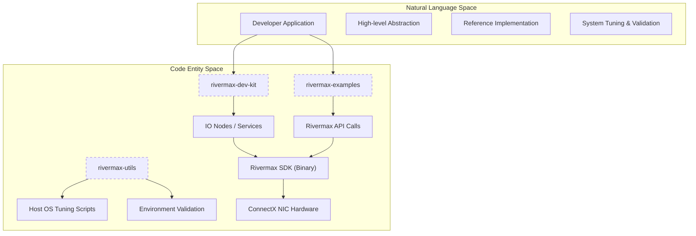
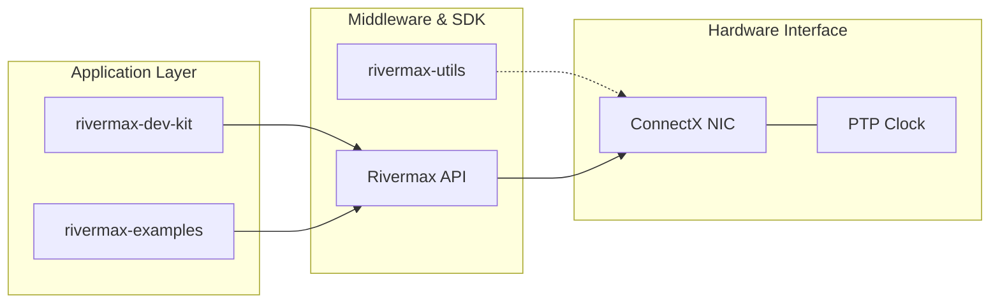

<!-- source: DeepWiki mcp.deepwiki.com · repo NVIDIA/Rivermax · page 1 Overview · fetched 2026-10-26 -->

# Overview

Relevant source files

The following files were used as context for generating this wiki page:

- [README.md](README.md)
- [resources/Rivermax_SDK.jpg](resources/Rivermax_SDK.jpg)

The NVIDIA Rivermax hub repository serves as the central gateway for developers building high-performance, IP-based media and data streaming applications. It provides a unified entry point to the specialized software kits, reference implementations, and utility tools required to leverage the NVIDIA Rivermax SDK.

## Purpose and Scope

This repository acts as a navigational hub rather than a monorepo for the codebase [README.md:7-9](). Its primary goals are:
*   **Centralized Access**: Providing a single location for official documentation, SDK downloads, and community support links [README.md:30-41]().
*   **Ecosystem Mapping**: Organizing specialized child repositories that handle distinct parts of the developer lifecycle, from low-level API examples to high-level C++ abstractions [README.md:22-28]().
*   **Problem Solving**: Addressing the complex requirements of professional media streaming (e.g., SMPTE ST 2110) through optimized networking that utilizes kernel bypass and hardware offloads [README.md:11-16]().

## System Architecture Overview

The Rivermax ecosystem bridges high-level application logic with low-level hardware capabilities. The following diagram illustrates how the repositories in this hub interact with the core SDK and NVIDIA networking hardware.

### Repository and Entity Map

**Sources:** [README.md:22-28](), [README.md:13-16]()

## Core Components

The Rivermax solution is divided into three specialized repositories, each serving a specific technical need.

### 1. rivermax-dev-kit
A high-level C++ software kit designed to accelerate development. It provides flexible "IO nodes" and developer-friendly services to abstract the complexities of the raw Rivermax API [README.md:24-24]().
*   For details, see [rivermax-dev-kit](#2.1).

### 2. rivermax-examples
A collection of reference applications provided as source code. These demos demonstrate direct usage of the Rivermax API for various streaming scenarios [README.md:26-26]().
*   For details, see [rivermax-examples](#2.2).

### 3. rivermax-utils
A suite of utility scripts and tools used for host environment preparation, OS tuning (Linux and Windows), and validating the network configuration [README.md:28-28]().
*   For details, see [rivermax-utils](#2.3).

## Key Technology Pillars

Rivermax is built to satisfy the rigorous demands of industries such as Media & Entertainment (M&E), Broadcast, and Healthcare [README.md:15-16]().

### SDK and Standards
The SDK facilitates optimized data streaming by utilizing NVIDIA ConnectX NIC hardware offloads and GPUDirect technologies [README.md:13-15](). It supports industry standards including:
*   **SMPTE ST 2110**: Professional media over IP.
*   **PTP (IEEE 1588)**: Precision timing for synchronization.

For a deep dive into the SDK architecture, hardware requirements, and supported standards, see [What Is Rivermax](#1.1).

### Infrastructure Integration
The following diagram maps the logical flow from the user-facing repositories to the underlying system components.

### Logical Data Flow

**Sources:** [README.md:13-16](), [README.md:22-28]()

## Navigation and Support

The repository structure is designed to guide users based on their current stage of development.
*   **New Users**: Should start with the [Official Documentation](https://developer.nvidia.com/networking/rivermax) and use `rivermax-utils` to prepare their environment [README.md:34-35]().
*   **Application Developers**: Can choose between the `rivermax-dev-kit` for rapid prototyping or `rivermax-examples` for fine-grained API control [README.md:24-26]().
*   **Support**: Issues with specific applications should be filed in their respective GitHub repositories, while SDK and licensing queries are handled via the NVIDIA Developer Portal [README.md:39-41]().

For more information on the repository layout and choosing the right starting point, see [Repository Structure and Navigation](#1.2).

**Sources:**
* [README.md:1-42]()
* [resources/Rivermax_SDK.jpg:1-28]()

---

