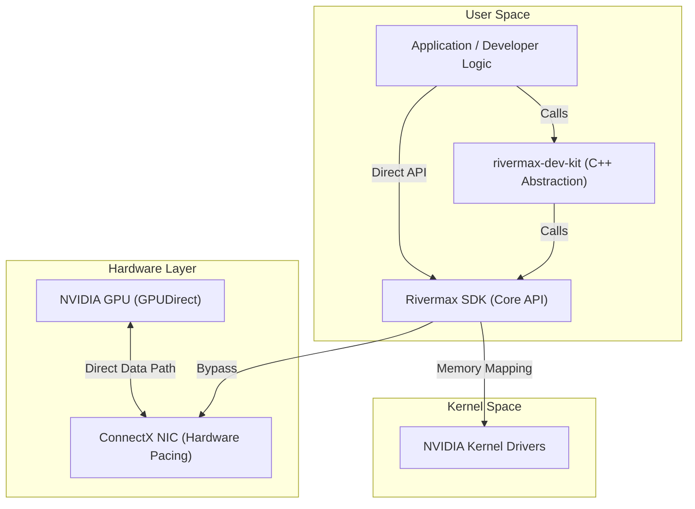
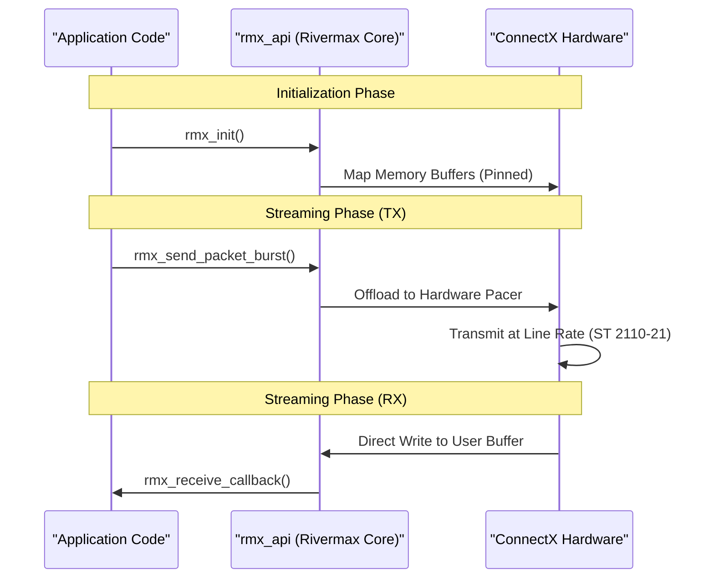

<!-- source: DeepWiki mcp.deepwiki.com · repo NVIDIA/Rivermax · page 1.1 What Is Rivermax · fetched 2026-10-26 -->

# What Is Rivermax

Relevant source files

The following files were used as context for generating this wiki page:

- [README.md](README.md)
- [resources/Rivermax_SDK.jpg](resources/Rivermax_SDK.jpg)

This page provides a technical deep dive into the NVIDIA Rivermax SDK, an optimized networking library designed for high-throughput media and data streaming. It covers the core value proposition, the hardware-software synergy with ConnectX NICs, and the architectural implementation that enables line-rate performance with minimal CPU overhead.

## Core Value Proposition

NVIDIA® Rivermax® is an SDK specifically engineered to handle the rigorous requirements of professional media-over-IP and high-bandwidth data streaming [README.md:13-14](). By utilizing kernel-bypass technology and hardware-based packet pacing, Rivermax enables standard COTS (Commercial Off-The-Shelf) servers to achieve performance previously only possible with dedicated FPGA-based hardware.

### Target Industries
*   **Media and Entertainment (M&E) & Broadcast:** Real-time uncompressed video transport [README.md:15-16]().
*   **Healthcare:** High-resolution medical imaging and remote surgery data [README.md:16-16]().
*   **Smart Cities:** Large-scale sensor data ingestion and AI-driven video analytics [README.md:16-16]().

### Key Standards Support
Rivermax is built around industry-standard protocols to ensure interoperability across broadcast and data ecosystems:
*   **SMPTE ST 2110:** Professional media over managed IP networks (Video, Audio, and Ancillary data).
*   **SMPTE ST 2022-7:** Seamless Protection Switching (hitless redundancy) for reliability.
*   **PTP / IEEE 1588:** Precision Time Protocol for sub-microsecond clock synchronization.
*   **SMPTE ST 2110-21:** Traffic shaping and delivery timing for video bitstreams.

**Sources:** [README.md:11-17]()

## Hardware and Performance Optimization

Rivermax is optimized for **NVIDIA ConnectX® Network Interface Cards (NICs)** (starting from ConnectX-5 and newer) [README.md:3-5](). The synergy between the SDK and the hardware is the foundation of its performance.

### GPUDirect Technology
Rivermax integrates with NVIDIA GPU accelerated computing technologies [README.md:15-15](). Using **GPUDirect**, Rivermax can move data directly between the NIC and GPU memory, bypassing the host CPU and system memory (RAM). This significantly reduces latency and frees up CPU cycles for application logic.

### Hardware Offloads
*   **Packet Pacing:** The NIC hardware handles the precise timing of packet transmission required by SMPTE ST 2110-21, preventing network congestion and jitter without CPU intervention.
*   **Kernel Bypass:** Data is transferred directly to user-space buffers, avoiding the overhead of the operating system's networking stack.

**Sources:** [README.md:1-17]()

## SDK Architecture

The Rivermax architecture follows a layered approach that abstracts the complexity of high-speed networking while maintaining direct access to hardware performance.

### Architecture Diagram
The following diagram illustrates the relationship between the application, the Rivermax SDK, and the underlying hardware components.

**Title: Rivermax System Architecture**

**Sources:** [README.md:24-28](), [resources/Rivermax_SDK.jpg:1-5]()

## Implementation and Data Flow

Rivermax operates by managing memory buffers and hardware queues to facilitate "zero-copy" data transfers.

### Data Path Integration
The SDK provides a core API that developers can interact with directly (demonstrated in `rivermax-examples`) or through a higher-level abstraction (provided by `rivermax-dev-kit`) [README.md:24-26]().

**Title: Code Entity Data Flow**

### Key Software Components
The Rivermax ecosystem is split into three functional areas to support the development lifecycle:

| Repository | Purpose | Target Audience |
| :--- | :--- | :--- |
| **rivermax-dev-kit** | High-level C++ abstraction using "IO nodes" to simplify development [README.md:24-24](). | Application Developers |
| **rivermax-examples** | Reference implementations showing raw API usage [README.md:26-26](). | System Architects / Core Integrators |
| **rivermax-utils** | Scripts for OS tuning, PTP validation, and performance benchmarking [README.md:28-28](). | DevOps / System Engineers |

**Sources:** [README.md:22-29]()

---

