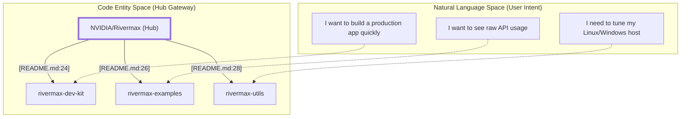
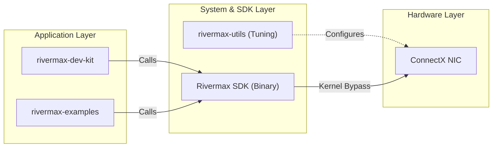

<!-- source: DeepWiki mcp.deepwiki.com · repo NVIDIA/Rivermax · page 1.2 Repository Structure and Navigation · fetched 2026-10-26 -->

# Repository Structure and Navigation

Relevant source files

The following files were used as context for generating this wiki page:

- [README.md](README.md)

This page describes the organizational structure of the NVIDIA Rivermax hub repository and its relationship with the specialized child repositories. It outlines the technical rationale for the distributed repository model and provides a navigation guide for developers based on their specific implementation requirements.

## Hub Repository Layout

The [NVIDIA/Rivermax](https://github.com/NVIDIA/Rivermax) repository functions as a "Hub" or "Gateway" rather than a container for source code. Its primary role is to provide a unified entry point for documentation, architectural overviews, and links to the functional components of the Rivermax ecosystem [README.md:9-10]().

### File Structure

The repository maintains a minimalist structure focused on discovery and visual documentation:

| Path | Description |
| :--- | :--- |
| `README.md` | The main entry point containing the ecosystem overview, repository links, and support information [README.md:1-42](). |
| `resources/` | Contains static assets used for documentation, such as the `Rivermax_SDK.jpg` architecture diagram [README.md:5](). |

**Sources:** [README.md:1-42]()

---

## Distributed Repository Model

The Rivermax codebase is intentionally split across multiple GitHub repositories rather than a single monorepo. This modularity allows for independent versioning, specialized CI/CD pipelines, and distinct dependency management for different use cases.

### The Three Pillars of Rivermax

The ecosystem is divided into three functional areas:

1.  **rivermax-dev-kit**: A high-level C++ abstraction layer. It is designed to simplify development by providing "IO nodes" that wrap complex Rivermax API calls into developer-friendly services [README.md:24]().
2.  **rivermax-examples**: Reference implementations that demonstrate direct usage of the Rivermax SDK API. These are intended for developers who need fine-grained control or wish to understand the raw SDK primitives [README.md:26]().
3.  **rivermax-utils**: A collection of operational tools. These scripts handle environment validation, performance tuning, and host configuration [README.md:28]().

### Repository Relationship Diagram

The following diagram illustrates how the Hub repository directs users to the specialized codebases based on their technical needs.

**Hub to Specialized Repository Mapping**

**Sources:** [README.md:22-29]()

---

## Navigation Guide by Use Case

To navigate the Rivermax ecosystem effectively, developers should choose their starting point based on the following technical criteria:

### 1. High-Level Application Development
If the goal is to implement SMPTE ST 2110 or generic data streaming without managing low-level memory pinning or packet pacing manually, navigate to **rivermax-dev-kit** [README.md:24]().
*   **Key Entity:** `IO nodes` (C++ classes that encapsulate streaming logic).
*   **Benefit:** Reduced boilerplate and faster time-to-market.

### 2. Learning and Direct Integration
If the goal is to integrate Rivermax directly into an existing engine or to understand the SDK's internal mechanics, navigate to **rivermax-examples** [README.md:26]().
*   **Key Entity:** `Rivermax API` (Direct C-style SDK calls).
*   **Benefit:** Maximum control over hardware features and memory management.

### 3. System Administration and Benchmarking
For initial setup, network interface card (NIC) configuration, or troubleshooting performance bottlenecks, navigate to **rivermax-utils** [README.md:28]().
*   **Key Entity:** `Utility scripts` (Python/Bash/PowerShell scripts for OS tuning).
*   **Benefit:** Ensures the underlying hardware and OS are optimized for kernel-bypass networking.

### Ecosystem Data Flow

The diagram below shows how these repositories interact with the underlying Rivermax SDK and the hardware.

**System Data Flow and Component Interaction**

**Sources:** [README.md:13-16](), [README.md:24-28]()

---

## Support and Maintenance Policy

Code across all Rivermax GitHub repositories is provided **"As Is"** [README.md:20](). While the repositories are maintained by NVIDIA, they serve as reference implementations.

*   **Bugs/Feature Requests:** Issues should be filed in the specific repository where the code resides (e.g., an issue with a utility script goes to `rivermax-utils`) [README.md:40]().
*   **SDK/Licensing:** Formal support for the binary SDK itself is handled via the NVIDIA Developer Portal [README.md:39]().
*   **Community:** General architectural questions are directed to the NVIDIA Developer Forums [README.md:41]().

**Sources:** [README.md:20](), [README.md:37-41]()

---

