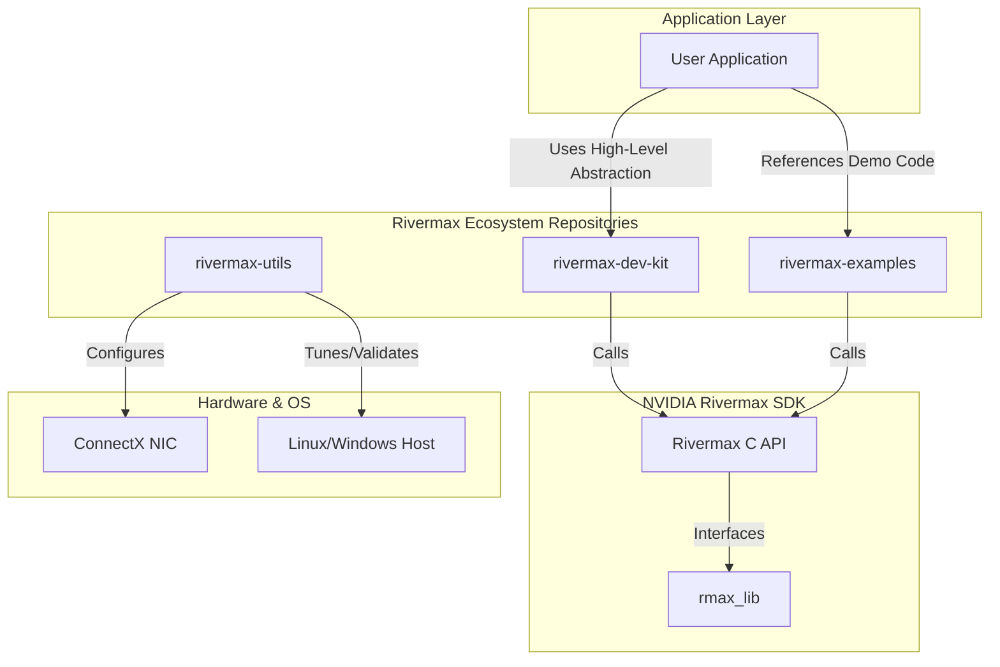

<!-- source: DeepWiki mcp.deepwiki.com · repo NVIDIA/Rivermax · page 2 Ecosystem Repositories · fetched 2026-10-26 -->

# Ecosystem Repositories

Relevant source files

The following files were used as context for generating this wiki page:

- [README.md](README.md)

The NVIDIA Rivermax ecosystem is organized into three specialized repositories, each serving a distinct purpose in the development and maintenance lifecycle of media and data streaming applications. This modular approach allows developers to choose the appropriate level of abstraction, ranging from raw API reference implementations to high-level C++ development kits and operational utility scripts.

### Repository Landscape

The following diagram illustrates how the three repositories interact with the underlying Rivermax SDK and the developer's application logic.

**Rivermax Ecosystem Integration Flow**

Sources: [README.md:22-28](), [README.md:9-18]()

---

## rivermax-dev-kit

The `rivermax-dev-kit` is a high-level C++ software kit designed to accelerate the development process. It abstracts the complexities of the raw Rivermax C API into flexible IO nodes and developer-friendly services.

*   **Role:** Productivity and Abstraction.
*   **Key Features:** Modular IO node architecture, simplified buffer management, and pre-integrated services for common streaming patterns.
*   **Target Audience:** Developers building production-grade applications who prefer a modern C++ framework over manual API orchestration.

For detailed architecture and usage, see [rivermax-dev-kit](#2.1).

Sources: [README.md:24-24]()

---

## rivermax-examples

The `rivermax-examples` repository serves as the primary reference implementation suite for the Rivermax SDK. It contains standalone demo applications that interact directly with the SDK's C API.

*   **Role:** Reference and Education.
*   **Key Features:** Demonstrates direct usage of the Rivermax API for various media essences (video, audio, data) and showcases core SDK features like packet pacing and memory pinning.
*   **Target Audience:** Developers needing to understand the low-level mechanics of the SDK or those seeking a "copy-paste" starting point for custom C-based implementations.

For a catalog of available demos and implementation details, see [rivermax-examples](#2.2).

Sources: [README.md:26-26]()

---

## rivermax-utils

The `rivermax-utils` repository provides a collection of essential scripts and tools for managing the host environment and validating performance.

*   **Role:** Operations and Optimization.
*   **Key Features:** Host OS tuning scripts (Linux/Windows), network interface configuration tools, environment validation checks, and performance benchmarking utilities.
*   **Target Audience:** System administrators and DevOps engineers responsible for preparing the hardware and OS for high-throughput, low-latency streaming.

For information on environment preparation and tuning tools, see [rivermax-utils](#2.3).

Sources: [README.md:28-28]()

---

## Summary of Repository Roles

The table below summarizes the intended use case for each repository within the developer lifecycle.

| Repository | Primary Focus | Language | Complexity |
| :--- | :--- | :--- | :--- |
| **`rivermax-dev-kit`** | Application Framework | C++ | High (Abstraction) |
| **`rivermax-examples`** | API Reference | C / C++ | Low (Direct API) |
| **`rivermax-utils`** | Environment/Ops | Shell / Python / Misc | N/A (Tooling) |

Sources: [README.md:22-28]()

---

