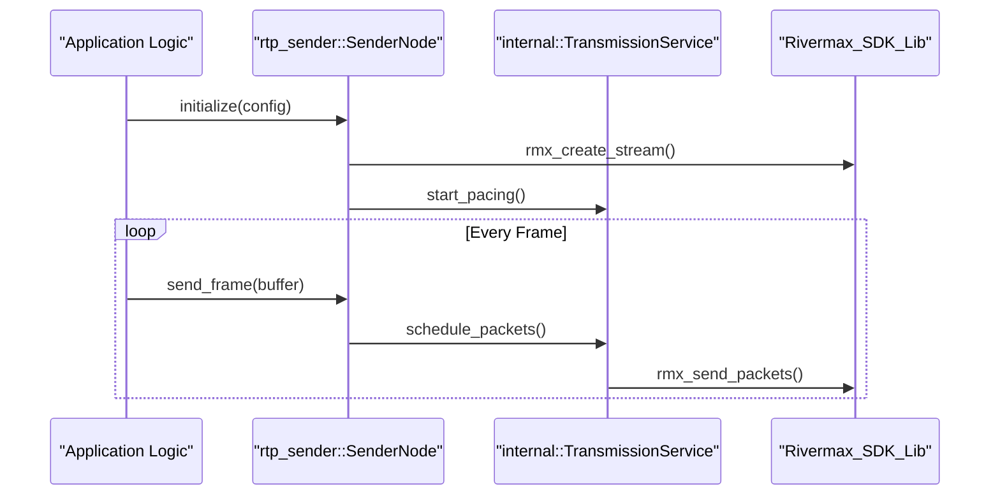

<!-- source: DeepWiki mcp.deepwiki.com · repo NVIDIA/Rivermax · page 2.1 rivermax-dev-kit · fetched 2026-10-26 -->

# rivermax-dev-kit

<details>
<summary>Relevant source files</summary>

The following files were used as context for generating this wiki page:

- [README.md](README.md)

</details>


The `rivermax-dev-kit` is a high-level C++ software kit designed to accelerate the development of applications utilizing the NVIDIA Rivermax SDK. While the core Rivermax SDK provides a low-level, high-performance API for media and data streaming, the Dev Kit acts as an abstraction layer that simplifies complex tasks such as memory management, thread synchronization, and protocol compliance (e.g., SMPTE ST 2110) [README.md:24-24]().

## Purpose and Value Proposition

The primary goal of the Dev Kit is to reduce the "time to market" for developers by providing pre-built components for common streaming workflows. It is particularly useful for developers who prefer an object-oriented C++ interface over the procedural C-style API of the base SDK.

| Feature | Direct Rivermax API | Rivermax Dev Kit |
| :--- | :--- | :--- |
| **Complexity** | High (Manual buffer/pacing management) | Lower (Abstracted IO Nodes) |
| **Abstraction** | Low-level C API | High-level C++ Classes |
| **Flexibility** | Maximum (Full control over every packet) | High (Modular node-based architecture) |
| **Development Speed** | Slower (Requires deep SDK knowledge) | Faster (Uses pre-validated services) |

**Sources:** [README.md:24-24]()

## IO Node Architecture

The Dev Kit is built around a modular **IO Node** architecture. This design allows developers to treat data sources and sinks as independent entities that can be connected to form a processing pipeline.

### Core Components
*   **Generic IO Nodes**: Abstract base classes that handle the lifecycle of a stream (Initialization, Start, Stop, Teardown).
*   **Receiver Nodes**: Handle incoming network traffic, buffer management, and payload extraction.
*   **Sender Nodes**: Handle packetization, hardware-based pacing, and transmission.

### Code Entity Mapping: IO Flow
The following diagram illustrates how high-level C++ entities in the Dev Kit manage the data flow from the network to the application layer.

**Dev Kit Data Path Architecture**
```mermaid
graph TD
    subgraph "Network Layer"
        "NIC"["ConnectX NIC"]
    end

    subgraph "Rivermax Dev Kit (C++ Abstraction)"
        "StreamService"["rtp_service::StreamService"]
        "IONode"["io_node::IONodeBase"]
        "BufferMgr"["memory::BufferManager"]
        "PacingService"["pacing::PacingService"]
    end

    subgraph "Rivermax SDK (Low-Level)"
        "RmaxAPI"["rmx_api_functions"]
    end

    "NIC" <--> "RmaxAPI"
    "RmaxAPI" --> "StreamService"
    "StreamService" --> "IONode"
    "IONode" --> "BufferMgr"
    "PacingService" -. "Controls" .-> "RmaxAPI"
```
**Sources:** [README.md:24-24]()

## Developer-Friendly Services

The Dev Kit provides several internal services that automate the heavy lifting required for professional media streaming:

1.  **Memory Management**: Automated pinning of memory buffers to ensure compatibility with Zero-copy and GPUDirect technologies.
2.  **Clock Synchronization**: Integration with PTP (Precision Time Protocol) to ensure frames are timestamped accurately according to SMPTE standards.
3.  **Traffic Shaping**: High-level wrappers for SMPTE ST 2110-21 compliant packet pacing, preventing network congestion and buffer overflows.
4.  **Redundancy**: Simplifies the implementation of SMPTE ST 2022-7 (Seamless Protection Switching) by managing dual-network paths within a single logical node.

### System Interaction: Sender Implementation
This diagram shows the relationship between Dev Kit classes when implementing a media sender.

**Sender Logic Entity Mapping**

**Sources:** [README.md:24-24]()

## When to Choose Rivermax Dev Kit

Choosing between the `rivermax-dev-kit` and the raw `rivermax-examples` depends on the project requirements:

### Choose `rivermax-dev-kit` if:
*   You are building a complex, production-grade C++ application.
*   You require a modular architecture where different media essences (Video, Audio, Ancillary) are handled by separate objects.
*   You want to leverage built-in SMPTE ST 2110 logic without implementing the specification from scratch.
*   You prefer RAII (Resource Acquisition Is Initialization) patterns for resource management.

### Choose `rivermax-examples` (Direct API) if:
*   You need the absolute minimum overhead for a specialized use case.
*   You are writing a C application or a wrapper for another language (e.g., Python, Rust).
*   You are performing low-level research or benchmarking of the SDK itself.
*   You need to implement a proprietary protocol not covered by the Dev Kit's abstractions.

**Sources:** [README.md:24-28]()

---

