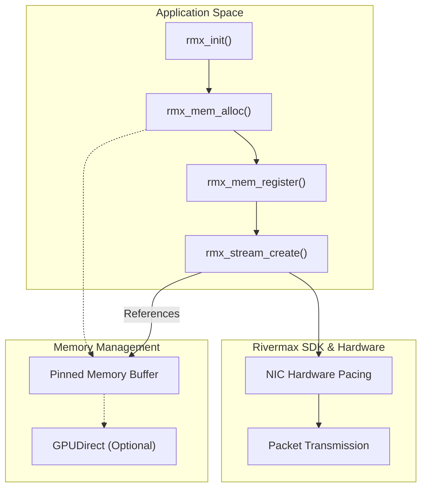
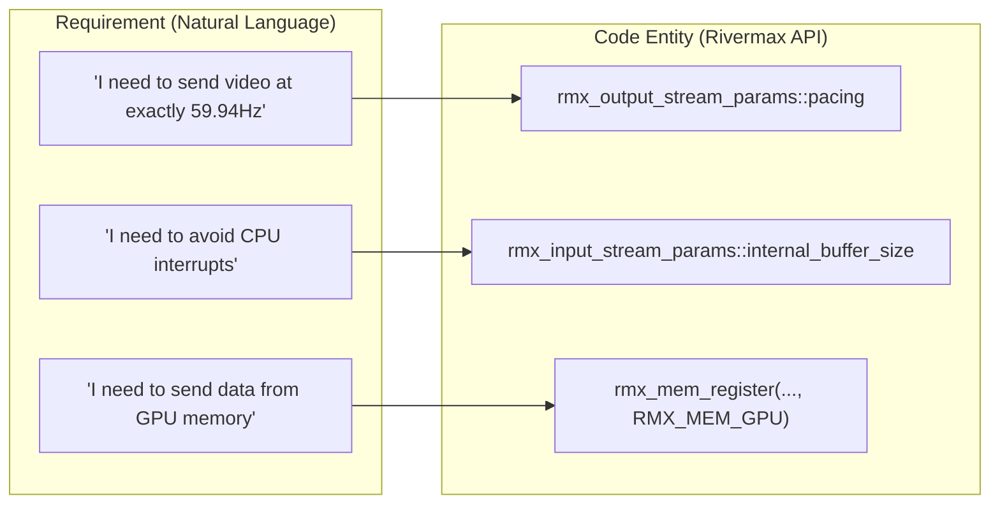

<!-- source: DeepWiki mcp.deepwiki.com · repo NVIDIA/Rivermax · page 2.2 rivermax-examples · fetched 2026-10-26 -->

# rivermax-examples

Relevant source files

The following files were used as context for generating this wiki page:

- [README.md](README.md)

The `rivermax-examples` repository serves as the foundational reference implementation suite for the NVIDIA Rivermax SDK. Unlike high-level abstraction layers, this repository provides direct, low-level demonstrations of the Rivermax API [README.md:26-27](). It is designed to guide developers through the core mechanics of memory management, packet pacing, and hardware offload integration.

## Role as Reference Implementation

The examples within this repository are provided as source code to illustrate how applications can achieve kernel-bypass performance and hardware-based synchronization [README.md:20-21](). By interfacing directly with the Rivermax SDK, these applications demonstrate the minimum overhead required for high-bandwidth media and data streaming.

### Key Functional Pillars
*   **Direct API Usage**: Implementation of the `rmx_` function calls for stream initialization, memory registration, and buffer management.
*   **Data Path Optimization**: Demonstrations of zero-copy data transfers and GPUDirect integration for low-latency processing.
*   **Standards Compliance**: Reference code for implementing SMPTE ST 2110 (Video, Audio, Ancillary data) and ST 2022-7 (Redundancy) at the packet level.

**Sources:** [README.md:11-21](), [README.md:26-27]()

## Application Architecture and Data Flow

The applications in `rivermax-examples` follow a structured flow to ensure the NIC hardware can take over packet timing and delivery, which is critical for professional broadcast standards like SMPTE ST 2110-21.

### Initialization and Memory Flow
The following diagram illustrates the typical sequence an example application follows to establish a high-performance media stream using the Rivermax SDK.

**Diagram: Rivermax Example Stream Lifecycle**

**Sources:** [README.md:13-16](), [README.md:26-27]()

## Demo Application Types

The repository includes various demo applications tailored to specific use cases in Media and Entertainment (M&E), Healthcare, and Smart Cities [README.md:15-16](). These demos are categorized by their primary function:

| Application Type | Description | Key Code Entities |
| :--- | :--- | :--- |
| **Generic Receive** | Demonstrates how to join multicast groups and ingest raw RTP streams using kernel-bypass. | `rmx_input_stream`, `rmx_receive()` |
| **Generic Transmit** | Shows how to schedule packets for transmission with hardware-accurate timing. | `rmx_output_stream`, `rmx_send()` |
| **ST 2110 Reference** | Specific implementations for Video (-20), Audio (-30), and Metadata (-40) essences. | `rmx_st2110_header`, `rmx_packet_pacing` |
| **Redundancy (2022-7)** | Demonstrates seamless protection switching by merging dual network paths. | `rmx_redundancy_group` |

**Sources:** [README.md:13-16](), [README.md:26-27]()

## From Natural Language to Code Entities

To help developers transition from conceptual requirements to implementation, the following diagram maps common streaming requirements to the specific Rivermax API entities used within the `rivermax-examples` repository.

**Diagram: Requirement to Code Mapping**

**Sources:** [README.md:13-16](), [README.md:26-27]()

## Usage as a Starting Point

Developers are encouraged to use these examples as a template for custom integrations. Because the code is provided "As Is" [README.md:20](), it serves as a sandbox for:
1.  **Benchmarking**: Using the example apps to validate that the local environment (configured via `rivermax-utils`) achieves expected line-rate performance [README.md:28]().
2.  **Prototyping**: Modifying the payload handling in the transmit/receive loops to integrate custom codecs or data formats.
3.  **API Learning**: Understanding the relationship between `rmx_` objects and the underlying ConnectX NIC hardware offloads [README.md:13-15]().

**Sources:** [README.md:20-21](), [README.md:26-28]()

---

