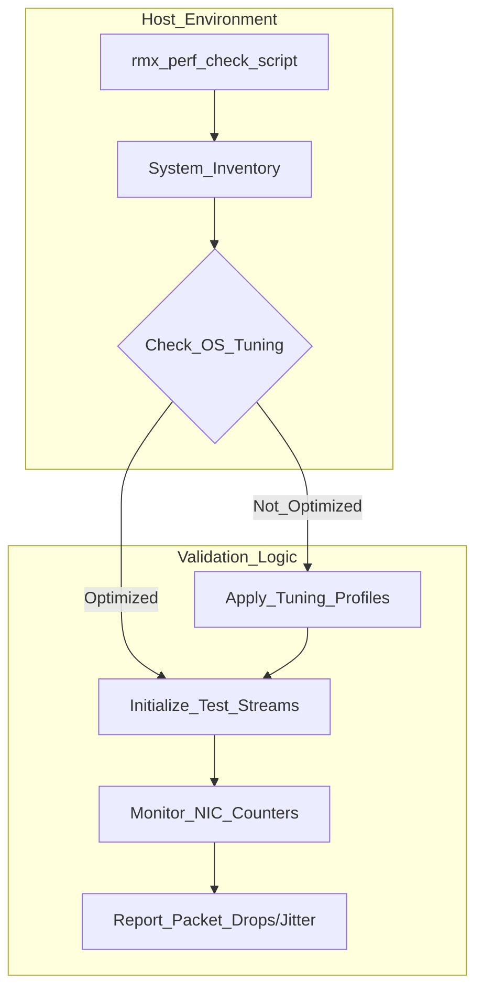
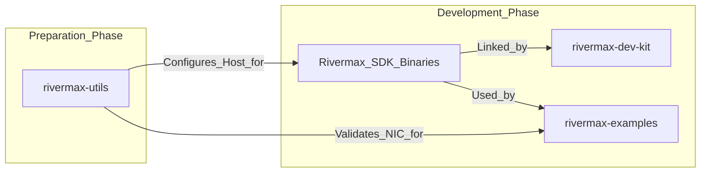

<!-- source: DeepWiki mcp.deepwiki.com · repo NVIDIA/Rivermax · page 2.3 rivermax-utils · fetched 2026-10-26 -->

# rivermax-utils

Relevant source files

The following files were used as context for generating this wiki page:

- [README.md](README.md)

The `rivermax-utils` repository is a specialized collection of scripts and tools designed to streamline the deployment, optimization, and maintenance of the NVIDIA Rivermax environment. While the SDK provides the core streaming capabilities, `rivermax-utils` focuses on the underlying infrastructure—ensuring the Host OS, Network Interface Cards (NICs), and system configurations are tuned for high-throughput, low-latency media streaming [README.md:28-28]().

## System Tuning and Environment Validation

The utilities in this repository address the strict performance requirements of professional media standards like SMPTE ST 2110. Achieving zero-packet-loss at high bitrates (e.g., 4K/8K video) requires specific OS-level optimizations that these tools automate.

### Linux Performance Tuning
For Linux environments, the utilities focus on kernel-bypass efficiency and interrupt management. Key areas of optimization include:
*   **CPU Governor Configuration:** Setting the scaling governor to `performance` to prevent frequency scaling latency.
*   **Interrupt Affinity:** Aligning NIC interrupts with specific CPU cores to minimize context switching.
*   **Hugepages Allocation:** Configuring memory management to support the large, pinned memory buffers required by the Rivermax SDK.

### Windows Performance Tuning
On Windows, the utilities assist in configuring the system for the Rivermax Windows driver, focusing on:
*   **Registry Optimizations:** Adjusting network stack parameters for high-performance UDP processing.
*   **Power Profiles:** Ensuring the system operates in a high-performance state to maintain consistent packet pacing.

### Hardware and Network Configuration
The tools provide automated workflows for managing NVIDIA ConnectX SmartNICs, which are foundational to Rivermax hardware offloads.

| Category | Functionality | Code Entity Reference |
| :--- | :--- | :--- |
| **Validation** | Verifies firmware versions and driver compatibility. | `rmx_validate_env` |
| **Configuration** | Sets up VPI (Virtual Protocol Interconnect) and Ethernet modes. | `rmx_nic_config` |
| **PTP Setup** | Configures Precision Time Protocol (IEEE 1588) parameters on the NIC. | `rmx_ptp_setup` |

**Sources:** [README.md:28-28](), [README.md:34-35]()

## Operational Maintenance and Benchmarking

Beyond initial setup, `rivermax-utils` provides tools for ongoing operational health monitoring and performance benchmarking.

### Performance Benchmarking Flow
The benchmarking utilities allow developers to simulate high-load scenarios to verify that the host system can handle the required number of ST 2110 streams without drops.

**Benchmarking Execution Logic**

**Sources:** [README.md:28-28](), [README.md:13-16]()

## Integration with Rivermax Ecosystem

The `rivermax-utils` repository acts as the foundation for the other components in the Rivermax hub. Before running examples or developing with the Dev Kit, the environment must be prepared using these utilities.

**Repository Interdependencies**

### Key Components Summary
*   **Environment Validation:** Scripts to ensure the hardware and software prerequisites (ConnectX NICs, OFED/WinOF-2 drivers) are met [README.md:35-35]().
*   **Network Interface Tuning:** Tools to configure hardware offloads such as packet pacing and header-data split.
*   **Operational Scripts:** Maintenance tools for firmware updates and log collection for support purposes [README.md:40-40]().

**Sources:** [README.md:9-18](), [README.md:24-28]()

---

